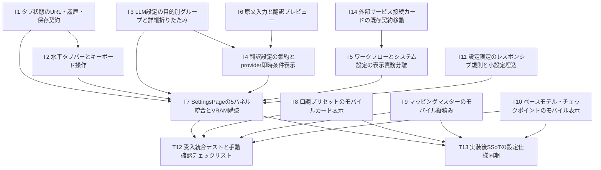

# REQ-314 BA Audit: part 3/8
Audit this fragment of the complete design, test plan and all 14 Task Cards. Other definitions may be in other fragments; do not invent defects solely from missing context. State findings with exact artifact/task references. User browser tests are manual and excluded from autonomous checks; typecheck/Vitest remain. D1: six real prompt keys versus AC-4 seven is an explicit unresolved human decision. D2: Backend/LM Studio URL editing versus unchanged API/schema is an explicit unresolved human decision. Do not require approval bypass or falsely mark those AC passed. Review acceptance coverage, logical contradictions, ownership/dependencies, testability and actual new gaps.

- D2 推奨: Comfy既存store URL編集、Backend origin表示/health、LM Studio backend経由疎通と環境設定案内へUI限定。
  Backend/LM Studio URL編集は別PBI。代案: API不変制約を撤回し本PBIへAPI変更を含めて再設計。
  現行configApiはcomfy_url GETのみ、BackendはBASE_URL='/api'、LM URLはbackend .env LLM_BASE_URL。
  現在LM URLはfrontend取得不可なので既定1234を現在値として偽装しない。

## Task Decomposition
| ID | 内容 | 所有数/予定変更行 | 依存 |
|---|---|---|---|
| [T1](../backlog/task/active/REQ-314-T1.md) | タブ状態のURL・履歴・保存契約 | 3 / <=270 | なし |
| [T2](../backlog/task/active/REQ-314-T2.md) | 水平タブバーとキーボード操作 | 2 / <=245 | T1 |
| [T3](../backlog/task/active/REQ-314-T3.md) | LLM設定の目的別グループと詳細折りたたみ | 2 / <=290 | なし |
| [T4](../backlog/task/active/REQ-314-T4.md) | 翻訳設定の集約とprovider即時条件表示 | 2 / <=280 | T3,T6 |
| [T5](../backlog/task/active/REQ-314-T5.md) | ワークフローとシステム設定の表示責務分離 | 2 / <=210 | T14 |
| [T6](../backlog/task/active/REQ-314-T6.md) | 原文入力と翻訳プレビュー | 2 / <=255 | なし |
| [T7](../backlog/task/active/REQ-314-T7.md) | SettingsPageの5パネル統合とVRAM購読 | 2 / <=290 | T1,T2,T3,T4,T5,T11 |
| [T8](../backlog/task/active/REQ-314-T8.md) | 口調プリセットのモバイルカード表示 | 2 / <=230 | なし |
| [T9](../backlog/task/active/REQ-314-T9.md) | マッピングマスターのモバイル縦積み | 3 / <=275 | なし |
| [T10](../backlog/task/active/REQ-314-T10.md) | ベースモデル・チェックポイントのモバイル表示 | 2 / <=245 | なし |
| [T11](../backlog/task/active/REQ-314-T11.md) | 設定限定のレスポンシブ規則と小設定埋込 | 3 / <=190 | なし |
| [T12](../backlog/task/active/REQ-314-T12.md) | 受入統合テストと手動確認チェックリスト | 2 / <=290 | T7,T8,T9,T10 |
| [T13](../backlog/task/active/REQ-314-T13.md) | 実装後SSoTの設定仕様同期 | 3 / <=140 | T7,T8,T9,T10 |
| [T14](../backlog/task/active/REQ-314-T14.md) | 外部サービス接続カードの既存契約移動 | 2 / <=255 | なし |

全カード本文79〜111行。所有3file以下・追加削除合計300行以下で設計時atomicity PASS。
実装時超過が見えたら事前に分割設計を差し戻す。共有sourceはDAG順に実行し他担当変更を戻さない。

## Dependency DAG

最大4層。型依存T1→T2、編集再利用T3/T6→T4、接続T14→T5→T7を明示。
独立responsive T8/T9/T10/T11は並行可能。T7統合後T12検証/T13正本同期。
T13が先に完了してもPBIのDoneは全Gate/AC証拠を確認してから判断する。

## Verification Plan
各Task Cardに正確な型、20〜29行の既存snippet、typecheck/局所Vitestコマンド。
Gate 1: frontend typecheck。Gate 2: 指定局所/統合＋full suite。
Gate 3（自律）: Vitestで実行可能な異常系・API契約・DOM操作シナリオとlocal QA監査。実ブラウザ操作は自律テストから除外。
ユーザー手動確認: 1280/768/767/390/320px、1023/1024px AppShell境界、履歴/ARIA、provider切替、API実動作、live VRAM。確認手順と未確認状態を引き渡す。
CSS/44px/safearea実測をjsdomで代用しない。環境未取得はINCONCLUSIVE、人間決定不足はBLOCKED。
設計testは未実行。local BA audit/VRAM証拠は[監査記録](REQ-314-ba-audit.md)。

## Trade-off Disclosure
常時mountはdraftを守るが購読/メモリを増やす。同一Query cacheを共有しsystem側workflow取得を抑止する。
group再編は局所差分にするが既存大fileは残る。全面移動/編集器複製は今回採らない。
詳細stateは新v2キーで既定閉。旧13区分キーは削除せず維持する。
mobile表は同一DOM/DNDを維持し、読み上げ意味の実機確認はユーザー手動確認項目とする。
未保存翻訳認証でpreview結果を装わないよう保存後に実行する。
D1/D2は要求と現行契約の矛盾であり、人間承認なしにACを弱めない。

## Human Design Review Gate
[dev-design](C:/Users/audih/.gemini/config/skills/dev-design/SKILL.md) Step 2:
「Physically generate all Task Cards ... BEFORE requesting implementation_plan.md approval.」
および今回のarchitect指示「Return changed designs through the human design review gate」により、
全物理成果物/監査記録を渡し、D1/D2の決定と設計承認を受けてから実装へ移る。


## Artifact: docs\backlog\task\active\REQ-314-T1.md
---
id: REQ-314-T1
pbi: REQ-314
status: pending
tags: [frontend, settings, REQ-314]
related_paths:
  - frontend/src/pages/SettingsPage/hooks/useSettingsTab.ts
  - frontend/src/utils/localStorageKeys.ts
  - frontend/src/pages/SettingsPage/hooks/__tests__/useSettingsTab.test.tsx
depends_on: []
---

# REQ-314-T1: タブ状態のURL・履歴・保存契約

## Review Gate
2026-10-04ユーザー指定: 実ブラウザ検証はユーザーが手動実施。エージェントのブラウザ操作・ブラウザ自動化テストは自律検証から除外する。VitestによるDOM/統合/異常系検証は維持し、手動項目は未確認のチェックリストとして引き渡す。
設計レビュー承認前は実行禁止。D1（6/7 prompt）とD2（接続URL）が未決定のためREQ-314全体は承認待ち。
所有範囲以外を変更しない。他担当の変更を取り消さず、共有ファイルはDAG順に実行する。

## Target / Atomicity
- `C:/Users/audih/ws/comfy-create-helper2/frontend/src/pages/SettingsPage/hooks/useSettingsTab.ts`
- `C:/Users/audih/ws/comfy-create-helper2/frontend/src/utils/localStorageKeys.ts`
- `C:/Users/audih/ws/comfy-create-helper2/frontend/src/pages/SettingsPage/hooks/__tests__/useSettingsTab.test.tsx`
依存: なし。所有 3 ファイル、実装＋局所テストの追加削除合計 270 行以下（見積り）。Atomicity: PASS（設計時）。300変更行を超える場合は担当者が分割設計を差し戻し、超過して進めない。

## Hermetic Context
### Required types / signatures
```tsx
export type SettingsTabId = 'workflows' | 'prompt' | 'dialogue' | 'translation' | 'system'
export function useSettingsTab(): { activeTab: SettingsTabId; selectTab: (id: SettingsTabId) => void }
// LS_KEYS.SETTINGS_ACTIVE_TAB = 'prompt-surgeon-settings-active-tab'
// LS_KEYS.SETTINGS_DETAILS_EXPANDED_V2 = 'prompt-surgeon-settings-details-expanded-v2'
```

### Existing surgical context
出典: `frontend/src/pages/SettingsPage.tsx`（設計時点、27行）。新ファイルはこの既存契約に接続する。
```tsx

export function SettingsPage() {
  const [expandedSections, setExpandedSections] = useState<ExpandedSectionsState>(() => {
    const stored = localStorage.getItem(LS_KEYS.SETTINGS_SECTIONS_EXPANDED)
    return stored
      ? JSON.parse(stored)
      : {
          prompts: true,
          mappingMasters: true,
          longPress: true,
          workflows: true,
          connections: true,
          llmModel: true,
          translation: true,
          baseModels: true,
          llmParams: false,
          speechDraft: false,
          bubbleDetection: false,
          speechTones: false,
          vramGuard: true,
        }
  })

  useEffect(() => {
    localStorage.setItem(LS_KEYS.SETTINGS_SECTIONS_EXPANDED, JSON.stringify(expandedSections))
  }, [expandedSections])

```

### Stable contracts
- query keys: `llm-prompts`, `llm-models`, `llm-current-model`, `workflows`, `settings-vram` を維持。
- backend/API/schemaは変更しない。保存先keyを表示ラベルに置き換えない。
- 正規hash順序: workflows / prompt / dialogue / translation / system。
- 詳細設計: `docs/design/REQ-314.md`。関連ACの条件付き判定は `REQ-314-test-plan.md`。

## Implementation Logic
- [ ] useLocation/useNavigate を唯一のURL状態として使う。初回のみ有効hash > 有効保存値 > workflows。無効hashは保存値/既定へ正規化しreplace。pathname/search保持。
- [ ] クリック/矢印選択は別タブの時だけnavigateでpush。既存hashへの再選択で履歴増殖しない。戻る/進むはlocationを優先しLocalStorageを更新。初回後の空/無効hashはworkflowsへreplace。
- [ ] getItem/setItem例外を捕捉してURL操作を継続。詳細v2キーは次タスクの契約として追加。旧SETTINGS_SECTIONS_EXPANDEDは削除・書換・移植しない。

## Acceptance / Verification
初回5hash・hash/LS衝突・無効値・Storage SecurityError・空hash・履歴push/replace・再選択・search保持をBrowserRouterで検証。
期待: typecheck exit 0、指定test全件PASS。異常系も実行し、失敗原因と結果を記録。設計段階では未実行。
```powershell
Set-Location 'C:/Users/audih/ws/comfy-create-helper2/frontend'
npm run typecheck
npx vitest run src/pages/SettingsPage/hooks/__tests__/useSettingsTab.test.tsx
```


## Artifact: docs\backlog\task\active\REQ-314-T10.md
---
id: REQ-314-T10
pbi: REQ-314
status: pending
tags: [frontend, settings, REQ-314]
related_paths:
  - frontend/src/pages/SettingsPage/components/BaseModelSection.tsx
  - frontend/src/pages/SettingsPage/components/__tests__/BaseModelSection.test.tsx
depends_on: []
---

# REQ-314-T10: ベースモデル・チェックポイントのモバイル表示

## Review Gate
2026-10-04ユーザー指定: 実ブラウザ検証はユーザーが手動実施。エージェントのブラウザ操作・ブラウザ自動化テストは自律検証から除外する。VitestによるDOM/統合/異常系検証は維持し、手動項目は未確認のチェックリストとして引き渡す。
設計レビュー承認前は実行禁止。D1（6/7 prompt）とD2（接続URL）が未決定のためREQ-314全体は承認待ち。
所有範囲以外を変更しない。他担当の変更を取り消さず、共有ファイルはDAG順に実行する。

## Target / Atomicity
- `C:/Users/audih/ws/comfy-create-helper2/frontend/src/pages/SettingsPage/components/BaseModelSection.tsx`
- `C:/Users/audih/ws/comfy-create-helper2/frontend/src/pages/SettingsPage/components/__tests__/BaseModelSection.test.tsx`
依存: なし。所有 2 ファイル、実装＋局所テストの追加削除合計 245 行以下（見積り）。Atomicity: PASS（設計時）。300変更行を超える場合は担当者が分割設計を差し戻し、超過して進めない。

## Hermetic Context
### Required types / signatures
```tsx
export function BaseModelSection(): React.JSX.Element
interface BaseModel { id: number; name: string; description: string | null; created_at: string }
interface CheckpointMapping { id: number; checkpoint_name: string; base_model_id: number; created_at: string; base_model?: BaseModel | null }
// checkpointMappingsApi / baseModelsApi は既存CRUDを使用
```

### Existing surgical context
出典: `frontend/src/pages/SettingsPage/components/BaseModelSection.tsx`（設計時点、27行）。新ファイルはこの既存契約に接続する。
```tsx
            <table className="w-full text-left border-collapse text-xs">
              <thead>
                <tr className="border-b border-[rgba(255,255,255,0.06)] text-zinc-400 bg-white/[0.01]">
                  <th className="px-4 py-2.5 font-medium">名前</th>
                  <th className="px-4 py-2.5 font-medium">説明</th>
                  <th className="px-4 py-2.5 font-medium text-right">アクション</th>
                </tr>
              </thead>
              <tbody className="divide-y divide-[rgba(255,255,255,0.04)] text-zinc-300">
                {isLoadingModels ? (
                  <tr>
                    <td colSpan={3} className="px-4 py-8 text-center text-zinc-500">
                      読み込み中...
                    </td>
                  </tr>
                ) : baseModels?.map((bm) => (
                  <tr key={bm.id} className="hover:bg-white/[0.01] transition-colors">
                    <td className="px-4 py-2.5 font-semibold text-[#3ECF8E]">{bm.name}</td>
                    <td className="px-4 py-2.5 text-zinc-400">{bm.description || '-'}</td>
                    <td className="px-4 py-2.5 text-right space-x-1.5">
                      <button
                        onClick={() => {
                          setEditingModel(bm)
                          setModelForm({ name: bm.name, description: bm.description || '' })
                          setShowModelModal(true)
                        }}
                        className="text-zinc-500 hover:text-zinc-300 p-1"
```

### Stable contracts
- query keys: `llm-prompts`, `llm-models`, `llm-current-model`, `workflows`, `settings-vram` を維持。
- backend/API/schemaは変更しない。保存先keyを表示ラベルに置き換えない。
- 正規hash順序: workflows / prompt / dialogue / translation / system。
- 詳細設計: `docs/design/REQ-314.md`。関連ACの条件付き判定は `REQ-314-test-plan.md`。

## Implementation Logic
- [ ] 両tableへsettings-mobile-tableと列data-label、mobile長いcheckpoint名の折返しを追加。>=768px列表示を維持。
- [ ] モデルCRUD・checkpoint紐付け/再取得・空/loading・modalを保持。表示のためにIDや未知model名を補完しない。modalフォームが320pxで溢れない幅/折返し。

## Acceptance / Verification
CRUD/関連ID・再取得呼出・空表示・長いファイル名/多言語・mobile列ラベルを検証。
