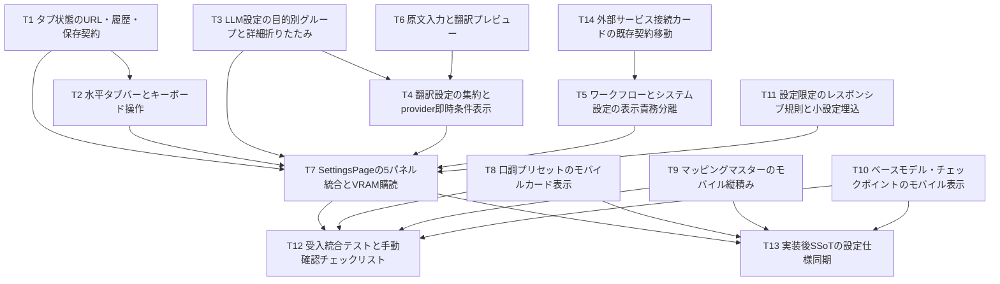

## Artifact: docs\design\REQ-314.md
---
title: REQ-314 設定ページ水平5タブ設計
status: awaiting-human-design-review
tags: [REQ-314, settings, frontend, information-design, interaction, visual]
related_paths:
  - docs/backlog/pbi/active/REQ-314.md
  - docs/design/REQ-314-test-plan.md
  - frontend/src/pages/SettingsPage.tsx
  - frontend/src/pages/SettingsPage/
  - docs/specs/SPEC_SETTINGS.md
  - docs/specs/SPEC_COMMON.md
  - docs/specs/SPEC_SUMMARY.md
---

# REQ-314: 設定ページ水平5タブ設計

## Review Status
2026-10-04 設計案。実装未開始。D1/D2の人間決定と設計承認が必要。
AC-4/AC-7は原文を維持し、下記推奨案を承認されるまで条件付き・未達として扱う。
BA監査・GPU解放記録は `REQ-314-ba-audit.md` に記載する。

## Feasibility / Boundary
技術的実現性: 5タブ、履歴、ARIA、目的別再配置、翻訳条件表示、モバイルは既存frontend内で実現可能。
ただし「7種類」と「Backend/LM Studio URL編集」は現行契約と矛盾し、全AC無条件達成の判定は不可。

Workspace/Git root: `C:/Users/audih/ws/comfy-create-helper2`。
対象: `frontend/src/pages/SettingsPage.tsx`、同名サブディレクトリ、既存共通row。
Backend/systemは証拠読取のみ。Git root mismatchなし。外部へのファイル編集は禁止。
GLOBAL_SCRIPTSはcontextのGLOBAL_ROOTから `C:/Users/audih/.gemini/antigravity/scripts` に展開済み。共有scriptはプロトコルで明示された実行に限る。
root AGENTS.mdは存在せず、ユーザー提供Context Resolution Directiveと `.agents/context.md` を適用。
dirtyな既存REQ-316 plan・Task Card等を保持し、REQ-314は独立節/独立docとして追加。
この役割では実装sourceを編集しない。

## SSoT Impact Analysis
`doc_mapper.py docs/specs docs/backlog/pbi/active/REQ-314.md` はマッピングなし。
`doc_mapper.py docs/specs frontend/src/pages/SettingsPage` は `SPEC_SETTINGS.md` を特定。
対象を限定してSPEC_SETTINGS、同書参照先SPEC_COMMON/SPEC_SUMMARYを読んだ。

| 正本 | 変更影響 | 同期時点 |
|---|---|---|
| SPEC_SETTINGS | accordion→5tab、分類、詳細初期閉、storage/hash、components | T13（実装証拠で同期） |
| SPEC_COMMON | 設定局所768pxとAppShell lgの併存、tab ARIA参照 | T13限定追記 |
| SPEC_SUMMARY | 設定構造/コンポーネント参照 | T13限定追記 |
| 参考HTML `tmp/settings_layout_redesign_spec (2).html` | 分類/UX根拠。件数・URL編集矛盾を記録 | 参考を改変しない |
| REQ-314 PBI | D1/D2人間決定が要件変更となる場合 | コーディネーターが承認記録を管理 |

API/schemaを変更せず既存client関数を使用するためOpenAPI変更抽出は省略。
`docs/system/openapi.yaml` は存在せず、存在するAPI型・client・backend定義とSPEC_SETTINGS表で既存契約を照合した。
client/provider正規値は `google_cloud`（SPEC_SETTINGSの旧google表記は同期時に修正）。Backend実際疎通は `/health`。

## Required Human Decisions

### D1: 7種類と実在6種類
PBI AC-4と参考HTMLは「7種」と記載するが、両方の列挙も6種。
現行 `LlmSettingsSection.tsx:PROMPT_LABELS` の生成/診断キー:
```text
audit_interference
audit_interference_anima
audit_vocabulary
audit_physical
scene_generate
scene_generate_anima
```
推奨: 6種類に件数訂正し、既存機能・キーを維持する要件改訂を人間が承認。
代案: 7件目の目的/内部key/初期prompt/利用経路を人間が定義して別設計へ追加。
架空editor、重複prompt、翻訳/セリフprompt混入で7に合わせることはしない。
決定前AC-4はBLOCKED。件数以外の配置/折りたたみ検証は実施可能。

### D2: 接続URL編集とAPI/schema不変
証拠:
- `frontend/src/api/client.ts`: `const BASE_URL='/api'`。Backendは同一origin相対通信。
- `configApi.get(): Promise<{comfy_url:string}>` のみ。Backend/LM Studio URL取得・変更関数なし。
- `backend/app/main.py:/api/config` はcomfy_urlを返し、書込endpointなし。
- `backend/app/config.py:Settings`: env_file=".env"、`llm_base_url="http://localhost:1234/v1"`。
  `backend/app/services/llm_request.py` は `settings.llm_base_url` でmodels/chat/completionsを呼ぶ。
- `WorkflowConnectionSection`: Backendは `window.location.origin+'/health'`、Comfyは `resolveComfyUrl(comfyUrl)`。
- Comfyのみ既存 `ConnectionActions.setComfyUrl(url:string):void` があり、既存LS_KEYS.COMFY_URLへ保存しWebSocketを再初期化。
  `comfyUrl:string|null` はZustand storeに保持。GenerateのSettingsPopoverがこの契約を使う。

推奨（要承認）: 本PBIをUI再編に限定し、Comfy既存URL編集・Backend URL読取表示/疎通・LM Studio backend経由モデルAPI疎通/環境設定案内にする。
LM Studio実際URLは取得できず、既定1234を現在設定値として表示しない。
Backend/LM Studio URL編集は別PBIで取得/保存/再接続のAPI契約から設計する。
代案: 本PBIのAPI/schema不変制約を撤回しURL設定機能を追加する。その場合本設計とTask Cardの再設計が必要。
決定前AC-7はBLOCKED、推奨案のみ実装して元のURL編集ACをPASSとしない。

## Framework / Architecture
React 18 + React Router BrowserRouter + TanStack Query + Zustand + Tailwindを使用。
既存SettingsPageは9個のcomponentに分割済み。LLMとWorkflowConnectionに異なる目的の設定が混在している。
一括ファイル移動は既存大量ロジックの変更増大を招くため、既存componentに目的groupを加え、同じquery/mutationを再利用する。
未来の別PBIでさらに小さいcardへ抽出できるが今回は保存仕様の移行を伴わない。

| Tab ID | desktop名 | mobile名 | 基本カード/詳細 |
|---|---|---|---|
| workflows | ① ワークフロー・モデル | ① モデル | workflow CRUD/差分/復元/presets、BaseModel/checkpoint、MappingMaster |
| prompt | ② プロンプト支援 | ② 呪文 | main LLM、診断/生成詳細（既存6 promptと2 params） |
| dialogue | ③ セリフ支援 | ③ セリフ | tone presets、VLM/LLM＋bubble、3役割prompt/params詳細 |
| translation | ④ 翻訳 | ④ 翻訳 | provider/auth/debounce、入力プレビュー、LLM専用詳細 |
| system | ⑤ システム・一般 | ⑤ システム | 接続、VRAM guard/live meter、thumbnail preview＋長押し2種 |

長いアクセシブル名をaria-labelに常時使用。mobile短縮labelはPBIが参考HTMLより優先。
workflows/base/mapping/tone/guardなど基本cardは常時展開、低頻度詳細prompt/dialogueだけ既定閉。
workflowsのpreset展開は既存状態を維持する。

## State / Navigation Contract
新型:
```ts
type SettingsTabId = 'workflows' | 'prompt' | 'dialogue' | 'translation' | 'system'
type DetailsState = { prompt: boolean; dialogue: boolean }
type LlmSettingsGroup = 'prompt' | 'dialogue' | 'translation'
```
新LS_KEYS:
- SETTINGS_ACTIVE_TAB = `prompt-surgeon-settings-active-tab`
- SETTINGS_DETAILS_EXPANDED_V2 = `prompt-surgeon-settings-details-expanded-v2`

初回は有効hash > 有効storage > workflows。無効/空hashは選択結果でreplaceし正規化。
初回以降の戻る/進むはlocationが優先。空/無効hashはworkflowsへreplace。
ユーザー選択はnavigateでpush。現在tab再選択は履歴を増やさない。pathname/searchを保持。
URL→state→storageの単方向反映で無限更新を防ぐ。storageは読書き例外を捕捉する。
詳細v2はobject/boolean検証し、不正JSONはfalse/false。旧13区分storageは書換・削除せず残す。

全5tabpanelを固定keyで常時mountし、非選択にhiddenを付ける。CSSでhidden display:noneを保証。
選択tab/panelはaria-selected/controls/labelledby対応、roving tabIndex。
ArrowLeft/Rightは循環して自動選択、Home/Endは先頭/末尾、通常Tabは選択tabからpanelへ。
focusしたtabを最小scrollIntoView。hover/scrollだけでは選択を変えない。
非選択のDOMはhiddenでアクセシビリティtree/Tab順から消え、未保存draftは維持。
modalは親panel配下（新body portalを作らない）。非選択panelのmodalが全画面を覆わない。
ページを離れた後の未保存draft永続化は新設しない。

## LLM Purpose Ownership
| group | model key/契約 | prompt key | params key |
|---|---|---|---|
| prompt | llmPromptsApi.getCurrentModel/updateCurrentModel | D1の6既存key | llm_params_audit, llm_params_scene_generate |
| dialogue | speech_draft_vlm_model, speech_draft_llm_model | speech_draft_vlm_prompt, speech_draft_llm_prompt, speech_rewrite_system_prompt | llm_params_speech_draft |
| translation | translation_model（空ならmain継承） | translation_ja_to_en, translation_en_to_ja | llm_params_translation |

speech labelsは①画像シチュエーション読み取りプロンプト(VLM)、②セリフ自動生成プロンプト(LLM)、③キャラクター口調変換プロンプト(LLM)。
PARAM_FIELDS/DEFAULT_PARAMS・PUT `{content}` を維持。groupを横断するkey再分類・JSON形式変更なし。
prompt allowlist外のmodel/api/debounce/bubble/unknown recordをprompt editorへ表示しない。
LlmSettingsSectionへ `modelFooter?: React.ReactNode` を追加しdialogueモデルcard内にBubbleDetectionSection embeddedを収める。
prompt/dialogueの詳細はそれぞれ単一card内にprompt＋paramsを置き、同じ詳細stateを使う。
React QueryのqueryKeyを維持し、同じprompt編集editorは分類上1回だけ描画。
group instanceのquery購読は重複するが同一Query cacheを共有する。不要workflow queryはsystem instanceでdisabled。
refetchによる未保存provider/credential/LLM paramsの上書きをdirty単位で防止。完了順序はserver再読込と保存成功値を照合。

## Translation Reactive Flow
基本設定provider draftが唯一の条件表示正本。provider==='llm'だけLLM詳細を表示。
他providerでも詳細componentのstateをhidden内で保持する。モデル/プロンプト/params入力をリロード不要で切替。
認証key/urlはgoogle_cloud/deeplのみ表示。FuguMTはproviderのみの従来更新契約を守る。
translation_debounceは既存key/300..2000ms/step50/既定500を移動。
既存疎通テスト・統計・cache clear・google_free移行を保持。

新TranslationPreviewCardのprops:
```ts
{ provider: 'google_cloud'|'deepl'|'llm'|'fugumt'; enabled: boolean; debounceMs: number }
```
原文・方向変更後debounceで既存translateApi.translatePromptを呼び、訳文/errorを即時更新。明示buttonでも実行可能。
API credentialsは保存値を使用するため基本設定未保存/保存中/失敗ではpreviewを無効化し保存案内。
input/direction/provider/enabled変更でrequest sequenceを無効化し古いresponseは表示しない。
空白は送信しない。new AbortSignal契約を追加せずUI競合を処理する。
保存provider切替時の旧訳文はクリアし、保存成功とrefetch同期後に新入力から再実行。
LLM用モデル/prompt/paramsは既存各保存buttonで保存して利用する。

## System / VRAM
SettingsPageで `useSystemStats():void` を1回呼び、settings滞在中のWS購読を確保。
VramGuardSectionの既存store読取とsettingsApi.getVram/updateVramを維持。
Page Visibility復帰・unmount cleanupは既存hookが担う。複数購読を新設しない。
WS値更新で実時間メーターを更新。未取得/切断は既存fallbackと未取得表示を使い0GBを偽造しない。
Comfy設定は新ServiceConnectionCardが既存storeを用いる（D2承認に条件付け）。
現行ConnectionStatusはHTTP statusを確認せずfetch解決だけで成功にするため、T14の新card内でresponse.okと3秒timeoutを確認する。既存共通componentを全面改修しない。
thumbnailはlivepreview維持、長押し既存2キー/0.1..5秒を同じ表示目的に集約。

## Responsive Contract
設定局所breakpointは768px。AppShellはlg(1024px)でdesktop navへ切替する現行契約を維持。
768..1023pxはタブはdesktop等幅・AppShellはbottom navという組合せも検証する。
mobile tabbarだけ横scroll＋snap。ページbody/tableによる不必要な横overflowは許容しない。
両端fadeはdecorative pointer-events:none。selected/focused tabがfadeで操作不能にならない。
settings scroll領域のmobile bottom padding=calc(6rem + env(safe-area-inset-bottom))（pb-24相当）。
AppShell既存main paddingとは別にページ最下段操作の余白を確保する。既存global navを改変しない。
SettingsResponsive.cssは `.req314-settings` 配下に限定、他画面のSettingsComponents rowへCSSを波及させない。

主要表はSpeechTone、BaseModel/checkpoint、MappingMasterを対象。単一table DOMをblock/cardへ変換しdata-labelとsemantic見出しを保つ。
mobileで指示prompt/checkpoint名は全文wrap。DND/selection/ref/transform/IDを維持する。
workflow/presetは既存list型をwrapし44px対象にする。modal/formもviewport内でscrollできる。
全可視button/入力/select/textarea/drag/checkbox hitboxは両辺44px以上を実測。checkboxは44pxlabelも含めクリック可能にする。
range見た目のthumbだけで判定せずinput操作領域を測定。hidden/file hidden inputは可視操作対象から除外。

## Task Decomposition / DAG
- T1: タブ状態のURL・履歴・保存契約（3 files / 270変更行以下、依存:なし）
- T2: 水平タブバーとキーボード操作（2 files / 245変更行以下、依存:T1）
- T3: LLM設定の目的別グループと詳細折りたたみ（2 files / 290変更行以下、依存:なし）
- T4: 翻訳設定の集約とprovider即時条件表示（2 files / 280変更行以下、依存:T3,T6）
- T5: ワークフローとシステム設定の表示責務分離（2 files / 210変更行以下、依存:T14）
- T6: 原文入力と翻訳プレビュー（2 files / 255変更行以下、依存:なし）
- T7: SettingsPageの5パネル統合とVRAM購読（2 files / 290変更行以下、依存:T1,T2,T3,T4,T5,T11）
- T8: 口調プリセットのモバイルカード表示（2 files / 230変更行以下、依存:なし）
- T9: マッピングマスターのモバイル縦積み（3 files / 275変更行以下、依存:なし）
- T10: ベースモデル・チェックポイントのモバイル表示（2 files / 245変更行以下、依存:なし）
- T11: 設定限定のレスポンシブ規則と小設定埋込（3 files / 190変更行以下、依存:なし）
- T12: 受入統合テストと手動確認チェックリスト（2 files / 290変更行以下、依存:T7,T8,T9,T10）
- T13: 実装後SSoTの設定仕様同期（3 files / 140変更行以下、依存:T7,T8,T9,T10）
- T14: 外部サービス接続カードの既存契約移動（2 files / 255変更行以下、依存:なし）

最大4層: T3/T6→T4→T7→T12/T13、およびT14→T5→T7→T12/T13。
T1→T2は型import依存。T8/T9/T10は独立。T11 CSSはT7で読込。
全taskは所有3files以下・追加削除合計300行以下の見積り、全カード本文300行以下。
T3/T4など同一sourceを共有する実行は依存順。異なるtaskがSettingsComponentsを編集する場合も所有者を確認する。
変更行超過が見えたら実装前にarchitectへ内部task分割を戻す。

## Upstream / Downstream Dependencies
上流: REQ-314 PBI/HTML、人間D1/D2、ReactRouter route /settings、Query cache/store、現行API/LLM key一覧。
既存機能依存: workflow差分置換/rollback/プリセット、BaseModel checkpoint、MappingMaster DND、多言語translation、SpeechTone modal再export。
下流: Generate/Speech利用の設定保存値、Comfy接続再初期化、thumbnail/longpress全画面表示、VRAM guard、SPEC参照。
Query/API/storage/model設定の意味を維持することで下流へのデータ移行を避ける。
SettingsPageの既存SpeechTonePresetModal exportを保持する。

## Test Strategy
`REQ-314-test-plan.md` に全ACとINT/E2E/RTを定義。
Gate 1 frontend typecheck、Gate 2局所/統合/full suite、Gate 3自律実行可能な異常系・API契約・DOM操作シナリオとlocal QA監査。実ブラウザ検証はユーザーによる手動確認とし、自律テストから除外する。
ブラウザ寸法/履歴/keyboard/API実動作の手動確認結果はユーザー報告待ち。未報告を自律テスト失敗とは扱わず、未確認のACをPASSとしない。D1/D2未決定でAC-4/7をPASSにしない。
設計時点で実装test未実行。BA auditは設計監査であり、実装品質の証拠には使わない。

## Trade-off Disclosure
- 常時mountはtab往復draftとmodal状態を保つがメモリとquery購読が増える。同じcacheを共有しsystem側不要workflow fetchをguard。
  選択panelだけunmountする案は未保存値が消えるため不採用。
- group propsは大量コード移動を避けるが大きい既存ファイルは残る。目的editorの新規複製は保存仕様の乖離を招くため不採用。
- 新v2詳細stateは既存全展開の記録を引き継がず既定閉にする。旧storageを消さず復帰余地を残す。
- mobile表CSSは単一DOM/DNDを保つが読み上げ意味の実機確認が必要。別mobile複製DOMは二重focus/ID問題を増やす。
- Backend/LM Studio URL編集はAPI不変と両立しない。D2の推奨範囲に合意がなければ実装へ進めない。
- 6既存promptを7に見せる代替は採らない。D1件数決定はACを変更する人間判断。
- provider draftは表示だけ即時、実際翻訳は保存済authを使う。未保存previewを止める理由は画面に簡潔表示する。
- 14taskは各編集量を局所化し最大4層。共有sourceは順次dispatchし、独立responsive taskを並行可能。


## Artifact: docs\design\REQ-314-test-plan.md
---
title: REQ-314 実行可能テスト計画
status: awaiting-human-design-review
tags: [REQ-314, settings, integration, e2e, red-team]
related_paths:
  - docs/design/REQ-314.md
  - docs/backlog/pbi/active/REQ-314.md
  - frontend/src/pages/SettingsPage.tsx
---

# REQ-314 実行可能テスト計画

## Status / Preconditions
2026-10-04 設計時点。自動/実ブラウザテスト未実行。
D1 6/7 prompt、D2 Backend/LM Studio URL編集は人間決定待ち。
AC-4/7は条件付き・未達（BLOCKED）。推奨案で原文を満たすとは判定しない。
Frontend＋Backend稼働中のアプリoriginを使用（例 http://localhost:8000/settings#workflows）。
保存系は破壊してよい専用test fixturesだけを使い、既存ユーザー設定を事前採取して終了時に戻す。
外部翻訳API key、LM/Comfyが利用できない実動作はINCONCLUSIVEとする。
Vitest mockではAPI呼出契約を検証するが実翻訳・CSS寸法・WS通信の代替としない。

## Verification Ownership (2026-10-04 User Revision)
ユーザー指示「ブラウザテストは手動でやるから、自律テストからは除いていい」を適用。
- 自律: Gate 1 typecheck、Gate 2局所/統合/full Vitest、Gate 3のVitestで実行可能な異常系・API契約・DOM操作検証とlocal QA監査。
- 手動（ユーザー）: 全E2E-1..6、実ブラウザでの寸法/レスポンシブ/44px/safe-area/読み上げ/実API・WS・他画面確認。エージェントはブラウザを操作せず、ブラウザ自動化テストも追加・実行しない。
- RT-1/2/3/4/6/7/8/9/10/11のmock・DOMで検証可能な部分はVitestで自律検証し、実ブラウザ/外部接続が必要な部分とRT-5はユーザー手動確認にする。
- 未実施の手動項目は「ユーザー手動確認待ち」。自律ゲートの失敗や再試行理由にせず、自律検証完了後に手順を引き渡す。ユーザー報告なしに手動項目/対応ACのPASSを宣言しない。
- D1/D2の要件判断・設計承認は本変更と別で、引き続き待機する。

## Gate 1 / Gate 2 Commands
PowerShell、repo frontend:
```powershell
Set-Location 'C:/Users/audih/ws/comfy-create-helper2/frontend'
npm run typecheck
npx vitest run src/pages/SettingsPage/hooks/__tests__/useSettingsTab.test.tsx src/pages/SettingsPage/components/__tests__/SettingsTabBar.test.tsx src/pages/SettingsPage/components/__tests__/LlmSettingsSection.test.tsx src/pages/SettingsPage/components/__tests__/TranslationSettingsSection.test.tsx src/pages/SettingsPage/components/__tests__/WorkflowConnectionSection.test.tsx src/pages/SettingsPage/components/__tests__/TranslationPreviewCard.test.tsx src/pages/SettingsPage/components/__tests__/ServiceConnectionCard.test.tsx
npx vitest run src/pages/__tests__/SettingsPage.test.tsx src/pages/__tests__/SettingsPage.req314.test.tsx src/pages/SettingsPage/components/__tests__/SpeechToneSection.test.tsx src/pages/SettingsPage/components/__tests__/MappingMasterSection.test.tsx src/pages/SettingsPage/components/__tests__/BaseModelSection.test.tsx src/pages/SettingsPage/components/__tests__/ThumbnailSettingsSection.test.tsx
npm test
```
期待: 全command exit 0、指定全件PASS。fullは実装後の既存退行検出に1回実行し、新変更・失敗時のみ再実行。
Task Cardごとにtypecheck＋局所commandを記録。上の新testファイルは各taskで生成予定。
設計段階で実行/成功を宣言しない。timeout目安: typecheck120秒、局所180秒、full600秒。超過時timeoutとして結果を残し根拠なしに延長しない。

## AC Traceability
| AC | シナリオ/検証 | 対応task | 判定条件 |
|---|---|---|---|
| 1 | E2E-1 等幅5tab/横幅 | T2,T7 | 実測＋DOM |
| 2 | INT-1/RT-1 hash/LS/履歴/リロード | T1,T2,T7 | 5hashと履歴一致 |
| 3 | INT-2/E2E-2 workflow/base/mapping集約 | T5,T7,T9,T10 | 既存全action到達 |
| 4 | INT-3 prompt分類/詳細閉 | T3,T7 | 件数D1未決定: BLOCKED |
| 5 | INT-4/E2E-3 tone/models/bubble/3role | T3,T7,T8,T11 | key/label保存一致 |
| 6 | INT-5/RT-3 4provider即時表示 | T4,T6 | 保存前でも同期可視 |
| 7 | INT-6/E2E-4 connections/guard/display | T14,T5,T7,T11 | URL編集D2未決定: BLOCKED |
| 8 | E2E-5/RT-5 767/390/320px・safearea・表・44px | T2,T8,T9,T10,T11 | 実寸/操作全て一致 |
| 9 | INT-7/E2E-6 ARIA/keyboard | T2,T7 | focus/selected/tabpanel一致 |

D1が6種訂正として承認された場合は承認済PBI AC-4改訂を引用し6種で判定。
7件目を追加する決定なら新key/backend/default/使用経路を再設計し本planを更新。
D2のUI限定案承認時も元の全URL編集ACをPASSにせず、改訂AC/承認記録に基づく判定。
API変更案ならendpoint/schema/認証/再接続/保存検証を別改訂してから実行。

## Integration Scenarios
- INT-1: BrowserRouterで各hashへ開く。storage別tabを事前設定しhash優先、click→hash/storage、back→前tab、forward→次tab、reload→同tab。
  初回無hash+有効LSはそのtabへreplace。初回不正hash+不正LSはworkflows。移動後空hashはworkflows。
  navigateでquery/path保持。選択済tab再clickでhistory.length増加なし。期待は選択aria値/可視panel/URL/LSが全て同一。
- INT-2: workflows fixture2件、BaseModel3件、mapping2件。rename/copy/diff/rollback/delete/preset展開へ到達し元API/ID/payloadをassert。
  workflowとsystem instanceが異目的データを描画しない。systemでworkflows queryが新しく走らない。
  Deleteはtest専用fixtureのみ。
- INT-3: prompts fixtureに既存6キー＋2translation＋3speech＋model/params/unknown recordを混ぜる。
  prompt詳細既定閉→展開で6だけ、2params、main model。unknown/model JSONがeditorへ出ない。
  D1未承認のため配置検証結果とAC-4全体BLOCKEDを別記録。
  prompt入力/paramsを未保存編集→他tab→戻る、値不変。background query refetchでもdirty params不変。
- INT-4: dialogueでtone名/prompt/order、VLM/LLM2select、bubble min_area/min_brightnessを確認。
  詳細展開で3役割labelとキー一致。各PUTのcontent形式が旧契約と同じ。
  tone create/edit/delete/cancelのfixture IDを確認、modal再export利用に退行なし。
- INT-5: provider draftをfugumt/deepl/google_cloud/llmに順次changeし保存せずLLM詳細可視条件をassert。
  credentialsはAPI型2providerのみ。FuguMT保存PUTはtranslation_provider1件だけ。
  translation_debounceを保存しpreviewへ渡る。基本未保存はpreview無効＋案内、保存成功で入力訳文を更新。
  既存testConnection/cache stats/clear-cacheの契約維持。
- INT-6: store comfyUrlあり/なしの実効表示優先順、保存buttonでsetComfyUrlを1回、typingでは未実行。
  Backend origin/health、LM modelsのbackend経由API応答で疎通、取得不能URLをdefaultで偽装しない。
  store.systemStatsのused更新を送りfree/total meter追従、useSystemStats購読1回・unmount cleanup。
  thumbnail比率変更→livepreview、longpress2キー変更と保存確認。
  D2未承認のためURL編集全AC-7はBLOCKED。
- INT-7: tablist1、tab5、aria-controls存在、全panel aria-labelledby正確、selected1、
  tabIndex=0のtab1、hidden panelがtab順から消える。Right/Left循環/Home/End/Enter/Space通常button動作。
  Tabで選択tab→tabpanel内の有効controlへ入り、Shift+Tabで戻れる。
- INT-8 (API/schema invariant):変更対象diffにbackend/api/client/types/store schemaの変更がないことを確認。
  existing llm PUT keys/JSON、translation POST、workflow actions、vram PUTをrequest spyで元契約と比較。
  同じ永続化値がGenerate/Speechで使えることはユーザーがブラウザで手動確認。見た目group名を保存keyにしない。
  T14は既存store動作利用のみ、新backend config書込/URL取得を作らない。

## User Manual Browser Checklist (E2E Paths)
以下は自律実行対象外のユーザー手動確認手順。ユーザーから得たviewport/URL/操作/観測/結果を `REQ-314-walkthrough.md` に記録する。未報告の実測値やスクリーン証拠を生成しない。各操作応答10秒、外部推論30秒を確認目安とする。
- E2E-1: 1280x900で /settings#workflows。sidebarを含め利用可能content幅を測る。
  tabbar幅がcontent内幅を使い、5tab幅の最大差2px以内、縦積みaccordionがtop構造に無い。
  768pxでも等幅。767pxでは短縮label+scrollsnapへ変わる。
- E2E-2: 5tab各click→識別heading/正しい3/2/3/3/3目的cardを確認。
  workflow rename/copy→list反映、JSON差分→confirm→rollback、preset展開、BaseModel/checkpoint、mapping CRUDに到達。
  保存は専用fixtureを使い元設定を終了時復元。現在データ全削除を行わない。
- E2E-3: prompt/dialogue詳細初期閉。11既存promptの全分類6+3+2を数え、未知keyがeditor混入しない。
  3speech labelの説明、VLM/LLM選択、bubble保存を確認。未保存prompt/paramsを書きtab往復で維持。
  D1決定未済ならAC-4はBLOCKED。
- E2E-4: translation4provider即時toggle、保存→任意原文→訳文、API認証条件、debounce、cache/疎通維持。
  system接続probe、guardトグル/threshold保存/WS実更新、thumbnailpreview、longpressを確認。
  D2決定未済ならAC-7はBLOCKED。外部稼働なしは疎通/実翻訳INCONCLUSIVE。
- E2E-5: 390x844と320x640、767x900でtabをscrollして全5選択。
  computed scroll-snap-type='x mandatory'、tab snap-align、fadeがpointerを遮らないこと。
  各tableをcardとして読む。prompt/checkpoint長文がviewport内折返し、全edit/delete/order/dragが使える。
  document.scrollWidth<=clientWidth+1px（tabbar内部scrollは許容）。viewport計測とスクリーン記録。
  最終controlをscroll into viewしbottom navのtopより上で全44px領域が見え、操作可能。
  computed mobile padding-bottom >=96px+safe-area評価値。safe-area0環境は0で確認と明記し非0実機を推測しない。
  <768pxの全可視button/input/select/textarea/drag/checkbox label hitboxのDOMRect width/height>=44px（1px誤差以内）。
- E2E-6: マウスを使わずTab/Left/Right/Home/End/Enter/Spaceで全tabとcardへ移動。
  hash/selected/focus一致、hidden内容へfocus侵入なし、モバイル選択tabは画面内。
  accessible nameは長いtab名、各aria-controls/labelledby相互参照を確認。
  画面読み上げが使える環境ではcard化tableの見出しと列ラベル対応を確認。未実施は明記。

## Red Team / Boundary / Anomaly (Ownership Above)
| ID | 注入/操作 | 期待する観測 |
|---|---|---|
| RT-1 | #unknown、#PROMPT、壊れLS、false/string/arrayのv2、getItem/setItem throw | crashなし、正規fallback、details false/false、URL操作可能 |
| RT-2 | hash再選択100回・back/forward5往復・search付きURL・route離脱再入 | 履歴増殖/loopなし、path/search維持、listener/WS leakなし |
| RT-3 | llm→fugumt→llm高速切替、詳細内focus、未保存auth、query refetch | 即時可視、focus脱落なし、draft不変、保存前preview不可 |
| RT-4 | slow訳文A→入力B、順序B→A応答、provider/方向変更、API500/timeout | AがBを上書きしない、旧訳文clear、失敗表示/再試行、入力維持 |
| RT-5 | 767/768/1023/1024px・320px・200%zoom・long日本語/URL/prompt | 設定とAppShell境界整合、controls/nav非重複、44px、情報欠落なし |
| RT-6 | 空models、offlineComfy、Backend500、LM API失敗、WS切断/復帰 | fake接続成功なし、保存値保持、未取得を0へ偽装しない、復帰更新 |
| RT-7 | doubleclicksave/dirtyparams中refetch、別tabへ移動中mutation完了 | 重複破壊なし、保存対象key不変、他draft消失なし |
| RT-8 | 空workflow/base/checkpoint/tones/mapping＋大量50件 | loading/empty到達、スクロール後最終操作可能、tab安定 |
| RT-9 | invalidComfy URL・empty・https有効、typing10回 | invalid保存抑止、setComfyUrlは明示保存だけ、入力毎WS再接続なし |
| RT-10 | FuguMT/LLMの認証欄非表示、既存キーを値ありにして保存 | fugumt PUT providerのみ、非API認証情報を新規要求しない |
| RT-11 | mobile MappingMaster並替/多選択、preset展開/drag/action | ID/順序API不変、actionがrow選択と衝突せずcontrols到達 |

## Audit / Evidence / Verdict
local QA test-plan auditはdev-verifyのGate3で行い、終了直後unloadを実施。
BA設計監査は別記録。監査モデルの指摘をそのまま実装test PASSと扱わない。
PASS=期待観測を実ツールで確認。FAIL=期待との不一致。INCONCLUSIVE=必要環境/証拠不足。BLOCKED=人間要件決定待ち。
自律Gateの結果とユーザー手動確認待ちを分けて引き渡す。全ACと必要な確認証拠が揃うまで全受入完了/Doneを宣言しない。D1/D2承認はAC改訂の根拠も残す。


## Artifact: docs\design\REQ-314-implementation_plan.md
---
title: REQ-314 Implementation Plan
status: awaiting-human-design-review
tags: [REQ-314, settings, frontend]
related_paths:
  - docs/design/REQ-314.md
  - docs/design/REQ-314-test-plan.md
  - docs/backlog/pbi/active/REQ-314.md
---

# Implementation Plan - REQ-314: 設定ページ水平タブ化

## Review Status
2026-10-04 設計レビュー待ち。実装未開始。
[設計](REQ-314.md)・[テスト計画](REQ-314-test-plan.md)・全14Task Cardを物理生成済み。
D1「7種類→既存6種類」の訂正か7件目定義、D2「Backend/LM Studio URL編集」とAPI不変制約の優先を人間が確定する必要がある。
元のAC-4/AC-7は未達/条件付きとして維持。設計承認だけで原文ACを満たしたことにはしない。

## Proposed Changes
既存SettingsPageの9分割componentを、目的別5tabへ再配置する。
LLMとWorkflowConnectionにgroupを設けて保存/queryロジックを再利用。常時mountのhidden panelで未保存draftを維持。
URL hash/LocalStorage/戻る進む・キーボードARIAを実装。翻訳provider draftで即時詳細表示。
翻訳原文プレビュー、VRAM実時間購読、768px境界のmobile snap・表card化・44px操作を追加する。
既存API/backend/schema保存keyを維持。SSoTは実装後のT13で同期。

## Required Human Decisions
- D1 推奨: AC-4を6種へ件数訂正。既存6promptの名前/保存keyを維持。
  代案: 7件目の用途/key/初期値/利用経路を定義し再設計。架空・重複editorで7にしない。
- D2 推奨: Comfy既存store URL編集、Backend origin表示/health、LM Studio backend経由疎通と環境設定案内へUI限定。
  Backend/LM Studio URL編集は別PBI。代案: API不変制約を撤回し本PBIへAPI変更を含めて再設計。
  現行configApiはcomfy_url GETのみ、BackendはBASE_URL='/api'、LM URLはbackend .env LLM_BASE_URL。
  現在LM URLはfrontend取得不可なので既定1234を現在値として偽装しない。

## Task Decomposition
| ID | 内容 | 所有数/予定変更行 | 依存 |
|---|---|---|---|
| [T1](../backlog/task/active/REQ-314-T1.md) | タブ状態のURL・履歴・保存契約 | 3 / <=270 | なし |
| [T2](../backlog/task/active/REQ-314-T2.md) | 水平タブバーとキーボード操作 | 2 / <=245 | T1 |
| [T3](../backlog/task/active/REQ-314-T3.md) | LLM設定の目的別グループと詳細折りたたみ | 2 / <=290 | なし |
| [T4](../backlog/task/active/REQ-314-T4.md) | 翻訳設定の集約とprovider即時条件表示 | 2 / <=280 | T3,T6 |
| [T5](../backlog/task/active/REQ-314-T5.md) | ワークフローとシステム設定の表示責務分離 | 2 / <=210 | T14 |
| [T6](../backlog/task/active/REQ-314-T6.md) | 原文入力と翻訳プレビュー | 2 / <=255 | なし |
| [T7](../backlog/task/active/REQ-314-T7.md) | SettingsPageの5パネル統合とVRAM購読 | 2 / <=290 | T1,T2,T3,T4,T5,T11 |
| [T8](../backlog/task/active/REQ-314-T8.md) | 口調プリセットのモバイルカード表示 | 2 / <=230 | なし |
| [T9](../backlog/task/active/REQ-314-T9.md) | マッピングマスターのモバイル縦積み | 3 / <=275 | なし |
| [T10](../backlog/task/active/REQ-314-T10.md) | ベースモデル・チェックポイントのモバイル表示 | 2 / <=245 | なし |
| [T11](../backlog/task/active/REQ-314-T11.md) | 設定限定のレスポンシブ規則と小設定埋込 | 3 / <=190 | なし |
| [T12](../backlog/task/active/REQ-314-T12.md) | 受入統合テストと手動確認チェックリスト | 2 / <=290 | T7,T8,T9,T10 |
| [T13](../backlog/task/active/REQ-314-T13.md) | 実装後SSoTの設定仕様同期 | 3 / <=140 | T7,T8,T9,T10 |
| [T14](../backlog/task/active/REQ-314-T14.md) | 外部サービス接続カードの既存契約移動 | 2 / <=255 | なし |

全カード本文79〜111行。所有3file以下・追加削除合計300行以下で設計時atomicity PASS。
実装時超過が見えたら事前に分割設計を差し戻す。共有sourceはDAG順に実行し他担当変更を戻さない。

## Dependency DAG

最大4層。型依存T1→T2、編集再利用T3/T6→T4、接続T14→T5→T7を明示。
独立responsive T8/T9/T10/T11は並行可能。T7統合後T12検証/T13正本同期。
T13が先に完了してもPBIのDoneは全Gate/AC証拠を確認してから判断する。

## Verification Plan
各Task Cardに正確な型、20〜29行の既存snippet、typecheck/局所Vitestコマンド。
Gate 1: frontend typecheck。Gate 2: 指定局所/統合＋full suite。
Gate 3（自律）: Vitestで実行可能な異常系・API契約・DOM操作シナリオとlocal QA監査。実ブラウザ操作は自律テストから除外。
ユーザー手動確認: 1280/768/767/390/320px、1023/1024px AppShell境界、履歴/ARIA、provider切替、API実動作、live VRAM。確認手順と未確認状態を引き渡す。
CSS/44px/safearea実測をjsdomで代用しない。環境未取得はINCONCLUSIVE、人間決定不足はBLOCKED。
設計testは未実行。local BA audit/VRAM証拠は[監査記録](REQ-314-ba-audit.md)。

## Trade-off Disclosure
常時mountはdraftを守るが購読/メモリを増やす。同一Query cacheを共有しsystem側workflow取得を抑止する。
group再編は局所差分にするが既存大fileは残る。全面移動/編集器複製は今回採らない。
詳細stateは新v2キーで既定閉。旧13区分キーは削除せず維持する。
mobile表は同一DOM/DNDを維持し、読み上げ意味の実機確認はユーザー手動確認項目とする。
未保存翻訳認証でpreview結果を装わないよう保存後に実行する。
D1/D2は要求と現行契約の矛盾であり、人間承認なしにACを弱めない。

## Human Design Review Gate
[dev-design](C:/Users/audih/.gemini/config/skills/dev-design/SKILL.md) Step 2:
「Physically generate all Task Cards ... BEFORE requesting implementation_plan.md approval.」
および今回のarchitect指示「Return changed designs through the human design review gate」により、
全物理成果物/監査記録を渡し、D1/D2の決定と設計承認を受けてから実装へ移る。


## Artifact: docs\backlog\task\active\REQ-314-T1.md
---
id: REQ-314-T1
pbi: REQ-314
status: pending
tags: [frontend, settings, REQ-314]
related_paths:
  - frontend/src/pages/SettingsPage/hooks/useSettingsTab.ts
  - frontend/src/utils/localStorageKeys.ts
  - frontend/src/pages/SettingsPage/hooks/__tests__/useSettingsTab.test.tsx
depends_on: []
---

# REQ-314-T1: タブ状態のURL・履歴・保存契約

## Review Gate
2026-10-04ユーザー指定: 実ブラウザ検証はユーザーが手動実施。エージェントのブラウザ操作・ブラウザ自動化テストは自律検証から除外する。VitestによるDOM/統合/異常系検証は維持し、手動項目は未確認のチェックリストとして引き渡す。
設計レビュー承認前は実行禁止。D1（6/7 prompt）とD2（接続URL）が未決定のためREQ-314全体は承認待ち。
所有範囲以外を変更しない。他担当の変更を取り消さず、共有ファイルはDAG順に実行する。

## Target / Atomicity
- `C:/Users/audih/ws/comfy-create-helper2/frontend/src/pages/SettingsPage/hooks/useSettingsTab.ts`
- `C:/Users/audih/ws/comfy-create-helper2/frontend/src/utils/localStorageKeys.ts`
- `C:/Users/audih/ws/comfy-create-helper2/frontend/src/pages/SettingsPage/hooks/__tests__/useSettingsTab.test.tsx`
依存: なし。所有 3 ファイル、実装＋局所テストの追加削除合計 270 行以下（見積り）。Atomicity: PASS（設計時）。300変更行を超える場合は担当者が分割設計を差し戻し、超過して進めない。

## Hermetic Context
### Required types / signatures
```tsx
export type SettingsTabId = 'workflows' | 'prompt' | 'dialogue' | 'translation' | 'system'
export function useSettingsTab(): { activeTab: SettingsTabId; selectTab: (id: SettingsTabId) => void }
// LS_KEYS.SETTINGS_ACTIVE_TAB = 'prompt-surgeon-settings-active-tab'
// LS_KEYS.SETTINGS_DETAILS_EXPANDED_V2 = 'prompt-surgeon-settings-details-expanded-v2'
```

### Existing surgical context
出典: `frontend/src/pages/SettingsPage.tsx`（設計時点、27行）。新ファイルはこの既存契約に接続する。
```tsx

export function SettingsPage() {
  const [expandedSections, setExpandedSections] = useState<ExpandedSectionsState>(() => {
    const stored = localStorage.getItem(LS_KEYS.SETTINGS_SECTIONS_EXPANDED)
    return stored
      ? JSON.parse(stored)
      : {
          prompts: true,
          mappingMasters: true,
          longPress: true,
          workflows: true,
          connections: true,
          llmModel: true,
          translation: true,
          baseModels: true,
          llmParams: false,
          speechDraft: false,
          bubbleDetection: false,
          speechTones: false,
          vramGuard: true,
        }
  })

  useEffect(() => {
    localStorage.setItem(LS_KEYS.SETTINGS_SECTIONS_EXPANDED, JSON.stringify(expandedSections))
  }, [expandedSections])

```

### Stable contracts
- query keys: `llm-prompts`, `llm-models`, `llm-current-model`, `workflows`, `settings-vram` を維持。
- backend/API/schemaは変更しない。保存先keyを表示ラベルに置き換えない。
- 正規hash順序: workflows / prompt / dialogue / translation / system。
- 詳細設計: `docs/design/REQ-314.md`。関連ACの条件付き判定は `REQ-314-test-plan.md`。

## Implementation Logic
- [ ] useLocation/useNavigate を唯一のURL状態として使う。初回のみ有効hash > 有効保存値 > workflows。無効hashは保存値/既定へ正規化しreplace。pathname/search保持。
- [ ] クリック/矢印選択は別タブの時だけnavigateでpush。既存hashへの再選択で履歴増殖しない。戻る/進むはlocationを優先しLocalStorageを更新。初回後の空/無効hashはworkflowsへreplace。
- [ ] getItem/setItem例外を捕捉してURL操作を継続。詳細v2キーは次タスクの契約として追加。旧SETTINGS_SECTIONS_EXPANDEDは削除・書換・移植しない。

## Acceptance / Verification
初回5hash・hash/LS衝突・無効値・Storage SecurityError・空hash・履歴push/replace・再選択・search保持をBrowserRouterで検証。
期待: typecheck exit 0、指定test全件PASS。異常系も実行し、失敗原因と結果を記録。設計段階では未実行。
```powershell
Set-Location 'C:/Users/audih/ws/comfy-create-helper2/frontend'
npm run typecheck
npx vitest run src/pages/SettingsPage/hooks/__tests__/useSettingsTab.test.tsx
```


## Artifact: docs\backlog\task\active\REQ-314-T10.md
---
id: REQ-314-T10
pbi: REQ-314
status: pending
tags: [frontend, settings, REQ-314]
related_paths:
  - frontend/src/pages/SettingsPage/components/BaseModelSection.tsx
  - frontend/src/pages/SettingsPage/components/__tests__/BaseModelSection.test.tsx
depends_on: []
---

# REQ-314-T10: ベースモデル・チェックポイントのモバイル表示

## Review Gate
2026-10-04ユーザー指定: 実ブラウザ検証はユーザーが手動実施。エージェントのブラウザ操作・ブラウザ自動化テストは自律検証から除外する。VitestによるDOM/統合/異常系検証は維持し、手動項目は未確認のチェックリストとして引き渡す。
設計レビュー承認前は実行禁止。D1（6/7 prompt）とD2（接続URL）が未決定のためREQ-314全体は承認待ち。
所有範囲以外を変更しない。他担当の変更を取り消さず、共有ファイルはDAG順に実行する。

## Target / Atomicity
- `C:/Users/audih/ws/comfy-create-helper2/frontend/src/pages/SettingsPage/components/BaseModelSection.tsx`
- `C:/Users/audih/ws/comfy-create-helper2/frontend/src/pages/SettingsPage/components/__tests__/BaseModelSection.test.tsx`
依存: なし。所有 2 ファイル、実装＋局所テストの追加削除合計 245 行以下（見積り）。Atomicity: PASS（設計時）。300変更行を超える場合は担当者が分割設計を差し戻し、超過して進めない。

## Hermetic Context
### Required types / signatures
```tsx
export function BaseModelSection(): React.JSX.Element
interface BaseModel { id: number; name: string; description: string | null; created_at: string }
interface CheckpointMapping { id: number; checkpoint_name: string; base_model_id: number; created_at: string; base_model?: BaseModel | null }
// checkpointMappingsApi / baseModelsApi は既存CRUDを使用
```

### Existing surgical context
出典: `frontend/src/pages/SettingsPage/components/BaseModelSection.tsx`（設計時点、27行）。新ファイルはこの既存契約に接続する。
```tsx
            <table className="w-full text-left border-collapse text-xs">
              <thead>
                <tr className="border-b border-[rgba(255,255,255,0.06)] text-zinc-400 bg-white/[0.01]">
                  <th className="px-4 py-2.5 font-medium">名前</th>
                  <th className="px-4 py-2.5 font-medium">説明</th>
                  <th className="px-4 py-2.5 font-medium text-right">アクション</th>
                </tr>
              </thead>
              <tbody className="divide-y divide-[rgba(255,255,255,0.04)] text-zinc-300">
                {isLoadingModels ? (
                  <tr>
                    <td colSpan={3} className="px-4 py-8 text-center text-zinc-500">
                      読み込み中...
                    </td>
                  </tr>
                ) : baseModels?.map((bm) => (
                  <tr key={bm.id} className="hover:bg-white/[0.01] transition-colors">
                    <td className="px-4 py-2.5 font-semibold text-[#3ECF8E]">{bm.name}</td>
                    <td className="px-4 py-2.5 text-zinc-400">{bm.description || '-'}</td>
                    <td className="px-4 py-2.5 text-right space-x-1.5">
                      <button
                        onClick={() => {
                          setEditingModel(bm)
                          setModelForm({ name: bm.name, description: bm.description || '' })
                          setShowModelModal(true)
                        }}
                        className="text-zinc-500 hover:text-zinc-300 p-1"
```

### Stable contracts
- query keys: `llm-prompts`, `llm-models`, `llm-current-model`, `workflows`, `settings-vram` を維持。
- backend/API/schemaは変更しない。保存先keyを表示ラベルに置き換えない。
- 正規hash順序: workflows / prompt / dialogue / translation / system。
- 詳細設計: `docs/design/REQ-314.md`。関連ACの条件付き判定は `REQ-314-test-plan.md`。

## Implementation Logic
- [ ] 両tableへsettings-mobile-tableと列data-label、mobile長いcheckpoint名の折返しを追加。>=768px列表示を維持。
- [ ] モデルCRUD・checkpoint紐付け/再取得・空/loading・modalを保持。表示のためにIDや未知model名を補完しない。modalフォームが320pxで溢れない幅/折返し。

## Acceptance / Verification
CRUD/関連ID・再取得呼出・空表示・長いファイル名/多言語・mobile列ラベルを検証。
期待: typecheck exit 0、指定test全件PASS。異常系も実行し、失敗原因と結果を記録。設計段階では未実行。
```powershell
Set-Location 'C:/Users/audih/ws/comfy-create-helper2/frontend'
npm run typecheck
npx vitest run src/pages/SettingsPage/components/__tests__/BaseModelSection.test.tsx
```


## Artifact: docs\backlog\task\active\REQ-314-T11.md
---
id: REQ-314-T11
pbi: REQ-314
status: pending
tags: [frontend, settings, REQ-314]
related_paths:
  - frontend/src/pages/SettingsPage/SettingsResponsive.css
  - frontend/src/pages/SettingsPage/components/BubbleDetectionSection.tsx
  - frontend/src/pages/SettingsPage/components/ThumbnailSettingsSection.tsx
depends_on: []
---

# REQ-314-T11: 設定限定のレスポンシブ規則と小設定埋込

## Review Gate
2026-10-04ユーザー指定: 実ブラウザ検証はユーザーが手動実施。エージェントのブラウザ操作・ブラウザ自動化テストは自律検証から除外する。VitestによるDOM/統合/異常系検証は維持し、手動項目は未確認のチェックリストとして引き渡す。
設計レビュー承認前は実行禁止。D1（6/7 prompt）とD2（接続URL）が未決定のためREQ-314全体は承認待ち。
所有範囲以外を変更しない。他担当の変更を取り消さず、共有ファイルはDAG順に実行する。

## Target / Atomicity
- `C:/Users/audih/ws/comfy-create-helper2/frontend/src/pages/SettingsPage/SettingsResponsive.css`
- `C:/Users/audih/ws/comfy-create-helper2/frontend/src/pages/SettingsPage/components/BubbleDetectionSection.tsx`
- `C:/Users/audih/ws/comfy-create-helper2/frontend/src/pages/SettingsPage/components/ThumbnailSettingsSection.tsx`
依存: なし。所有 3 ファイル、実装＋局所テストの追加削除合計 190 行以下（見積り）。Atomicity: PASS（設計時）。300変更行を超える場合は担当者が分割設計を差し戻し、超過して進めない。

## Hermetic Context
### Required types / signatures
```tsx
export interface BubbleDetectionParams { min_area: number; min_brightness: number }
export interface BubbleDetectionSectionProps { isExpanded: boolean; onToggle: () => void; embedded?: boolean }
// embedded=true は同一save/query本体を描画し独立カード枠とtoggleのみ除く
// ThumbnailSettingsSection: React.FC （公開props変更なし）
```

### Existing surgical context
出典: `frontend/src/pages/SettingsPage/components/BubbleDetectionSection.tsx`（設計時点、29行）。新ファイルはこの既存契約に接続する。
```tsx

export interface BubbleDetectionParams {
  min_area: number
  min_brightness: number
}

export interface BubbleDetectionSectionProps {
  isExpanded: boolean
  onToggle: () => void
}

export function BubbleDetectionSection({ isExpanded, onToggle }: BubbleDetectionSectionProps) {
  const qc = useQueryClient()
  const [saved, setSaved] = useState(false)
  const [bubbleDetectionParams, setBubbleDetectionParams] = useState<BubbleDetectionParams>({
    min_area: 1000,
    min_brightness: 150,
  })

  const { data: prompts } = useQuery({
    queryKey: ['llm-prompts'],
    queryFn: () => llmPromptsApi.list() as Promise<LlmPrompt[]>,
    staleTime: STALE_TIMES.LLM_PROMPTS,
  })

  useEffect(() => {
    if (prompts) {
      const record = prompts.find((p) => p.key === 'bubble_detection_params')
      if (record && record.content) {
```

### Stable contracts
- query keys: `llm-prompts`, `llm-models`, `llm-current-model`, `workflows`, `settings-vram` を維持。
- backend/API/schemaは変更しない。保存先keyを表示ラベルに置き換えない。
- 正規hash順序: workflows / prompt / dialogue / translation / system。
- 詳細設計: `docs/design/REQ-314.md`。関連ACの条件付き判定は `REQ-314-test-plan.md`。

## Implementation Logic
- [ ] .req314-settings内に限定したCSS。hidden強制、flex min-width:0、<768pxのinput/select/textarea/button/role=buttonに44px高・必要なicon/drag handle幅44px、checkboxは44pxlabel/実hitbox化。desktop不要な一律幅を強制しない。
- [ ] settings-mobile-tableのみtable/tbody/tr/tdを縦積みblock/card化しdata-labelに可視labelを付ける。theadをsr-onlyにしrolesは各カード所有taskで確認。body全体overflow-xを隠して問題をごまかさない。
- [ ] settings内のworkflow/presetアクション行とdialogフォームをflex-wrap/max-width:100%にし、modalの下端/close領域がnavを越えないscrollable範囲を確保。既存fixed modalはroot配下でありグローバルCSSを汚さない。
- [ ] Bubble embeddedの枠だけ変えmin_area/min_brightness範囲とbubble_detection_params JSONを維持。thumbnailのカスタム入力w-48固定と長説明をmax-w-fullへ調整、既存livepreview保持。

## Acceptance / Verification
既存ThumbnailSettingsSectionとページtestで保存/preview/Bubble埋込互換を確認。hitboxやtable/viewport/safe-areaの測定はT12のユーザー手動確認チェックリストに記載する。
期待: typecheck exit 0、指定test全件PASS。異常系も実行し、失敗原因と結果を記録。設計段階では未実行。
```powershell
Set-Location 'C:/Users/audih/ws/comfy-create-helper2/frontend'
npm run typecheck
npx vitest run src/pages/SettingsPage/components/__tests__/ThumbnailSettingsSection.test.tsx src/pages/__tests__/SettingsPage.test.tsx
```


## Artifact: docs\backlog\task\active\REQ-314-T12.md
---
id: REQ-314-T12
pbi: REQ-314
status: pending
tags: [frontend, settings, REQ-314]
related_paths:
  - frontend/src/pages/__tests__/SettingsPage.req314.test.tsx
  - docs/design/REQ-314-walkthrough.md
depends_on: [REQ-314-T7, REQ-314-T8, REQ-314-T9, REQ-314-T10]
---

# REQ-314-T12: 受入統合テストと手動確認チェックリスト

## Review Gate
2026-10-04ユーザー指定: 実ブラウザ検証はユーザーが手動実施。エージェントのブラウザ操作・ブラウザ自動化テストは自律検証から除外する。VitestによるDOM/統合/異常系検証は維持し、手動項目は未確認のチェックリストとして引き渡す。
設計レビュー承認前は実行禁止。D1（6/7 prompt）とD2（接続URL）が未決定のためREQ-314全体は承認待ち。
所有範囲以外を変更しない。他担当の変更を取り消さず、共有ファイルはDAG順に実行する。

## Target / Atomicity
- `C:/Users/audih/ws/comfy-create-helper2/frontend/src/pages/__tests__/SettingsPage.req314.test.tsx`
- `C:/Users/audih/ws/comfy-create-helper2/docs/design/REQ-314-walkthrough.md`
依存: REQ-314-T7, REQ-314-T8, REQ-314-T9, REQ-314-T10。所有 2 ファイル、実装＋局所テストの追加削除合計 290 行以下（見積り）。Atomicity: PASS（設計時）。300変更行を超える場合は担当者が分割設計を差し戻し、超過して進めない。

## Hermetic Context
### Required types / signatures
```tsx
// render wrapper: BrowserRouter + QueryClientProvider
// QueryClient defaultOptions.queries.retry=false
// mock useSystemStats / useGenerationStore.systemStats / llmPromptsApi / settingsApi
// vitest + @testing-library/react/user-event。ブラウザ実測はユーザーの手動報告だけを別記録
```

### Existing surgical context
出典: `frontend/src/pages/__tests__/SettingsPage.test.tsx`（設計時点、27行）。新ファイルはこの既存契約に接続する。
```tsx
    },
  ]

  beforeEach(() => {
    vi.clearAllMocks()
    localStorage.clear()
    queryClient = new QueryClient({
      defaultOptions: {
        queries: {
          retry: false,
        },
      },
    })
    vi.mocked(speechTonePresetsApi.list).mockResolvedValue(mockTonePresets)
  })

  const renderComponent = () => {
    return render(
      <QueryClientProvider client={queryClient}>
        <SettingsPage />
      </QueryClientProvider>
    )
  }

  it('renders speech tone presets section and lists presets upon expanding', async () => {
    renderComponent()

```

### Stable contracts
- query keys: `llm-prompts`, `llm-models`, `llm-current-model`, `workflows`, `settings-vram` を維持。
- backend/API/schemaは変更しない。保存先keyを表示ラベルに置き換えない。
- 正規hash順序: workflows / prompt / dialogue / translation / system。
- 詳細設計: `docs/design/REQ-314.md`。関連ACの条件付き判定は `REQ-314-test-plan.md`。

## Implementation Logic
- [ ] 全5tab帰属、保存key/API維持、初期詳細閉、provider保存前条件、tab往復draft、hash/履歴/keyboardを統合testで検証。T7既存testをduplicated全suiteにしない。
- [ ] desktop1280x900/768境界、mobile767/390/320pxのtest-plan E2E/RTをユーザー用手動チェックリストとしてwalkthroughに日本語記載。エージェントはブラウザ操作・実測を実施しない。結果はユーザー手動確認待ちとし、報告が得られた項目のみ観測/結果を記録する。
- [ ] AC-4/AC-7はレビュー決定の変更記録が揃うまでBLOCKED/UNMET。6種や接続情報だけ表示してoriginal AC PASSを付けない。
- [ ] 自律3-Gateはtypecheck・局所/full frontend suite・Vitestで実行可能な異常系/契約/DOM検証とlocal QA auditをコーディネーターへ渡す。ブラウザ手動確認待ちは自律Gate失敗とせず、未確認ACをPASSにしない。実装前このtaskは実行しない。

## Acceptance / Verification
テスト追加約230行＋walkthrough約60行以内。各AC coverage表と未実施/条件付き結果が一致。
期待: typecheck exit 0、指定test全件PASS。異常系も実行し、失敗原因と結果を記録。設計段階では未実行。
```powershell
Set-Location 'C:/Users/audih/ws/comfy-create-helper2/frontend'
npm run typecheck
npx vitest run src/pages/__tests__/SettingsPage.req314.test.tsx
```
ユーザー手動確認用URL（エージェント実行対象外）: 稼働中のアプリorigin（例 http://localhost:8000）に `/settings#workflows` を付加。CSS寸法をjsdom結果で代用しない。


## Artifact: docs\backlog\task\active\REQ-314-T13.md
---
id: REQ-314-T13
pbi: REQ-314
status: pending
tags: [frontend, settings, REQ-314]
related_paths:
  - docs/specs/SPEC_SETTINGS.md
  - docs/specs/SPEC_COMMON.md
  - docs/specs/SPEC_SUMMARY.md
depends_on: [REQ-314-T7, REQ-314-T8, REQ-314-T9, REQ-314-T10]
---

# REQ-314-T13: 実装後SSoTの設定仕様同期

## Review Gate
2026-10-04ユーザー指定: 実ブラウザ検証はユーザーが手動実施。エージェントのブラウザ操作・ブラウザ自動化テストは自律検証から除外する。VitestによるDOM/統合/異常系検証は維持し、手動項目は未確認のチェックリストとして引き渡す。
設計レビュー承認前は実行禁止。D1（6/7 prompt）とD2（接続URL）が未決定のためREQ-314全体は承認待ち。
所有範囲以外を変更しない。他担当の変更を取り消さず、共有ファイルはDAG順に実行する。

## Target / Atomicity
- `C:/Users/audih/ws/comfy-create-helper2/docs/specs/SPEC_SETTINGS.md`
- `C:/Users/audih/ws/comfy-create-helper2/docs/specs/SPEC_COMMON.md`
- `C:/Users/audih/ws/comfy-create-helper2/docs/specs/SPEC_SUMMARY.md`
依存: REQ-314-T7, REQ-314-T8, REQ-314-T9, REQ-314-T10。所有 3 ファイル、実装＋局所テストの追加削除合計 140 行以下（見積り）。Atomicity: PASS（設計時）。300変更行を超える場合は担当者が分割設計を差し戻し、超過して進めない。

## Hermetic Context
### Required types / signatures
```tsx
// Frontmatter tags: settings, REQ-314
// related_paths: frontend/src/pages/SettingsPage.tsx,
// frontend/src/pages/SettingsPage/, docs/design/REQ-314.md
```

### Existing surgical context
出典: `docs/specs/SPEC_SETTINGS.md`（設計時点、27行）。新ファイルはこの既存契約に接続する。
```tsx
## 2. 機能一覧（設定セクション群）

| セクション | 説明 |
|---|---|
| **LLM 設定** | 使用する LLM モデル（ローカル/外部）の選択、システムプロンプト編集、詳細パラメータ（Temperature、Top-P、MaxTokens 等）の調整 |
| **翻訳設定** | プロンプト翻訳機能のプロバイダー設定（FuguMT [推奨・CPU常駐・初回自動配置・APIキー不要] / Google Cloud / DeepL / LLM）、APIキー、デバウンス時間、キャッシュクリア、翻訳統計確認 |
| **フキダシ検出設定** | 画像内のフキダシ自動検出パラメータ（最小面積 `min_area`、輝度閾値 `min_brightness`）の調整 |
| **セリフ口調プリセット** | キャラクター性に応じた口調変換プリセット（ツンデレ、お嬢様、敬語等）の CRUD とリアルタイム書き換えテスト |
| **ノードマッピングマスタ** | MappingMaster の一覧・登録・編集・削除・並び替え（D&D、`PUT /reorder`）・一括編集、カスタムパラメータ型マスタ（`ParamTypeMaster`）の管理 |
| **サムネイル表示設定** | アプリケーション全体でのサムネイル表示アスペクト比（1:1 正方形, 3:4 縦長, 4:3 横長, 16:9 ワイド等）の切り替え |
| **Base Model 設定** | ベースモデル（SD1.5, SDXL, Pony, Illustrious, Flux 等）の定義と、ComfyUI チェックポイントファイル（.safetensors）との自動マッピング管理 |
| **操作・ワークフロー・接続** | 複数選択モード起動の長押し時間設定、ワークフロー一覧・削除、FastAPI / ComfyUI のリアルタイム接続ステータス確認 |

---

## 3. レイアウト（折り畳みアコーディオン構成）

各セクションの開閉状態は `localStorage` キー `prompt-surgeon-settings-sections-expanded` に永続化される。

```
┌─────────────────────────────────────────────────────────┐
│ Settings                                                │
├─────────────────────────────────────────────────────────┤
│ ▼ LLM Model, Prompts & Params                           │
│   - モデル選択ドロップダウン                            │
│   - システムプロンプト編集（audit, scene_generate 等）  │
│   - 詳細パラメータスライダー                            │
```

### Stable contracts
- query keys: `llm-prompts`, `llm-models`, `llm-current-model`, `workflows`, `settings-vram` を維持。
- backend/API/schemaは変更しない。保存先keyを表示ラベルに置き換えない。
- 正規hash順序: workflows / prompt / dialogue / translation / system。
- 詳細設計: `docs/design/REQ-314.md`。関連ACの条件付き判定は `REQ-314-test-plan.md`。

## Implementation Logic
- [ ] SPEC_SETTINGSのlayout/コンポーネント/開閉storage/グループ表を実装結果で5tab仕様へ更新。旧prompt混在構造の図を置き換える。
- [ ] SPEC_COMMONは設定局所768px breakpointとAppShell既存lg breakpointの併存、tab ARIA/履歴契約への参照だけ追記。SPEC_SUMMARYはcomponent参照と設定機能サマリだけ同期。
- [ ] 人間が確定したD1/D2記録を必ず参照。Backend/LM Studio URLが読取不可のまま『設定可能』と記載しない。API表は今回不変、現実との差（google_cloud/health）を既存契約へ正す。

## Acceptance / Verification
3spec内のbacklink/hash/keys一致、旧構造残存なし。doc_mapper SettingsPage→SPEC_SETTINGS trace、git diff --check対象docs。
期待: typecheck exit 0、指定test全件PASS。異常系も実行し、失敗原因と結果を記録。設計段階では未実行。
```powershell
Set-Location 'C:/Users/audih/ws/comfy-create-helper2'
python 'C:/Users/audih/.gemini/antigravity/scripts/doc_mapper.py' docs/specs frontend/src/pages/SettingsPage
git diff --check -- docs/specs/SPEC_SETTINGS.md docs/specs/SPEC_COMMON.md docs/specs/SPEC_SUMMARY.md
```


## Artifact: docs\backlog\task\active\REQ-314-T14.md
---
id: REQ-314-T14
pbi: REQ-314
status: pending
tags: [frontend, settings, REQ-314]
related_paths:
  - frontend/src/pages/SettingsPage/components/ServiceConnectionCard.tsx
  - frontend/src/pages/SettingsPage/components/__tests__/ServiceConnectionCard.test.tsx
depends_on: []
---

# REQ-314-T14: 外部サービス接続カードの既存契約移動

## Review Gate
2026-10-04ユーザー指定: 実ブラウザ検証はユーザーが手動実施。エージェントのブラウザ操作・ブラウザ自動化テストは自律検証から除外する。VitestによるDOM/統合/異常系検証は維持し、手動項目は未確認のチェックリストとして引き渡す。
設計レビュー承認前は実行禁止。D1（6/7 prompt）とD2（接続URL）が未決定のためREQ-314全体は承認待ち。
所有範囲以外を変更しない。他担当の変更を取り消さず、共有ファイルはDAG順に実行する。

## Target / Atomicity
- `C:/Users/audih/ws/comfy-create-helper2/frontend/src/pages/SettingsPage/components/ServiceConnectionCard.tsx`
- `C:/Users/audih/ws/comfy-create-helper2/frontend/src/pages/SettingsPage/components/__tests__/ServiceConnectionCard.test.tsx`
依存: なし。所有 2 ファイル、実装＋局所テストの追加削除合計 255 行以下（見積り）。Atomicity: PASS（設計時）。300変更行を超える場合は担当者が分割設計を差し戻し、超過して進めない。

## Hermetic Context
### Required types / signatures
```tsx
export function ServiceConnectionCard(): React.JSX.Element
// useGenerationStore selectors:
// comfyUrl: string | null; setComfyUrl: (url: string) => void
// useConfig(): UseQueryResult<{comfy_url: string}>
// resolveComfyUrl(url: string | null): string
// 新ServiceConnectionCard内で独立したcheckを実装しresponse.okを確認
// 現行ConnectionStatusはfetchのHTTP statusを検査しないためそのまま再利用しない
// llmPromptsApi.getModels(): Promise<string[]>
```

### Existing surgical context
出典: `frontend/src/store/slices/connectionSlice.ts`（設計時点、29行）。新ファイルはこの既存契約に接続する。
```tsx
    comfyUrl: localStorage.getItem(LS_KEYS.COMFY_URL),
    submissionAbortController: null,

    setSubmissionAbortController: (controller) => set({ submissionAbortController: controller }),
    abortSubmission: () => {
      const controller = get().submissionAbortController
      if (controller) {
        controller.abort()
        set({ submissionAbortController: null })
      }
    },

    clearPreview: () => {
      const prevUrl = get().previewImage
      if (prevUrl && prevUrl.startsWith('blob:')) {
        try { URL.revokeObjectURL(prevUrl) } catch {}
      }
      set({ previewImage: null, progress: null })
    },

    setComfyUrl: (url) => {
      comfyWsService.clearReconnectTimer()
      localStorage.setItem(LS_KEYS.COMFY_URL, url)
      set({ comfyUrl: url })
      comfyWsService.disconnect()
      get().initialize()
    },

    initialize: (options?: { force?: boolean }) => {
```

### Stable contracts
- query keys: `llm-prompts`, `llm-models`, `llm-current-model`, `workflows`, `settings-vram` を維持。
- backend/API/schemaは変更しない。保存先keyを表示ラベルに置き換えない。
- 正規hash順序: workflows / prompt / dialogue / translation / system。
- 詳細設計: `docs/design/REQ-314.md`。関連ACの条件付き判定は `REQ-314-test-plan.md`。

## Implementation Logic
- [ ] D2人間決定が先行必須。推奨UI限定案はComfy URLのdraft入力＋保存で既存store.setComfyUrlへ渡す。空/不正http(s)入力は保存抑止。自動typing保存で接続再初期化を連打しない。
- [ ] Comfy実効URLはstore値優先→config値→既存default。Backendはwindow.location.origin/healthで疎通、API BASE_URL=/api固定。LM Studioはモデル一覧の既存backend経由APIで疎通を判定する。
- [ ] LM Studio実際URLをfrontendが取得する契約は無いため、default1234を現在設定として偽装しない。'.envのLLM_BASE_URLで変更'と取得不可を説明。Backend表示をeditできるふりのinputにしない。
- [ ] 疎通はBackend/Comfyの既存URLにfetch({signal:AbortSignal.timeout(3000)})しresponse.okを確認。HTTP4xx/5xxもerror。現行ConnectionStatusの『fetch解決=成功』動作を再利用しない。localStorageは既存COMFY_URLと既存store保存を使用し新API/schema/config書込を作らない。結果と失敗messageをaria-live。API拡張案を人間が選んだ場合このカードを含め設計再作成が必要。

## Acceptance / Verification
Comfy store引数/実効URL、invalidURL抑止、Backend origin health、LM models backend経由/失敗、urlを偽装しない。AC-7原文は未達を記録。
期待: typecheck exit 0、指定test全件PASS。異常系も実行し、失敗原因と結果を記録。設計段階では未実行。
```powershell
Set-Location 'C:/Users/audih/ws/comfy-create-helper2/frontend'
npm run typecheck
npx vitest run src/pages/SettingsPage/components/__tests__/ServiceConnectionCard.test.tsx
```


## Artifact: docs\backlog\task\active\REQ-314-T2.md
---
id: REQ-314-T2
pbi: REQ-314
status: pending
tags: [frontend, settings, REQ-314]
related_paths:
  - frontend/src/pages/SettingsPage/components/SettingsTabBar.tsx
  - frontend/src/pages/SettingsPage/components/__tests__/SettingsTabBar.test.tsx
depends_on: [REQ-314-T1]
---

# REQ-314-T2: 水平タブバーとキーボード操作

## Review Gate
2026-10-04ユーザー指定: 実ブラウザ検証はユーザーが手動実施。エージェントのブラウザ操作・ブラウザ自動化テストは自律検証から除外する。VitestによるDOM/統合/異常系検証は維持し、手動項目は未確認のチェックリストとして引き渡す。
設計レビュー承認前は実行禁止。D1（6/7 prompt）とD2（接続URL）が未決定のためREQ-314全体は承認待ち。
所有範囲以外を変更しない。他担当の変更を取り消さず、共有ファイルはDAG順に実行する。

## Target / Atomicity
- `C:/Users/audih/ws/comfy-create-helper2/frontend/src/pages/SettingsPage/components/SettingsTabBar.tsx`
- `C:/Users/audih/ws/comfy-create-helper2/frontend/src/pages/SettingsPage/components/__tests__/SettingsTabBar.test.tsx`
依存: REQ-314-T1。所有 2 ファイル、実装＋局所テストの追加削除合計 245 行以下（見積り）。Atomicity: PASS（設計時）。300変更行を超える場合は担当者が分割設計を差し戻し、超過して進めない。

## Hermetic Context
### Required types / signatures
```tsx
import type { SettingsTabId } from '../hooks/useSettingsTab'
export interface SettingsTabBarProps { activeTab: SettingsTabId; onSelect: (id: SettingsTabId) => void }
export function SettingsTabBar(props: SettingsTabBarProps): React.JSX.Element
```

### Existing surgical context
出典: `frontend/src/pages/SettingsPage.tsx`（設計時点、27行）。新ファイルはこの既存契約に接続する。
```tsx
        <LlmSettingsSection
          isExpandedModel={expandedSections.llmModel}
          onToggleModel={() => toggleSection('llmModel')}
          isExpandedPrompts={expandedSections.prompts}
          onTogglePrompts={() => toggleSection('prompts')}
          isExpandedParams={expandedSections.llmParams}
          onToggleParams={() => toggleSection('llmParams')}
        />

        {/* Translation Settings */}
        <TranslationSettingsSection
          isExpanded={expandedSections.translation}
          onToggle={() => toggleSection('translation')}
        />

        {/* Bubble Detection Parameters */}
        <BubbleDetectionSection
          isExpanded={expandedSections.bubbleDetection}
          onToggle={() => toggleSection('bubbleDetection')}
        />

        {/* Speech Tone Presets */}
        <SpeechToneSection
          isExpanded={expandedSections.speechTones}
          onToggle={() => toggleSection('speechTones')}
        />

```

### Stable contracts
- query keys: `llm-prompts`, `llm-models`, `llm-current-model`, `workflows`, `settings-vram` を維持。
- backend/API/schemaは変更しない。保存先keyを表示ラベルに置き換えない。
- 正規hash順序: workflows / prompt / dialogue / translation / system。
- 詳細設計: `docs/design/REQ-314.md`。関連ACの条件付き判定は `REQ-314-test-plan.md`。

## Implementation Logic
- [ ] 5tabの順序/名前/hashは設計書どおり。各button id=settings-tab-{id}, aria-controls=settings-panel-{id}, role=tab, aria-selected、選択のみtabIndex=0。
- [ ] ArrowLeft/Right循環、Home/End先頭/末尾でfocusと選択を同時変更。Tabは通常移動。Enter/Spaceはbutton本来の動作。キーdefault抑止は実処理時のみ。
- [ ] >=768pxはgrid-cols-5等分、<768pxはoverflow-x-auto snap-x snap-mandatory＋snap-start、短縮labelを表示。aria-labelは常に長い名前。44px高、両端pointer-events-noneフェード、scrollIntoView({block:'nearest',inline:'nearest'})。

## Acceptance / Verification
5個tab、選択1個、controls対応、roving tabIndex、循環/Home/End、通常Tab、クリック後focus、長短label契約を検証。幅実測はT12。
期待: typecheck exit 0、指定test全件PASS。異常系も実行し、失敗原因と結果を記録。設計段階では未実行。
```powershell
Set-Location 'C:/Users/audih/ws/comfy-create-helper2/frontend'
npm run typecheck
npx vitest run src/pages/SettingsPage/components/__tests__/SettingsTabBar.test.tsx
```


## Artifact: docs\backlog\task\active\REQ-314-T3.md
---
id: REQ-314-T3
pbi: REQ-314
status: pending
tags: [frontend, settings, REQ-314]
related_paths:
  - frontend/src/pages/SettingsPage/components/LlmSettingsSection.tsx
  - frontend/src/pages/SettingsPage/components/__tests__/LlmSettingsSection.test.tsx
depends_on: []
---

# REQ-314-T3: LLM設定の目的別グループと詳細折りたたみ

## Review Gate
2026-10-04ユーザー指定: 実ブラウザ検証はユーザーが手動実施。エージェントのブラウザ操作・ブラウザ自動化テストは自律検証から除外する。VitestによるDOM/統合/異常系検証は維持し、手動項目は未確認のチェックリストとして引き渡す。
設計レビュー承認前は実行禁止。D1（6/7 prompt）とD2（接続URL）が未決定のためREQ-314全体は承認待ち。
所有範囲以外を変更しない。他担当の変更を取り消さず、共有ファイルはDAG順に実行する。

## Target / Atomicity
- `C:/Users/audih/ws/comfy-create-helper2/frontend/src/pages/SettingsPage/components/LlmSettingsSection.tsx`
- `C:/Users/audih/ws/comfy-create-helper2/frontend/src/pages/SettingsPage/components/__tests__/LlmSettingsSection.test.tsx`
依存: なし。所有 2 ファイル、実装＋局所テストの追加削除合計 290 行以下（見積り）。Atomicity: PASS（設計時）。300変更行を超える場合は担当者が分割設計を差し戻し、超過して進めない。

## Hermetic Context
### Required types / signatures
```tsx
export type LlmSettingsGroup = 'prompt' | 'dialogue' | 'translation'
export interface LlmSettingsSectionProps {
 group?: LlmSettingsGroup // 未指定は従来呼出互換
 isExpandedModel: boolean; onToggleModel: () => void
 isExpandedPrompts: boolean; onTogglePrompts: () => void
 isExpandedParams: boolean; onToggleParams: () => void
 modelFooter?: React.ReactNode
}
export interface LlmParams { temperature: number; top_p: number; max_tokens: number; presence_penalty: number; frequency_penalty: number }
// llmPromptsApi.update(key: string, data: unknown): Promise<LlmPrompt>
// dialogueモデルカード内のモデルselect直後へ modelFooter を描画
```

### Existing surgical context
出典: `frontend/src/pages/SettingsPage/components/LlmSettingsSection.tsx`（設計時点、29行）。新ファイルはこの既存契約に接続する。
```tsx
export const PROMPT_LABELS: Record<string, string> = {
  audit_interference: '干渉タグ診断（SDXL/汎用）',
  audit_interference_anima: '干渉タグ診断（Anima）',
  audit_vocabulary: '語彙サジェスト（SDXL/汎用）',
  audit_physical: '物理・構図整合性チェック',
  scene_generate: 'Scene Generator プロンプト',
  scene_generate_anima: 'Scene Generator プロンプト（Animaモード）',
  translation_ja_to_en: '翻訳システムプロンプト (日 -> 英)',
  translation_en_to_ja: '翻訳システムプロンプト (英 -> 日)',
  speech_draft_vlm_prompt: 'セリフ下書き: VLM システムプロンプト',
  speech_draft_llm_prompt: 'セリフ下書き: LLM システムプロンプト',
  speech_rewrite_system_prompt: 'セリフ口調変換: システムプロンプト',
}

export const PARAM_LABELS: Record<string, string> = {
  llm_params_translation: '翻訳パラメータ設定',
  llm_params_scene_generate: 'Scene Generator パラメータ設定',
  llm_params_audit: 'プロンプト診断パラメータ設定',
  llm_params_speech_draft: 'セリフ下書きパラメータ設定',
}

export const PARAM_FIELDS: { key: keyof LlmParams; label: string; min: number; max: number; step: number }[] = [
  { key: 'temperature', label: 'Temperature (温度)', min: 0.0, max: 2.0, step: 0.1 },
  { key: 'top_p', label: 'Top P (核サンプリング)', min: 0.0, max: 1.0, step: 0.05 },
  { key: 'max_tokens', label: 'Max Tokens (最大トークン数)', min: 1, max: 8192, step: 1 },
  { key: 'presence_penalty', label: 'Presence Penalty (存在ペナルティ)', min: -2.0, max: 2.0, step: 0.1 },
  { key: 'frequency_penalty', label: 'Frequency Penalty (頻度ペナルティ)', min: -2.0, max: 2.0, step: 0.1 },
]

```

### Stable contracts
```ts
const GROUP_PROMPTS = {
 prompt: ['audit_interference','audit_interference_anima','audit_vocabulary','audit_physical','scene_generate','scene_generate_anima'],
 dialogue: ['speech_draft_vlm_prompt','speech_draft_llm_prompt','speech_rewrite_system_prompt'],
 translation: ['translation_ja_to_en','translation_en_to_ja'],
} as const
const GROUP_PARAMS = {
 prompt: ['llm_params_audit','llm_params_scene_generate'],
 dialogue: ['llm_params_speech_draft'],
 translation: ['llm_params_translation'],
} as const
// models: dialogue=speech_draft_vlm_model/speech_draft_llm_model;
// translation=translation_model; prompt=getCurrentModel/updateCurrentModel
// PARAM_FIELDS: temperature 0..2 step.1; top_p 0..1 step.05;
// max_tokens 1..8192 step1; presence/frequency_penalty -2..2 step.1
// DEFAULT_PARAMS: {.2,1,1000,0,0} in above field order
```
- query keys: `llm-prompts`, `llm-models`, `llm-current-model`, `workflows`, `settings-vram` を維持。
- backend/API/schemaは変更しない。保存先keyを表示ラベルに置き換えない。
- 正規hash順序: workflows / prompt / dialogue / translation / system。
- 詳細設計: `docs/design/REQ-314.md`。関連ACの条件付き判定は `REQ-314-test-plan.md`。

## Implementation Logic
- [ ] 既存のquery/mutation/保存IDを再利用してgroupでmodel枠・promptリスト・paramsリストを明示allowlist絞込。prompts全件mapを止めて未知keyやmodel/debounce JSONをeditorへ出さない。
- [ ] prompt=メインmodel+6既存prompt+audit/scene params。dialogue=VLM/LLM model+3prompt+speech params。translation=翻訳model+2prompt+translation params。translation_debounceはT4へ移す。固定keyは下記allowlistを使用。
- [ ] prompt/dialogueはそれぞれ1つの詳細カード内にprompt/paramsを集約し同じisExpandedPrompts状態に従う（呼出側isExpandedParamsも同値）。modelは常時可視。role/aria-expanded対応buttonで詳細toggle。
- [ ] セリフ3labelをPBI指定役割名へ変更し短い補足を添える。編集値はtask以外groupへ伝播させず同じ保存key/PARAM_FIELDS/DEFAULT_PARAMSを維持。query refetch時未保存paramsを上書きしないdirty key保護を入れる。
- [ ] AC-4は6/7件数決定までBLOCKED。7件目の新設やAPI追加をこのカードでしない。新group以外互換分岐は将来廃止せず既存呼出を保つ。

## Acceptance / Verification
各groupの正確なキー集合、modelID重複なし、3役割label、詳細初期閉、同一PUTペイロード、unknown key非表示、refetch後dirty params不変を検証。
期待: typecheck exit 0、指定test全件PASS。異常系も実行し、失敗原因と結果を記録。設計段階では未実行。
```powershell
Set-Location 'C:/Users/audih/ws/comfy-create-helper2/frontend'
npm run typecheck
npx vitest run src/pages/SettingsPage/components/__tests__/LlmSettingsSection.test.tsx
```


## Artifact: docs\backlog\task\active\REQ-314-T4.md
---
id: REQ-314-T4
pbi: REQ-314
status: pending
tags: [frontend, settings, REQ-314]
related_paths:
  - frontend/src/pages/SettingsPage/components/TranslationSettingsSection.tsx
  - frontend/src/pages/SettingsPage/components/__tests__/TranslationSettingsSection.test.tsx
depends_on: [REQ-314-T3, REQ-314-T6]
---

# REQ-314-T4: 翻訳設定の集約とprovider即時条件表示

## Review Gate
2026-10-04ユーザー指定: 実ブラウザ検証はユーザーが手動実施。エージェントのブラウザ操作・ブラウザ自動化テストは自律検証から除外する。VitestによるDOM/統合/異常系検証は維持し、手動項目は未確認のチェックリストとして引き渡す。
設計レビュー承認前は実行禁止。D1（6/7 prompt）とD2（接続URL）が未決定のためREQ-314全体は承認待ち。
所有範囲以外を変更しない。他担当の変更を取り消さず、共有ファイルはDAG順に実行する。

## Target / Atomicity
- `C:/Users/audih/ws/comfy-create-helper2/frontend/src/pages/SettingsPage/components/TranslationSettingsSection.tsx`
- `C:/Users/audih/ws/comfy-create-helper2/frontend/src/pages/SettingsPage/components/__tests__/TranslationSettingsSection.test.tsx`
依存: REQ-314-T3, REQ-314-T6。所有 2 ファイル、実装＋局所テストの追加削除合計 280 行以下（見積り）。Atomicity: PASS（設計時）。300変更行を超える場合は担当者が分割設計を差し戻し、超過して進めない。

## Hermetic Context
### Required types / signatures
```tsx
type TranslationProvider = 'google_cloud' | 'deepl' | 'llm' | 'fugumt'
interface TranslationSettingsSectionProps { isExpanded: boolean; onToggle: () => void }
interface LlmPrompt { id: number; key: string; content: string; description: string | null; updated_at: string }
// 同梱: LlmSettingsSection group='translation'
// 同梱: TranslationPreviewCard { provider: TranslationProvider; enabled: boolean; debounceMs: number }
```

### Existing surgical context
出典: `frontend/src/pages/SettingsPage/components/TranslationSettingsSection.tsx`（設計時点、27行）。新ファイルはこの既存契約に接続する。
```tsx
    queryFn: () => llmPromptsApi.list() as Promise<LlmPrompt[]>,
  })

  const { data: cacheStats, refetch: refetchStats } = useQuery({
    queryKey: ['translate-stats'],
    queryFn: translateApi.getStats,
  })

  const [provider, setProvider] = useState<'google_cloud' | 'deepl' | 'llm' | 'fugumt'>(
    'google_cloud'
  )
  const [apiKey, setApiKey] = useState('')
  const [apiUrl, setApiUrl] = useState('')
  const [showApiKey, setShowApiKey] = useState(false)
  const [saved, setSaved] = useState(false)

  // Test connection state
  const [isTesting, setIsTesting] = useState(false)
  const [testResult, setTestResult] = useState<TranslateTestResponse | null>(null)

  // Sync state from fetched prompts
  useEffect(() => {
    if (prompts) {
      const pRecord = prompts.find((p) => p.key === 'translation_provider')
      if (pRecord?.content) {
        if (pRecord.content === 'google_free') {
          setProvider('google_cloud')
```

### Stable contracts
- query keys: `llm-prompts`, `llm-models`, `llm-current-model`, `workflows`, `settings-vram` を維持。
- backend/API/schemaは変更しない。保存先keyを表示ラベルに置き換えない。
- 正規hash順序: workflows / prompt / dialogue / translation / system。
- 詳細設計: `docs/design/REQ-314.md`。関連ACの条件付き判定は `REQ-314-test-plan.md`。

## Implementation Logic
- [ ] provider draftを表示条件の唯一の正本にする。保存前でもllmなら詳細表示、他なら即時hidden。React Query更新前でも反映。hidden内LLM editorはmountを保持し入力draftを失わない。
- [ ] 翻訳model/日英prompt/paramsはgroup=translationからここにだけ配置。translation_debounceを300..2000/step50/既定500で同じkeyへ保存。基本カード、テスト翻訳カード、LLM詳細カードの3枠。 PreviewCardへ検証済debounceMsを渡す。
- [ ] API認証入力はgoogle_cloud/deeplのみ。FuguMTはproviderのみ更新。既存疎通test/統計/cache clear/古いgoogle_free→google_cloud対応を維持。基本保存に未変更/無関係キーを追加しない。
- [ ] 基本設定が未保存/保存失敗/保存中はプレビューenabled=falseと保存案内。保存成功後、確定providerとkey/urlを使う。refetch時はdirty provider/apiKey/apiUrlを上書きせず、保存成功値と照合してdirty解除。
- [ ] プロバイダー切替で詳細内focusが隠れる場合selectへfocusを戻す。LLM詳細を隠しても翻訳query/保留レスポンスを誤表示しない。

## Acceptance / Verification
4providerの保存前即時可視、認証欄条件、FuguMT PUTキー1件、debounce境界、未保存draft/refetch/保存失敗/プレビュー無効状態を検証。
期待: typecheck exit 0、指定test全件PASS。異常系も実行し、失敗原因と結果を記録。設計段階では未実行。
```powershell
Set-Location 'C:/Users/audih/ws/comfy-create-helper2/frontend'
npm run typecheck
npx vitest run src/pages/SettingsPage/components/__tests__/TranslationSettingsSection.test.tsx
```


## Artifact: docs\backlog\task\active\REQ-314-T5.md
---
id: REQ-314-T5
pbi: REQ-314
status: pending
tags: [frontend, settings, REQ-314]
related_paths:
  - frontend/src/pages/SettingsPage/components/WorkflowConnectionSection.tsx
  - frontend/src/pages/SettingsPage/components/__tests__/WorkflowConnectionSection.test.tsx
depends_on: [REQ-314-T14]
---

# REQ-314-T5: ワークフローとシステム設定の表示責務分離

## Review Gate
2026-10-04ユーザー指定: 実ブラウザ検証はユーザーが手動実施。エージェントのブラウザ操作・ブラウザ自動化テストは自律検証から除外する。VitestによるDOM/統合/異常系検証は維持し、手動項目は未確認のチェックリストとして引き渡す。
設計レビュー承認前は実行禁止。D1（6/7 prompt）とD2（接続URL）が未決定のためREQ-314全体は承認待ち。
所有範囲以外を変更しない。他担当の変更を取り消さず、共有ファイルはDAG順に実行する。

## Target / Atomicity
- `C:/Users/audih/ws/comfy-create-helper2/frontend/src/pages/SettingsPage/components/WorkflowConnectionSection.tsx`
- `C:/Users/audih/ws/comfy-create-helper2/frontend/src/pages/SettingsPage/components/__tests__/WorkflowConnectionSection.test.tsx`
依存: REQ-314-T14。所有 2 ファイル、実装＋局所テストの追加削除合計 210 行以下（見積り）。Atomicity: PASS（設計時）。300変更行を超える場合は担当者が分割設計を差し戻し、超過して進めない。

## Hermetic Context
### Required types / signatures
```tsx
export interface WorkflowConnectionSectionProps {
 group?: 'workflows' | 'system' // 未指定は現行互換
 isExpandedLongPress: boolean; onToggleLongPress: () => void
 isExpandedWorkflows: boolean; onToggleWorkflows: () => void
 isExpandedConnections: boolean; onToggleConnections: () => void
}
// ServiceConnectionCard は system のConnections枠へ配置
```

### Existing surgical context
出典: `frontend/src/pages/SettingsPage/components/WorkflowConnectionSection.tsx`（設計時点、29行）。新ファイルはこの既存契約に接続する。
```tsx
export interface WorkflowConnectionSectionProps {
  isExpandedLongPress: boolean
  onToggleLongPress: () => void
  isExpandedWorkflows: boolean
  onToggleWorkflows: () => void
  isExpandedConnections: boolean
  onToggleConnections: () => void
}

export function WorkflowConnectionSection({
  isExpandedLongPress,
  onToggleLongPress,
  isExpandedWorkflows,
  onToggleWorkflows,
  isExpandedConnections,
  onToggleConnections,
}: WorkflowConnectionSectionProps) {
  const qc = useQueryClient()
  const [saved, setSaved] = useState<string | null>(null)
  const [comfyUrl, setComfyUrl] = useState('http://localhost:8188')
  const [longPressMultiSelect, setLongPressMultiSelect] = useState(0.8)
  const [longPressCardMove, setLongPressCardMove] = useState(0.5)

  // Workflow states
  const [workflowManageMode, setWorkflowManageMode] = useState<'rename' | 'copy' | null>(null)
  const [selectedWorkflowId, setSelectedWorkflowId] = useState<number | null>(null)
  const [expandedPresetWorkflowId, setExpandedPresetWorkflowId] = useState<number | null>(null)
  const [showWorkflowDeleteDialog, setShowWorkflowDeleteDialog] = useState(false)
  const [deleteWorkflowDetails, setDeleteWorkflowDetails] = useState({
```

### Stable contracts
- query keys: `llm-prompts`, `llm-models`, `llm-current-model`, `workflows`, `settings-vram` を維持。
- backend/API/schemaは変更しない。保存先keyを表示ラベルに置き換えない。
- 正規hash順序: workflows / prompt / dialogue / translation / system。
- 詳細設計: `docs/design/REQ-314.md`。関連ACの条件付き判定は `REQ-314-test-plan.md`。

## Implementation Logic
- [ ] group=workflowsでワークフロー本体・プリセット・CRUD/差分解析/rollback/削除modalだけを描画。group=systemで長押し2スライダー＋T14接続カードを描画。未指定は従来互換。
- [ ] workflows query/rollback status副作用はgroup!==systemでenabled/guardし、system instanceへ不要なworkflow接続を増やさない。既存handlerとquery keyは保持。
- [ ] systemの長押し0.1..5秒、既存2つのLS_KEYSを維持。display card内へ表示できるheading構造にし、トップレベルaccordionを残さない。
- [ ] 変更は表示条件と接続枠の委譲に絞る。差分/復元ロジックの一括移動・全面リライトを避け300変更行以下。

## Acceptance / Verification
groupごとの見出し/controls、workflow-only modal、差分/復元/名前/複製APIペイロード、system側workflow不要fetchなし、長押しLS保存を検証。
期待: typecheck exit 0、指定test全件PASS。異常系も実行し、失敗原因と結果を記録。設計段階では未実行。
```powershell
Set-Location 'C:/Users/audih/ws/comfy-create-helper2/frontend'
npm run typecheck
npx vitest run src/pages/SettingsPage/components/__tests__/WorkflowConnectionSection.test.tsx
```


## Artifact: docs\backlog\task\active\REQ-314-T6.md
---
id: REQ-314-T6
pbi: REQ-314
status: pending
tags: [frontend, settings, REQ-314]
related_paths:
  - frontend/src/pages/SettingsPage/components/TranslationPreviewCard.tsx
  - frontend/src/pages/SettingsPage/components/__tests__/TranslationPreviewCard.test.tsx
depends_on: []
---

# REQ-314-T6: 原文入力と翻訳プレビュー

## Review Gate
2026-10-04ユーザー指定: 実ブラウザ検証はユーザーが手動実施。エージェントのブラウザ操作・ブラウザ自動化テストは自律検証から除外する。VitestによるDOM/統合/異常系検証は維持し、手動項目は未確認のチェックリストとして引き渡す。
設計レビュー承認前は実行禁止。D1（6/7 prompt）とD2（接続URL）が未決定のためREQ-314全体は承認待ち。
所有範囲以外を変更しない。他担当の変更を取り消さず、共有ファイルはDAG順に実行する。

## Target / Atomicity
- `C:/Users/audih/ws/comfy-create-helper2/frontend/src/pages/SettingsPage/components/TranslationPreviewCard.tsx`
- `C:/Users/audih/ws/comfy-create-helper2/frontend/src/pages/SettingsPage/components/__tests__/TranslationPreviewCard.test.tsx`
依存: なし。所有 2 ファイル、実装＋局所テストの追加削除合計 255 行以下（見積り）。Atomicity: PASS（設計時）。300変更行を超える場合は担当者が分割設計を差し戻し、超過して進めない。

## Hermetic Context
### Required types / signatures
```tsx
export interface TranslationPreviewCardProps {
 provider: 'google_cloud' | 'deepl' | 'llm' | 'fugumt'; enabled: boolean; debounceMs: number
}
export function TranslationPreviewCard(props: TranslationPreviewCardProps): React.JSX.Element
interface PromptTranslateRequest { prompt: string; source_lang?: string; target_lang?: string; provider?: string; repack?: boolean }
interface PromptTranslateResponse { translated_prompt: string; meta: { total_chunks: number; cached_chunks: number; api_requested_chunks: number; billed_characters: number; provider: string } }
```

### Existing surgical context
出典: `frontend/src/api/client.ts`（設計時点、20行）。新ファイルはこの既存契約に接続する。
```tsx
export const translateApi = {
  translatePrompt: (data: PromptTranslateRequest) =>
    request<PromptTranslateResponse>('/translate/prompt', {
      method: 'POST',
      body: JSON.stringify(data),
    }),
  testConnection: (data: TranslateTestRequest) =>
    request<TranslateTestResponse>('/translate/test', {
      method: 'POST',
      body: JSON.stringify(data),
    }),
  getStats: () =>
    request<{ cached_entries_count: number }>('/translate/stats'),
  clearCache: () =>
    request<{ message: string; cleared_count: number }>('/translate/clear-cache', {
      method: 'POST',
    }),
}

// ─── Speech Batch Rewrite ─────────────────────────────────────────
```

### Stable contracts
- query keys: `llm-prompts`, `llm-models`, `llm-current-model`, `workflows`, `settings-vram` を維持。
- backend/API/schemaは変更しない。保存先keyを表示ラベルに置き換えない。
- 正規hash順序: workflows / prompt / dialogue / translation / system。
- 詳細設計: `docs/design/REQ-314.md`。関連ACの条件付き判定は `REQ-314-test-plan.md`。

## Implementation Logic
- [ ] textarea原文＋日英/英日方向＋読取専用訳文をカード内配置。原文変更に保存済translation_debounce（300..2000、fallback500）を適用、明示実行buttonも提供。
- [ ] translateApi.translatePrompt({prompt,source_lang,target_lang,provider})を既存契約で呼ぶ。未保存providerはenabled=false。空白原文・同一pending入力の重複送信をしない。
- [ ] request sequenceをinput/direction/provider/enabled変更とunmountで進め、古いresponse/rejectionを表示に使わない。入力変更時旧訳文はクリアしloading/errorをaria-liveで通知。API clientにAbortSignalを追加しない。
- [ ] type/label連携44px操作、保存されていない原文はカードstate保持。英語UI内部キーを説明ラベルとして露出しない。

## Acceptance / Verification
debounce fake timer、空白抑止、方向payload、provider変更/無効化/連続入力の遅延レスポンス逆転、失敗/再試行を検証。
期待: typecheck exit 0、指定test全件PASS。異常系も実行し、失敗原因と結果を記録。設計段階では未実行。
```powershell
Set-Location 'C:/Users/audih/ws/comfy-create-helper2/frontend'
npm run typecheck
npx vitest run src/pages/SettingsPage/components/__tests__/TranslationPreviewCard.test.tsx
```


## Artifact: docs\backlog\task\active\REQ-314-T7.md
---
id: REQ-314-T7
pbi: REQ-314
status: pending
tags: [frontend, settings, REQ-314]
related_paths:
  - frontend/src/pages/SettingsPage.tsx
  - frontend/src/pages/__tests__/SettingsPage.test.tsx
depends_on: [REQ-314-T1, REQ-314-T2, REQ-314-T3, REQ-314-T4, REQ-314-T5, REQ-314-T11]
---

# REQ-314-T7: SettingsPageの5パネル統合とVRAM購読

## Review Gate
2026-10-04ユーザー指定: 実ブラウザ検証はユーザーが手動実施。エージェントのブラウザ操作・ブラウザ自動化テストは自律検証から除外する。VitestによるDOM/統合/異常系検証は維持し、手動項目は未確認のチェックリストとして引き渡す。
設計レビュー承認前は実行禁止。D1（6/7 prompt）とD2（接続URL）が未決定のためREQ-314全体は承認待ち。
所有範囲以外を変更しない。他担当の変更を取り消さず、共有ファイルはDAG順に実行する。

## Target / Atomicity
- `C:/Users/audih/ws/comfy-create-helper2/frontend/src/pages/SettingsPage.tsx`
- `C:/Users/audih/ws/comfy-create-helper2/frontend/src/pages/__tests__/SettingsPage.test.tsx`
依存: REQ-314-T1, REQ-314-T2, REQ-314-T3, REQ-314-T4, REQ-314-T5, REQ-314-T11。所有 2 ファイル、実装＋局所テストの追加削除合計 290 行以下（見積り）。Atomicity: PASS（設計時）。300変更行を超える場合は担当者が分割設計を差し戻し、超過して進めない。

## Hermetic Context
### Required types / signatures
```tsx
type SettingsTabId = 'workflows' | 'prompt' | 'dialogue' | 'translation' | 'system'
type DetailsState = { prompt: boolean; dialogue: boolean }
// useSettingsTab() / SettingsTabBar({activeTab,onSelect})
// useSystemStats(): void
// export { SpeechTonePresetModal } を維持
```

### Existing surgical context
出典: `frontend/src/pages/SettingsPage.tsx`（設計時点、27行）。新ファイルはこの既存契約に接続する。
```tsx
        <LlmSettingsSection
          isExpandedModel={expandedSections.llmModel}
          onToggleModel={() => toggleSection('llmModel')}
          isExpandedPrompts={expandedSections.prompts}
          onTogglePrompts={() => toggleSection('prompts')}
          isExpandedParams={expandedSections.llmParams}
          onToggleParams={() => toggleSection('llmParams')}
        />

        {/* Translation Settings */}
        <TranslationSettingsSection
          isExpanded={expandedSections.translation}
          onToggle={() => toggleSection('translation')}
        />

        {/* Bubble Detection Parameters */}
        <BubbleDetectionSection
          isExpanded={expandedSections.bubbleDetection}
          onToggle={() => toggleSection('bubbleDetection')}
        />

        {/* Speech Tone Presets */}
        <SpeechToneSection
          isExpanded={expandedSections.speechTones}
          onToggle={() => toggleSection('speechTones')}
        />

```

### Stable contracts
- query keys: `llm-prompts`, `llm-models`, `llm-current-model`, `workflows`, `settings-vram` を維持。
- backend/API/schemaは変更しない。保存先keyを表示ラベルに置き換えない。
- 正規hash順序: workflows / prompt / dialogue / translation / system。
- 詳細設計: `docs/design/REQ-314.md`。関連ACの条件付き判定は `REQ-314-test-plan.md`。

## Implementation Logic
- [ ] 全5tabpanelを同時mountしhidden属性とページ限定CSSの[hidden]{display:none}で非選択を消す。id/aria-labelledbyをtabと対応させ、選択panelのみtabIndex=0。React keyは固定id。未保存draft/開いたpreset/modalをtab切替で失わない。
- [ ] 基本カードを初期展開し、prompt/dialogue詳細は新v2キーのbooleanのみ採用し既定false。try/catch・object検証で壊れJSONを無害化。従来expandedSections型のexport互換を必要なら維持。
- [ ] workflows=workflow/base/mapping。prompt=group prompt。dialogue=tones＋group dialogueのmodels＋embedded bubble＋1詳細。translation=T4。system=接続/VRAM/thumbnail＋長押し。
- [ ] T3 groupのmodelsとadvancedの間にbubbleを配置するslot prop（ReactNode）をT3契約に追加し、T7はそこへBubbleDetectionSection embeddedを渡す。その他のEditorやAPIを複製しない。
- [ ] useSystemStatsをSettingsPageで1回呼びページ全体の寿命で購読、VramGuardSection既存store読取を使用。非選択panelではmodalもhiddenに従う（body portalを増やさない）。
- [ ] T11 CSS importとroot req314-settingsクラス。内部scroll領域に<768pxだけpadding-bottom:calc(6rem + env(safe-area-inset-bottom))。AppShell既存lg境界とpaddingを変更しない。

## Acceptance / Verification
9ACのカード帰属・非選択focus不可・draft往復保持・詳細v2・既存tone CRUDテストをBrowserRouterで適応。useSystemStats mock/store更新でVRAM値追従とunmount cleanup呼出を確認。
期待: typecheck exit 0、指定test全件PASS。異常系も実行し、失敗原因と結果を記録。設計段階では未実行。
```powershell
Set-Location 'C:/Users/audih/ws/comfy-create-helper2/frontend'
npm run typecheck
npx vitest run src/pages/__tests__/SettingsPage.test.tsx
```


## Artifact: docs\backlog\task\active\REQ-314-T8.md
---
id: REQ-314-T8
pbi: REQ-314
status: pending
tags: [frontend, settings, REQ-314]
related_paths:
  - frontend/src/pages/SettingsPage/components/SpeechToneSection.tsx
  - frontend/src/pages/SettingsPage/components/__tests__/SpeechToneSection.test.tsx
depends_on: []
---

# REQ-314-T8: 口調プリセットのモバイルカード表示

## Review Gate
2026-10-04ユーザー指定: 実ブラウザ検証はユーザーが手動実施。エージェントのブラウザ操作・ブラウザ自動化テストは自律検証から除外する。VitestによるDOM/統合/異常系検証は維持し、手動項目は未確認のチェックリストとして引き渡す。
設計レビュー承認前は実行禁止。D1（6/7 prompt）とD2（接続URL）が未決定のためREQ-314全体は承認待ち。
所有範囲以外を変更しない。他担当の変更を取り消さず、共有ファイルはDAG順に実行する。

## Target / Atomicity
- `C:/Users/audih/ws/comfy-create-helper2/frontend/src/pages/SettingsPage/components/SpeechToneSection.tsx`
- `C:/Users/audih/ws/comfy-create-helper2/frontend/src/pages/SettingsPage/components/__tests__/SpeechToneSection.test.tsx`
依存: なし。所有 2 ファイル、実装＋局所テストの追加削除合計 230 行以下（見積り）。Atomicity: PASS（設計時）。300変更行を超える場合は担当者が分割設計を差し戻し、超過して進めない。

## Hermetic Context
### Required types / signatures
```tsx
interface SpeechTonePreset { id: number; name: string; prompt: string; description?: string | null; sort_order: number; created_at: string }
export interface SpeechToneSectionProps { isExpanded: boolean; onToggle: () => void }
interface SpeechTonePresetCreate { name: string; prompt: string; description?: string | null; sort_order?: number }
export interface SpeechTonePresetModalProps { mode: 'create' | 'edit'; initial?: SpeechTonePreset | null; isPending: boolean; onClose: () => void; onSubmit: (data: SpeechTonePresetCreate) => void }
```

### Existing surgical context
出典: `frontend/src/pages/SettingsPage/components/SpeechToneSection.tsx`（設計時点、27行）。新ファイルはこの既存契約に接続する。
```tsx
            <div className="rounded-xl border border-[rgba(255,255,255,0.06)] bg-surface overflow-x-auto">
              <table className="w-full text-left border-collapse text-xs">
                <thead>
                  <tr className="border-b border-[rgba(255,255,255,0.06)] text-zinc-400 bg-white/[0.01]">
                    <th className="px-4 py-3 font-medium">プリセット名</th>
                    <th className="px-4 py-3 font-medium">プロンプト指示</th>
                    <th className="px-4 py-3 font-medium">説明</th>
                    <th className="px-4 py-3 font-medium text-center w-16">順序</th>
                    <th className="px-4 py-3 font-medium text-right w-24">操作</th>
                  </tr>
                </thead>
                <tbody className="divide-y divide-[rgba(255,255,255,0.04)] text-zinc-300">
                  {tonePresets.map((tp) => (
                    <tr key={tp.id} className="hover:bg-white/[0.02] transition-colors">
                      <td className="px-4 py-3 font-medium text-zinc-100 whitespace-nowrap">
                        {tp.name}
                      </td>
                      <td className="px-4 py-3 text-zinc-300 max-w-xs truncate" title={tp.prompt}>
                        {tp.prompt}
                      </td>
                      <td className="px-4 py-3 text-zinc-400 max-w-xs truncate">
                        {tp.description || '-'}
                      </td>
                      <td className="px-4 py-3 text-zinc-500 font-mono text-center">
                        {tp.sort_order}
                      </td>
                      <td className="px-4 py-3 text-right whitespace-nowrap">
```

### Stable contracts
- query keys: `llm-prompts`, `llm-models`, `llm-current-model`, `workflows`, `settings-vram` を維持。
- backend/API/schemaは変更しない。保存先keyを表示ラベルに置き換えない。
- 正規hash順序: workflows / prompt / dialogue / translation / system。
- 詳細設計: `docs/design/REQ-314.md`。関連ACの条件付き判定は `REQ-314-test-plan.md`。

## Implementation Logic
- [ ] 同一tonePreset.mapを使い768px未満だけtable rowをカード縦積みにする。名前・指示全文・表示順・description・編集/削除が見えるdata-labelとモバイルwrapを付ける。desktop列は維持。
- [ ] theadはdisplay:noneではなくsr-only式で見出し意味を保持、必要なrole補強。duplicate interactive DOMの二重renderを避ける。作成/編集modalの既存mutation契約保持。
- [ ] h2開閉buttonを常時カード見出しへ扱えるprops運用とし、作成buttonのnested buttonを避ける。ボタン/field44pxはT11共通CSSも使う。

## Acceptance / Verification
表示順が読める、長文ラベル、edit/delete正確ID、modal作成/保存/キャンセル、空一覧を検証。CSS実測はT12。
期待: typecheck exit 0、指定test全件PASS。異常系も実行し、失敗原因と結果を記録。設計段階では未実行。
```powershell
Set-Location 'C:/Users/audih/ws/comfy-create-helper2/frontend'
npm run typecheck
npx vitest run src/pages/SettingsPage/components/__tests__/SpeechToneSection.test.tsx
```


## Artifact: docs\backlog\task\active\REQ-314-T9.md
---
id: REQ-314-T9
pbi: REQ-314
status: pending
tags: [frontend, settings, REQ-314]
related_paths:
  - frontend/src/pages/SettingsPage/components/MappingMasterSection.tsx
  - frontend/src/components/SettingsComponents.tsx
  - frontend/src/pages/SettingsPage/components/__tests__/MappingMasterSection.test.tsx
depends_on: []
---

# REQ-314-T9: マッピングマスターのモバイル縦積み

## Review Gate
2026-10-04ユーザー指定: 実ブラウザ検証はユーザーが手動実施。エージェントのブラウザ操作・ブラウザ自動化テストは自律検証から除外する。VitestによるDOM/統合/異常系検証は維持し、手動項目は未確認のチェックリストとして引き渡す。
設計レビュー承認前は実行禁止。D1（6/7 prompt）とD2（接続URL）が未決定のためREQ-314全体は承認待ち。
所有範囲以外を変更しない。他担当の変更を取り消さず、共有ファイルはDAG順に実行する。

## Target / Atomicity
- `C:/Users/audih/ws/comfy-create-helper2/frontend/src/pages/SettingsPage/components/MappingMasterSection.tsx`
- `C:/Users/audih/ws/comfy-create-helper2/frontend/src/components/SettingsComponents.tsx`
- `C:/Users/audih/ws/comfy-create-helper2/frontend/src/pages/SettingsPage/components/__tests__/MappingMasterSection.test.tsx`
依存: なし。所有 3 ファイル、実装＋局所テストの追加削除合計 275 行以下（見積り）。Atomicity: PASS（設計時）。300変更行を超える場合は担当者が分割設計を差し戻し、超過して進めない。

## Hermetic Context
### Required types / signatures
```tsx
interface MappingMaster { id: number; role: string; expected_class_types: string[] | null; param_name: string; input_type: 'textarea' | 'int' | 'float' | 'select' | 'lora_stack' | 'select_sampler' | 'select_scheduler' | 'boolean'; display_name: string; title_patterns: string[] | null; sort_order: number }
// SortableMasterRow({ mm, openEditModal, openDeleteModal, openCopyModal,
// isMultiSelectMode, isSelected, onClick, longPressHandlers }: SortableMasterRowProps)
// longPressHandlers: {onMouseDown:(e:React.MouseEvent)=>void;onMouseUp:()=>void;onMouseLeave:()=>void;onTouchStart:(e:React.TouchEvent)=>void;onTouchEnd:()=>void}
```

### Existing surgical context
出典: `frontend/src/components/SettingsComponents.tsx`（設計時点、27行）。新ファイルはこの既存契約に接続する。
```tsx
  const style = {
    transform: CSS.Transform.toString(transform),
    transition,
    opacity: isDragging ? 0.5 : 1,
    zIndex: isDragging ? 10 : 1,
  }

  return (
    <tr
      ref={setNodeRef}
      style={style}
      onClick={onClick}
      onMouseDown={longPressHandlers.onMouseDown}
      onMouseUp={longPressHandlers.onMouseUp}
      onMouseLeave={longPressHandlers.onMouseLeave}
      onTouchStart={longPressHandlers.onTouchStart}
      onTouchEnd={longPressHandlers.onTouchEnd}
      className={`transition-colors cursor-pointer select-none ${
        isMultiSelectMode && isSelected
          ? 'bg-[#3ECF8E]/10 border-l-2 border-[#3ECF8E] hover:bg-[#3ECF8E]/15'
          : 'hover:bg-white/[0.01]'
      }`}
    >
      <td className="px-3 py-3 text-zinc-600">
        <div className="flex items-center gap-2">
          {isMultiSelectMode && (
            <div className="w-[13px] h-[13px] border border-[rgba(255,255,255,0.15)] rounded flex items-center justify-center bg-zinc-800 flex-shrink-0">
```

### Stable contracts
- query keys: `llm-prompts`, `llm-models`, `llm-current-model`, `workflows`, `settings-vram` を維持。
- backend/API/schemaは変更しない。保存先keyを表示ラベルに置き換えない。
- 正規hash順序: workflows / prompt / dialogue / translation / system。
- 詳細設計: `docs/design/REQ-314.md`。関連ACの条件付き判定は `REQ-314-test-plan.md`。

## Implementation Logic
- [ ] MappingMasterSectionのtableへsettings-mobile-tableクラス、SortableMasterRowの各tdへdata-labelと折返しclassを付ける。共通row変更はclass/ラベル追加のみ、Settings以外画面へCSS影響を出さない。
- [ ] DndContext/SortableContext/useSortable/ref/transform/drag listeners/key維持。全列（role,param_name,type,class_types,title_patterns,sort_orderなど現行列）の情報をモバイルでも失わない。
- [ ] 操作buttonsはaria-labelを対象名前付きにし、row選択/longpressとaction伝播を維持。別mobile mapの追加やDND stateの二重生成を避ける。

## Acceptance / Verification
編集/複製/削除ID・並替ペイロード・長押し・ラベル対応を検証。320/390pxのdrag/多選択はT12チェックリストを使ってユーザーが手動確認する。
期待: typecheck exit 0、指定test全件PASS。異常系も実行し、失敗原因と結果を記録。設計段階では未実行。
```powershell
Set-Location 'C:/Users/audih/ws/comfy-create-helper2/frontend'
npm run typecheck
npx vitest run src/pages/SettingsPage/components/__tests__/MappingMasterSection.test.tsx
```
