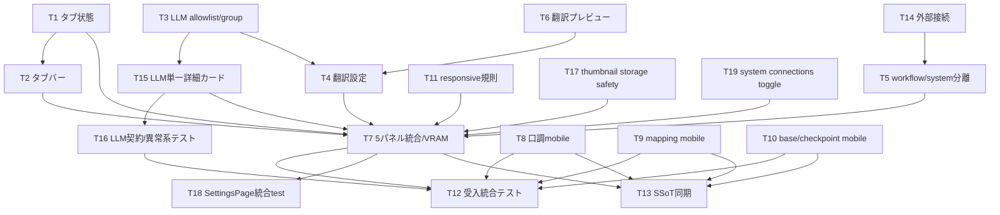

# Implementation Plan - REQ-314: 設定ページ水平タブ化

## Review Status
2026-10-04 ユーザー「OK」で設計と実装開始を承認済み。
[設計](REQ-314.md)・[テスト計画](REQ-314-test-plan.md)・全19Task Card（T3をT3/T15/T16に分割、Storage denial境界をT17へ追加、T7を実装/統合testへ分割、接続カード表示切替をT19へ抽出）を物理生成済み。
D1は既存6種類、D2は既存契約内に人間が確定済み。[決定記録](REQ-314-decisions.md)。
PBIのAC-4/AC-7を確定条件へ改訂済み。実装は進行中で、AC合格は最終統合検証まで未判定。2026-10-04のユーザー「OK」で最終設計レビューと実装開始を承認済み。

## Proposed Changes
既存SettingsPageの9分割componentを、目的別5tabへ再配置する。
LLMとWorkflowConnectionにgroupを設けて保存/queryロジックを再利用。常時mountのhidden panelで未保存draftを維持。
URL hash/LocalStorage/戻る進む・キーボードARIAを実装。翻訳provider draftで即時詳細表示。
翻訳原文プレビュー、VRAM実時間購読、768px境界のmobile snap・表card化・44px操作を追加する。
既存API/backend/schema保存keyを維持。SSoTは実装後のT13で同期。

## Confirmed Scope Decisions
- D1確定: 診断/生成promptは既存6種類。既存キー/保存/利用経路を維持し、7件目は追加しない。
- D2確定: Comfy既存URL編集・保存・疎通、Backend origin表示/health、LM Studio Backend経由疎通と環境設定案内。
  Backend/LM Studio URL編集、設定取得/保存API追加は本PBI対象外。LM URLを既定値で偽装しない。
- ブラウザ検証はユーザー手動のまま。自律検証はtypecheck/Vitest/DOM・契約・異常系とlocal QA。
- D1/D2と元14タスクの実装開始は承認済み。今回のT3内部分割は親coordinatorの指示で承認範囲内の作業として継続する。

## Task Decomposition
| ID | 内容 | 所有数/予定変更行 | 依存 |
|---|---|---|---|
| [T1](../backlog/task/active/REQ-314-T1.md) | タブ状態のURL・履歴・保存契約 | 3 / <=270 | なし |
| [T2](../backlog/task/active/REQ-314-T2.md) | 水平タブバーとキーボード操作 | 2 / <=245 | T1 |
| [T3](../backlog/task/active/REQ-314-T3.md) | LLM allowlist/group配線とdirty params保護 | 3 / <=275 | なし |
| [T4](../backlog/task/active/REQ-314-T4.md) | 翻訳設定の集約とprovider即時条件表示 | 2 / <=280 | T3,T6 |
| [T5](../backlog/task/active/REQ-314-T5.md) | ワークフローとシステム設定の表示責務分離 | 2 / <=210 | T14 |
| [T6](../backlog/task/active/REQ-314-T6.md) | 原文入力と翻訳プレビュー | 2 / <=255 | なし |
| [T7](../backlog/task/active/REQ-314-T7.md) | SettingsPageの5パネル統合とVRAM購読 | 1 / <=290 | T1,T2,T4,T5,T11,T15,T17,T19 |
| [T8](../backlog/task/active/REQ-314-T8.md) | 口調プリセットのモバイルカード表示 | 2 / <=230 | なし |
| [T9](../backlog/task/active/REQ-314-T9.md) | マッピングマスターのモバイル縦積み | 3 / <=275 | なし |
| [T10](../backlog/task/active/REQ-314-T10.md) | ベースモデル・チェックポイントのモバイル表示 | 2 / <=245 | なし |
| [T11](../backlog/task/active/REQ-314-T11.md) | 設定限定のレスポンシブ規則と小設定埋込 | 3 / <=215 | なし |
| [T12](../backlog/task/active/REQ-314-T12.md) | 受入統合テスト | 1 / <=290 | T7,T8,T9,T10,T16,T17 |
| [T13](../backlog/task/active/REQ-314-T13.md) | 実装後SSoTの設定仕様同期 | 3 / <=140 | T7,T8,T9,T10 |
| [T14](../backlog/task/active/REQ-314-T14.md) | 外部サービス接続カードの既存契約移動 | 2 / <=255 | なし |
| [T15](../backlog/task/active/REQ-314-T15.md) | LLM単一詳細カードと役割ラベル | 1 / <=180 | T3 |
| [T16](../backlog/task/active/REQ-314-T16.md) | LLM表示/保存/refetchのcomponent契約テスト | 1 / <=280 | T15 |
| [T17](../backlog/task/active/REQ-314-T17.md) | サムネイル比率hookのStorage拒否fallback | 2 / <=150 | なし |
| [T18](../backlog/task/active/REQ-314-T18.md) | SettingsPage統合受入テスト | 1 / <=300 | T7 |
| [T19](../backlog/task/active/REQ-314-T19.md) | システム設定の接続カード表示を任意化 | 2 / <=120 | T5 |

全カード本文300行以下。所有3file以下・追加削除合計300行以下で設計時atomicity PASS。
現行LlmSettingsSection.tsxは546行。旧T3の290行見積りを撤回し、T3=275/T15=180/T16=280行へ分割。既存JSX/query/mutationを局所変更し、全文移動・再インデントは行わない。
実装時超過が見えたら事前に分割設計を差し戻す。共有sourceはDAG順に実行し他担当変更を戻さない。

## Dependency DAG

最大4層: T3→T15→T7→T18、T3→T4→T7→T13、T3→T15→T16→T12。
T3後のT15/T4は並行可（T4にはT6も必要）。T15後のT16/T7は別source/testで並行可。
T7回帰testは原子性上限を守るためT18へ分割した。T12とは独立ファイルなので並行できる。T16/T18のPASSは最終Verifierの着手条件とし、全完了/QAで両方必須。
独立responsive T8/T9/T10/T11は並行可能。T7統合後T12検証/T13正本同期。
T13が先に完了してもPBIのDoneは全Gate/AC証拠を確認してから判断する。

## Verification Plan
各Task Cardに正確な型、20〜29行の既存snippet、typecheck/局所Vitestコマンド。
Gate 1: frontend typecheck。Gate 2: 指定局所/統合＋full suite。
Gate 3（自律）: Vitestで実行可能な異常系・API契約・DOM操作シナリオとlocal QA監査。実ブラウザ操作は自律テストから除外。
ユーザー手動確認: 1280/768/767/390/320px、1023/1024px AppShell境界、履歴/ARIA、provider切替、API実動作、live VRAM。tester-reviewerが日本語の未確認チェックリストを別途作成し、ユーザーが操作結果を報告した場合だけ実測として記録する。
CSS/44px/safearea実測をjsdomで代用しない。環境未取得はINCONCLUSIVE、手動項目はユーザー報告待ち。AC-4/7は改訂PBIに基づいて判定。
設計testは未実行。local BA audit/VRAM証拠は[監査記録](REQ-314-ba-audit.md)。

## Trade-off Disclosure
常時mountはdraftを守るが購読/メモリを増やす。同一Query cacheを共有しsystem側workflow取得を抑止する。
group再編は局所差分にするが既存大fileは残る。全面移動/編集器複製は今回採らない。
詳細stateは新v2キーで既定閉。旧13区分キーは削除せず維持する。
mobile表は同一DOM/DNDを維持し、読み上げ意味の実機確認はユーザー手動確認項目とする。
未保存翻訳認証でpreview結果を装わないよう保存後に実行する。
D1/D2は人間が推奨範囲へ確定済み。決定原文を残してACを改訂し、未検証のACをPASSにしない。

## Human Design Review Gate
[dev-design](C:/Users/audih/.gemini/config/skills/dev-design/SKILL.md) Step 2:
「Physically generate all Task Cards ... BEFORE requesting implementation_plan.md approval.」
および今回のarchitect指示「Return changed designs through the human design review gate」により、
D1/D2と元の最終設計レビューはユーザー「OK」で承認済み。T3/T15/T16は同じ承認範囲を300行以下へ分割する改訂で、親coordinatorが再レビュー不要と指示済み。
今回の改訂ではAC/API/保存契約を変更しない。新たな承認範囲の変更が必要な場合のみ人間設計レビューへ戻す。BA監査原出力・既存manifest/SHAは当時の証拠として保持し、今回の分割について新たな監査PASSを主張しない。

## Selected Tab Appearance Correction
T11はpage局所CSSで選択tabの背景/文字色/境界と全tabのfocus-visibleを担当（25行程度、総215変更行見積り）。T2のARIA選択/focus動作と責務を揃え、Tailwind文字列のtestは追加しない。実際の色/境界/ring可視性はT12のユーザー手動確認表へ記載する。
