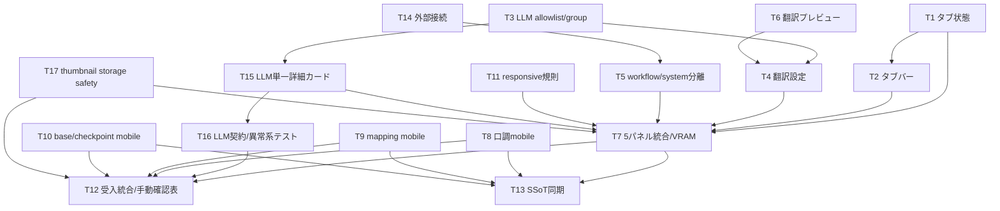

# REQ-314: 設定ページ水平5タブ設計

## Review Status
2026-10-04のユーザー「OK」で最終設計レビューと実装開始を承認済み。D1は既存6種、D2は既存契約内に人間が確定済み。承認範囲の19タスクの実装が完了した。
AC-4/AC-7は人間の確定条件でPBIを改訂済み。型チェック、全117ファイル・1,137テスト、配信用ビルドが成功。2026-10-05のユーザー「確認完了」により手動確認・AC受入完了。[決定記録](REQ-314-decisions.md)、[検証記録](REQ-314-walkthrough.md)。
BA監査・GPU解放記録は `REQ-314-ba-audit.md` に記載する。

## Feasibility / Boundary
技術的実現性: 5タブ、履歴、ARIA、目的別再配置、翻訳条件表示、モバイルは既存frontend内で実現可能。
当初の件数/URL編集範囲の矛盾はD1/D2の要件改訂で解消。現在のACは既存6種類と既存通信・保存契約の範囲で検証する。

Workspace/Git root: `C:/Users/audih/ws/comfy-create-helper2`。
対象: `frontend/src/pages/SettingsPage.tsx`、同名サブディレクトリ、既存共通row。
Backend/systemは証拠読取のみ。Git root mismatchなし。外部へのファイル編集は禁止。
GLOBAL_SCRIPTSはcontextのGLOBAL_ROOTから `C:/Users/audih/.gemini/antigravity/scripts` に展開済み。共有scriptはプロトコルで明示された実行に限る。
root AGENTS.mdは存在せず、ユーザー提供Context Resolution Directiveと `.agents/context.md` を適用。
dirtyな既存REQ-316 plan・Task Card等を保持し、REQ-314は独立節/独立docとして追加。
この役割では実装sourceを編集しない。

## SSoT Impact Analysis
`doc_mapper.py docs/specs docs/backlog/pbi/archive/REQ-314.md` はマッピングなし。
`doc_mapper.py docs/specs frontend/src/pages/SettingsPage` は `SPEC_SETTINGS.md` を特定。
対象を限定してSPEC_SETTINGS、同書参照先SPEC_COMMON/SPEC_SUMMARYを読んだ。

| 正本 | 変更影響 | 同期時点 |
|---|---|---|
| SPEC_SETTINGS | accordion→5tab、分類、詳細初期閉、storage/hash、components | T13（実装証拠で同期） |
| SPEC_COMMON | 設定局所768pxとAppShell lgの併存、tab ARIA参照 | T13限定追記 |
| SPEC_SUMMARY | 設定構造/コンポーネント参照 | T13限定追記 |
| 参考HTML `tmp/settings_layout_redesign_spec (2).html` | 分類/UX根拠。件数・URL編集矛盾を記録 | 参考を改変しない |
| REQ-314 PBI | AC-4/AC-7を人間の確定条件へ改訂済み | REQ-314-decisions.mdへ原文と範囲を記録 |

API/schemaを変更せず既存client関数を使用するためOpenAPI変更抽出は省略。
`docs/system/openapi.yaml` は存在せず、存在するAPI型・client・backend定義とSPEC_SETTINGS表で既存契約を照合した。
client/provider正規値は `google_cloud`（SPEC_SETTINGSの旧google表記は同期時に修正）。Backend実際疎通は `/health`。

## Confirmed Scope Decisions
[決定記録](REQ-314-decisions.md)、2026-10-04人間指示を適用。

### D1: 既存6種類（確定）
当初PBI/参考HTMLの「7種類」は列挙・現行キーの6種類と不一致だった。人間は「D1:6種に合わせる」と決定。
AC-4/Requirementを6種類へ訂正し、次の既存キーと利用経路を保持する。
```text
audit_interference
audit_interference_anima
audit_vocabulary
audit_physical
scene_generate
scene_generate_anima
```
7件目の新設や架空のeditor追加はしない。AC-4は改訂済み6種類と配置/詳細初期閉/保存互換で判定する。

### D2: 既存契約内（確定）
人間は「D2:既存契約内に限定する」と決定。Comfy既存URL編集・保存・疎通確認、Backend同一origin表示/health、LM Studio Backend経由モデルAPI疎通/環境設定案内を採用。
- frontend/src/api/client.tsはBASE_URL='/api'。Backendは同一origin相対通信。
- configApi.get() / backend /api/configはcomfy_urlの読取のみ。Backend/LM Studio URLの取得・変更APIは追加しない。
- LM Studio URLはbackend .env LLM_BASE_URLで管理。フロントが現在値を取得できないため既定1234を現在値として偽装しない。
- Comfyは既存ConnectionActions.setComfyUrl(url:string):void、LS_KEYS.COMFY_URL、接続再初期化を利用する。
Backend/LM Studio URL編集は本PBI対象外。改訂AC-7で接続カード/VRAM/表示設定の集約と既存契約内の動作を検証する。
D1/D2の未決定によるBLOCKEDは解消。実装・AC合格は最終設計承認と実検証の後に判断する。

## Framework / Architecture
React 18 + React Router BrowserRouter + TanStack Query + Zustand + Tailwindを使用。
既存SettingsPageは9個のcomponentに分割済み。LLMとWorkflowConnectionに異なる目的の設定が混在している。
一括ファイル移動は既存大量ロジックの変更増大を招くため、既存componentに目的groupを加え、同じquery/mutationを再利用する。
未来の別PBIでさらに小さいcardへ抽出できるが今回は保存仕様の移行を伴わない。

| Tab ID | desktop名 | mobile名 | 基本カード/詳細 |
|---|---|---|---|
| workflows | ① ワークフロー・モデル | ① モデル | workflow CRUD/差分/復元/presets、BaseModel/checkpoint、MappingMaster |
| prompt | ② プロンプト支援 | ② 呪文 | main LLM、診断/生成詳細（既存6 promptと2 params） |
| dialogue | ③ セリフ支援 | ③ セリフ | tone presets、VLM/LLM＋bubble、3役割prompt/params詳細 |
| translation | ④ 翻訳 | ④ 翻訳 | provider/auth/debounce、入力プレビュー、LLM専用詳細 |
| system | ⑤ システム・一般 | ⑤ システム | 接続、VRAM guard/live meter、thumbnail preview＋長押し2種 |

長いアクセシブル名をaria-labelに常時使用。mobile短縮labelはPBIが参考HTMLより優先。
workflows/base/mapping/tone/guardなど基本cardは常時展開、低頻度詳細prompt/dialogueだけ既定閉。
workflowsのpreset展開は既存状態を維持する。

## State / Navigation Contract
新型:
```ts
type SettingsTabId = 'workflows' | 'prompt' | 'dialogue' | 'translation' | 'system'
type DetailsState = { prompt: boolean; dialogue: boolean }
type LlmSettingsGroup = 'prompt' | 'dialogue' | 'translation'
```
新LS_KEYS:
- SETTINGS_ACTIVE_TAB = `prompt-surgeon-settings-active-tab`
- SETTINGS_DETAILS_EXPANDED_V2 = `prompt-surgeon-settings-details-expanded-v2`

初回は有効hash > 有効storage > workflows。無効/空hashは選択結果でreplaceし正規化。
初回以降の戻る/進むはlocationが優先。空/無効hashはworkflowsへreplace。
ユーザー選択はnavigateでpush。現在tab再選択は履歴を増やさない。pathname/searchを保持。
URL→state→storageの単方向反映で無限更新を防ぐ。storageは読書き例外を捕捉する。
詳細v2はobject/boolean検証し、不正JSONはfalse/false。旧13区分storageは書換・削除せず残す。

全5tabpanelを固定keyで常時mountし、非選択にhiddenを付ける。CSSでhidden display:noneを保証。
選択tab/panelはaria-selected/controls/labelledby対応、roving tabIndex。
ArrowLeft/Rightは循環して自動選択、Home/Endは先頭/末尾、通常Tabは選択tabからpanelへ。
focusしたtabを最小scrollIntoView。hover/scrollだけでは選択を変えない。
非選択のDOMはhiddenでアクセシビリティtree/Tab順から消え、未保存draftは維持。
modalは親panel配下（新body portalを作らない）。非選択panelのmodalが全画面を覆わない。
ページを離れた後の未保存draft永続化は新設しない。

## LLM Purpose Ownership
| group | model key/契約 | prompt key | params key |
|---|---|---|---|
| prompt | llmPromptsApi.getCurrentModel/updateCurrentModel | D1の6既存key | llm_params_audit, llm_params_scene_generate |
| dialogue | speech_draft_vlm_model, speech_draft_llm_model | speech_draft_vlm_prompt, speech_draft_llm_prompt, speech_rewrite_system_prompt | llm_params_speech_draft |
| translation | translation_model（空ならmain継承） | translation_ja_to_en, translation_en_to_ja | llm_params_translation |

speech labelsは①画像シチュエーション読み取りプロンプト(VLM)、②セリフ自動生成プロンプト(LLM)、③キャラクター口調変換プロンプト(LLM)。
PARAM_FIELDS/DEFAULT_PARAMS・PUT `{content}` を維持。groupを横断するkey再分類・JSON形式変更なし。
prompt allowlist外のmodel/api/debounce/bubble/unknown recordをprompt editorへ表示しない。
LlmSettingsSectionへ `modelFooter?: React.ReactNode` を追加しdialogueモデルcard内にBubbleDetectionSection embeddedを収める。
prompt/dialogueの詳細はそれぞれ単一card内にprompt＋paramsを置き、同じ詳細stateを使う。
React QueryのqueryKeyを維持し、同じprompt編集editorは分類上1回だけ描画。
group instanceのquery購読は重複するが同一Query cacheを共有する。不要workflow queryはsystem instanceでdisabled。
refetchによる未保存provider/credential/LLM paramsの上書きをdirty単位で防止。完了順序はserver再読込と保存成功値を照合。

## Translation Reactive Flow
基本設定provider draftが唯一の条件表示正本。provider==='llm'だけLLM詳細を表示。
他providerでも詳細componentのstateをhidden内で保持する。モデル/プロンプト/params入力をリロード不要で切替。
認証key/urlはgoogle_cloud/deeplのみ表示。FuguMTはproviderのみの従来更新契約を守る。
translation_debounceは既存key/300..2000ms/step50/既定500を移動。
既存疎通テスト・統計・cache clear・google_free移行を保持。

新TranslationPreviewCardのprops:
```ts
{ provider: 'google_cloud'|'deepl'|'llm'|'fugumt'; enabled: boolean; debounceMs: number }
```
原文・方向変更後debounceで既存translateApi.translatePromptを呼び、訳文/errorを即時更新。明示buttonでも実行可能。
API credentialsは保存値を使用するため基本設定未保存/保存中/失敗ではpreviewを無効化し保存案内。
input/direction/provider/enabled変更でrequest sequenceを無効化し古いresponseは表示しない。
空白は送信しない。new AbortSignal契約を追加せずUI競合を処理する。
保存provider切替時の旧訳文はクリアし、保存成功とrefetch同期後に新入力から再実行。
LLM用モデル/prompt/paramsは既存各保存buttonで保存して利用する。

## System / VRAM
SettingsPageで `useSystemStats():void` を1回呼び、settings滞在中のWS購読を確保。
VramGuardSectionの既存store読取とsettingsApi.getVram/updateVramを維持。
Page Visibility復帰・unmount cleanupは既存hookが担う。複数購読を新設しない。
WS値更新で実時間メーターを更新。未取得/切断は既存fallbackと未取得表示を使い0GBを偽造しない。
Comfy設定は新ServiceConnectionCardが既存storeを用いる（D2確定条件）。
現行ConnectionStatusはHTTP statusを確認せずfetch解決だけで成功にするため、T14の新card内でresponse.okと3秒timeoutを確認する。既存共通componentを全面改修しない。
thumbnailはlivepreview維持、長押し既存2キー/0.1..5秒を同じ表示目的に集約。

## Responsive Contract
設定局所breakpointは768px。AppShellはlg(1024px)でdesktop navへ切替する現行契約を維持。
768..1023pxはタブはdesktop等幅・AppShellはbottom navという組合せも検証する。
mobile tabbarだけ横scroll＋snap。ページbody/tableによる不必要な横overflowは許容しない。
両端fadeはdecorative pointer-events:none。selected/focused tabがfadeで操作不能にならない。
settings scroll領域のmobile bottom padding=calc(6rem + env(safe-area-inset-bottom))（pb-24相当）。
AppShell既存main paddingとは別にページ最下段操作の余白を確保する。既存global navを改変しない。
SettingsResponsive.cssは `.req314-settings` 配下に限定、他画面のSettingsComponents rowへCSSを波及させない。

主要表はSpeechTone、BaseModel/checkpoint、MappingMasterを対象。単一table DOMをblock/cardへ変換しdata-labelとsemantic見出しを保つ。
mobileで指示prompt/checkpoint名は全文wrap。DND/selection/ref/transform/IDを維持する。
workflow/presetは既存list型をwrapし44px対象にする。modal/formもviewport内でscrollできる。
全可視button/入力/select/textarea/drag/checkbox hitboxは両辺44px以上を実測。checkboxは44pxlabelも含めクリック可能にする。
range見た目のthumbだけで判定せずinput操作領域を測定。hidden/file hidden inputは可視操作対象から除外。

## Task Decomposition / DAG
- T1: タブ状態のURL・履歴・保存契約（3 files / 270変更行以下、依存:なし）
- T2: 水平タブバーとキーボード操作（2 files / 245変更行以下、依存:T1）
- T3: LLM allowlist/group配線とdirty params保護（3 files / 275変更行以下、依存:なし）
- T4: 翻訳設定の集約とprovider即時条件表示（2 files / 280変更行以下、依存:T3,T6）
- T5: ワークフローとシステム設定の表示責務分離（2 files / 210変更行以下、依存:T14）
- T6: 原文入力と翻訳プレビュー（2 files / 255変更行以下、依存:なし）
- T7: SettingsPageの5パネル統合とVRAM購読（2 files / 290変更行以下、依存:T1,T2,T4,T5,T11,T15,T17）
- T8: 口調プリセットのモバイルカード表示（2 files / 230変更行以下、依存:なし）
- T9: マッピングマスターのモバイル縦積み（3 files / 275変更行以下、依存:なし）
- T10: ベースモデル・チェックポイントのモバイル表示（2 files / 245変更行以下、依存:なし）
- T11: 設定限定のレスポンシブ規則と小設定埋込・選択tab表示（3 files / 215変更行以下、依存:なし）
- T12: 受入統合テスト（1 file / 290変更行以下、依存:T7,T8,T9,T10,T16,T17。walkthrough/手動表はtester-reviewer所有）
- T13: 実装後SSoTの設定仕様同期（3 files / 140変更行以下、依存:T7,T8,T9,T10）
- T14: 外部サービス接続カードの既存契約移動（2 files / 255変更行以下、依存:なし）
- T15: LLM詳細カードの単一開閉と役割ラベル（1 file / 180変更行以下、依存:T3）
- T16: LLM表示/保存/refetch契約test（1 file / 280変更行以下、依存:T15）
- T17: サムネイル比率hookのStorage拒否fallback（2 files / 150変更行以下、依存:なし）

最大4層: T3→T15→T7→T12/T13、T3→T15→T16→T12、およびT3/T6→T4→T7→T12/T13、T14→T5→T7→T12/T13。T17は独立rootでStorage拒否境界からT7/T12をgateする。
T1→T2は型import依存。T8/T9/T10は独立。T11 CSSはT7で読込。
全taskは所有3files以下・追加削除合計300行以下の見積り、全カード本文300行以下。
T3/T15は同一sourceを共有するため依存順。T4は別sourceを所有しT3後にT15と並行可。異なるtaskがSettingsComponentsを編集する場合も所有者を確認する。
変更行超過が見えたら実装前にarchitectへ内部task分割を戻す。

## Upstream / Downstream Dependencies
上流: REQ-314 PBI/HTML、確定済みD1/D2、ReactRouter route /settings、Query cache/store、現行API/LLM key一覧。
既存機能依存: workflow差分置換/rollback/プリセット、BaseModel checkpoint、MappingMaster DND、多言語translation、SpeechTone modal再export。
下流: Generate/Speech利用の設定保存値、Comfy接続再初期化、thumbnail/longpress全画面表示、VRAM guard、SPEC参照。
Query/API/storage/model設定の意味を維持することで下流へのデータ移行を避ける。
SettingsPageの既存SpeechTonePresetModal exportを保持する。

## Test Strategy
`REQ-314-test-plan.md` に全ACとINT/E2E/RTを定義。
Gate 1 frontend typecheck、Gate 2局所/統合/full suite、Gate 3自律実行可能な異常系・API契約・DOM操作シナリオとlocal QA監査。実ブラウザ検証はユーザーによる手動確認とし、自律テストから除外する。
ブラウザ寸法/履歴/keyboard/API実動作の手動確認結果はユーザー報告待ち。未報告を自律テスト失敗とは扱わず、未確認のACをPASSとしない。AC-4/7は改訂PBIで判定し、実検証前にPASSとしない。
設計時点で実装test未実行。BA auditは設計監査であり、実装品質の証拠には使わない。

## Trade-off Disclosure
- 常時mountはtab往復draftとmodal状態を保つがメモリとquery購読が増える。同じcacheを共有しsystem側不要workflow fetchをguard。
  選択panelだけunmountする案は未保存値が消えるため不採用。
- group propsは大量コード移動を避けるが大きい既存ファイルは残る。目的editorの新規複製は保存仕様の乖離を招くため不採用。
- 新v2詳細stateは既存全展開の記録を引き継がず既定閉にする。旧storageを消さず復帰余地を残す。
- mobile表CSSは単一DOM/DNDを保つが読み上げ意味の実機確認が必要。別mobile複製DOMは二重focus/ID問題を増やす。
- Backend/LM Studio URL編集は本PBI対象外。D2は既存契約内に確定しAPI/schemaを維持する。
- D1は6既存promptへ確定。既存機能を維持しACの件数を訂正する。
- provider draftは表示だけ即時、実際翻訳は保存済authを使う。未保存previewを止める理由は画面に簡潔表示する。
- 17taskは各編集量を局所化し最大4層。共有sourceは順次dispatchし、独立responsive taskを並行可能。

## T3 Atomicity Revision (2026-10-04)
現行LlmSettingsSection.tsxは546行。旧T3の290変更行見積りを撤回し、T3（allowlist/group/dirty保護、3file/275行）、T15（単一詳細UI、1file/180行）、T16（DOM/保存/refetch契約test、1file/280行）へ分割する。
元のD1/D2・6/3/2prompt・2/1/1params・旧caller/API/schema/store契約を維持。既存editorとquery/mutationを再利用し全面書換えしない。
T4はT3/T6、T7はT15と他既存前提、T12はT16を待つ。T16はT7と別所有で並行可。人間「OK」の承認範囲内として親coordinatorが継続を指示した内部分割で、既存監査PASSの追加主張はしない。
