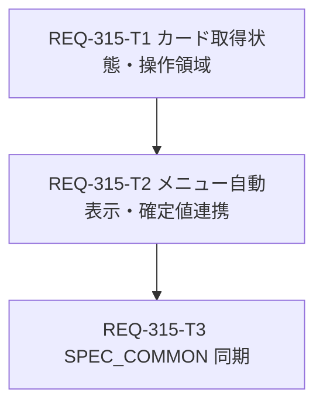

# Implementation Plan: REQ-315

既存の `implementation_plan.md` は別 PBI の REQ-313 を記述しているため、REQ-315 のレビュー用計画はこの専用ファイルに置く。人間の設計レビュー後に Task Card を実装へ渡す。

## Proposed Changes

- `REQ-315-T1`: 和訳カードで親サブメニューを操作領域に含め、翻訳要求の番号管理、旧結果破棄、空応答・10秒タイムアウト表示を実装する。対象はカード本体とそのテストの2ファイル。
- `REQ-315-T2`: サブメニュー展開と同時にカードを表示し、確定済み `baseText` のみカードへ渡す。Enter/blur の確定後は親 `text` の更新で自動翻訳する。対象は `TagChip.tsx` とそのテストの2ファイル。
- `REQ-315-T3`: 実装確認後、マージ前に `SPEC_COMMON.md` 第3-5節を同期する。文書1ファイル。

## Task Decomposition & Parallelism DAG

最大深度は3。各 Task Card の変更対象は2、2、1ファイルで、推定変更量は200、160、30行以下。T2 は T1 の新しい `menuRef` 契約に依存する。T3 は受け入れ済みの実装動作を正本へ反映するため T2 の後とする。

## Verification Plan

局所確認は各 Task Card の対象 Vitest。最終 Gate 1 は `cd frontend; npm run typecheck`、Gate 2 は全テストの `cd frontend; npm test`。Gate 3 は `REQ-315-test-plan.md` の初回表示、Enter/blur、取消、失敗、逆順到着、タグ切替、空応答・タイムアウト、PC/モバイル操作を確認する。設計段階で実装テストは実行しない。

## Trade-off Disclosure

- 自動表示によりメニューを開くたびに翻訳 API を呼ぶが、入力途中の逐次翻訳は行わない。既存バックエンドキャッシュを利用する。
- 10秒のカード側期限は UI の無限待機を防ぐ一方、正当に遅い翻訳も失敗扱いにする可能性がある。現行 API クライアントには中断シグナルがないため、期限後も通信自体は継続し得る。後着結果は番号照合で破棄する。API シグネチャを広げる案は今回の変更面積に見合わない。
- 翻訳ボタンは任意の閉じる・再表示用に維持する。削除するとカードを閉じた後の同一メニュー内の復帰導線がなくなる。
- タグ名入力欄で Escape を押すと現行どおりメニューとカードが閉じる。「訳を維持」は取消文言の訳で確定値を上書きしない解釈とし、再表示時に確定値を再取得する。

## Risks

親からの `text` 更新を唯一の翻訳トリガーとするため、親が `onEdit` 後に値を反映しない特殊な利用箇所では訳も更新されない。`TagChipEditor` の通常経路は親状態を更新する。複数要求の競合、アンマウント、カード内操作と外側クリックの境界を局所テストと Gate 3 で確認する。
