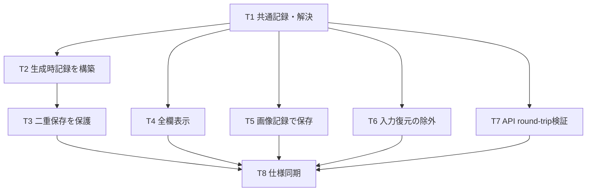
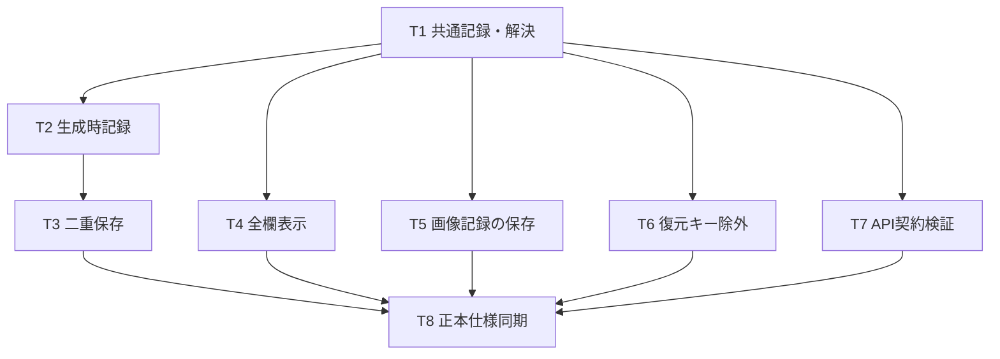

### REQ-316: 生成画像メタ情報で全プロンプト欄の全文を確認する

- **Type**: feature
- **Status**: in-progress
- **Current step**: design-planning
- **Priority**: P2
- **Surface**: 生成画像プレビューおよび保存済み画像詳細の既存メタ情報表示。
- **User wish**: メタ情報にQuality欄のプロンプトだけが表示され、他の入力欄の内容を確認できない。全欄のプロンプトを確認できるようにしたい。
- **Operational need**: 画像に対応した生成時のプロンプトを、入力した欄との対応が分かる状態で振り返れること。

#### 5 Whys / 要望の背景

1. なぜ全欄を見たいか: Quality以外の欄へ入力した内容をメタ情報で確認できないため（ユーザー申告）。
2. なぜQualityだけでは足りないか: 複数の入力欄があり、一部の表示では入力内容の全体を確認できないため（文書と申告に基づく整理）。
3. なぜ全体を確認する必要があるか: 生成結果と、その結果に使われたプロンプトを対応付けて振り返るため（推論）。
4. なぜ現在の入力欄を見るだけでは足りないか: 生成後の編集によって現在値と過去の画像に使われた値が異なる場合があるため（既存仕様に基づく整理）。
5. なぜ画像に紐づく全文表示が必要か: 当該画像の生成条件を欠落や取り違えなく確認するため（推論）。技術的な原因は未調査。

#### UX Classification

- **Information Design（情報設計）**: 各欄の名前と、その画像に使われたプロンプト全文を対応付けて提示する。
- **Interaction（操作）**: 長い内容もメタ情報表示から末尾まで確認できる。
- **Visual（視覚）**: 独立した見た目の刷新は今回要求しない。

#### Requirement

- 対象画像の生成時に存在した全プロンプト欄を対象とする。ネガティブ欄が存在する場合も含める。固定の欄数・欄名を仮定しない。
- 各欄の生成時の有効プロンプト全文を、元の入力欄が識別できる名前とともに確認できる。
- 長文の末尾まで確認できる。折りたたみ・スクロール等の方式は設計で決める。
- 新規生成画像では、生成時の全欄の全文が後日の閲覧でも確認できることを要求する。現在の保存形式や保存の完全性は前提にせず、必要な変更範囲は設計で評価する。
- 既存画像は記録されている欄を表示し、記録のない内容を現在の入力値から補完しない。「空欄」は生成時の空の値が記録されている状態、「未記録」は生成時の値が記録されていない状態を表す。
- 対象欄は生成時点のワークフローに存在した欄のみ。後日追加された欄を過去画像の未記録欄として扱わない。生成時の欄構成や記録の完全性を判定できない既存画像では、全体に「未記録の項目がある可能性があります」と表示して完全な記録と誤認させない。
- 保存済み画像も対象とし、既存のQualityおよびその他の生成パラメータも確認できる。

#### Acceptance Criteria (AC)

- [ ] AC-1: Given QualityとQuality以外の全プロンプト欄それぞれに異なる有効文字列を入れて新規生成した画像がある, When その画像のメタ情報を開く, Then 全プロンプト欄について生成時の有効文字列と元の欄を識別できる名前が対応付けて表示される。
- [ ] AC-2: Given ネガティブプロンプト欄に有効文字列を入れて新規生成した画像がある, When その画像のメタ情報を開く, Then ネガティブ欄の名前と生成時の有効文字列が確認できる。
- [ ] AC-3: Given 一つの欄に日本語・改行・括弧・重み表記を含む2000文字以上の有効文字列を入れて新規生成した画像がある, When その欄のメタ情報を末尾まで閲覧する, Then 表示された全文は生成時の有効文字列と一致し、末尾も確認できる。
- [ ] AC-4: Given 画像Aの生成後に全プロンプト欄の入力を別の文字列へ変更している, When 画像Aのメタ情報を開く, Then 各欄は画像Aの生成時の値を表示する。
- [ ] AC-5: Given Quality以外の欄にも有効文字列を入れて新規生成した画像を保存している, When 保存済み画像の詳細からメタ情報を開く, Then 生成直後と同じ全欄の名前と有効文字列が確認できる。
- [ ] AC-6: Given 新規生成時に値が空だったプロンプト欄がある, When その画像のメタ情報を開く, Then その欄は名前と「空欄」の表示により空の値として識別できる。
- [ ] AC-7: Given 既存画像の記録にはQualityの値だけがあり他欄の値が記録されていない, When その画像のメタ情報を開く, Then 未記録のプロンプト欄がある旨の「未記録」表示を確認できる。
- [ ] AC-8: Given AC-7の既存画像があり現在の入力欄には別の値が入っている, When その画像のメタ情報を開く, Then 現在の入力欄の値は当該画像の生成時プロンプトとして表示されない。
- [ ] AC-9: Given 有効タグと無効タグを含む欄で新規生成した画像がある, When その画像のメタ情報を開く, Then その欄のプロンプトには無効タグが含まれない。
- [ ] AC-10: Given Qualityの有効文字列とシード値などの既存生成パラメータが記録されている画像がある, When その画像のメタ情報を開く, Then 記録されたQualityの文字列と既存生成パラメータの値が従来どおり確認できる。

- [ ] AC-11: Given ワークフローに新しいプロンプト欄を追加する前に生成した画像があり生成時の欄構成が確認できる, When その画像のメタ情報を開く, Then 後から追加された欄は当該画像の未記録欄として表示されない。
- [ ] AC-12: Given 生成時のプロンプト欄構成も記録の完全性も判定できない既存画像がある, When その画像のメタ情報を開く, Then 「未記録の項目がある可能性があります」と表示される。

#### Inferred points

<inferred_points>

- 目的を「生成時の内容の振り返り」と解釈した。コピー・再利用・再生成の操作追加は依頼されていない。
- 「全欄」は対象画像のワークフローの全プロンプト欄（存在する場合のネガティブ欄を含む）と解釈した。
- 表示対象は生成に使われた有効プロンプトと解釈した。無効化したタグは含めない（SPEC_GENERATEの既存仕様）。
- 生成ページの画像プレビューと保存済み画像詳細の双方を対象と仮定した。
- 既存画像でも取得可能な記録は表示する。未記録の内容の復元は要求せず、空欄と未記録を区別する。未記録の具体的な欄名まで分からない場合は全体への「未記録」表示を許容する。
- 技術的な原因は未調査。実装コードは閲覧していない。上記の解釈はユーザーレビューで確認する。

</inferred_points>

#### 参照文書

- `docs/specs/SPEC_GENERATE.md`: プロンプト入力パネル、生成時メタ情報、履歴プレビューモーダル。
- `docs/specs/SPEC_HISTORY.md`: 保存済みスナップショット詳細。

#### BA contradiction audit

- 2回のローカル監査を実施済み。最終判定は技術確認を条件とする承認（無条件PASSではない）。両回とも直後のモデルunload成功。詳細と出力の読み違いを `docs/backlog/ba-audit/REQ-316.md` に記録した。
- 設計時に、生成時の記録と欄名の対応、および既存記録の完全性を確認する必要がある。実際の欠落原因や変更箇所をこの要件で断定しない。
- 承認ゲート: 物理PBIドラフトの明示承認までdraftを維持し、ready変更およびdev-coordinatorへの引き渡しは行わない。


#### Approval history

- 2026-10-03（Asia/Tokyo）: ユーザーが「実装計画へ進めてよいですか？」に「OK」と回答し、REQ-316の要件と計画着手を明示承認。
- 承認後、PBI状態を `ready` から `in-progress` へ遷移。現在は設計・テスト計画の人手レビュー待ちであり、実装開始は未承認。
---
id: REQ-316-design
status: review-pending
tags: [prompt-surgeon, metadata, information-design, frontend]
related_paths:
- docs/backlog/pbi/active/REQ-316.md
- docs/specs/SPEC_GENERATE.md
- docs/specs/SPEC_HISTORY.md
- frontend/src/components/HistoryModalPreview.tsx
- frontend/src/pages/GeneratePage/hooks/useGenerateAction.ts
- frontend/src/pages/GeneratePage/hooks/useSnapshotActions.ts
---
# REQ-316: 全プロンプト欄の生成時メタ情報

## Boundary Audit
- WORKSPACE_ROOT / Git root: C:/Users/audih/ws/comfy-create-helper2（git -c safe.directory=... rev-parse で確認）。
- Target_Paths: 同ルートのfrontend/、backend/、docs/。アプリケーション調査・変更対象に外部パスなし。Git_Root_Mismatch: No。
- GLOBAL_ROOTの<USER_HOME>はC:/Users/audihに展開、GLOBAL_SCRIPTSはC:/Users/audih/.gemini/antigravity/scripts。開発者指定の役割・スキルとそのCLIだけを外部から読み取り/実行した。
- 調査時に他REQの作業差分あり。REQ-316以外の編集を保存・変更しない。本設計作業の編集はdocs/とimplementation_plan.mdに限定。
- 実現性: AC-1〜12は通常のマッピング済みワークフローで実現可能。既存画像の失われた内容・名前・生成時欄集合は復元不能なので曖昧性を表示する。

## Evidence / 現行経路
|段階|実コード根拠|確認結果|
|---|---|---|
|欄定義|api/types.ts:38-46、useWorkflowManagement.ts:165付近|roleあり、input_type=textareaのmappingsがプロンプト欄。display_nameが入力UIの名前。固定欄数やpositive/negativeの固定名はない。|
|有効値|multiSetSlice.ts:19-33、useGenerateAction.ts:233-239、393-401|chipsToStringで有効タグを反映し、その後applyParamSync。単一生成・セット別生成の両方がこの値を使う。|
|投入|workflowParamInjector.ts:217付近、useGenerateAction.ts:258-275、420-438|getInitialParamsのデフォルトと画面値をマージしてinject。キューmetadataはsyncedParamValuesであり、デフォルト補完された値と必ずしも同一ではない。|
|記録|jobQueueSlice.ts:139-156、prompt_metadata.py:38-55|prompt IDごとのlocalStorageとparam_valuesのJSON Text。文字数切り詰め処理は当該経路に見つからない。|
|保持|jobQueueSlice.ts:161-179、prompt_metadata.py:58-74|ローカル200件・サーバー1000件で古い記録を削除。|
|保存|useSnapshotActions.ts:25-54、78-80、snapshot_service.py:167-169|URLのtから生成記録を解決しparamsにコピー。ただし欠落/破損/失敗時に現在入力へ戻る。|
|閲覧|HistoryModalPreview.tsx:167-204、307-317、345-346、513-535|findで最初の正・負のキーだけを表示するため、他欄が記録されていても非表示。空文字も条件描画で消える。|
|復元|useWorkflowParams.ts:83-89|snapshot.paramsの全キーを文字列へ変換して入力ストアへ渡すため、記録用予約キーを除外する必要がある。|

Qualityのみ見える直接原因は表示のfind。BA監査で挙がった切り詰めや文字コード損失は実コード上の確認事実ではない。

## Contract / 生成時記録
既存params/param_valuesの辞書に、予約キー `__prompt_surgeon_metadata_v1` の**JSON文字列**を追加する。Record<string,string>を維持し、APIのトップレベル型・DB列・マイグレーションを増やさない。
JSON内部の契約:
```ts
interface PromptFieldRecord {
  mapping_id: number;
  node_id: string;
  role: string;
  display_name: string;
  value: string | null; // ''=記録された空欄、null=未記録
}
interface PromptRecord {
  version: 1;
  workflow_id: number;
  completeness: 'complete' | 'partial' | 'unknown';
  fields: PromptFieldRecord[]; // 生成時mappings順、重複roleもmapping_idで識別
}
```
- `buildPromptRecord(workflow: Workflow, injectedWorkflow: Record<string, unknown>): PromptRecord` を共通utilityに置く。
- handleGenerate/handleGenerateSetsの開始時にworkflowのjson_body/mappingsを複製して固定する。同期後のparamValuesでinjectした、**bypass前の**各ジョブのgraphからtextarea各欄の実値を読む。注入先キーはinjectGeneralParamと同じ規則: param_nameが存在すればそれ、なければvalueが存在すればvalue、なければparam_name || 'value'。文字列をそのまま記録しtrim/再構成しない。
- 全textarea mapping（roleがnullでない）を含め、display_name || roleで欄名を固定する。重複表示名/roleはroleとnode_idを添えて識別する。negativeもinput_typeで対象に入り、キー名検索では決めない。
- ノードなし、非文字列値、重複mapping_id、予約キーと同名roleがあるなど不整合ではcompleteにしない。予約キー衝突は投入前に理由を通知して停止し、値を上書きしない。欠落ノードはvalue=null/partialとする。正常な新規生成でnullが発生した場合はAC不達として修正する。
- bypassは生成処理として維持する。ここでいう有効プロンプトは現在の生成フックが注入する有効文字列であり、ComfyUI内部で連結・エンコードされた最終文字列を逆算するものではない。bypassで対象ノードが取り除かれた場合にも生成時入力欄の注入文字列を記録する（欄定義は生成時のもの）。
- paramsの通常キーは既存metadata同様に保持し、Quality・seed等・LoRA表示の契約を維持する。既存seed記録方式の改善は本REQの範囲外。
- 予約キーはComfyUI入力やプリセット/編集ストアへ戻さない。生成metadataの新レコードは毎回構築し、以前の予約キーは除去する。

## Persistence / 保存と取得
- queuePromptのmetadataに `workflowId?: number` を追加し、呼出元の固定workflow.idを渡す。永続化でget().selectedWorkflowIdを後読みして取り違えない。
- queuePrompt開始時にmetadataを複製。URLのt/取得prompt_idで対象画像と結び付ける。localStorage例外がサーバー保存を妨げないよう保存を個別try/catchし、ComfyUI投入成功はmetadata書込失敗で「投入失敗」に変えない。保存失敗は「生成時メタ情報の保存に失敗しました」と既存通知経路へ表示する。
- サーバー保存は現行の非同期方式を維持する。ローカルに保存できれば直後の閲覧/保存には利用可能。サーバーだけ成功するケースも画像IDから取得できる。両方失敗した場合、欠落を未記録として表示し、現在入力で補完しない。
- **保持上限200/1000件は維持する。** 未保存画像の全期間永続保持は対象外。保存済み画像はSnapshot.paramsに独立コピーされるため、元prompt metadataやlocalStorageが削除されても表示できる。後日閲覧の保証は保存済み画像について成立する。この保持制約はレビューで明示する。
- `resolveRecordedMetadata(promptId: string | null): Promise<ResolvedMetadata | null>` は共通utilityに置く。ローカルのJSON破損、paramValues非辞書、appliedAssets欠落はサーバー照会を妨げない。paramsとassetsの妥当性は独立に判断する。
- valid version-1記録のあるローカルを優先。ローカル欠落/破損/旧形式ではサーバーを照会し、version-1記録を優先、取得不能なら利用可能な旧paramsを返す。server.prompt_idが対象IDと異なれば不採用。paramsとassetsを別画像/別取得元から合成しない。
- useSnapshotActionsのfallbackはparams={}、assets={}（workflow_idは記録のworkflow_idがあればそれ、なければ既存selectedWorkflowId）。通常キーを現在のparamValuesから取得しない。旧記録も予約キーを作らずそのまま保存する。
- 保存済み画像はsnapshot.paramsのみを正本とする。空辞書でもlocalStorage/serverへの再補完をしない。記録のない画像も既存画像の保存操作自体は可能で、メタ情報は未記録となる。

## View / 表示規則
`getPromptView(params: Record<string, unknown> | null): PromptView` は現行ワークフローや現在入力を受け取らない純関数。
- 妥当なv1: fieldsを生成時の順番で全件表示。value===''は「空欄」、nullは「未記録」。partialは欄別表示に加え「未記録の項目があります」を表示する。
- 旧形式（予約キーなし）: **保存されている全scalar項目**をキー名で「記録済みの項目（生成時の欄構成は不明）」に表示する。既存Prompt/negativeに該当する文字列も失わず、任意role名も見える。生成時のdisplay_nameが失われている場合は保存キーが識別名になる。ここでは各項目をプロンプト欄だと断定しない。既存のseed等の整形表示は併存できる。
- 旧形式、未知version、不正record、欄集合/完全性不明は「未記録の項目がある可能性があります」を常に表示する。利用可能な通常キーの値は見せるが、不正recordをcompleteとして採用しない。
- paramsなし/{}は「生成時プロンプトは未記録です」および可能性表示。既存Loading表示は維持し、取得エラーと読み込み中を区別する。
- 完全なv1記録には後日追加された欄を追加しない。現行workflowの取得/マスター照会を表示根拠にしない。
- 各欄は見出し＋全文。パネル全体の既存overflow-y-autoとwhitespace-pre-wrap/break-allを使用。省略、truncate、line-clamp、文字数上限をプロンプト本文に付けない。Reactのテキストとして描画しHTMLを解釈しない。
- 記録だけでもInfoを開けるようにする。画像切替ではquery key/有効ソースを切り替え、前画像の記録を表示し続けない。

## SSoT Impact
doc_mapper実行結果はNo mapped documents。PBI参照先と現行実装から手動補足した。
- SPEC_GENERATE: §6の記録契約、保存欠落時の扱いと保持上限、§6-2の全欄/空欄/不確実性/長文表示を同期。
- SPEC_HISTORY: §4-1の保存済み記録を正本とする全欄表示を同期。
- docs/system/openapi.yamlは存在しない。openapi_parserへ存在しない入力を渡さない。既存Pydantic/API型を直接確認した: PromptMetadataCreate.param_values=Dict[str,Any]、SnapshotCreate/Read.params=dict[str,Any]、metadataクライアントはRecord<string,any>。予約キー文字列の輸送は現行契約内。
- API endpoint/トップレベルschema変更なし。バックエンドソース変更なし、既存POST/GET双方のJSON round-tripテストで契約を検証する。

## DAG / Atomicity

各カードの変更ファイル2〜3、見積り変更行90〜300、カード本文300行未満。4層。T2とT4/T5/T6/T7は独立、T3だけ型拡張T2に依存。T8は成果をSSoTへ反映する終端。shared utilityの契約は本書で固定し、実装者がAPIを個別に変えない。300行を超える見込みが出たら設計者へ戻して再分割し、承認済み範囲を増やさない。

## Trade-off Disclosure / Risks
- params内のJSON文字列で互換性と変更範囲を抑える。専用DB列/新API型の方が厳密だがmigration・派生画像コピー経路の変更が増えるため採用しない。予約キーを編集値へ再流入させないテストが必要。
- 生成時値をflat paramsとfieldsへ重複保存するためサイズが増える。長文は切り詰めず、localStorage容量超過時はサーバー取得と欠落通知で扱う。
- 旧形式では欄名/集合を保証できないため、記録済みscalar項目と全体の可能性表示を採用。現行workflowの名前を当てはめる案は歴史誤認を生むため採用しない。
- 現行200/1000件の保持制約と非同期server保存には、未保存画像の後日取得不能/即時別端末取得レースが残る。無制限保持や生成をmetadata保存でブロックする変更は範囲外。
- 既存useSnapshotActions.test.tsは取得失敗時の現在値fallbackを期待する。承認済みAC-8に合わせ、そのテストを未記録期待へ変更する（旧仕様の意図的変更）。
- 新規プロンプト欄はtextarea mappingsが対象。カスタムwidgetの任意テキスト入力は既存生成UIでプロンプト欄として分類されておらず、欄種別を広げる変更はしない。
- 未解決技術矛盾なし。人間レビューには保持制約と旧形式表示方針を明示する。

## Review / Audit
設計・8枚のTask Cardsを物理生成済み。アプリケーション実装・テスト実行は行っていない。BA監査結果とunloadの実行結果は本書末尾へ追記する。人間の設計レビュー承認までengineeringへ移行しない。

---
id: REQ-316-test-plan
status: review-pending
tags: [metadata, integration, e2e, red-team]
related_paths:
- docs/backlog/pbi/active/REQ-316.md
- docs/design/REQ-316.md
- frontend/src/components/HistoryModalPreview.tsx
---
# REQ-316 テスト計画

## 対象と実施条件
人間の設計承認後に実装担当/QAが実行する。設計段階ではアプリケーションテスト未実行。生成UIのtextarea mappingsを対象とし、保存済みSnapshot.paramsを後日閲覧の正本とする。未保存履歴の200/1000件保持は維持する。
PowerShell作業ディレクトリ: C:/Users/audih/ws/comfy-create-helper2。各コマンドは新しいシェルか指定作業ディレクトリから実行する。

## Gate 1 / 静的検証
frontend/で `npm run typecheck`。backendにアプリ実装変更はない。backendの静的検証はcoordinatorの既存baselineに従う。
予約JSON文字列がRecord<string,string>互換であること、workflowIdがqueuePromptの型に伝播することを確認する。

## Gate 2 / 単体・契約検証
frontend/:
```powershell
npx vitest run src/utils/__tests__/promptRecord.test.ts src/pages/GeneratePage/hooks/__tests__/useGenerateAction.test.ts src/store/__tests__/slices/jobQueueSlice.test.ts src/components/__tests__/HistoryModalPreview.test.tsx src/pages/GeneratePage/hooks/__tests__/useSnapshotActions.test.ts src/pages/GeneratePage/hooks/__tests__/useWorkflowParams.test.ts src/utils/__tests__/workflowParamInjector.test.ts src/store/__tests__/slices/multiSetSlice.test.ts
```
workspace root:
```powershell
$env:PYTHONPATH = 'backend'
backend/.venv/Scripts/python -m pytest backend/tests/test_prompt_metadata.py backend/tests/test_snapshots.py -v
```
重要な比較は予約JSON decode後のfieldsの名前/順序/文字列完全一致、およびAPIが返すJSON文字列自体の完全一致。スナップショットは外部画像取得なしのSQLite fixtureで検証する。

## Gate 3 / 結合フロー
|ID|Given / When|Then / 証拠|
|---|---|---|
|INT-1|5つ以上の任意roleのtextarea（Quality、Character、Scene、別の任意名、negative）を持つworkflowを生成。1欄はmapping defaultのみ、1欄は無効chip入り。同期slaveも含む。|bypass前inject graphの値とv1 fieldsが全欄で一致。無効chip除外、同期値/default適用。local/serverの予約JSONに同じ欄集合。AC-1/2/9。|
|INT-2|2セットを各2回生成、途中で現在入力と選択workflowを変更。|画像のtごとにセット別値と生成時workflow ID、生成時欄名を保持。別ジョブ値の混入なし。AC-4。|
|INT-3|生成→全入力編集→画像保存→local/server prompt metadataを削除→Historyから表示。|Snapshot.paramsに全欄が保持され生成直後と完全一致、current値は含まれない。通常Quality/seed等も残る。AC-4/5/10。|
|INT-4|保存時localを削除、serverのみ。続いてlocal破損/server成功、local paramsのみ/assetsなしを実施。|正しい画像記録を保存。破損localでserver照会し、assets欠落がparams採用を阻止しない。|
|INT-5|予約キーを含むsnapshotを入力へ復元し再生成。|予約キーは入力ストア/プリセット/Comfy graphへ混入せず、新規recordを新workflowの欄集合から作る。|
|INT-6|旧Qualityのみparamsを持つ画像、currentには別値と追加欄。|旧記録の値と保存キー名が表示され、「未記録の項目がある可能性があります」。追加欄名を捏造しない。AC-7/8/12。|
|INT-7|local QuotaExceeded/server成功、local成功/server拒否、両方失敗。|queueの成功IDは維持し再投入しない。他方保存を実行。失敗通知、記録欠落時は未記録表示。|
|INT-8|保存画像Aはv1 complete、後日workflowの欄追加/名前変更後に閲覧。|Aの欄数/名前/値は生成時のまま。追加欄は未記録項目としても足さない。AC-11。|

## E2E / 受入経路
新しいブラウザテスト基盤は追加しない。利用可能なブラウザ操作ツールで実環境（プロジェクトの既存起動URL）を確認し、スクリーンショット/観察記録をQA成果物へ保存する。実ComfyUI生成ができなければE2EはINCONCLUSIVEとしmock成功で代替PASSにしない。

1. **新規生成プレビュー**: 全プロンプト欄に別marker、negativeにもmarker、1欄は空欄。生成後Infoを開き全名前/全文/空欄を確認（AC-1/2/6）。無効化したchipのmarkerが含まれない（AC-9）。
2. **長文**: 日本語・改行・括弧・重みを含む2000文字以上、末尾に固有marker。有効プロンプトとして投入された文字列を基準に、Infoパネルを末尾までスクロールし一致を確認。desktop/mobileの狭い画面でもスクロールが途中で閉じたり省略されたりしない（AC-3）。
3. **生成後編集と保存**: 全欄の現在値を別markerへ変更し、先の画像を再閲覧・保存。Historyの詳細を開き生成時値を確認。local cache削除後リロードし同じ全文を確認（AC-4/5）。Qualityとseed等も従来どおり見える（AC-10）。
4. **旧画像**: Qualityだけの記録、params={}、未知version、欠落fieldのfixtureを開く。空欄と未記録を識別し、全体の可能性表示を確認。現在入力を表示しない（AC-7/8/12）。
5. **欄構成変更・画像切替**: v1生成後に欄を追加/名前変更。以前の画像に追加欄が現れない。次/前で画像を切替え、読み込み中にも前画像の名前/値が残らない（AC-11）。

## Red Team / 境界・異常
|ケース|期待結果|
|---|---|
|未知version、JSON破損、fieldsなし、duplicate mapping_id、complete宣言なのにnull|completeに格上げせず警告、通常保存キーを表示。例外でパネルを壊さない。|
|同じ表示名/roleに複数node|mapping_idで全欄保持しrole/nodeを添えて識別。1欄へ集約しない。|
|生成時空値''、空白のみ、日本語/emoji/重み/CRLF|''だけ空欄、空白のみは文字列。trim/Unicode変換なし、保存/表示で末尾まで一致。|
|script/HTML文字列、非常に長い1行|Reactテキスト表示、実行なし、折返しとスクロールで全文確認。|
|ローカル配列/オブジェクトの異常構造、serverのprompt_id不一致|他画像記録を不採用。server照会/未記録へ安全に移行。|
|tなし/不正URL、server 404/通信失敗、assetsなし|現在入力fallbackなし、空params保存可能、未記録表示。|
|saved params={}とlocalに別の豊富な記録|snapshotが正本、localへ補完しない。|
|予約キーとmapping.role衝突|投入前に理由を通知して停止、実入力値を上書きしない。|
|bypassされるプロンプトnode|生成時欄とbypass前の注入文字列を記録。実Comfy処理の結合文字列を捏造しない。|
|LRU200/1000件で元記録削除|未保存は保持制約内で未記録。保存済みsnapshotは独立して全文保持。|

## AC Traceability
AC-1/2: T1/T2/T4、INT-1、E2E-1。AC-3: T1/T4/T7、E2E-2。AC-4: T2/T3/T5、INT-2/3。AC-5: T3/T5/T7、INT-3、E2E-3。AC-6: T1/T4/T7、E2E-1。AC-7/8: T1/T4/T5、INT-6、E2E-4。AC-9: T2、INT-1。AC-10: T4/T7、INT-3、E2E-3。AC-11/12: T1/T4、INT-6/8、E2E-4/5。
T6は予約キーが再投入されない回帰、T8はSSoT整合を担当する。

## 判定と証拠
- PASS: 対象ACと3-Gateの要求が実行証拠で成立。
- FAIL: 値/欄名/末尾の不一致、現在値混入、旧記録の完全性誤表示。
- INCONCLUSIVE: 実ComfyUI/E2E環境が未使用/利用不能、テスト未実行。未実行を成功と報告しない。
BA設計監査は実装/E2Eの証明ではない。検証実行結果はQA walkthroughに記録する。

# Implementation Plan - REQ-316: 全プロンプト欄の生成時メタ情報

## Review Status
設計レビュー待ち。要件案はユーザーの「OK」で承認済み。設計・テスト計画・8枚のTask Cardsを物理生成した。アプリケーションの実装と検証はまだ行っていない。

## Proposed Changes
- 生成時の全textarea欄を名前・有効文字列・欄集合とともに記録する。negative、空欄、長文を含む。
- paramsに予約キー `__prompt_surgeon_metadata_v1` のJSON文字列を追加し、既存local/server保存とSnapshot.paramsへ運ぶ。API/DBスキーマの変更なし。
- 既存メタ表示を全欄の全文へ変更する。画像生成後の編集や後日欄追加の影響を受けない。
- 旧画像は記録だけを表示し「未記録の項目がある可能性があります」。保存時の現在入力fallbackを除去する。
詳細: [設計](docs/design/REQ-316.md)、[テスト計画](docs/design/REQ-316-test-plan.md)。

## Task Decomposition
|ID|変更先|依存|見積り|
|---|---|---|---|
|[REQ-316-T1](docs/backlog/task/active/REQ-316-T1.md)|`frontend/src/utils/promptRecord.ts`<br>`frontend/src/utils/__tests__/promptRecord.test.ts`|なし|2ファイル / 300行以下|
|[REQ-316-T2](docs/backlog/task/active/REQ-316-T2.md)|`frontend/src/pages/GeneratePage/hooks/useGenerateAction.ts`<br>`frontend/src/store/types.ts`<br>`frontend/src/pages/GeneratePage/hooks/__tests__/useGenerateAction.test.ts`|T1|3ファイル / 230行以下|
|[REQ-316-T3](docs/backlog/task/active/REQ-316-T3.md)|`frontend/src/store/slices/jobQueueSlice.ts`<br>`frontend/src/store/__tests__/slices/jobQueueSlice.test.ts`|T2|2ファイル / 180行以下|
|[REQ-316-T4](docs/backlog/task/active/REQ-316-T4.md)|`frontend/src/components/HistoryModalPreview.tsx`<br>`frontend/src/components/__tests__/HistoryModalPreview.test.tsx`|T1|2ファイル / 270行以下|
|[REQ-316-T5](docs/backlog/task/active/REQ-316-T5.md)|`frontend/src/pages/GeneratePage/hooks/useSnapshotActions.ts`<br>`frontend/src/pages/GeneratePage/hooks/__tests__/useSnapshotActions.test.ts`|T1|2ファイル / 220行以下|
|[REQ-316-T6](docs/backlog/task/active/REQ-316-T6.md)|`frontend/src/pages/GeneratePage/hooks/useWorkflowParams.ts`<br>`frontend/src/pages/GeneratePage/hooks/__tests__/useWorkflowParams.test.ts`|T1|2ファイル / 90行以下|
|[REQ-316-T7](docs/backlog/task/active/REQ-316-T7.md)|`backend/tests/test_prompt_metadata.py`<br>`backend/tests/test_snapshots.py`|T1|2ファイル / 160行以下|
|[REQ-316-T8](docs/backlog/task/active/REQ-316-T8.md)|`docs/specs/SPEC_GENERATE.md`<br>`docs/specs/SPEC_HISTORY.md`|T3, T4, T5, T6, T7|2ファイル / 100行以下|
全カードは300行未満、各実装変更は3ファイル以下/300行以下。超過見込みは再分割のため設計へ戻す。

## Dependency DAG

最大4層。T1後にT2/T4/T5/T6/T7を並行実行可能、T3だけT2のqueue型拡張に依存。

## Verification Plan
frontend/: `npm run typecheck` と各カードのvitestコマンド。
workspace root: `$env:PYTHONPATH = 'backend'`、`backend/.venv/Scripts/python -m pytest backend/tests/test_prompt_metadata.py backend/tests/test_snapshots.py -v`。
結合/E2Eは全欄・negative・2000文字末尾・生成後編集・保存後cache削除・旧画像/追加欄・保存失敗・画像切替を検証する。実環境を利用できないE2EはINCONCLUSIVEとする。

## Trade-off Disclosure
- 予約JSON文字列で既存型/保存形式を維持する。入力復元からの除外と不正JSON検証が必要。
- 値を重複記録するためサイズが増える。localStorage失敗がserver保存や生成成功IDを妨げないようにする。
- 旧画像の元の欄名/集合は分からない場合があるため保存キー名と可能性表示を採用する。
- **ローカル200件/サーバー1000件の既存削除規則を維持する。** 保存済み画像はSnapshot.paramsに記録を独立保持する。未保存履歴の無期限保持は対象外。
- サーバーの非同期保存は維持するため、即時別端末取得のレースや両保存先失敗では未記録になり得る。通知と現在値補完の禁止で誤認を防ぐ。
- 既存取得失敗時に画面値を保存するテスト期待はAC-8へ合わせて変更する。Qualityと既存生成パラメータは記録された値を引き続き表示する。

## Audit and Human Gate
正式BA監査とunloadの結果は設計書末尾へ記録する。この計画の承認後にcoordinatorが実装へ進める。

---
id: REQ-316-T1
title: 生成時プロンプト記録と解決の共通utility
status: ready
depends_on: []
tags: [frontend, metadata, prompt-surgeon]
related_paths:
- docs/backlog/pbi/active/REQ-316.md
- docs/design/REQ-316.md
- docs/design/REQ-316-test-plan.md
- frontend/src/utils/promptRecord.ts
- frontend/src/utils/__tests__/promptRecord.test.ts
---
# REQ-316-T1: 生成時プロンプト記録と解決の共通utility

## 実行条件・所有範囲
人間の設計レビュー承認後に着手する。対象は以下の2ファイルだけ。他担当の編集を巻き戻さず整合させる。
- `frontend/src/utils/promptRecord.ts`
- `frontend/src/utils/__tests__/promptRecord.test.ts`
Atomicity: 2ファイル、推定変更300行以下、PASS。300行超の見込みは設計者に戻して再分割する。
依存: なし。

## 密閉コンテキスト
```ts
export const PROMPT_RECORD_KEY = '__prompt_surgeon_metadata_v1';
export interface PromptFieldRecord {
  mapping_id: number; node_id: string; role: string;
  display_name: string; value: string | null;
}
export interface PromptRecord {
  version: 1; workflow_id: number;
  completeness: 'complete' | 'partial' | 'unknown';
  fields: PromptFieldRecord[];
}
export interface ResolvedMetadata {
  paramValues: Record<string, unknown>;
  appliedAssets: Record<string, AppliedAsset[]>;
  workflowId: number | null;
}
export interface PromptView {
  fields: { key: string; name: string; value: string | null }[];
  warning: string | null;
}
export function buildPromptRecord(workflow: Workflow,
  injectedWorkflow: Record<string, unknown>): PromptRecord;
export function getPromptView(params: Record<string, unknown> | null): PromptView;
export function resolveRecordedMetadata(promptId: string | null):
  Promise<ResolvedMetadata | null>;
```
WorkflowMapping: `{id:number; master_id:number; node_id:string; role:string|null; param_name:string|null; input_type:string|null; display_name:string|null}`。
Workflow: `{id:number; name:string; json_body:Record<string,unknown>; mappings:WorkflowMapping[]; created_at:string}`。
AppliedAssetはstore/typesの既存型を利用し、enabled/type/assetId/loraPromptStringで選別する。
API: `promptMetadataApi.get(promptId):Promise<{prompt_id:string; workflow_id:number|null; param_values:Record<string,any>; applied_assets:Record<string,any>|null; created_at:string}>`。
`promptMetadataApi.create({prompt_id,workflow_id?,param_values,applied_assets?})`、`snapshotsApi.create({workflow_id,image_path?,params,album_id?,new_album_name?,loras?,tag_sets?})`は現行JSON辞書を輸送する。

既存箇所の24行（frontend/src/api/types.ts:38、T1は型参照、T7/T8は契約根拠）:
```tsx
export interface WorkflowMapping {
  id: number
  master_id: number
  node_id: string
  role: string | null
  param_name: string | null
  input_type: string | null
  display_name: string | null
}

export interface WorkflowSummary {
  id: number
  name: string
  created_at: string
}

export interface Workflow {
  id: number
  name: string
  json_body: Record<string, unknown>
  mappings: WorkflowMapping[]
  default_applied_assets?: string | null
  target_base_model_id?: number | null
  created_at: string
```

## 実装内容
新規utilityで以下の公開契約を実装する。AppliedAssetはstore/types、Workflowはapi/typesから型import。promptMetadataApiはapi/clientから取得する。
- buildPromptRecord: role!=null/input_type==='textarea'の全mappingsを配列化。fieldsの名前はdisplay_name || role、valueは注入先graphの実文字列（trim禁止）。注入先はparam_nameがinputsにある場合、そのキー、なければvalue、なければparam_name || 'value'。nullの場合partial。id重複などの不正はcompleteにしない。予約キーとrole衝突は例外で通知可能にする。
- getPromptView: JSON文字列を安全にparseしversion/fields/key/value/完全性を検証。completeを名乗るnull/重複idはpartialまたは不正扱い。配列順と複数同名欄を保持。''とnullを分離。不正/未知versionは通常scalar項目だけ表示＋可能性警告。旧形式は記録済み全scalarキーと値を表示（プロンプト欄と断定しない）、予約キーは本文として表示しない。
- resolveRecordedMetadata: 対象promptIdのlocalStorageを独立try/catchし、妥当v1ローカル優先。旧/欠落/破損localはAPI.get(promptId)を試す。server.prompt_idを照合し、妥当v1優先、取得不能なら旧local。params妥当性とassets妥当性は独立、assetsなしは{}。返すparams/assetsは同一取得元。メタなしはnull。現在の入力/現行workflowは参照しない。
- JSON parse後は配列を辞書扱いしない。null/オブジェクトを文字列へ変換してプロンプトにしない。legacy値はstring/number/booleanのみ。文字列はコードポイント/改行をそのまま返す。

## 受入・検証
AC-1/2/3/6/7/8/11/12。5種類以上の任意role、negative、重複名、2000文字＋末尾marker、空欄/null、不正JSON/未来version/欠落fields、legacy arbitrary role、破損local→server、assets欠落、server ID不一致。
legacyで現行workflow/現在入力を補完しない。''は「空欄」、null/欠落は「未記録」。unknown/incompleteは「未記録の項目がある可能性があります」。完全性を勝手にcompleteにしない。
作業ディレクトリ: C:/Users/audih/ws/comfy-create-helper2。PowerShell:
```powershell
Set-Location frontend
npm run typecheck
npx vitest run src/utils/__tests__/promptRecord.test.ts
```
期待値: 対象テストPASS、型チェックエラーなし。外部ComfyUI/LM Studioはmock。T7はSQLite fixture、T8は文書整合確認。

---
id: REQ-316-T2
title: 両生成経路で全欄の生成時記録を固定
status: ready
depends_on: [REQ-316-T1]
tags: [frontend, metadata, prompt-surgeon]
related_paths:
- docs/backlog/pbi/active/REQ-316.md
- docs/design/REQ-316.md
- docs/design/REQ-316-test-plan.md
- frontend/src/pages/GeneratePage/hooks/useGenerateAction.ts
- frontend/src/store/types.ts
- frontend/src/pages/GeneratePage/hooks/__tests__/useGenerateAction.test.ts
---
# REQ-316-T2: 両生成経路で全欄の生成時記録を固定

## 実行条件・所有範囲
人間の設計レビュー承認後に着手する。対象は以下の3ファイルだけ。他担当の編集を巻き戻さず整合させる。
- `frontend/src/pages/GeneratePage/hooks/useGenerateAction.ts`
- `frontend/src/store/types.ts`
- `frontend/src/pages/GeneratePage/hooks/__tests__/useGenerateAction.test.ts`
Atomicity: 3ファイル、推定変更230行以下、PASS。300行超の見込みは設計者に戻して再分割する。
依存: REQ-316-T1。

## 密閉コンテキスト
```ts
export const PROMPT_RECORD_KEY = '__prompt_surgeon_metadata_v1';
export interface PromptFieldRecord {
  mapping_id: number; node_id: string; role: string;
  display_name: string; value: string | null;
}
export interface PromptRecord {
  version: 1; workflow_id: number;
  completeness: 'complete' | 'partial' | 'unknown';
  fields: PromptFieldRecord[];
}
export interface ResolvedMetadata {
  paramValues: Record<string, unknown>;
  appliedAssets: Record<string, AppliedAsset[]>;
  workflowId: number | null;
}
export interface PromptView {
  fields: { key: string; name: string; value: string | null }[];
  warning: string | null;
}
export function buildPromptRecord(workflow: Workflow,
  injectedWorkflow: Record<string, unknown>): PromptRecord;
export function getPromptView(params: Record<string, unknown> | null): PromptView;
export function resolveRecordedMetadata(promptId: string | null):
  Promise<ResolvedMetadata | null>;
```
WorkflowMapping: `{id:number; master_id:number; node_id:string; role:string|null; param_name:string|null; input_type:string|null; display_name:string|null}`。
Workflow: `{id:number; name:string; json_body:Record<string,unknown>; mappings:WorkflowMapping[]; created_at:string}`。
AppliedAssetはstore/typesの既存型を利用し、enabled/type/assetId/loraPromptStringで選別する。
API: `promptMetadataApi.get(promptId):Promise<{prompt_id:string; workflow_id:number|null; param_values:Record<string,any>; applied_assets:Record<string,any>|null; created_at:string}>`。
`promptMetadataApi.create({prompt_id,workflow_id?,param_values,applied_assets?})`、`snapshotsApi.create({workflow_id,image_path?,params,album_id?,new_album_name?,loras?,tag_sets?})`は現行JSON辞書を輸送する。

既存箇所の24行（frontend/src/pages/GeneratePage/hooks/useGenerateAction.ts:255、T1は型参照、T7/T8は契約根拠）:
```tsx
        }

        let wfJson = injectWorkflowParams({
          workflow,
          paramValues: syncedParamValues,
          seedOptions: {
            seedMode: currentSeedMode,
            seed: currentSeed,
            index: i,
          },
          cloneJson: true,
        })
        if (activeBypassNodeIds.length > 0) {
          wfJson = applyBypass(wfJson, activeBypassNodeIds, comfyObjectInfo)
        }
        let promptId: string | null = null
        let submissionFailure: QueueSubmissionFailure | undefined
        try {
          promptId = await queuePrompt(
            wfJson,
            { paramValues: syncedParamValues, appliedAssets: currentAppliedAssets },
            {
              signal: abortController.signal,
              skipQueueFetch: true,
```

## 実装内容
queuePromptのmetadata型にworkflowId?: numberを追加（paramValuesのRecord<string,string>型は維持）。
- handleGenerate/handleGenerateSets開始時にworkflow.mappings/json_bodyを複製し固定。同じ固定workflowでallowlist/effective/defaults/inject/recordを決め、待機中の変更を混ぜない。
- getEffectiveParamValues→applyParamSync→injectWorkflowParamsの順序を維持。各ジョブのbypass前graphからbuildPromptRecordを呼ぶ。JSON.stringify(record)を予約キーへ載せた**別metadata辞書**をqueuePromptに渡す。既存syncedParamValues/入力ストアを変更しない。
- metadata.workflowIdは固定workflow.id。既存予約キーは通常入力辞書から取り除いて新レコードを生成する。予約キーと実mapping.role衝突はキュー投入前に通知して停止。
- 単一・複数セット・各バッチジョブの両呼出箇所を変更。active setは最新画面値、inactive setは自身の値という既存独立性を維持。JSONはbypass適用前に記録し、bypass後graphを従来どおり投入する。

## 受入・検証
AC-1/2/4/6/9/11。単一/2セット×2バッチ、無効タグ除去、Anima、param sync slave、有効値欠落時デフォルト、generation中workflow切替、store/graphに予約キーが漏れないこと。
legacyで現行workflow/現在入力を補完しない。''は「空欄」、null/欠落は「未記録」。unknown/incompleteは「未記録の項目がある可能性があります」。完全性を勝手にcompleteにしない。
作業ディレクトリ: C:/Users/audih/ws/comfy-create-helper2。PowerShell:
```powershell
Set-Location frontend
npm run typecheck
npx vitest run src/pages/GeneratePage/hooks/__tests__/useGenerateAction.test.ts src/utils/__tests__/workflowParamInjector.test.ts src/store/__tests__/slices/multiSetSlice.test.ts
```
期待値: 対象テストPASS、型チェックエラーなし。外部ComfyUI/LM Studioはmock。T7はSQLite fixture、T8は文書整合確認。

---
id: REQ-316-T3
title: 生成記録のローカルとサーバー保存を独立させる
status: ready
depends_on: [REQ-316-T2]
tags: [frontend, metadata, prompt-surgeon]
related_paths:
- docs/backlog/pbi/active/REQ-316.md
- docs/design/REQ-316.md
- docs/design/REQ-316-test-plan.md
- frontend/src/store/slices/jobQueueSlice.ts
- frontend/src/store/__tests__/slices/jobQueueSlice.test.ts
---
# REQ-316-T3: 生成記録のローカルとサーバー保存を独立させる

## 実行条件・所有範囲
人間の設計レビュー承認後に着手する。対象は以下の2ファイルだけ。他担当の編集を巻き戻さず整合させる。
- `frontend/src/store/slices/jobQueueSlice.ts`
- `frontend/src/store/__tests__/slices/jobQueueSlice.test.ts`
Atomicity: 2ファイル、推定変更180行以下、PASS。300行超の見込みは設計者に戻して再分割する。
依存: REQ-316-T2。

## 密閉コンテキスト
```ts
export const PROMPT_RECORD_KEY = '__prompt_surgeon_metadata_v1';
export interface PromptFieldRecord {
  mapping_id: number; node_id: string; role: string;
  display_name: string; value: string | null;
}
export interface PromptRecord {
  version: 1; workflow_id: number;
  completeness: 'complete' | 'partial' | 'unknown';
  fields: PromptFieldRecord[];
}
export interface ResolvedMetadata {
  paramValues: Record<string, unknown>;
  appliedAssets: Record<string, AppliedAsset[]>;
  workflowId: number | null;
}
export interface PromptView {
  fields: { key: string; name: string; value: string | null }[];
  warning: string | null;
}
export function buildPromptRecord(workflow: Workflow,
  injectedWorkflow: Record<string, unknown>): PromptRecord;
export function getPromptView(params: Record<string, unknown> | null): PromptView;
export function resolveRecordedMetadata(promptId: string | null):
  Promise<ResolvedMetadata | null>;
```
WorkflowMapping: `{id:number; master_id:number; node_id:string; role:string|null; param_name:string|null; input_type:string|null; display_name:string|null}`。
Workflow: `{id:number; name:string; json_body:Record<string,unknown>; mappings:WorkflowMapping[]; created_at:string}`。
AppliedAssetはstore/typesの既存型を利用し、enabled/type/assetId/loraPromptStringで選別する。
API: `promptMetadataApi.get(promptId):Promise<{prompt_id:string; workflow_id:number|null; param_values:Record<string,any>; applied_assets:Record<string,any>|null; created_at:string}>`。
`promptMetadataApi.create({prompt_id,workflow_id?,param_values,applied_assets?})`、`snapshotsApi.create({workflow_id,image_path?,params,album_id?,new_album_name?,loras?,tag_sets?})`は現行JSON辞書を輸送する。

既存箇所の24行（frontend/src/store/slices/jobQueueSlice.ts:137、T1は型参照、T7/T8は契約根拠）:
```tsx
          if (promptId) {
            localStorage.setItem(LS_KEYS.CURRENT_PROMPT_ID, promptId)
            const metaKey = `prompt-surgeon-meta-${promptId}`
            const promptMetadata = {
              paramValues: metadata?.paramValues ?? get().paramValues,
              appliedAssets: metadata?.appliedAssets ?? get().appliedAssets,
              timestamp: Date.now(),
            }
            localStorage.setItem(metaKey, JSON.stringify(promptMetadata))

            // サーバー側DBへ非同期保存 (端末間同期対応)
            promptMetadataApi?.create?.({
              prompt_id: promptId,
              workflow_id: get().selectedWorkflowId ?? undefined,
              param_values: promptMetadata.paramValues,
              applied_assets: promptMetadata.appliedAssets,
            })?.catch?.((err: any) => {
              console.warn('[PromptMetadata] Failed to persist metadata to server:', err)
            })


            // 200件上限のLRUクリーンアップ (ローカルストレージ側)
            setTimeout(() => {
              try {
```

## 実装内容
queuePrompt開始時に受け取ったmetadataとworkflowIdを複製して固定。ComfyUIのprompt_idへその辞書を関連付ける。metadata.paramValues内の予約JSON文字列をそのまま送信する。
- サーバーworkflow_idはmetadata.workflowIdを優先、未指定の旧呼出だけ開始時のselectedWorkflowIdを使用。
- localStorageのCURRENT_PROMPT_ID/metaKey保存を独立try/catch。失敗してもpromptMetadataApi.createは実行し、ComfyUI成功のpromptIdを返す。serverの非同期.catchを維持し、失敗にはメタ情報保存失敗を通知する。ComfyUI再投入はしない。
- local/server片方の失敗は他方へ影響させない。200件のlocal pruningと1000件のserver pruningは維持。current-state fallbackの既存旧呼出でも生成時recordを捏造しない。
- 既存submissionFailure/abort/queueFetch経路を保持。通知は既存setErrorToastの型に従う。

## 受入・検証
予約JSON/全通常値が両保存先で等値。待機中selectedWorkflow変更、local QuotaExceededでもserver呼出、server拒否でもlocal保持、両失敗の通知、キューは1回/成功ID維持。既存200件LRUテストを維持。
legacyで現行workflow/現在入力を補完しない。''は「空欄」、null/欠落は「未記録」。unknown/incompleteは「未記録の項目がある可能性があります」。完全性を勝手にcompleteにしない。
作業ディレクトリ: C:/Users/audih/ws/comfy-create-helper2。PowerShell:
```powershell
Set-Location frontend
npm run typecheck
npx vitest run src/store/__tests__/slices/jobQueueSlice.test.ts
```
期待値: 対象テストPASS、型チェックエラーなし。外部ComfyUI/LM Studioはmock。T7はSQLite fixture、T8は文書整合確認。

---
id: REQ-316-T4
title: 生成画像と保存画像で欄ごとの全文を表示
status: ready
depends_on: [REQ-316-T1]
tags: [frontend, metadata, prompt-surgeon]
related_paths:
- docs/backlog/pbi/active/REQ-316.md
- docs/design/REQ-316.md
- docs/design/REQ-316-test-plan.md
- frontend/src/components/HistoryModalPreview.tsx
- frontend/src/components/__tests__/HistoryModalPreview.test.tsx
---
# REQ-316-T4: 生成画像と保存画像で欄ごとの全文を表示

## 実行条件・所有範囲
人間の設計レビュー承認後に着手する。対象は以下の2ファイルだけ。他担当の編集を巻き戻さず整合させる。
- `frontend/src/components/HistoryModalPreview.tsx`
- `frontend/src/components/__tests__/HistoryModalPreview.test.tsx`
Atomicity: 2ファイル、推定変更270行以下、PASS。300行超の見込みは設計者に戻して再分割する。
依存: REQ-316-T1。

## 密閉コンテキスト
```ts
export const PROMPT_RECORD_KEY = '__prompt_surgeon_metadata_v1';
export interface PromptFieldRecord {
  mapping_id: number; node_id: string; role: string;
  display_name: string; value: string | null;
}
export interface PromptRecord {
  version: 1; workflow_id: number;
  completeness: 'complete' | 'partial' | 'unknown';
  fields: PromptFieldRecord[];
}
export interface ResolvedMetadata {
  paramValues: Record<string, unknown>;
  appliedAssets: Record<string, AppliedAsset[]>;
  workflowId: number | null;
}
export interface PromptView {
  fields: { key: string; name: string; value: string | null }[];
  warning: string | null;
}
export function buildPromptRecord(workflow: Workflow,
  injectedWorkflow: Record<string, unknown>): PromptRecord;
export function getPromptView(params: Record<string, unknown> | null): PromptView;
export function resolveRecordedMetadata(promptId: string | null):
  Promise<ResolvedMetadata | null>;
```
WorkflowMapping: `{id:number; master_id:number; node_id:string; role:string|null; param_name:string|null; input_type:string|null; display_name:string|null}`。
Workflow: `{id:number; name:string; json_body:Record<string,unknown>; mappings:WorkflowMapping[]; created_at:string}`。
AppliedAssetはstore/typesの既存型を利用し、enabled/type/assetId/loraPromptStringで選別する。
API: `promptMetadataApi.get(promptId):Promise<{prompt_id:string; workflow_id:number|null; param_values:Record<string,any>; applied_assets:Record<string,any>|null; created_at:string}>`。
`promptMetadataApi.create({prompt_id,workflow_id?,param_values,applied_assets?})`、`snapshotsApi.create({workflow_id,image_path?,params,album_id?,new_album_name?,loras?,tag_sets?})`は現行JSON辞書を輸送する。

既存箇所の24行（frontend/src/components/HistoryModalPreview.tsx:307、T1は型参照、T7/T8は契約根拠）:
```tsx
  const getParamValue = useCallback((keys: string[], excludeKeys: string[] = []): string => {
    if (!effectiveParams) return ''
    const matchKey = Object.keys(effectiveParams).find((key) => {
      const k = key.toLowerCase()
      const matchesInclude = keys.some((target) => k.includes(target.toLowerCase()))
      const matchesExclude = excludeKeys.some((target) => k.includes(target.toLowerCase()))
      return matchesInclude && !matchesExclude
    })
    return matchKey ? String(effectiveParams[matchKey]) : ''
  }, [effectiveParams])

  if (!isOpen || images.length === 0) return null

  // Swipe gesture handling

  const handleTouchStart = (e: React.TouchEvent) => {
    touchStartX.current = e.touches[0].clientX
  }

  const handleTouchEnd = (e: React.TouchEvent) => {
    if (touchStartX.current === null) return
    const touchEndX = e.changedTouches[0].clientX
    const diff = touchStartX.current - touchEndX
```

## 実装内容
getPromptViewを使い、positivePrompt/negativePromptのfindによる2欄の表示を全fieldsの表示へ置き換える。name、全文、''の空欄、nullの未記録、warningを表示する。
- 保存済みはsnapshot.paramsを正本とする。空辞書でも他ソースへfallbackしない。未保存はresolveRecordedMetadata(promptId)をqueryFnにして破損localでもAPI取得可能とする。loading/errorは日本語で識別し、取得不能は未記録表示。
- legacyは全scalarキーを「記録済みの項目（生成時の欄構成は不明）」として見せる。現行workflow/入力値は取得しない。Qualityと従来parameter grid/LoRA/assetsも保持。
- Infoはparamsが空でも開けるようにし、「生成時プロンプトは未記録です」「未記録の項目がある可能性があります」を表示する。
- 欄本文にwhitespace-pre-wrap/break-all、panelのoverflow-y-autoを使用し切り詰めなし。Reactテキスト描画。重複nameはrole/nodeで区別。React keyはmapping_id/nodeの識別値。
- 画像切替のqueryKeyにpromptId/snapshotIdを使い、前画像の値を再利用しない。

## 受入・検証
AC-1〜4/6〜8/10〜12。任意5欄＋negative、空欄/null、2000文字末尾、日本語/改行/重み/HTML、snapshot優先空辞書、後日欄追加、旧Quality＋seed保持、前画像→次画像、API失敗。スクロール到達性はE2Eで検証。
legacyで現行workflow/現在入力を補完しない。''は「空欄」、null/欠落は「未記録」。unknown/incompleteは「未記録の項目がある可能性があります」。完全性を勝手にcompleteにしない。
作業ディレクトリ: C:/Users/audih/ws/comfy-create-helper2。PowerShell:
```powershell
Set-Location frontend
npm run typecheck
npx vitest run src/components/__tests__/HistoryModalPreview.test.tsx
```
期待値: 対象テストPASS、型チェックエラーなし。外部ComfyUI/LM Studioはmock。T7はSQLite fixture、T8は文書整合確認。

---
id: REQ-316-T5
title: 対象画像の記録を保存し現在入力の補完を除く
status: ready
depends_on: [REQ-316-T1]
tags: [frontend, metadata, prompt-surgeon]
related_paths:
- docs/backlog/pbi/active/REQ-316.md
- docs/design/REQ-316.md
- docs/design/REQ-316-test-plan.md
- frontend/src/pages/GeneratePage/hooks/useSnapshotActions.ts
- frontend/src/pages/GeneratePage/hooks/__tests__/useSnapshotActions.test.ts
---
# REQ-316-T5: 対象画像の記録を保存し現在入力の補完を除く

## 実行条件・所有範囲
人間の設計レビュー承認後に着手する。対象は以下の2ファイルだけ。他担当の編集を巻き戻さず整合させる。
- `frontend/src/pages/GeneratePage/hooks/useSnapshotActions.ts`
- `frontend/src/pages/GeneratePage/hooks/__tests__/useSnapshotActions.test.ts`
Atomicity: 2ファイル、推定変更220行以下、PASS。300行超の見込みは設計者に戻して再分割する。
依存: REQ-316-T1。

## 密閉コンテキスト
```ts
export const PROMPT_RECORD_KEY = '__prompt_surgeon_metadata_v1';
export interface PromptFieldRecord {
  mapping_id: number; node_id: string; role: string;
  display_name: string; value: string | null;
}
export interface PromptRecord {
  version: 1; workflow_id: number;
  completeness: 'complete' | 'partial' | 'unknown';
  fields: PromptFieldRecord[];
}
export interface ResolvedMetadata {
  paramValues: Record<string, unknown>;
  appliedAssets: Record<string, AppliedAsset[]>;
  workflowId: number | null;
}
export interface PromptView {
  fields: { key: string; name: string; value: string | null }[];
  warning: string | null;
}
export function buildPromptRecord(workflow: Workflow,
  injectedWorkflow: Record<string, unknown>): PromptRecord;
export function getPromptView(params: Record<string, unknown> | null): PromptView;
export function resolveRecordedMetadata(promptId: string | null):
  Promise<ResolvedMetadata | null>;
```
WorkflowMapping: `{id:number; master_id:number; node_id:string; role:string|null; param_name:string|null; input_type:string|null; display_name:string|null}`。
Workflow: `{id:number; name:string; json_body:Record<string,unknown>; mappings:WorkflowMapping[]; created_at:string}`。
AppliedAssetはstore/typesの既存型を利用し、enabled/type/assetId/loraPromptStringで選別する。
API: `promptMetadataApi.get(promptId):Promise<{prompt_id:string; workflow_id:number|null; param_values:Record<string,any>; applied_assets:Record<string,any>|null; created_at:string}>`。
`promptMetadataApi.create({prompt_id,workflow_id?,param_values,applied_assets?})`、`snapshotsApi.create({workflow_id,image_path?,params,album_id?,new_album_name?,loras?,tag_sets?})`は現行JSON辞書を輸送する。

既存箇所の24行（frontend/src/pages/GeneratePage/hooks/useSnapshotActions.ts:24、T1は型参照、T7/T8は契約根拠）:
```tsx
        targetImgs.map(async (img) => {
          let resolvedParamValues = paramValues
          let resolvedAppliedAssets = appliedAssets

          // クエリパラメータ t から promptId を抽出してキャッシュからアセットメタデータを復元
          try {
            const urlObj = new URL(img, window.location.origin)
            const t = urlObj.searchParams.get('t')
            if (t) {
              const cached = localStorage.getItem(`prompt-surgeon-meta-${t}`)
              if (cached) {
                const parsed = JSON.parse(cached)
                if (parsed.paramValues && parsed.appliedAssets) {
                  resolvedParamValues = parsed.paramValues
                  resolvedAppliedAssets = parsed.appliedAssets
                }
              } else {
                // 端末跨ぎ・別ブラウザ対応: サーバーDBから取得
                try {
                  const serverMeta = await promptMetadataApi.get(t)
                  if (serverMeta && serverMeta.param_values) {
                    resolvedParamValues = serverMeta.param_values
                    resolvedAppliedAssets = serverMeta.applied_assets || {}
                  }
```

## 実装内容
URLのtごとにresolveRecordedMetadataを呼ぶ。params/assetを対象画像の記録から取得し、予約キーを含め丸ごとsnapshotsApi.createへコピー。workflow_idは記録.workflowId優先、記録がなければ既存selectedWorkflowId。
- 初期fallback paramValues/appliedAssetsを現在入力から取得しない。記録なし、tなし、壊れたURL、両ソースエラーはparams={}、assets={}で保存。保存操作は継続し後日「未記録」が分かる。
- ローカルにassets欠落でもparamsを失わない。破損localはserverを試す。旧形式は旧記録のまま保存し、完全なv1として作り直さない。
- 複数画像は画像ごとの記録を解決。異なるworkflow/セット/param値の画像を画面選択workflowの値で上書きしない。既存enabled assets抽出、アルバム、toast/invalidationを維持。
- 現行テストの“fallback gracefully to current UI paramValues”は承認済みAC-8に反するため、空params期待に修正する。

## 受入・検証
AC-4/5/7/8。生成後全入力変更して保存、キャッシュ削除serverのみ、破損local、assetsなし、両エラー/tなし、画像A/Bの別params・workflow、旧記録保持、空params保存、保存後metadata削除。
legacyで現行workflow/現在入力を補完しない。''は「空欄」、null/欠落は「未記録」。unknown/incompleteは「未記録の項目がある可能性があります」。完全性を勝手にcompleteにしない。
作業ディレクトリ: C:/Users/audih/ws/comfy-create-helper2。PowerShell:
```powershell
Set-Location frontend
npm run typecheck
npx vitest run src/pages/GeneratePage/hooks/__tests__/useSnapshotActions.test.ts
```
期待値: 対象テストPASS、型チェックエラーなし。外部ComfyUI/LM Studioはmock。T7はSQLite fixture、T8は文書整合確認。

---
id: REQ-316-T6
title: 保存記録用キーを入力復元から除外
status: ready
depends_on: [REQ-316-T1]
tags: [frontend, metadata, prompt-surgeon]
related_paths:
- docs/backlog/pbi/active/REQ-316.md
- docs/design/REQ-316.md
- docs/design/REQ-316-test-plan.md
- frontend/src/pages/GeneratePage/hooks/useWorkflowParams.ts
- frontend/src/pages/GeneratePage/hooks/__tests__/useWorkflowParams.test.ts
---
# REQ-316-T6: 保存記録用キーを入力復元から除外

## 実行条件・所有範囲
人間の設計レビュー承認後に着手する。対象は以下の2ファイルだけ。他担当の編集を巻き戻さず整合させる。
- `frontend/src/pages/GeneratePage/hooks/useWorkflowParams.ts`
- `frontend/src/pages/GeneratePage/hooks/__tests__/useWorkflowParams.test.ts`
Atomicity: 2ファイル、推定変更90行以下、PASS。300行超の見込みは設計者に戻して再分割する。
依存: REQ-316-T1。

## 密閉コンテキスト
```ts
export const PROMPT_RECORD_KEY = '__prompt_surgeon_metadata_v1';
export interface PromptFieldRecord {
  mapping_id: number; node_id: string; role: string;
  display_name: string; value: string | null;
}
export interface PromptRecord {
  version: 1; workflow_id: number;
  completeness: 'complete' | 'partial' | 'unknown';
  fields: PromptFieldRecord[];
}
export interface ResolvedMetadata {
  paramValues: Record<string, unknown>;
  appliedAssets: Record<string, AppliedAsset[]>;
  workflowId: number | null;
}
export interface PromptView {
  fields: { key: string; name: string; value: string | null }[];
  warning: string | null;
}
export function buildPromptRecord(workflow: Workflow,
  injectedWorkflow: Record<string, unknown>): PromptRecord;
export function getPromptView(params: Record<string, unknown> | null): PromptView;
export function resolveRecordedMetadata(promptId: string | null):
  Promise<ResolvedMetadata | null>;
```
WorkflowMapping: `{id:number; master_id:number; node_id:string; role:string|null; param_name:string|null; input_type:string|null; display_name:string|null}`。
Workflow: `{id:number; name:string; json_body:Record<string,unknown>; mappings:WorkflowMapping[]; created_at:string}`。
AppliedAssetはstore/typesの既存型を利用し、enabled/type/assetId/loraPromptStringで選別する。
API: `promptMetadataApi.get(promptId):Promise<{prompt_id:string; workflow_id:number|null; param_values:Record<string,any>; applied_assets:Record<string,any>|null; created_at:string}>`。
`promptMetadataApi.create({prompt_id,workflow_id?,param_values,applied_assets?})`、`snapshotsApi.create({workflow_id,image_path?,params,album_id?,new_album_name?,loras?,tag_sets?})`は現行JSON辞書を輸送する。

既存箇所の24行（frontend/src/pages/GeneratePage/hooks/useWorkflowParams.ts:81、T1は型参照、T7/T8は契約根拠）:
```tsx
    const newParams: Record<string, string> = {}
    Object.entries(snapshotParams).forEach(([key, val]) => {
      newParams[key] = String(val)
    })
    setParamValues(healLegacyParamKeys(newParams))

    if (snapshotParams['Sampler_Seed'] !== undefined) {
      const seedVal = Number(snapshotParams['Sampler_Seed'])
      if (!isNaN(seedVal)) {
        setSeed(seedVal)
        setSeedMode('fixed')
      }
    }
  }

  // Save current params as workflow defaults
  const saveDefaultParamsMutation = useMutation({
    mutationFn: async ({
      workflowId,
      json_body,
      default_applied_assets,
    }: {
      workflowId: number
      json_body: Record<string, unknown>
```

## 実装内容
loadSnapshotParams(snapshotParams: Record<string,any>)のObject.entriesでPROMPT_RECORD_KEYを除外してから従来String(val)とhealLegacyParamKeysを実行する。
- 他の通常キー・seed固定・旧Resolution Selecto補正は維持。snapshotParams自体をmutateしない。
- JSON文字列・不正予約JSON・将来versionでも予約キーをストアへ戻さない。生成時プロンプトを再生成する際はT2が新たなrecordを作る。

## 受入・検証
通常prompt/空文字/seedは復元、予約キーだけ除外、元snapshot不変、未知versionや不正JSONも除外。
legacyで現行workflow/現在入力を補完しない。''は「空欄」、null/欠落は「未記録」。unknown/incompleteは「未記録の項目がある可能性があります」。完全性を勝手にcompleteにしない。
作業ディレクトリ: C:/Users/audih/ws/comfy-create-helper2。PowerShell:
```powershell
Set-Location frontend
npm run typecheck
npx vitest run src/pages/GeneratePage/hooks/__tests__/useWorkflowParams.test.ts
```
期待値: 対象テストPASS、型チェックエラーなし。外部ComfyUI/LM Studioはmock。T7はSQLite fixture、T8は文書整合確認。

---
id: REQ-316-T7
title: 既存APIの全文JSON保存契約を検証
status: ready
depends_on: [REQ-316-T1]
tags: [backend, metadata, prompt-surgeon]
related_paths:
- docs/backlog/pbi/active/REQ-316.md
- docs/design/REQ-316.md
- docs/design/REQ-316-test-plan.md
- backend/tests/test_prompt_metadata.py
- backend/tests/test_snapshots.py
---
# REQ-316-T7: 既存APIの全文JSON保存契約を検証

## 実行条件・所有範囲
人間の設計レビュー承認後に着手する。対象は以下の2ファイルだけ。他担当の編集を巻き戻さず整合させる。
- `backend/tests/test_prompt_metadata.py`
- `backend/tests/test_snapshots.py`
Atomicity: 2ファイル、推定変更160行以下、PASS。300行超の見込みは設計者に戻して再分割する。
依存: REQ-316-T1。

## 密閉コンテキスト
```ts
export const PROMPT_RECORD_KEY = '__prompt_surgeon_metadata_v1';
export interface PromptFieldRecord {
  mapping_id: number; node_id: string; role: string;
  display_name: string; value: string | null;
}
export interface PromptRecord {
  version: 1; workflow_id: number;
  completeness: 'complete' | 'partial' | 'unknown';
  fields: PromptFieldRecord[];
}
export interface ResolvedMetadata {
  paramValues: Record<string, unknown>;
  appliedAssets: Record<string, AppliedAsset[]>;
  workflowId: number | null;
}
export interface PromptView {
  fields: { key: string; name: string; value: string | null }[];
  warning: string | null;
}
export function buildPromptRecord(workflow: Workflow,
  injectedWorkflow: Record<string, unknown>): PromptRecord;
export function getPromptView(params: Record<string, unknown> | null): PromptView;
export function resolveRecordedMetadata(promptId: string | null):
  Promise<ResolvedMetadata | null>;
```
WorkflowMapping: `{id:number; master_id:number; node_id:string; role:string|null; param_name:string|null; input_type:string|null; display_name:string|null}`。
Workflow: `{id:number; name:string; json_body:Record<string,unknown>; mappings:WorkflowMapping[]; created_at:string}`。
AppliedAssetはstore/typesの既存型を利用し、enabled/type/assetId/loraPromptStringで選別する。
API: `promptMetadataApi.get(promptId):Promise<{prompt_id:string; workflow_id:number|null; param_values:Record<string,any>; applied_assets:Record<string,any>|null; created_at:string}>`。
`promptMetadataApi.create({prompt_id,workflow_id?,param_values,applied_assets?})`、`snapshotsApi.create({workflow_id,image_path?,params,album_id?,new_album_name?,loras?,tag_sets?})`は現行JSON辞書を輸送する。

既存箇所の24行（backend/app/routers/prompt_metadata.py:25、T1は型参照、T7/T8は契約根拠）:
```python
    param_values: Dict[str, Any]
    applied_assets: Optional[Dict[str, Any]] = None
    created_at: str


@router.post("", response_model=Dict[str, Any])
def save_prompt_metadata(payload: PromptMetadataCreate, db: Session = Depends(get_db)):
    """ジョブ投入時のパラメータおよびアセットメタデータを保存または更新する (UPSERT)"""
    try:
        existing = db.query(models.PromptMetadata).filter(
            models.PromptMetadata.prompt_id == payload.prompt_id
        ).first()

        param_values_str = json.dumps(payload.param_values, ensure_ascii=False)
        applied_assets_str = (
            json.dumps(payload.applied_assets, ensure_ascii=False)
            if payload.applied_assets is not None
            else None
        )

        if existing:
            existing.workflow_id = payload.workflow_id
            existing.param_values = param_values_str
            existing.applied_assets = applied_assets_str
```

## 実装内容
バックエンドアプリケーションソース改修なし。既存unittest/TestClient/in-memory SQLite/dependency override構成へテストを追加する。
- /api/prompt-metadata POST→GET: param_valuesの通常Quality/seedと予約JSON文字列（任意欄/negative/空欄/2000文字＋日本語/改行/括弧）の完全等値。
- /api/snapshots POST→GET: params内の同じ予約文字列と通常値の完全等値。外部画像DLを避けimage_path未指定で作成。workflow fixtureは既存test_snapshotsにある。
- prompt metadataを削除/存在しない状態にしてもsnapshot.paramsが独立保存されることを確認。記録空辞書/旧flat paramsの保存も成功。保持ポリシー/API型/DB列を変更しない。
- JSON decodeされたfields.valueと元文字列を比較し、単なるキー存在テストにしない。

## 受入・検証
AC-3/5/6/10。JSON文字列を二重encodeしない、長文末尾/改行/日本語、旧params互換、snapshot独立性。
legacyで現行workflow/現在入力を補完しない。''は「空欄」、null/欠落は「未記録」。unknown/incompleteは「未記録の項目がある可能性があります」。完全性を勝手にcompleteにしない。
作業ディレクトリ: C:/Users/audih/ws/comfy-create-helper2。PowerShell:
```powershell
$env:PYTHONPATH = 'backend'
backend/.venv/Scripts/python -m pytest backend/tests/test_prompt_metadata.py backend/tests/test_snapshots.py -v
```
期待値: 対象テストPASS、型チェックエラーなし。外部ComfyUI/LM Studioはmock。T7はSQLite fixture、T8は文書整合確認。

---
id: REQ-316-T8
title: 生成と履歴の正本仕様へ反映
status: ready
depends_on: [REQ-316-T3, REQ-316-T4, REQ-316-T5, REQ-316-T6, REQ-316-T7]
tags: [system, metadata, prompt-surgeon]
related_paths:
- docs/backlog/pbi/active/REQ-316.md
- docs/design/REQ-316.md
- docs/design/REQ-316-test-plan.md
- docs/specs/SPEC_GENERATE.md
- docs/specs/SPEC_HISTORY.md
---
# REQ-316-T8: 生成と履歴の正本仕様へ反映

## 実行条件・所有範囲
人間の設計レビュー承認後に着手する。対象は以下の2ファイルだけ。他担当の編集を巻き戻さず整合させる。
- `docs/specs/SPEC_GENERATE.md`
- `docs/specs/SPEC_HISTORY.md`
Atomicity: 2ファイル、推定変更100行以下、PASS。300行超の見込みは設計者に戻して再分割する。
依存: REQ-316-T3, REQ-316-T4, REQ-316-T5, REQ-316-T6, REQ-316-T7。

## 密閉コンテキスト
```ts
export const PROMPT_RECORD_KEY = '__prompt_surgeon_metadata_v1';
export interface PromptFieldRecord {
  mapping_id: number; node_id: string; role: string;
  display_name: string; value: string | null;
}
export interface PromptRecord {
  version: 1; workflow_id: number;
  completeness: 'complete' | 'partial' | 'unknown';
  fields: PromptFieldRecord[];
}
export interface ResolvedMetadata {
  paramValues: Record<string, unknown>;
  appliedAssets: Record<string, AppliedAsset[]>;
  workflowId: number | null;
}
export interface PromptView {
  fields: { key: string; name: string; value: string | null }[];
  warning: string | null;
}
export function buildPromptRecord(workflow: Workflow,
  injectedWorkflow: Record<string, unknown>): PromptRecord;
export function getPromptView(params: Record<string, unknown> | null): PromptView;
export function resolveRecordedMetadata(promptId: string | null):
  Promise<ResolvedMetadata | null>;
```
WorkflowMapping: `{id:number; master_id:number; node_id:string; role:string|null; param_name:string|null; input_type:string|null; display_name:string|null}`。
Workflow: `{id:number; name:string; json_body:Record<string,unknown>; mappings:WorkflowMapping[]; created_at:string}`。
AppliedAssetはstore/typesの既存型を利用し、enabled/type/assetId/loraPromptStringで選別する。
API: `promptMetadataApi.get(promptId):Promise<{prompt_id:string; workflow_id:number|null; param_values:Record<string,any>; applied_assets:Record<string,any>|null; created_at:string}>`。
`promptMetadataApi.create({prompt_id,workflow_id?,param_values,applied_assets?})`、`snapshotsApi.create({workflow_id,image_path?,params,album_id?,new_album_name?,loras?,tag_sets?})`は現行JSON辞書を輸送する。

既存箇所の24行（frontend/src/components/HistoryModalPreview.tsx:512、T1は型参照、T7/T8は契約根拠）:
```tsx
                  <h4 className="text-zinc-500 font-semibold mb-1 uppercase tracking-wider text-[10px]">Prompt</h4>
                  <div className="bg-surface-2 p-3 rounded-lg border border-[rgba(255,255,255,0.04)] text-zinc-200 select-all whitespace-pre-wrap break-all">
                    {positivePrompt}
                  </div>
                </div>
              )}

              {/* Negative Prompt */}
              {negativePrompt && (
                <div>
                  <h4 className="text-zinc-500 font-semibold mb-1 uppercase tracking-wider text-[10px]">Negative Prompt</h4>
                  <div className="bg-surface-2 p-3 rounded-lg border border-[rgba(255,255,255,0.04)] text-zinc-200 select-all whitespace-pre-wrap break-all">
                    {negativePrompt}
                  </div>
                </div>
              )}

              {/* Grid of basic variables */}
              <div className="grid grid-cols-2 sm:grid-cols-3 gap-3">
                {aspectRatio && (
                  <div className="bg-surface-2 p-2.5 rounded-lg border border-[rgba(255,255,255,0.04)]">
                    <span className="text-[10px] text-zinc-500 block mb-0.5 font-medium uppercase">Aspect Ratio</span>
                    <span className="font-mono text-zinc-200 font-semibold truncate block" title={aspectRatio}>{aspectRatio}</span>
                  </div>
```

## 実装内容
SPEC_GENERATE §6/6-2、SPEC_HISTORY §4-1を本設計の確定実装へ同期する。
- 全textarea mappings、生成時display_name/role/値、negative、空欄/未記録、全文スクロール、生成後の編集非追従、保存済みparams正本を記載。
- 予約JSON文字列、JSON Textの既存契約、保存時の現在値fallback撤廃、不正/旧記録の全体可能性表示を記載。
- local200/server1000件と未保存画像の保持制約、snapshot.paramsの独立保持を明記。後日追加された欄は過去画像へ補完しない。
- 実装/検証結果に合わせて同期。設計のみの未実装状態を実現済みと書かない。PBI status/閉鎖はcoordinatorの責任。

## 受入・検証
AC-1〜12の要件と保持制約が正本と矛盾しない。自動テストの代替ではなく文書整合確認。
legacyで現行workflow/現在入力を補完しない。''は「空欄」、null/欠落は「未記録」。unknown/incompleteは「未記録の項目がある可能性があります」。完全性を勝手にcompleteにしない。
作業ディレクトリ: C:/Users/audih/ws/comfy-create-helper2。PowerShell:
```powershell
rg -n 'REQ-316|全プロンプト|未記録|200|1000|__prompt_surgeon_metadata_v1' docs/specs/SPEC_GENERATE.md docs/specs/SPEC_HISTORY.md
```
期待値: 対象テストPASS、型チェックエラーなし。外部ComfyUI/LM Studioはmock。T7はSQLite fixture、T8は文書整合確認。
