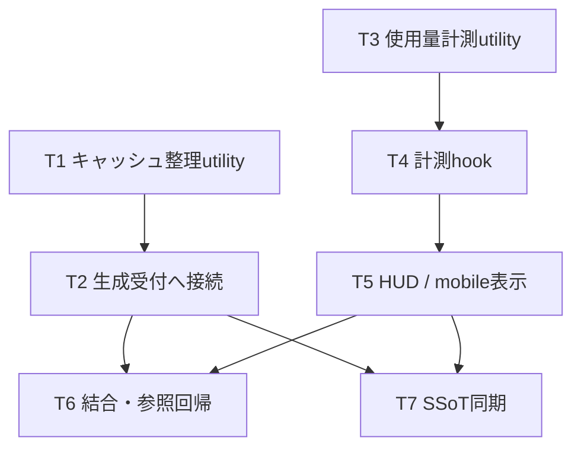

# REQ-317: キャッシュ保持適正化とブラウザ保存領域の使用量表示

## Review Status
2026-10-05（Asia/Tokyo）、ユーザーの「OK」により改訂PBIを承認済みとして設計を開始。**本設計・Task Cardは設計レビュー待ち。実装は未着手。**
REQ-312の目的は重複排除・スリム化。追加項目に伴う表示行増加は許容済みで、全体3行固定は適用しない。
BA監査は既存記録のINCONCLUSIVEを保持（[証拠](../backlog/ba-audit/REQ-317.md)）。接続・ロード障害の既知の再試行は行わない。直前のunload exit 0は「モデル未ロード」という報告であり、監査PASS・GPU総使用量ゼロの証明ではない。

## Boundary and Evidence
WORKSPACE_ROOT: C:/Users/audih/ws/comfy-create-helper2。対象はfrontend/とdocs/。設計担当の編集範囲はdocs/、implementation_plan.md。
GLOBAL_SCRIPTSはcontextのGLOBAL_ROOTをUserProfileへ展開したC:/Users/audih/.gemini/antigravity/scripts。役割・スキル正本および明示されたglobal scriptの利用は指定された例外。外部プロジェクトは参照していない。
doc_mapperはPBI、useGenerationStore.ts、ResourceGaugeHUD.tsxで「No mapped documents」（exit 0）。マッピング不在を影響なしと解釈せず、PBIの参照文書と下表で補足した。
openapi_parserはdocs/system/openapi.yaml不在でexit 1。既存clientとbackend/app/routers/prompt_metadata.pyを契約根拠にした。
git statusは「must be run in a work tree」を返した。Git差分検証が成功したとは扱わない。設計ファイルの存在・内容・カード/DAGを個別確認する。
参考HTMLは方針資料として参照。Approved表示・コード例・無条件無損失・0ms・1.5MB・エラー0%を要件や実測証明として採用しない。

|責務|現状の根拠|変更点・依存先|
|---|---|---|
|生成受付・保存|jobQueueSlice.ts:148–205|CURRENT_PROMPT_ID→meta setItem→非同期server→setTimeoutで200件整理。先行整理へ変更|
|生成記録|generationRecord.ts / PROMPT_RECORD_KEY|捕捉したgraph・実seed等の内容を同じ形式で維持|
|読取|promptRecord.ts:86–109|妥当v1 localはserverを待たず返す。欠落/旧形式はserver lookup。変更不要、回帰検証|
|保存済み参照|HistoryModalPreview.tsx:156–182|URL tからIDを選びquery key分離。Snapshot.paramsは空でも正本|
|server保持|backend/app/routers/prompt_metadata.py:16–96|POST UPSERT、GET ID一致、1000件。変更不要|
|システム計測|useSystemStats.ts、store/types.ts/SystemStats|WS経由の4指標。browser usageは別hookのlocal stateで保持|
|描画|ResourceGaugeHUD.tsx、ResourceGaugeChips.tsx|desktop/mobileにbrowser usageを追加|
|ライフサイクル|DesktopLayout.tsx:182/611、MobileLayout.tsx:31/265|既存モニタが各レイアウトでマウントされる。新hookは描画component内で起動|

## Cache Algorithm
新規utility `frontend/src/utils/promptMetadataCache.ts` を作り、prefix定数は既存LS_KEYSへ `METADATA_PREFIX: 'prompt-surgeon-meta-'` として追加。上限はutilityの `LOCAL_METADATA_CACHE_LIMIT = 30`。
契約:
```ts
export const LOCAL_METADATA_CACHE_LIMIT = 30
export function prunePromptMetadataCache(incomingPromptId: string, storage?: Storage): void
// storage未指定はwindow.localStorage。読み書き/列挙エラーを呼出元へ伝える。
```
1. 成功したqueue応答からprompt IDを確定。取消・応答エラー・IDなしの経路は整理しない。
2. 保存予定IDのキーを保持対象として予約し、それ以外のmeta prefixキーをStorage.length/keyで先に列挙・収集する。列挙中の削除は禁止。
3. 各既存値のJSONが非object/破損、timestamp欠落・非number・非finite、キー値が読取不能なら整理優先。正常記録はtimestamp降順。読み取りによる順位変更はしない。同timestampはkey順の安定tie-breakでよい。
4. 保存予定IDを除く最新29件を残し、それ以外をremoveItem。正常より無効記録を先に除外する。既存不足時は不要な削除をしない。
5. 初回200件＋新規なら171既存を除外し29既存＋新規を保存。同ID更新は既存キーを除外候補に入れず、29他ID＋更新1件。
6. 同期整理を**CURRENT_PROMPT_IDなど受付時のlocalStorage書込より先**に実行。既存の遅延200件整理を撤去。バッチ中間ジョブも同じqueuePrompt経路で適用。
7. 整理、current ID保存、meta保存、server保存を個別try/catchとする。整理失敗でもlocal書込とserver送信を試み、local失敗でserverを止めない。保存失敗通知の既存文言を維持し、受付済みpromptを再投入・失敗化しない。

通常条件で受付完了後最大30件。ID更新を除外候補に混ぜて29件へ減らすことを避ける。server取得結果をlocal cacheへ補充する追加動作は設けない。
整理途中のremoveItem失敗、保存失敗、複数タブ競合は上限・無損失保証の対象外。同期操作中にawaitを置かず、単一タブの各受付完了状態を基準にする。

## Browser Usage Contract
新規 `utils/browserStorageUsage.ts`:
```ts
export type StorageUsage = { status: 'ok'; bytes: number } | { status: 'unavailable' }
export interface BrowserStorageUsage { localStorage: StorageUsage; sessionStorage: StorageUsage }
export function measureStorageUsage(getStorage: () => Storage): StorageUsage
export function measureBrowserStorageUsage(): BrowserStorageUsage
export function formatStorageUsage(usage: StorageUsage): string
```
Storage getterもtry内で評価。領域ごとに独立し `length/key/getItem` で全キー・値を読み、`sum((key.length + value.length) * 2)`。UTF-16コード単位なのでemojiはサロゲート2単位として数える。JSON parse、Blob、UTF-8長による計測はしない。
開始lengthの範囲内でkey/getItemがnull、列挙/読取例外、不正な合計、検出可能なlength変化なら領域全体をunavailable。部分合計や前回正常値を今回成功値として表示しない。他方の領域は正常に計測する。同数の並行更新の原子的snapshotまでは保証せず、次の周期で再計測。
空領域はok/bytes=0。bytes < 1048576はKiB、それ以上はMiB、各1024/1048576で割りtoFixed(1)。unavailableは「取得不可」。境界比較は丸める前のbytesを使用。
対象はwindowの現在オリジンのlocalStorageと現在オリジン・現在タブのsessionStorage。外部origin・他tab・ブラウザ全体は照会しない。値内容・キー名をUI/ログに出さない。

## Sampling and UI
新規 `hooks/useBrowserStorageUsage.ts`:
```ts
export function useBrowserStorageUsage(): BrowserStorageUsage
```
描画componentのマウント時、activeなら即計測、2500ms intervalを起動。hiddenではinterval停止。visibility復帰で即計測して再開（復帰後の最初の更新機会とする）。unmountではtimer・listenerを全撤去。StrictMode再mountでもtimer重複が残らない。
WS/systemStatsに依存させないため、server offlineや応答保留でもusageだけは更新できる。原則同時に表示されるのはdesktop/mobileの片方。別componentに同hookを置いても状態を永続化しない。
desktop: CPU/GPUを使用率だけの横並び1行、RAM/VRAMを各1行とする既存4指標の整理に、localStorage/sessionStorageを各1行追加。label+数値を一度ずつ表示。行数やpixel高さの固定ACは設けない。必要な幅を確保する。
mobile: 既存4chipの横スクロール列に続くstorage列（折返し可）を同component内へ追加。min-w-0/max-w-fullで縮小可能なwrapperにし、ヘッダー/設定行と重ならない。既存4指標はスクロールを含め全て到達可能。
両UIにキーボード・タップで開ける `details/summary` の「推定使用量の説明」を置き、本文「localStorage: 現在のオリジン。sessionStorage: 現在のオリジンの現在タブ。キーと値のUTF-16コード単位を2 bytes換算した推定値です。」を表示。hoverだけのtitleを唯一の説明手段にしない。
browser usageには使用率・総容量・残容量・警告色閾値を適用しない。hardware指標の正常/警告/危険色と取得不能の--を維持する。REQ-312は独立PBIのまま、本変更のHUD配置は同PBIの重複排除方針と整合させる。

## SSoT Impact and Closure
|正本|改訂対象|維持・区別|
|---|---|---|
|SPEC_GENERATE §6、§6-3|生成時meta local200→30、timestamp順/先行整理/初回移行|server1000、非同期独立保存、Snapshot.params正本|
|SPEC_GENERATE §2-10|推定式・対象範囲・2500ms/visible lifecycle・取得不可・両UI説明|既存CPU/GPU/RAM/VRAMとWS契約|
|SPEC_HISTORY §4-1/REQ-316|曖昧な「履歴上限local200/server1000」をmetaキャッシュlocal30/server1000と明確化|画像履歴・Snapshot一覧/保存済みsnapshotの件数上限を変更しない|
|REQ-312|参照依存のみ、追加行許容済み|要件衝突として再承認を要求しない|
|旧REQ-316 design/plan|歴史記録として残す|旧local200記述は当時の仕様。今回の正本へ遡及改変しない|
T7で実装結果に合わせ上記2正本だけを同期する。設計段階で実装済み・テスト済みと書かない。
以前のroot implementation_plan.mdは[REQ-316-implementation_plan.md](REQ-316-implementation_plan.md)へ保存し、今回のroot planに置換。

## Task DAG and Atomicity

|Task|変更所有ファイル|依存|変更行予算|
|---|---|---|---|
|T1|promptMetadataCache.ts / utils/__tests__/promptMetadataCache.test.ts / localStorageKeys.ts|なし|260|
|T2|jobQueueSlice.ts / store/__tests__/slices/jobQueueSlice.test.ts|T1|240|
|T3|browserStorageUsage.ts / utils/__tests__/browserStorageUsage.test.ts|なし|240|
|T4|useBrowserStorageUsage.ts / hooks/__tests__/useBrowserStorageUsage.test.tsx|T3|240|
|T5|ResourceGaugeHUD.tsx / ResourceGaugeChips.tsx / components/ResourceGauge/__tests__/ResourceGauge.storage.test.tsx|T4|290|
|T6|utils/__tests__/promptRecord.test.ts / components/__tests__/HistoryModalPreview.test.tsx / src/test/e2e_req317_storage.test.tsx|T2,T5|290|
|T7|SPEC_GENERATE.md / SPEC_HISTORY.md|T2,T5|90|
全カードは3ファイル以下、変更行300以下で原子性PASS。T1/T3は並行可能。最大4層（T3→T4→T5→T6またはT7）。T7はT6結果に応じた検証完了の主張を含めず、実装契約のみ同期するため人工的な5層目を作らない。300行超過の見込みなら無断拡張せずカード再分割・設計レビューに戻す。
総合Gateはタスク外のレビュー工程。T6/T7完了後、test-planの3-GateとブラウザE2E、AC証拠を担当reviewerへ渡す。過去のBA監査状態をPASSへ置換しない。

## Trade-offs and Risks
- 30件への削減は件数保証。1件の巨大化・他領域の占有では容量不足を解消できず、全条件でQuotaExceededErrorゼロを保証しない。
- 記録済みtimestamp順を採用。アクセスLRU・重複圧縮・IndexedDB移行は互換性と今回の範囲を理由に採用しない。
- 削除前にserver保存を確認しないため、未保存・server失敗・serverから既に削除された古い記録は失われ得る。初回移行は不可逆。30→200のコードrollbackだけで消した記録は戻らない。
- 同期先行整理は容量枠を確保できるが、初回200件の読取/parse/削除はmain thread処理。最大量・巨大値でのUI応答をGate 3で観測する。定量的な速度保証は設けない。
- UTF-16推定量はブラウザ実クォータ・ディスク占有と一致しない。固定10MB・使用率%・空き容量・警告閾値を提示しない。
- 2.5秒ごとの全キー読取は表示中の負荷。hiddenで停止し新しいキャッシュは30件に縮小。全origin保存量が巨大な環境では計測負荷が残る。
- 複数タブのmeta書込競合、全件snapshot計測の厳密な原子性、server1000件を超えた過去情報復元は今回の保証外。
- LM Studio BA監査はINCONCLUSIVE。自己レビューによる23AC追跡は完了条件の代替証明ではなく、人間設計レビューで残余を確認する。
