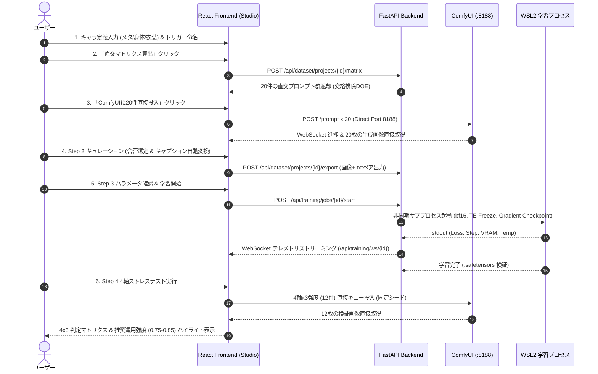

# REQ-319 詳細設計: LoRA Studio (End-to-End キャラクターLoRA 統合ワークスペース)

## 1. 全体アーキテクチャ & 設計原則

### 1.1 背景と目的
キャラクターLoRA作成において、プロンプト設計、バッチ生成、身体・衣装タグの分離（デカップリング）、学習スクリプト実行、および品質検証の手順が分断されており、衣装癒着（衣装ベイクイン）やポーズ硬直、手動作業の煩雑さが発生している。
本機能では、Prompt Surgeon 内に直交計画（DOE）に基づく素材生成から、自動デカップリングキャプション、ローカル学習ディスパッチ、4軸ストレステスト自動評価までを一気通貫で完結できる専用ワークスペース「LoRA Studio」を新設・統合する。

### 1.2 コア設計原則
1. **独立専用ページ (`DatasetStudioPage`)**:
   日常の単発生成（`GeneratePage`）とは目的・成果物・バッチライフサイクルが根本から異なるため、`/studio` ルートを独立させる。
2. **ComfyUI 直接通信の厳守 (FastAPI 画像プロキシ禁止)**:
   バッチキュー投入、画像生成進捗、および WebSocket イベント購読は、フロントエンドが `http://127.0.0.1:8188` と直接通信する。FastAPI は重い画像バイナリを仲介せず、メタデータ管理・DOE 数理計算・学習プロセス制御に特化する。
3. **ワークフローインポート機構の流用**:
   ComfyUI 側に専用パイプラインをハードコードせず、既存のワークフロー JSON とノードマッピング（Positive/Seed）をそのままバッチ生成エンジンとして再利用する。
4. **`TagChipEditor` の完全流用**:
   キャラクター定義入力欄は、`GeneratePage` で実績のある `TagChipEditor`（チップ/テキスト切替、個別削除、ドラッグ語順入替、アセット添付バー）をそのまま活用し、操作感を完全に統一する。
5. **GPU 競合保護ガード**:
   学習プロセス実行中は、GPU メモリ競合を防ぐため新規画像生成ジョブの投入をフロントエンド・バックエンド双方で抑止する。

### 1.3 シーケンスダイアグラム


---

## 2. データモデル & SQLite スキーマ

### 2.1 テーブル定義

```sql
-- 1. LoRA素材プロジェクト管理
CREATE TABLE dataset_projects (
    id INTEGER PRIMARY KEY AUTOINCREMENT,
    name VARCHAR(255) NOT NULL,
    character_trigger VARCHAR(100) NOT NULL,
    outfit_trigger VARCHAR(100) NOT NULL,
    workflow_id INTEGER NOT NULL,
    prompt_meta TEXT NOT NULL,
    prompt_physical TEXT NOT NULL,
    prompt_exclusive_outfit TEXT NOT NULL,
    selected_alt_outfits TEXT NOT NULL,
    created_at TIMESTAMP DEFAULT CURRENT_TIMESTAMP,
    updated_at TIMESTAMP DEFAULT CURRENT_TIMESTAMP,
    FOREIGN KEY (workflow_id) REFERENCES workflows(id)
);

-- 2. マトリクス生成アイテム (20枚スロット)
CREATE TABLE dataset_items (
    id INTEGER PRIMARY KEY AUTOINCREMENT,
    project_id INTEGER NOT NULL,
    slot_index INTEGER NOT NULL,
    factors_json TEXT NOT NULL,
    raw_prompt TEXT NOT NULL,
    caption_text TEXT NOT NULL,
    image_path VARCHAR(500),
    seed BIGINT NOT NULL,
    status VARCHAR(50) DEFAULT 'APPROVED',
    created_at TIMESTAMP DEFAULT CURRENT_TIMESTAMP,
    FOREIGN KEY (project_id) REFERENCES dataset_projects(id) ON DELETE CASCADE
);

-- 3. 別衣装プリセットマスタ
CREATE TABLE outfit_master_presets (
    id INTEGER PRIMARY KEY AUTOINCREMENT,
    name VARCHAR(100) NOT NULL,
    category VARCHAR(50) NOT NULL,
    prompt_tags TEXT NOT NULL,
    is_builtin BOOLEAN DEFAULT TRUE,
    created_at TIMESTAMP DEFAULT CURRENT_TIMESTAMP
);

-- 4. 学習ジョブ管理テーブル
CREATE TABLE lora_training_jobs (
    id INTEGER PRIMARY KEY AUTOINCREMENT,
    project_id INTEGER NOT NULL,
    lora_name VARCHAR(150) NOT NULL,
    model_type VARCHAR(50) DEFAULT 'anima_2b',
    config_toml_content TEXT NOT NULL,
    epochs INTEGER NOT NULL,
    repeats INTEGER NOT NULL,
    batch_size INTEGER NOT NULL,
    total_steps INTEGER NOT NULL,
    network_dim INTEGER NOT NULL,
    network_alpha INTEGER NOT NULL,
    learning_rate VARCHAR(50) NOT NULL,
    status VARCHAR(50) DEFAULT 'IDLE',
    final_loss FLOAT,
    pid INTEGER,
    created_at TIMESTAMP DEFAULT CURRENT_TIMESTAMP,
    FOREIGN KEY (project_id) REFERENCES dataset_projects(id)
);
```

### 2.2 内蔵プリセット初期データ (Built-in Outfit Presets)
- **カジュアル (Casual Street)**: `casual oversized hoodie, denim jeans, sneakers` (category: `casual`)
- **シンプル部屋着 (Roomwear)**: `plain white t-shirt, gray sweatpants, bare feet` (category: `roomwear`)
- **水着 (Swimsuit)**: `simple two-piece bikini, sandals` (category: `swimsuit`)
- **フォーマルスーツ (Business Suit)**: `formal suit, necktie, dress shirt, slacks` (category: `formal`)

---

## 3. Step 1: 素材マトリクス生成 & 直交計画 (DOE) 仕様

### 3.1 3分割キャラクター入力とトリガー連動
- **① メタ情報 (Meta & Quality)**:
  - 共通画風・クオリティ（例: `1girl, solo, anime style, masterpiece`）
  - 連動トリガー: なし。キャプションの先頭または共通部として保持。
- **② 身体的特徴 (Face & Body)**:
  - 固定容姿（例: `long silver hair, red eyes, cat ears, ahoge`）
  - 連動トリガー: **キャラトリガー** (例: `mychara`)
  - 自動変換挙動: キャプション生成時に該当単語群を**完全消去（Strip）**し、キャラトリガーに置換。
- **③ 専用の服装 (Default Outfit)**:
  - 本命衣装装飾（例: `black gothic dress, lace collar, gold trim, ribbon`）
  - 連動トリガー: **衣装トリガー** (例: `mychara_outfit`)
  - 自動変換挙動: 本命衣装枠のみ該当装飾タグを**完全消去（Strip）**し、衣装トリガーに置換。

### 3.2 別衣装マスタ選択と25%均等割当ロジック
- 全20件中、本命衣装（15件 / 75%）、別衣装（5件 / 25%）を割り振る。
- ユーザーが選択した K 個の別衣装マスタを、5件の別衣装枠に対して均等配分する（例: 2件選択時 [3, 2]、3件選択時 [2, 2, 1]）。
- 別衣装枠では③専用服装のタグは一切注入せず、選択された別衣装タグを注入する。

### 3.3 直交計画 (DOE) ソルバーアルゴリズム (`matrix_service.py`)
1. **水準因子プール**:
   - `Shot`: Close-up, Bust, Full-body (目標比率: 25%, 45%, 30% -> 5枚, 9枚, 6枚)
   - `Angle`: Front, Three-quarter view, Profile / side view, Back
   - `Expression`: Smile, Serious, Blush, Looking away
   - `Pose`: Standing, Sitting, Walking, Arms crossed
   - `Outfit`: Default (15枚), Alt (5枚)
2. **ハード制約フィルタ**:
   - `Shot == "Close-up"` の場合、`Pose in ["Sitting", "Walking"]` を除外。
   - `Outfit == "Default"` の場合、別衣装タグを混入させない。
3. **貪欲法 (Greedy Orthogonal Selection)**:
   - 全候補組み合わせから、既存採択済み行群とのペア共起行列の二乗誤差（交絡度）を最小化する組み合わせを1行ずつ貪欲に20件採択。
   - 直交度スコア（1.0 - 最大ペア相関係数）を計算。
4. **ComfyUI 直接投入**:
   - バックエンド経由の画像プロキシを行わず、React フロントエンドから ComfyUI の `/prompt` へ直接20件のジョブを連続POST。WebSocket で進捗状況をリアルタイム購読。

---

## 4. Step 2: キュレーション & キャプション自動変換 仕様

### 4.1 自動デカップリング (Concept Decoupling) 処理
- プロンプトから入力トークンを正規化して検出・除去する：
  - **本命衣装スロット (15件)**:
    - 身体的特徴タグを完全除去 -> `{character_trigger}` を先頭に付与
    - 専用服装タグを完全除去 -> `{outfit_trigger}` を付与
    - 残りの構図・表情・アングル・ポーズタグを維持
  - **別衣装スロット (5件)**:
    - 身体的特徴タグを完全除去 -> `{character_trigger}` を先頭に付与
    - 専用服装タグは元々含まれていないため、`{outfit_trigger}` は**絶対に挿入しない**
    - 別衣装タグ（`casual oversized hoodie` 等）はそのまま維持（衣装を一般語として学習させることで本体から分離）
- ユーザーによる手動キャプション編集・オーバーライド可能。

### 4.2 単発リロール (Single Slot Reroll)
- 各サムネイルの「↺」ボタンをクリック時、当該スロットの `raw_prompt` を保持したまま新規乱数シードを採番し、ComfyUI に1件のみ直接再生成を要求。
- 完了画像をインプレースで更新し、キャプション定義はそのまま維持。

### 4.3 学習フォルダ一括エクスポート
- `POST /api/dataset/projects/{id}/export` により、指定ディレクトリへ `001.png` + `001.txt` の完全ペアファイルを連番出力。

---

## 5. Step 3: ローカル学習ディスパッチャー 仕様

### 5.1 学習スケジュール動的計算式
- **Total Steps**: `((素材枚数 * Dataset Repeats) / Train Batch Size) * Max Train Epochs`
- **保存チェックポイント数**: `floor(Max Train Epochs / Save Every N Epochs)`
- 例: 20枚 x 10 repeats / 1 batch x 10 epochs = **2,000 steps**。

### 5.2 ハイパーパラメータ Tooltip マスタ
- **Network Dim (Rank)**: LoRAの表現容量。キャラLoRAは16〜32が最適。過学習とポーズ追従のトレードオフ。
- **Network Alpha**: 重みスケーリング倍率。通常はDimと同値（1:1）または半分（1:2）。
- **Base Learning Rate**: 全体学習歩幅。Anima DiTは `1e-4` が推奨値。
- **Text Encoder LR**: Qwen3テキストエンコーダの学習率。`0 (Freeze)` によりVRAM節約＆言語理解保護。
- **Optimizer Type**: `AdamW` (ROCm環境ネイティブ対応で安全)。
- **LR Scheduler**: `cosine` (過学習を防ぎ滑らかに収束)。
- **Mixed Precision**: **`bf16` (必須)** (AMD ROCm / RX 9070 XT での NaN オーバーフロー防止)。
- **Gradient Checkpointing**: **有効 (True)** (中間活性化再計算でVRAMを約50%削減)。
- **Noise Offset**: `0.05` (極端な明暗表現力向上・コントラスト焼け防止)。

### 5.3 非同期学習実行 & WebSocket テレメトリ (`training_manager.py`)
- 一時 `config.toml` を自動生成し、サブプロセス（WSL2 / local python）を非同期実行。PID を保持。
- 標準出力をパースし、WebSocket (`/api/training/ws/{job_id}`) で `loss`, `step`, `epoch`, `vram_used_gb`, `gpu_temp` をリアルタイムブロードキャスト。
- 緊急停止ボタン（SIGTERM / taskkill）による安全なプロセス中断。
- 完了時に成果物 `.safetensors` ファイルの存在とサイズ整合性を検証。

---

## 6. Step 4: 4軸ストレステスト自動評価 仕様

### 6.1 4大ストレステスト プロンプト自動展開
Step 1 のトリガー名 `{char}`, `{outfit}`, モデル名 `{name}` に基づき、4軸x3強度（w in [0.6, 0.8, 1.0]）の計12件のプロンプトを固定シード（`12345678`）で生成：
1. **① 衣装分離 (Decoupling)**:
   `<lora:{name}:{w}>, {char}, wearing red hoodie, blue denim jeans, standing`
2. **② 衣装再現 (Bake-in)**:
   `<lora:{name}:{w}>, {char}, {outfit}, upper body`
3. **③ ポーズ追従 (Pose)**:
   `<lora:{name}:{w}>, {char}, sitting on floor, hugging knees`
4. **④ アングル追従 (Angle)**:
   `<lora:{name}:{w}>, {char}, side view, looking away, profile`

### 6.2 4x3 判定グリッド & 推奨強度判定
- ComfyUI へ12件を投入し、4列（検証項目）x 3行（強度）で比較グリッドを表示。
- 拡大モーダルで細部の装飾漏れや破綻を確認可能。
- **推奨強度（スイートスポット: 0.75-0.85）** を自動ハイライト。

---

## 7. 実装ファイル構成マトリクス

| 区分 | ファイルパス | 内容・責務 |
|---|---|---|
| **Backend** | `backend/app/models.py` | `DatasetProject`, `DatasetItem`, `OutfitMasterPreset`, `LoraTrainingJob` モデル定義 |
| **Backend** | `backend/app/schemas/dataset.py` | プロジェクト、アイテム、プリセット、学習、評価の Pydantic スキーマ |
| **Backend** | `backend/app/migrations/steps.py` | マイグレーションステップ追加 & 初期プリセットシーディング |
| **Backend** | `backend/app/services/matrix_service.py` | 因子プール・制約フィルタ・貪欲直交計画（DOE）ソルバー |
| **Backend** | `backend/app/services/training_manager.py` | ステップ計算、config.toml生成、非同期プロセス管理、WSテレメトリ |
| **Backend** | `backend/app/services/benchmark_service.py` | 4軸x3強度プロンプト生成、スイートスポット判定 |
| **Backend** | `backend/app/routers/dataset_router.py` | プロジェクトCRUD、マトリクス算出、エクスポート、学習、ベンチマークAPI |
| **Frontend** | `frontend/src/api/types.ts` | データセット・学習・ベンチマークのTypeScript型定義 |
| **Frontend** | `frontend/src/api/client.ts` | データセット関連APIクライアント関数群 |
| **Frontend** | `frontend/src/pages/DatasetStudioPage/useStudioStore.ts` | スタジオ状態管理 Zustand ストア |
| **Frontend** | `frontend/src/pages/DatasetStudioPage/index.tsx` | スタジオ親コンテナ (Step 1〜4 ウィザード) |
| **Frontend** | `frontend/src/pages/DatasetStudioPage/components/MatrixGenerationStep.tsx` | Step 1: トリガー入力、TagChipEditor 3枠、DOE実行、ComfyUI直接投入 |
| **Frontend** | `frontend/src/pages/DatasetStudioPage/components/OutfitMasterModal.tsx` | 別衣装マスタ選択モーダル |
| **Frontend** | `frontend/src/pages/DatasetStudioPage/components/CuratorGrid.tsx` | Step 2: 20枚サムネイル合否選定、単発リロール、キャプション編集、エクスポート |
| **Frontend** | `frontend/src/pages/DatasetStudioPage/components/TrainingConfigPanel.tsx` | Step 3: パラメータ設定、解説Tooltip、プロセス起動・停止、Lossテレメトリ |
| **Frontend** | `frontend/src/pages/DatasetStudioPage/components/BenchmarkGrid.tsx` | Step 4: 4x3 ストレステスト比較グリッド、セルモーダル、推奨強度カード |
| **Frontend** | `frontend/src/components/layout/AppShell.tsx` | サイドバーに「Studio」ナビゲーション項目追加 |
| **Frontend** | `frontend/src/App.tsx` | `/studio` ルート登録 |
