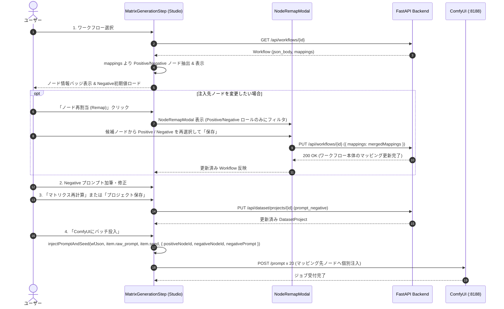

# REQ-320 詳細設計: LoRA Studio Positive/Negative ノードリマッピング & Negative 編集入力

## 1. 背景と基本方針 (Context & Design Principles)

### 1.1 現状の課題 (As-Is)
- 現行の LoRA Studio (Step 1: 素材マトリクス) では、ワークフロー選択時に ComfyUI ワークフロー JSON の最初の `CLIPTextEncode` ノードに Positive プロンプトを決め打ちで注入しており、ノード構成によっては意図しないノードにプロンプトが流れるリスクがある。
- Negative プロンプト用の入力枠が存在せず、ComfyUI 投入時に負のプロンプトを制御できない。
- 生成ページや設定ページで設定されたワークフローのマッピング情報（`workflow.mappings`）が Studio 画面上で表示されず、Positive / Negative の注入先を Studio から変更する導線がない。

### 1.2 解決方針 (To-Be)
1. **既存ワークフロー永続マッピングの完全流用 (SSoT の統一)**:
   - マッピングの真の保持元 (SSoT) は、生成ページ・設定ページと共通のワークフローエンティティ（`Workflow.mappings` / `workflow_mappings` テーブル）とする。Studio 固有の別管理テーブル・カラムは新設せず、既存アーキテクチャをそのまま流用する。
2. **Positive / Negative に絞り込んだリマッピング導線 (`NodeRemapModal`)**:
   - ワークフロー内の全ロール（Sampler Seed, Steps, CFG 等）を表示するのではなく、Studio で必要な **Positive プロンプト (`Main_Positive_Prompt`)** と **Negative プロンプト (`Negative_Prompt`)** の 2 つのロールにフィルタリングして表示・変更可能にする。
   - 変更・保存時は `workflowsApi.update(workflowId, { mappings })` を呼び出し、ワークフロー本体のマッピングを更新・永続化する。これにより設定ページや生成ページとの完全な整合性が保たれる。
3. **Negative Prompt 編集入力枠の追加 (`TagChipEditor`)**:
   - Step 1 に全幅のネガティブプロンプト入力エリアを追加。既存の `TagChipEditor` を再利用し、タグチップとテキストの相互切替、タグ削除・追加を可能にする。
   - ワークフローの Preset またはノード初期値をデフォルト値として自動ロードする。
4. **個別プロンプト注入エンジン (`injectPromptAndSeed`) のマッピング準拠**:
   - 決め打ち探索ではなく、選択中ワークフローの `mappings` から Positive ノード ID と Negative ノード ID を参照し、正プロンプト（直交 DOE 合成）と負プロンプトをそれぞれのノードへ個別・確実に注入する。
5. **プロジェクト永続化**:
   - `DatasetProject` には、プロジェクト固有のプロンプトテキストである `prompt_negative` カラムを追加し、SQLite マイグレーションを実施。プロジェクトの保存・再開時に完全復元する。

---

## 2. システムアーキテクチャ & データフロー

### 2.1 シーケンスダイアグラム



---

## 3. データモデル & スキーマ変更

### 3.1 Backend モデル (`backend/app/models.py`)

`DatasetProject` に `prompt_negative` カラムを追加（マッピングは既存の `Workflow.mappings` を流用するため、別カラムは新設しない）：

```python
class DatasetProject(Base):
    __tablename__ = "dataset_projects"
    # 既存フィールド...
    prompt_negative: Mapped[str] = mapped_column(Text, nullable=False, default="")
```

### 3.2 データベースマイグレーション (`backend/app/migrations/steps.py`)

Step 026 を新設：

```python
def step_026_dataset_projects_prompt_negative(conn: Connection, inspector: Inspector) -> None:
    columns = [col["name"] for col in inspector.get_columns("dataset_projects")]
    if "prompt_negative" not in columns:
        conn.execute(sa.text("ALTER TABLE dataset_projects ADD COLUMN prompt_negative TEXT NOT NULL DEFAULT ''"))
        logger.info("Migrated: Added 'prompt_negative' to 'dataset_projects'.")
```

### 3.3 Pydantic スキーマ (`backend/app/schemas/dataset.py`)

- `DatasetProjectCreate`: `prompt_negative: str = ""` を追加
- `DatasetProjectUpdate`: `prompt_negative: Optional[str] = None` を追加
- `DatasetProjectResponse`: `prompt_negative: str = ""` を追加

### 3.4 Frontend 型定義 (`frontend/src/api/types.ts`)

```typescript
export interface DatasetProject {
  // 既存フィールド...
  prompt_negative?: string
}
```

---

## 4. フロントエンド詳細設計

### 4.1 ノード抽出・検出ロジック

ワークフロー JSON (`workflow.json_body`) からテキスト入力可能ノードを抽出する：
```typescript
export interface TextCandidateNode {
  id: string
  title: string
  classType: string
}

export function extractTextNodes(jsonBody: Record<string, any> | undefined): TextCandidateNode[] {
  if (!jsonBody || typeof jsonBody !== 'object') return []
  const candidates: TextCandidateNode[] = []
  for (const [id, node] of Object.entries(jsonBody)) {
    if (!node || typeof node !== 'object') continue
    const classType = node.class_type || ''
    const hasTextInputs = node.inputs && ('text' in node.inputs || 'string' in node.inputs || 'prompt' in node.inputs)
    const isTextClass = classType.includes('CLIPText') || classType.includes('Text') || classType.includes('Primitive')
    if (hasTextInputs || isTextClass) {
      const title = node._meta?.title || node.title || `${classType} (#${id})`
      candidates.push({ id, title, classType })
    }
  }
  return candidates
}
```

### 4.2 ワークフローからのマッピング解決

`workflow.mappings`（`WorkflowMapping[]`）から Positive および Negative のノードを特定：
- **Positive ノード**: `role === 'Main_Positive_Prompt'` または `role` に `Positive` を含むマッピングの `node_id`
- **Negative ノード**: `role === 'Negative_Prompt'` または `role` に `Negative` を含むマッピングの `node_id`
- マッピングが存在しない場合のフォールバック:
  - タイトルに `positive` を含むノード、または最初の `CLIPTextEncode`
  - タイトルに `negative` を含むノード、または 2 番目の `CLIPTextEncode`

### 4.3 ロール限定リマッピングモーダル (`NodeRemapModal`)

- 既存の `ParamSyncModal` / `RescanModal` のマッピング編集ロジックを流用。
- 表示対象を **Positive (`Main_Positive_Prompt`)** と **Negative (`Negative_Prompt`)** の 2 つに限定（不要なロールは削ぎ落とす）。
- 各ロールに対して、`extractTextNodes` で得られた候補ノード一覧をドロップダウン表示。
- 保存時処理:
  1. `workflow.mappings` のうち、Positive / Negative の `master_id` に該当する要素のみ新しい `node_id` で差し替え（他のロールのマッピングはそのまま維持）。
  2. `await workflowsApi.update(workflow.id, { mappings: updatedMappings })` を実行。
  3. 完了後、Studio 画面側の表示を即座に更新。

### 4.4 Negative Prompt デフォルト値自動抽出

ワークフロー変更時または初期ロード時：
1. `project.prompt_negative` が既に設定されている（ユーザーが入力・保存済み）場合はそれを最優先で維持。空文字列 `""` が明示的に保存されている場合も意図的なクリアとして維持。
2. 未設定（`undefined` / 新規プロジェクト）の場合、`workflowPresets`（`/api/workflow-presets?workflow_id={id}`）から `param_values.Negative_Prompt` または `param_values.negative_prompt` を取得。
3. なければ、解決された Negative ノードの `inputs.text` 文字列を取得。
4. なければ、定型フォールバック (`worst quality, low quality, bad anatomy, blurry`) を設定。

### 4.5 ペイロード注入ロジック (`injectPromptAndSeed`)

```typescript
export interface InjectPromptOptions {
  positiveNodeId?: string | null
  negativeNodeId?: string | null
  negativePrompt?: string
  seedNodeId?: string | null
}

export function injectPromptAndSeed(
  workflowPromptJson: Record<string, any> | undefined,
  rawPrompt: string,
  seed: number,
  options?: InjectPromptOptions
): Record<string, any>
```
- options でノード ID が指定されている場合は、そのノードの `inputs.text` にピンポイント注入。
- 指定ノードが存在しない場合は既存の自動探索フォールバックを動作させ、後方互換性を担保。
- `negativePrompt` が空文字 `""` の場合も安全に空文字として注入（`undefined` や `null` の混入を防止）。

---

## 5. UI/UX コンポーネント設計

### 5.1 Step 1 画面上でのマッピング表示
- ワークフロー選択ドロップダウンの横/下部に、マッピング情報エリアをインライン配置：
  - Positive 注入バッジ: `[Positive: #6 CLIPTextEncode]`
  - Negative 注入バッジ: `[Negative: #7 CLIPTextEncode]`
  - 「ノード再割当」ボタン: クリックすると `NodeRemapModal` をポップアップ。

### 5.2 Negative Prompt 編集エリア
- メタ情報・身体特徴・専用服装の 3 カラムの下部に、独立した全幅カードとして配置。
- コンポーネント: `<TagChipEditor>` を使用。
  - チップ/テキスト切替トグル対応
  - 単語数・文字数カウント表示
  - 削除・ドラッグ並び替え対応
  - 最大文字数ガード (10,000文字)

---

## 6. セキュリティ & 安全性
- ワークフロー更新時の他ロール保持（Positive/Negative 以外のマッピングが消失しないようマージ保存）。
- ノード存在検証とフォールバック処理。
