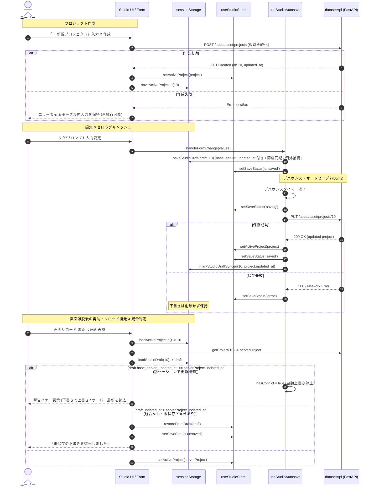

# REQ-323 詳細設計: Dataset Studio プロジェクト即時永続化・オートセーブ・下書き復元機構

## 1. 概要 & 目的 (Overview & Purpose)

### 1.1 背景
LoRA Dataset Studio（`/studio`）において、ユーザーがキャラクター定義やプロンプト設定を入力中に、誤って画面遷移やブラウザリロードを行うと、入力内容が全て破棄されてしまう問題が存在していた。
従来の設計では、Step 1 の「直交マトリクス再計算 (DOE)」ボタンをクリックするまでサーバー側プロジェクト（`dataset_projects`）が作成・永続化されず、編集中の入力状態がクライアントの単一 React state にのみ保持されていたことが原因である。

### 1.2 目的 (Zero Data Loss Architecture)
本設計では、「クライアント側即時下書き退避（`sessionStorage`）」と「サーバー側デバウンス永続化（オートセーブ）」の二重化保護機構（Zero Data Loss Architecture）を導入し、以下の要求を満たす。
1. **新規プロジェクトの即時永続化**: プロジェクト作成トリガー（`CreateProjectModal`）時に `datasetApi.createProject` を即時実行し、確定した `project.id` のもとで編集を開始。失敗時はモーダル内入力を保持したまま再試行可能とする。
2. **デバウンス付きオートセーブ**: プロジェクト編集中、フォームやタグの変更停止後 750ms（500ms〜1000ms）で自動的に `datasetApi.updateProject` を呼び出し永続化。
3. **sessionStorage ゼロラグ下書きキャッシュ**: 入力操作のたびに、プロジェクトID単位（`dataset_studio_draft_${projectId}`）でタイムスタンプ付き下書きを即座に退避。容量超過等の例外は安全に補足。
4. **画面遷移・リロード時の自動復元**: 再訪時、サーバーデータより新しい未保存下書きが存在すれば直前の編集状態を自動復元。
5. **保存完了時のキャッシュ同期**: サーバー保存成功時にキャッシュを同期済みとして整理。
6. **保存ステータスの可視化**: UI 上に現在の保存状態（「編集中 / 未保存」「保存中...」「保存完了」「保存失敗 / 下書き保持中」）をリアルタイムにフィードバック。

---

## 2. SSoT インパクト分析 (SSoT Impact Analysis)

- **仕様ドキュメント**:
  - `docs/specs`: `doc_mapper.py` による調査の結果、直接マッピングされた仕様書はなし。
  - `docs/design/REQ-319.md`: LoRA Studio の初期設計。本設計は REQ-319 の Step 1（`MatrixGenerationStep`）のライフサイクルおよびプロジェクト永続化レイヤーを拡張する。
- **バックエンド API コントラクト (SSoT)**:
  - `backend/app/routers/dataset_router.py`:
    - `POST /api/dataset/projects` (`datasetApi.createProject`): 新規プロジェクト作成
    - `PUT /api/dataset/projects/{project_id}` (`datasetApi.updateProject`): プロジェクト更新
    - `GET /api/dataset/projects` (`datasetApi.getProjects`): プロジェクト一覧取得
    - `GET /api/dataset/projects/{project_id}` (`datasetApi.getProject`): プロジェクト詳細取得
  - 本改修は既存のバックエンド API スキーマ（`DatasetProjectCreate`, `DatasetProjectUpdate`, `DatasetProjectResponse`）に 100% 準拠し、バックエンドの改修は不要（フロントエンド完結）。

---

## 3. システムアーキテクチャ & データフロー (System Architecture)



---

## 4. 詳細コンポーネント設計 (Detailed Component Design)

### 4.1 ストレージキャッシュ層 (`utils/studioDraftStorage.ts`)

#### 型定義
```typescript
export interface DatasetStudioDraft {
  projectId: number
  name: string
  character_trigger: string
  outfit_trigger: string
  workflow_id: number
  prompt_meta: string
  prompt_physical: string
  prompt_exclusive_outfit: string
  prompt_negative: string
  selected_alt_outfits: string
  updated_at: string // ISO 文字列タイムスタンプ (下書き編集時刻)
  base_server_updated_at?: string // 編集ベースとしたサーバー更新日時 (楽観的ロック用)
  is_synced: boolean
}
```

#### 提供関数
- `getDraftStorageKey(projectId: number): string`: `dataset_studio_draft_${projectId}` を返却。
- `saveStudioDraft(draft: DatasetStudioDraft): void`:
  - `sessionStorage.setItem` を実行。
  - `QuotaExceededError` やストレージ無効化例外を `try/catch` で捕捉し、コンソール警告を出力してアプリクラッシュを防止（AC-3）。
- `loadStudioDraft(projectId: number): DatasetStudioDraft | null`:
  - 指定プロジェクトの下書きをパースして取得。破損 JSON 時は `null` を返却。
- `clearStudioDraft(projectId: number): void`:
  - `sessionStorage.removeItem` を実行。
- `markStudioDraftSynced(projectId: number, serverUpdatedAt?: string): void`:
  - 該当ドラフトの `is_synced` を `true` に更新し、`base_server_updated_at` を最新の `serverUpdatedAt` に同期して再退避。
- `saveActiveProjectId(projectId: number | null): void`:
  - `dataset_studio_active_project_id` キーにプロジェクト ID を保存。
- `loadActiveProjectId(): number | null`:
  - 直近のアクティブプロジェクト ID を復元。

### 4.2 プロジェクト作成モーダル (`components/CreateProjectModal.tsx`)

#### 機能要件 (AC-1)
- 「＋ 新規プロジェクト」ボタン押下でモーダルを開く。
- 入力項目: プロジェクト名、キャラトリガー名、本命衣装トリガー名、ComfyUI ワークフロー選択。
- 「作成して開始」押下時:
  - ローディング状態に遷移し、`datasetApi.createProject` を非同期呼び出し。
  - 成功時: 作成された `DatasetProject` を親コンポーネント（およびストア）に渡し、モーダルを閉じる。
  - 失敗時: モーダルは閉じず、エラーアラートを表示。入力中の内容はそのまま維持され、修正して即座に再試行可能。

### 4.3 デバウンス・オートセーブ & 競合判定フック (`hooks/useStudioAutosave.ts`)

#### 機能要件 (AC-2, AC-3, AC-4, AC-5, 競合検知)
- 引数:
  - `activeProject: DatasetProject | null`
  - `formData: FormValues`
  - `onProjectUpdated: (project: DatasetProject) => void`
  - `onDraftRestored?: (draft: DatasetStudioDraft) => void`
  - `debounceMs?: number` (デフォルト: 750ms)
- 内部状態:
  - `saveStatus`: `'idle' | 'unsaved' | 'saving' | 'saved' | 'error'`
  - `hasConflict`: `boolean` (競合検知フラグ)
  - `conflictDraft`: `DatasetStudioDraft | null` (競合対象下書き)
  - `lastSavedStateRef`: 直近に保存完了したフォーム値
  - `autoSaveTimerRef`: デバウンス用タイマー
- 競合検知 & 復元動作:
  - ロード時、下書きに `base_server_updated_at` が存在し、`activeProject.updated_at` と異なる場合:
    - 他セッションによるサーバー更新と判定し、`hasConflict = true` を設定。
    - サーバーへの自動オートセーブは完全に停止（競合中の誤上書き防止）。
- 競合解消メソッド (Conflict Resolution):
  - `resolveConflictWithDraft()`: 下書きの内容でサーバーへ `datasetApi.updateProject` を強制送信。成功時に `base_server_updated_at` を同期して `hasConflict = false` に復帰。
  - `resolveConflictWithServer()`: `clearStudioDraft(projectId)` を実行して下書きを破棄し、最新のサーバーデータをフォームに再適用して `hasConflict = false` に復帰。
- 通常編集時の動作仕様:
  - `hasConflict` が false の場合のみ、フォーム値変更時に `saveStudioDraft`（`base_server_updated_at: activeProject.updated_at` 記録）および 750ms デバウンスオートセーブを実行。
  - API 成功時: `saveStatus` を `'saved'` に更新、`markStudioDraftSynced(projectId, res.updated_at)` を実行、`onProjectUpdated` を発火。
  - API 失敗時: `saveStatus` を `'error'` に更新、下書きは保持。
  - `flushAutoSave`: タイマーを待たずに即時同期する関数を提供。

### 4.4 UI 統合とステータス表示 (`MatrixGenerationStep.tsx`, `DatasetStudioPage/index.tsx`)

#### 1. ヘッダー / ツールバー
- プロジェクト選択セレクター (`<select data-testid="project-selector">`):
  - 登録済みプロジェクト（`datasetApi.getProjects()`）の一覧から切り替え可能。
- 「＋ 新規プロジェクト」ボタン (`data-testid="open-create-project-modal-btn"`):
  - `CreateProjectModal` を開く。
- 保存ステータスバッジ (`data-testid="autosave-status"`):
  - `'saved'`: 「保存完了」 (緑アイコン)
  - `'saving'`: 「変更を保存中...」 (スピナー / 黄アイコン)
  - `'unsaved'`: 「未保存（下書き保持）」 (橙アイコン)
  - `'error'`: 「保存失敗（下書き保持中）」 (赤アイコン / 再試行導線)

#### 2. `MatrixGenerationStep.tsx` 競合警告バナー & 復元通知
- 下書き復元時: `data-testid="draft-restored-alert"` 通知を表示（AC-4）。
- 競合検知時 (`hasConflict: true`):
  - `data-testid="draft-conflict-alert"` 警告バナーを表示:
    「競合が発生しました: 編集開始後に別セッションでサーバーデータが更新されました。」
  - 選択ボタン:
    - `data-testid="resolve-conflict-draft-btn"`: 「下書きで上書き (自分の変更を優先)」
    - `data-testid="resolve-conflict-server-btn"`: 「サーバーの最新を読込 (下書きを破棄)」

### 4.5 Zustand ストア拡張 (`useStudioStore.ts`)

- 以下の状態とアクションを追加:
  ```typescript
  export type StudioSaveStatus = 'idle' | 'unsaved' | 'saving' | 'saved' | 'error'

  // StudioState に追加:
  saveStatus: StudioSaveStatus
  setSaveStatus: (status: StudioSaveStatus) => void
  projectsList: DatasetProject[]
  setProjectsList: (projects: DatasetProject[]) => void
  ```

---

## 5. 異常系・境界値ハンドリング (Error Handling & Edge Cases)

1. **ストレージ容量超過 (QuotaExceededError)**:
   - `saveStudioDraft` 内で try/catch により補足。コンソールへ警告を出力し、画面の操作継続を保証。
2. **ネットワーク不通・サーバー 500 エラー**:
   - オートセーブ失敗時は `saveStatus` を `'error'` とし、ユーザーに視覚的フィードバックを提供。
   - `sessionStorage` 内の下書きは一切削除せず維持し、次回通信可能時またはリロード時に確実に復旧可能とする。
3. **複数タブ・端末間の競合抑止 (楽観的ロック & 競合バナー)**:
   - 下書きに編集起点となる `base_server_updated_at` を記録。
   - 画面復元時にサーバー側の `updated_at` と一致しない場合、無条件上書きを禁止して `hasConflict: true` とし、ユーザーに「下書きで上書き」か「サーバー最新を読込」を選択させる。
4. **プロジェクト未作成状態（ID 未確定時）**:
   - プロジェクト作成前に入力された内容も一時キー（`dataset_studio_draft_new`）にキャッシュし、作成成功時に正規の `dataset_studio_draft_${id}` へ昇格。

---

## 6. 後方互換性と移行性 (Compatibility & Migration)

- 既存のテスト（`MatrixGenerationStep.test.tsx`, `e2e_req319_lora_studio.test.tsx`, `CuratorGrid.test.tsx` 等）は、初期状態 `activeProject: null` から直接 `handleCalculateMatrix` を呼び出すフローを含んでいる。
- 本設計では、`activeProject` が未選択のまま「直交マトリクス再計算」を実行した場合でも、従来のインライン作成ロジック（`datasetApi.createProject`）がフォールバックとして正常動作し続ける設計とし、完全な後方互換性を担保する。

