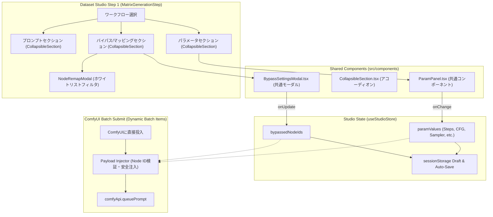

<!-- [LLM Audit Trace: Action=ba-audit | Model=qwen3.5-9b-claude-4.6-highiq-thinking-heretic-uncensored | Domain=reasoning | Params=9.0B | Quant=Q6_K] -->

# REQ-331 詳細設計: Dataset Studio パラメータ編集・ノードバイパス・マッピング統合

> [!NOTE]
> 本設計では、ユーザーのフィードバックに基づき、アダプターパターンを廃止して `src/components/` での共通コンポーネント抽出（部品共用）アーキテクチャを採用しています。

## 1. 背景と設計方針 (Background & Design Principles)

### 1.1 現状の課題 (As-Is)
- 現行の Dataset Studio Step 1（`MatrixGenerationStep`）では、画像生成（直交マトリクス20件の一括投入）を行う際、Steps, CFG, Sampler, Scheduler, LoRA Stack などの各種生成パラメータを編集できず、ワークフローの初期値に拘束されている。
- FaceDetailer や アップスケーラー等の特定ノードを無効化するノードバイパス（Bypass）設定を行う手段が Studio 側に存在しない。
- ノードマッピング画面（`NodeRemapModal`）は Positive/Negative プロンプトの 2 ロールに固定されており、パラメータ関連ノードの再割当ができない。
- 入力項目が増加した際、画面の縦スクロールが著しく増大し、操作性と視認性が低下する。

### 1.2 解決方針 (To-Be)
1. **共通コンポーネント切り出しによる部品共用 (Common Component Extraction)**:
   - 生成ページ固有配下にあった `ParamPanel.tsx` を汎用コンポーネント `frontend/src/components/ParamPanel.tsx` として抽出・昇格する。
   - `BypassSettingsModal.tsx` は既に共通層（`frontend/src/components/BypassSettingsModal.tsx`）に存在するため、Studio から直接インポートして利用する。
   - 不要なアダプター層（`StudioParamAdapter`, `StudioBypassAdapter` 等）を排除し、シンプルな Props 注入（`values`, `onChange`, `mappings` 等）で疎結合に連携する。
2. **ホワイトリスト方式によるロールフィルタリング (Role Whitelisting)**:
   - ノードマッピングモーダルでは、数値・選択肢・LoRA・サンプラ等のパラメータロール全件と、Studio 必須の Positive (`Main_Positive_Prompt`) / Negative (`Negative_Prompt`) を対象とし、Studio 独自のマトリクスプロンプトと重複する汎用 textarea プロンプトロールのみを除外する。純粋関数 `isStudioAllowedRole` として単体テスト可能に抽出する。
3. **セクション別アコーディオン折り畳み機構 (Collapsible Sections)**:
   - 共通部品 `frontend/src/components/CollapsibleSection.tsx` を新設し、Step 1 の入力画面を「マトリクス因子プロンプト」「ネガティブプロンプト」「生成パラメータ」「バイパス／マッピング詳細」にセクション分割する。
4. **ComfyUI 投入ペイロードへの確実な反映とノードID安全バリデーション**:
   - 編集されたパラメータ値（Steps, CFG, Sampler, Scheduler, LoRA 等）およびバイパス設定（対象ノードの mode = 2 (Bypass/Mute)）は、バッチ投入される各プロンプトペイロードに確実に注入される。
   - ワークフロー外で削除されたノードが存在しても、ペイロード生成時に存在チェックを行い安全にスキップ（クラッシュ防止）する。
5. **プロジェクト状態としての永続化とマージ戦略 (SSoT Integrity)**:
   - `useStudioStore` を SSoT とし、初期ロード時は「下書き・保存値優先（Draft > Workflow Defaults）」のマージ戦略を採用。`SPEC_DATASET_STUDIO` のライフサイクル（sessionStorage 下書き退避およびサーバーオートセーブ）と完全に同期・復元する。

## 2. システムアーキテクチャ & データフロー

## 3. コンポーネントおよびインターフェース設計 (Component Design)

### 3.1 CollapsibleSection.tsx (`frontend/src/components/CollapsibleSection.tsx`)
- **Props**:
  - `title`: string - セクション見出し
  - `defaultOpen`?: boolean - 初期開閉状態（デフォルト true）
  - `badge`?: React.ReactNode - ヘッダー右側の状態バッジ
  - `children`: React.ReactNode - セクション内コンテンツ
  - `className`?: string
- **UI 振る舞い**: ヘッダー押下で開閉トグル。アクセントカラーと回転矢印アイコン付き。

### 3.2 ParamPanel.tsx (`frontend/src/components/ParamPanel.tsx`)
- `frontend/src/pages/GeneratePage/components/ParamPanel.tsx` から `frontend/src/components/ParamPanel.tsx` へ移動。
- `GeneratePage` 側および `Studio` 側の双方が `@/components/ParamPanel` より利用。
- `paramMappings` のうち非 textarea ロール（`int`, `float`, `select`, `lora_stack`, `select_sampler`, `select_scheduler`, `boolean`）を抽出してインラインレンダリング。
- `batchSize`, `seed`, `seedMode` 等はオプショナルプロパティとし、未指定時は非表示またはフォールバック。

### 3.3 NodeRemapModal.tsx (`frontend/src/pages/DatasetStudioPage/components/NodeRemapModal.tsx`)
- **ホワイトリスト判定基準**:
  - `isStudioAllowedRole(mapping: WorkflowMapping): boolean`
  - `input_type !== "textarea" || role === "Main_Positive_Prompt" || role === "Negative_Prompt" || role.toLowerCase().includes("positive") || role.toLowerCase().includes("negative")`
- **保存処理**: `workflowsApi.update(workflowId, { mappings: updatedMappings })` を実行し、ワークフロー本体の mappings を更新。

### 3.4 MatrixGenerationStep.tsx 投入ペイロード合成
- バッチ投入時（`handleSubmitBatch`）:
  - 各アイテムのプロンプト（正・負）とシード値を注入。
  - `paramValues` の全エントリ（Steps, CFG, Sampler 等）をマッピングされた各ノードの inputs へ注入。
  - バイパス指定されたノード（`bypassedNodeIds`）のノード存在チェックを実施し、存在するノードのみ mode を 2 (Bypass/Mute) に書き換え。
  - `comfyApi.queuePrompt` を通じて投入。

### 3.5 BA監査フィードバックの反映 (Audit Enhancements)
1. **マージ優先戦略**: `useStudioStore` でワークフロー変更時、既存の変更値（`paramValues`）を維持しつつ新規パラメータのみワークフロー初期値で補完（`{ ...workflowDefaults, ...currentParamValues }`）。
2. **ノード存在バリデーション**: ペイロード生成時にノード ID がワークフロー JSON に存在しない場合は無視し、コンソール警告を出力してジョブ投入のクラッシュを防止。
3. **動的バッチ対応**: バッチ件数は固定20件に依存せず、生成マトリクス配列の長さに応じて動的にループ投入。

## 4. Trade-off Disclosure & リスク管理 (Trade-offs & Risks)

| 項目 | 採用案 | トレードオフ・リスク | 対策 |
|---|---|---|---|
| 部品共有 | `ParamPanel` を `src/components/` へ抽出 | `GeneratePage` の既存インポートパスの変更が必要 | 既存インポートを更新し、型定義を完全に保持して回帰を防止 |
| ロールフィルタ | ホワイトリスト方式（非textarea + Positive/Negative） | 将来的に Studio で追加のプロンプト枠が必要になった際の追従 | ホワイトリスト判定関数を純粋関数として分離し保守性を向上 |
| UI 領域 | セクション別アコーディオン | 開閉操作の手間が1クリック増える | 主要セクション（プロンプト、基本パラメータ）はデフォルト展開 |