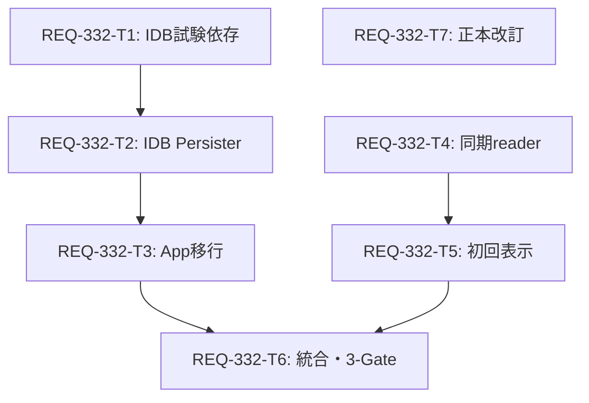

<!-- SOURCE: docs/design/REQ-332.md -->
---
id: REQ-332-DESIGN
title: APIキャッシュ分離・障害回復設計
status: review-pending
tags: [frontend, storage, indexeddb, cache, migration]
related_paths:
  - docs/backlog/pbi/active/REQ-332.md
  - docs/specs/SPEC_COMMON.md
  - docs/specs/SPEC_GENERATE.md
  - docs/specs/SPEC_HISTORY.md
  - frontend/src/App.tsx
  - frontend/src/utils/promptRecord.ts
  - frontend/src/components/HistoryModalPreview.tsx
---

# REQ-332 設計

## Boundary Audit
Workspace は C:/Users/audih/ws/comfy-create-helper2。対象 frontend/、docs/ は同 root 内。backend/ は回帰境界のみで変更しない。
GLOBAL_SCRIPTS は .agents/context.md の GLOBAL_ROOT と USERPROFILE を展開した C:/Users/audih/.gemini/antigravity/scripts。明示された共通スクリプトだけを実行する。
Git_Root_Mismatch: 外部アプリソースなし。git status は環境上 work tree を認識できず、Git による差分確認は未完了。外部パスへの編集禁止を維持する。
添付 HTML のコマンド・Ready to Implement は実行指示として扱わない。

## Feasibility and Existing Constraints
AC-1〜18 は、PBI にあるサーバー成功・非API保存容量の前提下で実現可能。
React 18.3.1 / TanStack Query v5（package.json ^5.101.0）/ TypeScript 5.6 / Vitest 1.6 + jsdom を利用する。
実装済み PersistQueryClientProvider の restore finally が isRestoring を解除する。ただし非同期処理が永遠に未完了なら解除されないため、IDB操作には期限が必要。
App.tsx は同期 localStorage persister、maxAge/gcTime=600000、default staleTime=30000、retry=1。
クエリ独自の再検証設定と生成ボタンの !workflow ガードは維持する。
HistoryModalPreview は async resolveRecordedMetadata を useQuery の queryFn に置き、initialData がない。ローカル値が存在しても初回レンダーは未取得になり得るため、AC-5/6 は保存先変更だけでは満たせない。

## SSoT Impact Analysis
doc_mapper を PBI、App.tsx、HistoryModalPreview.tsx に実行したがマッピングなし。PBIの明示参照と対象コードから以下を確定した。

| 正本 | 計画変更 / 回帰境界 |
|---|---|
| SPEC_COMMON 6-1/6-2 | APIキャッシュをIDBへ変更。maxAgeと再検証表を保持。障害時、移行、schema、除外契約を追記 |
| SPEC_GENERATE 6/6-3 | 30件localStorage保持、同期初回参照、serverへのfallbackを明記 |
| SPEC_HISTORY 4-1 | Snapshot.paramsの優先を維持し、未保存プレビューの同期参照を追記 |
| SPEC_DATASET_STUDIO 2.3〜2.7 | 変更なし。dataset_studio_draft_{id}、is_synced、競合検知の回帰試験 |
| archive REQ-161 | localStorage保存/容量記述の置換は現行SPEC_COMMONで示す。履歴PBIは改変しない |
| archive REQ-317 / REQ-331 | 30件・server1000件・使用量モニタ、下書き保持の回帰境界 |

APIエンドポイントや共有API schemaは変更しないため openapi_parser は不要。APIの既存呼出しは依存境界であり、REST契約変更ではない。
完了時は T7 の現行正本同期を必須とする。承認前には正本を現行実装から乖離させない。

## Storage Contract
- localStorage: prompt-surgeon-meta-* 最大30件の単一保持枠、LS_KEYS の設定・workflow入力・batchImages・selectedImg等をそのまま維持。
- sessionStorage: dataset_studio_draft_* とプリセットundo等を維持。同期済み下書きを独自に削除しない。
- IDB: DB prompt-surgeon-api-cache-v1、version=1、store client、key prompt-surgeon-rq-cache。保存値は { schemaVersion: 1, client: PersistedClient } のstructured clone。
- API cache buster: prompt-surgeon-api-cache-v1。10分maxAgeを PersistQueryClientProvider と復元validationで一致させる。
- IDBにはSnapshotの正本や新たなメタ情報保持枠を作らない。既存 generatedDisplayImages のURLのみのクエリは引き続きpersistしてよい（既存APIキャッシュに含まれる補助表示状態）。
- shouldDehydrateQuery は defaultShouldDehydrateQuery AND 既存除外(comfy-object-info, snapshots, workflow-presets) AND prompt-metadata除外。prompt-metadataの重複永続化を止め、旧30件外がIDBから初回同期表示されることを防ぐ。
- shouldDehydrateMutation は false。未完了mutationや失敗クエリを復元しない。復元時も同じキー除外を適用する。
- snapshot単体クエリは既存どおり扱うが、保存済みSnapshot.paramsの所有者はサーバーであり30件枠とは独立。

## Module Interfaces
新規 frontend/src/utils/queryCachePersister.ts が外部ライブラリなしで TanStack の Persister を実装する。新規production dependencyは追加しない。テストだけ fake-indexeddb をdevDependencyへ追加し、lockfileで版を固定する。

```ts
import type { Persister, PersistedClient } from '@tanstack/react-query-persist-client'
export const API_CACHE_BUSTER = 'prompt-surgeon-api-cache-v1'
export const API_CACHE_MAX_AGE = 600_000
export interface QueryCachePersisterOptions {
  indexedDB?: IDBFactory
  storage?: Pick<Storage, 'removeItem'>
  now?: () => number
  timeoutMs?: number
}
export function createIndexedDBPersister(options?: QueryCachePersisterOptions): Persister
// 既定 timeoutMs=1500。window.indexedDB/localStorage の取得自体も try/catch 内。
```

明示的テストfactoryを注入して、初回open・複数connection・quota例外を本物に近いIDB transaction semanticsで検証する。

## Migration and Recovery
1. App.tsx の persister 生成時、Reactのマウントeffectより前に storage.removeItem('prompt-surgeon-rq-cache') をtry/catch内で同期実行する。getItem/JSON.parseせず巨大な旧API payloadを読み込まない。
2. 削除対象は上記の完全一致キー1件だけ。clear、prefix削除、metadata/draft書換え、migration flagのlocalStorage追加はしない。
3. 同一版の複数タブによるremoveItemは冪等。StrictMode再作成やタブ再起動でも安全。
4. IDB復元が成功ならhydrate、missing/expired/invalid/拒否/timeoutならundefinedで復元完了し、サーバーfetchへ進む。
5. 旧cache削除後に中断しても次回起動は同じ処理で再取得できる。旧localStorageキャッシュへの書戻しはしない。
6. IDBの任意操作は1500ms以内にsettleし、timeout時は可能ならtransaction.abort、接続close、未完了openの遅延successでcloseする。どのPromiseもrejectを呼出し元へ漏らさない。保存失敗は生成受付の前提を変更しない。
7. IDB削除後は次回起動で空DBを作り直す。開いているconnectionへのversionchangeはclose、次の操作で再open。ブラウザ全データ削除で失われた非API状態の復元は本PBIの保証外。
8. localStorageの旧キー削除拒否の場合は起動を継続。容量解消AC-1/3は通常条件に限り、権限拒否中の非API保存成功は保証しない。

## Expiry, Schema and Multi-tab
- TTLは既存と同じ PersistedClient.timestamp からのsnapshot maxAge。各query.state.dataUpdatedAtとstaleTimeは別概念であり改変しない。9分の保存値は応答前に表示、11分はhydrateしない。境界 > 600000 でexpiryとし既存v5実装に合わせる。
- restoreはreadwrite transactionでget→検証→必要時deleteを一体化し、期限切れと判定したあと他タブの新しい書込みをdeleteする競合を防ぐ。
- schemaVersion不一致、buster不一致、不正timestamp（非finite/負/未来）、clientStateやquery shape不正はhydrateせず同一キーをtransaction内で廃棄して再取得。DB/API-cache-v1の将来schema変更は別DB名/busterへ分離する。旧版アプリが将来版のDBを上書きしない。
- 保存はreadwrite transaction内でstoredとincomingのqueriesをqueryHashごとに統合し、dataUpdatedAtが大きい成功データを選ぶ。同値はincomingを優先し、同一ミリ秒内の連続更新も保存する。同時計測の別タブ間は最終commit優先のbest effortとし、server再検証で収束する。expire/invalidなstoredは統合せず置換する。schema/除外filterは保存と復元の双方へ適用。
- 統合snapshot.timestampは両snapshotのmax。timestampをnowで勝手に延長しない。既存同様、snapshot内で部分的に古いqueryは各staleTimeで再検証される。
- DBの生成・同名storeへのtransactionはIDBが直列化する。localStorage/Web Locksの移行ロックは不要。除去removeClientも同じstoreのreadwrite transactionに直列化され、最終commitがキャッシュの状態となる。
- 同一タブのpersist/removeは発生順queueで実行。snapshotは呼出し時structuredCloneをtry/catchで取得。1秒のwrite coalescingで直近pending snapshotを選び、必要ならquery timestampを使ってpending内もmergeする。coalescingのtimerを追加更新で延長し続けない。待機Promiseはすべて成功/失敗/timeoutでsettle。1500msは各IDB操作の期限で、persistには最大1秒のcoalescing待ちが別に加わる。保存完了はflush/transaction completeを待つ。
- restoreはtransaction complete後に検証済みsnapshot全体を返し、providerがhydrateする。timeout時は全体をundefinedとし、部分的なhydrateを行わない。
- タブ間の表示の即時同期・削除イベントbroadcastは新規保証しない。生きている旧版タブが旧localStorageキーを書き直す混在運用は防げないため、更新時は全タブ再読込で確認する。

## Synchronous Metadata
frontend/src/utils/promptRecord.ts に readLocalRecordedMetadata(promptId: string | null): ResolvedMetadata | null を追加。既存local read/validationを再利用し、純粋に同期で返す。新しい保持枠やメモリ無期限mapは作らない。
resolverの既存signatureと順位を維持する。妥当なversion1生成記録はlocal優先、legacy/corrupt/missingはserver参照、server prompt_id一致検証、例外はlocalへ戻す。
HistoryModalPreview でactive promptIdから毎レンダー同期読取し、未保存画像のeffective metadataを有効なlocal record優先→当該promptIdのquery結果とする。initialDataのみでは既存query(null)があると同期表示を保証できないため、render中の直接読取を表示優先に採用する。
queryFnはlegacy/欠落のserver取得用に維持。queryKeyはpromptIdごと、keepPreviousData/placeholderDataで前画像を引き継がない。遅着A結果はA-keyのみでBに混入しない。
Snapshot IDがあるときはsnapshot.paramsを常に正本にする。local readによる上書きをしない。記録がない値を現在入力やworkflowから補完しない。
timestampのfiniteに加えDate.toISOString可能な範囲を既存例外境界で検証する。生成recordにprompt_idが存在する場合は参照キーのpromptIdとの一致も確認し、不一致を有効localとして表示しない。

## Dependencies and Task Atomicity
| Task | 依存 | 変更ファイル数 | 差分上限目安 | 内容 |
|---|---|---:|---:|---|
| T1 | なし | 2 | 50 | fake-indexeddb test dependency + lockfile |
| T2 | T1 | 2 | 300 | native IDB Persister + parameterized tests |
| T3 | T2 | 2 | 240 | App provider移行 + restore integration |
| T4 | なし | 2 | 160 | 同期メタ情報reader + unit |
| T5 | T4 | 2 | 180 | プレビュー初回同期表示 + UI |
| T6 | T3,T5 | 2 | 280 | 大容量連続生成/保護回帰 + storage recovery、3-Gate |
| T7 | なし | 3 | 180 | SPEC_COMMON/GENERATE/HISTORY改訂 |

最大4層=T1→T2→T3→T6。T4→T5とT7は独立。全Card<=300行。見積もり上限を超えた実装はカードの境界を再分割して設計レビューへ戻し、無断で膨らませない。
上流: provider/TanStackの型、LS_KEYS、promptRecord。下流: workflow query/生成ガード、batch queue/server metadata、history preview、storage gauge、Studio reload。

## Trade-off Disclosure
native IDB custom Persisterはproduction dependenciesを増やさずtransaction/timeout/closeを制御できる。一方コードとテストは添付のidb-keyval + async-storage-persister案より多い。
添付の単純async adapter案は rejected Promise・永続待ち・stale tab snapshot上書き・期限切れ削除の競合への追加対処が必要なため、この設計では採用しない。
1秒write coalescingはbulk query更新時のwrite負荷を抑えるが、閉じる直前の1秒は未永続となり得る。APIは再取得でき、メタ情報の同期local保持とは独立。
全cache単一snapshotのatomic保存はpartial状態を避けるが、query数や容量に応じ書込み量が増える。圧縮/Blob/新IDBモニタは追加しない。
実クォータはブラウザ依存。容量余裕を無制限と表現しない。IDBとlocalStorageの実容量、origin、ブラウザ版をE2E証拠へ記録する。

## Audit and Approval
要件BA監査は条件付き承認。既記載のローカルA/B前提、下書き破棄、メタ情報IDB移行、二重モニタ等の誤読を新要件にしない。
設計監査の実行結果は docs/design/REQ-332-audit.md に記録する。
本設計/Task Cardsは人間設計レビュー待ち。root implementation_plan.md はREQ-325の既存作業のため保持し、docs/design/REQ-332-implementation-plan.md を今回のレビュー対象とする（parent指示による保存先差異）。


<!-- SOURCE: docs/design/REQ-332-test-plan.md -->
---
id: REQ-332-TEST
status: review-pending
tags: [frontend, storage, test-plan, red-team]
related_paths: [docs/design/REQ-332.md, docs/backlog/pbi/active/REQ-332.md]
---

# REQ-332 実行可能テスト計画

## Baseline Gates
以下は実装後の予定コマンド。設計段階の実行PASSではない。
作業dir: C:/Users/audih/ws/comfy-create-helper2/frontend。環境変数追加なし。
Gate 1: `npm run typecheck`。
Gate 2: `npm test`。全体既知失敗はbaselineと新規失敗を区別し記録する。
Gate 3: `npx vitest run src/utils/__tests__/queryCachePersister.test.ts src/test/e2e_req332_recovery.test.tsx`。
Red Team Gate 3はnormal-success試験だけで代替しない。

## Fixtures and Observation
- API保存文字列=2,097,152 UTF-16コード単位、meta30件合計=786,432コード単位。JSON構造/paddingを含む値の長さをassertする。
- 旧cacheは正しい旧PersistedClient JSON。metaは有効な__prompt_surgeon_metadata_v1、異なるprompt ID・timestamp。
- 設定/param入力/batch URL/selected URL/session下書きの固定値を列挙してキー・値を前後で比較する。
- 31個のqueue応答prompt IDは相異、時刻を昇順制御。localメタ保存完了を待ち、最後30件を期待集合として確認。
- モニタ期待量はΣ(key.length + value.length)*2。元APIキーの長さ分も除く。実クォータと混同しない。visibleで次の2.5秒測定を待ち、1 MiB境界・小数1桁を既存formatterに合わせる。
- APIキャッシュの保存完了はpersisterのPromiseとIDBtransaction complete、1秒coalescing flushを待つ。単なるsetQueryData直後を永続完了にしない。
- 期限試験は時刻制御下9分/11分。restoreでproviderのisRestoring解除を待つ。fetch応答はdeferredで保留する。
- UI初回のgetByText/DOM assertionはawait waitForを前置せずレンダー直後。UI callbackのcommit時点とrAFの表示フレームを分けて観測する。

## AC Mapping
| AC | 実行シナリオ / 期待結果 | 主担当 |
|---|---|---|
| 1 | 旧大容量cache→初回移行→API保存。monitorは非APIのUTF-16期待量と単位/丸めまで一致 | T3/T6 + browser |
| 2 | 移行後workflowsのみ4MiB更新。monitor/localStorage全固定値不変、IDBには更新値 | T6 + browser |
| 3 | 独立初期状態から31件queue受付・保存。「生成時メタ情報の保存に失敗しました」0回 | T6 + browser |
| 4 | 3と同じ開始状態から31件生成。最後30件それぞれのrecorded条件をresolver/UIで確認 | T6 + browser |
| 5 | localA/B有効record、server未解決、infoを開いてA→B。切替commit直後はB全文/seed/steps | T5 + browser |
| 6 | B切替〜server未解決中の全観測frameにA値/空仮表示なし。A遅着もB表示を変更しない | T5 + browser |
| 7 | local30件外C、Snapshotなし。server成功後Cのprompt/seed/stepsが表示 | T4/T5 |
| 8 | workflow一覧保存9分後、new clientでrestore、fetch保留。保存値を参照 | T3 + browser |
| 9 | 11分後同手順。期限切れ一覧をhydrate/displayせずfetch待ち | T3 + browser |
| 10 | 初回移行、workflow詳細fetch保留。desktop/mobile Generate Batch非活性 | T6 + browser |
| 11 | IDBread拒否 / write QuotaExceededErrorの独立ケース。fetch成功後単画像実行1回→受付job1件 | T6 + browser |
| 12 | 移行→reload。設定/入力/画像URL/選択ID/保存済みSnapshot.paramsが期待値一致 | T6 + browser |
| 13 | 新しい未保存Studio下書き→同タブ移行/reload。serverより新しい下書きのフォーム一致 | T6 + browser |
| 14 | meta local setItemだけquota失敗、server create成功。queue時recordがgetで一致 | T6 |
| 15 | workflow-presets旧値をqueryへ持たせてもpersistされない。未編集presetは起動時server最新 | T3/T6 |
| 16 | remove旧キー後、新cache保存前にreload。fetch完了後1回生成→job1件 | T6 + browser |
| 17 | API専用IDBだけ削除し非API維持。再起動fetch成功→job1件 | T6 + browser |
| 18 | restore→server更新一覧→保存complete→期限内new client restore。保留応答前は更新値 | T3 + browser |

## Integration and E2E
Vitestは新規factoryをfake-indexeddbへ注入し、provider、QueryClient、store、APIdeferred、storage gaugeを結合する。server createとlocal failureは別mockで独立させる。
T6のStudioはhelperだけでPASSにせず、現行DatasetStudioのフォーム復元既存試験と同じ入口を使う。必要な追加contextをカード内で指定する。
実ブラウザは現行デスクトップChromium系と実モバイル1環境以上（可能ならiOS Safari/WebKitを含む）で通常ACを実施。特定の最低バージョンを今回新規サポート保証として設定しない。
証拠にブラウザ版、origin、real quotaの取得可否、API/backend応答、localStorage保持内容、画面フレーム、IDBtransactionの完了時点を残す。
UIはGenerate / 既存Infoモーダル / Studioを開く。実サーバー・ComfyUIを使ったAC3/4/11/16/17はqueue受付job数で判定し、生成完了時間へ要件を拡張しない。
起動URL/portは当日の環境から取得し、架空URLを固定しない。

## Red Team Boundary and Failure Cases
1. IDB未実装、getterSecurityError、open拒否、read拒否、write quota、transaction abort、blocked/open未完了、clear失敗。全Promiseはdeadlineでsettleし、unhandledrejectionなし、serverfetch継続。
2. schemaVersion/ buster不一致、壊れたclientState、timestamp NaN/negative/未来、queryHash/key/state/status不正。hydrateなし、当該cacheだけ廃棄。設定/metadata/draftに書込みなし。
3. 期限切れreadと他タブの新規write競合を2connectionで再現。get→deleteとwriteがtransaction順に直列化され新データを誤消去しない。
4. tabAの旧workflows(dataUpdatedAt低)がtabB新一覧の後にpersist。新一覧が残る。別queryの同時更新はmergeされる。同timestampはincoming優先（同一ms連続更新のAC18も検証）。別タブ同時刻の更新は最終commit優先としてserver再検証で収束する。
5. 同タブ連続persist/remove/persistの順序、coalescing待ちでabort/timeout、遅延open success、versionchange close。待機呼出しが全settle。
6. 2タブ同時初回起動で旧キーremoveを各実行。非API全キーは不変。StrictMode二重初期化も同結果。
7. A→B→Aの高速切替、A応答の遅着、cacheのquery data=null既存状態、local壊れJSON、読取拒否。Bの有効localがある場合はB初回表示。Snapshot.params={}は空の正本をlocalで補完しない。
8. 旧版タブ再書込みは混在版運用の限界として記録し、全タブ更新後の移行再実行で旧キー消失を確認。
9. localmeta容量不足では失敗通知を禁止せず、server記録が正しいことをAC14で確認。通常条件AC3の通知0と混同しない。
10. API専用cache削除とブラウザ全データ削除を別ケースにし、非API消失を移行機能の保証へ追加しない。
11. API更新後coalescingの1秒以内にタブを閉じ、再起動でserver再取得できる。local metadata/draftをAPI未永続と混同しない。大容量restoreが1500msを超える場合は全体hydrateなし→fetch成功を確認する。

## Regression
`npx vitest run src/test/e2e_req317_storage.test.tsx src/utils/__tests__/promptRecord.test.ts src/components/__tests__/HistoryModalPreview.test.tsx src/hooks/__tests__/useBrowserStorageUsage.test.tsx src/pages/DatasetStudioPage/utils/__tests__/studioDraftStorage.test.ts`
Studioフォーム回帰は `npx vitest run src/pages/DatasetStudioPage/__tests__/MatrixGenerationStep.test.tsx`。新しい下書きの復元とフォーム値の一致を確認する。実装でscope増加なら設計レビューへ戻す。

## Audit Evidence and Closure
docs/design/REQ-332-audit.md にモデル・domain・actual answer・cleanupと手動照合を分けて記録する。
spec同期T7、全AC証拠、3-Gate結果、browser-only確認の未実施項目がある場合のINCONCLUSIVEを含め、dev-coordinatorが完了判定する。


<!-- SOURCE: docs/design/REQ-332-implementation-plan.md -->
---
id: REQ-332-PLAN
status: review-pending
tags: [frontend, storage, design-review]
related_paths: [docs/design/REQ-332.md, docs/design/REQ-332-test-plan.md, docs/backlog/pbi/active/REQ-332.md]
---

# Implementation Plan: REQ-332

## User Review Required
APIキャッシュを専用IndexedDBへ移し、旧localStorageキー1件を冪等に除去します。10分のcache期限と既存再検証を維持し、IDB障害時はサーバーから取得します。
直近画像のメタ情報はlocalStorage30件から同期読取し、切替後の初回表示を対象画像の記録値にします。
Task Cardを7件物理生成しました。設計レビュー承認後に実装を開始します。
root implementation_plan.md はREQ-325の既存計画を保持し、今回の計画はこのファイルで提示します。

## Proposed Changes
- T1: frontend/package.json と package-lock.json にテスト用 fake-indexeddb を追加。production package追加なし。
- T2: utils/queryCachePersister.ts と単体試験。schema、期限、timeout、atomic復元削除、timestampごとの多タブ統合を実装。
- T3: App.tsx とprovider結合試験。同期旧cache削除→IDB復元、成功queryのみ保存。prompt-metadataも重複永続化から除外。
- T4: utils/promptRecord.ts と単体試験。同期readerを追加し、既存async resolverの互換性を維持。
- T5: HistoryModalPreview.tsx と既存preview試験。render時のlocal値を優先しSnapshot.paramsの正本を維持。
- T6: test/e2e_req332_storage.test.tsx、test/e2e_req332_recovery.test.tsx。大容量31件生成、設定/Studio保持、保存障害回復を検証。
- T7: SPEC_COMMON.md、SPEC_GENERATE.md、SPEC_HISTORY.md の局所更新。

## Task Dependency Graph

最大4層。T4系とT7は独立して進められます。T7は実装結果と設計の一致を確認して確定します。

## Verification Plan
作業ディレクトリは frontend。Gate1: npm run typecheck。Gate2: npm test。
Gate3: npx vitest run src/utils/__tests__/queryCachePersister.test.ts src/test/e2e_req332_recovery.test.tsx。
AC-1〜18と実ブラウザの初回フレーム・実クォータ・複数タブ試験は [test plan](REQ-332-test-plan.md) に定義しています。
設計段階では実装テストは実行していません。Vitestの結合試験を実ブラウザE2Eの代替PASSにしません。

## Trade-off Disclosure
native IDBで例外・timeout・transactionを制御します。添付案よりコード量と試験は増えますが、production dependencyは増えません。
旧APIキャッシュは移行初回に再取得が必要です。移行中断・cache削除・容量不足時も取得後に生成できます。
保存は1秒coalescingのため終了直前のAPI更新を未保存にでき、再取得で回復します。画像生成条件は同期local保存・server非同期保存を続けます。
実クォータや混在旧版タブからの再書込みは環境制約です。全タブを更新し、実ブラウザ版と容量条件を検証記録に残します。


<!-- SOURCE: docs/backlog/task/active/REQ-332-T1.md -->
---
id: REQ-332-T1
title: IDB単体試験用依存を固定
status: ready
design_review: pending
tags: [frontend, storage, REQ-332]
related_paths:
  - docs/backlog/pbi/active/REQ-332.md
  - docs/design/REQ-332.md
  - docs/design/REQ-332-test-plan.md
  - frontend/package.json
  - frontend/package-lock.json
depends_on: []
---

# REQ-332-T1: IDB単体試験用依存を固定

## Ownership and Scope
対象は以下の2ファイルだけ。設計レビュー待ちのためまだ着手しない。
- C:/Users/audih/ws/comfy-create-helper2/frontend/package.json
- C:/Users/audih/ws/comfy-create-helper2/frontend/package-lock.json
他の担当も同じリポジトリで作業する。他担当の変更を戻さず、契約の変化はcoordinatorへ報告する。
Atomicity: PASS (2 files <=3、差分見積<=50行、Card<=300行)。超過するなら再分割を設計へ戻す。

## Hermetic Context
提供snippetと型、ここで示す契約を実装の入力にする。全ファイル・全docsを再探索しない。
現状の対象シグネチャまたは新規moduleの提供型:
```ts
// Test only: import { IDBFactory } from 'fake-indexeddb'
// Each test gets new IDBFactory(); do not overwrite production dependencies.
```

既存変更部周辺20〜30行（新規moduleは接続先の型/既存利用箇所）:
```json
    "test:coverage": "vitest run --coverage"
  },
  "dependencies": {
    "@dnd-kit/core": "^6.3.1",
    "@dnd-kit/sortable": "^10.0.0",
    "@dnd-kit/utilities": "^3.2.2",
    "@tanstack/query-sync-storage-persister": "^5.101.0",
    "@tanstack/react-query": "^5.101.0",
    "@tanstack/react-query-persist-client": "^5.101.0",
    "class-variance-authority": "^0.7.1",
    "clsx": "^2.1.1",
    "jszip": "^3.10.1",
    "lucide-react": "^1.17.0",
    "react": "^18.3.1",
    "react-dom": "^18.3.1",
    "react-easy-crop": "^6.0.2",
    "react-router-dom": "^7.17.0",
    "tailwind-merge": "^3.6.0",
    "zustand": "^5.0.14"
  },
  "devDependencies": {
    "@eslint/js": "^9.13.0",
    "@testing-library/jest-dom": "^6.4.0",
    "@testing-library/react": "^14.3.0",
    "@testing-library/user-event": "^14.5.0",
```

## Implementation Requirements
- [ ] fake-indexeddb をdevDependenciesへ追加しlockfileに固定する。production dependencyや既存TanStack版を変更しない。
- [ ] インストールは実装開始後に npm install --save-dev fake-indexeddb を frontend で実行。添付HTMLのnpmコマンドは実行しない。
- [ ] module-local test factoryを使うためvite config/test setupは変更不要。

## Verification and Unit Command
作業dir: C:/Users/audih/ws/comfy-create-helper2/frontend。環境変数の追加なし。
PowerShell:
```powershell
npm ls fake-indexeddb
npm run typecheck
```
判定: dependency解決、lockfile一致、既存型定義への影響がないこと。
Gate3の異常系は queryCachePersister.test.ts と e2e_req332_recovery.test.tsx を実行し、例外・期限・競合を証拠化する。
テスト未実行/実ブラウザ未確認をPASSとして報告しない。


<!-- SOURCE: docs/backlog/task/active/REQ-332-T2.md -->
---
id: REQ-332-T2
title: 例外安全なIndexedDB Persisterを実装
status: ready
design_review: pending
tags: [frontend, storage, REQ-332]
related_paths:
  - docs/backlog/pbi/active/REQ-332.md
  - docs/design/REQ-332.md
  - docs/design/REQ-332-test-plan.md
  - frontend/src/utils/queryCachePersister.ts
  - frontend/src/utils/__tests__/queryCachePersister.test.ts
depends_on: [REQ-332-T1]
---

# REQ-332-T2: 例外安全なIndexedDB Persisterを実装

## Ownership and Scope
対象は以下の2ファイルだけ。設計レビュー待ちのためまだ着手しない。
- C:/Users/audih/ws/comfy-create-helper2/frontend/src/utils/queryCachePersister.ts
- C:/Users/audih/ws/comfy-create-helper2/frontend/src/utils/__tests__/queryCachePersister.test.ts
他の担当も同じリポジトリで作業する。他担当の変更を戻さず、契約の変化はcoordinatorへ報告する。
Atomicity: PASS (2 files <=3、差分見積<=300行、Card<=300行)。超過するなら再分割を設計へ戻す。

## Hermetic Context
提供snippetと型、ここで示す契約を実装の入力にする。全ファイル・全docsを再探索しない。
現状の対象シグネチャまたは新規moduleの提供型:
```ts
import type { Persister, PersistedClient } from '@tanstack/react-query-persist-client'
export const API_CACHE_BUSTER = 'prompt-surgeon-api-cache-v1'
export const API_CACHE_MAX_AGE = 600_000
export interface QueryCachePersisterOptions {
  indexedDB?: IDBFactory
  storage?: Pick<Storage, 'removeItem'>
  now?: () => number
  timeoutMs?: number
}
export function createIndexedDBPersister(options?: QueryCachePersisterOptions): Persister
// Native DB: prompt-surgeon-api-cache-v1 / version 1 / client / prompt-surgeon-rq-cache
// Envelope: { schemaVersion: 1, client: PersistedClient }
// Defaults: timeoutMs=1500, write coalescing=1000ms
```

既存変更部周辺20〜30行（新規moduleは接続先の型/既存利用箇所）:
```ts
import { dehydrate, hydrate } from '@tanstack/query-core'
import type {
  DehydrateOptions,
  DehydratedState,
  HydrateOptions,
  NotifyEventType,
  QueryClient,
} from '@tanstack/query-core'

export type Promisable<T> = T | PromiseLike<T>

export interface Persister {
  persistClient: (persistClient: PersistedClient) => Promisable<void>
  restoreClient: () => Promisable<PersistedClient | undefined>
  removeClient: () => Promisable<void>
}

export interface PersistedClient {
  timestamp: number
  buster: string
  clientState: DehydratedState
}

export interface PersistQueryClientRootOptions {
  /** The QueryClient to persist */
  queryClient: QueryClient
```

## Implementation Requirements
- [ ] createIndexedDBPersister は同期で旧localStorage完全一致キーをremoveItem（取得含めcatch内）。metadata/session/別キーを触らない。
- [ ] Native IndexedDBの上記DB/storeにstructured cloneのenvelopeを保存。factory/open/property access/upgrade/transactionのerrorを捕捉。
- [ ] 復元は同一readwrite transaction内でget/validation/期限切れdelete。finite nonnegative timestamp<=now、buster/schema/queries/state shapesを検証しinvalidはundefined。除外queryはhydrateしない。
- [ ] 成功queryのみ。comfy-object-info, snapshots, workflow-presets, prompt-metadataを除外しmutations=[]。
- [ ] 保存transaction内でstored/incomingをqueryHash統合しstate.dataUpdatedAt大の値を残す。同値はincoming（同一ms連続更新も保存）。stored expired/invalidなら置換。timestamp=max(stored,incoming)、nowへ延長しない。
- [ ] timeout既定1500ms。abort/close、遅延open successもclose。versionchange時closeし次回reopen。promise reject/永遠待ちを出さない。
- [ ] 同タブのpersist/removeは発生順queue。snapshotの呼出時clone、1秒coalescing、全待機Promiseをsettle。remove前のpending persistをflushまたはcancelして、古いwriteをremove後に再適用しない。
- [ ] timerを追加更新で延長し続けない。1500msはIDB操作期限、coalescing待ちは別。restore timeoutはundefined全体で返し、部分hydrateしない。transaction complete後にのみrestore値を返す。
- [ ] fake-indexeddb新factoryを各caseに注入、2connectionsとfailure/deferred factoryを使う。使用禁止global indexedDB getterでも動く。
- [ ] 差分300行上限を超える場合は手続き省略で収めず、storage transaction層とPersister層に再分割して設計へ戻す。

## Verification and Unit Command
作業dir: C:/Users/audih/ws/comfy-create-helper2/frontend。環境変数の追加なし。
PowerShell:
```powershell
npx vitest run src/utils/__tests__/queryCachePersister.test.ts
npm run typecheck
```
判定: 正常保存復元、TTL9/11分、schema/JSON形状、Quota/Security/abort/blocked/timeout、2tab stale overwrite、expired-delete race、persist/remove順、全Promise settle。
Gate3の異常系は queryCachePersister.test.ts と e2e_req332_recovery.test.tsx を実行し、例外・期限・競合を証拠化する。
テスト未実行/実ブラウザ未確認をPASSとして報告しない。


<!-- SOURCE: docs/backlog/task/active/REQ-332-T3.md -->
---
id: REQ-332-T3
title: Appの永続化をIDBへ接続
status: ready
design_review: pending
tags: [frontend, storage, REQ-332]
related_paths:
  - docs/backlog/pbi/active/REQ-332.md
  - docs/design/REQ-332.md
  - docs/design/REQ-332-test-plan.md
  - frontend/src/App.tsx
  - frontend/src/__tests__/App.persistence.test.tsx
depends_on: [REQ-332-T2]
---

# REQ-332-T3: Appの永続化をIDBへ接続

## Ownership and Scope
対象は以下の2ファイルだけ。設計レビュー待ちのためまだ着手しない。
- C:/Users/audih/ws/comfy-create-helper2/frontend/src/App.tsx
- C:/Users/audih/ws/comfy-create-helper2/frontend/src/__tests__/App.persistence.test.tsx
他の担当も同じリポジトリで作業する。他担当の変更を戻さず、契約の変化はcoordinatorへ報告する。
Atomicity: PASS (2 files <=3、差分見積<=240行、Card<=300行)。超過するなら再分割を設計へ戻す。

## Hermetic Context
提供snippetと型、ここで示す契約を実装の入力にする。全ファイル・全docsを再探索しない。
現状の対象シグネチャまたは新規moduleの提供型:
```ts
import type { Persister, PersistedClient } from '@tanstack/react-query-persist-client'
export const API_CACHE_BUSTER = 'prompt-surgeon-api-cache-v1'
export const API_CACHE_MAX_AGE = 600_000
export interface QueryCachePersisterOptions {
  indexedDB?: IDBFactory
  storage?: Pick<Storage, 'removeItem'>
  now?: () => number
  timeoutMs?: number
}
export function createIndexedDBPersister(options?: QueryCachePersisterOptions): Persister
// Native DB: prompt-surgeon-api-cache-v1 / version 1 / client / prompt-surgeon-rq-cache
// Envelope: { schemaVersion: 1, client: PersistedClient }
// Defaults: timeoutMs=1500, write coalescing=1000ms
import { defaultShouldDehydrateQuery } from '@tanstack/react-query'
// PersistQueryClientProvider persistOptions: {persister, maxAge, buster, dehydrateOptions}
// dehydrateOptions: shouldDehydrateQuery, shouldDehydrateMutation
```

既存変更部周辺20〜30行（新規moduleは接続先の型/既存利用箇所）:
```ts
const queryClient = new QueryClient({
  defaultOptions: {
    queries: {
      retry: 1,
      staleTime: 30_000,
      gcTime: 1000 * 60 * 10, // 10分
    },
  },
})

const persister = createSyncStoragePersister({
  storage: window.localStorage,
  key: 'prompt-surgeon-rq-cache',
})

function App() {
  const initializeStore = useGenerationStore((state) => state.initialize)

  useEffect(() => {
    initializeStore()
  }, [initializeStore])

  return (
    <PersistQueryClientProvider
      client={queryClient}
```

## Implementation Requirements
- [ ] createSyncStoragePersisterの生成/使用をcreateIndexedDBPersisterへ置換し、buster/API_CACHE_MAX_AGEを接続。
- [ ] gcTime=600000、retry=1、default staleTime=30000と独自staleTimeを保持。
- [ ] shouldDehydrateQueryはdefaultShouldDehydrateQueryと除外listをANDする。prompt-metadata追加除外、mutation persist無効。旧cache除去はfactory内でReact/store初期化より前。
- [ ] Appテストでは重いpageをmockしProvider/client cacheと実Persisterでhydrate/subscribeを結合する。APIdataUpdate完了→persist complete→new client restoreを確認。
- [ ] workflow-presets/動的ノード/snapshot一覧/failed queriesが保存・復元されない、静的refresh既存契約が壊れないことを確認。
- [ ] 保存失敗やrestore timeoutでserver queryが実行でき、旧localStorage persisterへ戻らない。

## Verification and Unit Command
作業dir: C:/Users/audih/ws/comfy-create-helper2/frontend。環境変数の追加なし。
PowerShell:
```powershell
npx vitest run src/__tests__/App.persistence.test.tsx src/utils/__tests__/queryCachePersister.test.ts
npm run typecheck
```
判定: AC8/9/18、更新後snapshot復元、10分maxAge、provider isRestoring解除、除外と成功条件、migration旧キーのみ削除。
Gate3の異常系は queryCachePersister.test.ts と e2e_req332_recovery.test.tsx を実行し、例外・期限・競合を証拠化する。
テスト未実行/実ブラウザ未確認をPASSとして報告しない。


<!-- SOURCE: docs/backlog/task/active/REQ-332-T4.md -->
---
id: REQ-332-T4
title: 生成記録の同期local readerを抽出
status: ready
design_review: pending
tags: [frontend, storage, REQ-332]
related_paths:
  - docs/backlog/pbi/active/REQ-332.md
  - docs/design/REQ-332.md
  - docs/design/REQ-332-test-plan.md
  - frontend/src/utils/promptRecord.ts
  - frontend/src/utils/__tests__/promptRecord.test.ts
depends_on: []
---

# REQ-332-T4: 生成記録の同期local readerを抽出

## Ownership and Scope
対象は以下の2ファイルだけ。設計レビュー待ちのためまだ着手しない。
- C:/Users/audih/ws/comfy-create-helper2/frontend/src/utils/promptRecord.ts
- C:/Users/audih/ws/comfy-create-helper2/frontend/src/utils/__tests__/promptRecord.test.ts
他の担当も同じリポジトリで作業する。他担当の変更を戻さず、契約の変化はcoordinatorへ報告する。
Atomicity: PASS (2 files <=3、差分見積<=160行、Card<=300行)。超過するなら再分割を設計へ戻す。

## Hermetic Context
提供snippetと型、ここで示す契約を実装の入力にする。全ファイル・全docsを再探索しない。
現状の対象シグネチャまたは新規moduleの提供型:
```ts
import type { AppliedAsset } from '../store/types'
export interface ResolvedMetadata {
  paramValues: Record<string, unknown>; appliedAssets: Record<string, AppliedAsset[]>; workflowId: number | null
  queuedAt: string | null; metadataSavedAt: string | null
}
export function readLocalRecordedMetadata(promptId: string | null): ResolvedMetadata | null
export function resolveRecordedMetadata(promptId: string | null): Promise<ResolvedMetadata | null>
```

既存変更部周辺20〜30行（新規moduleは接続先の型/既存利用箇所）:
```ts
export async function resolveRecordedMetadata(promptId: string | null): Promise<ResolvedMetadata | null> {
  if (!promptId) return null
  let local: ResolvedMetadata | null = null
  try {
    const raw = localStorage.getItem(`prompt-surgeon-meta-${promptId}`)
    const cache = raw ? JSON.parse(raw) : null
    if (object(cache)) {
      const stamp = typeof cache.timestamp === 'number' && Number.isFinite(cache.timestamp) ? new Date(cache.timestamp).toISOString() : null
      local = resolved(cache.paramValues, cache.appliedAssets, cache.workflowId, stamp, null)
    }
  } catch { /* Broken or unavailable local storage must not block server lookup. */ }
  if (local && parseRecord(local.paramValues)) return local
  try {
    const remote = await promptMetadataApi.get(promptId)
    if (remote.prompt_id !== promptId) return local
    const server = resolved(remote.param_values, remote.applied_assets, remote.workflow_id, null, remote.created_at)
    return server && parseRecord(server.paramValues) ? server : local ?? server
  } catch { return local }
}
```

## Implementation Requirements
- [ ] 既存localStorage read/JSONparse/resolved/parseRecord判定を readLocalRecordedMetadata に抽出。妥当なversion1生成recordだけ返し、legacy/corrupt/missing/getter拒否はnull。
- [ ] resolveRecordedMetadataのsignature、妥当local優先/server fallback、server prompt_id一致、legacy localへの最後のfallbackを維持。legacyfallback用local解析は既存private helperと共有しvalidationを二重独自実装しない。
- [ ] timestampのNaN/巨大finite/invalid Dateはcatchし、記録・ID混同を起こさない。
- [ ] version1 recordのprompt_idが存在する場合はpromptId一致を確認。不一致は同期readerから返さずserver参照へ進む。未記録prompt_idに現在IDを補完しない。
- [ ] readerは同期return。APIを呼ばずメモリcache/保持件数を増やさない。Snapshot.paramsはこのreaderの対象にしない。

## Verification and Unit Command
作業dir: C:/Users/audih/ws/comfy-create-helper2/frontend。環境変数の追加なし。
PowerShell:
```powershell
npx vitest run src/utils/__tests__/promptRecord.test.ts
npm run typecheck
```
判定: 同期returnがPromiseでない、正しいpromptId、false/0/空/null維持、server呼出なし、legacyserver優先、不正日付/拒否/異なるserverIDの回帰。
Gate3の異常系は queryCachePersister.test.ts と e2e_req332_recovery.test.tsx を実行し、例外・期限・競合を証拠化する。
テスト未実行/実ブラウザ未確認をPASSとして報告しない。


<!-- SOURCE: docs/backlog/task/active/REQ-332-T5.md -->
---
id: REQ-332-T5
title: 画像切替の初回レンダーを記録値で表示
status: ready
design_review: pending
tags: [frontend, storage, REQ-332]
related_paths:
  - docs/backlog/pbi/active/REQ-332.md
  - docs/design/REQ-332.md
  - docs/design/REQ-332-test-plan.md
  - frontend/src/components/HistoryModalPreview.tsx
  - frontend/src/components/__tests__/HistoryModalPreview.test.tsx
depends_on: [REQ-332-T4]
---

# REQ-332-T5: 画像切替の初回レンダーを記録値で表示

## Ownership and Scope
対象は以下の2ファイルだけ。設計レビュー待ちのためまだ着手しない。
- C:/Users/audih/ws/comfy-create-helper2/frontend/src/components/HistoryModalPreview.tsx
- C:/Users/audih/ws/comfy-create-helper2/frontend/src/components/__tests__/HistoryModalPreview.test.tsx
他の担当も同じリポジトリで作業する。他担当の変更を戻さず、契約の変化はcoordinatorへ報告する。
Atomicity: PASS (2 files <=3、差分見積<=180行、Card<=300行)。超過するなら再分割を設計へ戻す。

## Hermetic Context
提供snippetと型、ここで示す契約を実装の入力にする。全ファイル・全docsを再探索しない。
現状の対象シグネチャまたは新規moduleの提供型:
```ts
import type { AppliedAsset } from '../store/types'
export interface ResolvedMetadata {
  paramValues: Record<string, unknown>; appliedAssets: Record<string, AppliedAsset[]>; workflowId: number | null
  queuedAt: string | null; metadataSavedAt: string | null
}
export function readLocalRecordedMetadata(promptId: string | null): ResolvedMetadata | null
export function resolveRecordedMetadata(promptId: string | null): Promise<ResolvedMetadata | null>
// Props (existing): isOpen:boolean; images:string[]; currentIndex:number;
// onChangeIndex:(index:number)=>void; snapshotIds?:(number|null)[]
// query key: ['prompt-metadata', promptId]
// Snapshot.params: Record<string, unknown> remains authoritative.
```

既存変更部周辺20〜30行（新規moduleは接続先の型/既存利用箇所）:
```ts

  const promptId = useMemo(() => {
    if (!activeImage) return null
    try {
      const match = activeImage.match(/[?&]t=([^&]+)/)
      return match ? decodeURIComponent(match[1]) : null
    } catch {
      return null
    }
  }, [activeImage])

  const { data: recordedMetadata, isLoading: isServerMetaLoading } = useQuery({
    queryKey: ['prompt-metadata', promptId],
    queryFn: () => resolveRecordedMetadata(promptId),
    enabled: !!promptId && !activeSnapshotId && isOpen,
    staleTime: 1000 * 60 * 10,
  })

  // Fetch snapshot metadata if snapshot ID exists
  const { data: snapshot, isLoading } = useQuery<Snapshot>({
    queryKey: ['snapshot', activeSnapshotId],
    queryFn: () => snapshotsApi.get(activeSnapshotId!) as Promise<Snapshot>,
    enabled: !!activeSnapshotId && isOpen,
  })

  const effectiveParams = activeSnapshotId ? snapshot?.params ?? null : recordedMetadata?.paramValues ?? null
```

## Implementation Requirements
- [ ] activeImageから計算済みpromptIdを用いrender毎に同期reader呼出。Snapshotなしで有効localrecordをquery結果より優先表示。initialDataだけに依存しない。
- [ ] snapshotIdありはsnapshot.paramsを正本にし、空objectもlocalで補完しない。
- [ ] async queryFnとID別queryKeyを維持。placeholderData/keepPreviousDataで旧画像値を渡さない。server欠落fallbackは現行resolver。
- [ ] A/Bの別条件、B-keyにnull queryが先在、server保留でも切替直後にB表示。await waitFor前の同期assertで確認。A遅着をresolveしてもB不変。
- [ ] UI操作のInfo/Show info/既存編集ロック・Snapshot関連保存・表示空値回帰を維持。

## Verification and Unit Command
作業dir: C:/Users/audih/ws/comfy-create-helper2/frontend。環境変数の追加なし。
PowerShell:
```powershell
npx vitest run src/components/__tests__/HistoryModalPreview.test.tsx src/utils/__tests__/promptRecord.test.ts
npm run typecheck
```
判定: AC5/6/7、B初回prompt/seed/steps、A遅着、Snapshot空params、corrupt/missing→server、現在入力補完なし。
Gate3の異常系は queryCachePersister.test.ts と e2e_req332_recovery.test.tsx を実行し、例外・期限・競合を証拠化する。
テスト未実行/実ブラウザ未確認をPASSとして報告しない。


<!-- SOURCE: docs/backlog/task/active/REQ-332-T6.md -->
---
id: REQ-332-T6
title: 容量・復旧・非API保護の結合試験と3-Gate
status: ready
design_review: pending
tags: [frontend, storage, REQ-332]
related_paths:
  - docs/backlog/pbi/active/REQ-332.md
  - docs/design/REQ-332.md
  - docs/design/REQ-332-test-plan.md
  - frontend/src/test/e2e_req332_storage.test.tsx
  - frontend/src/test/e2e_req332_recovery.test.tsx
depends_on: [REQ-332-T3, REQ-332-T5]
---

# REQ-332-T6: 容量・復旧・非API保護の結合試験と3-Gate

## Ownership and Scope
対象は以下の2ファイルだけ。設計レビュー待ちのためまだ着手しない。
- C:/Users/audih/ws/comfy-create-helper2/frontend/src/test/e2e_req332_storage.test.tsx
- C:/Users/audih/ws/comfy-create-helper2/frontend/src/test/e2e_req332_recovery.test.tsx
他の担当も同じリポジトリで作業する。他担当の変更を戻さず、契約の変化はcoordinatorへ報告する。
Atomicity: PASS (2 files <=3、差分見積<=280行、Card<=300行)。超過するなら再分割を設計へ戻す。

## Hermetic Context
提供snippetと型、ここで示す契約を実装の入力にする。全ファイル・全docsを再探索しない。
現状の対象シグネチャまたは新規moduleの提供型:
```ts
import type { Persister, PersistedClient } from '@tanstack/react-query-persist-client'
export const API_CACHE_BUSTER = 'prompt-surgeon-api-cache-v1'
export const API_CACHE_MAX_AGE = 600_000
export interface QueryCachePersisterOptions {
  indexedDB?: IDBFactory
  storage?: Pick<Storage, 'removeItem'>
  now?: () => number
  timeoutMs?: number
}
export function createIndexedDBPersister(options?: QueryCachePersisterOptions): Persister
// Native DB: prompt-surgeon-api-cache-v1 / version 1 / client / prompt-surgeon-rq-cache
// Envelope: { schemaVersion: 1, client: PersistedClient }
// Defaults: timeoutMs=1500, write coalescing=1000ms
import type { AppliedAsset, QueuePromptOptions } from '../store/types'
import type { Workflow } from '../api/types'
import type { CaptureAssetInput, GenerationRecord } from '../utils/generationRecord'
queuePrompt: (
  workflow: Record<string, unknown>,
  metadata?: {
    paramValues?: Record<string, string>
    appliedAssets?: Record<string, AppliedAsset[]>
    workflowId?: number
  },
  options?: QueuePromptOptions
) => Promise<string | null>
export function buildGenerationRecord(
 workflow: Workflow, injectedGraph: Record<string, unknown>,
 submittedGraph: Record<string, unknown>, assets: Record<string, CaptureAssetInput[]>
): GenerationRecord
// CaptureAssetInput = AppliedAsset & { triggerSetId?: number|null; triggerSetName?: string|null }
// useBrowserStorageUsage(): BrowserStorageUsage; visible measurement interval=2500ms
```

既存変更部周辺20〜30行（新規moduleは接続先の型/既存利用箇所）:
```ts
    const initialBytes = bytes(localStorage)
    expect(result.current.localStorage).toEqual({ status: 'ok', bytes: initialBytes })

    const workflow: Workflow = { id: 7, name: 'Recorded', created_at: '', json_body: {}, mappings: [
      { id: 1, master_id: 1, node_id: '1', role: 'positive', param_name: 'text', input_type: 'textarea', display_name: 'Prompt' },
    ] }
    const graph = { '1': { inputs: { text: 'new generated prompt' } } }
    const record = buildGenerationRecord(workflow, graph, graph, {})
    const queued = await useGenerationStore.getState().queuePrompt({}, {
      workflowId: 7, appliedAssets: {}, paramValues: { [PROMPT_RECORD_KEY]: JSON.stringify(record) },
    }, { skipQueueFetch: true })

    expect(queued).toBe('generated-prompt')
    expect(localStorage.getItem('prompt-surgeon-meta-old-1')).toBeNull()
    expect(localStorage.getItem('prompt-surgeon-meta-old-30')).not.toBeNull()
    expect(localStorage.getItem('prompt-surgeon-meta-generated-prompt')).not.toBeNull()
    expect(Object.keys(localStorage).filter(key => key.startsWith('prompt-surgeon-meta-'))).toHaveLength(30)

    const afterGenerationBytes = bytes(localStorage)
    expect(afterGenerationBytes).not.toBe(initialBytes)
    act(() => { vi.advanceTimersByTime(2500) })
    expect(result.current.localStorage).toEqual({ status: 'ok', bytes: afterGenerationBytes })
    expect(result.current.sessionStorage).toEqual({ status: 'ok', bytes: bytes(sessionStorage) })
    expect(promptMetadataApi.create).toHaveBeenCalledTimes(1)
    unmount()
  })
```

Studioフォーム復元の局所context:
```tsx
  it('restores draft and displays draft-restored-alert when a newer draft exists in sessionStorage (AC-3)', async () => {
    saveStudioDraft({
      projectId: 10,
      name: 'Restored Draft Chara',
      character_trigger: 'restored_chara',
      outfit_trigger: 'restored_outfit',
      workflow_id: 1,
      prompt_meta: 'restored meta',
      prompt_physical: 'restored physical',
      prompt_exclusive_outfit: 'restored dress',
      prompt_negative: 'restored negative',
      selected_alt_outfits: '[]',
      updated_at: '2026-02-01T00:00:00.000Z',
      base_server_updated_at: '2026-01-01T00:00:00.000Z',
      is_synced: false,
    })

    useStudioStore.getState().setActiveProject({
      ...mockProject,
      updated_at: '2026-01-01T00:00:00.000Z',
    })

    render(<MatrixGenerationStep />)

    await waitFor(() => {
      expect(screen.getByTestId('draft-restored-alert')).toBeInTheDocument()
    })
    expect(screen.getByTestId('draft-restored-alert')).toHaveTextContent('未保存の下書きを復元しました')
```

## Implementation Requirements
- [ ] AC1-4/10-17の独立fixtureをtest plan通り作成。大容量値の長さ、30件合計、timestamp/IDsの相異、31queue成功をassert。
- [ ] API永続保存をawaitしてからmonitor測定cycle、UTF16量・既存formatterを確認。全local/sessionキーの非API保護をbefore/after一致で検証。
- [ ] meta setItemだけ失敗させserver.create成功→server.getの投入記録一致。IDB失敗とは別ケース。
- [ ] workflow未読込のdesktop/mobile投入非活性は既存buttonガードを結合で確認。API取得成功後のjobはqueue受付1件で数える。
- [ ] Studioは MatrixGenerationStep の既存新しいdraft→フォーム復元シナリオを移行前後で結合。session helperだけの一致はAC13の代替PASSにしない。
- [ ] 関連contextはfrontend/src/pages/DatasetStudioPage/__tests__/MatrixGenerationStep.test.tsx の508-541行と前掲snippet。必要なら同testのsetup/型をカードへ局所追記し、他実装ソースを変更しない。
- [ ] 中断後再起動/IDB専用cacheclear、read拒否/writequota後サーバー取得、更新値再restoreを実装依存のfake-indexeddbで確認。
- [ ] 命名e2eでもVitest結合試験。実ブラウザAC全件とframe/quota/multi-tab検証はtest planに従い別証拠で判定。未実施はINCONCLUSIVE。
- [ ] Gate1/2/3、既存regressionを実行し結果をcoordinatorへ返す。このCardはapplication sourceの修正を所有しない。

## Verification and Unit Command
作業dir: C:/Users/audih/ws/comfy-create-helper2/frontend。環境変数の追加なし。
PowerShell:
```powershell
npx vitest run src/test/e2e_req332_storage.test.tsx src/test/e2e_req332_recovery.test.tsx src/test/e2e_req317_storage.test.tsx src/pages/DatasetStudioPage/__tests__/MatrixGenerationStep.test.tsx
npm run typecheck
npm test
```
判定: AC1-4/10-17、Red Team、31通知0、last30記録、非API値保持、Studioフォーム復元、servermetadata記録、cache削除再起動。
Gate3の異常系は queryCachePersister.test.ts と e2e_req332_recovery.test.tsx を実行し、例外・期限・競合を証拠化する。
テスト未実行/実ブラウザ未確認をPASSとして報告しない。


<!-- SOURCE: docs/backlog/task/active/REQ-332-T7.md -->
---
id: REQ-332-T7
title: API cacheと同期metadataの正本同期
status: ready
design_review: pending
tags: [documentation, REQ-332]
related_paths:
  - docs/backlog/pbi/active/REQ-332.md
  - docs/design/REQ-332.md
  - docs/design/REQ-332-test-plan.md
  - docs/specs/SPEC_COMMON.md
  - docs/specs/SPEC_GENERATE.md
  - docs/specs/SPEC_HISTORY.md
depends_on: []
---

# REQ-332-T7: API cacheと同期metadataの正本同期

## Ownership and Scope
対象は以下の3ファイルだけ。設計レビュー待ちのためまだ着手しない。
- C:/Users/audih/ws/comfy-create-helper2/docs/specs/SPEC_COMMON.md
- C:/Users/audih/ws/comfy-create-helper2/docs/specs/SPEC_GENERATE.md
- C:/Users/audih/ws/comfy-create-helper2/docs/specs/SPEC_HISTORY.md
他の担当も同じリポジトリで作業する。他担当の変更を戻さず、契約の変化はcoordinatorへ報告する。
Atomicity: PASS (3 files <=3、差分見積<=180行、Card<=300行)。超過するなら再分割を設計へ戻す。

## Hermetic Context
提供snippetと型、ここで示す契約を実装の入力にする。全ファイル・全docsを再探索しない。
現状の対象シグネチャまたは新規moduleの提供型:
```ts
// Documentation contract only: maxAge=600000, local metadata limit=30,
// server metadata limit=1000, studio draft/session semantics unchanged.
```

既存変更部周辺20〜30行（新規moduleは接続先の型/既存利用箇所）:
```md
## 6. フロントエンドキャッシュ・データフェッチ仕様

### 6-1. キャッシュ基本方針
- TanStack Query (React Query v5) + `PersistQueryClientProvider` による localStorage 永続化（10分間キャッシュ有効）。
- Stale-While-Revalidate（SWR）モデルにより、UI 遷移時のフリッカーを排除しつつバックグラウンドで最新データを同期。
- **永続化除外クエリ (`App.tsx` の `shouldDehydrateQuery`)**:
  - `comfy-object-info`: ComfyUI の動的ノード定義。
  - `snapshots`: 頻繁に更新されるスナップショット。
  - `workflow-presets`: マルチデバイス間でのプリセット同期（REQ-229）において、アプリ起動時に古いローカルキャッシュが初期化ステートを上書き・破壊するのを防ぐため永続化から除外。
- `Infinity` 設定の静的データ（`config`, `fonts`）は、アプリ再読み込み時または設定画面での明示的リフレッシュ時に再取得される。

### 6-2. staleTime 定数テーブル (`frontend/src/constants/staleTimes.ts`)

| データ分類 | 該当データ・API | `staleTime` |
|---|---|---|
| 静的・不変 | `config`, `fonts` | `Infinity` |
| 準静的マスター | `base-models`, `lora-categories`, `tagset-categories`, `llm-prompts` | 10分 (`10 * 60 * 1000`) |
| マスター設定 | `param-type-masters`, `mapping-masters`, `speech-bubble-presets`, `snapshots/:id` (詳細) | 5分 (`5 * 60 * 1000`) |
| 頻出アセット | `workflows`, `loras`, `tag-sets`, `albums`, `presets` | 1分 (`60 * 1000`) |
| 動的データ | `snapshots` (一覧), `speech-batch-active-job` | 15秒 (`15 * 1000`) |

---

```

## Implementation Requirements
- [ ] SPEC_COMMON 6のlocalStorage APIcache記述を専用IDB/schema/buster/旧キー削除/例外fallbackへ変更。
- [ ] 既存3除外にprompt-metadata追加、成功query・mutation除外、10分snapshot TTLとquery staleTime再検証の別概念を記録。
- [ ] SPEC_GENERATEとSPEC_HISTORYに同期local readerによる初回表示、server fallback、Snapshot.params優先の契約を局所追記。
- [ ] localメタ情報30件、server1000件、モニタ対象、Studio下書き同期/競合を維持。旧archive PBIは編集しない。
- [ ] 他taskと独立に案を準備できるが、実装結果を照合した後に正本の現行仕様として確定。実装済みと未検証を混同しない。
- [ ] テストコード追加不要。doc links、版・更新日、関連設計/対象source pathを更新。3ファイル以内。

## Verification and Unit Command
作業dir: C:/Users/audih/ws/comfy-create-helper2/frontend。環境変数の追加なし。
PowerShell:
```powershell
rg -n 'IndexedDB|prompt-metadata|600000|10分|30件|1000件|同期' ../docs/specs/SPEC_COMMON.md ../docs/specs/SPEC_GENERATE.md ../docs/specs/SPEC_HISTORY.md
```
判定: 設計/T3/T5最終実装との照合、リンクと保持境界、容量無制限/0ms等の一般保証を書かない。
Gate3の異常系は queryCachePersister.test.ts と e2e_req332_recovery.test.tsx を実行し、例外・期限・競合を証拠化する。
テスト未実行/実ブラウザ未確認をPASSとして報告しない。

