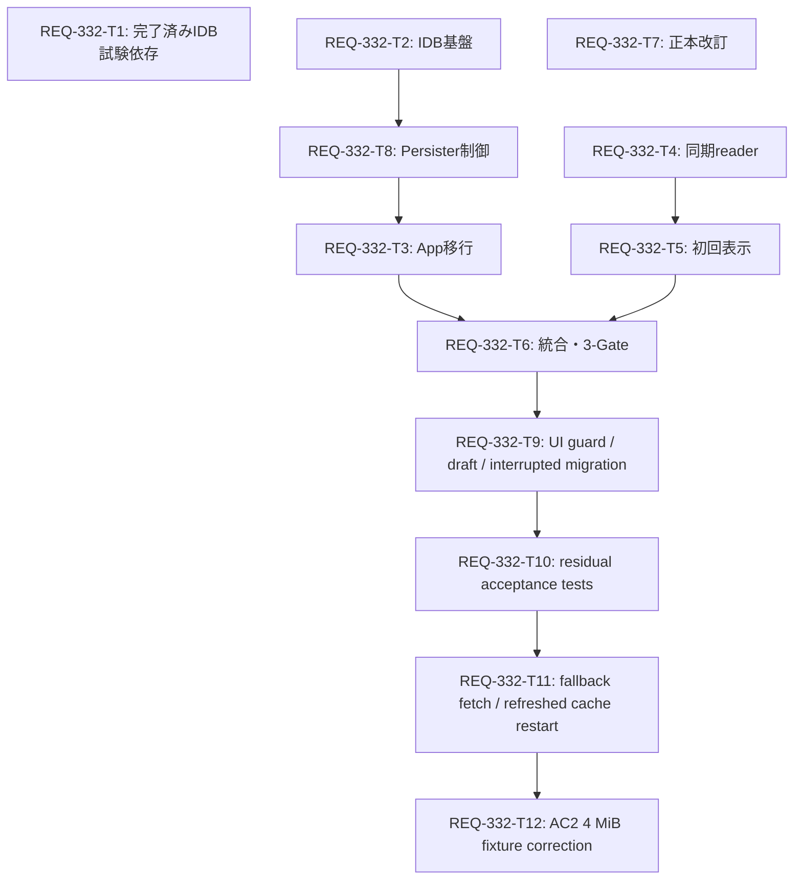

# Implementation Plan: REQ-332

## User Review Required
APIキャッシュを専用IndexedDBへ移し、旧localStorageキー1件を冪等に除去します。10分のcache期限と既存再検証を維持し、IDB障害時はサーバーから取得します。
直近画像のメタ情報はlocalStorage30件から同期読取し、切替後の初回表示を対象画像の記録値にします。
architecture・対象ファイル・AC18件は2026-10-08のユーザーOKで承認済みです。大きすぎたT2をT2/T8に分解し、実装後の残余AC試験をT9/T10へ機械分割しました。振る舞いと承認scopeは維持します。
root implementation_plan.md はREQ-325の既存計画を保持し、今回の計画はこのファイルで提示します。
LLM監査は設計単体がCONDITIONAL APPROVAL PENDING、全Card契約がREQUIREMENT NEEDS REVISIONでした。指摘別の照合とclock/hash/clone境界の補足を[監査記録](REQ-332-audit.md)に保存しています。LLMのPASSへ読み替えず、この結果を含めて人間レビューへ返します。監査モデルは解放済みです。

## Proposed Changes
- T1: frontend/package.json と package-lock.json にテスト用 fake-indexeddb を追加。production package追加なし。
- T2: utils/queryCachePersister.ts と同単体試験のIDB基盤。schema、期限、timeout、atomic復元削除、timestampごとの多タブ統合。差分見積<=280行。
- T8: 同じ2ファイルをT2後に直列変更。queue、1秒coalescing、全Promise settle、remove順序を完成。差分見積<=240行。
- T3: App.tsx とprovider結合試験。同期旧cache削除→IDB復元、成功queryのみ保存。prompt-metadataも重複永続化から除外。
- T4: utils/promptRecord.ts と単体試験。同期readerを追加し、既存async resolverの互換性を維持。
- T5: HistoryModalPreview.tsx と既存preview試験。render時のlocal値を優先しSnapshot.paramsの正本を維持。
- T6: test/e2e_req332_storage.test.tsx、test/e2e_req332_recovery.test.tsx。大容量31件生成、設定/Studio保持、保存障害回復を検証。
- T7: SPEC_COMMON.md、SPEC_GENERATE.md、SPEC_HISTORY.md の局所更新。
- T9: T6と同じテスト2ファイルへAC10/13/16を追記。desktop loading guard、全Studio draft欄復元、IDB中断を検証。
- T10: T9後に同じ2テストファイルへAC1/3/4/15/17の残余assertionを追記。gauge/30件境界/server最新preset/fake-IDB削除を検証。
- T11: T10の同じ2テストファイルへAC11 read failure後の成功server fetchと、AC18更新workflow cacheの9分再起動/保留fetch中表示を追記。
- T12: AC2 storage integration fixtureを4MiB byte相当（2Mi UTF-16 code units）へ補正。

## Task Dependency Graph

T6以降で同じテストファイルを編集するT9/T10/T11/T12は直列実行します。T1 doneをT2.completed_prerequisitesに保持して再dispatchしません。実ブラウザGate3はT12後にtesterが別途判定し、fake-IDB/jsdomは実mobile・frame・quota・multitabのPASSを意味しません。

## Verification Plan
作業ディレクトリは frontend。Gate1: npm run typecheck。Gate2: npm test。
Gate3: npx vitest run src/utils/__tests__/queryCachePersister.test.ts src/test/e2e_req332_storage.test.tsx src/test/e2e_req332_recovery.test.tsx。
T2/T8基盤・制御suiteに加え、T6/T9/T10の両統合テストを全件実行します。AC1〜18と実ブラウザの初回フレーム・実quota・複数タブ試験は [test plan](REQ-332-test-plan.md) に定義しています。
設計段階では実装テストは実行していません。Vitestの結合試験を実ブラウザE2Eの代替PASSにしません。

## Trade-off Disclosure
native IDBで例外・timeout・transactionを制御します。添付案よりコード量と試験は増えますが、production dependencyは増えません。
旧APIキャッシュは移行初回に再取得が必要です。移行中断・cache削除・容量不足時も取得後に生成できます。
保存は1秒coalescingのため終了直前のAPI更新を未保存にでき、再取得で回復します。画像生成条件は同期local保存・server非同期保存を続けます。
実クォータや混在旧版タブからの再書込みは環境制約です。全タブを更新し、実ブラウザ版と容量条件を検証記録に残します。
