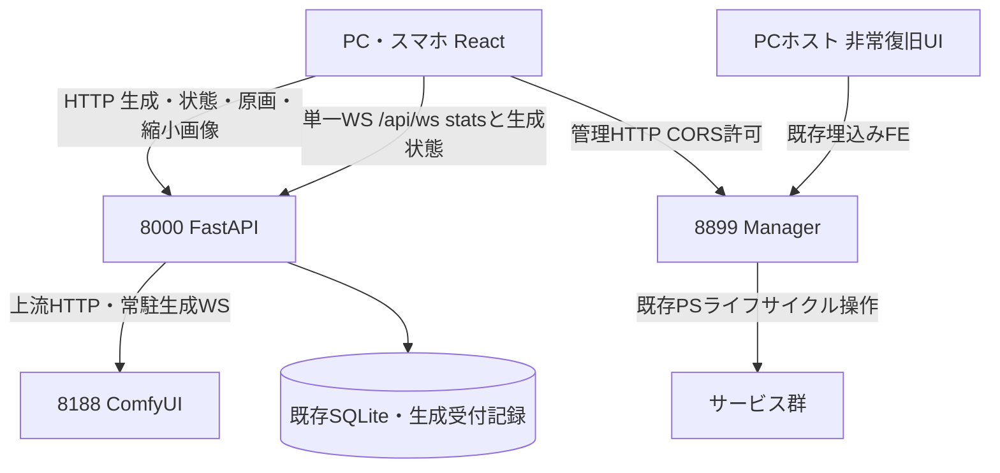

# REQ-333 設計パッケージ監査入力

設計レビュー前の提案。歴史BA判定REQUIRES MODIFICATION BEFORE PRODUCTIONをPASSへ書き換えない。実装は未着手、テストは予定。ロードマップ完全無視。新認証/TTL/BE完全再起動保証/StudioStep遷移/資源性能刷新を追加しない。全35 ACは承認済みPBIに存在。

以下の設計、物理カードの代表全文、全29カードの所有/依存/要点を論理監査する。追加カード全文やコード全体はこの入力に含まないため、全カードの逐語監査を行ったと称さない。

## SOURCE docs/design/REQ-333.md
---
title: REQ-333 管理UI統合・生成通信集約設計
status: proposed
tags: [REQ-333, architecture, manager, websocket, multi-device]
related_paths:
  - docs/backlog/pbi/archive/REQ-333.md
  - docs/backlog/ba-audit/REQ-333.md
  - backend/app/routers/comfy.py
  - backend/app/routers/ws.py
  - frontend/src/store/slices/connectionSlice.ts
  - frontend/src/store/slices/jobQueueSlice.ts
  - tools/server-manager/server_api.py
---

# REQ-333 設計レビュー案

2026-10-10（Asia/Tokyo）。35 ACを入力とした設計案。要件から設計へ進む承認は取得済み。以下の決定・仕様更新は人間の設計レビュー前であり、実装済み・承認済みとは扱わない。資料ロードマップは参照していない。

## 1. Feasibility and Evidence

**実現可能。ただしレビューで下記の契約・衝突更新を承認してから実装する。** HTTPプロキシ、サムネ生成、SYSTEM_STATS WS、SQLiteと独立Managerが既にあるため、既存部品を活かして構成できる。調査はソース・文書の読取りであり、実ComfyUI・PC/スマホでの再現試験は実施していない。

| 現在の根拠 | 確認した現行契約 | 今回の差分 |
|---|---|---|
| `backend/app/routers/comfy.py` | prompt/queue/interrupt/history/object_info/thumbnailを8000で中継。原画viewなし。queue/historyの接続失敗を空結果で返す | 既存APIを残し、原画viewと明示的な状態照会を追加 |
| `frontend/src/store/services/comfyWebSocketService.ts` | `/ws?clientId=...`へ直結しbinary previewを受信 | ブラウザの生成WSを既存`/api/ws`へ集約 |
| `frontend/src/store/slices/connectionSlice.ts` | 端末で完了判定、history/queue直接照会、localStorageのclient ID | 完了・復元の正本をBEに移し、IDを継承 |
| `frontend/src/store/slices/jobQueueSlice.ts` | 受付後にローカル保存と非同期metadata POST。取消をfailedにする箇所あり | 受付時記録をBEへ移す。取消を別状態にする |
| `backend/app/routers/ws.py` / `resource_monitor.py` | 全接続へのbroadcast、30秒受信timeout、SYSTEM_STATS 2.5秒周期 | stats契約を保ち、生成snapshot/eventを追加 |
| `MatrixGenerationStep.tsx: handleSubmitBatch` | HTTPはproxy経由だが、完了進捗ではなく投入済み件数を表示 | 1リクエスト＝1batch IDで完了状態を表示 |
| `tools/server-manager/server_api.py` | 8899独立、status/action/logs、埋込みHTML、CORSなし | 同じAPIへ限定Origin対応。定常UIだけReactへ統合 |
| `tools/server-manager/server_status.py` | LISTEN/STOPPED/BUNDLED、pidsは空。runningはTCPポート状態 | 起動操作中状態を別に持ち、TCP状態とHTTP応答を区別 |
| `backend/app/services/snapshot_service.py` | HTTP(S)絶対URLをdownload。`/view`を含むpathを上流へ再構成 | `/api/comfy/view`と旧URLを正しく上流`/view`へ変換 |

境界はすべて`C:/Users/audih/ws/comfy-create-helper2`内。Git_Root_Mismatch: No（外部実装パスなし）。作業はdocsの設計・カードのみ。global scriptはcontextから`C:/Users/audih/.gemini/antigravity/scripts`に解決した。doc_mapperはPBI・FE・jobQueueSliceにmappedなしを返したため、PBIで列挙済みの仕様書とそこから得た実装パスを限定読取りした。

`docs/system/openapi.yaml`と`docs/openapi.yaml`は存在しない。実在する`backend/openapi.json`をopenapi_parserで確認したが、Dataset等現行routerを含まず古い可能性がある。API正本の更新は起動時生成契約を保ち、実装後の`app.openapi()`でこの実在ファイルを更新する案とする。WSとManagerはOpenAPI対象外のため本設計で別途契約を記す。

## 2. Topology and Ownership



生成投入/queue/history/image/previewを8000経由にする。Viteも`/api`のHTTP/WSを8000へ転送する。ブラウザ8188直結・`/comfy`Vite proxyは最終切替で廃止する。Managerは生成経路に入れず、8000再起動要求は8899に直接送る。スマホのManager URLは`window.location.hostname`のPCホストに8899を付ける（URL APIで構築）。スマホのlocalhostへ向けない。

| データ | 正本と責任 |
|---|---|
| ジョブ識別・scope・batch・凍結した投入条件・終端状態 | BEのGenerationServiceとSQLiteのGenerationJob。ブラウザから完了状態を書かせない |
| 実行中node/progressと実際のqueue | ComfyUIをBEが照合・正規化。BEの単一revisionで端末へ配信 |
| 生成メタデータ | 既存PromptMetadataへBEが同じ凍結条件を保存。localStorage30件は表示cache |
| Snapshot画像・params・関連編集 | 既存Snapshotとサービス。試行履歴・job cacheから独立 |
| セッション・表示フィルタ | 既存LS_KEYS.CLIENT_ID / FILTER_OWN。認証・権限IDではない |
| サービス制御・管理ログ | 独立Manager。SYSTEM_STATSや生成成否の正本にはしない |
| Studio編集・競合 | 既存project API + sessionStorage draft。生成WSでフォームを上書きしない |

## 3. Review Decisions

### D1: Identity

session IDは既存`prompt-surgeon-client-id`をそのまま使用。同origin・同browser profileのタブは同じsession、reload/再接続後も継続し、別端末/profile/originは別session。TTL・fingerprint・アカウントは追加しない。保存拒否時はタブ内IDで動作し、reloadで新IDになる旨を表示する。FILTER_OWNも既存保存を引き継ぎ、未設定はfalse。既にONを保存済みの端末はその選択を保つ。

上流WS client IDと利用者session IDを分離する。新しいapp投入はBE常駐WSのclient IDをComfyUIへ渡し、利用者session/scope/batchはBE記録で保持する。外部ComfyUI画面などからの旧/未記録jobは`legacy`由来として全端末一覧に表示できるが自sessionに帰属させない。旧historyのclient_idが既存利用者IDと一致する場合だけ、その既存情報を使える。未知jobをStudioと推測しない。

### D2: Canonical State and Reconnect

BE lifespanがGenerationServiceと上流watcherを起動し、最後のブラウザが閉じても停止しない。queue/historyの照合を上流WSのopen・状態変化・終了イベント・ブラウザ初期snapshot要求で行う。upstream切断時も再接続・照合を続ける。終了イベントを取り逃した場合はhistory照合で補う。

既存`/api/ws`に`GENERATION_SNAPSHOT`と`GENERATION_EVENT`を加える。共通envelopeは`version:1, epoch:string, revision:int, data`。epochはBE起動ごとに変わる。全端末に同じ状態を配信し、フィルタは表示だけに適用する。SYSTEM_STATS/VRAM_RECOVEREDのtype/data契約と2.5秒周期は変更しない。

WS接続時、BEは送信先を登録してからsnapshotを送る。登録からsnapshot送信終了までのeventを接続ごとに順序付きで送る。FEは同期完了まで前回状態を「再同期中」と表示し、snapshotを一括置換する。eventのrevisionが同じ以下なら無視、欠番またはepoch変更なら`GET /api/generation/state`で全状態を再取得する。snapshot取得中に届いたeventはsnapshotより新しいものだけ適用する。event replay logの長期保存は導入しない。

並行HTTP snapshotとWS初期snapshotで同じjobを追加しない。一覧keyは`job_id`、画像keyは`prompt_id + node_id + image index`。凍結記録・終端statusをcommitしてからeventを送信する。broadcastの遅い/切断クライアントは生成workerを待たせず切断し、復帰時に全同期させる。JSON通知には画像URLだけを載せる。

### D3: Acceptance, Idempotency and Recovery Limit

新しい`POST /api/generation/batches`で凍結したgraphとmetadataの配列を受ける。正常受付はBEが全jobをcommitした後の202（`batch_id, job_ids, epoch, revision`）。受付済みjobの投入・完了保存はブラウザ接続に依存しない。normal/Studioともこの受付口を使い、既存comfy proxy APIは互換のため残す。

request IDはFEが生成するUUID。BEはunique request IDとpayload hashをbatch各行へ保存し、同じID/同じbodyなら同じ受付結果、同じID/違うbodyは409。自動mutation再送はしない。202応答を失った場合は`GET /api/generation/requests/{request_id}`で照合し、「受付確認中/結果未確認」と既存REQ-307相当の通知を出す。DBエラー時は202を返さず503。未受理の入力をoffline queueへ保存する機能は追加しない。

上流の`/prompt`は分散transactionに参加しない。送信前の`submitting`記録、上流prompt_id確定後の記録の間で障害が起きると、厳密な一回だけの投入は保証できない。結果未確認をfailed/completedに勝手に変えず`unconfirmed`として照合する。上流へのPOSTを自動再送しない。関連づけが証明できないjobを時刻/seed類似で推定しない。

**AC-11/12はBEとComfyUI稼働中のブラウザ切断が保証範囲。** BE再起動後は保存済みprompt_idをqueue/historyへ照合できる範囲だけ復元する。`submitting/unconfirmed`や上流履歴消失は「状態未確認」と表示し、自動再実行しない。未送信の受付jobも再起動後に自動投入せず確認対象とする。AC-05は本体の稼働復帰であり、生成の再起動完全復元を合格条件へ追加しない。

新GenerationJobは受付/実行情報の補助記録。終端記録は既存server metadata1000件の保持集合と同じ範囲で整理し、activeは実行が終わるまで整理しない。永続的な試行archiveは作らない。jobのgraphは投入に必要な間だけ保持し、terminal化時に解放する。追加記録量と実装上のcleanupを資源回帰で確認する（新しい性能/容量目標は設定しない）。既存30件local metadata、1000件server metadata、thumbnail500件memory/4000超→3600diskを変更しない。上限整理後の冪等性key永久保証はしない。

### D4: Progress Groups and Waiting

normalは全端末共通の「未終了jobがある間の生成単位」をnormal group IDで表す。未終了jobがある間の新投入は同groupへ追加し、すべて終端後の次の受付で新groupにする。完了状態は次group開始まで表示できる。この区切りは既存activeBatchが端末内だったための**設計提案**でありレビュー対象。history一覧の保存範囲をgroupで削除しない。

Studioは毎回のbatch受付で別batch ID。project IDは別軸。同project・別端末・別batchも合算しない。Step遷移・Step 2への保存/進行は本PBIで変更しない。

`queued, submitting, running, succeeded, failed, cancelled, unconfirmed`を区別する。normal表示の母数Nは当該groupのcancelled以外、終了数Fはsucceeded+failed。進捗は`(F + running_fraction)/N`、枚数はF/N。N=0はidleとし除算しない。取消成功を上流queue照合後に確定し、取消要求だけで母数を減らさない。失敗はトーストとfailed表示を出し、終了数に1を加える。取消が失敗終了通知を発火しないよう区別する。

Studio失敗は同じF/Nで13/20へ進む。Studio取消の計算法はACにないため新たな取消UI・計算法を導入しない。通常画面のcancel allは選択normal job IDに限定し、Studio queueをclearしない。runningへの上流interruptは対象promptが実際のrunningと一致する場合だけ実施し、入替わっていれば409で再同期する。

自session ONはnormal groupの自ID分でF/Nを計算、OFFは同group全sessionを共通計算。Studio一覧はbatchごとに表示。待機条件は自表示対象に未終了jobがあり、runningが別対象にある場合のみ。別scope待機を先に表示し、そのscopeの未終了残数（runningを含む）を示す。同scope他session待機はON時だけ表示する。OFF時には出さない。Studio別batchがrunningならそのbatch名/IDの待機で区別し、他batchを進捗に足さない。対象がrunningになれば待機を消す。project名は任意併記。

既存2段バー、nodeタイトル、経過時間・推定残り時間の計算を再利用する。監視起点はserverのrunning開始情報を使い、スマホ参加時刻から計時し直さない。VRAM判定は既存`resource_monitor.get_vram_status()`と設定値を使い、受付済みworkerの上流投入前へ移す。現行の待機内容、10秒警告、SYSTEM_STATS周期、待機取消を保持する。閾値が仕様の4GBとFEfallback6GBで混在する点は既存設定正本を使用し新しい値を定義しない。

### D5: Service State and Manager

Supervisorのみ停止時は総合OFFLINE。生成側が正常なら生成・queue・imageを使用でき、管理操作/管理ログは利用不可と表示する。OFFLINE labelだけでGenerateボタンを無効にしない。8000停止時はAC-06のPCホスト8899非常UIで復旧し、8000画面の描画は要求しない。

ManagerのTCP状態、ComfyUIのHTTP応答、端末WS再接続状態を個別表示する。CONNECTINGは起動操作中または再接続中。ManagerがComfyポートLISTENを確認し、BEのqueue等軽量HTTP probeが30秒超連続失敗ならSTUCK、STOPPEDはManagerの停止状態かつ起動中ではない場合。30秒以内の応答再開で連続失敗timerをresetする。生成nodeの進捗が止まっただけではSTUCKにしない。

現ManagerはPID/実プロセス検査を提供せずポート状態だけを返す。したがって**「プロセス稼働」の観測はLISTENと起動操作情報を根拠にする提案**。ポートも開かないハングのPID検出まで要求するかはレビュー論点として開示し、既存native socket監視をPS/WSL定期呼出しへ置換しない。開発FEの5173/BUNDLEDは総合label判定から除外する。

定常UIはSettings systemのServiceConnectionCardをサービス操作/ログへ改修し、VRAM・表示操作の既存カードを保つ。本体停止を誘う通常のstopボタンは新設せず、AC-05のrestartを提供する。8000再起動の操作結果は8899応答と本体復帰後の再読込で確認する。action成功レスポンスだけでrunningへ楽観変更しない。

8899の許可OriginはHTTP(S)、hostがlocalhost/127.0.0.1/妥当なIPv4の192.168.0.0/16または10.0.0.0/8、port5173/8000。文字列prefix判定は使わない。AC-33/34で列挙された境界だけを実装し、172.16/12・IPv6・任意ホストの追加は今回承認していない。allowlistを返すCORS、OPTIONS、Vary:Originを実装。外部Origin/8080は403かつACAOなし。既存8899 HTMLの同origin通信とOriginなしのPC直接GETは維持する。unsafe POSTは許可Origin/同originを検査し、API actionの許可action/serviceを既存列挙値に制限する。これは個人LANの境界であり認証や厳密なセキュリティ監査を追加しない。

main.pyの任意http(s) CORS regexは発見事項だが、AC-34の対象はManager。全APIのCORS全面変更は本PBIで行わず、生成WSは正規アプリのsame-origin/許可originを検査する。

### D6: Image and Snapshot Compatibility

`GET /api/comfy/view?filename&subfolder&type&t=prompt_id`を原画配信口にする。上流hostは設定COMFY_URLに固定し、任意url queryを受けない。tはmetadata照会用でありComfyUIへ送らない。原画bytes/MIMEを保ち再encodeしない。実在する`/api/comfy/thumbnail`を一覧に使い、サイズ/品質・aspect処理を変更しない。

上流previewのbinaryはBEが現在jobへ関連付け、HTTP preview URLとrevisionだけを配信する。新たな恒久preview保存をせず直近frameだけ保持して置換/terminalで解放する。原画viewとは別の一時表示とする。previewが他jobへ混ざらないよう上流runningと対応を確認する。

画像利用状態は上流原画の確定404でmissing。timeout/502はunknownとして履歴を削除しない。missing結果を試行表示/選択/表示cacheから除外するが、metadataやthumbnailを即時削除しない。既存thumbnail cache hit時の原画欠損unlink/popはこの意図と衝突するため、確定missingの表示除外へ役割を移す。Snapshotはその対象から外す。

古いlocalStorage/query cacheの8188 absolute view URLはfilename/subfolder/type/tから新same-origin view URLへ正規化する。新キーを原URLの文字列だけに依存させず重複を防ぐ。SnapshotServiceはrelative/absolute `/api/comfy/view`と旧`/view`を認識し、上流ではpathを厳密に`/view`へ置換する。現行の`/api/comfy/view`をそのまま8188へ送る誤変換を防ぐ。Snapshot保存変換・品質・album・params・明示削除は既存通り。

## 4. SSoT Impact / Conflict Review Matrix

以下は**承認後に更新する文面案**。現行正本をこの設計作業で書き換えていない。

| ID / 参照文書・箇所 | 現行仕様・指令 | 変更差分と具体的な改修案 | 理由/扱い |
|---|---|---|---|
| C1 `SKILL.md` API概要/重要方針1/prohibited_actions | React→Comfy直接、FastAPI proxy禁止 | 方針を「生成関連HTTP/WS・画像はReactから同origin FastAPI経由。上流Comfy接続はBEのみ」へ置換。proxy禁止を削除。Manager8899独立と非常FEを追記 | 明示アーキ変更。T1で実装前に承認文面を適用 |
| C2 `server_manager_guide.md` 2.2/アクセスURL/ネットワーク | スマホ8188直結、8000/8188/8899を一括開放 | 「生成は8000、管理は8899。正規UIは8188外部到達不要。8000停止時はPCホスト8899画面」を記載。既存firewall batの機能・既存ルールを勝手に削除しない | AC-06/10。OS firewall刷新は範囲外 |
| C3 `SPEC_SETTINGS.md` 3/system境界・5 | 新APIを導入しない、ComfyURLを端末設定/接続確認 | system接続カードへ管理操作/ログと個別稼働状態を加える例外を記載。生成上流URLはBE COMFY_URLを正本とし端末COMFY_URLを通信経路に使わない。Backend/LM URL編集は増やさない | AC-01..07/33/34。5tab・draft・レスポンシブ保持 |
| C4 `SPEC_GENERATE.md` 2-1/2-9/5/6/6-3 | 端末ComfyWS、activeBatch、取消failed、端末から非同期metadata POST、完了時刻未記録 | `/api/ws`・BE受付/完了正本・D4のgroup/失敗/取消・受付と記録同一payloadを追記。「server非同期POST」を「BE受付とサーバー保存、local30件cacheは独立」に置換。完了時刻は新job状態側のみ、既存生成recordのqueued_at等の意味は保持 | AC-11..23/27..32。記録経路変更、記録内容の再推定禁止は保持 |
| C5 `SPEC_HISTORY.md` 4-1 | local同期reader/serverfallback、30/1000、Snapshot優先 | 配信URLをsame-origin、原画404の試行表示除外、jobの冪等keyとcache整理範囲を追記。Snapshot params優先、cacheとは独立を明記 | AC-24..26。ライフサイクル全面刷新なし |
| C6 `SPEC_COMMON.md` 6 | IndexedDB query cache、generateDisplayImages残存、Studiodraft独立 | 生成状態snapshot/revisionはserver再取得で検証し正本にしない、旧画像URLの読取り正規化、missing表示の空集合反映を追記。querycache方式・maxAge・比率を保持 | stale cacheで削除済み原画を再表示しない |
| C7 `SPEC_DATASET_STUDIO.md` | Step1 browser foreach投入、project/draft/競合は既存 | Step1生成にscope=studio・request別batch・完了F/N・他scope待機を追記。750ms autosave、session draft、競合解消、Step遷移は保持 | AC-17/19/22/30/31。batchとprojectを混同しない |
| C8 `backend/openapi.json` / `SKILL.md`契約生成方針 | YAMLパスは現存せずJSONは一部古い | 実在JSONを現行app.openapi()から再生成。新generation API/typed error/image操作を収録。WS/Managerは本設計のenvelope/Origin/action契約を参照 | 古い契約をコピーせずsource生成する |
| C9 `comfy.py` thumbnail欠損cache削除と`SPEC_HISTORY` | 原画404でthumbnailも即unlinkする現実装 | 即削除を止め、missing表示だけを除外、通常の500/4000→3600上限整理へ委ねる | ユーザーの原画欠損指定による保存差分 |
| C10 `SPEC_GENERATE` 5-4と実装のVRAMfallback | spec4GB/FE6GB、BE設定値が存在 | 数値改定をせずBE get_vram_statusの現在設定を唯一の判定入力にし、同じ待機通知をserver workerへ移す | 受付後browser切断でも継続するための責務移動 |
| C11 `snapshot_service.py`とSnapshot保護仕様 | absolute URLのみdownload、/view pathをhostだけ置換 | relative/absolute新経路を同じ原画downloadへ解決。保存変換・品質/params/アルバムは変更しない | AC-25、明示された既存維持の保存回帰 |

## 5. Proposed API and Module Contracts

`POST /api/generation/batches`: `{request_id, session_id, scope:'normal'|'studio', project_id?:number, items:[{graph, workflow_id?, param_values, applied_assets?, set_name?}]}`。Studioはproject ID必須、同requestのscope/projectは固定。FEが既存injector/bypass/buildGenerationRecordで凍結した値を渡し、BEは現在workflowから再構成しない。202の後はclient IDを上流専用IDに置換して順次投入。

`GET /api/generation/state`: `{version,epoch,revision,normal_group_id,jobs,batches,upstream}`。`GET /api/generation/requests/{request_id}`は200で既知の受付、404は現在保持集合にない、503は照合不能。404を無条件自動再送の根拠にしない。

`POST /api/generation/jobs/{job_id}/cancel`: 200確認済み/202取消処理中、409対象running変更、503上流照合不能。normalの集合取消はID列挙で同処理を使う。初回取消と同ID繰返しは状態を重ねて減算しない。

`GET /api/generation/preview/{job_id}?revision=N`: 一時frameまたは404、bytesをJSONへ載せない。`GET /api/generation/images/{job_id}/availability`: outputごとのpresent/missing/unknown。確定404以外でmissingにしない。

GenerationJob候補字段: job_id(PK UUID), request_id/index(unique), payload_hash, prompt_id(nullable unique), session_id, scope, batch_id, normal_group_id, project_id(nullable), set_name, status, graph_json(nullable), metadata_json, outputs_json, accepted_at, started_at, finished_at, failure_json, cancel_requested。schema追加は既存migrations/steps.pyの冪等step027（実装時に番号衝突を再確認）で行う。既存snapshotとPromptMetadataは破壊しない。

新モジュールはschemas/generation.py、services/generation_repository.py、services/generation_service.py、services/comfy_generation_bridge.py、routers/generation.py。schemaを固定すればrepository/worker/FEを別々にmockして実装できる。lifespanの登録と停止はrouter wiring taskに集約し、同ファイルへの並行変更を避ける。

## 6. Trade-offs and Review Items

| 判断 | 採用案と代替・制約 |
|---|---|
| 生成正本 | BE受付記録と上流照合。単純WS byte relayではブラウザ不在完了・scope・冪等性を満たせない |
| WS統合 | `/api/ws`に生成を追加。SYSTEM_STATS用WSと生成専用WSを二重維持する案は、既存購読が二重化するため採らない |
| snapshot復帰 | 全同期+revision。永続event replay logや最大遅延SLAは新規要求にしない |
| session | 既存localStorage IDを継承。TTL/device fingerprintは既存の再読込同一性を変えるため採らない |
| BE再起動 | 保存済みIDのbest effort照合、未確認は自動再送なし。分散exactly-once/checkpoint再開の保証を追加しない |
| normal group境界 | 全体未終了集合が空→次受付で切替。端末activeBatchのままでは全端末3/8を共有できない。レビューでこの区切りを確認する |
| サービス稼働観測 | socket LISTENと応答timerを利用。実PID不在のためポート未開放ハングの厳密判定は保証範囲外。AC-08の観測解釈を確認する |
| メタ保存失敗 | 受付commit前は503、上流実行後の保存失敗は状態未確認/再保存通知。記録を捏造して成功扱いにしない |
| API切替 | BE追加→FE接続/保存互換→Vite直結撤去。途中版を完成品として配布しない。rollbackではBE/API/FEを対応版へ揃える |
| 画像cache | 原画missingで表示除外し通常cleanupへ委ねる。cache-hit時の存在チェックは維持し、ネットワーク障害と欠損を区別 |

レビューの具体項目はC1..C11、D1の既存同一性、D3の受付・冪等保証範囲/再起動未確認、D4 normal区切り、D5稼働観測、追加job記録の保持集合である。要件の35 ACを変更する提案ではなく、その実装契約を確認する。実装中に契約を変える必要が判明したらカード外の変更をせず設計へ差し戻す。

## 7. Audit and Handover

履歴BA判定`REQUIRES MODIFICATION BEFORE PRODUCTION`は`docs/backlog/ba-audit/REQ-333.md`にそのまま保持する。D1..D6は残指摘への設計回答案であり、モデルがPASSしたと称さない。

物理カード、DAG、全35 AC対応とRed Team試験は`REQ-333-implementation-plan.md`、`REQ-333-test-plan.md`を参照。カードは承認前draft。設計レビュー承認を得るまで実装へ送らない。設計作業ではソースの編集・テストの実行をしていない。設計パッケージの監査結果・実行制約は`REQ-333-design-audit.md`へ追記する。


## SOURCE docs/backlog/task/archive/REQ-333-T2.md
---
id: REQ-333-T2
title: '生成受付・状態・ポートの型契約'
status: draft
tags: [REQ-333, backend, design-review]
related_paths:
  - docs/backlog/pbi/archive/REQ-333.md
  - docs/design/REQ-333.md
  - backend/app/schemas/generation.py
  - backend/tests/test_generation_schema.py
depends_on: []
---

# REQ-333-T2: 生成受付・状態・ポートの型契約

## Purpose and Ownership

BatchRequest/JobView/StateSnapshot/GenerationPort/RepositoryPortを定義する。scope normal/studio、Studio project必須、UUID、graph+metadataの凍結入力、nullable prompt ID、statusとepoch/revisionを分離。利用者sessionを上流client IDと混同しない。

受入対応: AC-11..23/27..32。設計レビュー承認後に実施。所有する変更対象は下記だけ（テスト/依存宣言込み）。他担当の変更を巻き戻さず、共通ファイル変更は調整役が直列化する。

- backend/app/schemas/generation.py (NEW)
- backend/tests/test_generation_schema.py (NEW)

## Hermetic Contract

以下は承認対象の新contract。scopeとproject、上流client IDと利用者sessionは別。clientから完了状態を送らない。
受付はDB commit後202。上流POST結果不明はunconfirmed、自動再送なし。BE再起動完全復元を追加しない。
通常Nはcancelled除外、F=succeeded+failed。Studio各batch独立。別scope待機優先、他session待機はfilter ONだけ。
snapshotはepoch/revisionでatomic置換、eventも同じ形の全状態dataを使い部分mergeを避ける。SYSTEM_STATS/VRAM_RECOVEREDのtype/data・2.5秒周期保持。
既存30local/1000server metadata、Snapshot独立、Studio750ms/draft競合、画像aspectを保持。
カード外ファイルや公開contract変更が必要なら設計へ差し戻す。

```python
from typing import Any, Literal, Protocol
from pydantic import BaseModel
Scope = Literal['normal','studio']
JobStatus = Literal['queued','submitting','running','succeeded','failed','cancelled','unconfirmed']
class BatchItem(BaseModel):
    graph: dict[str, Any]
    workflow_id: int | None = None
    param_values: dict[str, Any]
    applied_assets: dict[str, Any] | None = None
    set_name: str | None = None
class BatchRequest(BaseModel):
    request_id: str
    session_id: str
    scope: Scope
    project_id: int | None = None
    items: list[BatchItem]
class GenerationPort(Protocol):
    async def submit(self, graph: dict[str, Any]) -> dict[str, Any]: ...
    async def queue(self) -> dict[str, Any]: ...
    async def history(self, prompt_id: str | None = None) -> dict[str, Any]: ...
    async def interrupt(self, prompt_id: str) -> None: ...
class RepositoryPort(Protocol):
    def accept_batch(self, payload: BatchRequest) -> dict[str, Any]: ...
    def snapshot(self) -> dict[str, Any]: ...
    def transition(self, job_id: str, status: JobStatus, **fields: Any) -> dict[str, Any]: ...
# UUID、空items禁止、studio project必須をvalidatorで検査。
```

対象の関数/型契約:

```python
class JobView(BaseModel): ...
class StateSnapshot(BaseModel): ...
# JobView/Snapshotの字段は共通FE型と同一。immutable graph/metadataを検査。
```

既存変更周辺24行: backend/app/routers/comfy.py:138（設計時読取り。新機能実装済みの証拠ではない）

```python
            timeout=10.0
        )
        return Response(
            content=response.content,
            status_code=response.status_code,
            media_type="application/json"
        )
    except Exception as e:
        logger.error(f"Failed to proxy prompt to ComfyUI: {e}")
        raise HTTPException(status_code=502, detail=f"ComfyUI prompt error: {e}")


@router.get("/queue")
async def get_queue():
    """
    ComfyUI の /queue を取得する。
    """
    client = get_comfy_client()
    try:
        response = await client.get(f"{settings.comfy_url}/queue", timeout=5.0)
        return Response(
            content=response.content,
            status_code=response.status_code,
            media_type="application/json"
```

## Local Verification

Studio project欠落422、未知scope不許可。false/0/空paramsを保持。schema dump→load同一。

```powershell
Set-Location 'C:/Users/audih/ws/comfy-create-helper2/backend'
.\.venv\Scripts\python.exe -m pytest tests/test_generation_schema.py -q
.\.venv\Scripts\python.exe -m mypy app/schemas/generation.py
```

新規testはこのカードで作成後に実行。実プロセス操作はmock。実PC/スマホのE2Eは別検証。
exitと実出力を記録。未実施/環境不足はINCONCLUSIVE、局所PASSをAC全体へ流用しない。
仕様同期カードは承認文面と実装diff/実試験証跡を比較し、ライフサイクル全刷新をしない。

## Atomicity and Handoff

変更対象2ファイル、カードcontextは300行以内。依存: なし（本体設計契約を固定しmockで独立実装）。
完了時は変更内容/実検証出力/残リスクを調整役へ返す。設計承認前statusはdraft。


## SOURCE docs/backlog/task/archive/REQ-333-T11.md
---
id: REQ-333-T11
title: '統合WS・初回snapshot順序・stats共存'
status: draft
tags: [REQ-333, backend, design-review]
related_paths:
  - docs/backlog/pbi/archive/REQ-333.md
  - docs/design/REQ-333.md
  - backend/app/routers/ws.py
  - backend/tests/test_ws.py
  - backend/tests/test_generation_ws.py
depends_on: [REQ-333-T2]
---

# REQ-333-T11: 統合WS・初回snapshot順序・stats共存

## Purpose and Ownership

ConnectionManagerへsnapshot supplier/生成event publisherを注入できる口を追加。登録→snapshot→新revision event送信の順序を保証。慢性slow readerを切断しworkerをブロックしない。正規Origin検査、30秒ping timeout、SYSTEM_STATS type/data保持。既存testの初回frame前提を更新。

受入対応: AC-12/13/17。設計レビュー承認後に実施。所有する変更対象は下記だけ（テスト/依存宣言込み）。他担当の変更を巻き戻さず、共通ファイル変更は調整役が直列化する。

- backend/app/routers/ws.py
- backend/tests/test_ws.py
- backend/tests/test_generation_ws.py (NEW)

## Hermetic Contract

以下は承認対象の新contract。scopeとproject、上流client IDと利用者sessionは別。clientから完了状態を送らない。
受付はDB commit後202。上流POST結果不明はunconfirmed、自動再送なし。BE再起動完全復元を追加しない。
通常Nはcancelled除外、F=succeeded+failed。Studio各batch独立。別scope待機優先、他session待機はfilter ONだけ。
snapshotはepoch/revisionでatomic置換、eventも同じ形の全状態dataを使い部分mergeを避ける。SYSTEM_STATS/VRAM_RECOVEREDのtype/data・2.5秒周期保持。
既存30local/1000server metadata、Snapshot独立、Studio750ms/draft競合、画像aspectを保持。
カード外ファイルや公開contract変更が必要なら設計へ差し戻す。

```python
from typing import Any, Literal, Protocol
from pydantic import BaseModel
Scope = Literal['normal','studio']
JobStatus = Literal['queued','submitting','running','succeeded','failed','cancelled','unconfirmed']
class BatchItem(BaseModel):
    graph: dict[str, Any]
    workflow_id: int | None = None
    param_values: dict[str, Any]
    applied_assets: dict[str, Any] | None = None
    set_name: str | None = None
class BatchRequest(BaseModel):
    request_id: str
    session_id: str
    scope: Scope
    project_id: int | None = None
    items: list[BatchItem]
class GenerationPort(Protocol):
    async def submit(self, graph: dict[str, Any]) -> dict[str, Any]: ...
    async def queue(self) -> dict[str, Any]: ...
    async def history(self, prompt_id: str | None = None) -> dict[str, Any]: ...
    async def interrupt(self, prompt_id: str) -> None: ...
class RepositoryPort(Protocol):
    def accept_batch(self, payload: BatchRequest) -> dict[str, Any]: ...
    def snapshot(self) -> dict[str, Any]: ...
    def transition(self, job_id: str, status: JobStatus, **fields: Any) -> dict[str, Any]: ...
# UUID、空items禁止、studio project必須をvalidatorで検査。
```

対象の関数/型契約:

```python
class ConnectionManager:
    def configure_generation(self, snapshot_supplier, request_snapshot) -> None: ...
    async def connect(self, websocket: WebSocket) -> None: ...
    async def broadcast(self, message: str) -> None: ...
    async def publish_generation(self, snapshot: dict) -> None: ...
# callback注入。SYSTEM_STATS契約は維持。
```

既存変更周辺24行: backend/app/routers/ws.py:10（設計時読取り。新機能実装済みの証拠ではない）

```python
class ConnectionManager:
    """アクティブな WebSocket 接続を管理するクラス。"""

    def __init__(self) -> None:
        self.active_connections: list[WebSocket] = []

    async def connect(self, websocket: WebSocket) -> None:
        await websocket.accept()
        self.active_connections.append(websocket)

    def disconnect(self, websocket: WebSocket) -> None:
        if websocket in self.active_connections:
            self.active_connections.remove(websocket)

    async def broadcast(self, message: str) -> None:
        """全クライアントへメッセージを送信する。送信失敗したクライアントは切断扱いにする。"""
        dead: list[WebSocket] = []
        for connection in self.active_connections:
            try:
                await connection.send_text(message)
            except Exception:
                dead.append(connection)
        for ws in dead:
            self.disconnect(ws)
```

## Local Verification

snapshot/event race、duplicate/slow reader、SYSTEM_STATS混在、timeout切断、禁止Origin、全clients0でもpublisher正常。

```powershell
Set-Location 'C:/Users/audih/ws/comfy-create-helper2/backend'
.\.venv\Scripts\python.exe -m pytest tests/test_ws.py tests/test_generation_ws.py -q
.\.venv\Scripts\python.exe -m mypy app/routers/ws.py
```

新規testはこのカードで作成後に実行。実プロセス操作はmock。実PC/スマホのE2Eは別検証。
exitと実出力を記録。未実施/環境不足はINCONCLUSIVE、局所PASSをAC全体へ流用しない。
仕様同期カードは承認文面と実装diff/実試験証跡を比較し、ライフサイクル全刷新をしない。

## Atomicity and Handoff

変更対象3ファイル、カードcontextは300行以内。依存: REQ-333-T2。
完了時は変更内容/実検証出力/残リスクを調整役へ返す。設計承認前statusはdraft。


## SOURCE docs/backlog/task/archive/REQ-333-T18.md
---
id: REQ-333-T18
title: 'Studio Step1のrequest別batch進捗'
status: draft
tags: [REQ-333, frontend, design-review]
related_paths:
  - docs/backlog/pbi/archive/REQ-333.md
  - docs/design/REQ-333.md
  - frontend/src/pages/DatasetStudioPage/components/MatrixGenerationStep.tsx
  - frontend/src/pages/DatasetStudioPage/hooks/useStudioGeneration.ts
  - frontend/src/pages/DatasetStudioPage/__tests__/MatrixGenerationStep.test.tsx
depends_on: [REQ-333-T8]
---

# REQ-333-T18: Studio Step1のrequest別batch進捗

## Purpose and Ownership

injectPromptAndSeedの結果をstudio scope/project/UUID付きbatchで受付。useStudioGenerationはstore snapshotの当該batch IDsを表示し投入完了を生成完了にしない。別A/Bのprogress、normal待機、failedtoast、縮小画像。onDirectBatchSubmit拡張口もbatch識別/結果を返す契約へ整合。project autosave/draft/Step遷移には触れない。

受入対応: AC-17/19/22/24/30..32。設計レビュー承認後に実施。所有する変更対象は下記だけ（テスト/依存宣言込み）。他担当の変更を巻き戻さず、共通ファイル変更は調整役が直列化する。

- frontend/src/pages/DatasetStudioPage/components/MatrixGenerationStep.tsx
- frontend/src/pages/DatasetStudioPage/hooks/useStudioGeneration.ts (NEW)
- frontend/src/pages/DatasetStudioPage/__tests__/MatrixGenerationStep.test.tsx

## Hermetic Contract

以下は承認対象の新contract。scopeとproject、上流client IDと利用者sessionは別。clientから完了状態を送らない。
受付はDB commit後202。上流POST結果不明はunconfirmed、自動再送なし。BE再起動完全復元を追加しない。
通常Nはcancelled除外、F=succeeded+failed。Studio各batch独立。別scope待機優先、他session待機はfilter ONだけ。
snapshotはepoch/revisionでatomic置換、eventも同じ形の全状態dataを使い部分mergeを避ける。SYSTEM_STATS/VRAM_RECOVEREDのtype/data・2.5秒周期保持。
既存30local/1000server metadata、Snapshot独立、Studio750ms/draft競合、画像aspectを保持。
カード外ファイルや公開contract変更が必要なら設計へ差し戻す。

```typescript
export type Scope = 'normal' | 'studio'
export type JobStatus = 'queued' | 'submitting' | 'running' | 'succeeded' | 'failed' | 'cancelled' | 'unconfirmed'
export interface GenerationItem {
  graph:Record<string,unknown>; workflow_id?:number
  param_values:Record<string,unknown>; applied_assets?:Record<string,unknown>; set_name?:string
}
export interface BatchRequest {
  request_id:string; session_id:string; scope:Scope; project_id?:number; items:GenerationItem[]
}
export interface JobView {
  job_id:string; request_id:string; prompt_id:string|null
  session_id:string; scope:Scope; batch_id:string; normal_group_id:string|null; project_id:number|null
  status:JobStatus; started_at:string|null; finished_at:string|null
  node:{id:string; name:string; value:number; max:number}|null
  outputs:Array<{node_id:string; index:number; view_url:string; thumbnail_url:string; availability:'present'|'missing'|'unknown'}>
  failure:{reason:string; outcome:'failed'|'unconfirmed'}|null
}
export interface GenerationSnapshot {
  version:1; epoch:string; revision:number; normal_group_id:string|null; jobs:JobView[]
  batches:Array<{batch_id:string; scope:Scope; project_id:number|null}>
  upstream:{http_ready:boolean; ws_connected:boolean; failure_since:string|null}
}
export type GenerationEnvelope = {
  type:'GENERATION_SNAPSHOT'|'GENERATION_EVENT'; version:1; epoch:string; revision:number; data:GenerationSnapshot
}
```

対象の関数/型契約:

```typescript
export function useStudioGeneration(projectId:number|null):{batches:GenerationSnapshot['batches'];submit:(items:GenerationItem[])=>Promise<string>;progress:(id:string)=>{finished:number;total:number}} { ... }
// onDirectBatchSubmit?: (items:DatasetItem[])=>Promise<{batch_id:string;job_ids:string[]}>
```

既存変更周辺24行: frontend/src/pages/DatasetStudioPage/components/MatrixGenerationStep.tsx:555（設計時読取り。新機能実装済みの証拠ではない）

```typescript

  // Submit direct 20 items batch to ComfyUI (Port 8188)
  const handleSubmitBatch = async () => {
    if (items.length === 0) {
      setStatusMessage({
        type: 'error',
        text: 'マトリクスアイテムが生成されていません。先に「直交マトリクス再計算」を実行してください。',
      })
      return
    }

    setIsSubmitting(true)
    setBatchProgress(0)
    setStatusMessage(null)

    try {
      if (onDirectBatchSubmit) {
        await onDirectBatchSubmit(items)
        setBatchProgress(100)
      } else {
        // Direct ComfyUI batch submission via proxy
        const clientId = 'lora-studio-' + Date.now() + '-' + Math.random().toString(36).slice(2, 7)

        // Fetch selected workflow JSON body and mappings if available
```

## Local Verification

A12/20 B2/10、A13/20失敗、normal残2待機、同project別batch、draft競合/750ms回帰。

```powershell
Set-Location 'C:/Users/audih/ws/comfy-create-helper2/frontend'
npm run typecheck
npx vitest run src/pages/DatasetStudioPage/__tests__/MatrixGenerationStep.test.tsx
```

新規testはこのカードで作成後に実行。実プロセス操作はmock。実PC/スマホのE2Eは別検証。
exitと実出力を記録。未実施/環境不足はINCONCLUSIVE、局所PASSをAC全体へ流用しない。
仕様同期カードは承認文面と実装diff/実試験証跡を比較し、ライフサイクル全刷新をしない。

## Atomicity and Handoff

変更対象3ファイル、カードcontextは300行以内。依存: REQ-333-T8。
完了時は変更内容/実検証出力/残リスクを調整役へ返す。設計承認前statusはdraft。


## 全カードmanifest

- REQ-333-T1: 承認された通信方針をプロジェクト指令へ反映; owned=SKILL.md; depends=none; C1の置換文面を適用し、React生成HTTP/WS/画像→FastAPI、上流Comfy接続→BE、Manager独立を明示する。Snapshot base64禁止とLLM境界を保持する。人間設計承認後にだけ実施。; verification=文面をC1と逐語照合。実装ソース変更なし、直接接続/proxy禁止の矛盾が残らないこと。
- REQ-333-T2: 生成受付・状態・ポートの型契約; owned=backend/app/schemas/generation.py,backend/tests/test_generation_schema.py; depends=none; BatchRequest/JobView/StateSnapshot/GenerationPort/RepositoryPortを定義する。scope normal/studio、Studio project必須、UUID、graph+metadataの凍結入力、nullable prompt ID、statusとepoch/revisionを分離。利用者sessionを上流client IDと混同しない。; verification=Studio project欠落422、未知scope不許可。false/0/空paramsを保持。schema dump→load同一。
- REQ-333-T3: GenerationJob永続受付モデルと冪等migration; owned=backend/app/models.py,backend/app/migrations/steps.py,backend/tests/test_generation_jobs_migration.py; depends=none; GenerationJobをD3/API字段で追加。request_id+item_index unique、prompt_id nullable unique。step027を既存custom migrationsへ冪等追加（番号衝突を再確認）。旧Snapshot/PromptMetadata行は変更しない。; verification=空DB/既存DB/二度migration、nullable上流ID、unique制約、旧行内容の保持。
- REQ-333-T4: 生成記録repositoryとmetadata互換保存; owned=backend/app/services/generation_repository.py,backend/app/routers/prompt_metadata.py,backend/tests/test_generation_repository.py; depends=REQ-333-T2,REQ-333-T3; 受付全件をtransaction保存、terminal状態とoutputs保存後にrevisionを発行。同request同hashは同IDs、異hash409。PromptMetadataの旧APIを維持し受付worker用保存関数を再利用。terminal job記録の保持集合を既存metadata1000件へ揃え、activeは実行中保護、graphはterminal解放。; verification=commit失敗rollback、request二重受付、1001件/active/metadata1000境界、Snapshot独立。
- REQ-333-T5: BE生成管理・normal group・scope状態機械; owned=backend/app/services/generation_service.py,backend/tests/test_generation_service.py; depends=REQ-333-T2; 注入RepositoryPort/GenerationPort/clockを使う常駐service。normal未終了集合が空→次受付で新group、Studioは毎batch独立。キャンセルは確認済みだけcancelled、failedは通知と終了数。VRAM既存get_vram_status入力/10秒通知をworkerへ移し数値維持。queue空だけで完了にしない。; verification=3/8→3/7、4/8、Studio13/20と別batch不変、N=0、VRAM待機取消、normal all取消でStudio保護。
- REQ-333-T6: 常駐Comfy bridge・履歴照合・preview; owned=backend/app/services/comfy_generation_bridge.py,backend/tests/test_comfy_generation_bridge.py,backend/requirements.txt; depends=REQ-333-T2; websockets.asyncio.clientを明示依存とする（既存環境websockets16.0）。BE専用client IDでWS接続、queue/historyを照合、JSON progressとbinary frameをjobへ対応づける。最後のbrowser不在でも監視継続。upstream POST unconfirmedを自動再送しない。保存IDだけ再起動照合、preview最新frameのみ保持/終了解放。; verification=全browser0接続でterminal、終了event欠落history補完、WS再接続、原画/preview区別、POST timeout自動再送0回、異jobframe混入なし。
- REQ-333-T7: 独立ManagerのOrigin境界と操作確認; owned=tools/server-manager/server_api.py,backend/tests/test_manager_origin_req333.py; depends=none; OriginをURL/IP解析、localhost/127/192.168/10かつ5173/8000を許可。8899 same-origin/既存HTMLを保持、OPTIONS/ACAO/Vary、外部/8080拒否。action/service既存列挙を検査、subprocess非ゼロを成功扱いしない。起動/再起動中フラグとstatus cache無効化。実PSの動作を改造しない。; verification=全許可Origin、invalid IPv4/偽prefix/null/8080、同originHTML、mock subprocessのfailure/timeout、既存status/logs型保持。
- REQ-333-T8: FE生成API・型・再送結果確認; owned=frontend/src/api/domains/generation.ts,frontend/src/api/domains/__tests__/generation.test.ts,frontend/src/api/client.ts; depends=none; BatchRequest/JobView/Snapshot型とsubmitBatch/getState/getRequest/cancelJob/availabilityを実装しclientからexport。BASE_URL=/api、UUID request、202確定受付とunconfirmedを別扱い。自動mutation再送なし。旧comfyApiを残す。; verification=同originパス、signal、202/409/503の型、結果照会、元params false/0/空を保持。
- REQ-333-T9: 共通進捗・scope/session待機selector; owned=frontend/src/utils/generationSelectors.ts,frontend/src/utils/__tests__/generationSelectors.test.ts; depends=REQ-333-T8; 純関数selectProgress/selectWaitを実装。normal group全端末/自IDでF/N。Studioはbatchごと。cancelled母数除外、failed終了加算、N0idle。別scope優先、同scope他session待機はONだけ。server開始時刻でelapsed/estimateを算出し既存node率/推定式を保持。; verification=P01..P06/W01..W05、3完了+running50%=枚数3/8と43.75%、全取消、scope優先、OFF他session待機なし。
- REQ-333-T10: 生成router・lifespan組込み; owned=backend/app/routers/generation.py,backend/app/main.py,backend/tests/test_generation_api.py; depends=REQ-333-T2,REQ-333-T4,REQ-333-T5,REQ-333-T6,REQ-333-T11; generation APIを追加しRepository/Service/Bridgeをlifespanで一度start/stop。DB commit後202、browser切断後もworker保持。state/request/cancel/preview/availability型レスポンス、run epoch。既存resource monitor start/stop・Comfy client closeを維持。ws managerへsnapshot supplier/event publisherを注入。; verification=全endpoint status、受理後request切断、startup/shutdown重複なし・task leakなし、旧config/comfy/stats回帰。
- REQ-333-T11: 統合WS・初回snapshot順序・stats共存; owned=backend/app/routers/ws.py,backend/tests/test_ws.py,backend/tests/test_generation_ws.py; depends=REQ-333-T2; ConnectionManagerへsnapshot supplier/生成event publisherを注入できる口を追加。登録→snapshot→新revision event送信の順序を保証。慢性slow readerを切断しworkerをブロックしない。正規Origin検査、30秒ping timeout、SYSTEM_STATS type/data保持。既存testの初回frame前提を更新。; verification=snapshot/event race、duplicate/slow reader、SYSTEM_STATS混在、timeout切断、禁止Origin、全clients0でもpublisher正常。
- REQ-333-T12: 原画配信・欠損確認・既存thumbnail保護; owned=backend/app/routers/comfy.py,backend/tests/test_comfy_proxy.py,backend/tests/test_comfy_proxy_fault.py; depends=none; GET /api/comfy/viewを追加、upstream host=settings.comfy_url、query filename/subfolder/typeのみ転送しt除外、原画bytes/MIME保持。上流404と502/timeoutを区別。thumbnail原画missing時の即pop/unlinkを廃止し通常cache上限cleanupへ任せる。既存サイズ/品質/L1/L2/変換方式は保持。; verification=1024x1536原画、縮小pixel、404 missingと502 unknown、cache既存ファイル即削除0、旧proxy contract。
- REQ-333-T13: Manager FEクライアントと状態購読; owned=frontend/src/api/domains/systemManager.ts,frontend/src/hooks/useManagerStatus.ts,frontend/src/hooks/__tests__/useManagerStatus.test.ts; depends=none; URL APIで現在PC hostname:8899。status/action/logs型、個別running/起動中/TCP応答と取得失敗を分離。既存2秒status cache/接続チェックを活用し新性能周期なし。action応答成功だけでrunningに変更せず再照会。Manager unavailableは生成不可の意味にしない。; verification=スマホPC host、localhost、restart後再取得、管理failureでも生成状態は変更なし、購読解放。
- REQ-333-T14: FE単一SystemWsサービスの複数購読; owned=frontend/src/store/services/systemWsService.ts,frontend/src/hooks/useSystemStats.ts,frontend/src/store/services/__tests__/systemWsService.test.ts; depends=REQ-333-T8; subscribe/unsubscribeでstats/生成が同じ1socketを共有。callback上書き禁止、最後の購読だけclose。25秒ping追加、既存1..10秒backoff/visibility suspendを保ち復帰snapshot。useSystemStatsのcleanupが他購読を切らない。resetForTestingを提供。; verification=購読2つでsocket1、stats cleanup後生成生存、ping<30秒、非表示/復帰、二重timer0。
- REQ-333-T15: Generation storeのserver snapshot正本化; owned=frontend/src/store/slices/connectionSlice.ts,frontend/src/store/types.ts,frontend/src/store/__tests__/slices/connectionSlice.test.ts; depends=REQ-333-T8,REQ-333-T14; 既存LS IDとFILTER_OWNを保持、保存拒否はtab内IDへfallback。generation snapshot/epoch/revisionとjob状態を型へ追加。initializeは統合WS購読、snapshot一括置換、event古順無視/欠番再取得。8188 fetch/WS/端末完了判定を削除し再同期中を表示。subscriberはAppの既存initializeで始める。; verification=sameprofile再読込ID保持、拒否fallback、逆順/欠番/epoch変更、atomic snapshot、上流直結0。
- REQ-333-T16: queue操作・表示cacheとBE受付の接続; owned=frontend/src/store/slices/jobQueueSlice.ts,frontend/src/api/domains/settings.ts,frontend/src/store/__tests__/slices/jobQueueSlice.test.ts; depends=REQ-333-T8; 新batch APIを使うstore口を作り旧queuePrompt signature互換を維持。metadataは受付に同梱し旧非同期POST二重保存を除く。server結果のlocal30件cacheはbest effort。cancelはjob ID、normal allはnormal集合のみ。filter永続化保持。旧history URLをsameoriginへ読取り正規化。; verification=録画後metadata不変、取消成功前母数不変、failed通知、filter保持、localcache拒否でserver受付は継続、Studio clear0。
- REQ-333-T17: 通常生成の凍結バッチ受付へ移行; owned=frontend/src/pages/GeneratePage/hooks/useGenerateAction.ts,frontend/src/pages/GeneratePage/hooks/__tests__/useGenerateAction.test.ts,frontend/src/pages/GeneratePage/hooks/__tests__/useGenerateAction.fault.test.ts; depends=REQ-333-T8,REQ-333-T16; 既存captureWorkflow/inject/bypass/paramSync/seed/セット別不変性を保持し全graph/metadataを受付requestへまとめる。normal scope+LS ID+UUID。端末VRAM待機loopはserver workerへ委譲する（UI表示/10秒警告は保持）。request結果未確認は照会、REQ-307のpersistent理由/対象通知を維持。; verification=通常/複数セット/中間graph記録、seed凍結、取消、通信未確認、投入confirmed failedの通知継続。
- REQ-333-T18: Studio Step1のrequest別batch進捗; owned=frontend/src/pages/DatasetStudioPage/components/MatrixGenerationStep.tsx,frontend/src/pages/DatasetStudioPage/hooks/useStudioGeneration.ts,frontend/src/pages/DatasetStudioPage/__tests__/MatrixGenerationStep.test.tsx; depends=REQ-333-T8; injectPromptAndSeedの結果をstudio scope/project/UUID付きbatchで受付。useStudioGenerationはstore snapshotの当該batch IDsを表示し投入完了を生成完了にしない。別A/Bのprogress、normal待機、failedtoast、縮小画像。onDirectBatchSubmit拡張口もbatch識別/結果を返す契約へ整合。project autosave/draft/Step遷移には触れない。; verification=A12/20 B2/10、A13/20失敗、normal残2待機、同project別batch、draft競合/750ms回帰。
- REQ-333-T19: ヘッダーのサービス総合状態; owned=frontend/src/components/common/SystemStatusBadge.tsx,frontend/src/components/common/PageHeader.tsx,frontend/src/components/common/__tests__/SystemStatusBadge.test.tsx; depends=REQ-333-T8,REQ-333-T13; 共通SystemStatusBadgeで個別状態/総合5labelを表示。Comfy TCP LISTEN+HTTP失敗timer>30秒STUCK、起動/再接続CONNECTING、Supervisor単独停止OFFLINE。5173 dev FEを総合判定から除く。生成可否はupstream情報を別に返しOFFLINEだけで無効化しない。既存header badge slotを保つ。; verification=状態表5行、30秒境界/reset、devFE切替、Manager downで生成可、進捗が止まるだけでSTUCKなし。
- REQ-333-T20: PC・スマホ進捗と待機バッジの共通化; owned=frontend/src/pages/GeneratePage/components/DesktopLayout.tsx,frontend/src/pages/GeneratePage/components/MobileLayout.tsx,frontend/src/pages/GeneratePage/components/__tests__/GenerationProgress.req333.test.tsx; depends=REQ-333-T9,REQ-333-T19; D4共通selectorとSystemStatusBadgeを使用。2段bar配置保持、F/Nとnode fractionを分ける。ON/OFF別待機、scope優先、node名、elapsed/estimate、失敗トースト、N0idle。ManagerラベルOFFLINEだけでGenerateを無効化しない。; verification=PC/スマホ3/8同値、43.75% fraction、Studio待機8、ON他session2/OFFなし、targetrunningで待機消失。
- REQ-333-T21: 試行画像のURL互換・欠損表示除外; owned=frontend/src/pages/GeneratePage/hooks/useGenerateDisplayState.ts,frontend/src/utils/thumbnailUrl.ts,frontend/src/pages/GeneratePage/hooks/__tests__/useGenerateDisplayState.test.tsx; depends=REQ-333-T8,REQ-333-T16; 一覧は既存thumbnail、main/拡大はsame-origin view。旧absolute URLをparams/t保持で正規化。availability missingのみdisplay/cache/選択から除外、empty集合をquery cacheへ反映。unknown/502は除外しない。保存Snapshotタブは対象外、画像keyで重複防止。; verification=画像dimension、旧新URL同ID、確定404表示除外、空cache適用、thumb/metadata即削除なし、Snapshot保持。
- REQ-333-T22: SnapshotServiceの新旧原画URL互換; owned=backend/app/services/snapshot_service.py,backend/tests/test_snapshot_service_req267.py,backend/tests/test_snapshots_req316_metadata.py; depends=REQ-333-T12; resolve_internal_comfy_urlはrelative/absolute /api/comfy/viewと旧/viewをupstream /viewへ厳密変換。create_snapshotのrelative pathも同じdownload処理へ導く。tは生成metadata照会に保持。process_and_save_image品質/一括保存/album/params/独立保持を改変しない。; verification=new relative/new absolute/legacyURL download、upstreampath厳密/view、false/0/空params、試行cachecleanup後保存Snapshot不変。
- REQ-333-T23: 旧ComfyWSサービスの単一接続互換整理; owned=frontend/src/store/services/comfyWebSocketService.ts,frontend/src/store/useGenerationStore.ts,frontend/src/store/services/__tests__/comfyWebSocketService.test.ts; depends=REQ-333-T14; 旧serviceのブラウザ8188 socket生成を廃止し、必要なpending promise/reset test helperだけ互換保持。root store test resetは単一SystemWsService resetを呼ぶ。新接続正本はconnectionSlice、旧サービスがstatsの購読を上書き/closeしない。; verification=8188newWebSocket0、二重socket0、既存test helperのcleanup、promise解放。
- REQ-333-T24: 旧hookとVite直接Comfy経路の切替; owned=frontend/src/hooks/useComfyWebSocket.ts,frontend/src/hooks/__tests__/useComfyWebSocket.test.ts,frontend/vite.config.ts; depends=REQ-333-T8; resolveComfyUrl互換関数は端末8188を返さずsame-origin /api/comfyにする。unused直接hookをstore adapterへ移し新socketを作らない。Vite /comfy proxy撤去、/api ws:trueは維持。公開配布は関連FE/BE全カード完了後。; verification=localhost/PC LAN/5173/8000全部同origin、oldURL route正常、直接fetch/WS0、Vite /api HTTP/WS維持。
- REQ-333-T25: Settings systemサービス操作・ログUI; owned=frontend/src/pages/SettingsPage/components/ServiceConnectionCard.tsx,frontend/src/pages/SettingsPage.tsx,frontend/src/pages/SettingsPage/components/__tests__/ServiceConnectionCard.test.tsx; depends=REQ-333-T13; ServiceConnectionCardにComfy start/stop/restart・本体restart、各サービスlog selectorを追加。8899クライアント使用、本体restart中は復帰経路を表示。Manager unavailableは操作/log不可、systemのVRAM/表示操作と5tab・draftを保持。Comfy上流URLはBE正本の読取表示。; verification=system内UI、操作routeとstatus再照会、ログ対象最新行、timeout/failure表示、44px/モバイル縦積み、既存tab保存回帰。
- REQ-333-T26: 生成・履歴・共通仕様の差分同期; owned=docs/specs/SPEC_GENERATE.md,docs/specs/SPEC_HISTORY.md,docs/specs/SPEC_COMMON.md; depends=REQ-333-T17,REQ-333-T20,REQ-333-T21,REQ-333-T22; 承認されたC4/C5/C6/C9/C10/C11と実装証拠を正本へ反映。30/1000、Snapshot、IndexedDB maxAge、aspect、履歴一時性、既存通知周期は保持。完了時刻を既存生成recordの別意味へ上書きしない。; verification=C4〜C11対応逐語確認、新旧仕様diff、テスト実施/未実施の記載一致。
- REQ-333-T27: 設定・Studio・運用ガイドの差分同期; owned=docs/specs/SPEC_SETTINGS.md,docs/specs/SPEC_DATASET_STUDIO.md,docs/specs/server_manager_guide.md; depends=REQ-333-T18,REQ-333-T25; C2/C3/C7を同期。通常system管理/8000停止時PC8899、生成8000・管理8899・8188端末到達不要、Origin境界を記載。StudioStep1 request別batchと待機だけ追記しStep遷移/750ms draft競合は保持。firewall脚本や既存OSruleを変更しない。; verification=実装経路とドキュメント一致、ロードマップ無視、既存非変更契約diff。
- REQ-333-T28: 全経路統合試験とOpenAPI実在契約更新; owned=backend/tests/test_generation_integration.py,frontend/src/__tests__/App.generationIntegration.test.tsx,backend/openapi.json; depends=REQ-333-T7,REQ-333-T10,REQ-333-T12,REQ-333-T15,REQ-333-T17,REQ-333-T18,REQ-333-T20,REQ-333-T21,REQ-333-T22,REQ-333-T23,REQ-333-T24,REQ-333-T25,REQ-333-T29; IG1〜6/RT01〜16を専用一時DB+mock upstream/Managerで統合。response lost・revision race・全browser切断・wronginterrupt・Studio分離・旧Snapshot経路・SYSTEM_STATSを検証。app.openapi()から実在JSONを再生成し古い定義をコピーしない。実端末E2EはQAへ渡しmockをそのPASS証拠にしない。; verification=backend/FE統合exit0、型チェック、生成APIschemaとrouter一致、実端末未実施はINCONCLUSIVE。
- REQ-333-T29: Generate接続設定popoverの上流正本表示; owned=frontend/src/pages/GeneratePage/components/SettingsPopover.tsx,frontend/src/pages/GeneratePage/components/__tests__/SettingsPopover.req333.test.tsx; depends=none; 端末localComfyUrl編集が通信先を変えたと誤認されないよう、BE COMFY_URL読取表示と設定systemへの導線に変更。既存workflow/default params/model操作を保持。旧store props signatureは移行中互換を保ち直接通信へ復活させない。; verification=URLを書換えても8188直結なし、既存workflow保存/reset/model操作、モバイルpopover維持。

## 試験計画の重要期待

35 AC対応表、IG1〜6、RT01〜16を物理テスト計画に保存。normal3/8→取消3/7、別fixture失敗4/8、連続取消後失敗4/7、N=0idle、3完了+running50%は枚数3/8とfraction43.75%、Studio A12/20 B2/10→失敗A13/20、誤runningへのinterrupt0、snapshot/event raceとstats混在、DB commit failure、POST結果未確認自動再送0、原画404 missing/502 unknown、Snapshot保存互換、30local/1000server、same-originManager許可/外部8080拒否、実スマホ8188遮断経路を計画している。コード試験は実施済みではない。

## DAGレビュー修正

T1を先行governance preflightとして単独dispatch、完了後に実装DAG4層を開始。T4にT2/T3依存。T28はT7/T10/T12/T15/T17/T18/T20/T21/T22/T23/T24/T25/T29へ依存。T24は既存GenerationState型のmockで隔離したstore adapter、新snapshot型に依存しない。
