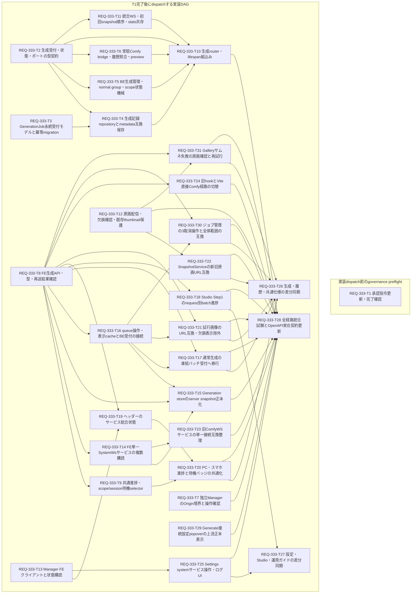

# REQ-333 Implementation Plan

## Review Status

2026-10-10（Asia/Tokyo）、AC-36を含む改訂設計の人間レビュー承認と実装開始許可を取得。PBIはin-progress。
設計/試験計画と31枚のTask Cardを物理生成済み。親がCoordinatorの責務を担当し、最大3名のEngineerへ依存順に委任する。現行状態と局所検証は [execution tracker](./REQ-333-execution.md) を参照。
実装ソースは許可されたEngineer担当者が変更中。全体3-Gateと実端末検証は未完了。
履歴BAモデル判定 REQUIRES MODIFICATION BEFORE PRODUCTION は維持。今回の設計監査は別証跡へ保存する。

## Human Review Decisions

[設計C1..C13](./REQ-333.md)で各正本の現行仕様・差分・更新案を確認する。
**通常生成の集計区切り**は「全端末の未終了normal集合が空→次の受付で新group」とする提案。端末activeBatchの現行に代わるため明示的レビュー対象。
**サービス稼働の観測範囲**は現ManagerがPIDを返さないためTCP LISTEN＋起動情報＋HTTP失敗30秒超を使う提案。ポート未開放PIDハングの厳密検出は今回の保証に含めない。
セッションは既存localStorage IDと保存フィルタを継承。TTL/fingerprint/認証は追加しない。
受付commit後202、同request ID同bodyは同job集合。上流POST結果未確認は自動再送せず照合する。
BE再起動完全復元はACへ追加せず、保存済みprompt IDの照合可能範囲と未確認状態を開示する。
Supervisor停止時OFFLINEでも上流正常なら生成可。原画missingは試行表示除外だけとしSnapshot/thumbnail/metadataを即削除しない。
新job terminal記録は既存metadata1000件の保持集合へ揃えactiveは追跡。追加record量/cleanupの回帰を確認する。
これらは要件承認後に作った具体的設計案であり、要件承認を未提示設計の承認に読み替えない。

## Task Inventory

| Card | 目的 | 担当領域 | 依存 | 変更ファイル数 | DAG層 |
|---|---|---|---|---:|---:|
| [REQ-333-T1](../backlog/task/archive/REQ-333-T1.md) | 承認された通信方針をプロジェクト指令へ反映 | system | — | 1 | 1 |
| [REQ-333-T2](../backlog/task/archive/REQ-333-T2.md) | 生成受付・状態・ポートの型契約 | backend | — | 2 | 1 |
| [REQ-333-T3](../backlog/task/archive/REQ-333-T3.md) | GenerationJob永続受付モデルと冪等migration | backend | — | 3 | 1 |
| [REQ-333-T4](../backlog/task/archive/REQ-333-T4.md) | 生成記録repositoryとmetadata互換保存 | backend | REQ-333-T2, REQ-333-T3 | 3 | 2 |
| [REQ-333-T5](../backlog/task/archive/REQ-333-T5.md) | BE生成管理・normal group・scope状態機械 | backend | REQ-333-T2 | 2 | 2 |
| [REQ-333-T6](../backlog/task/archive/REQ-333-T6.md) | 常駐Comfy bridge・履歴照合・preview | backend | REQ-333-T2 | 3 | 2 |
| [REQ-333-T7](../backlog/task/archive/REQ-333-T7.md) | 独立ManagerのOrigin境界と操作確認 | system | — | 2 | 1 |
| [REQ-333-T8](../backlog/task/archive/REQ-333-T8.md) | FE生成API・型・再送結果確認 | frontend | — | 3 | 1 |
| [REQ-333-T9](../backlog/task/archive/REQ-333-T9.md) | 共通進捗・scope/session待機selector | frontend | REQ-333-T8 | 2 | 2 |
| [REQ-333-T10](../backlog/task/archive/REQ-333-T10.md) | 生成router・lifespan組込み | backend | REQ-333-T2, REQ-333-T4, REQ-333-T5, REQ-333-T6, REQ-333-T11 | 3 | 3 |
| [REQ-333-T11](../backlog/task/archive/REQ-333-T11.md) | 統合WS・初回snapshot順序・stats共存 | backend | REQ-333-T2 | 3 | 2 |
| [REQ-333-T12](../backlog/task/archive/REQ-333-T12.md) | 原画配信・欠損確認・既存thumbnail保護 | backend | — | 3 | 1 |
| [REQ-333-T13](../backlog/task/archive/REQ-333-T13.md) | Manager FEクライアントと状態購読 | frontend | — | 3 | 1 |
| [REQ-333-T14](../backlog/task/archive/REQ-333-T14.md) | FE単一SystemWsサービスの複数購読 | frontend | REQ-333-T8 | 3 | 2 |
| [REQ-333-T15](../backlog/task/archive/REQ-333-T15.md) | Generation storeのserver snapshot正本化 | frontend | REQ-333-T8, REQ-333-T14, REQ-333-T16 | 3 | 3 |
| [REQ-333-T16](../backlog/task/archive/REQ-333-T16.md) | queue操作・表示cacheとBE受付の接続 | frontend | REQ-333-T8 | 3 | 2 |
| [REQ-333-T17](../backlog/task/archive/REQ-333-T17.md) | 通常生成の凍結バッチ受付へ移行 | frontend | REQ-333-T8, REQ-333-T16 | 3 | 3 |
| [REQ-333-T18](../backlog/task/archive/REQ-333-T18.md) | Studio Step1のrequest別batch進捗 | frontend | REQ-333-T8 | 3 | 2 |
| [REQ-333-T19](../backlog/task/archive/REQ-333-T19.md) | ヘッダーのサービス総合状態 | frontend | REQ-333-T8, REQ-333-T13 | 3 | 2 |
| [REQ-333-T20](../backlog/task/archive/REQ-333-T20.md) | PC・スマホ進捗と待機バッジの共通化 | frontend | REQ-333-T9, REQ-333-T19 | 3 | 3 |
| [REQ-333-T21](../backlog/task/archive/REQ-333-T21.md) | 試行画像のURL互換・欠損表示除外 | frontend | REQ-333-T8, REQ-333-T16 | 3 | 3 |
| [REQ-333-T22](../backlog/task/archive/REQ-333-T22.md) | SnapshotServiceの新旧原画URL互換 | backend | REQ-333-T12 | 3 | 2 |
| [REQ-333-T23](../backlog/task/archive/REQ-333-T23.md) | 旧ComfyWSサービスの単一接続互換整理 | frontend | REQ-333-T14 | 3 | 3 |
| [REQ-333-T24](../backlog/task/archive/REQ-333-T24.md) | 旧hookとVite直接Comfy経路の切替 | frontend | REQ-333-T8 | 3 | 2 |
| [REQ-333-T25](../backlog/task/archive/REQ-333-T25.md) | Settings systemサービス操作・ログUI | frontend | REQ-333-T13 | 3 | 2 |
| [REQ-333-T26](../backlog/task/archive/REQ-333-T26.md) | 生成・履歴・共通仕様の差分同期 | system | REQ-333-T17, REQ-333-T20, REQ-333-T21, REQ-333-T22, REQ-333-T30, REQ-333-T31 | 3 | 4 |
| [REQ-333-T27](../backlog/task/archive/REQ-333-T27.md) | 設定・Studio・運用ガイドの差分同期 | system | REQ-333-T18, REQ-333-T25 | 3 | 3 |
| [REQ-333-T28](../backlog/task/archive/REQ-333-T28.md) | 全経路統合試験とOpenAPI実在契約更新 | backend | REQ-333-T7, REQ-333-T10, REQ-333-T12, REQ-333-T15, REQ-333-T17, REQ-333-T18, REQ-333-T20, REQ-333-T21, REQ-333-T22, REQ-333-T23, REQ-333-T24, REQ-333-T25, REQ-333-T29, REQ-333-T30, REQ-333-T31 | 3 | 4 |
| [REQ-333-T29](../backlog/task/archive/REQ-333-T29.md) | Generate接続設定popoverの上流正本表示 | frontend | — | 2 | 1 |
| [REQ-333-T30](../backlog/task/archive/REQ-333-T30.md) | ジョブ管理の3取消操作と全体範囲の互換 | frontend | REQ-333-T8, REQ-333-T16 | 2 | 3 |
| [REQ-333-T31](../backlog/task/archive/REQ-333-T31.md) | Galleryサムネ失敗の原画確認と再試行 | frontend | REQ-333-T8, REQ-333-T12 | 2 | 2 |

## Dependency DAG

最大深さ4層、循環なし。31カードすべて変更対象≤3ファイル、現在の最大221行（T2）。上限300行/Task Card以内。
固定contractのもとでrepository/service/bridge/WS/APIをmockで独立実装。T11はservice直接importではなくsnapshot supplier/event publisherを注入し、T10が実結線する。
T28の統合とT26/T27の正本同期は並行できる。実PC/スマホGate 3は実装DAG後の検証ゲート。

## Shared File Scheduling

main.pyのlifespan/登録はT10、models/migrationsはT3、jobQueueSliceはT16、connectionSliceはT15が所有する。types.tsはT16が先にJobQueueActionsとGenerationServerStateを定義し、T16完了後のT15だけが同期エラー表示のoptional型を追記する。既存T16→T15依存で共有ファイルを直列化する。
旧service/root store helperはT23、Settings接続UIはT25、Generate設定popoverはT29。
他担当変更を巻き戻さず、公開型が変わる場合は調整役へ戻す。新ファイルの契約を先に固定し不要な人工依存を加えない。
T1は人間設計承認後のgovernance preflightとして単独dispatchする。完了確認前は他のrootカードもdispatchしない。T1完了後に4層の実装DAGを開始する（T1はその前段フェーズ）。旧proxy禁止を残したままエンジニアへ送らない。
カードsnippetは設計時点の現行証拠。先行実装で対象が変わった場合は所有範囲/公開契約を再確認する。

## Rollout and Verification

1. 人間設計ゲートでC1..C13・D1..D8・31カード・全36 AC試験計画（既存35+AC-36）をレビューする。
2. T1へ承認文面を適用し、BE記録/worker/WS/imageとFE API/selectorを実装する。
3. T10でBE結線、FE store/normal/Studio/header/systemと原画/Snapshot保存互換を結線する。
4. 同origin生成経路を確認して旧hook/Vite直結を撤去。途中のFE/BE組合せを配布しない。
5. T28統合、T26/T27正本同期を行い、QAがテスト計画の3-Gate/実端末Network/CORS/復旧を実施する。
6. walkthroughへ実出力を記録し、全ACと正本同期を確認して調整役がPBIを閉じる。

局所pytest/vitest/型checkは各カードに正確なコマンド。新test作成後に実行する。設計工程では実施済みと扱わない。
実機/権限不足はINCONCLUSIVE。mockをスマホ/CORS/非常復旧の実証にしない。
COMFY_URL/WSL/既存firewall設定を活用し、OSの外部設定書換えを計画に含めない。
rollbackはFE/BEを対応版へ揃える。追加table削除でSnapshotを巻き込まない。

## Trade-offs and Risks

SQLite受付記録と常駐watcherはBEの責務を増やすが、browser不在完了・全端末の一致を成立させる。単純WS relayではmetadata/取消/Studio独立は解決できない。
全snapshot復帰は永続event replayより単純で保存上限を保つが、復帰中は前回値へ再同期中表示を要する。
上流Comfyの分散exactly-onceは保証しない。POST結果不明・BE再起動・履歴消失を失敗終了や成功と混同しない。
VRAM spec4GB/FEfallback6GBの現混在は現在BE設定を正本にし、新閾値や性能SLAを定義しない。
Origin対応は個人LANの要求境界に限定。認証/クラウド公開/厳密監査へ拡張しない。
旧URL cacheとSnapshotService path変換をT21/T22/IG6で保護する。画像品質、編集同期、StudioStep遷移、資源/通知周期は刷新しない。

## Evidence and Handover

履歴要件監査: docs/backlog/ba-audit/REQ-333.md（元回答と否定判定を保持）。
設計監査: docs/design/REQ-333-design-audit.md。物理カード/DAG/structured handover: docs/design/REQ-333-handover.json。
T24は既存GenerationState公開口だけを使うtyped store adapter。新GenerationSnapshot項目には依存せず、既存store型のmockで独立実装できる。T15との実結線・単一socket確認はT28が行う。新module/APIが必要になった場合はDAGを増やさずカードを設計へ差し戻す。

## Cancellation and Thumbnail Compatibility Revision

[互換性レビュー](./REQ-333-compatibility-review.md) と設計D7/D8・C12/C13を追加レビューする。2全取消は既存global対象を維持し、前回のnormal-only/Studio保護推論を撤回する。T30 Modal、T31 Galleryを追加、T16→T15の準備依存とT26/T28結線を更新した。T31はT8/T12の型と原画確認endpoint完成後に実施する。T30はT8/T16の型付きstore口後、T15結線はT28で確認する。

構造実測: 31カード、56辺、acyclic、最大深度4、所有最大3ファイル、実カード最大221行。T1 governance preflightを実装dispatch前に完了する。今回もsource変更・コード試験実行はない。追加変更契約監査入力はREQ-333-cancel-image-audit-input.md、実行/明示unloadは調整役が記録する。旧監査verdictは書換えない。

## Explicit Bulk Cancellation Scope Revision

追加ユーザー要望をPBI addendum/AC-36へ反映し、元AC-01..35と監査verdict/承認履歴は維持。既定全生成はglobal、単件は選択IDのまま。一括操作のnormal-only選択は全sessionに共有され、表示filterとは独立する。Studio/unknownがrunning又は上流pendingならinterruptを見送り、通常実行中保持・skipped理由・非完了を表示。known normal-only queueの場合の試行も上流TOCTOUを原子的に防止する保証ではない。

31カード/56辺/depth4を維持、最大カード221行。T2/T8公開型、T5/T6/T10処理、T16口、T18停止、T30 UI選択、T26仕様同期へ追加scopeを展開、FC15–19へ対応。サムネ契約は今回変更しない。差分監査入力REQ-333-normal-scope-audit-input.mdを調整役が権限付きtimeout900/unload-afterで実行し、直後明示unloadを記録する。人間設計レビューまで実装dispatchしない。
