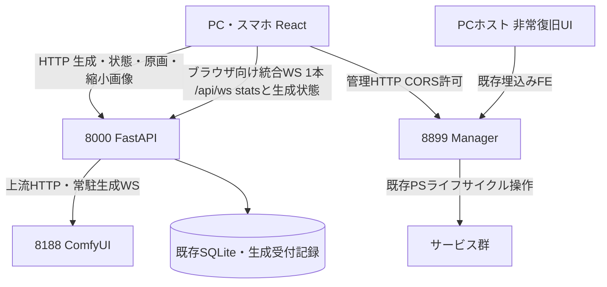

# REQ-333 設計レビュー案

2026-10-10（Asia/Tokyo）。36 AC（既存35＋追加AC-36）を入力とした設計案。要件から設計へ進む承認は取得済み。以下の決定・仕様更新は人間の設計レビュー前であり、実装済み・承認済みとは扱わない。資料ロードマップは参照していない。

## 1. Feasibility and Evidence

**実現可能。ただしレビューで下記の契約・衝突更新を承認してから実装する。** HTTPプロキシ、サムネ生成、SYSTEM_STATS WS、SQLiteと独立Managerが既にあるため、既存部品を活かして構成できる。調査はソース・文書の読取りであり、実ComfyUI・PC/スマホでの再現試験は実施していない。

| 現在の根拠 | 確認した現行契約 | 今回の差分 |
|---|---|---|
| `backend/app/routers/comfy.py` | prompt/queue/interrupt/history/object_info/thumbnailを8000で中継。原画viewなし。queue/historyの接続失敗を空結果で返す | 既存APIを残し、原画viewと明示的な状態照会を追加 |
| `frontend/src/store/services/comfyWebSocketService.ts` | `/ws?clientId=...`へ直結しbinary previewを受信 | ブラウザの生成WSを既存`/api/ws`へ集約 |
| `frontend/src/store/slices/connectionSlice.ts` | 端末で完了判定、history/queue直接照会、localStorageのclient ID | 完了・復元の正本をBEに移し、IDを継承 |
| `frontend/src/store/slices/jobQueueSlice.ts` | 受付後にローカル保存と非同期metadata POST。取消をfailedにする箇所あり | 受付時記録をBEへ移す。取消を別状態にする |
| `backend/app/routers/ws.py` / `resource_monitor.py` | 全接続へのbroadcast、30秒受信timeout、SYSTEM_STATS 2.5秒周期 | stats契約を保ち、生成snapshot/eventを追加 |
| `MatrixGenerationStep.tsx: handleSubmitBatch` | HTTPはproxy経由だが、完了進捗ではなく投入済み件数を表示 | 1リクエスト＝1batch IDで完了状態を表示 |
| `tools/server-manager/server_api.py` | 8899独立、status/action/logs、埋込みHTML、CORSなし | 同じAPIへ限定Origin対応。定常UIだけReactへ統合 |
| `tools/server-manager/server_status.py` | LISTEN/STOPPED/BUNDLED、pidsは空。runningはTCPポート状態 | 起動操作中状態を別に持ち、TCP状態とHTTP応答を区別 |
| `backend/app/services/snapshot_service.py` | HTTP(S)絶対URLをdownload。`/view`を含むpathを上流へ再構成 | `/api/comfy/view`と旧URLを正しく上流`/view`へ変換 |

境界はすべて`C:/Users/audih/ws/comfy-create-helper2`内。Git_Root_Mismatch: No（外部実装パスなし）。作業はdocsの設計・カードのみ。global scriptはcontextから`C:/Users/audih/.gemini/antigravity/scripts`に解決した。doc_mapperはPBI・FE・jobQueueSliceにmappedなしを返したため、PBIで列挙済みの仕様書とそこから得た実装パスを限定読取りした。

`docs/system/openapi.yaml`と`docs/openapi.yaml`は存在しない。実在する`backend/openapi.json`をopenapi_parserで確認したが、Dataset等現行routerを含まず古い可能性がある。API正本の更新は起動時生成契約を保ち、実装後の`app.openapi()`でこの実在ファイルを更新する案とする。WSとManagerはOpenAPI対象外のため本設計で別途契約を記す。

## 2. Topology and Ownership

生成投入/queue/history/image/previewを8000経由にする。ブラウザが生成状態とSYSTEM_STATSを受け取るアプリ向けWSは`/api/ws`の1接続へ統合する。一方、BEからComfyUIへ接続する常駐上流WSは別接続であり、「単一WS」はブラウザ側の接続数を指す。Viteも`/api`のHTTP/WSを8000へ転送する。ブラウザ8188直結・`/comfy`Vite proxyは最終切替で廃止する。Managerは生成経路に入れず、8000再起動要求は8899に直接送る。スマホのManager URLは`window.location.hostname`のPCホストに8899を付ける（URL APIで構築）。スマホのlocalhostへ向けない。

| データ | 正本と責任 |
|---|---|
| ジョブ識別・scope・batch・凍結した投入条件・終端状態 | BEのGenerationServiceとSQLiteのGenerationJob。ブラウザから完了状態を書かせない |
| 実行中node/progressと実際のqueue | ComfyUIをBEが照合・正規化。BEの単一revisionで端末へ配信 |
| 生成メタデータ | 既存PromptMetadataへBEが同じ凍結条件を保存。localStorage30件は表示cache |
| Snapshot画像・params・関連編集 | 既存Snapshotとサービス。試行履歴・job cacheから独立 |
| セッション・表示フィルタ | 既存LS_KEYS.CLIENT_ID / FILTER_OWN。認証・権限IDではない |
| サービス制御・管理ログ | 独立Manager。SYSTEM_STATSや生成成否の正本にはしない |
| Studio編集・競合 | 既存project API + sessionStorage draft。生成WSでフォームを上書きしない |

## 3. Review Decisions

用語を区別する。`GenerationSnapshot`はepoch/revision付きの生成状態JSON（再接続時の読取り結果）、`Snapshot`は既存の保存済み画像・paramsのDBエンティティ、`thumbnail`は一覧用画像とその一時cache。状態JSONをSnapshotServiceで永続画像へ保存せず、thumbnail cacheをSnapshot保護の対象にしない。

### D1: Identity

session IDは既存`prompt-surgeon-client-id`をそのまま使用。同origin・同browser profileのタブは同じsession、reload/再接続後も継続し、別端末/profile/originは別session。TTL・fingerprint・アカウントは追加しない。保存拒否時はタブ内IDで動作し、reloadで新IDになる旨を表示する。FILTER_OWNも既存保存を引き継ぎ、未設定はfalse。既にONを保存済みの端末はその選択を保つ。

上流WS client IDと利用者session IDを分離する。新しいapp投入はBE常駐WSのclient IDをComfyUIへ渡し、利用者session/scope/batchはBE記録で保持する。外部ComfyUI画面などからの旧/未記録jobは`legacy`由来として全端末一覧に表示できるが自sessionに帰属させない。旧historyのclient_idが既存利用者IDと一致する場合だけ、その既存情報を使える。未知jobをStudioと推測しない。

### D2: Canonical State and Reconnect

BE lifespanがGenerationServiceと上流watcherを起動し、最後のブラウザが閉じても停止しない。queue/historyの照合を上流WSのopen・状態変化・終了イベント・ブラウザ初期snapshot要求で行う。upstream切断時も再接続・照合を続ける。終了イベントを取り逃した場合はhistory照合で補う。

既存`/api/ws`に`GENERATION_SNAPSHOT`と`GENERATION_EVENT`を加える。共通envelopeは`version:1, epoch:string, revision:int, data`。epochはBE起動ごとに変わる。全端末に同じ状態を配信し、フィルタは表示だけに適用する。SYSTEM_STATS/VRAM_RECOVEREDのtype/data契約と2.5秒周期は変更しない。

WS接続時、BEは送信先を登録してからsnapshotを送る。登録からsnapshot送信終了までのeventを接続ごとに順序付きで送る。FEは同期完了まで前回状態を「再同期中」と表示し、snapshotを一括置換する。eventのrevisionが同じ以下なら無視、欠番またはepoch変更なら`GET /api/generation/state`で全状態を再取得する。snapshot取得中に届いたeventはsnapshotより新しいものだけ適用する。event replay logの長期保存は導入しない。

並行HTTP snapshotとWS初期snapshotで同じjobを追加しない。一覧keyは`job_id`、画像keyは`prompt_id + node_id + image index`。凍結記録・終端statusをcommitしてからeventを送信する。broadcastの遅いクライアントは生成workerを待たせず、切断したクライアントは復帰時に全同期させる。JSON通知には画像URLだけを載せる。

送信はclientごとの単一writerへ切り離す。同一WebSocketの登録は1回、disconnectは冪等。slow readerで待つ間は未送信の生成状態を最新1状態へ置換し、SYSTEM_STATSの最新値を別に保持してworkerへbackpressureを返さない。切断判定は送信例外・既存30秒heartbeat受信timeoutによる。1MB制限・接続数上限・新たな時間SLAは追加しない。

HTTP期限は既存comfy.pyの値を継承する: connect5秒、prompt10秒、queue/interrupt5秒、history15秒（client既定15秒）。read照合は再接続/状態変化契機、submit/interruptの自動再送はしない。上流WS再接続は旧ComfyWebSocketServiceの1秒開始/最大15秒/0〜499ms jitter、端末統合WSは既存SystemWsServiceの1〜10秒を継承する。これは新しい性能目標・期限追加ではなく、移行する既存挙動の明記。

### D3: Acceptance, Idempotency and Recovery Limit

新しい`POST /api/generation/batches`で凍結したgraphとmetadataの配列を受ける。正常受付はBEが全jobをcommitした後の202（`batch_id, job_ids, epoch, revision`）。受付済みjobの投入・完了保存はブラウザ接続に依存しない。normal/Studioともこの受付口を使い、既存comfy proxy APIは互換のため残す。

request IDはFEが生成するUUID。BEはunique request IDとpayload hashをbatch各行へ保存し、同じID/同じbodyなら同じ受付結果、同じID/違うbodyは409。自動mutation再送はしない。202応答を失った場合は`GET /api/generation/requests/{request_id}`で照合し、「受付確認中/結果未確認」と既存REQ-307相当の通知を出す。この照会は受付transactionで保存したrequest/batch記録から直接行い、現在のStateSnapshot読取りに依存させない。記録の保持・整理は既存metadata保持集合の範囲に従う。lookupの404/記録整理後の未確認は「未受付」の証明ではなく、再送根拠にしない。DBエラー時は202を返さず503。未受理の入力をoffline queueへ保存する機能は追加しない。

job/batch/normal group IDもBE生成UUIDとし、旧Studioのtimestamp入りclient IDをbatch IDに流用しない。利用者session IDの既存文字列は変えない。

旧Comfy proxyは上流操作の互換口であり、別のGenerationJob状態をclientから書き込む口ではない。改修後のnormal/Studioは新受付APIだけを使い、旧metadata POSTによる同じ記録の二重保存を除く。旧proxy経由・外部直接投入の未登録jobは上流照合で分かる範囲のlegacy表示にとどめ、scope/所有を推測してnormal/Studio集計へ混入させない。旧proxyの廃止期限は新要件にせず、全体の生成状態はBEのみが更新する。

上流の`/prompt`は分散transactionに参加しない。送信前の`submitting`記録、上流prompt_id確定後の記録の間で障害が起きると、厳密な一回だけの投入は保証できない。結果未確認をfailed/completedに勝手に変えず`unconfirmed`として照合する。上流へのPOSTを自動再送しない。関連づけが証明できないjobを時刻/seed類似で推定しない。

**AC-11/12はBEとComfyUI稼働中のブラウザ切断が保証範囲。** BE再起動後は保存済みprompt_idをqueue/historyへ照合できる範囲だけ復元する。`submitting/unconfirmed`や上流履歴消失は「状態未確認」と表示し、自動再実行しない。未送信の受付jobも再起動後に自動投入せず確認対象とする。AC-05は本体の稼働復帰であり、生成の再起動完全復元を合格条件へ追加しない。

新GenerationJobは受付/実行情報の補助記録。終端記録は既存server metadata1000件の保持集合と同じ範囲で整理し、activeは実行が終わるまで整理しない。永続的な試行archiveは作らない。jobのgraphは投入に必要な間だけ保持し、terminal化時に解放する。追加記録量と実装上のcleanupを資源回帰で確認する（新しい性能/容量目標は設定しない）。既存30件local metadata、1000件server metadata、thumbnail500件memory/4000超→3600diskを変更しない。上限整理後の冪等性key永久保証はしない。

### D4: Progress Groups and Waiting

normalは全端末共通の「未終了jobがある間の生成単位」をnormal group IDで表す。未終了jobがある間の新投入は同groupへ追加し、すべて終端後の次の受付で新groupにする。完了状態は次group開始まで表示できる。この区切りは既存activeBatchが端末内だったための**設計提案**でありレビュー対象。history一覧の保存範囲をgroupで削除しない。

Studioは毎回のbatch受付で別batch ID。project IDは別軸。同project・別端末・別batchも合算しない。Step遷移・Step 2への保存/進行は本PBIで変更しない。

`queued, submitting, running, succeeded, failed, cancelled, unconfirmed`を区別する。normal表示の母数Nは当該groupのcancelled以外、終了数Fはsucceeded+failed。進捗は`(F + running_fraction)/N`、枚数はF/N。N=0はidleとし除算しない。取消成功を上流queue照合後に確定し、取消要求だけで母数を減らさない。失敗はトーストとfailed表示を出し、終了数に1を加える。取消が失敗終了通知を発火しないよう区別する。

Studio失敗は同じF/Nで13/20へ進む。Studio専用の新取消UIは導入しないが、既存ジョブ管理のグローバル操作はStudioにも作用する。先の「既定操作をnormalだけに限定する」推論は撤回。既定globalは保持し、追加AC-36の明示normal-only選択でStudioを保護する。操作の対象・確認・集計はD7に従う。Studioは取消されたjobを成功完了へ数えず、batch停止を表す。Step 2へ自動遷移しない。

自session ONはnormal groupの自ID分でF/Nを計算、OFFは同group全sessionを共通計算。Studio一覧はbatchごとに表示。待機条件は自表示対象に未終了jobがあり、runningが別対象にある場合のみ。別scope待機を先に表示し、そのscopeの未終了残数（runningを含む）を示す。同scope他session待機はON時だけ表示する。OFF時には出さない。Studio別batchがrunningならそのbatch名/IDの待機で区別し、他batchを進捗に足さない。対象がrunningになれば待機を消す。project名は任意併記。

既存2段バー、nodeタイトル、経過時間・推定残り時間の計算を再利用する。監視起点はserverのrunning開始情報を使い、スマホ参加時刻から計時し直さない。VRAM判定は既存`resource_monitor.get_vram_status()`と設定値を使い、受付済みworkerの上流投入前へ移す。現行の待機内容、10秒警告、SYSTEM_STATS周期、待機取消を保持する。閾値が仕様の4GBとFEfallback6GBで混在する点は既存設定正本を使用し新しい値を定義しない。

実装具体化（VRAM待機取消）: 受付は低VRAMでも先にcommitする。旧cancelVramWaitの明示abortは同requestの受理済みjob IDsだけへguard付き単件取消を送る。既存 `/api/generation/jobs/{job_id}/cancel?only_unsubmitted=true` はServiceのaccept/dispatch/cancel lock内でstatus=queuedかつprompt_id=NULLの場合だけ取消す。上流投入済み/実行中はnot_cancelledで保持し、別request/Studioを巻き込まない。ブラウザdisconnectや単なるunmountはabortへ変換しない。旧「将来の未投入だけ停止」を受付責務移動後も維持するための条件であり、一括取消のmode/scopeは増やさない。

### D5: Service State and Manager

Supervisorのみ停止時は総合OFFLINE。生成側が正常なら生成・queue・imageを使用でき、管理操作/管理ログは利用不可と表示する。OFFLINE labelだけでGenerateボタンを無効にしない。8000停止時はAC-06のPCホスト8899非常UIで復旧し、8000画面の描画は要求しない。

ManagerのTCP状態、ComfyUIのHTTP応答、端末WS再接続状態を個別表示する。CONNECTINGは起動操作中または再接続中。ManagerがComfyポートLISTENを確認し、BEのqueue等軽量HTTP probeが30秒超連続失敗ならSTUCK、STOPPEDはManagerの停止状態かつ起動中ではない場合。30秒以内の応答再開で連続失敗timerをresetする。生成nodeの進捗が止まっただけではSTUCKにしない。

現ManagerはPID/実プロセス検査を提供せずポート状態だけを返す。したがって**「プロセス稼働」の観測はLISTENと起動操作情報を根拠にする提案**。ポートも開かないハングのPID検出まで要求するかはレビュー論点として開示し、既存native socket監視をPS/WSL定期呼出しへ置換しない。開発FEの5173/BUNDLEDは総合label判定から除外する。

定常UIはSettings systemのServiceConnectionCardをサービス操作/ログへ改修し、VRAM・表示操作の既存カードを保つ。本体停止を誘う通常のstopボタンは新設せず、AC-05のrestartを提供する。8000再起動の操作結果は8899応答と本体復帰後の再読込で確認する。action成功レスポンスだけでrunningへ楽観変更しない。

8899の許可OriginはHTTP(S)、hostがlocalhost/127.0.0.1/妥当なIPv4の192.168.0.0/16または10.0.0.0/8、port5173/8000。文字列prefix判定は使わない。AC-33/34で列挙された境界だけを実装し、172.16/12・IPv6・任意ホストの追加は今回承認していない。allowlistを返すCORS、OPTIONS、Vary:Originを実装。外部Origin/8080は403かつACAOなし。既存8899 HTMLの同origin通信とOriginなしのPC直接GETは維持する。unsafe POSTは許可Origin/同originを検査し、API actionの許可action/serviceを既存列挙値に制限する。これは個人LANの境界であり認証や厳密なセキュリティ監査を追加しない。

main.pyの任意http(s) CORS regexは発見事項だが、AC-34の対象はManager。全APIのCORS全面変更は本PBIで行わず、生成WSは正規アプリのsame-origin/許可originを検査する。

### D6: Image and Snapshot Compatibility

`GET /api/comfy/view?filename&subfolder&type&t=prompt_id`を原画配信口にする。上流hostは設定COMFY_URLに固定し、任意url queryを受けない。tはmetadata照会用でありComfyUIへ送らない。原画bytes/MIMEを保ち再encodeしない。実在する`/api/comfy/thumbnail`を一覧に使い、サイズ/品質・aspect処理を変更しない。

上流previewのbinaryはBEが現在jobへ関連付け、HTTP preview URLとrevisionだけを配信する。新たな恒久preview保存をせず直近frameだけ保持して置換/terminalで解放する。原画viewとは別の一時表示とする。previewが他jobへ混ざらないよう上流runningと対応を確認する。

2026-10-10プレビュー回帰修正: JobViewのoptional `preview_url`は画像未受信時null、省略は旧payload互換。実画像callback受信時だけjob別の一時URLを更新し、単なるnode進捗・health・state revision変更では同じURLを保つ。FEはstate revisionからURLを合成せず、画像URLがない進捗通知では直前のプレビューを保持する。次jobの初回画像未受信時も直前画像を表示し、実画像到着で切り替える。active work終了・epoch変更で一時previewを解除し、既存の完了原画auto-followとユーザー選択を維持する。DBへのpreview保存は追加しない。

後続ユーザー確認の差分: PC/mobileの進捗率文字は整数に丸め、bar fractionは保持。取消modal下部は狭幅で表示session説明・一括取消範囲・actionを段組みにし、filterとscopeの独立を維持。メタ情報version1 recordへoptional `completed_at`を追加し、成功jobの実finished_atを同transactionに記録する。GETは対応する成功jobが残る旧記録だけread-onlyで補完。local凍結recordは他の生成factsを保持したまま不足日時だけ同promptのserver実記録から補う。Snapshotは自身のrecordを表示し、画像保存日時や現在時刻を代用しない。非current presetがdefaultになる報告は現在再現せず、初回一括投入で実param injectionとgraph/metadataの独立を回帰試験に追加、本番の推測変更はしない。

画像利用状態は上流原画の確定404でmissing。timeout/502はunknownとして履歴を削除しない。missing結果を試行表示/選択/表示cacheから除外するが、metadataやthumbnailを即時削除しない。既存thumbnail cache hit時の原画欠損unlink/popはこの意図と衝突するため、確定missingの表示除外へ役割を移す。Snapshotはその対象から外す。

古いlocalStorage/query cacheの8188 absolute view URLはfilename/subfolder/type/tから新same-origin view URLへ正規化する。新キーを原URLの文字列だけに依存させず重複を防ぐ。SnapshotServiceはrelative/absolute `/api/comfy/view`と旧`/view`を認識し、上流ではpathを厳密に`/view`へ置換する。現行の`/api/comfy/view`をそのまま8188へ送る誤変換を防ぐ。Snapshot保存変換・品質・album・params・明示削除は既存通り。

### D7: Cancellation Modes and Explicit Bulk Scope

現物 JobManagementModal.tsx:21-53 は表示filterと3操作、jobQueueSlice.ts:369-521/comfy.py:168-211 はglobal clearとIDなしinterrupt。既定global互換を維持し、追加ユーザー要望で一括対象「通常生成のみ / 全生成（Studioを含む）」を設ける。単件は選択ID、queuedは待機取消、allは待機+実行中取消。modeと操作scopeは独立。

一括scopeはall|normal、mode=single|queued|allとは別軸。既定scope=allを維持。singleは選択job_id/prompt_id一方だけ、scopeを選択させずallのみ。表示filterは対象決定へ使わない。
all scope: queuedは全BE受付済み未投入＋全上流pendingをglobal clear:true、running保持。mode allは同clear後global interrupt、Studio/全session/legacyを含む。per-job loopへ縮小しない。
normal scope: 全sessionのDB job.scope=normalかつcutoff前commit済み未投入、またはDB prompt_idに正に対応付いた上流normal pendingだけ対象。削除はdelete:[確定ID群]、clear:true禁止、Studio/unknown legacyは触らない。推測client_id/表示行/残数からnormalを判定しない。
accept/dispatch/cancelを同じBE lockで直列化。normal allはID削除後に最新queueを再取得し、running又は上流pendingにStudio/unknownが1件でもある、queue照合不能、対象normalがrunningと確認不能ならinterruptを送らない。upstream_interrupt=skipped、messageで「Studio/未分類を保護するため通常実行中を維持」等の理由、正常終了前ならnot_cancelledを返す。全取消完了と表示しない。normal queuedはrunningに関係なく上記確定待機取消を行う。
最新queueが全件known normal、対象running一致、lock保持の場合だけnormal-running interruptを試行可能。直前一致検査後、T6 bridgeはcompatibility hintとしてPOST `/interrupt` JSON `{prompt_id}` を送る。現行proxyはtarget IDを送らず、existing handler may ignore extra JSON key。ComfyUI全体がID指定をサポートしないとは断定しないが、現行runtimeのtarget capabilityは未確認。hint無視/遅延到達では外部legacy投入/上流自律切替とのTOCTOUが残り、原子的な誤中断防止を保証しない。Studio保護の絶対保証と称さず、競合・timeoutはunconfirmedで明示、自動再送しない。既知保護対象がある場合は常に見送るという保守条件を優先。
未投入はlock下の取消commit、上流投入済みは正常ack＋queue/history/terminal照合で確認。queue不在/旧HTTP200 status:errorだけを証拠にしない。成功/失敗先行は終端を優先。normal Nはconfirmed cancelledのみ除外し重複減算なし、操作のfailed/unconfirmed/skippedをjob失敗へ変換しない。cutoff後の新BE受付は次集合、上流global clearは実行時集合、分散atomicではない。
待機delete/clearは標準上流でinterrupted履歴を生成しないため、直前pending確認・正常ACK・正常な操作後queueでrunning/pending双方から消失・正常history照会で先行成功/失敗なしを組み合わせる。ACKだけ/不在だけ/照会失敗/running競合は未確認。実行中interruptへこの条件を流用しない。空のglobal allは操作前後の空queueとclear→interrupt正常ACKで対象なし確認済みとし、分散原子保証は追加しない。
Studio batch F=成功+失敗、取消非加算、12成功+8取消は12/20停止。cancelled終端でrunning flags解除、Step移動/auto-advanceなし。confirmed cancelに失敗トーストなし。running履歴cleanupは取消確認後best effort、先行完了履歴/保存Snapshotを消さずcleanup失敗で取消を戻さない。

normal-only中断は**Studio/unknownがrunning又は上流pendingに1件でもあれば送らない**。削除可能な通常待機は取り消し、通常実行中は維持して理由を示す。known normalだけのpreflightでも上流APIにはatomic target指定がなく、外部操作との競合は保証外。全生成既定の使用範囲を縮小せず、保護されるnormal-only選択と区別する。

### D8: Thumbnail Missing Does Not Mean Original Missing

現物`comfy.py:274-403`はL1 memory→L2 disk→L3上流原画GET/Pillow再生成。L1/L2両方欠損なら通常GETだけで再生成し、disk書込とmemory登録を行う。0-byte disk/read失敗の回復も既実装で、`test_comfy_proxy.py:216-284`がcache hit/0-byte回復を検査する。新しい保存品質/サイズ/上限やSnapshot再生成は導入しない。

`GenerationGallerySection.tsx:297-307`はLazyThumbnail.onErrorだけでbatchImages/comfyHistoryImagesを削除する。この処理は原画存在+サムネ欠損/変換失敗でも履歴を消すため、今回の原画欠損要件と衝突する。`LazyThumbnail.tsx:61-69`はerror callbackを発火するだけで原画判定をしない。

managed/legacy画像とも`filename,subfolder,type`で原画利用状態を照会できる`GET /api/comfy/image-availability`を追加する。UUID不要。原画確定404だけmissing、200はpresent、HEAD非対応・502・503・timeout・判定不能はunknown。HEADで確定できない場合だけ原画GETへfallbackし、thumbnail responseの失敗を原画missingの根拠にしない。APIのImageAvailabilityResponseは{availability:present|missing|unknown}。GET不通をFEでmissingへ変換しない。

サムネcache missは既存L3で原画から再生成。原画presentだが変換/配信失敗なら行・選択・原画拡大経路を保持し、一覧画像の取得失敗を示す。一覧へ原画を自動流用せず縮小/原画の経路分離を保持する。unknownも行を消さない。missing確認時だけ試行表示/cache/選択を整合して除外する。画像identityごとにprobeを共有し同じerror連発によるonError/refetch loopを止める。失敗後は同じidentityへの自動probe/retryを繰返さず、明示再取得/画像変更で再試行する。固定の新TTL/SLAは作らない。既存placeholder上のサムネ取得失敗/明示再試行を使い、キャッシュ形式や一覧寸法を変更しない。

保存済みSnapshot画像はこの試行availability判定・除外の対象外。現`GallerySection.tsx:400-415`/ImageCarouselはtruthy thumbnail_pathを使い、保存サムネ欠損の自動再生成/自動原画fallbackを保証しない。保存画像のrepairを本PBIへ広げず、Snapshot本体・params・サムネを取消/試行errorで削除しない。

## 4. SSoT Impact / Conflict Review Matrix

以下は**承認後に更新する文面案**。現行正本をこの設計作業で書き換えていない。

| ID / 参照文書・箇所 | 現行仕様・指令 | 変更差分と具体的な改修案 | 理由/扱い |
|---|---|---|---|
| C1 `SKILL.md` API概要/重要方針1/prohibited_actions | React→Comfy直接、FastAPI proxy禁止 | 方針を「生成関連HTTP/WS・画像はReactから同origin FastAPI経由。上流Comfy接続はBEのみ」へ置換。proxy禁止を削除。Manager8899独立と非常FEを追記 | 明示アーキ変更。T1で実装前に承認文面を適用 |
| C2 `server_manager_guide.md` 2.2/アクセスURL/ネットワーク | スマホ8188直結、8000/8188/8899を一括開放 | 「生成は8000、管理は8899。正規UIは8188外部到達不要。8000停止時はPCホスト8899画面」を記載。既存firewall batの機能・既存ルールを勝手に削除しない | AC-06/10。OS firewall刷新は範囲外 |
| C3 `SPEC_SETTINGS.md` 3/system境界・5 | 新APIを導入しない、ComfyURLを端末設定/接続確認 | system接続カードへ管理操作/ログと個別稼働状態を加える例外を記載。生成上流URLはBE COMFY_URLを正本とし端末COMFY_URLを通信経路に使わない。Backend/LM URL編集は増やさない | AC-01..07/33/34。5tab・draft・レスポンシブ保持 |
| C4 `SPEC_GENERATE.md` 2-1/2-9/5/6/6-3 | 端末ComfyWS、activeBatch、取消failed、端末から非同期metadata POST、完了時刻未記録 | `/api/ws`・BE受付/完了正本・D4のgroup/失敗/取消・受付と記録同一payloadを追記。「server非同期POST」を「BE受付とサーバー保存、local30件cacheは独立」に置換。完了時刻は新job状態側のみ、既存生成recordのqueued_at等の意味は保持 | AC-11..23/27..32。記録経路変更、記録内容の再推定禁止は保持 |
| C5 `SPEC_HISTORY.md` 4-1 | local同期reader/serverfallback、30/1000、Snapshot優先 | 配信URLをsame-origin、原画404の試行表示除外、jobの冪等keyとcache整理範囲を追記。Snapshot params優先、cacheとは独立を明記 | AC-24..26。ライフサイクル全面刷新なし |
| C6 `SPEC_COMMON.md` 6 | IndexedDB query cache、generateDisplayImages残存、Studiodraft独立 | 生成状態snapshot/revisionはserver再取得で検証し正本にしない、旧画像URLの読取り正規化、missing表示の空集合反映を追記。querycache方式・maxAge・比率を保持 | stale cacheで削除済み原画を再表示しない |
| C7 `SPEC_DATASET_STUDIO.md` | Step1 browser foreach投入、project/draft/競合は既存 | Step1生成にscope=studio・request別batch・完了F/N・他scope待機を追記。750ms autosave、session draft、競合解消、Step遷移は保持 | AC-17/19/22/30/31。batchとprojectを混同しない |
| C8 `backend/openapi.json` / `SKILL.md`契約生成方針 | YAMLパスは現存せずJSONは一部古い | 実在JSONを現行app.openapi()から再生成。新generation API/typed error/image操作を収録。WS/Managerは本設計のenvelope/Origin/action契約を参照 | 古い契約をコピーせずsource生成する |
| C9 `comfy.py` thumbnail欠損cache削除と`SPEC_HISTORY` | 原画404でthumbnailも即unlinkする現実装 | 即削除を止め、missing表示だけを除外、通常の500/4000→3600上限整理へ委ねる | ユーザーの原画欠損指定による保存差分 |
| C10 `SPEC_GENERATE` 5-4と実装のVRAMfallback | spec4GB/FE6GB、BE設定値が存在 | 数値改定をせずBE get_vram_statusの現在設定を唯一の判定入力にし、同じ待機通知をserver workerへ移す | 受付後browser切断でも継続するための責務移動 |
| C11 `snapshot_service.py`とSnapshot保護仕様 | absolute URLのみdownload、/view pathをhostだけ置換 | relative/absolute新経路を同じ原画downloadへ解決。保存変換・品質/params/アルバムは変更しない | AC-25、明示された既存維持の保存回帰 |
| C12 `JobManagementModal.tsx:21-53` / `jobQueueSlice.ts:369-521` / `SPEC_GENERATE` 2-9 | フィルタは表示だけ、clear:trueはglobal、allはclear→interrupt、結果確認前にreset | D7の既存対象範囲を維持。native confirmに選択scopeの対象と中断見送り条件を表示し、確認済み取消だけ集計/終了flagsを更新。既定normal-only限定推論は撤回し、追加AC-36の明示選択を設ける | 使用範囲を狭めない。T5/T6/T10/T16/T18/T30で操作とfeedbackを結線 |
| C13 `GenerationGallerySection.tsx:297-307` / `comfy.py:274-403` / `test_comfy_proxy.py:216-284` | thumbnail errorで履歴除外、cache miss/0-byteは原画から再生成 | identity原画判定で確定欠損だけ試行除外。present/unknownはplaceholder/retryと原画preview保持。既存cache回復/品質/上限と保存Snapshotを維持 | thumb失敗を原画欠損と取り違えない。T12/T21/T31、結線T28 |

## 5. Proposed API and Module Contracts

公開API DTOはT2/T8/T10に項目を完全展開し一致させる。BatchAccepted={batch_id,job_ids,epoch,revision}、RequestLookup={batch_id,job_ids}、CancelResult={job_id,prompt_id,status,outcome,message}（legacy job_id/statusはnull）、CancelOperation={scope,message,mode,items,upstream_clear,upstream_interrupt,epoch,revision}。outcomeはcancelled/not_cancelled/already_terminal/unconfirmed/rejected、上流actionはconfirmed/unconfirmed/failed/not_requested/skipped。managed availabilityはImageView配列、identity availabilityは{availability:present|missing|unknown}、previewは画像bytes/MIME。ErrorEnvelope={detail:{code,message,outcome,request_id,job_id}}。generation router内だけで409/422/503/404をこの形にし、既存routerのerror形は変えない。

snapshot()はread-only。DB read/serialize失敗は503、FEは前回のvalid状態を保持して同期失敗表示、部分payloadは適用しない。受付transaction未commitならrollbackして202なし。commit済みなら後続snapshot取得/通知失敗で受付を拒否扱いに戻さず、commitしたjob IDs/epoch/revisionから202を返す。request lookupを受付根拠とし、state取得失敗でmutationを再送しない。

version=1をruntime検証。未知version/不正な項目は適用せずlast valid状態とSYSTEM_STATS購読を保持。同epochの未知versionについて自動state再取得は最大1回、なお非対応なら再読込を案内する同期非対応状態にし、連続refetch/自動reload/reconnectを起こさない。手動操作または対応するpayloadに復帰した時に解除する。

`POST /api/generation/batches`: `{request_id, session_id, scope:'normal'|'studio', project_id?:number, items:[{graph, workflow_id?, param_values, applied_assets?, set_name?}]}`。Studioはproject ID必須、同requestのscope/projectは固定。FEが既存injector/bypass/buildGenerationRecordで凍結した値を渡し、BEは現在workflowから再構成しない。202の後はclient IDを上流専用IDに置換して順次投入。

`GET /api/generation/state`: `{version,epoch,revision,normal_group_id,jobs,batches,upstream}`。`GET /api/generation/requests/{request_id}`は200で既知の受付、404は現在保持集合にない、503は照合不能。404を無条件自動再送の根拠にしない。

`POST /api/generation/jobs/{job_id}/cancel`: managed単件の互換入口。200結果/202取消未確認、409対象running変更、503操作開始前の照合不能。`POST /api/generation/cancel`: {mode:single|queued|all,scope?:all|normal,target?:{job_id?:string,prompt_id?:string}}。singleはtargetに一方のみ、scope省略/allのみ。一括modeはtarget禁止。scope省略/allは既定globalを維持し、mode=queuedならglobal clear:trueだけ、mode=allならglobal clear:true→global interrupt。scope=normalのmode=queuedは正に識別済みnormal IDだけdeleteし、mode=allはD7の保護対象preflightを通った場合だけrunning normalへのinterruptを試す。upstream_clearは指定ID削除またはglobal clearの結果を表す。globalをper-job loopへ変更しない。partial/skipped結果はCancelOperationのitems/action別に返し、すべて成功へ丸めない。初回取消と同ID繰返しは二重減算なし。`GET /api/generation/upstream-queue`は{running:[{prompt_id,client_id}],pending:[...]}、取得不能503で空成功にしない。BE jobと既知promptをdedupし未投入もModalへ投影、legacyに架空job UUIDを作らない。

`GET /api/generation/preview/{job_id}?revision=N`: 一時frameまたは404、bytesをJSONへ載せない。`GET /api/generation/images/{job_id}/availability`: outputごとのpresent/missing/unknown。`GET /api/comfy/image-availability?filename&subfolder&type`はUUIDなしのlegacyも確認可能、同じ判定helperを使う。確定原画404以外でmissingにしない。

GenerationJob候補項目: job_id(PK UUID), request_id/index(unique), payload_hash, prompt_id(nullable unique), session_id, scope, batch_id, normal_group_id, project_id(nullable), set_name, status, graph_json(nullable), metadata_json, outputs_json, accepted_at, started_at, finished_at, failure_json, cancel_requested。schema追加は既存migrations/steps.pyの冪等step027（実装時に番号衝突を再確認）で行う。既存snapshotとPromptMetadataは破壊しない。

新モジュールはschemas/generation.py、services/generation_repository.py、services/generation_service.py、services/comfy_generation_bridge.py、routers/generation.py。schemaを固定すればrepository/worker/FEを別々にmockして実装できる。lifespanの登録と停止はrouter wiring taskに集約し、同ファイルへの並行変更を避ける。

## 6. Trade-offs and Review Items

| 判断 | 採用案と代替・制約 |
|---|---|
| 生成正本 | BE受付記録と上流照合。単純WS byte relayではブラウザ不在完了・scope・冪等性を満たせない |
| WS統合 | `/api/ws`に生成を追加。SYSTEM_STATS用WSと生成専用WSを二重維持する案は、既存購読が二重化するため採らない |
| snapshot復帰 | 全同期+revision。永続event replay logや最大遅延SLAは新規要求にしない |
| session | 既存localStorage IDを継承。TTL/device fingerprintは既存の再読込同一性を変えるため採らない |
| BE再起動 | 保存済みIDのbest effort照合、未確認は自動再送なし。分散exactly-once/checkpoint再開の保証を追加しない |
| normal group境界 | 全体未終了集合が空→次受付で切替。端末activeBatchのままでは全端末3/8を共有できない。レビューでこの区切りを確認する |
| サービス稼働観測 | socket LISTENと応答timerを利用。実PID不在のためポート未開放ハングの厳密判定は保証範囲外。AC-08の観測解釈を確認する |
| メタ保存失敗 | 受付commit前は503、上流実行後の保存失敗は状態未確認/再保存通知。記録を捏造して成功扱いにしない |
| API切替 | BE追加→FE接続/保存互換→Vite直結撤去。途中版を完成品として配布しない。rollbackではBE/API/FEを対応版へ揃える |
| 画像cache | 原画missingで表示除外し通常cleanupへ委ねる。cache-hit時の存在チェックは維持し、ネットワーク障害と欠損を区別 |

レビューの具体項目はC1..C13、D1の既存同一性、D3の受付・冪等保証範囲/再起動未確認、D4 normal区切り、D5稼働観測、追加job記録の保持集合である。元の35 ACは保持し追加AC-36を実装契約へ展開するもので、その実装契約を確認する。実装中に契約を変える必要が判明したらカード外の変更をせず設計へ差し戻す。

## 7. Audit and Handover

履歴BA判定`REQUIRES MODIFICATION BEFORE PRODUCTION`は`docs/backlog/ba-audit/REQ-333.md`にそのまま保持する。D1..D8は残指摘への設計回答案であり、モデルがPASSしたと称さない。

物理カード、DAG、全36 AC対応（既存35＋AC-36）とRed Team試験は`REQ-333-implementation-plan.md`、`REQ-333-test-plan.md`を参照。カードは承認前draft。設計レビュー承認を得るまで実装へ送らない。設計作業ではソースの編集・テストの実行をしていない。設計パッケージの監査結果・実行制約は`REQ-333-design-audit.md`へ追記する。

今回の取消/サムネ互換差分と現物の3操作比較は [互換性レビュー](./REQ-333-compatibility-review.md) を参照。仕様の新規刷新ではなく、利用範囲を保つ具体的な設計更新である。旧監査入力/出力は当時の証跡として変更しない。
