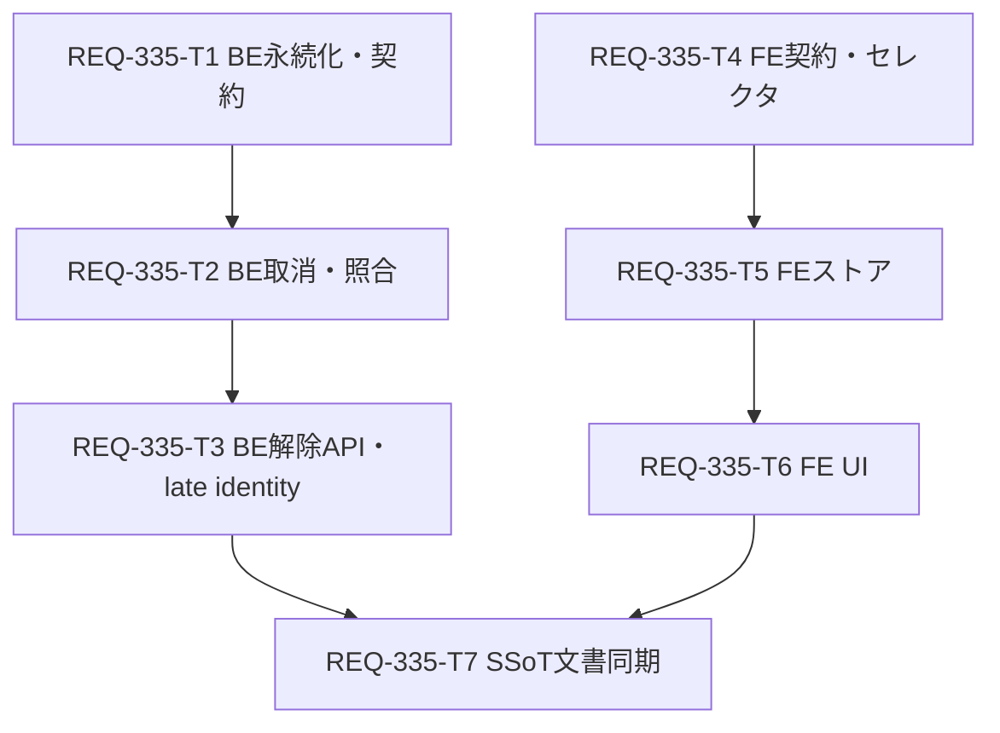
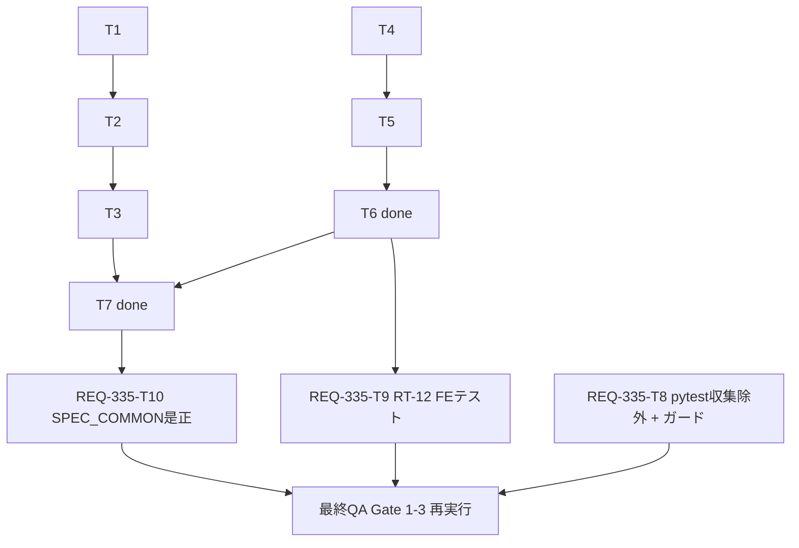

# Implementation Plan - REQ-335: 未確認ジョブの待機表示残留と解除不能の解消

> 配置メモ: リポジトリ直下の `implementation_plan.md` は REQ-377 のコミット済み成果物のため上書きしない。本PBIの実装計画は本ファイルを正本とする（REQ-333 の `docs/design/REQ-333-implementation-plan.md` と同じ運用）。

> 改訂2: Q1〜Q7 のユーザー回答を反映し、Q4（再起動後に孤立した送信待ちの回復）を範囲内に編入した。Card数・DAGは変更なし（T2/T3 を拡張）。

## Overview

- PBI: `docs/backlog/pbi/active/REQ-335.md`（Type A bug、P2）
- 設計書: `docs/design/REQ-335.md` / テスト計画: `docs/design/REQ-335-test-plan.md`
- 方針: `unconfirmed` を「状態未確認」として待機・進捗から分離し、取消で確認済み終了として扱わず、利用者判断で解除できる恒久操作 `release`（新状態 `released`）を追加する。再起動後も待機へ戻らず解除記録が残る。加えて、BE再起動でメモリ上の送信待ちを失った prompt_id=null の `queued`/`submitting` を起動時に `unconfirmed` へ回復し（自動再送なし）、待機表示への永久残留を塞ぐ。

## Proposed Changes

| Card | 内容 | AC | change_kind | subsystem |
|---|---|---|---|---|
| REQ-335-T1 | `released` 状態・`release_json`・step_032・リポジトリ（group終了条件、解除CAS、late identity注記、保持上限） | AC-3, AC-4 | code | backend |
| REQ-335-T2 | サービス: `_CONFIRMED_TERMINAL` 分離、取消の `already_terminal` 是正、一括取消の未確認項目、unconfirmed の照合/イベント再開、**起動時回復 `_recover_orphaned_submissions`（設計§6.8）** | AC-1, AC-2, AC-4, AC-5 | code | backend |
| REQ-335-T3 | サービス `release_unconfirmed`、`POST /api/generation/release`、late identity、再起動結合試験（解除の永続・**起動時回復の結合**） | AC-1, AC-3, AC-4, AC-5 | code | backend |
| REQ-335-T4 | FE契約（`released`/`release`/`releaseJobs`）とセレクタ（進捗N・待機・`selectUnconfirmedJobs`） | AC-1, AC-3, AC-4 | code | frontend |
| REQ-335-T5 | FEストア: `projectQueue`、生成中判定、batch終了判定、`releaseUnconfirmed` | AC-1〜AC-5 | code | frontend |
| REQ-335-T6 | FE UI: 状態未確認セクション・解除確認・Queueボタンの件数チップ・レイアウト判定 | AC-1, AC-2, AC-3 | code | frontend |
| REQ-335-T7 | SSoT同期: SPEC_COMMON / SPEC_GENERATE（起動時回復の規則を含む）/ openapi.yaml | AC-1〜AC-5 | doc | system |

## DAG

並列ブランチ: BE系 (T1→T2→T3) と FE系 (T4→T5→T6) は互いに独立して開始できる。T7 は両ブランチ完了後。

### Atomicity Audit（Card別）

| Card | AC/メカニズム | 所有ファイル | 依存 | 本文行数 | 凝集性・分割理由 | 並列効果/コスト | 所有衝突/手戻り | 判定 |
|---|---|---|---|---|---|---|---|---|
| T1 | AC-3/4: 永続契約とリポジトリ | schemas/generation.py, models.py, migrations/steps.py, generation_repository.py + 3 tests | なし | 278 | 「released を永続化し group 終了条件を決める」で一貫。サービスは別Card | FE系と並列可。後続BEの前提 | 他Cardと所有衝突なし。schema変更はT2/T3の前提でT1内に閉じる | Keep |
| T2 | AC-1/2/4/5: 取消・照合の是正＋起動時回復 | generation_service.py, test_generation_service.py | T1 | 233 | 「unconfirmed のライフサイクル是正」(出口/取消/照合) と「unconfirmed の発生源の是正(起動時回復)」。いずれも `start()`/reconcile/cancel 周辺の同一ファイル内の小変更（回復は約45行）で、別Card化すると同一ファイルの所有衝突と DAG 深さ増(5段)を招くため同居。解除機能と独立に検証可 | 並列不可（T1後） | T3と同一ファイルのため直列化 | Keep（T3と分離） |
| T3 | AC-1/3/4/5: 解除操作＋回復の再起動結合 | generation_service.py, routers/generation.py + 3 tests | T2 | 200 | 新機能（release+API+再起動検証） | 直列 | T2との同一ファイルを依存で解消 | Keep |
| T4 | AC-1/3/4: 契約とセレクタ | generation.ts, generationSelectors.ts + 2 tests | なし | 162 | 純粋関数・契約のみで独立検証可能 | BE系と完全並列 | T5/T6とファイル分離 | Keep |
| T5 | AC-1〜5: ストア投影 | jobQueueSlice.ts, connectionSlice.ts, types.ts + 3 tests | T4 | 158 | 状態投影とアクション | 直列 | UI(T6)と分離 | Keep |
| T6 | AC-1/2/3: UI | JobManagementModal.tsx, Desktop/MobileLayout.tsx + 2 tests | T5 | 206 | 1つの画面責務（ジョブ管理＋Queue表示）。分割すると同一Modal/Layoutを跨ぐ手戻りが増える | 直列 | Layoutは他PBI非並行 | Keep |
| T7 | 全AC: 文書同期 | SPEC_COMMON.md, SPEC_GENERATE.md, openapi.yaml | T3, T6 | 103 | 文書のみ（doc経路） | 直列 | 実装確定後でないと誤記 | Keep |

全Cardの本文は300行以下（上表は物理行数。T1=278 が最大で、本改訂では T1 を変更していない）。並列による短縮量は未計測（unknown）。引き継ぎ・待ち・手戻りのコストはカード数に比例して増えるため、BE/FEそれぞれ3段（計7枚）に留めた。

### DAG Complexity Audit

- Max_Depth: 4（T1→T2→T3→T7 と T4→T5→T6→T7）。警告域(3-4)に該当するが自動上限ではない。
- 実依存の根拠: T2 は T1 の `JobStatus`/リポジトリ契約を import（`mypy` で検証）。T3 は T2 と同一ファイル `generation_service.py` を編集するため直列が必須（所有衝突回避）。T5 は T4 の型/API、T6 は T5 のアクションを使用。T7 は実装確定後の文言整合（identity が docs を含むため最終QA前に完了）。
- 並列性/ボトルネック: BE・FE の2系統は独立。T2/T3 が `generation_service.py` で直列化される点が BE 側の最長経路。FE 側は T4 を先行させれば BE と同時進行可能。契約の食い違いリスクは設計書§6.4 を共通正本とし、QAの結合シナリオ（`-k "REQ-335 and AC-3"` と FE統合）で確認する。

## Verification Plan

詳細は `docs/design/REQ-335-test-plan.md` §6。要約:

| Gate | コマンド（WORKSPACE_ROOT から） |
|---|---|
| 1 | `backend\.venv\Scripts\python.exe -m mypy backend` / `-m pytest backend/tests/unit` / `scripts/run_in_dir.py frontend npm.cmd exec -- vitest run src/utils src/components/**/__tests__` / `scripts/verify_ui_invariants.py` / `npm.cmd --prefix frontend run typecheck` / `scripts/verify_test_naming.py --strict` |
| 2 | `backend\.venv\Scripts\python.exe scripts/run_full_suite.py` |
| 3 | `backend\.venv\Scripts\python.exe scripts/run_e2e.py` |
| シナリオ | `-k "REQ-335 and AC-1"`（起動時回復の再起動）、`-k "REQ-335 and AC-3"`（解除の再起動）、`-k "REQ-335 and AC-4"`、FE `-t "REQ-335/AC-4"` |

`.agents/verification.json` の突合結果: `required_commands` というキーは存在せず、実体は `gates.fixed_commands`（上表と一致）。参照スクリプトはすべて存在を確認。

## Trade-off Disclosure

| 論点 | 採用 | 代替案と理由 |
|---|---|---|
| 解除の表現 | 新状態 `released` + `release_json` | `unconfirmed` + フラグ: 消費者の判定漏れで残留が再発（fail-open）。`cancelled` 流用: 上流取消確認と区別不能でAC-3違反。削除: 解除記録が残らない |
| 配備互換 | FE/BE同時配備。旧FEは `released` を含むsnapshotを拒否（再読込で復旧） | 状態名を増やさず互換維持: 上記fail-openのリスクが大きいため不採用 |
| ロールバック | 旧BE戻し時は `UPDATE generation_jobs SET status='unconfirmed' WHERE status='released';` を事前実行 | 旧BEがreleasedを読めず `/state` が失敗するため必須の手順 |
| 進捗N | unconfirmed を N から除外し別チップ併記（SSoT変更あり） | N に残す: 進捗が永久に完了しない（AC-1矛盾） |
| 解除時の照合 | prompt_id ありは1回照合、進行中なら拒否。ComfyUI停止中は照合不能でも解除可 | 常に照合必須: 主要ユースケース（ComfyUI停止）で解除不能 |
| T2/T3 の直列化 | 同一ファイルのため依存で直列 | 並列: 同一ファイル衝突とマージ手戻り |
| 保持 | released 独立上限1000件（Q1 決定済み） | 無期限/期間制: DB増加の上限なし／解除記録の期限切れで AC-3 を損なう |
| 孤立した送信待ち (Q4) | 起動時に1回だけ、上流へ問い合わせず prompt_id=null の queued/submitting を unconfirmed 化（T2）。`_pending_ids` 在籍は除外、失敗は非致命＋ワーカー再試行 | 周期 reconcile で常時掃除: 稼働中の正規ジョブとの競合面。起動時 `_pending` 復元: 二重投入。failed/cancelled 化: 確認済み終了と混同。新Repository一括CAS: T1肥大・過剰。別Card化: 同一ファイル所有衝突とDAG深さ5 |
| queued の写像 | unconfirmed に統一し reason で未送信を明示（Q4 決定） | 専用状態 `never_sent`: FE/BE/OpenAPI の変更範囲が過大 |
| E2E | 追加しない（既存Gate3の回帰） | 実ブラウザ新規E2E: jsdomで検証可能な範囲のため過剰 |

## Decision Log / Open Questions

設計書 §10 を参照。

**決定済み（ユーザー回答）**: Q1 解除記録の独立上限1000件、Q2 進捗Nから unconfirmed を除外し件数チップ併記、Q3 prompt_id ありで上流進行中なら解除を拒否（状態を更新して返す）、Q4 再起動後の孤立 queued/submitting を範囲内で unconfirmed 化、Q5 残留3件はデプロイ後に新API `/release` で暫定解除（運用作業）、Q6 `backend/openapi.json` は更新せず `docs/openapi.yaml` のみ、Q7 PBI本文の修正はPBI更新権限者が実施。

**未決**:
- Q8: prompt_id を持つが上流 queue/history から消えた queued/submitting/running の残留（ComfyUI再起動後など。設計 R13）を別PBIとして起票するか。
- Q9: Q7 の PBI 修正時に、Q4 編入（起動時回復の Requirement 追記と AC-1/AC-3 の検証観点）を併せて反映するか（現行ACのままで本設計は充足）。

## Supplement (post-QA)

> 経緯: 最終QAで Gate 2 が FAIL（pytest が `docs/logs` の git 無視コピーを収集し 80 件の収集エラー）。あわせて文書レビュー指摘 F-1/F-2 と RT-12 未実装が判明し、ユーザー決定（A: `docs/logs` を収集から除外、B: RT-12 のFEテストを追加、C: F-1/F-2 を反映）に基づき補足Cardを追加する。T1〜T7 は done のため編集しない（契約ハッシュは承認済みスコープ）。PBI/Card の状態は変更せず、新Cardは `status: ready` で起票。詳細は `docs/design/REQ-335.md` §13、テストは `docs/design/REQ-335-test-plan.md` §8。

| Card | 内容 | AC / 目的 | change_kind | subsystem | 所有ファイル | depends_on |
|---|---|---|---|---|---|---|
| REQ-335-T8 | 直下 `pytest.ini`（`norecursedirs` に `docs/logs` + pytest既定値）とガードテスト | Gate 2 是正（決定A） | code | backend | `pytest.ini`, `backend/tests/governance/test_pytest_collection.py` | なし |
| REQ-335-T9 | RT-12 FEテスト3ケース（エスケープ・超長文・解除確認の非エコー） | AC-1, AC-3（決定B） | code | frontend | `frontend/src/components/__tests__/JobManagementModal.test.tsx` | T6(done) |
| REQ-335-T10 | SPEC_COMMON の F-1（母数分離の適用範囲）/F-2（解除対象・outcome 4値） | AC-1, AC-4 の SSoT（決定C） | doc | system | `docs/specs/SPEC_COMMON.md` | T7(done) |

### DAG（補足）

T8・T9・T10 は互いに独立（所有ファイル重複なし）で並列実行できる。3Card とも最終QAの前提。最大深さは T8=1、T9=T4→T5→T6→T9 の既存系列の延長（4）、T10=T7 後の1段。

### Atomicity Audit（補足Card別）

| Card | AC/メカニズム | 所有ファイル | 依存 | 本文行数 | 凝集性・分割理由 | 並列効果/コスト | 所有衝突/手戻り | 判定 |
|---|---|---|---|---|---|---|---|---|
| T8 | Gate 2 収集除外 | `pytest.ini`, `test_pytest_collection.py` | なし | 157 | 「収集設定とそのガード」で一貫。設定とガードを分けると設定の罠（既定値置換）が再発しうる | T9/T10 と並列可。短縮量は unknown | 他Cardと重複なし。手戻り点は `norecursedirs` の Windows 実効（検証コマンドで即時判明） | Keep |
| T9 | RT-12 FE テスト | `JobManagementModal.test.tsx` | T6 | 149 | 同一ファイルへのテスト追加のみ。T6 所有ファイルだが T6 は done で衝突なし | 並列可 | 欠陥実証時は後続Card（T11）へエスカレーション | Keep |
| T10 | 文書是正 | `SPEC_COMMON.md` | T7 | 71 | 同一文書の近接2箇所。分割すると同一ファイル衝突 | 並列可 | SPEC_GENERATE/openapi は不変（ハッシュ確認）。docs は identity 入力のためQA前完了必須 | Keep |

### 追加トレードオフ
| 論点 | 採用 | 代替案と理由 |
|---|---|---|
| 収集除外の置き場所 | 直下 `pytest.ini`（`norecursedirs` に既定値併記） | `run_full_suite.py` に `--ignore`: 素の `pytest -n auto` が壊れたまま。`testpaths`: 将来のテストを黙って落とす。`conftest.py`: 設定散在。コピー削除: 証跡破壊 |
| identity 盲点 | ガードテスト（identity 入力内）で `pytest.ini` 内容を固定 | `verification.json` の root_files に追加: ゲート定義の変更でスコープ外（必要ならコーディネータ/ユーザー判断） |
| RT-12 のレイアウト検証 | jsdom でクラス契約を固定 | 実ブラウザE2E: jsdom で足りる範囲を超えず過剰 |

### リスクと確認事項
- 収集除外後に実行される実テストは `docs/logs` のコピーに依存しない（`docs/logs` に追跡ファイル0件・除外後 743 件が `--ignore` 版と同数）。QA で件数（743 + ガード4 = 747）を確認する。
- スコープ manifest（承認済みスコープ）に T8〜T10 の Card と所有ファイル（`pytest.ini`、`backend/tests/governance/test_pytest_collection.py`、`JobManagementModal.test.tsx`、`SPEC_COMMON.md`）を追加すること。追加しないと所有外編集として扱われる。
- 直下 `pytest.ini` は identity 入力外。ガードテストが内容を縛るが、`.agents/verification.json` の root_files への追加は別判断。
- `norecursedirs` は pytest 既定値を置換する。`docs/logs` のみの指定は 240 エラーとなる（実測）ため既定値併記を崩さない。
- T9 が欠陥を実証した場合は T11（`JobManagementModal.tsx`）起票が必要で、最終QAが後ろ倒しになる。
- `docs` は identity 入力のため、T10 完了後・QA前に docs を追加変更しない。
