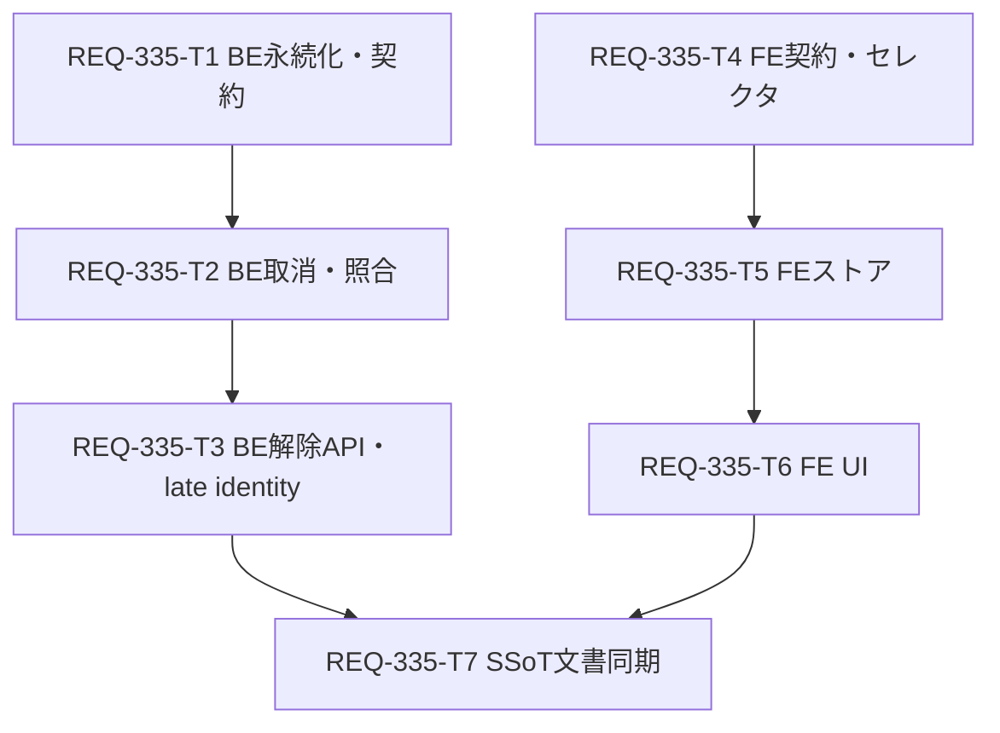

# REQ-335 詳細設計書: ComfyUI停止後の未確認ジョブが待機表示のまま残留し解除できない

- 作成: architect (dev-design) / 状態: 設計レビュー待ち（改訂2: Q1〜Q7 は決定済み §10、Q4 の起動時回復を範囲内へ編入 §6.8）
- PBI: `docs/backlog/pbi/active/REQ-335.md`（Type A bug / status は変更しない）
- テスト計画: `docs/design/REQ-335-test-plan.md`
- 実装計画・DAG: `docs/design/REQ-335-implementation_plan.md`

## 1. 概要と目的

ComfyUI停止などで「上流への投入結果が不明」になったジョブ（`status=unconfirmed`、`prompt_id=null`）が、
(a) フロントエンド(FE)で待機中・生成中として表示され続け、(b) 取消が `already_terminal`（確認済み終了）として扱われ何も変わらず、
(c) DBでは active のまま再起動後も残り続け、利用者が解除する手段もない。

本設計は次を行う。
1. `unconfirmed` を「状態未確認」として待機・進捗・生成中から分離して表示する（AC-1）。
2. 取消で `unconfirmed` を `already_terminal` と扱わず、確認できた範囲と未確認を明示する（AC-2）。
3. 利用者判断で未確認記録を解除する恒久操作 `release` を新設し、再起動後も待機へ復活せず、上流取消確認とは区別した解除記録を残す（AC-3）。
4. 未確認が存在しても新規生成が完了でき、二重投入・無関係ジョブの取消を起こさない（AC-4）。
5. 後から上流識別情報（prompt_id）が判明した場合の扱いを、解除前/解除後に分けて定義する（AC-5）。
6. BE再起動でメモリ上の送信待ち(`_pending`)が失われ、prompt_id=null のまま `queued`/`submitting` が待機表示に残留する経路を、起動時回復で `unconfirmed`（送信結果不明）へ変換して塞ぐ（§6.8。AC-1/AC-3/AC-4 に関与。ユーザー判断 Q4 で範囲内）。

## 2. Acceptance Criteria 一覧

| AC | 要旨 |
|---|---|
| AC-1 | 上流キューが空で prompt_id=null/unconfirmed のジョブを FE 同期時、待機中と区別した「状態未確認」を表示し、待機件数・進捗に矛盾がない |
| AC-2 | 未確認ジョブの単件/一括取消を `already_terminal` として処理せず、確認できた範囲と未確認を明示 |
| AC-3 | 利用者が解除を確定 → BE再起動後も待機キューへ復活せず、上流取消確認と区別した解除記録が残る |
| AC-4 | 未確認が存在しても新規生成が完了でき、二重投入・無関係ジョブ取消を起こさない |
| AC-5 | 後から上流識別情報が判明した場合、承認された保持・解除仕様に従い結果を扱う |

## 3. 境界監査 (Boundary Audit)

- Target_Paths（編集対象）: `C:\Users\audih\ws\comfy-create-helper2\backend\app\{schemas,models.py,migrations,services,routers}`、`...\frontend\src\{api\domains,utils,store,components,pages\GeneratePage}`、`...\docs\{specs,openapi.yaml}`
- Shared_Dependency_Paths（読み取り/実行のみ）: `C:\Users\audih\.claude\skills\agent-tooling-maintenance\helpers`（doc_mapper / openapi_parser / audit_contract / local_model_adapter）
- Git_Root_Mismatch: なし。編集対象はすべて WORKSPACE_ROOT (`C:\Users\audih\ws\comfy-create-helper2`) 配下。システム契約の正本はこのリポジトリのBE（`backend/app/schemas/generation.py` と `docs/openapi.yaml`）。他リポジトリへの波及なし。
- Hallucination_Lock: ACTIVE。外部への編集なし。

## 4. SSoT 影響分析

`doc_mapper.py docs/specs docs/backlog/pbi/active/REQ-335.md` の結果は「No mapped documents」（PBI に related_paths が無いため）。
そのため PBI 引用箇所と grep(`未確認`/`unconfirmed`)により手動で特定した。

**引用行番号の不一致（要注意）**: PBI の `SPEC_COMMON.md:318` / `SPEC_GENERATE.md:174` は現行ファイルでは内容が移動している。実際の該当箇所は下表。
また PBI の「Incident report」リンク `docs/incident_report.md` の内容は REQ-386（進捗バー停止）の報告であり、本件（未確認残留）の調査報告ではない。本設計は PBI本文・実コード・REQ-333設計書を根拠とし、incident_report.md は根拠に使わない。

| 文書 | 現行該当箇所 | 影響 |
|---|---|---|
| `docs/design/REQ-333.md:103,113,160,161`（archive済PBIの設計） | 未確認は「状態未確認」表示、自動再実行しない、N=cancelled以外 | 参照元。本設計は N の定義を拡張（§6.3）。REQ-333.md 自体は履歴として改変しない |
| `docs/specs/SPEC_COMMON.md:548,551` | 上流送信結果不明は unconfirmed、POST自動再送なし／未確認を完了扱いにしない | 追記: 状態未確認の分離表示、解除(release)の意味、`released` 状態 |
| `docs/specs/SPEC_GENERATE.md:196,199,200,202,204` | unconfirmed の定義、進捗母数N、待機取消の確認条件、部分成功/未確認の表示 | 追記: N から released/unconfirmed を除外、取消時の未確認項目の必須報告、解除操作 |
| `docs/openapi.yaml`（`/api/generation/*`, `JobView`, `CancelResult` ほか） | JobStatus enum、CancelResult | 追記: `released`、`JobView.release`、`POST /api/generation/release`、関連スキーマ |

起動時回復（§6.8）の規則も SPEC_COMMON/SPEC_GENERATE に追記する（T7）。SSoT同期は Task Card REQ-335-T7（doc）で実施する。`backend/openapi.json` は既に `JobView` 等が実装と乖離（実測: 生成した `JobView` が不一致）しており、本PBIでは更新対象に含めない（ユーザー判断 Q6、§10.1）。

## 5. 現状分析（根本原因の実コード対応）

| # | 事実 | 箇所 |
|---|---|---|
| E1 | worker が上流POST失敗/不明で `unconfirmed`（prompt_id=null）に遷移。以降どの経路にも出口がない | `backend/app/services/generation_service.py:511-520,532-538` |
| E2 | サービス側 `_TERMINAL` に `unconfirmed` が含まれる。このため単件取消が `already_terminal` を返す（AC-2の直接原因） | 同 `:30`, 使用: `:155,180,605`（単件）、`:686,706,961`（一括）、`:288`（event）、`:1086`（reconcile） |
| E3 | 同じ `_TERMINAL` により reconcile/on_event が unconfirmed を一切更新しない。prompt_id が後から判明しても照合されない（AC-5）。REQ-333.md:103「保存済みprompt_idをqueue/historyへ照合」の実装不整合 | 同 `:288,1086` |
| E4 | リポジトリは `unconfirmed` を ACTIVE 扱い（`_ACTIVE_STATUSES`）、`_TERMINAL_STATUSES` に含めない → 永久に active、prune されず、normal group を永久に開いたままにする | `backend/app/services/generation_repository.py:23-25,220-233,330,375` |
| E5 | 一括取消は unconfirmed ジョブを結果 items に含めない（上流キューに居るものだけ処理）。未確認が黙って残る | 同 service `:661-754`, `:943-1069` |
| E6 | FE `projectQueue` が `unconfirmed` を「待機」配列(`queuePending`)へ投影し、モーダルは「待機中のキュー」に表示 | `frontend/src/store/slices/jobQueueSlice.ts:42`、`frontend/src/components/JobManagementModal.tsx:280-326` |
| E7 | FE が unconfirmed を未終了扱い: 生成中判定・進捗(`selectProgress`: N に含まれ F に入らず停滞)・待機(`selectWait`)・レイアウトの `normalUnfinished` | `frontend/src/store/slices/connectionSlice.ts:181`, `frontend/src/utils/generationSelectors.ts:71,103-130`, `DesktopLayout.tsx:249`, `MobileLayout.tsx:261` |
| E8 | 解除(release)の API/状態/UI は存在しない | — |
| E9 | `JobStatus` は FE の厳格デコーダ `isJobStatus` で検証され、未知値のsnapshotは全体拒否される | `frontend/src/api/domains/generation.ts:160-163,299-309` |
| E10 | `generation_jobs.status` に CHECK 制約はない（新しい状態値の追加に DDL 変更不要） | `backend/app/migrations/steps.py:477-517` |
| E11 | **起動時回復の欠落（Q4）**: `start()` はワーカー起動と初回 reconcile のみ。ワーカーは `_pending`（メモリ）の queued だけを処理し、reconcile は prompt_id を持つ行だけを対象にする。そのため再起動後に prompt_id=null の `queued`/`submitting` を扱う経路が無く、`_ACTIVE_STATUSES` により永久に active（待機表示・normal group を開いたまま）になる。graceful stop 時の `CancelledError` 経路（`:503-510`）は送信中ジョブを unconfirmed にするが、強制終了・電源断・DB書込失敗では働かない | 同 `:92-100,450-554,1077-1152`、`backend/app/main.py:86-93` |

## 6. 設計

### 6.1 用語と状態モデル

| 状態 | 意味 | 区分 |
|---|---|---|
| queued / submitting / running | 通常の進行中 | active（待機・生成中の対象） |
| succeeded / failed / cancelled | 確認済み終了（cancelled は上流取消を確認できた場合のみ） | confirmed terminal |
| **unconfirmed** | 上流への投入/実行結果を確認できない | **active でも terminal でもない第3の状態**（「状態未確認」）。自動再送しない。照合により進行/終了へ遷移し得る |
| **released**（新設） | 利用者判断で未確認記録を解除した | terminal（永続）。成功・失敗・上流取消確認のいずれでもない |

サービス層の集合を次のとおり分離する（E2の修正）。
```python
_CONFIRMED_TERMINAL = {"succeeded", "failed", "cancelled", "released"}
_TERMINAL = _CONFIRMED_TERMINAL | {"unconfirmed"}   # 既存用途（snapshotのpreview消去等）のみに残す
```
取消の `already_terminal` 判定（succeeded/failed/cancelled のみ。released は `not_cancelled` を返す専用分岐）、event/reconcile のスキップ判定、`_cancel_requested` 登録判定は `_CONFIRMED_TERMINAL` を使う。

### 6.2 状態遷移（unconfirmed と released）

| 遷移 | 契機 | 備考 |
|---|---|---|
| submitting → unconfirmed | 上流POST例外/prompt_id欠落/停止/バインド失敗 | 既存。prompt_id=null のものは識別不能で、推測照合しない（REQ-333.md:101） |
| queued/running → unconfirmed | 取消要求なしの `execution_interrupted` | 既存 |
| queued/submitting(prompt_id=null) → unconfirmed | **BE起動時回復（新規、§6.8）**。送信待ちを保持するメモリ(`_pending`)が失われた記録 | 自動再送しない。reason で「未送信」「送信中断」を区別 |
| unconfirmed → queued/running | reconcile が prompt_id を上流 queue に発見、または当該 event 受信 | **新規有効化（E3）**。prompt_id を持つ場合のみ |
| unconfirmed → succeeded/failed | reconcile が history の終端を確認 | 同上 |
| unconfirmed → cancelled | 取消フローで「削除前pending・ACK・削除後不在・historyにinterrupted」を確認 | 既存の確認条件のまま |
| unconfirmed → unconfirmed | 照合しても結論が出ない | **no-op**。revision を進めない（無限再送出防止） |
| unconfirmed → released | 利用者の解除（§6.4） | 唯一の出口（識別不能な場合） |
| released → * | **なし**（terminal） | 例外: late identity の注記のみ（§6.5） |

### 6.3 FE投影規則（AC-1 / AC-4）

1. **待機件数**: `queuePending` / `queueRunning` / Queue件数は queued・submitting・running のみ。unconfirmed を含めない。
2. **状態未確認**は独立集合 `selectUnconfirmedJobs(snapshot, sessionId|null)` で、group・scope を問わず全 unconfirmed を返す（group が閉じても残留を可視化するため）。Queueボタン内の件数チップ「状態未確認 N件」と、ジョブ管理モーダルの専用セクションで表示する。「待機中」ラベルを使わない。
3. **進捗**: normal の N = group内で status が `cancelled / released / unconfirmed` 以外、F = succeeded + failed。unconfirmed は進捗に混ぜず別チップで併記する（REQ-333.md:113 の N 定義を拡張。SSoT更新は T7、ユーザー判断 Q2 で承認済み）。Studio は N から released のみ除外し、unconfirmed は N に残る（batch停止の既存意味を保つ。unconfirmed 件数チップで可視）。
4. **生成中**: `isGenerating` / `currentPromptId` / `normalUnfinished` は queued・submitting・running のみで判定（unconfirmed で「準備中...」固定にならない）。
5. **activeBatch**: unconfirmed の項目は「未完了」に数えず batch 終了判定を妨げない（項目は `pending` のまま、`isGenerating` を固定しない）。released は `failed` 相当で終了扱い。
6. **projectQueue の `seen`**: unconfirmed/released の prompt_id は seen から除外する。上流キューに実在する場合は外部項目として可視になる（後から判明した上流項目を隠さない）。

### 6.4 解除 (`release`) の恒久ライフサイクル【明示定義】

**意味**: 「この未確認記録を、利用者の判断で、待機・進捗・生成中の対象から恒久的に外し、解除した事実を記録する」操作。
ComfyUI上の取消・成功・失敗の確認ではなく、上流に対して cancel/interrupt/delete/POST を一切送らない。結果は `status=released` と `release` 記録で表す。

**対象**: `status == unconfirmed` のジョブのみ（prompt_id の有無を問わない）。他の状態（queued/running/成功/失敗/取消）は `not_released` で一切変更しない。

**状態**: `status="released"`（terminal）。`failure`（元の未確認理由）は保持する。`graph_json` は null 化（terminal共通）。

**永続化**: `generation_jobs.release_json TEXT NULL`（migration step_032）。内容:
```json
{"released_at":"2026-10-24T01:02:03Z","released_by_session":"<clientId|null>","reason":"user_release",
 "upstream_check":"skipped_no_identity|not_found|unavailable","late_prompt_id":null}
```
状態更新と revision 加算は同一DBトランザクション（compare-and-set: `WHERE status='unconfirmed'`）。BE再起動後も `released` のまま復元され、`_pending` に戻らず、worker は再投入しない（既存設計: 受付jobも再起動後は自動投入しない）。

**API**: `POST /api/generation/release`
```
Request  ReleaseRequest   {job_ids: string[1..50] 重複不可, session_id?: string}
Response ReleaseOperation {items: ReleaseResult[], epoch: string, revision: int}
ReleaseResult {job_id: string|null, prompt_id: string|null, status: JobStatus|null,
               outcome: "released"|"already_released"|"not_released"|"rejected",
               message: string, upstream_check: "skipped_no_identity"|"not_found"|"unavailable"|null}
HTTP: 200（item別結果。not_released/rejected を含んでも200）、422（空/重複/51件以上/型不正）、503（typed ErrorEnvelope, outcome=unconfirmed）
```
- 冪等: 解除済みへの再実行は `already_released`（状態・revision不変）。
- 明示ID指定のみ（「全unconfirmed暗黙解除」は設けない）。FEは表示中の unconfirmed の job_id を送る。送信後に別状態へ遷移した行は `not_released` となり巻き込まない（AC-4）。
- prompt_id を持つ unconfirmed は、解除前に既存 `_reconcile_locked()` で1回照合する。照合で queue に居る/running になった/終端が確認できた場合は状態が更新され `not_released`（理由: 上流で進行中/終了を確認）。照合で変化なしなら `upstream_check=not_found`、照合自体が失敗なら `unavailable`（ComfyUI停止中でも解除可能）。prompt_id=null は `skipped_no_identity`。
- 実行はサービスのロック内で行い、完了後に snapshot を1回 publish する。

**保持（retention）**: `released` は通常の terminal prune(`_TERMINAL_LIMIT=1000`)の対象外とし、独立上限 `_RELEASED_LIMIT=1000`（released_at の古い順に削除、`prune_terminal` と同一トランザクション）。上限以内の解除記録は恒久に残る（自動期限なし）。この上限値はユーザー判断 Q1 で決定済み（§10.1）。
（事実: `prune_terminal()` は現状アプリ本体から呼ばれていない（grep: テストのみ）。上限は同関数に実装するが、定期実行の導入は本PBI範囲外で、現状は成功/失敗/取消の terminal 行も同様に無制限に蓄積する。released 行は小さく件数も利用者操作で限られるため許容する。）

**normal group 終了条件【明示定義】**:
- group が「開いている」⇔ scope=normal のジョブに status ∈ {queued, submitting, running} が1件以上ある。
- 閉じる ⇔ すべての normal ジョブが {succeeded, failed, cancelled, unconfirmed, released}。**unconfirmed は group を開いたままにしない**（E4の修正: `_ACTIVE_STATUSES` から unconfirmed を除外）。
- 次の normal 受付時、開いている group があればその `normal_group_id` に追加、なければ新UUIDで新group。
- 閉じた group に残る unconfirmed/released は元の `normal_group_id` を保持するが、可視化は group 非依存（§6.3-2）なので見えなくならない。

### 6.5 後から上流識別情報が判明した場合（AC-5）

| 状況 | 扱い |
|---|---|
| 解除前の unconfirmed + prompt_id あり | reconcile/event により進行・終端状態へ遷移（E3の修正）。結果は実状態に従う（成功/失敗/実行中）。unconfirmed→unconfirmed は no-op |
| 解除前の unconfirmed + prompt_id=null | 識別不能。時刻/seed類似による推定結合はしない（REQ-333.md:101）。解除のみが出口 |
| 解除後に identity が判明（例: 上流が受理済みでバインド保存の再試行が後から成功する経路 `_retry_prompt_bindings`） | **status は released のまま**。`prompt_id` と `release.late_prompt_id` を注記し、frozen prompt metadata を保存する。上流の成否を job の status/outputs に取り込まない。上流に実行が残る場合は `projectQueue` の外部項目として可視化される（§6.3-6） |
| 解除済みへの取消/再解除 | 取消は `outcome=not_cancelled`（message: 解除済みの記録であり上流取消は行っていない。`already_terminal`＝確認済み終了とは意味が異なるため使わない）、再解除は `already_released` |

### 6.6 取消の意味（AC-2）

- 単件（`/jobs/{id}/cancel`, `only_queued`, `only_unsubmitted`, `/cancel mode=single`）: unconfirmed を `already_terminal` にしない。
  - prompt_id=null: 上流へ何も送らず `outcome=unconfirmed`、`status=unconfirmed` のまま（既存 `:611-612` の分岐へ流す）。
  - prompt_id あり: 既存の queue/history 確認フローへ流す（pending→削除確認で cancelled、running→interrupt、不在→unconfirmed）。
  - `cancel_unsubmitted`（未送信のみガード）: unconfirmed は `outcome=unconfirmed`（ガード対象外の提示）。
- 一括（`mode=queued|all`, `scope=all|normal`）: 対象スコープ内で処理後も unconfirmed のまま残るジョブを `outcome=unconfirmed` の item として必ず含める。これにより FE の `hasConfirmedAllEffects` が偽となり、モーダルが維持され「確認済み n件 / 未確認 m件」が出る。normal-only 範囲では Studio/未分類の unconfirmed は報告・操作しない（保護範囲を変えない）。
- ルータ: item に unconfirmed があれば既存どおり HTTP 202。

### 6.7 データ・契約変更一覧

| 層 | 変更 |
|---|---|
| `backend/app/schemas/generation.py` | `JobStatus` に `released`、`ReleaseView`、`JobView.release: ReleaseView|None = None`、`ReleaseRequest/ReleaseResult/ReleaseOperation` |
| `backend/app/models.py` | `GenerationJob.release_json: Text NULL` |
| `backend/app/migrations/steps.py` | `step_032_generation_jobs_release_json`（冪等な `ALTER TABLE ... ADD COLUMN`、`MigrationStep("032", ...)`） |
| `generation_repository.py` | `_ACTIVE_STATUSES` から unconfirmed 除外、`_TERMINAL_STATUSES` に released、`release_unconfirmed()`（CAS）、`annotate_late_identity()`、prune 分離、`_job_view` に release |
| `generation_service.py` | `_CONFIRMED_TERMINAL`、取消/reconcile/event 修正、一括の未確認 item、起動時回復 `_recover_orphaned_submissions()`（`start()`・ワーカー再試行）、`release_unconfirmed()`、late identity |
| `routers/generation.py` | `POST /api/generation/release`（typed error） |
| FE `generation.ts` / `generationSelectors.ts` | `released` と `release` の型・デコーダ、`releaseJobs` API、`selectUnconfirmedJobs`、進捗/待機の集合修正 |
| FE `jobQueueSlice.ts` / `connectionSlice.ts` / `store/types.ts` | `projectQueue` 修正、`releaseUnconfirmed` アクション、生成中/batch 判定修正 |
| FE `JobManagementModal.tsx` / Desktop・MobileLayout | 状態未確認セクション・解除UI、Queueボタン内の状態未確認件数チップ（新規コンポーネントは作らない） |

### 6.8 起動時回復: 孤立した送信待ち記録の unconfirmed 化（Q4、AC-1/AC-3/AC-4）

**仕様上の根拠**: `docs/design/REQ-333.md:103`「`submitting/unconfirmed`…は『状態未確認』と表示し、自動再実行しない。未送信の受付jobも再起動後に自動投入せず確認対象とする」。本節はこの既定仕様の実装欠落（E11）を埋めるもので、新しい仕様判断は「queued/submitting の状態を unconfirmed へ永続的に変換する」点のみ。

**問題**: 送信待ち(`_pending`)・凍結graph・VRAM待ちはメモリのみで、再起動で失われる。DB上の `queued`/`submitting`（prompt_id=null）は、以後どの経路にも拾われず待機表示のまま残る（E11）。

**対象（述語）**: `status IN ('queued','submitting') AND prompt_id IS NULL AND job_id NOT IN self._pending_ids`（scope は問わない。normal/Studio/未分類とも同じ残留が起きるため）。以下は**一切対象外**（変更しない）: prompt_id を持つ行（reconcile/event の責務）、running、確認済み終了、`unconfirmed`（理由を上書きしない）、`released`、現プロセスの `_pending` に居る行。

**変換**: `unconfirmed` へ遷移。`failure={"reason": <下記>, "outcome": "unconfirmed"}`、`finished_at=now`（既存 unconfirmed と同形）。prompt_id は null のまま。
- `queued`: `"service restarted before upstream submission; the request was not sent upstream and is not resubmitted automatically"`
- `submitting`: `"service restarted during upstream submission; whether upstream accepted it could not be confirmed"`
`queued` は送信前(POST未実施)と分かっているが、「未送信の確認済み終了」を表す状態はライフサイクルに無い。ユーザー判断(Q4)に従い unconfirmed に統一し、reason で区別する（§8）。

**実行契機と順序**: `GenerationService.start()` 内、(1) ワーカー task 作成**前**、(2) 初回 `reconcile()` **前**、(3) `self._lock` 保持下で同期関数 `_recover_orphaned_submissions()` を1回実行し、変換があれば `_publish_snapshot()` を1回行う。lifespan は `await service.start()` 完了後に yield する（`main.py:91-94`）ため、最初のHTTP/WS同期が見る状態は回復済みで、FEが一瞬でも「待機」を受け取らない。
- 上流(ComfyUI)へ**一切アクセスしない**（停止中でも動く。reconcile の成否に依存しない）。ワーカー起動前なので、回復中に自動送信が走らない。
- reconcile との順序: 回復対象は prompt_id=null のため reconcile は元々対象外であり、順序で結果は変わらない。回復を先にするのは「ワーカーが対象を拾わない」「初回publishが回復後の状態になる」ため。

**冪等性・アトミック性**:
- 2回目以降の `start()`（ワーカー稼働中は即 return、停止後の再 start は再実行）は、対象が既に unconfirmed のため0件で、revision・publish ともに増えない。
- 1行ごとに `repository.transition()`（1行=1コミット）。途中で例外が出ても、変換済みの行は確定し、未変換の行は次回の回復で収束する（再実行は残りだけを処理）。`repository.transition()` は compare-and-set ではないが、回復は `self._lock` 保持下かつワーカー作成前に実行されるため、同一プロセス内に競合する書込主体はいない。また述語（queued/submitting）と `release`（unconfirmed のみ対象）は対象が交わらない。
- revision は変換1件につき +1（新epoch内で単調増加。epoch は repository 生成時に決まり、回復は epoch 確定後に行う）。

**失敗時**: 回復の例外は握りつぶさず警告ログを出し、`start()` は失敗させない（ワーカーと上流照合は継続）。`_recovery_pending=True` とし、ワーカーの reconcile 周期（`_RECONCILE_SECONDS`）で同じ関数を成功するまで再試行する（成功で False）。

**「本当に送信中」との区別（エッジ）**:
- 単一プロセス前提: 起動時点のプロセス内に送信中のジョブは存在しない（送信はワーカーのみが行い、ワーカーは回復後に作られる）。
- 同一プロセスの stop→start、または `start()` 前の `accept()` では、受付済みジョブが `_pending_ids` に残る。これは述語で除外し、正規に待機・送信される（二重変換・取りこぼしなし）。
- 複数プロセスが同一DBを共有する構成（`--reload` 二重起動等）は非対応。旧プロセスの送信中行を新プロセスが unconfirmed 化し得るが、旧プロセスのワーカーは status!=queued を見て送信しないため二重投入にはならない（R10）。

**他機能との整合**:
- 取消(§6.6): 回復後の行は prompt_id=null の unconfirmed なので `outcome=unconfirmed`、上流へ何も送らない。
- 解除(§6.4): そのまま解除可能（`upstream_check=skipped_no_identity`）。上流が実は受理済みでも prompt_id が不明なため late identity は到達しない（再起動で `_binding_retry` も消えるため）。
- normal group(§6.4): 回復で queued/submitting が消えるため、全員 unconfirmed なら group は閉じ、次の受付で新groupになる（AC-4）。回復前は孤立行が group を開いたままにする。
- リクエスト再送(replay): 回復後に同一 request_id を再送しても `find_request` が既存行を返し、`_pending` に追加されない（既存仕様）。
- 初回デプロイ: 既に残留している古い `queued`/`submitting` も、新BE初回起動時に同じ規則で unconfirmed 化される（意図した是正。Q5 の残留3件の解除は `/release` で別途行う）。
- ロールバック: スキーマ変更なし。旧BEは unconfirmed を従来どおり扱う（R2 の `released` 手順は別途必要）。

## 7. Seam Map（テスト境界 [MUST W-DD-SEAM]）

1. **Integrated (real code)**:
   - BE: router → `GenerationService` → `GenerationRepository` → SQLite（tmp_path 実ファイル、`Base.metadata.create_all` と migration step）→ `ComfyGenerationBridge`（real）。
   - FE: `generationApi` デコーダ → zustand store(`useGenerationStore` の実スライス) → `generationSelectors` → コンポーネント(`JobManagementModal`, `DesktopLayout`/`MobileLayout` のQueueボタン)。
2. **Severed (external I/O only)**:
   - ComfyUI HTTP: `httpx.MockTransport(LocalUpstream)`（`backend/tests/integration/legacy/test_generation_integration.py`）。停止は `LocalUpstream.prompt_error` / `queue_error` で表現。WebSocket は `websockets` ローカルサーバ。
   - API応用試験: `FakeBridge`（`test_generation_api.py`）。
   - FE: `fetch`（`generationApi.call`）をモック、`localStorage` は jsdom。
   - DB永続境界: SQLite tmp ファイル（再起動は `_integration_app(tmp_path, ...)` を同一 `tmp_path` で再生成して再現）。
3. **Mock Level**: 内部ビジネスロジック/ヘルパのmonkey-patchは禁止。`generation_service` の内部メソッドや `GenerationRepository` をスタブ化しない（ただし既存 `MemoryRepository` を使うユニット的サービス試験は既存慣例。Repository契約の検証は実SQLiteで別途行う）。
4. **PBT Decision**: 必須。入力空間が広い状態集合（status 組合せ・遷移列）を扱うため、
   - BE: Hypothesis（`test_generation_repository.py`）— 「任意の遷移列と release 要求で、unconfirmed 以外の行は不変」「released は不変で冪等」「released は group を開かない」。
   - FE: fast-check（`generationSelectors.test.ts`）— 「任意の status 多重集合で 0≤fraction≤1、F≤N、unconfirmed/released は F と待機件数に影響しない、N=0 は idle」。
   - 起動時回復(§6.8)の入力空間は有限（status 8種 × prompt_id有無 × `_pending`在否 = 32通り）のため PBT ではなく**全組合せの網羅パラメタライズ**で検証する（PBT より強い保証）。
5. **Fault Injection**: 再起動で失われた `_pending` の再現（受付済み行をDBへ直接シードして新 service を `start()`。実repository/MemoryRepository の公開API `accept_batch`/`transition` のみ使用）、起動時の ComfyUI 停止(`queue_error`)、回復中のDB書込失敗（repository 境界の障害注入）、同一プロセス stop→start、ComfyUI停止(`prompt_error`)、queue照会失敗(`queue_error`)、history照会失敗、DB read失敗(503)、解除中の競合（解除直前に状態が running へ遷移）、バインド保存の後追い成功。詳細は test plan §5。

## 8. トレードオフと代替案

| 論点 | 採用 | 代替案と不採用理由 |
|---|---|---|
| 解除の表現 | 新状態 `released`（terminal）+ `release_json` | (B) `unconfirmed` のまま解除フラグ: wire互換は容易だが、全消費者が「unconfirmed かつ未解除」を毎回判定する必要があり、判定漏れ時に残留が再発する（fail-open）。(C) `cancelled` 流用: 上流取消確認と区別できず AC-3 違反。(D) レコード削除: 「解除記録が残る」に反する。released は allowlist 方式の active 判定で既定が fail-closed |
| unconfirmed と進捗 | N/F から除外し別チップ | N に残す: 進捗が永久に100%未満・「完了」にならず矛盾（AC-1）。除外しても件数チップで隠れない |
| 解除時の上流照合 | prompt_id あり時のみ既存 reconcile を1回実行。上流で進行中なら拒否 | 常に照合なしで解除: 実行中ジョブを誤って記録から外す恐れ。常に照合必須: ComfyUI停止中（本件の主状況）に解除できない |
| 解除対象指定 | 明示 job_ids | 「全unconfirmed解除」暗黙API: 画面に見えていない記録を巻き込む（AC-4） |
| 保持 | released 独立上限1000（古い順） | 無期限: DB増加の理論上の上限なし（ただし1件は小さい）。terminal上限共有: 成功ジョブの流入で解除記録が早期消失し AC-3 違反 |
| 孤立した送信待ちの扱い (Q4) | 起動時に1回、prompt_id=null の queued/submitting を unconfirmed 化（上流アクセスなし、`start()`・ワーカー前） | (a) 周期 reconcile で常時掃除: 稼働中の正規ジョブ（受付直後・送信中）を誤変換する競合面が増える。起動時なら「送信主体が存在しない」ことが構造的に保証される。(b) 起動時に `_pending` を復元して自動再送: 二重投入の恐れ（POST到達済みかが不明）で「自動再送しない」に反する。(c) failed 化: 確認済み終了扱いになり REQ-333.md の方針に反する。(d) 起動時に削除: 記録が失われる |
| queued(未送信) の写像 | unconfirmed に統一、reason で「未送信」を明示（ユーザー判断 Q4） | `cancelled`: 上流取消確認の意味と衝突（AC-3の区別違反）。`failed`: 実行失敗と区別不能。新状態 `never_sent`: FE/BE/OpenAPI の追加変更が大きく範囲過大 |
| 回復の書込 | 既存 `repository.transition()` を1行ずつ使用（新Repositoryメソッド・DDL なし） | 一括CASメソッドを新設: 1トランザクション・revision 1加算の利点があるが、T1 を肥大させ（300行上限）、起動時1回の処理に対して過剰。ロック下かつワーカー作成前で競合が無いため単純案を採用 |
| 再起動 | 自動再送・自動復元せず released を保持 | 起動時に unconfirmed を自動 failed 化: 「確認済み終了扱いしない」に反する |
| 後から識別情報 | released は注記のみ、結果を取り込まない | 取り込み(成功へ遷移): 利用者の解除判断を覆し、REQ-333.md:101 の推定結合禁止の精神と矛盾 |

## 9. リスクと緩和

| ID | リスク | 緩和 |
|---|---|---|
| R1 | FE/BEのバージョンずれ: 旧FEは `released` を含む snapshot を全体拒否（E9） | FE・BEを同時配備（REQ-333設計の「対応版へ揃える」と同方針）。旧FEは同期不能表示になり、再読込で復旧 |
| R2 | **ロールバック**: 旧BEは `released` 行で snapshot 検証に失敗 | ロールバック前手順: `UPDATE generation_jobs SET status='unconfirmed' WHERE status='released';`（`release_json` 列は旧BEが無視）。design-reviewで承認 |
| R3 | unconfirmed の照合有効化で状態遷移が増える（unconfirmed→running 等） | REQ-333.md:103の意図。unconfirmed→unconfirmed は no-op（revision不変）をテストで固定 |
| R4 | 解除で「実は ComfyUI で実行中」の作業を記録から外す | 確認文言で明示、prompt_id ありは照合し進行中なら拒否、late identity は外部項目で可視 |
| R5 | `generation_service.py`(1348行)の同一ファイルを T2/T3 が連続編集 | T3 は T2 に依存（直列）。所有ファイルを Card に明記 |
| R6 | normal group 終了条件の変更で既存の「group再利用」テストが変わる | `test_normal_group_reused_while_jobs_are_unfinished_and_reopened_after_terminal` 等を T1/T2 で更新し AC-4 タグを付す |
| R7 | （解決・範囲内化）BE再起動で `_pending` が消えた prompt_id=null の `queued`/`submitting` が待機表示のまま残る（E11） | §6.8 の起動時回復で unconfirmed 化（Q4 ユーザー判断）。T2 実装、T3 結合試験 |
| R8 | `released_by_session` はクライアント申告値（認証ではない） | 監査用の参考情報として扱い、権限判定に使わない |
| R9 | 回復対象と「本当に送信中」の取り違え | 起動時はワーカー作成前（送信主体なし）、同一プロセス再 start/`start()` 前 accept は `_pending_ids` で除外。網羅パラメタライズと stop→start 試験で固定（§6.8） |
| R10 | 複数プロセス共有DB（`--reload` 二重起動等）で旧プロセスの送信中行を新プロセスが unconfirmed 化 | 非対応構成と明記。旧ワーカーは status!=queued を見て送信せず二重投入にはならない。送信完了時の prompt_id 書込で unconfirmed→submitting に戻る（unconfirmed は terminal でない） |
| R11 | 回復の失敗（DB障害）で孤立行が残る | `start()` は失敗させず警告、ワーカー周期で成功まで再試行。部分成功後も再実行で収束（冪等） |
| R12 | `submitting` 孤立は上流が実際に受理済みの可能性（強制終了のPOST後）。prompt_id が不明で突合不能 | 単に表示を「状態未確認」にし、reason で「受理有無を確認できない」と明示。解除は `skipped_no_identity`。利用者がComfyUI側を確認する判断材料になる（自動再送しない） |
| R13 | **範囲外の残留**: prompt_id を持つ `queued`/`submitting`/`running` が、ComfyUI再起動等で上流 queue/history から消えた場合は reconcile でも変化せず残る（`_reconcile_locked` は不在を結論にしない） | 本PBIの対象外。REQ-333.md:103 は「上流履歴消失」も状態未確認と表示する旨を既定しており、実装欠落の同類だが、誤判定（一時的な照会失敗＝不在）を避ける猶予設計が別途必要。§10 Q8 で別PBI化を判断 |

## 10. 決定ログと未決事項

### 10.1 決定ログ（Q1〜Q7、ユーザー回答済み）

| ID | 論点 | 決定 | 設計への反映 |
|---|---|---|---|
| Q1 | 解除記録の保持 | 独立上限1000件（released_at の古い順） | §6.4 保持、T1 `_RELEASED_LIMIT=1000` |
| Q2 | 進捗N | unconfirmed を N から除外し件数チップ併記（REQ-333.md:113 / SPEC_GENERATE:199 の N 定義変更を承認） | §6.3-3、T4/T5/T7 |
| Q3 | prompt_id あり unconfirmed が上流で進行中の解除 | 拒否（照合して状態を更新し `not_released` で返す） | §6.4 API、T3 `_release_one` |
| Q4 | 範囲外残留（再起動後の queued/submitting, prompt_id=null） | **範囲内に編入**。起動時に unconfirmed へ変換（自動再送なし） | §6.8、E11、R7/R9〜R12、T2（実装）・T3（結合）・T7（文書） |
| Q5 | 残留3件の暫定解除 | 本機能デプロイ後に新API `/release` で実施（運用手順。設計外・実装外） | §6.8 初回デプロイ注記。実施は別作業 |
| Q6 | `backend/openapi.json` | 更新しない（`docs/openapi.yaml` のみ更新） | §4、T7 |
| Q7 | PBI引用行番号・Incident reportリンク修正 | PBI更新権限者が実施（architect は変更しない） | §4。加えて Q9 を参照 |

### 10.2 未決事項（ユーザー/PBI更新権限者の判断が必要）

| ID | 論点 | 推奨 |
|---|---|---|
| Q8 | R13: prompt_id を持つが上流 queue/history から消えた `queued`/`submitting`/`running` の残留（ComfyUI再起動後など）を別PBIとして起票するか。誤判定回避の猶予設計が要るため本PBIでは扱わない | 別PBI起票を推奨 |
| Q9 | Q7 の PBI 本文修正時に、Q4 の編入（起動時回復を Requirement に追記、AC-1/AC-3 に「再起動後に孤立した送信待ち記録も状態未確認になる」旨の検証を含める）を併せて反映するか。現行ACは変更せずに本設計は充足できる | Q7 と同時にPBI更新権限者が追記 |

## 11. タスク分解・DAG

詳細は `docs/design/REQ-335-implementation_plan.md`。



| Card | AC | 主な所有ファイル | depends_on |
|---|---|---|---|
| T1 | AC-3,4 | schemas/generation.py, models.py, migrations/steps.py, generation_repository.py + 3 tests | — |
| T2 | AC-1,2,4,5（起動時回復 §6.8 を含む） | generation_service.py, test_generation_service.py | T1 |
| T3 | AC-1,3,4,5（回復・解除の再起動結合を含む） | generation_service.py, routers/generation.py, 3 tests | T2 |
| T4 | AC-1,4 | generation.ts, generationSelectors.ts + 2 tests | — |
| T5 | AC-1,2,3,4 | jobQueueSlice.ts, connectionSlice.ts, store/types.ts + 3 tests | T4 |
| T6 | AC-1,2,3 | JobManagementModal.tsx, DesktopLayout.tsx, MobileLayout.tsx + 2 tests | T5 |
| T7 | AC-1..5（SSoT） | SPEC_COMMON.md, SPEC_GENERATE.md, openapi.yaml | T3, T6 |

## 12. 検証ベースライン（`.agents/verification.json` 突合）

`required_commands` というキーは存在せず、実体は `gates.fixed_commands`（Gate1: mypy / pytest backend/tests/unit / vitest(src/utils, src/components/**/__tests__) / verify_ui_invariants / npm typecheck、Gate2: `scripts/run_full_suite.py`、Gate3: `scripts/run_e2e.py`）、`full_suite_argv`、`require_scenario: true`。
参照スクリプト `scripts/run_full_suite.py`・`run_e2e.py`・`run_in_dir.py`・`verify_ui_invariants.py`・`verify_test_naming.py` の存在を確認済み。`identity.input_dirs` に `docs` が含まれるため、**T7(文書同期)は最終QAの前に完了**させる（QA後の docs 変更は identity を変える）。
シナリオ検証（require_scenario）は test plan §6 の再起動シナリオ(`-k "REQ-335 and AC-1"` 起動時回復、`-k "REQ-335 and AC-3"` 解除の永続)とFE統合シナリオを指定する。

## 13. Supplement (post-QA)

最終QA（Gate 2 FAIL）と文書レビューの結果、およびユーザー決定A/B/Cを受けた補足Card T8〜T10 を追加する。既存 T1〜T7 は done のため**編集しない**（契約ハッシュが承認済みスコープに含まれる）。PBI/Cardの状態はセッターで変更せず、新Cardを `status: ready` で起票する。

### 13.1 経緯と決定
| ID | 事象 | ユーザー決定 | 対応Card |
|---|---|---|---|
| A | Gate 2 が `python -m pytest -n auto`（リポジトリ直下・設定ファイルなし）で `docs/logs/REQ-380/commit-candidate-20261024/` の git 無視コピーを再帰収集し、basename 重複の `import file mismatch` で 80 件の収集エラー（`--ignore=docs/logs` では 743 passed） | `docs/logs` を pytest 収集から除外する | T8 |
| B | テスト計画 RT-12（XSS風・長文）に対応するFEテストが未実装 | RT-12 のFEテストを追加する | T9 |
| C | 文書レビュー F-1（SPEC_COMMON L552 の母数分離がscope無しで SPEC_GENERATE L200 と矛盾）/ F-2（解除対象・`outcome` 4値の明文化） | 指摘を反映する | T10 |

### 13.2 T8 の設計判断（収集除外）
- 調査結果: 直下実行は設定ファイルなし（`backend/pytest.ini` は `backend/` を引数にした実行でのみ有効）。収集エラーの原因は `docs/logs` 配下の `backend/tests/**`・`tests/unit/**` の同名コピー。`docs/logs` に git 追跡ファイルは無く、実テストは存在しない。除外後の実テストは 743 件（`backend/tests` 694 + `tests/unit` 49）で `--ignore` 版と同数。他の収集ルート（`.claude/worktrees`・`backend/.venv`・`frontend/node_modules`）は pytest 既定の `norecursedirs` で除外済み。
- 採用: 直下に新規 `pytest.ini` を置き `norecursedirs = docs/logs <pytest既定値>` とする。`norecursedirs` は既定値を置換するため、既定値の併記が必須（`docs/logs` のみだと `.venv`/`node_modules` を収集して 240 エラー。実測）。Gate 2 の argv（`scripts/run_full_suite.py`）は不変。`backend/` 引数の実行（Gate 1）は `backend/pytest.ini` が優先され不変。
- 不採用: `run_full_suite.py` への `--ignore`（素の `pytest -n auto` が壊れたまま）、`testpaths`（将来のテスト配置を黙って落とす）、直下 `conftest.py`（設定の散在）、コピー削除（証跡の破壊）。
- ガード: `backend/tests/governance/test_pytest_collection.py`（設定の内容固定＋一時ディレクトリでの挙動再現と対照＋`docs/logs` 追跡ファイル0の確認）。直下 `pytest.ini` は `.agents/verification.json` の identity 入力外のため、identity 入力内のガードテストで固定する。
- トレードオフ: 直下 `pytest.ini` の新設は「引数なし直下実行」と `pytest tests/unit` の設定を変える（`norecursedirs` のみ・挙動は `docs/logs` 以外同一）。`testpaths` を入れないため収集範囲は現状維持。

### 13.3 T9 の設計判断（RT-12）
- 既存 `JobManagementModal.test.tsx` に3ケース追加（テストのみ）。Seam: 実コンポーネント＋実セレクタ、切断はストア境界のみ。PBT 対象外。jsdom は折返しを測れないため、折返し/切詰めはクラス契約（`break-words`・`[overflow-wrap:anywhere]`・`truncate`・`min-w-0`）で固定し、実ブラウザ溢れ検証は追加しない（Tier3 対象外のまま）。
- 解除確認ダイアログは件数のみを表示し利用者由来文字列をエコーしないことを契約として固定する。
- 欠陥をテストが実証した場合: T9 はコンポーネントを編集せず差し戻し、後続Card（例 T11、`JobManagementModal.tsx` 所有）を起票してスコープ manifest に追加する。

### 13.4 T10 の設計判断（文書）
- F-1: SPEC_COMMON L552 を「通常生成の進捗母数から分離。Studio は SPEC_GENERATE に従い状態未確認は母数に残る」へ限定。F-2: L553 に解除対象（状態未確認のみ・明示 `job_ids` のみ・他状態不変）と `outcome` 4値（`released`/`already_released`/`not_released`/`rejected`）の意味を追記。所有は `SPEC_COMMON.md` のみ（`SPEC_GENERATE.md`/`openapi.yaml` は不変、ハッシュで確認）。
- 持ち越し（本補足の範囲外）: F-3（`prune_terminal()` の呼出元なし＝保持上限の自動整理が未実装）、O-1（Studio の cancelled が N に残る既存乖離）、O-2（Queue件数チップの session 絞り込み未規定）は文書レビューどおり別途判断。

### 13.5 DAG と手戻り
T8・T9・T10 は互いに独立（所有ファイル重複なし）で、全て最終QA（Gate 1〜3 の再実行）の前提となる。QA は T8〜T10 完了後の最終状態で実施する（`docs`・`backend/tests` は identity 入力のため、完了後に追加変更しない）。
