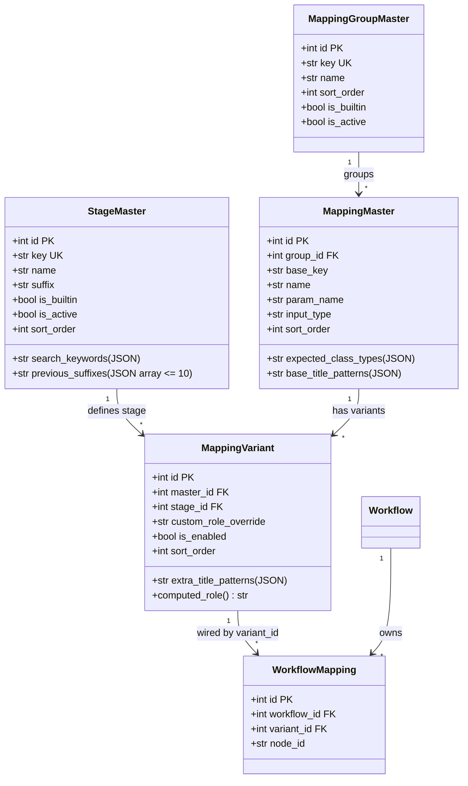

# REQ-336: Prompt Surgeon ワークフローマッピング新アーキテクチャ統合 詳細設計書

## 1. 概要とアーキテクチャ設計 (Architecture Overview)

### 1.1 背景と課題
現行のワークフローマッピングは、「1つの物理ノード入力 ＝ 1つのマスタレコード」というフラット構造（`mapping_master`）を採用しており、同一パラメータ（steps, cfg, プロンプト等）がステージ（Rough, Detail, Mainなど）ごとに個別行として重複定義されています。
このため、以下の構造的課題が発生しています：
1. **マスタの肥大化と保守困難性**: 1つのワークフローで30〜50件超のマスタ行が並び、クラス型や引数の変更時に各ステージの行を個別に修正する手間が生じる。
2. **未知のワークフローへの対応限界**: 3段以上の多段階サンプラ、リージョン分割（Region Conditioning）、複数パーツディテイラー等の高度なワークフロー構成に対してコードや固定マスタが縛られており、柔軟に対応できない。
3. **ノード型入力のタイポリスク**: クラス名の手動入力でタイポが発生しやすいため、HTML設計モックに準拠したチップ入力と代表的候補クラスパレット（+ KSampler, + SamplerCustom 等）により手入力を支援する。

### 1.2 コア設計思想：2軸正規化と動的導出
本設計では、「セマンティックロール（普遍的親定義）」×「適用ステージ（ユーザー拡張可能な適用工程マスタ）」の2軸直交正規化を行い、交差エンティティ（`mapping_variants`）で結合します。



---

## 2. データモデル仕様 (Data Models & Schemas)

### 2.1 テーブル定義

#### (1) `mapping_group_masters`
- `id` (PK, Integer, autoincrement)
- `key` (String, nullable=False, unique=True): 大カテゴリキー (`prompt`, `sampler`, `model`, `latent`, `controlnet`, `etc`)
- `name` (String, nullable=False): 表示名 (例: `プロンプト系`, `サンプラー系`)
- `sort_order` (Integer, default=0)
- `is_builtin` (Boolean, default=False): システム既定保護フラグ
- `is_active` (Boolean, default=True): 論理表示フラグ

#### (2) `stage_masters`
- `id` (PK, Integer, autoincrement)
- `key` (String, nullable=False, unique=True): ステージキー (`main`, `rough`, `detail`, `region`, `custom_xxx`)
- `name` (String, nullable=False): ステージ表示名 (例: `通常 / Main`, `Rough`, `Detail`)
- `suffix` (String, nullable=False, default=""): 接尾辞 (例: `""`, `"_rough"`, `"_detail"`)
- `search_keywords` (Text, nullable=True): ノード自動検出用キーワード (JSON array: `["rough", "draft", "1st"]`)
- `previous_suffixes` (Text, nullable=True): 旧接尾辞履歴 (上限10件のJSON array: `["_rouhg"]`)
- `is_builtin` (Boolean, default=False): システム既定保護フラグ (`main`, `rough`, `detail` 等)
- `is_active` (Boolean, default=True): 論理表示フラグ
- `sort_order` (Integer, default=0)

#### (3) `mapping_masters`
- `id` (PK, Integer, autoincrement)
- `group_id` (Integer, ForeignKey(`mapping_group_masters.id`, ondelete="SET NULL"), nullable=True)
- `base_key` (String, nullable=False): パラメータ普遍キー (例: `steps`, `cfg`, `prompt_positive`, `denoise`)
- `name` (String, nullable=False): 親パラメータ表示名 (例: `Steps`, `CFG Scale`)
- `param_name` (String, nullable=False): ComfyUIノード入力引数名 (例: `steps`, `text`)
- `input_type` (String, nullable=False): 入力UI種別 (`textarea`, `int`, `float`, `select_sampler`, `select_scheduler`, `lora_stack`, `boolean`, `select`)
- `expected_class_types` (Text, nullable=True): 期待ノードクラス (JSON array: `["KSampler", "KSamplerAdvanced"]`)
- `base_title_patterns` (Text, nullable=True): 基本タイトルパターン (JSON array: `["KSampler", "Sampler"]`)
- `sort_order` (Integer, default=0)

#### (4) `mapping_variants`
- `id` (PK, Integer, autoincrement)
- `master_id` (Integer, ForeignKey(`mapping_masters.id`, ondelete="CASCADE"), nullable=False)
- `stage_id` (Integer, ForeignKey(`stage_masters.id`, ondelete="CASCADE"), nullable=False)
- `custom_role_override` (String, nullable=True): 任意オーバーライド値 (未設定時は None)
- `extra_title_patterns` (Text, nullable=True): ステージ固有タイトルパターン (JSON array: `["Rough KSampler"]`)
- `is_enabled` (Boolean, default=True): 有効フラグ
- `sort_order` (Integer, default=0)

#### (5) `workflow_mappings`
- `id` (PK, Integer, autoincrement)
- `workflow_id` (Integer, ForeignKey(`workflows.id`, ondelete="CASCADE"), nullable=False)
- `variant_id` (Integer, ForeignKey(`mapping_variants.id`, ondelete="CASCADE"), nullable=False)
- `node_id` (String, nullable=False): 実ワークフローノード番号 (例: `"3"`, `"877:866"`)

---

## 3. 動的Role導出とライフサイクル仕様 (Derivation & Lifecycle)

### 3.1 動的Role導出 (`computed_role`)
`mapping_variants` にはサフィックス結合後の完成文字列を直接保持せず、単方向の動的プロパティとして導出します：
```python
@property
def computed_role(self) -> str:
    if self.custom_role_override:
        return self.custom_role_override
    suffix = self.stage.suffix if (self.stage and self.stage.suffix) else ""
    return f"{self.master.base_key}{suffix}"
```
- **利点**: `stage_masters` の `suffix` を変更しても、子テーブルの書き換えが不要で O(1) の即時反映。
- **配線保護**: `workflow_mappings` は数値の `variant_id` で結合されているため、Role名やサフィックスの変更で物理配線が切断されません。

### 3.2 マスタ編集時の一括置換（Cascade Rename）と排他制御
ステージの接尾辞（`suffix`）を変更・保存する場合、古いRole名が保存されたDB内データ（プリセット・スナップショット・オーバーライド）を一括置換します。
1. **排他制御**: `with db.begin():` による行ロックを伴う単一トランザクション内で実行。
2. **事前検証プレビュー (`GET /api/stage-masters/{stage_id}/cascade-preview`)**:
   - 変更前の旧接尾辞と新接尾辞から、影響を受けるバリアント一覧を特定。
   - `workflow_presets.param_values` 内の該当キー検出件数と差分プレビューを返却。
   - `snapshots.params` 内の該当キー検出件数と差分プレビューを返却。
3. **トランザクション一括置換 (`POST /api/stage-masters/{stage_id}/cascade-rename`)**:
   - `mapping_variants.custom_role_override` の該当文字列を置換。
   - `workflow_presets.param_values` の JSON 文字列内キー置換 (`"{old_role}":` -> `"{new_role}":`)。
   - `snapshots.params` の JSON 文字列内キー置換。
   - 旧接尾辞を `stage_masters.previous_suffixes` の先頭に記録（最大10件を保持、古いものは自動削除）。

### 3.3 3重削除ガード仕様 (Deletion Guard Policy)
1. **システム既定保護 (`is_builtin == True`)**:
   - 削除操作をHTTP 400で即座に遮断（「システム既定のマスタは削除できません」）。
2. **参照中保護 (`usage_count > 0`)**:
   - 紐づくバリアントまたは配線が存在する場合、削除をHTTP 400でブロック（「現在○件で使用中のため削除できません」）。
3. **論理非表示（アーカイブ / `is_active = False`）**:
   - 削除に代わる安全策として論理非表示を推奨。非活性化時は、紐づくバリアントも連動して配線画面および生成画面から非表示化。
4. **完全物理削除の許可条件**:
   - `is_builtin == False` かつ `usage_count == 0` のユーザー定義カスタムマスタのみ物理削除を許可。

### 3.4 外部PNGメタデータの旧接尾辞履歴フォールバック解決
外部ComfyUI出力PNG画像（DB外）は直接置換できないため、D&D読み込み時に以下の3段階でフォールバック解決します：
1. **直接合致**: 現在の有効バリアントの `computed_role` と完全一致する場合はそのまま採用。
2. **履歴チェーン解決**: `stage_masters.previous_suffixes` に含まれる旧接尾辞（直近10件）と合致する場合、現在の最新 `computed_role` へ自動フォールバック。
3. **グレイスフル解決**: 履歴チェーン外の未知キーの場合、アンダースコア分割により `base_key` を推測し、同一親パラメータのメインバリアントへグレイスフルに解決。

---

## 4. UI/UX設計とアダプティブ・ステージング (Adaptive UI Design)

### 4.1 Settings画面：統合マッピング管理UI
1. **大カテゴリタブ（Group Tabs）**:
   - `mapping_group_masters` をタブとして配置（プロンプト系、サンプラー系、モデル系、等）。
   - タブ切り替えにより該当グループの親マスタのみを絞り込み表示。
2. **統合テーブル（1行集約ビュー）**:
   - 親マスタ行内に、登録されている全ステージのバリアントをバッジ（通常、Rough、Detail、カスタム等）でコンパクトに同居表示。
   - バリアントの有効/無効トグルおよび個別オーバーライド状態を可視化。
3. **統合編集モーダル（MappingMasterEditModal）**:
   - 親の共通設定（表示名、引数名、入力型、期待Class Types、基本検索パターン）と配下の全バリアント設定を1モーダル内で統合編集。
   - 期待Class Typesのチップ式入力（Enter/カンマ）および主要ノード候補パレット（+ PrimitiveStringMultiline, + BasicScheduler, + SamplerCustom, + KSampler, + FaceDetailerPipe, + UltimateSDUpscale 等のワンクリック追加）。
   - ワークフローノードとのリアルタイムマッチング検証ボックスを配置。

### 4.2 ワークフロー配線画面：完全データ駆動型アダプティブ配線UI
1. **全ステージ走査とキーワードマッチング**:
   - ワークフロー全ノードのメタ情報（`_meta.title`, `class_type`）を走査。
   - 登録されている全 `stage_masters` の `search_keywords` と照合。
2. **動的タブ/セクション展開**:
   - 該当ノードが存在するステージ（`count > 0`）およびシステム必須ステージ（`Main`）のみを動的にタブ展開。
   - 該当ノードが0件のステージおよびバリアント未定義の空ステージは自動的に非表示化。
   - 1段サンプラ構成（Mainのみ）、2段サンプラ構成（Rough/Detail）、3段以上のサンプラ構成、リージョン分割ワークフローのいずれであっても、コード変更なしにマスタ定義のみで動的適応。

---

## 5. データベース移行設計 (Migration Step 029)

### 5.1 冪等マイグレーション仕様 (`step_029_workflow_mapping_v2_normalization`)
1. **新テーブル作成**:
   - `mapping_group_masters`, `stage_masters`, `mapping_variants` の作成。
   - `mapping_masters` への `group_id`, `base_key`, `base_title_patterns` カラム追加（既存データ維持）。
   - `workflow_mappings` への `variant_id` カラム追加（既存 `master_id` との並行サポート）。
2. **シードデータの展開**:
   - 既定グループ（Prompt, Sampler, Model, Latent, ControlNet, Other）を投入。
   - 既定ステージ（Main: suffix="", Rough: suffix="_rough", Detail: suffix="_detail"）を投入。
3. **既存データ移行**:
   - 既存 `mapping_master` の `role` をパースし、親 `base_key` とステージを同定。
   - 親レコードを作成し、対応する `stage_id` と紐づく `mapping_variants` レコードを自動生成。
   - 既存 `workflow_mappings` の `master_id` を、新しく生成された `mapping_variants.id` に正確に付け替え。
4. **ロールバック安全策**:
   - 単一トランザクションで実行され、エラー発生時は即座に ROLLBACK。
   - Dry-run検証による件数整合性チェック。

