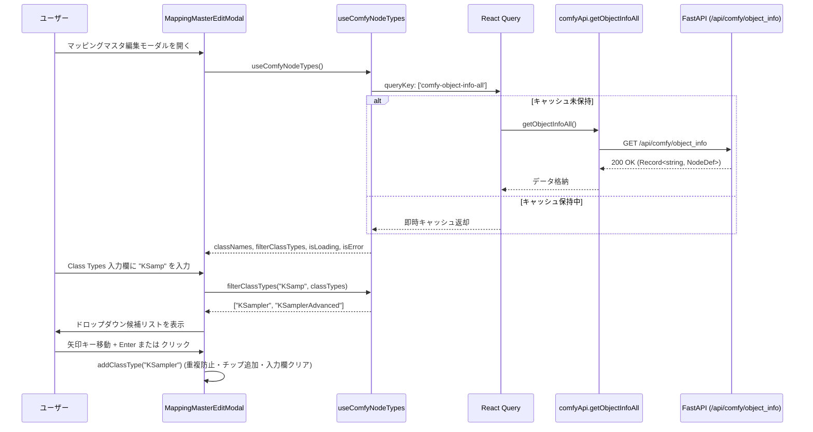

# REQ-337: Prompt Surgeon: ComfyUI /object_info 連動 ClassType 動的オートコンプリート・ノード検索 詳細設計書

## 1. 概要とアーキテクチャ設計 (Architecture Overview)

### 1.1 背景と課題
REQ-336（ワークフローマッピング新アーキテクチャ）において、マッピングマスタ編集時の Class Types 入力は静的候補パレット（`COMMON_CLASS_CANDIDATES`）と手入力で実装された。
しかし、ComfyUI 環境下には多種多様なカスタムノード（AnimateDiff, ControlNet, IPAdapter, Impact Pack等）が存在し、クラス型の手動入力ではタイポが発生しやすく、また利用可能なノードクラスを把握しづらい課題がある。

### 1.2 コア設計方針
1. **APIドメイン層 (`frontend/src/api/domains/comfy.ts`)**:
   - バックエンド `/api/comfy/object_info` (全ノード取得) は既存実装済み（インメモリキャッシュ対応）。
   - フロントエンド API クライアントとして `comfyApi.getObjectInfoAll()` を提供。
   - `frontend/src/api/client.ts` から `comfyApi` を再エクスポート。
2. **カスタムフック層 (`frontend/src/hooks/useComfyNodeTypes.ts`)**:
   - React Query (`useQuery`) を用いて全ノード定義を取得。
   - セッションキャッシュ (`staleTime: 10 * 60 * 1000`, `gcTime: 30 * 60 * 1000`) を設定。
   - 取得データから利用可能な全 `class_type` のキー一覧を抽出しアルファベット順にソートして保持。
   - インクリメンタル検索関数 `filterClassTypes(query: string, exclude?: string[]): string[]` を提供。
     - 大文字小文字不問（case-insensitive）。
     - 前方一致（prefix match）を最優先、部分一致（contains match）を次点にソート。
     - 既存選択済みクラス（exclude）を除外。
     - ドロップダウン描画負荷を抑制するため最大15件に制限。
   - ComfyUI 未接続・503・ネットワーク切断時でもエラーを画面全体に伝播させず、`isError: true`, `classNames: []` を安全に返却するノンブロッキング・グレイスフル設計。
3. **UIコンポーネント層 (`frontend/src/components/MappingMasterEditModal.tsx`)**:
   - Class Types 入力欄に動的オートコンプリート・ドロップダウンを統合。
   - ユーザー入力が 1 文字以上かつ候補が存在する場合にフローティング候補リストを表示。
   - キーボード操作を完全サポート:
     - `ArrowDown` / `ArrowUp`: 候補リストのフォーカス移動。
     - `Enter` / `Tab`: フォーカス中候補を選択確定（未フォーカス時は入力中文字列を確定）。
     - `Escape`: ドロップダウンを閉じる。
   - マウスクリックでの選択追加をサポート。
   - 既存の自由手入力（カンマ区切り含む）および静的候補パレット（`COMMON_CLASS_CANDIDATES`）と完全共存。
   - クラス型の重複登録防止（既にチップとして存在する場合は二重追加しない）。

---

## 2. コンポーネントおよびデータフロー



---

## 3. 型定義とインターフェース

### 3.1 ComfyObjectInfo
`frontend/src/api/types.ts`:
```typescript
export type ComfyObjectInfo = Record<string, {
  input?: {
    required?: Record<string, [unknown, Record<string, unknown>]>
    optional?: Record<string, [unknown, Record<string, unknown>]>
  }
}>
```

### 3.2 useComfyNodeTypes
```typescript
export interface UseComfyNodeTypesResult {
  classNames: string[]
  isLoading: boolean
  isError: boolean
  filterClassTypes: (query: string, exclude?: string[]) => string[]
}
```

---

## 4. エラーハンドリングとフォールバック
1. **ComfyUI 未接続・ネットワーク切断**:
   - `useComfyNodeTypes` のクエリは `retry: false` を設定。
   - エラー発生時は `classNames: []` となり、ドロップダウンは非表示となるが、通常の手入力および静的候補パレットからの追加は完全に動作を維持。
2. **大文字小文字不問と前方一致優先**:
   - 入力クエリ小文字化と候補クラス名の小文字化で比較。
   - 前方一致リストと部分一致（前方一致除く）リストを結合して最大15件を返却。