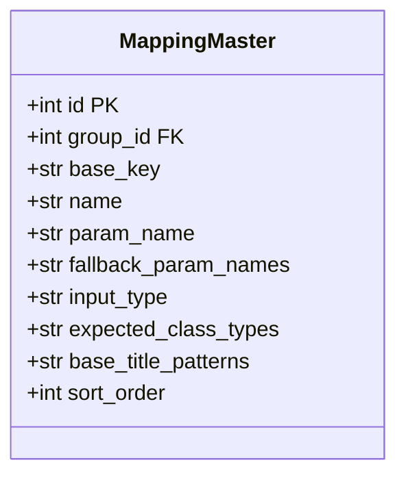
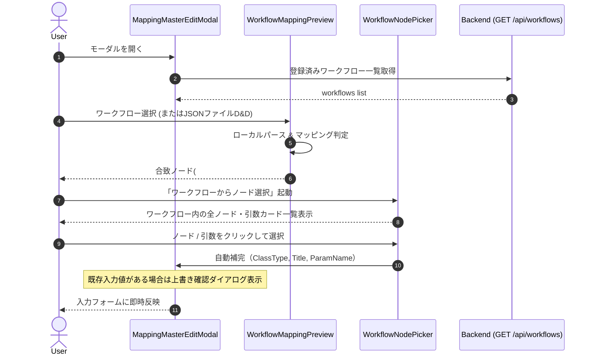

# REQ-340: Prompt Surgeon: Settingsマッピングマスタ編集のUX強化 詳細設計書

## 1. 概要とアーキテクチャ設計 (Architecture Overview)

### 1.1 背景と課題
REQ-336にてワークフローマッピングの2軸正規化（MappingMaster × StageMaster = MappingVariant）と動的Role導出が導入され、REQ-337にてComfyUI /object_info と連動したノードクラスのオートコンプリートが実装された。
しかし、実際の設定運用において以下の運用上のフリクションが残存していた：
1. **パターンの重複入力とタイポ修正コスト**: 類似の役割を持つロール間でタイトル検索パターンをコピペできず、タイポ修正時にはチップの削除→再入力が必要。
2. **パラメータ名の表記ゆれ（seed vs noise_seed等）**: カスタムノードやモデル種別によってパラメータ名が異なる場合、単一の param_name ではマッチングが失敗し、ロールの重複定義が必要。
3. **プレビュー対象の不透明さ**: 「リアルタイム合致プレビュー」が静的な定義値の表示にとどまり、実際のワークフローノードに対してどのようにマッチングされるかが確認できない。
4. **手動入力負荷**: ユーザーがComfyUIワークフローの各ノードのクラス名や入力パラメータ名を手動で確認して手打ち入力する必要がある。

### 1.2 設計ゴール
- **チップ操作性の刷新**: タイトル検索パターンのクリップボード連携（一括コピー／カンマ・改行・空白区切りの一括ペースト）およびダブルクリック／編集ボタンによるインライン編集。
- **パラメータ表記ゆれのフォールバック解決**: MappingMasterに優先順位付きの表記ゆれ配列（fallback_param_names）を追加し、プライマリ名で見つからない場合に順次フォールバック探索。
- **コンテキスト連動リアルタイムプレビュー**: 登録済みワークフロー（GET /api/workflows）またはドロップ／貼付されたワークフローJSONを対象として、現在のマッピング設定による合致状況（ノードID、タイトル、バインドパラメータ）を即座にシミュレーション表示。
- **逆引きノード登録（Node Picker）**: 渡されたワークフローの全ノードと入力引数を可視化し、ユーザーが選択したノード・引数をマッピング設定へワンクリックで自動転記（既存入力値がある場合は上書き確認を挟む安全設計）。

---

## 2. データモデルとDBスキーマ設計 (Backend/DB)

### 2.1 MappingMaster スキーマ拡張
mapping_masters テーブルに fallback_param_names（JSON配列文字列）カラムを追加する。



- **カラム仕様**:
  - fallback_param_names: TEXT (SQLite / PostgreSQL)。
  - 格納形式: JSON配列（例: ["noise_seed", "random_seed"]）。
  - デフォルト値: NULL または空配列 "[]"。
  - マイグレーション: backend/app/migrations/steps.py に ALTER TABLE mapping_masters ADD COLUMN fallback_param_names TEXT を追加（既存DBに対する冪等保証）。

### 2.2 Pydantic スキーマ
```python
# backend/app/routers/mapping_masters.py & backend/app/schemas/workflow.py
class MappingMasterV2Read(BaseModel):
    ...
    fallback_param_names: Optional[list[str]] = None

class MappingMasterUpdate(BaseModel):
    ...
    fallback_param_names: Optional[list[str]] = None

class MappingMasterCreatePayload(BaseModel):
    ...
    fallback_param_names: Optional[list[str]] = None
```

### 2.3 Workflow Scanner におけるフォールバック解決ロジック
backend/app/services/workflow_scanner.py:
1. ノード探索時、master.param_name（プライマリ）を最優先として候補を評価。
2. ノードの inputs 内にプライマリ名が存在しない場合、fallback_param_names をインデックス順（0, 1, 2...）に走査し、最初に合致した引数名をバインド対象として採用。
3. プレビュー結果および警告オブジェクトに matched_param_name および is_fallback: bool を付与して返却。

---

## 3. フロントエンド設計 (Frontend Architecture)

### 3.1 コンポーネント構成
```
frontend/src/components/
  MappingMasterEditModal.tsx          -- モーダル親コンポーネント（状態管理・保存）
  PatternTagInput.tsx                 -- タイトル検索パターン用（コピペ・インライン編集・チップ管理）
  FallbackParamsInput.tsx             -- 表記ゆれパラメータ名用（チップ・並び替え・追加削除）
  WorkflowMappingPreview.tsx          -- コンテキスト連動プレビュー（WF選択/JSONドロップ、合致ノード表示）
  WorkflowNodePicker.tsx              -- ワークフロー逆引きノードエクスプローラ（ノード選択・自動補完）
```

### 3.2 パターンチップ操作フロー (PatternTagInput)
- **コピー**: 「パターンをコピー」操作で titlePatterns.join(', ') を Clipboard API に書き込み。不可時はテキストエリアを開く。
- **貼り付け**: クリップボードまたは入力欄からのペーストイベントを捕捉。カンマ・改行・タブ・空白で分割し、ダブルクォート除去・トリム・空文字除外・重複排除した上で現在のチップリストにマージ。
- **インライン編集**: チップのダブルクリックまたは編集アイコン押下で当該チップのみ input に切替。
  - Enter / Blur: 空白でなければ更新。空文字なら削除。
  - Escape: 編集破棄して元に戻す。

### 3.3 ワークフロープレビュー & 逆引き登録 (WorkflowMappingPreview / NodePicker)


---

## 4. 安全性・エッジケース対応 (Defensive Engineering)

1. **JSONバリデーション & サイズ制限**:
   - ユーザーから提供されるワークフローJSONは最大10MBに制限。
   - 構文エラー（JSON.parse 失敗）およびセマンティックエラー（nodes 配列や辞書の欠落）を検出し、UIクラッシュを起こさずにトーストまたはインラインアラートを表示。
2. **非破壊的自動補完 (Non-destructive Overwrite Guard)**:
   - 逆引きノード選択時、すでにフォームに手動入力された値がある場合は「既存の設定（クラス名・パラメータ名）を上書きしますか？」の確認ダイアログを提示。
3. **ドラフトのメモリ分離**:
   - モーダル内の全編集（インライン編集、チップ追加削除、逆引き反映）はReactローカルステートで保持され、「マスターを保存」ボタンが押下されたタイミングでのみAPIへ送信。キャンセル時は破棄される。

---

## 5. Trade-off Disclosure (技術的トレードオフ)

1. **プレビュー判定の実行場所 (Frontend vs Backend)**:
   - **採用**: フロントエンド側でのローカルパース・マッピング判定エンジン。
   - **メリット**: ワークフローJSONのドラッグ＆ドロップ時にバックエンド通信不要（ゼロレイテンシ）、ComfyUI停止中やオフライン環境でも完全動作。
   - **トレードオフ**: バックエンドの workflow_scanner.py とフロントエンドの判定ロジックが二重化するリスクがあるため、判定ルール（ClassType一致、Title正規化、ParamName優先順走査）を共通仕様として厳格に同期する。
2. **フォールバックパラメータ名のDB格納形式**:
   - **採用**: mapping_masters 内の JSON 配列文字列カラム (TEXT)。
   - **メリット**: 新規テーブル増設（交差テーブル）を避け、シンプルなマイグレーションとCRUDで完結。
   - **トレードオフ**: 個別パラメータ名単位でのDBインデックス検索は行わないが、マッピングマスタの件数は数十件程度であるためパフォーマンス上の問題は皆無。
