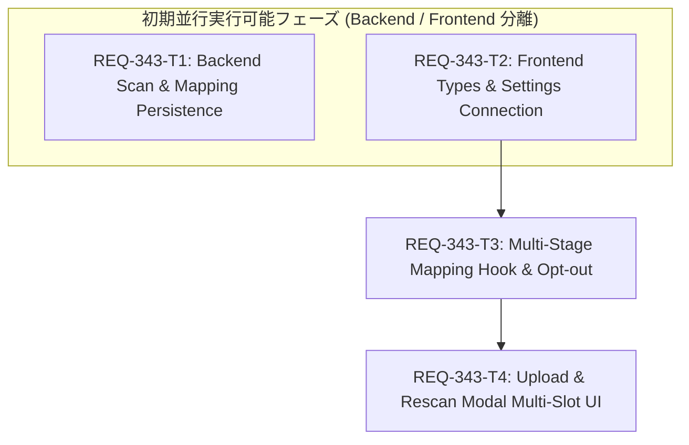

# Implementation Plan: REQ-343 ワークフローマッピング画面のRole×ステージ多段階対応および未設定選択のUI/データ整合

## 1. Executive Summary (概要)
本計画は、REQ-336で導入されたRole×Stageの2軸マッピングアーキテクチャに基づき、ワークフロー取り込み（`UploadWorkflowModal`）、再スキャン（`RescanModal`）、および配線設定画面（`WorkflowConnectionSection`）において、有効ステージ別のノード選択スロット展開、不要な組み合わせの安全な「未設定」オプトアウト、およびバックエンドにおける `variant_id` 永続化と `/api/workflows/scan` のバリアント検出対応を実現する実装計画である。

---

## 2. Proposed Changes

#### [LOCAL MODIFY] [backend/app/schemas/workflow.py](file:///c:/Users/audih/ws/comfy-create-helper2/backend/app/schemas/workflow.py)
- `ScanMatchedItem` および `ScanWarningItem` に `variant_id?: int`, `stage_id?: int`, `stage_key?: str` を追加。
- `WorkflowMappingCreate` および `WorkflowMappingRead` に `variant_id?: int` を追加。

#### [LOCAL MODIFY] [backend/app/routers/workflows.py](file:///c:/Users/audih/ws/comfy-create-helper2/backend/app/routers/workflows.py)
- `scan_workflow_json`: `MappingVariant` を取得し `scan_workflow_variants` を実行（バリアント不在時は `scan_workflow` にフォールバック）。
- `create_workflow`, `update_workflow`, `copy_workflow`, `rollback_workflow`: `WorkflowMapping.variant_id` を正しくDB永続化および復元。
- `get_workflow`: `variant_id` およびバリアント由来の `computed_role` を `WorkflowMappingRead` に反映。

#### [LOCAL NEW] [backend/tests/test_req343_workflow_variant_scan.py](file:///c:/Users/audih/ws/comfy-create-helper2/backend/tests/test_req343_workflow_variant_scan.py)
- `/api/workflows/scan` のバリアント別マッチング検証テスト。
- ワークフロー作成・更新における `variant_id` 永続化と取得の結合テスト。

#### [LOCAL MODIFY] [frontend/src/api/types.ts](file:///c:/Users/audih/ws/comfy-create-helper2/frontend/src/api/types.ts)
- `WorkflowMapping`, `WorkflowCreate`, `WorkflowUpdate`, `ScanMatchedItem`, `ScanWarningItem` に `variant_id` を追加。

#### [LOCAL MODIFY] [frontend/src/pages/SettingsPage/components/WorkflowConnectionSection.tsx](file:///c:/Users/audih/ws/comfy-create-helper2/frontend/src/pages/SettingsPage/components/WorkflowConnectionSection.tsx)
- `validateConfig`: 重複判定を `uniqueKey = m.variant_id ? `${m.master_id}_${m.variant_id}` : `${m.master_id}`` に改修し、同一 `master_id` の複数バリアント共存を許容。
- `handleSaveLinks`, `setConfigMappings`: `variant_id` を維持して保存・反映。
- 設定JSONエクスポート/インポート時の `variant_id` 保持。

#### [LOCAL NEW] [frontend/src/pages/SettingsPage/components/__tests__/WorkflowConnectionSection.config.test.ts](file:///c:/Users/audih/ws/comfy-create-helper2/frontend/src/pages/SettingsPage/components/__tests__/WorkflowConnectionSection.config.test.ts)
- 同一 `master_id` の複数バリアント共存および重複遮断のバリデーションテスト。

#### [LOCAL MODIFY] [frontend/src/hooks/useMasterMappingRows.ts](file:///c:/Users/audih/ws/comfy-create-helper2/frontend/src/hooks/useMasterMappingRows.ts)
- `MasterMappingRow` に `stageSlots?: StageSlotItem[]` を追加し、Role×Stageの複数スロット状態管理をサポート。
- `updateSlotNodeId(slotKey, node_id)` および `clearSlot(slotKey)` を提供。
- `getMappings`: 未設定（空文字）のスロットを除外して `{ master_id, node_id, variant_id }` を生成。

#### [LOCAL MODIFY] [frontend/src/hooks/__tests__/useMasterMappingRows.test.ts](file:///c:/Users/audih/ws/comfy-create-helper2/frontend/src/hooks/__tests__/useMasterMappingRows.test.ts)
- 多段階スロット展開、クリア操作による未設定化、未設定除外の保存マッピング生成テスト。

#### [LOCAL MODIFY] [frontend/src/components/UploadWorkflowModal.tsx](file:///c:/Users/audih/ws/comfy-create-helper2/frontend/src/components/UploadWorkflowModal.tsx)
- Roleカード内でアクティブステージごとのサブスロット（ステージバッジ、ドロップダウン、クリアボタン✕）をレンダリング。
- 先頭に「未設定」選択肢を配置、★推奨ノードの優先表示。

#### [LOCAL MODIFY] [frontend/src/components/RescanModal.tsx](file:///c:/Users/audih/ws/comfy-create-helper2/frontend/src/components/RescanModal.tsx)
- 再スキャン結果に基づき、各Roleの有効ステージスロットを展開。
- 不要な組み合わせのクリア操作および未設定のまま安全に更新保存。

#### [LOCAL NEW] [frontend/src/components/__tests__/WorkflowModalMultiStage.test.tsx](file:///c:/Users/audih/ws/comfy-create-helper2/frontend/src/components/__tests__/WorkflowModalMultiStage.test.tsx)
- モーダルにおける多段階スロット表示と未設定オプトアウトのUIテスト。

---

## 3. Task Dependency Graph & Parallelism (タスク依存関係・並行設計)



| タスクID | 概要 | 変更ファイル数 | サブシステム | 依存関係 | 並行実行可能性 |
| :--- | :--- | :--- | :--- | :--- | :--- |
| **REQ-343-T1** | バックエンド /api/workflows/scan バリアント対応 & 永続化改修 | 3 | Backend | なし (Root) | **T2 と完全並行可能** |
| **REQ-343-T2** | フロントエンド型定義 & 設定画面バリアント配線整合 | 3 | Frontend | なし (Root) | **T1 と完全並行可能** |
| **REQ-343-T3** | マッピングフック（useMasterMappingRows）多段階 & 未設定対応 | 2 | Frontend | T2 | 単独実行 |
| **REQ-343-T4** | 取り込み・再スキャンモーダル多段階UI & クリア操作実装 | 3 | Frontend | T3 | 単独実行 |

---

## 4. Trade-off Disclosure

1. **多段階スロット表示によるモーダル縦長化と情報密度**:
   - *メリット*: 同一Roleに対して複数ステージ（Main, Rough, Detail等）のノードを同一画面で直感的に割り当て・解除可能。
   - *トレードオフ*: ステージ数が多いワークフローではモーダルのスクロール量が増加する。これに対し、Roleカードをコンパクトに設計し、各ステージをバッジ＋スリムセレクトボックスとして横並び・サブ行配置することで縦方向の肥大化を抑制。
2. **未設定（オプトアウト）項目の除外保存アプローチ**:
   - *メリット*: 空文字（未設定）の項目を `WorkflowMapping` テーブルにダミー保存せず除外することで、DB容量の浪費を防ぎ、実行時（`workflowParamInjector`）にも不要な上書き処理が発生しない。
   - *トレードオフ*: 「ユーザーが意図して未設定にしたのか、スキャンで検出されなかったのか」の区別はDB上は同じ「未割り当て」となるが、UI上は「未設定」と表示され意図通りの動作となるため整合性は保たれる。
3. **バックエンド /api/workflows/scan の後方互換性**:
   - *メリット*: `MappingVariant` が未定義の古い環境や移行前のDBでも、`scan_workflow` にフォールバックするため既存ワークフローの登録が一切壊れない。
   - *トレードオフ*: フォールバック時は `variant_id` がレスポンスに含まれないため、マスタ単一選択として機能するが、段階的マイグレーションとして最も安全。

---

## 5. Verification Plan (3-Gate 検証計画)

### Gate 1: 静的型チェック (Typecheck Baseline)
```bash
cd frontend; npm run typecheck
mypy backend
```
- 期待値: 0 errors

### Gate 2: ユニット＆結合テスト (Unit / Full Suite Baseline)
```bash
# Backend ユニットテスト
backend\.venv\Scripts\python -m pytest backend/tests/test_req343_workflow_variant_scan.py

# Frontend ユニットテスト
cd frontend; npx vitest run src/hooks/__tests__/useMasterMappingRows.test.ts
cd frontend; npx vitest run src/pages/SettingsPage/components/__tests__/WorkflowConnectionSection.config.test.ts
cd frontend; npx vitest run src/components/__tests__/WorkflowModalMultiStage.test.tsx

# Full Suite ベースライン
backend\.venv\Scripts\python -m pytest
cd frontend; npm test
```
- 期待値: 全テスト PASS (Exit code 0)

### Gate 3: シナリオ＆Red Teaming (AC 100% 準拠)
- **AC-1 (Role×有効ステージの複数ノードマッピング)**: Main/Rough を含むワークフローで、各Roleにステージ別スロットが表示され、異なるノードを選択して登録・保存できることを検証。
- **AC-2 (不要な組み合わせの未設定化)**: 特定ステージのスロットを「未設定」またはクリアボタンで解除した際、保存時にエラーとならず、未設定項目を除外して正常に登録されることを検証。
- **AC-3 (バリアント単位の配線保存と重複master_id許容)**: 設定画面で同一master_idを持つ複数バリアントを保存・JSONエクスポート/インポートしても重複エラーが発生しないことを検証。
- **AC-4 (バックエンドスキャンのステージバリアント対応)**: `/api/workflows/scan` でステージキーワードに合致するノードが variant_id, stage_key 付きで返却されることを検証。
- **Red Teaming (異常系)**:
  - 全スロット未設定（マッピング0件）保存時のクラッシュ耐性。
  - 不正なJSONスキャン時のエラーフォールバック耐性。
  - 旧形式（variant_idなし）設定JSONインポートの下位互換性。

