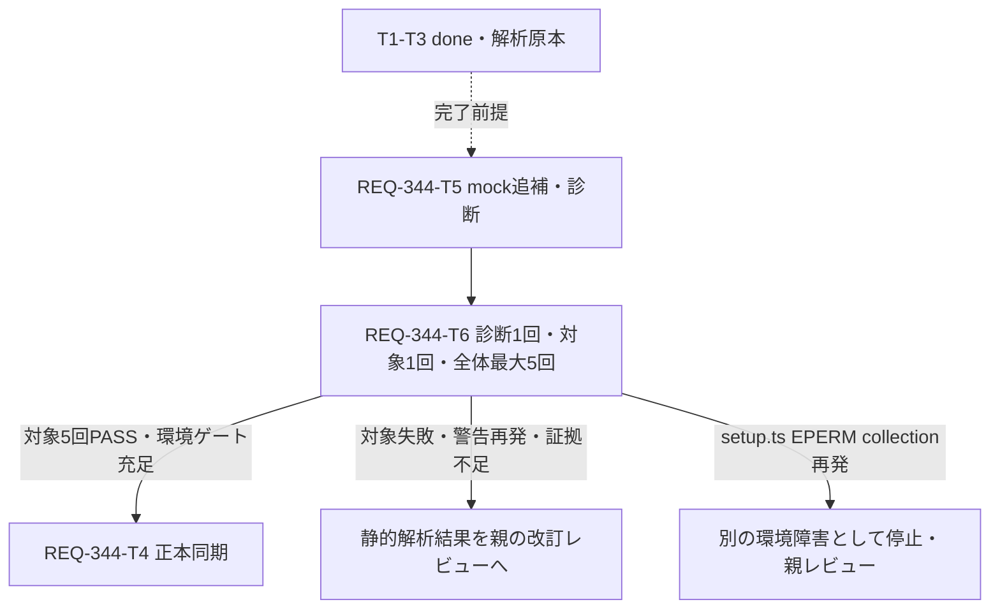

# REQ-344: 静的解析に基づくgetComfyModels mock追補設計

## Requirement and Current Evidence

2026-10-13改訂。AC-1は同じ実装・既定npm testの連続5回でGeneratePage.test.tsxの全ケースPASS。診断runや単独runは受入5回に数えない。

T1/T2の修正、T3静的解析はTaskとしてdoneだが、T2対象検証は人手停止でexit1、PASSと認定しない。T1の13/13 PASSは親提供証拠で、T2以後の成功へ転用しない。既定5回は未完了。T3の [解析報告](REQ-344-static-analysis.md) を原本として保持する。

具体的な候補はtest:54のlorasApi mockにgetComfyModelsがないこと。beforeEach:165でもlistだけが復元されている。LoraStackEditor:16-20、LoraFormFields:49-52、ProfileBulkEditModal/index:30-34は同じkey ['comfy-lora-models'] にqueryFn: lorasApi.getComfyModelsを渡す。mock下の参照がundefinedとなる静的候補は強く支持されるが、No queryFnの生stack・発火observer・歴史的flakyとの因果は未確定。

別の全体実行ではsetup.ts realpath EPERMによるcollection不能が親から報告されている。これは別の環境障害として記録する。警告やworkflow disabledの原因とは結び付けない。

## Boundary and SSoT

workspace rootはC:/Users/audih/ws/comfy-create-helper2。編集は今回も対象テストとdocsに限定する。API、製品component、hook、store、vite.config、setup.tsを変更しない。製品APIの型はlorasApi.getComfyModels: () => Promise<ComfyLoraModel[]>。既定応答[]はこの型の有効な空結果で、実ネットワークを使わない。

上流はPBI/既存Generate仕様、T1/T2実装、T3解析、getComfyModels API契約。下流は3observerのqueryFn、REQ-161のDesktop/Mobile、対象全ケース、既定全体検証、T4正本同期。doc_mapperによるPBI/GeneratePage指定は一致なし、限定検索でSPEC_GENERATEを特定したという初回分析を維持する。API/schema変更なしのためopenapi_parser不要。

旧設計/計画/検証手順全文はREQ-344-design-pre-followup-snapshot.md、REQ-344-plan-pre-followup-snapshot.md、REQ-344-test-plan-pre-followup-snapshot.mdに保持する。T1-T3カードと解析報告は書き換えない。既存の初期候補修正を繰り返さない。

## Follow-up Fix (T5)

factoryのlorasApiに getComfyModels: vi.fn().mockResolvedValue([]) を一度追加し、vi.resetAllMocks後のbeforeEachで同メソッドをmockResolvedValue([])へ戻す。T1/T2のfixture、非同期待機、assertionを維持する。componentのqueryFnやenabledを変えず、warningを抑制して通す変更をしない。

最小の診断を同じテストファイルへ追加する。import.meta.env.VITE_REQ344_QUERY_DIAGNOSTICS === '1' のときだけ有効とし、通常対象runと既定npm testでは無効。console.warn/errorをpass-throughで監視し、No queryFn/Missing queryFnの件数を数える。最初の該当warningの時点と、診断対象各caseのcleanup前に次を記録する:
- case名、時点、key ['comfy-lora-models']、queryの有無。
- Query.options.queryFnのtypeof、API mockとの参照一致、getObserversCount()。
- state.status/fetchStatus、mock呼出件数、warning件数。

cacheがない、unmount後でobserver数0ならその値を記録する。getObserversCountは総数であり、3箇所のうちどれがmountしたかや個別observerのoptionsを証明しない。3consumerの静的位置とenabled条件は報告に別記する。private observersへアクセスしない。

診断記録はwarning最初の1件＋対象2caseのcleanup前＋suite終了summaryの最大4行を目安とする。console本来のwarning/errorは抑制しない。診断が不足した場合は未確定として返し、ログを取るまで繰り返さない。

## Bounded Validation (T6)

この追補で明示するrunだけを行う:
1. typecheckを1回。
2. VITE_REQ344_QUERY_DIAGNOSTICS=1でREQ-161のworkflow load state Desktop/Mobileをfocused実行1回。wall上限120秒、既定case timeoutを維持。warning消失、queryFn型/参照、key/observer総数を記録。
3. focusedが正常完了・全2case PASS、No queryFn/Missing queryFnが0、必要なquery evidenceが揃う場合だけ、診断envを解除して対象ファイル全ケースを1回。wall上限120秒、timeout/worker数/retryを変更しない。
4. 対象全ケースが正常完了・全PASS・未処理例外なしなら、同じ実装/既定条件でnpm testを最大5回の受入1バッチ。

これは静的解析後の人の設計レビューで計画した単発診断と単発対象検証であり、前回中断runの再試行を自動化しない。失敗/120秒超過/証拠不足なら終了し、追補結果を親へ返す。wall停止をテストのPASS/通常完了として扱わない。対象がまだ失敗する場合はread-only静的解析と改訂レビューへ戻す。

全体各runのwall上限は600秒。既定npm test自体の設定は変更せず、coordinatorが外側で期限を監視する。期限超過なら保存/停止してINCONCLUSIVE、受入未達。setup.ts EPERM/realpath collection failureが再発した場合は、たとえ対象のPASS行があっても環境ゲート未充足としてバッチを停止する。例外種別/対象path/collection状況を記録し環境のread-only調査・親レビューへ返す。ACL、cache、setup、実行権限、worker設定をこの追補で変更しない。修復後の再試行は新しいレビュー済み計画が必要。

対象FAIL/timeout、No queryFn再発、対象との関係が不明な未処理例外、出力不足も停止条件。別ファイルだけの既存test assertion FAILは別記し、collection正常・対象結果が明確なら5回観測を続けられる。ただし全体Gate失敗と対象AC観測を分け、T4の成功完了は親の判断まで保留する。

## Diagnostics and Closure Outputs

T6はREQ-344-followup-validation.mdに、run識別/実装SHA256/日時/終了code/停止理由、focused2case、警告件数、cache/queryFn/observer evidenceと未観測項目、単独全件、全体5回またはNOT-RUN表、EPERM分類を保存する。生ログはfollowup-diagnostic.log、followup-target.log、followup-suite-N.log。JSONはfollowup-suite-results.json。過去ログと解析報告を上書きしない。

warning消失とqueryFnがfunctionになった観測はmock欠落候補を支持するが、歴史的flakyの根因確定とはしない。受入5回PASS・追加修正不要の親判断後にT4でSPEC_GENERATEとverificationを同期する。警告を記録しない通常runでもログに警告が残れば失敗扱いで戻す。

## Task DAG and Atomicity

| Task | 状態 | 対象ファイル数 / 変更行予算 | 依存 |
|---|---|---|---|
| T1/T2/T3 | done（過去の証拠、受入PASSとは別） | 既存記録維持 | 既存履歴維持 |
| T5 mock追補＋env限定診断 | ready、設計承認待ち | 1 / 140以下 | 完了T3 |
| T6 単発診断・対象検証・受入バッチ記録 | ready、ゲート待ち | report 1 / 180以下（生ログ別） | T5 |
| T4 正本同期 | ready、ゲート待ち | 2 / 100以下 | T6＋対象5回PASS・環境ゲート充足 |

未完了Task DAGは3層。完了済みT1-T3は履歴として扱い再dispatchしない。各カード300行以内。

## Trade-offs and Risks

空のgetComfyModels mockはAPI参照欠落を局所修正できるが、実API/モデル選択UIの検証は対象外。診断envは通常runへの負荷を減らせる一方、warning時点とcase終了時点を区別する必要がある。console監視をruntime原因の証明にしない。120/600秒は外側の停止上限であり、case timeout延長ではない。5回PASSは観測条件で、将来flakyゼロを保証しない。EPERMでcollect不能のrunを対象PASSへ数えない。

## Human Review and Audit

追補T5/T6と更新T4、設計、test plan、implementation_planを新しい人の設計レビューへ返す。承認前にこの追補を実装しない。

旧BA監査はqwen/qwen3.5-9b、context32768、reasoning_effort要求none、第1chunkの180秒request timeoutでINCONCLUSIVE（exit1、runtime/推論制御応答は未取得）。直後のunloadはexit0でLM Studio reports no models loadedを確認。全GPUメモリ解放を主張しない。trace/audit log/unload log/exit JSONは保持する。今回追補は人のレビュー用改訂で再監査しない。旧対象ハッシュを現行の監査PASSへ転用しない。
