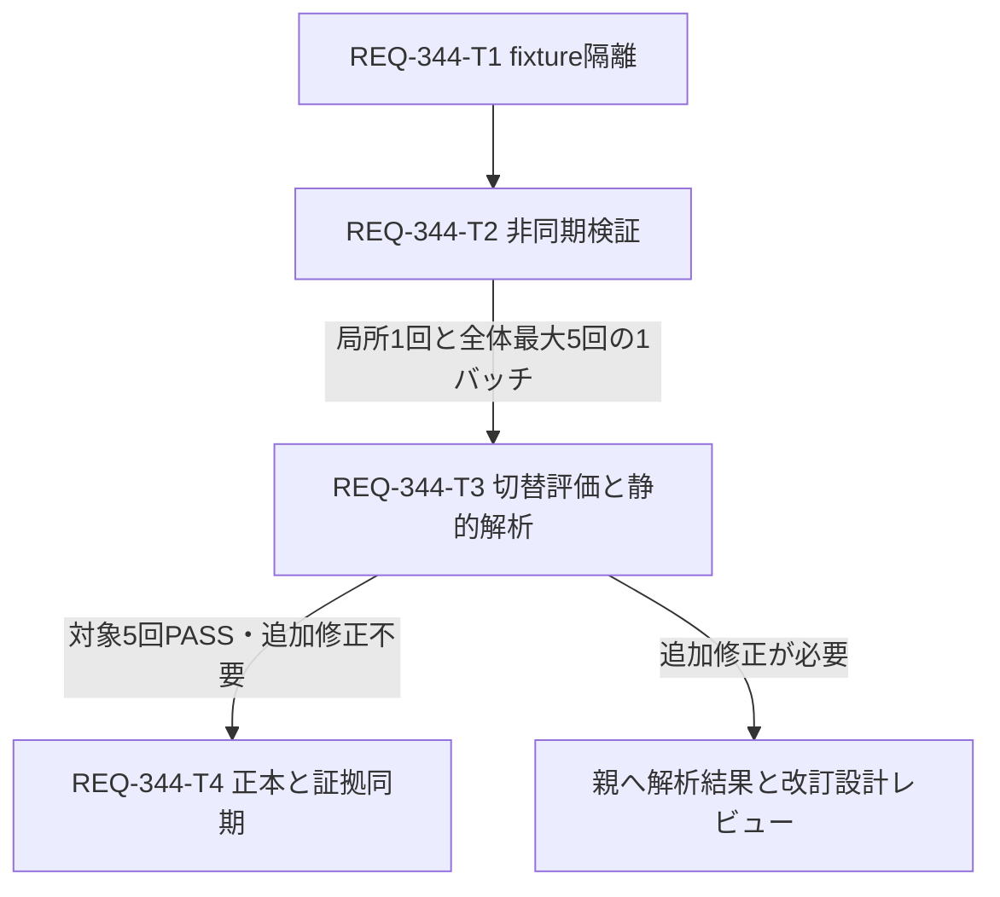

# REQ-344: GeneratePage全体テストの安定化設計

## Requirement and Feasibility

AC-1は、frontendで既定の `npm test` を連続5回実行し、各回で `GeneratePage.test.tsx` の全ケースがPASSすること。Vitest 1.6系、React 18、TanStack Query 5、jsdom、`pool: 'forks'` の現行構成で実現可能と判断する。5回は同じ実装・同じ実行条件の連続した実行とし、失敗回を除外して集計しない。5回の成功は観測期間の安定性を示し、将来のflaky確率ゼロを保証しない。

## Boundary and SSoT Impact

workspace/git rootは `C:/Users/audih/ws/comfy-create-helper2`。frontend、backend、docsはいずれもこの配下。Git_Root_Mismatch=No、外部への編集禁止。設計はfrontendのテストとdocsに限定する。グローバル手順・監査スクリプトは `.agents/context.md` のGLOBAL_SCRIPTSを解決した `C:/Users/audih/.gemini/antigravity/scripts` を使う。

`doc_mapper.py docs/specs docs/backlog/pbi/active/REQ-344.md` とGeneratePage本体の指定は双方とも一致なし。限定した文字列検索から `SPEC_GENERATE.md` を特定した。この正本はレイアウト、workflow依存の生成ボタン、プリセット同期・自動保存の契約を保持する。実装完了時には正本にREQ-344の回帰テスト方針と設計・検証計画リンクを追記する。API契約・schemaを変更しないためopenapi_parserは不要。

上流: PBI、SPEC_GENERATE、vite.config.ts、test/setup.ts、api/client・types、GeneratePage、useWorkflowManagement、usePresetState、usePresetAutoSave、usePresetStoreSync。
下流: Desktop/Mobileの生成ボタン回帰、REQ-186プリセット管理、同期前破壊的autosave防止、全体Vitest、実装完了記録。REQ-343のモーダル改修と切り離せるが、同時に対象テストが変更される場合は現在の差分を維持して再レビューする。

## Evidence and Diagnosis

2026-10-11のPBI記録では、REQ-343を含まない `b9433b7` でも全体実行3回中1回失敗、単独13/13成功。設計段階では再現テストを実行しておらず、原因確定とは扱わない。

現行コードから確認した欠陥候補:

1. `vi.clearAllMocks()` は呼出履歴だけを消し、`workflowPresetsApi.list.mockResolvedValue(...)` や未消費のone-shot mockは次のケースへ残り得る。
2. mock storeはmodule単位の可変objectを共有し、`setState` がin-place変更する。React側のselectorはsnapshotを読むだけで購読しない。ストアの変更や同期がテストに反映されず、autosaveの否定assertionが空振りする可能性がある。
3. QueryClientは毎回新規作成するが、afterEachで明示的なunmount・queryキャンセル・clearを行わない。resizeもcleanupの前後関係を明示していない。
4. `useWorkflowManagement` が呼ぶ `baseModelsApi.list`、`paramTypeMastersApi.list`、`comfyApi.getObjectInfo` がAPI mockから欠落。最後のqueryは本体でretry=3を明示するため、既定retry=falseだけでは未定義APIの再試行を防げない。
5. autosaveの既存ケースは `setTimeout(1200)` を待ち、プロンプト保持の肯定assertionがない。全体実行のCPU競合で実時間待ちが増える候補。
6. Desktop/Mobileのdeferred workflowケースはquery開始を確認せずresolve関数を呼ぶ。固定要素参照より、最終状態のDOMを再取得して待つ方が安全。

T1は変更前の単独実行と全体実行を各1回記録し、失敗テスト名・transform/collect/test時間・CPU競合条件・例外/警告を採取する。再現しなければ「再現なし」と記す。T1/T2を一つの疑わしい箇所への修正案として1回適用し、局所検証1回＋既定全体検証を最大5回の一つの検証バッチで評価する。候補の追加・変更や再実行を繰り返す前にT3の静的解析へ切り替える。

## Detailed Design

### Fixture isolation

変更対象は `frontend/src/pages/__tests__/GeneratePage.test.tsx` のみ。既存API mockを明示的に補完し、毎回 `vi.resetAllMocks()` の後で全APIの既定応答を設定し直す。成功を期待するqueryは全てsettleし、存在しないAPIや実ネットワークへのfallbackを許可しない。`vi.restoreAllMocks()` はafterEachの最後に実行する。履歴だけのclearでは置き換えない。

mock storeは `zustand.create` を使うファイル内fixtureに置き換える。既存の画面用stateとspyを保持し、今回必要な `setSets`、`setActiveSetId`、`setParamValues`、`loadPresetData`、`openPreset`、`removeSet`、`updateActiveSet` は実際にimmutable stateを更新する。型は現行GenerationSet/WorkflowPreset契約に合わせる。毎ケース新しいnested object/arrayを生成して `setState(freshFixture, true)` で初期状態へ戻す。getState/getInitialState/subscribeはZustandの実APIを使い、手作り購読の漏れを避ける。fixture全体の製品store実装を複製せず、対象操作の最小機能に限定する。

QueryClientは `queries: { retry: false, gcTime: Infinity }` と `mutations: { retry: false }` を設定する。各ケースのafterEachは `cleanup()` → `await queryClient.cancelQueries()` → `queryClient.clear()` → fake timer使用時のclear/real timers復元 → storage復元 →innerWidth復元 →spy復元の順。自動RTL cleanupと重なっても安全にする。localStorage/sessionStorageはケース開始時clear、suite開始時の内容を最後に復元し、resize通知は必要なときだけact内で実行する。

### Observable asynchronous boundaries

Desktop/Mobileケースは `deferred<Workflow>()` の `promise/resolve/reject` を持ち、API呼出を `waitFor` で確認してからresolveする。未解決時のdisabled、resolve後のenabledを別々に検証する。最終assertionはIDからDOMを再取得して行う。未解決・rejectの場合は有効化されないことも両レイアウトで確認する。未解決Promiseはcleanupで購読を解除し、不要な解決を行わない。

プリセット画面操作には実timerのfindBy/waitForを使い、要素の存在を必須assertする。既存の `if (closeTabBtn)` は必須の存在確認とclickに変更し、確認対象の操作を省略してPASSしないようにする。

### Bounded timer control and meaningful autosave

1000ms debounceの検証に限ってfake timerを使う。query待機用waitForとfake timerの混在を避け、deferred解決を `act` で制御し、QueryClientのsuccessとstoreの同期内容を明示的に検証する。fake timer区間の通知は `await act(async () => { await vi.advanceTimersByTimeAsync(ms) })` でboundedに進める。`runAllTimers` や任意のsleepは使わない。5000ms pollingは今回の1000/1200msの範囲外に保つ。

同期前はpreset queryを未解決にし、1200msを進めてupdateが0回であることを確認する。resolveした後はtextarea mappingを持つfixtureで `paramValues.positive === 'masterpiece, 1girl'`、画面の対応入力の値、query successを確認し、さらに1200ms進めても空文字保存がないことを検証する。別ケースでは同期後に実store setterでpositiveを変更し、999msでupdateなし、追加1msで1回・非空の正しいpayloadを確認する。これにより否定assertionだけの空振りを防ぐ。製品のdebounce時間や画面ロジックは変更しない。

### Failure handling

既定test timeout、waitFor timeout、並列設定を維持する。GeneratePageの状態hook・Desktop/Mobile・preset panel・autosave本体を偽物に置き換えない。T1/T2の同じ修正案内での明白な型・構文修正は許容するが、別の原因候補を追加する試行や「通るまで」の検証を行わない。

### Bounded Attempt and Static Analysis Fallback

T1/T2適用後、局所検証で対象失敗・未処理非同期例外が残る場合は全体5回へ進まずT3へ移る。局所成功時は全体を最大5回実行し、GeneratePageの失敗・timeout・対象に関連する未処理非同期例外を確認した時点でそのバッチを終了しT3へ移る。停止したバッチはAC-1未達であり、未実行の回をPASSで埋めない。別ファイルだけの失敗は対象失敗と区別し、既定5回の観測を継続できる。

5回全対象PASSでも、変更前の失敗箇所→非同期/共有状態の仕組み→変更で遮断される経路の説明に具体的なコード位置・観測がない場合はT3の静的解析を行う。単独PASS、5回PASS、既知の欠陥候補列挙だけを歴史的flakyの原因確定とは扱わない。T3は全経路で一度評価され、解析不要とする場合にも根拠を記録する。

T3の解析対象は、対象テストと既に特定したGeneratePage、useGeneratePageState、useWorkflowManagement、usePresetState、usePresetAutoSave、usePresetStoreSync、useGenerateDisplayState、DesktopLayout、MobileLayout、store/useGenerationStore・types、vite.config・test/setup。各ファイルのimportから直接関係する依存だけを追加し、追加理由をreportへ記録する。全frontendやnode_modulesを走査しない。

静的解析でPromiseの開始/resolve/reject/awaitとunmount、timerの作成/clear/real↔fake切替、mock default/one-shot/reset、store snapshot/subscribe/setter、query key/enable/retry/poll/gc/取消、閉じたcomponentのimportとmount時副作用を照合する。timer/query/storeの相互作用とReact effect依存による再実行も追跡する。静的にCPU負荷や実際の処理時間を確定しない。

出力は `docs/design/REQ-344-static-analysis.md`。検証バッチと停止条件、ファイル:行の根拠付きライフサイクル表、失敗候補の因果経路、修正済み/残存/否定/未確定の仮説表、最小の次手とその検証案を含む。T3は読取り＋解析文書作成のみで、コード修正や再現試行を追加しない。

解析後は親へ必ず返す。追加修正が必要なら具体的な根拠から設計・カードを改訂して人の設計レビューへ戻す。対象5回PASSで追加修正が不要なら、原因未確定を明示したままT4で結果を記録できる。原因が説明できないことだけを理由に調査ループへ戻らない。target失敗が残る場合はT4の成功完了条件を満たさない。

## Tasks and Atomicity

| Task | 対象ファイル数 | 変更行予算 | 依存 | 判定 |
|---|---:|---:|---|---|
| T1: 診断・fixture/cleanup隔離 | 1 | 280以下 | なし | PASS（計画値） |
| T2: 非同期待機・autosave検証 | 1 | 250以下 | T1 | PASS（計画値） |
| T3: 切替条件評価と静的解析 | 1 | 180以下 | T2＋coordinatorの1バッチ証拠 | PASS（計画値） |
| T4: 正本同期と証拠整理 | 2 | 100以下 | T3＋対象5回PASS＋追加修正不要 | PASS（計画値） |

予算は追加＋削除行数、既存ファイル全体の行数ではない。超える見込みが判明した時点で親に報告し、Task Cardを再分割する。カードは各300行以内。Task DAGは4層。同じテストファイルへの編集と検証結果の順序依存があるため直列とする。検証バッチはT2→T3の実行ゲートであり追加の実装Taskに数えない。

## Trade-offs and Risks

- ファイル内Zustand fixtureは実購読を使える一方、必要なactionの保守が必要。実製品store丸ごとの利用はAPI副作用・persist・他テストへの依存が増えるため採用しない。
- fake timerは1.2秒の実待機を除ける一方、query通知との組合せで停止し得る。利用区間を限定し、bounded advanceとstateの肯定assertionを必要とする。
- 重いimportのmockやテスト分割を初手にすると統合回帰の範囲が変わるため保留する。測定で残存原因が確認された場合は設計改訂する。
- 5回の全体実行には時間とCPU負荷がかかる。既定の実行条件を保持して観測し、他ファイルの既存失敗は別記する。対象が5回PASSしても全体FAILがある場合、AC-1の対象観測と全体Gate失敗を分けて報告し、PBI Doneはcoordinator判断まで保留する。
- 既存13ケースを削除せず必要な境界ケースを追加するため、最終ケース数は13以上になり得る。件数の固定による検証省略を避ける。

## Verification and Design Gate

詳細は [REQ-344-test-plan.md](REQ-344-test-plan.md)。設計段階はテスト未実行。実装・SSoT同期・5回分の証拠記録が揃うまで完了としない。物理生成したT1/T2/T3/T4と改訂設計を人の設計レビューへ返す。

## Local BA Audit

設定モデル `qwen/qwen3.5-9b` のcatalog FOUNDを確認済み。context=32768、reasoning_effort=noneを指定するadapterで、本設計・test plan・T1/T2/T3・implementation_planの全6対象を明示列挙して監査を実行した。

結果はINCONCLUSIVE（exit=1）。入力28659文字は2チャンクに分割されたが、第1チャンクのLM Studio API応答が180秒のrequest timeoutとなり、監査所見を取得できなかった。モデルロード込みの時間は [trace](REQ-344-ba-audit-trace.json) に記録した。runtimeとreasoning制御の応答証拠は未取得のため、検証済みとは扱わない。変更案の監査PASSとは表示しない。

finallyで直後にunloadを実行しexit=0、`LM Studio reports no models loaded` を確認した。全GPUメモリ解放の確認とは扱わない。証拠は [audit log](REQ-344-ba-audit.log)、[unload log](REQ-344-unload.log)、[exit JSON](REQ-344-audit-exits.json)。traceに追記前の全6対象SHA256を保持した。人の設計レビューへ監査未完了を明示して返す。

今回の静的解析フォールバック改訂は上記監査の後に作成した。新T3/T4と改訂文書は再監査していない。旧traceの対象ハッシュを現行改訂の監査証拠として転用しない。監査状態は引き続きINCONCLUSIVE。
