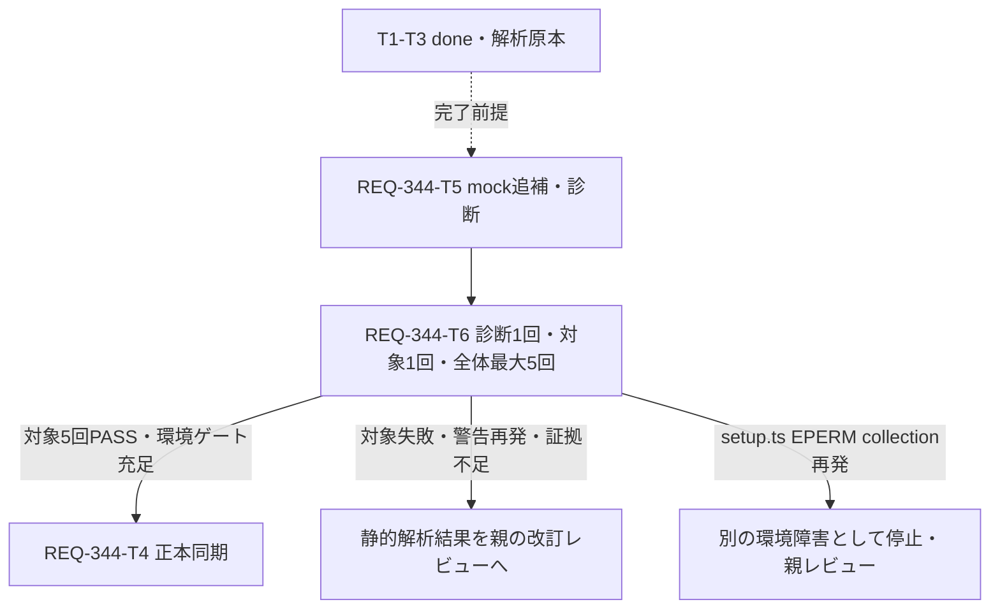

# Implementation Plan — REQ-344 getComfyModels Follow-up

## Current State and Evidence

2026-10-13。T1/T2/T3のTask作業はdone、T2対象検証は人手停止exit1でPASSではない。
[T3静的解析](docs/design/REQ-344-static-analysis.md) はtest:54/beforeEach:165のgetComfyModels欠落を、
同じkey/queryFnを使う3consumerと照合した。強い静的候補でありruntime/歴史的flaky原因は未確定。
全体setup.ts realpath EPERM collection障害は別記する。既定5回の受入は未完了。

新しい人のレビューに向け、[設計](docs/design/REQ-344.md) と
[test plan](docs/design/REQ-344-test-plan.md) を追補する。
旧計画は[pre-followup snapshot](docs/design/REQ-344-plan-pre-followup-snapshot.md)、
旧REQ-347 planは既存snapshotに保持する。T1-T3カード/解析原本を変更しない。

## Follow-up Scope

T5で対象テストのlorasApi factoryとreset後defaultへgetComfyModelsのresolved []を追加する。
VITE_REQ344_QUERY_DIAGNOSTICS=1時だけ、No queryFn/Missing queryFnの件数と
key/query有無/queryFn型・mock参照一致/observer総数/status/fetchStatus/mockCallsを記録する。
warning時点とcase cleanup前を区別し、通常runではenvを解除する。
製品API/component/query条件、既存fixture/assertion/timeout/poolを変更しない。

## Bounded Validation and Failure Gates

T5のtypecheck1回後、T6でfocused load-state Desktop/Mobile診断1回（wall120秒）。
正常完了2case PASS、warning0、必要なquery evidenceが揃えば、診断envを解除して
対象ファイル全ケースを1回（wall120秒）。正常完了/全件PASS/警告・例外なしの場合だけ
既定npm test最大5回の受入1バッチ（各wall600秒）へ進む。
外側で監視して期限で停止し、case timeoutを延長しない。

対象失敗/警告再発/証拠不足/停止時は親へ返し、read-only静的解析と改訂レビューへ。
setup.ts EPERM collectionが再発したら別の環境障害として停止し、target PASS行があっても
環境ゲート未充足とする。raw例外/path/collection状況を保存し、環境read-only調査へ返す。
ACL/cache/setup/権限/worker修正やその場の再試行をしない。
今回の単発診断・単発対象以外のretryは新しいレビュー済み計画が必要。

## Task Cards and Atomicity

| Task | 状態 | 対象/行予算 | 依存 |
|---|---|---|---|
| T1/T2/T3 | done（過去の作業と証拠） | 維持 | 履歴 |
| [T5](docs/backlog/task/active/REQ-344-T5.md) | ready・設計承認待ち | テスト1file / 140以下 | 完了T3 |
| [T6](docs/backlog/task/active/REQ-344-T6.md) | ready・ゲート待ち | 結果文書1file / 180以下、生ログ別 | T5 |
| [T4](docs/backlog/task/active/REQ-344-T4.md) | ready・ゲート待ち | 正本/verification2files / 100以下 | T6＋対象5回PASS・環境ゲート |

未完了DAGは3層、各カード300行以内。完了履歴を再dispatchしない。
同じテストへの編集とその検証結果に依存するため直列とする。

## Dependency DAG

## Deliverables and Acceptance

T6のREQ-344-followup-validation.mdに単発run/実装SHA256/日時/code/停止理由、
診断warning数/query snapshots、対象全件、5回結果/NOT-RUN、EPERM分類を記録する。
生ログ/JSONはfollowup名を使い過去を保持する。AC-1は既定全5回のtarget PASS。
別ファイルのFAILによる全体Gate失敗は別記し、T4の成功完了は親判断まで保留する。
T4は解析/追補結果をリンクしSPEC_GENERATEとverificationを同期する。

## Trade-offs and Risks

[] mockはAPI参照欠落を修正するが実API/モデル選択UIの検証ではない。
observer総数は個別componentのowner証拠ではない。warning消失と根因確定を分ける。
診断env限定で通常runへの影響を減らし、warningは抑制しない。
期限停止/EPERM collectionをflaky再現やPASSへ変換しない。5回成功は将来ゼロ保証ではない。

## Human Review and Audit

追補T5/T6、更新T4と全設計を人のレビューへ返す。承認前に追補実装しない。
旧BA監査はqwen/qwen3.5-9b/context32768/reasoning_effort要求none、
180秒request timeoutでINCONCLUSIVE（exit1）。直後unload exit0でモデル未ロードを確認。
[trace](docs/design/REQ-344-ba-audit-trace.json) とaudit/unload logを保持する。
今回追補は再監査しない。旧対象ハッシュを現行の監査PASSへ転用しない。
