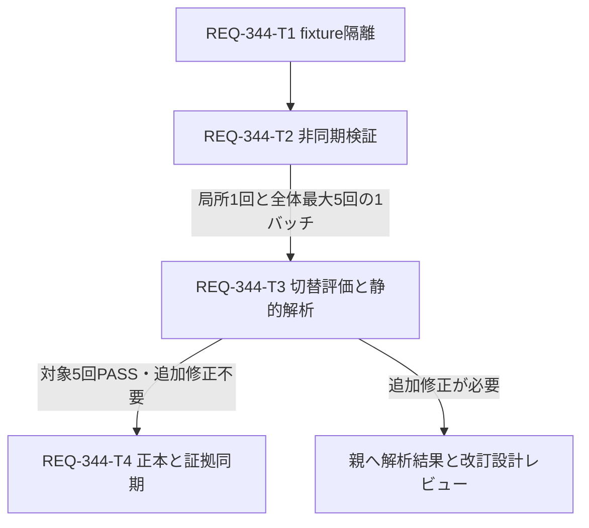

# Implementation Plan — REQ-344 (Bounded Attempt and Static Analysis)

## Executive Summary

GeneratePage.test.tsxの全体実行時のtimeout/disabled判定不安定について、疑わしい箇所の修正を1回試す。その後も失敗が残る、または原因を説明する具体的な証拠が不足する場合は、静的解析へ進む。成功したことだけで根因を確定せず、修正候補とテスト再試行を繰り返さない。

AC-1は同じ実装・既定npm testの連続5回で対象全ケースPASS。[設計](docs/design/REQ-344.md)、[test plan](docs/design/REQ-344-test-plan.md)。旧REQ-347用planは[保存済み全文](docs/design/REQ-344-previous-implementation-plan.md)に保持している。

## Architecture and Initial Attempt

React18/Query5/Vitest1.6/jsdom/forksの既存枠組みを使う。T1/T2を一つの候補修正案として1回適用する。対象はGeneratePage.test.tsxで、API mock実装、実Zustand購読を使うfixture、QueryClientとcleanup、deferredのworkflow待機、autosaveのみのbounded fake timerを整える。

T1の単発中間チェックとT2最終局所検証を各1回行い、最終局所失敗ならT3へ進む。局所成功ならcoordinator/testerが全体最大5回の1バッチで評価する。対象失敗/timeout/対象関連の未処理例外が出た回で停止する。未実行回はNOT-RUNで、AC-1未達を明示する。別ファイルだけの既存FAILは対象と区別する。明白な型/構文修正以外の候補追加と追加再試行はT3より先に行わない。

## Static Analysis Trigger and Outputs

T3は全経路で一度、切替条件を評価する。対象失敗が残る場合、非同期例外と対象との関係が不明な場合、または5回PASSでも失敗→機構→修正による遮断の説明に具体的なコード位置/観測がない場合に静的解析する。5回PASSかつ具体的な説明がある場合は解析不要の根拠を記録する。

対象テスト、GeneratePageの関連hook/layout、store、vite.config/setupのPromise/await、timer/cleanup、mock/reset、store snapshot/購読、query lifecycle、component import/render/effect境界を6分類で照合する。直接関係する依存だけを追加し、全frontendやnode_modulesを走査しない。

出力はdocs/design/REQ-344-static-analysis.md。Attempt Evidence、Lifecycle Matrix、Causal Paths、Hypotheses、Next Decisionを含み、ファイル:行と観測ログ/未観測の区別を残す。T3はread-only解析と文書作成に限定し、追加の実装やテスト再試行をしない。

解析結果は親へ返す。追加修正が必要なら最小変更対象と検証案を示して改訂設計レビューへ戻す。対象5回PASS・追加修正不要なら、原因未確定の限界を明示したままT4で結果を記録できる。説明できるまで調査を繰り返さない。

## Task Cards and Atomicity

| Task | 内容 | 対象ファイル数 / 行予算 | 依存 |
|---|---|---|---|
| [T1](docs/backlog/task/active/REQ-344-T1.md) | 診断とfixture/cleanup隔離 | 1 / 280以下 | なし |
| [T2](docs/backlog/task/active/REQ-344-T2.md) | workflow待機、autosave検証 | 1 / 250以下 | T1 |
| [T3](docs/backlog/task/active/REQ-344-T3.md) | 切替評価と必要時の静的解析文書 | 1 / 180以下 | T2＋検証1バッチ |
| [T4](docs/backlog/task/active/REQ-344-T4.md) | 正本と検証証拠同期 | 2 / 100以下 | T3＋対象5回PASS＋追加修正不要 |

カードは全て物理生成済み、各300行以内。Task DAG最大深さ4。同じテストファイルへの編集と証拠の順序依存に沿って直列化する。行予算超過時は再分割する。

## Dependency DAG

## Verification Plan

frontendでnpm run typecheckと対象vitestを実行する。局所成功後に既定npm testを最大5回、対象失敗時はその回で停止する。test planのコマンドで終了code/日時/対象判定/例外/ログを保存する。静的解析には指定ファイルへのrgと局所抽出を使い、解析文書の5節と6分類の根拠を親がレビューする。設計段階で実装テストを実行していない。

## Trade-offs and Risks

初手の複数候補修正を1回にまとめるため、PASSだけでどの候補が歴史的失敗の主因だったかは判別できない。説明が不足すれば静的解析へ進み、修正済み欠陥と未確定の根因を分けて報告する。静的解析だけでCPU競合や実所要時間を断定しない。

実Zustand fixtureはaction保守、fake timerはquery通知との整合が必要。重いimportの分離など次の変更は解析根拠から設計改訂する。timeout増加、skip/retry、全体直列化、worker制限を受入の代替にしない。5回PASSは観測条件であり将来flakyゼロを保証しない。

## Human Design Review Gate

改訂設計、test plan、物理T1/T2/T3/T4を人の設計レビューへ返す。実装開始は設計承認後。残存失敗から新しい修正案へ進む場合も、T3の具体的な根拠を添えてレビューへ戻す。

## Local BA Audit

旧版のqwen/qwen3.5-9b監査はcontext32768/reasoning_effort=none、第1チャンクの180秒request timeoutでINCONCLUSIVE（exit1）。直後のunloadはexit0でLM Studioのモデル未ロードを確認した。証拠は[trace](docs/design/REQ-344-ba-audit-trace.json)、[audit log](docs/design/REQ-344-ba-audit.log)、[unload log](docs/design/REQ-344-unload.log)。runtime/推論制御の応答証拠は未取得。

今回改訂の文書と新T3/T4は再監査していない。旧traceを現行改訂の監査PASSへ転用せず、状態はINCONCLUSIVEを保持する。
