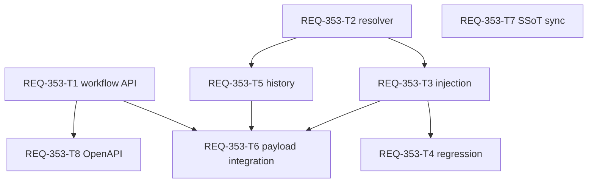

# Implementation Plan — REQ-347 Visual Polish r12

## Executive Summary

ユーザーは現在の生成入力/Settings対応付けの動作をOKと確認し、sticky上端の余白、Prompt項目見出しの小ささ、名称の重複表示を修正するよう依頼した。r12では機能AC1–8を維持してAC-V1–3を追加する。設計は[REQ-347](docs/design/REQ-347.md)、実測手順は[test-plan](docs/design/REQ-347-test-plan.md)。追加確認は不要な技術的選択として親調整役へ返す。

## Current State and Evidence

T1–T15は完了済み。変更前のGate1と有効Gate2はPASS（226 files/2,053 tests）、ブラウザーtelemetry/隔離fixture runner未充足でGate3はINCONCLUSIVE。ユーザー自身の変更前操作確認は別証拠であり、自動Gate3/改訂後PASSへ転用しない。新改訂のsource/testはArchitectが編集していない。

旧設計/plan時点全文はREQ-347-design-pre-r12-snapshot.md/REQ-347-implementation-plan-pre-r12-snapshot.md、旧Task/DAG/停止/監査節はREQ-347-design-history-pre-r12.md。raw監査log/trace/unloadのr1–r11と旧T7の360行上限違反を保持。現在の作業/状態はこのplanとr12節を用いる。

## Architecture and Contracts

3rootの物理上下padding0を共通CSSで規定しDesktop py-4を除去、必要な余白はbody/group外本文へ置く。水平px-5、heading36px/top0/opaque/z10、scroll-padding/margin44px、focusの実矩形式、section間gap0と独立scroll/保存動作を保持する。次stage境界のnative押出しをJS固定バーへ置き換えない。

工程h3の可視文字はStageMaster.name（stageName）だけ、技術keyを省略。schemaに別のstage display_nameはない。空白名はkey→「ステージ不明」、title全文/ARIA name(keyまたはgroupKey)/data/useIdを維持する。Prompt項目名はWorkflowMapping.display_nameをそのまま、空白/欠落ならparam_name→role→「プロンプト」。非空設定文字列のMain/Rough等を削除しない。工程groupを消したり項目へ工程名を付加したりしない。Settings slotのrole→param/select名は変更しない。

Desktop Promptは16px/24px/600の独立h4/collapse行、toolbarは次行。TagChipEditorの任意toolbarStart/既定trueのshowModeStatusを追加し、Desktopだけ元clipboard/history→translation→assetsをslotで渡しcaptionを省略。editorが既存mode buttonを次順に1回描画。toolbarはwrap/gap6/min-width0/clip無し、Undo/Redo hint保持。Mobile/Studioのprops省略は従来表示/機能を維持。React key/元role/値/chips/popup anchor/parse/historyを変更しない。

## Acceptance and Evidence

| AC | 期待 | 証拠 |
|---|---|---|
| V1 | sticky中のroot上端1px以内、物理padding0/opaqueで前本文の上帯・透け無し | T16局所/T19 DOM、実browser BR-VIS1 |
| V2 | 設定名のみを可視表示、fallback明示/同名ARIAと元ID保持、設定文字列を加工しない | UT-VIS1/IT-VIS1/BR-VIS2 |
| V3 | 16px項目名独立行、操作+mode統合toolbar/caption無し、狭幅/zoomで到達・非遮蔽・値保持 | UT-VIS2/IT-VIS1/BR-VIS3 |

既存機能AC1–8/BR1–11とT8 draft session競合保護を回帰確認する。CSS文字列/jsdom rectangle mockをsticky実測と混同しない。

## Task Cards and Ownership

T16–T20を物理生成済み、各card300行未満。固定baselineは3b901040c1887b24c56cc517e75768b777913a5e。全所有ファイルの追加＋削除を累積し、完了済み差分/移動を除外しない。未追跡ファイルは全行を追加として加算。超過見込みはArchitectへ自律分割、通常のユーザー判断待ちにしない。

| Card | 内容 | Files | 上限 | Depends |
|---|---|---:|---:|---|
| [T16](docs/backlog/task/active/REQ-347-T16.md) | 共通header tsx/css/局所test | 3 | 300 | なし |
| [T17](docs/backlog/task/active/REQ-347-T17.md) | TagChipEditor index/新toolbar test | 2 | 250 | なし |
| [T18](docs/backlog/task/active/REQ-347-T18.md) | DesktopLayout/clipboard popup接続 | 2 | 250 | T17 |
| [T19](docs/backlog/task/active/REQ-347-T19.md) | 新visual結合test/既存tabs期待 | 2 | 300 | T16,T18 |
| [T20](docs/backlog/task/active/REQ-347-T20.md) | Generate/Settings正本 | 2 | 160 | なし |

T16の未追跡3ファイル現250行、T18 Desktop既存19行、T19 tabs既存28行、T20 specs既存32行も計上する。実改訂差分はまだ未測定。旧T2/T4/T10/T11は完了時点履歴で、新revisionの同じファイルを書かない。T19上限300は実Harnessを密閉するため、既存28行+新test272行まで。

## Dependency Graph and Scheduling

~~~mermaid
graph TD
  T16[REQ-347-T16 Common Header] --> T19[REQ-347-T19 Integration]
  T17[REQ-347-T17 Editor Toolbar] --> T18[REQ-347-T18 Desktop]
  T18 --> T19
  T20[REQ-347-T20 SSoT]
~~~

改訂DAGは完了baselineの後の最長3層。旧DAG最大4層はsnapshotに保持。T16/T17/T20並列、T18はT17型後、T19はT16/T18後。CSS/source/test/specの単独所有と引渡しを維持する。

## SSoT Synchronization

T20がSPEC_GENERATE §2/2-3/2-5、SPEC_SETTINGS §3-1の対象記述/更新日/参照を同期。エンドポイント/型/schema/保存・roleキーを変更しない。PBIの補足AC-V1–3は親調整役がユーザー修正依頼の記録とともに同期する（ArchitectはPBI本文を編集しない）。

## Verification Strategy

各カードのtypecheck/局所command後、verify担当がfull frontend suiteを実行。T19の実QueryClient/実Desktop/UI/API境界mockは名称/callback/stateを確認、物理sticky/文字サイズ/折返しは実browser BR-VIS1–3で矩形/computedStyle/hit-test/value/画像を採取する。ブラウザーcapability未充足はINCONCLUSIVEのまま、unsupported依存導入や未観測データを作らない。手元のユーザー操作環境を使う際もrunner/evidenceが取得できた場合だけ測定済みとする。

## Trade-offs and Risks

可視key省略で同名工程の視覚区別は位置に依存するが、ARIA/key/data/元IDを維持。表示名を加工せず利用者の設定語彙を保つ。16pxタイトルと折返しで高さは変わるため120px pane/330px幅/200%zoomの到達を実測する。toolbarsはclipを設けず既存popupを保つが、新rowのanchor位置を確認する。root余白をbodyへ移し共有active state/scroll監視/新APIを追加しない。

## Local Audit and Review Handover

dev-designの変更設計レビューは親調整役へ返す。ユーザーの直接の3点修正依頼/既存Architect自律修正指示に基づき進め、人間の新規判断事項0。関連8対象（design/test-plan/T16–T20/plan）を明示しqwen/qwen3.5-9b/context32768/reasoning none、初回からelevatedでr12監査する。全文/本文hash、raw verdict、実行exit、trace/log/直後unloadと独立lms ps []を保存。監査実行成功を設計PASSとしない。r12は8対象で3chunks/483.846秒、audit/unload/独立ps各exit0、raw「実装直前に致命的な論理的矛盾と脆弱性を有しています」を保存した。T19の文言を「描画側の付加禁止/設定全文保持」と明確化しdesign/本plan/T19の3対象をr13へ渡す。結果・本文hash coverage・指摘応答はr13 trace/responseとhandover.current_local_auditを参照。新視覚実装の受入結果とは分ける。

---

## Popup Clarification and Audit r14

T18はDesktopLayoutとPromptSectionClipboardMenuの2source/累積250へ明確化。menuAlign default end維持/新startは全幅relative toolbarStartをanchorとしてleft0/topfull/w72/max-width100%、Desktopだけstart。modeは同toolbar内の次のwrap行を許容する。T19/BR-VIS3で実menuの元role操作/実popup左右を確認、collapseのsr-only descriptionで元stageKey/roleを区別する。DAG5カード/最大3層は不変。r13はraw実装停止勧告/3hash一致/直後unload0/ps[]を保存、共有planの別PBI前提混同は応答済み。最終r14 trace/response/handoverを参照する。

REQ-347のAPI不変は本PBIの変更scopeのみ。以下の別PBI REQ-353節のschema変更可否/承認はそのPBIの判断であり、この視覚改訂の実装担当が実行する対象ではない。別担当者の節を保持する。

# Implementation Plan: REQ-353 Seed型の実入力への適用

## Executive Summary

専用Seedのrandom値が未使用の`seed`入力へ追加され、SamplerCustomの`noise_seed`が固定のままになる経路を修正する。登録済みfallback aliasをworkflow取得APIで渡し、初期値・バッチ検証・注入・履歴が共通resolverで実入力を読む。解決先がなければ生成要求全体を送信前に拒否する。

詳細: [design](docs/design/REQ-353.md)、[test-plan](docs/design/REQ-353-test-plan.md)。既存REQ-347の計画を保持したまま今回の節を追加した。実装・受入テスト完了。ユーザー受容とraw gate結果はdocs/design/REQ-353-walkthrough.mdに記録。

## Architecture and Contracts

`GET /api/workflows/{workflow_id}`の`WorkflowMappingRead`へ`fallback_param_names: list[str] | null`をoptional/default nullで追加し、DBのeffective_masterのJSON文字列を配列へdecodeする。frontend型にもoptional属性を追加する。生成POST形式、DB schema、乱数方式は変更しない。

共通`resolveSeedInputKey(mapping, inputs): string | null`はprimary→登録済fallback順で既存own keyを探す。暗黙value/new key追加を廃止し、valueは明示登録が必要。seedBatch/injectorで未解決・配線・解決後競合を拒否し、初期値/履歴は欠損を既存規則で扱う。注入は専用seed全件を事前確認し、cloneJson=falseでも不正な後続seedで部分変更を残さない。非seed型/global Seedは従来経路を維持する。

## Task Cards and Ownership

全8枚は物理生成済み、予定変更は各<=3ファイル、<=300行。DAGは最大3層。共有ファイルの別PBI編集はcoordinatorが所有を調整する。

| Task | 内容 | ファイル数 | 変更行上限 | 依存 |
|---|---|---:|---:|---|
| [T1](docs/backlog/task/archive/REQ-353-T1.md) | workflow API fallback伝搬・契約テスト | 3 | 260 | なし |
| [T2](docs/backlog/task/archive/REQ-353-T2.md) | TS型・key resolver・unit | 3 | 220 | なし |
| [T3](docs/backlog/task/archive/REQ-353-T3.md) | batch/injector/default修正 | 2 | 200 | T2 |
| [T4](docs/backlog/task/archive/REQ-353-T4.md) | alias/未解決/競合回帰 | 2 | 260 | T3 |
| [T5](docs/backlog/task/archive/REQ-353-T5.md) | 履歴の実key値捕捉・unit | 2 | 180 | T2 |
| [T6](docs/backlog/task/archive/REQ-353-T6.md) | 3枚payload・全件拒否の結合検証 | 1 | 260 | T1,T3,T5 |
| [T7](docs/backlog/task/archive/REQ-353-T7.md) | SPEC_GENERATE/REQ-350契約同期 | 2 | 120 | なし |
| [T8](docs/backlog/task/archive/REQ-353-T8.md) | OpenAPI snapshot局所同期・検証 | 2 | 160 | T1 |

## Verification Strategy

型検証、memory SQLiteのGET契約、共通resolver/注入/記録unit、hookからBatchRequestのgraph.noise_seedとmetadata.valueを確認する。3枚randomは11/22/33をseed抽選だけにstubし、未使用seed key無し・記録値一致を保証する。通常/複数setの無効入力はsubmit 0回。primary seed、legacy global、random偶然重複、同期、Default、bypass/空graphを回帰に含める。設計段階ではsource/test変更・テスト実行なし。

## Trade-offs and Risks

APIへのalias付加でFE/BE両方の更新が必要になるが、登録内容と凍結workflowで決定できる。noise_seedのハードコードやmaster別追加queryは採用しない。登録なしvalue専用mappingは明示登録が必要となる。壊れたfallback JSONは読取を失敗させ、別名を推定しない。OpenAPI snapshotは今回のpropertyだけ同期し既知の全体drift改善を混ぜない。

POST全文ログ/graph長期保持は別の保存設計が必要なため今回追加しない。旧frontend artifactが残る場合はcoordinatorが既存build手順でFE/BE配信を揃える。PBI Surfaceを読取API・型・初期値・履歴へ拡張する判断はこのレビュー対象。

## Local Audit and Review Handover

dev-designのworkspace外アクセス禁止により、解決済GLOBAL_SCRIPTSのdoc_mapper/scaffold/openapi_parser/local_model_adapterは`BLOCKED_BEFORE_ACCESS`。対象限定のworkspace内調査・文書生成のみ実施した。local BA auditはNOT_RUN（model未取得、chunks0、elapsed0、runtime未接続）、unloadもNOT_RUN。本作業でmodelはloadしていないが、LM Studioの未loaded状態を確認したという主張はしない。

外部監査の扱いと人間の設計承認を親調整役へ返す。承認前に実装へ進めない。詳細なBA audit traceはREQ-353設計書末尾に記録した。
