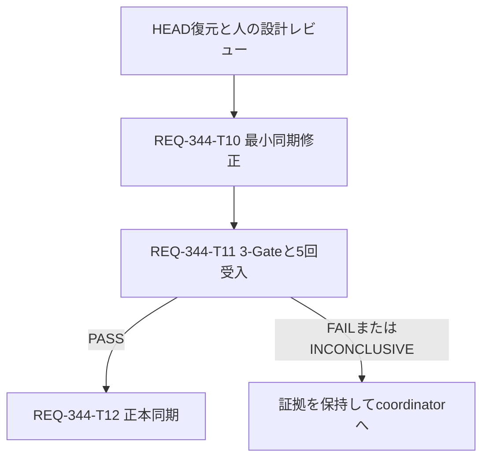

# REQ-344: 確定原因に限定した非同期完了の待機修正

## Decision and Evidence

2026-10-13改訂。直接原因はREQ-161のworkflow deferred解決を広いasync actで囲み、
React Queryの後続更新まで待つ同期方法である。mock補完・cleanup・query開始待ちを固定した
比較で旧境界はDesktop 5012ms timeout、Mobile 1076ms disabled assertionに失敗した。
act境界だけを除きQueryClient状態を待つとPASS。診断6件が独立5回で30/30 PASS。
[原因分析](REQ-344-root-cause-analysis.md)は一次証拠。診断時15/18は受入成功ではない。

HEADの元ケースは await act(async () => { resolveWorkflow!(...); }) である。
診断時にはdeferred promise自体のawaitも加わっていた。採用修正は元ケースの広い
async actを除去し、別のasync actへpromise待機を移さない。

ここで変更するのは非同期処理の待機方法であり、APIを同期処理へ変える意味ではない。
resolverはテスト自身が操作する既存mockであり、実network delayは存在しない。
query successとDOM反映を個別waitForで観測するため、両方成立前に先へ進まない。
元13件へ復元した最終差分は未検証。旧15/18は追加fixture回帰を含む過去の診断結果で、
復元後13/13という将来の受入条件と区別する。5回はPBI所定の安定性gateである。
変更範囲2ケースと検証範囲full suiteは役割が異なり、PBI/3-Gateが後者を要求する。

## Boundary and SSoT

workspace: C:/Users/audih/ws/comfy-create-helper2。変更は
frontend/src/pages/__tests__/GeneratePage.test.tsxの元REQ-161 Desktop/Mobile 2ケース。
React18.3/TanStack Query5/RTL14/Vitest1.6の既存構成を維持。
upstream: ID=1、workflowsApi.get、QueryClient ['workflow',1]、Provider、renderPage。
downstream: 各buttonのdisabled状態、REQ-186を含む13件、全suiteとAC-1。
製品code/API/schema/package/config/共通setup/timeout/pool/retryは変更不要。
doc_mapperはexit0・No mapped documents found。既知SPEC_GENERATEは画面契約の正本として
確認済みで、製品仕様を変えず検証契約と設計リンクだけ末尾に追記する。
API変更がないためopenapi_parserは不要。

## Revert Scope

親coordinatorが調査で増えた対象testの差分をHEADへ局所復元する。
mock追加、Zustand書換え、reset/cleanup/cancel/clear、診断、fake timers/autosave変更、
追加5ケースを除去し元fixtureと13件を戻す。原因修正も一旦元2ケースへ戻してT10で適用する。
独立したユーザー変更があれば識別・保存し当該調査分のみ戻す。repo全体resetは行わない。
調査log、原因分析、旧snapshot、T1-T9は保持。T1-T9にはsupersededを注記して再dispatchしない。
旧EPERM T7-T9の依存、cache書込みゼロ、warning0条件は新計画へ継承しない。

## Minimal Implementation

元2ケースの初期disabled確認を保持し、次の順序へ変更する。
1. render後にwaitForでworkflowsApi.get(1)の呼出しを確認。
2. resolveWorkflow!(元payload)をasync act外で実行。
3. waitForでqueryClient.getQueryState(['workflow',1])?.status === 'success'を確認。
4. 別waitForでbuttonを毎回DOMから再queryし、存在とenabledを確認。

query successだけでは画面成功を認定しない。act importは既存resize/autosave用に保持。
新helper、型import、パラメタライズ、ケース追加、fixture変更は不要。

## Tasks and DAG

| Task | 対象 | 行予算 | 依存 |
|---|---|---:|---|
| T10 最小同期修正 | test 1file | 80変更行以内 | 復元と人の設計レビュー |
| T11 3-Gate/5回受入 | minimal-verification.md 1file、raw別 | 180行以内 | T10 |
| T12 正本同期 | SPEC_GENERATE、minimal-verification 2files | 100変更行以内 | T11 PASS |

各カード300行以内、DAG深さ3。共通test変更と5回process実行は直列。

## Verification and Rollback

frontend cwd: 局所はnpm run typecheckとnpx vitest run src/pages/__tests__/GeneratePage.test.tsx。
最終Gate1 typecheck、Gate2/3は既定npm test連続5回。全suite初回をGate2/run1に兼用し、
6回目を追加しない。各回13/13・skip/timeoutなし。全suite別失敗はGate2 FAIL、
対象ACと分けて記録し完了を保留。失敗回を捨てて5成功回を集めない。
各suite wall600秒、poll60秒以下。対象失敗/未処理例外/収集障害/報告不足で残りNOT-RUN。
通常test成果物/cache書込みは許可された実行範囲。ACL/runtime/config変更はしない。
sandbox収集障害は通常permissionルールで同コマンドを許可contextに再実行し経緯を記録する。
受入バッチ開始前にcontextを固定し、途中変更しない。
rollbackはT10の元2ケース差分のみ。証拠保持、追加修正は再設計レビューへ返す。

## Trade-offs and Audit

QueryClient key依存は現行hook契約に一致し、取得とDOM更新を別観測点で確認できる。
async actの広い待機、timeout延長、mock補完、fixture刷新は採用しない。
元fixtureの既知mock警告は保存し別欠陥として扱う。警告ゼロを追加ACにしない。
5回PASSは指定ACの証拠であり将来全実行の保証ではない。
BA監査対象はこの設計、test plan、T10-T12全件。traceとunload結果を保存する。
変更設計は人の設計レビューへ返し、承認後T10へ進む。PBIはin-progress。

## BA Audit Review

監査exit0、qwen/qwen3.5-9b (9.0B/Q6_K)、context-length32768。
原応答はCRITICAL FLAWS DETECTED。exit0をCOMPLIANTに読み替えない。
直後unload exit0、LM Studio reports no models loaded。全GPUメモリ解放の証拠ではない。
[traceと指摘対応案](REQ-344-minimal-ba-audit-trace.json)をcoordinatorへ返し人のレビュー対象とする。
語義/実装・検証範囲/旧実測と将来ACを明文化した。timeout不足は実測FAILとして停止し、
延長で通さない。Mobile更新はDOM待ち、process間mock漏れは独立process実行で確認する。
監査後の明文化追記とT12原文抜粋訂正は再監査していない旨をtraceに残す。
