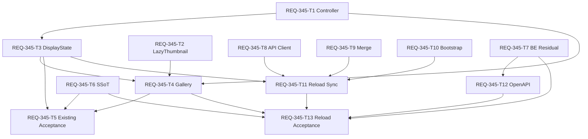

# REQ-345 原画が消失した未保存試行の履歴除外

## Boundary and Feasibility

作業境界は `C:/Users/audih/ws/comfy-create-helper2`。frontend / backend / docs は境界内。外部実装パスはない。設計者の変更は設計成果物に限定する。

AC-1〜9は実現可能。表示需要の原画確認には既存API、再読込の追加候補には新しい残存差分APIを使う。SPEC_COMMON:337のerror限定契機とSPEC_GENERATE:271の初回履歴取得を更新する。present/missing/unknown、identity、既存保存期限は維持する。全表示履歴の事前probeは行わず、新規差分候補だけBEで確認する。

doc_mapperはPBIの対応文書なしを返した。PBI明示のSPEC_GENERATE、SPEC_COMMON、REQ-333と、関連するSPEC_HISTORYを対象検索した。API仕様の実在パスは `docs/openapi.yaml`。openapi_parserのget-endpointで `/api/comfy/image-availability get` を抽出した。

## Current Behavior and Cause

Gallery:44-71はLazyThumbnailのonErrorだけで原画APIを照会し、component内Mapで共有する。BE comfy.py:327-415はサムネmemory/disk cache-hitでも原画確認するが、サムネ応答に `public, max-age=604800, immutable` があるため、ブラウザーcache成功はBEの確認を通らない。

DisplayState:148-187はmissingイベントで両session query、主選択、複数選択を除外する。missing集合とGalleryのprobe集合が別ownerのため、レイアウト再mount時に照会抑止が失われる。IndexedDBから復元されたURLにも、サムネ成功と独立した原画確認が必要。

## Architecture and Dependencies

React/TanStack Query/Zustandを維持。純粋controller `frontend/src/services/trialImageAvailability.ts` をDisplayStateで1個所有する。useGeneratePageStateはdisplayStateをspreadする既存構造で、controllerをGalleryへ渡せるためファサード編集は不要。

```text
LazyThumbnail: 試行branchのonLoad/onError
 -> Gallery: 実際に読込された需要を登録
 -> page-owned controller: identity共有、最大2照会、完了状態
 -> generationApi.imageAvailability -> 既存BE原画probe
 -> controller購読 -> Gallery確認表示 / DisplayState除外
```

上流: lazyサムネ通知、persist復元、Generation同期、残存差分API。下流: query/store/選択/preview/保存。Snapshot・metadata・DB/cleanupは独立保護、新規BE service/routerは差分APIの変更対象。

## API and Controller Contract

`GET /api/comfy/image-availability?filename&subfolder&type` の200本文 `{availability:present|missing|unknown}` を使う。503/422/通信失敗/timeoutはunknown。API HTTP404自体をmissingと解釈せず、上流原画404確認済みというAPI本文のmissingだけで除外する。

```ts
type TrialAvailability = 'checking' | 'present' | 'missing' | 'unknown'
interface TrialIdentity { key: string; request: ImageIdentity }
interface TrialAvailabilityController {
  getIdentity(url: string): TrialIdentity | null
  getStatus(url: string): TrialAvailability | undefined
  observe(url: string, owner: object): void
  retainOwnerImages(owner: object, urls: readonly string[]): void
  releaseOwner(owner: object): void
  adopt(url: string, availability: ImageAvailability['availability']): void
  check(url: string, options?: { retry?: boolean }): Promise<TrialAvailability>
  refreshVisible(): void
  subscribe(listener: (url: string, status: TrialAvailability) => void): () => void
  dispose(): void
}
createTrialAvailabilityController(
  probe: (identity: ImageIdentity) => Promise<ImageAvailability>
): TrialAvailabilityController
```

identityは同一originの`/view`または`/api/comfy/view` URLの `[filename, subfolder || '', type || 'output']` をJSON化。旧host/`t`違いは共有、subfolder/type違いは別。不正URLはunknownで照会/除外しない。SnapshotはURLがview pathでもobserveしない。

## Confirmation Triggers and Load Budget

- LazyThumbnailへ省略可能なonLoad通知を追加。isLoaded更新後に通知する。既存Snapshot等の利用者は通知を渡さない。
- Gallery未保存branchのonLoad/onErrorからobserve/check。初期未確認/checkingは確認placeholderと「原画を確認中…」を重ね、選択操作を抑止。presentで画像を示す。unknownではサムネ/選択を保持し明示再試行を示す。
- 未読込行はplaceholderのままAPIを照会しない。一覧全件map probe、定期timer、追加offscreen先読みを設けない。既存IntersectionObserver rootMarginは維持する。
- active照会は最大2件。同identityはpending Promise/完了値共有。onLoad/onError連発、desktop/mobile、URL表現違い、StrictMode再接続で重複要求を防ぐ。
- 成功history-fetchedで、owner登録済みかつ現在履歴に残るpresent identityだけ1回再確認。pendingは共有。過去に読込済みでmountedなoffscreen行は対象になり得るが、未読込行を確認しない。focus/visibilityは既存fetchHistory経由。
- unknownは自動履歴更新でも再照会せず、明示retry/再読込で再確認。missingは同page controller寿命中固定し、別選択、履歴更新、レイアウト再mount、retryで再開しない。
- 真のpage離脱でdisposeしqueue/購読を停止。遅延応答でstore更新しない。開発StrictModeのeffect cleanup/replayだけでcontrollerを失効させないよう接続世代を扱う。

「初期履歴確認完了」は初期読込需要がある行のpendingがsettleした時点。それ以降Aは非表示でBは表示される。scrollで初表示となる行も確認する。未読込の画面外画像の存在まで事前保証する契約は追加しない。

## Missing Transition and Recovery

missing購読でhookの除外集合へ追加し、両 `generateDisplayImages` query、`comfyHistoryImages`、`batchImages`をidentityでfilter。最後の1件もqueryへ `[]` を明示。後着history-fetched/executed/snapshot、persist復元、filter/sort変更も除外集合を通す。

主選択がAならnullへ、複数選択からAのみ除外。modalでAを見ていたら残存画像へindexを合わせ、0件なら閉じる。古いindexでAを自動取得しない。全選択/保存/navigationはフィルタ済み一覧を用いる。

互換イベント `comfy-image-availability` の `{url, availability}` を維持。controller確定結果を通知しDisplayStateは冪等適用。後着present通知でmissingを解除しない。明示retryはunknownのみ、進行中Promiseを削除して二重起動しない。

新しい永続missing記録は導入しない。再読み込み後はcontrollerを新規作成し、残存候補のサムネload成功でも原画を再確認。古いpersist候補があっても完了後の反復取得を抑止する。

## Reload Residual History Contract

### Displayed Set and Trigger

表示済み集合Dは、persist復元完了後の両 `generateDisplayImages` queryと対応する `comfyHistoryImages` / `batchImages` の未保存試行identityの和集合。missing集合Mを引き、URLを同一originへ正規化する。表示済みとは論理行であり、viewport外・非選択tab・自session filterで隠れた行も含む。保存Snapshotは含めない。旧host/t違いは同一、subfolder/type違いは別。不正URLは送らず既存表示だけ保持する。

`useIsRestoring() === false`（TanStack Query v5）かつ最初の有効なGeneration snapshot受信後に、document reload epochごと1回の論理同期を開始する。snapshotが来ない間は復元履歴を保持し未同期を示す。復元されたpersist表示cacheに有効canonical identityの非空baselineがなければ要求をskipしcompleteとする。空cacheやstore/live snapshotだけを理由に残存要求を開始しない。StrictMode replay・layout・sort/filter・tab切替・focus・visibilityで再開始しない。document reloadで新epochを作る。route再mountは同document epochの自動要求を再開しない。QueryClientごとのepoch実行記録を共有し、StrictMode/route再mountは同記録を使う。scopeはGenerateページで、History/Snapshot/Studioページに新要求を追加しない。

初回/epoch切替で `connectionSlice.bootstrapHistoryOnce -> fetchHistory -> getHistory(200)` を呼ぶ経路を廃止する。`mergeManagedHistory` は初期snapshot内の過去成功出力を追加しない。同epochの実際の成功遷移/実行完了eventは維持する。DisplayStateの `snapshotImages` からも未表示の過去出力を暗黙追加しない。snapshotはjob/進捗/session分類の正本として保持する。focus/visibilityでの既存明示履歴更新はreload差分とは別経路で、進行中の初回差分同期中には全件取得を開始しない。

### Proposed API (Not Yet Implemented)

`POST /api/generation/history/residual`。JSON bodyを使い大量identityをquery stringへ埋め込まない。新規Pydantic型は専用serviceモジュールへ置く。既存Generation ErrorEnvelope/422/503を使う。

```ts
interface ResidualHistoryRequest {
  known: ImageIdentity[] // 最新DとM。identityのみ、host/tなし
  examined: ImageIdentity[] // 同一論理同期の既検査identity、初回[]
}
interface ResidualHistoryItem {
  identity: ImageIdentity
  view_url: string // 同一origin /api/comfy/view、tはprompt ID
  session_id: string | null
  availability: 'present'
}
interface ResidualHistoryResponse {
  items: ResidualHistoryItem[]
  rejected: Array<{ identity: ImageIdentity; availability: 'missing' | 'unknown' }>
  has_more: boolean
}
generationApi.residualHistory(body: ResidualHistoryRequest,
  signal?: AbortSignal): Promise<ResidualHistoryResponse>
```

known/examinedは各最大1000のdistinct identity、filename非空、subfolder既定空/type既定output。超過/不正は422、URL/任意hostを受け取らない。items/rejectedの重複、identityとview_url不一致、present以外のitems、空pageなのにhas_more=true、不正本文はFEでrejectし既存表示を保持する。

BE候補Kは既存の `GET ComfyUI /history?max_items=200` の出力と、`service.snapshot()` の保持済み成功job出力の和集合。DBのSnapshot、thumbnail cache、metadata単独を存在根拠にしない。未保存試行履歴の既存scopeを維持しnormal/studioを勝手に限定しない。sessionはmanaged jobのsession_idを優先、legacy prompt[3].client_idをfallback、不明ならnull。Comfyの専用transport client_idをmanaged利用者sessionと混同しない。

順序はmanaged成功jobのfinished_at降順（nullは末尾）、同値はjob_id/node_id/indexの昇順、次にlegacyのみをprompt[0]降順・prompt_id/node_id/image index昇順。重複identityはmanaged側を優先。既存同様最新候補200画像を対象とし、保持/cleanup期限や上限を延長しない。

各pageはKからknown/examinedを先に除き、先頭10identityだけ既存 `probe_image_availability` で確認する。BE active最大2。presentのみitems、missing/unknownはrejectedへ返す。全表示履歴の事前probeや重複候補probeは0。has_moreは未検査差分の残存を示す。上流history失敗/不正データまたはGeneration service不在は503（空正常結果へ変換しない）。各pageは読み取りのみでDB/metadata/サムネ削除を呼ばない。

FEはitems/rejectedのidentityをexaminedへ加え、最新D/Mを送ってhas_moreの間だけ逐次続行する。1論理同期あたり最大20page/200検査identity。新規実行完了で候補が増える競合は現在の200候補窓に対して再比較し、継続上限到達時は部分同期として示す。unknownは同期中再検査しない。ページングは応答サイズ/1要求のprobeを制限するもので保存期限ではない。

### Additive Merge and Isolation

FE純粋helperは応答適用直前の最新D/Mで再比較する。追加対象はitemsのpresent ∧ Dに不在 ∧ Mに不在のみ。受信順でdedup、既存URLと既存行の相対順を維持し `[newItems, ...existing]` の降順配列を作る。複数pageの追加は受信済み追加ブロックを維持して次pageをブロック末尾へ挿入し、BEの確定順を逆転させない。ascは降順配列全体のreverse。existingを新応答で置換/消去しない。既存200行を優先保持し空きslotだけ追加、既存が200以上なら追加しない。過去画像の厳密な時刻挿入は行わず既存の新規先頭追加規則を維持する。

全履歴query/storeには全追加、自sessionquery/batchには `session_id === clientId` の追加だけ適用する。nullやforeignは全体のみ。既存行のURL/順序/主選択/複数選択/modal indexを同期自身で変更しない。差分missingはcontrollerへadoptしてpage内再挿入を抑止、present追加はadopt後に行うためGallery load時の重複確認を避ける。missing後のpresent/pending応答でmissingを解除しない。既存Bの原画確認はlazy需要経路で行い、unknownなら保持する。新規Eのunknownは追加保留で既存AC-4と両立する。

応答に載らない既存行をmissingと推定しない。503/通信失敗/abort/不正本文はそのpageを適用せず既存/適用済みpageを維持し「履歴の追加確認に失敗」と明示再試行を示す。自動全件fallback/自動retryは0。手動再試行のみ新論理同期を開始しunknown候補も再検査可能。真の離脱でabort/世代失効、後着応答はstore/query/controllerへ書かない。Snapshot/metadata/削除期限は独立して保持する。

上流ComfyUIには差分history APIがないためBE内では既存上限付き200件照会を使う。FEへの全履歴転送/置換を禁止する契約であり、BE内部の上限付き候補列挙まで0件とは主張しない。probeがHEAD非対応の場合の既存GET転送/timeoutは維持され、10件pageでも最大2並列で待ち時間が生じる。画面をブロックせずページごと追加する。

## SSoT Change Map

| 正本 | 対象 | 変更内容 |
|---|---|---|
| SPEC_GENERATE | 2-10、222-224/271行 | lazy試行サムネ成功/失敗で原画確認、checking/unknown UX、再読込 |
| SPEC_COMMON | 337行 | error限定を需要確認へ、最大2件、page共有、present履歴再確認、unknown/missing抑止 |
| SPEC_HISTORY | 4 / 4-1、56/71行 | Snapshot独立性、metadata/期限/上限維持を今回の変更へ関連付け |

SSoT編集は承認後にT6で実施。新規残存差分POST/schemaをT12でdocs/openapi.yamlへ同期。既存availability API契約は保持。REQ-333は過去設計として保持する。

## Acceptance Mapping

| AC | 実現と検証 |
|---|---|
| 1 | サムネ成功時確認/履歴present再確認。restart相当応答でA missing、B present |
| 2 | page共有missing、cache/選択修正。確定後A原画/API要求増分0 |
| 3 | 復元A/Bと未表示C/D/E。差分present Cだけ追加、lazy確認でA除外 |
| 4 | unknown分類。サムネ404、503、timeout、通信失敗だけで除外しない |
| 5 | FE表示だけ除外。metadata即時削除なし、既存BEサムネ保持試験 |
| 6 | Snapshot非登録。同一URLでも画像/params/query保持 |
| 7 | 応答時最新identity再比較、URL/順序/選択保持 |
| 8 | 復元+初回snapshot後1cycle、full GET/全件置換/known probe0 |
| 9 | 差分error保持、session確定のみown、fallback/retry/late書込0 |

## Atomic Tasks and DAG

| Task | ファイル数 | 変更行上限 | 依存 | 原子性 |
|---|---:|---:|---|---|
| T1 controller/局所試験 | 2 | 300 | なし | PASS（計画値） |
| T2 LazyThumbnail通知 | 2 | 160 | なし | PASS（計画値） |
| T3 DisplayState基盤/選択 | 2 | 290 | T1 | PASS（計画値） |
| T4 Gallery接続/差分状態表示 | 3 | 290 | T1,T2,T3 | PASS（計画値） |
| T5 既存AC統合/保護 | 1 | 280 | T3,T4,T6 | PASS（計画値） |
| T6 3仕様正本同期 | 3 | 200 | なし、承認後 | PASS（計画値） |
| T7 BE残存差分API | 3 | 300 | なし | PASS（計画値） |
| T8 FE API型/decoder | 2 | 200 | なし | PASS（計画値） |
| T9 純粋追加merge | 2 | 240 | なし | PASS（計画値） |
| T10 初回全件bootstrap停止 | 2 | 240 | なし | PASS（計画値） |
| T11 復元後差分同期 | 2 | 280 | T3,T8,T9,T10 | PASS（計画値） |
| T12 OpenAPI同期 | 1 | 200 | T7 | PASS（計画値） |
| T13 再読込AC統合 | 1 | 280 | T7,T11,T6,T12,T4 | PASS（計画値） |



最大4層。初期独立T1/T2/T6/T7/T8/T9/T10、T3完了後はT4/T11が別ファイルで並列。T3とT11は同hookを編集するため順序必須。T7 routerとT10 FE storeは競合しない。T12 docs/openapiはT6の3仕様ファイルと分離。T5/T13は別test。各300行/3ファイル超過見込みは着手前に再分割。計画上の原子性PASSは実装/監査/受入PASSを意味しない。

## Trade-offs and Risks

- 表示需要のあるidentityごとに追加API照会する。最大2並行/需要限定/共有/成功履歴更新限定で抑える。BEサムネcache-hit自体のprobeとの重複は許容する。
- 全件事前probeは採用せず、未読込行の欠損確定は初表示時まで遅れる。checking中は閲覧可能と誤認させない。
- Cache-Control変更だけでは配布済みimmutable応答を失効できない。BE cache/TTL変更、再起動世代API、DB missing flag追加は採用しない。
- 同identityへ原画が再作成されても同page missingを保持し、再読込で回復する。自動再取得抑止を優先し新TTLは導入しない。
- HEAD非対応では既存probeがGETで原画を転送する。最大2件で負荷を抑えるが総バイト数の新上限は作らない。既存timeout経路中はcheckingを示す。
- StrictMode、owner解放/遅延応答、後着履歴再挿入、Snapshot identity衝突を対象試験に含める。

## Review and Audit State

2026-10-12: 旧監査はINCONCLUSIVE。docs/design/REQ-345-audit-retry.jsonでは3 chunks処理後、最終合成が出力token上限で未完了（exit1）。直後のunloadはexit0でロードモデルなしを確認した。初回モデル不在/timeoutの記録も履歴として保存する。

後続の固定model qwen/qwen3.5-9b / Q6_K / reasoning=none / context32768 / timeout600 / --unload-afterによる8対象監査はexit0で最終合成まで完了、判定はISSUES_DETECTED（CRITICAL DEFECTS DETECTED）。unload exit0を確認済み。証跡: docs/design/REQ-345-audit-32k.json / REQ-345-audit-32k.log。exit0は監査実行完了であり設計PASSではない。

本再読込改訂はPBI/設計/テスト計画/13枚Task Card/計画を更新した新revision。32k監査の対象は旧8資産で、新規T7〜T13を含む現revision全体の再監査は未実行。親の重複監査禁止指示に従い同passで追加推論しない。指摘対応は docs/design/REQ-345-audit-response.md に個別記録。実装・実装テスト未着手。全カードはdraft/design_gate=pending、改訂設計の人間承認待ち。
