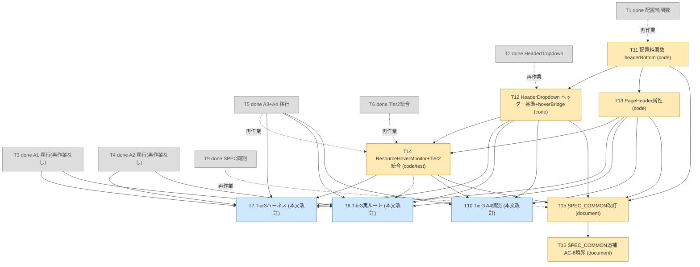
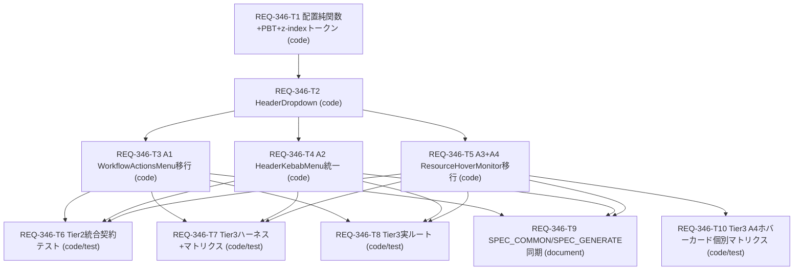

# REQ-346 実装計画

作成者: architect (dev-design) / 作成日: 2026-10-16 / 改訂: 2026-10-16（人間の設計レビュー反映）/ change_kind: mixed（コードカード T1–T8・T10〜T14、ドキュメントカード T9・T15・T16）

## 改訂（2026-10-16・実ブラウザ所見 R1〜R3 の反映。再作業計画）

T7 のハーネス（`frontend/e2e/headerMenuOverlay.spec.ts`）の実行で 8 件が失敗し、人間が次を決定した（詳細は設計 `REQ-346.md` 改訂履歴）。

| # | 決定 | 影響 |
|---|---|---|
| R1 | **決定 (a)**: 全展開パネル（A1 ワークフロー／A2 ケバブ／A3 モバイル VRAM ピル／A4 ホバーカード）の上端を**ヘッダー下端＋6px** に置き、ヘッダーに重ねない（モバイルのヘッダー下端 118 に対し旧ピル基準パネルは約71から開いていた）。水平位置はトリガー基準のまま | 配置純関数に `headerBottom`（T11）、`HeaderDropdown` が `[data-page-header-root]` から下端を自動取得・`ResizeObserver` で追従・A4 の固定ブリッジを内蔵（T12）、`PageHeader` に属性 1 つ（T13）、`ResourceHoverMonitor` のブリッジ置換と Tier2 統合テスト更新（T14）、SPEC_COMMON 文言（T15）、Tier3 の T7／T8／T10 の検証内容改訂 |
| R2 | **承認 (#3)**: AC-3 のスクロール到達性は workflow パネルのあふれを要求しない（4項目で収まる）。あふれ・末尾スクロールは高い `future` アクションで判定 | T7 本文（AC-3 判定規則）、テスト計画 §3 |
| R3 | **#1**: ケバブでパネル上端がトリガー下端より約2px上。根本原因（アンカー rect がラッパーで、44px のヒットスロップボタンより8px小さい）を解消し、上端 ≥ ヘッダー下端 かつ ≥ トリガー下端 | T12（直接子要素 rect を含めたトリガー下端計測）＋ R1 のヘッダー基準。`HeaderKebabMenu.tsx` は**変更しない**（REQ-365/AC-2 の44px 領域を保護） |

方針: **完了済みカード（T1／T2／T5／T6／T9）は再オープンせず**、新規「再作業カード」T11〜T15 を起票する（履歴・検証証跡の保存、T1/T10 接頭辞衝突を伴うコーディネータ状態管理の複雑化を避ける）。T3（A1）・T4（A2）は呼出側 API が不変のため**再作業なし**（T12 の検証コマンドで既存テストを回帰実行）。未着手／着手中の T7／T8／T10 は本文を改訂（`depends_on` に T12／T13／T14 を追加、状態は coordinator 所有で未変更）。

## Goal Description

共通ヘッダーの展開アクションがヘッダー高さの制限で切り詰められる問題（原因: `PageHeader` の `actions` スロット外枠 `overflow-x-auto` が内部の `absolute` メニューを切り詰める）を、既存ブラウザキャッシュメニュー（ヘッダーメニュー）と同じ「ヘッダー下へ重ねて展開」方向の共通契約に統一する。共通プリミティブ `HeaderDropdown`（ポータル＋`position: fixed`＋ビューポート計測の高さ上限＋メニュー内スクロール。制御型でトリガー種別に依存しない）を導入し、ワークフロー設定（A1）・ヘッダーメニュー（A2）・モバイルVRAM展開（A3）の click 型に加え、**デスクトップ資源ホバーカード（A4、hover 型）も同一プリミティブ／契約（HEO-9）に含めて**移行する。契約は SPEC_COMMON §4-4-1 に反映し、将来追加される展開アクション（click 型・hover 型）にも適用する。

## 設計レビュー反映（人間の決定）

| # | 決定 | 反映 |
|---|---|---|
| 1 | A4 を共有 HeaderDropdown／契約に含める | HEO-9（hover 型）新設。T5 を A3＋A4 に拡張（同一ファイル）、T6 拡張、T8 に A4 重なり順追加、T9 に A4 適用・hover 規律を追記、**T10 新設**（A4 実ブラウザ個別マトリクス） |
| 2 | 検証幅は設計どおり承認 | 変更なし。A4 は ≥640 の承認済み幅を使用 |
| 3 | SPEC_GENERATE §2-1 の古い行は是正しない（追記のみ） | T9 に明記。後続PBI候補 F-1（設計 §10-C） |
| 4 | 後続PBI候補: 11px 下限違反、Escape／フォーカス復帰 | 設計 §10-C F-2／F-3（記録のみ。本PBIで実装しない） |
| 5 | coordinator 対応済み | 対象外（PBI メタデータ／状態は未変更） |

## 追補（2026-10-16・T8 実測所見 R4 の反映: AC-6 の読み）

T8 の実ルート実測（14 件 PASS／1 件 FAIL）で、Generate は 768px で Desktop／Mobile レイアウトが入れ替わり、`WorkflowActionsMenu` が再マウントされて開いたメニューが閉じることが判明した（1280×800 → 375×360 で `[role="menu"]` 0 件）。人間決定 (b): これを**仕様として受容**し、(a)「境界を跨いでも開いたままにする」は却下。AC-6 は「同一レイアウト内の resize は開いたまま末尾到達・押下可／境界跨ぎは閉じ、開き直せば末尾到達・押下可」と読む。

| 対象 | 変更 |
|---|---|
| コード（プリミティブ・呼出側・レイアウト） | **変更なし** |
| T8（in-progress） | 本文のみ改訂。AC-6 を ①同一レイアウト内 resize（開いたまま到達）②境界跨ぎ（閉じる→開き直して到達）の 2 本に分割。所有ファイル `e2e/headerMenuRoutes.spec.ts`・状態は不変 |
| T10 / T7 | 影響なし（T7 ハーネスはレイアウトを切り替えない。T10 は `/settings` で各 resize 後に再 hover し、639 以下の非表示のみを判定するため境界の有無に依存しない） |
| **T16（新設・document）** | SPEC_COMMON §4-4-1 に 1 句追補（「レイアウト境界を跨ぐ resize で閉じるのは正常、開き直せば末尾到達」）。T15（done）に依存、T7／T8／T10 と並行可能 |

## User Review Required

1. **A4 の AC-2／AC-4 の読み替え**（設計 §8-2）: A4 は押下ボタン・操作項目を持たない情報カードのため、AC-2 を「カード内へ移動しても閉じない（ホバー継続）」、AC-4 を「ポインター離脱／外側押下で閉じる（クリックトグルは追加しない）」と読み替えて検証する。PBI の意図と異なる場合は追加タスクが必要。
2. **hover 継続の実現方式**（設計 T-9）: トリガー〜カード間 6px の隙間は、呼出側（`ResourceHoverMonitor`）のトリガー内透明ブリッジ（高さ7px）で被覆し、閉鎖遅延は入れない（既存テスト3箇所の「`mouseLeave` 直後に消える」を無改修で通すため）。プリミティブ内蔵・遅延方式を望む場合は設計変更が必要。将来の hover 型アクションも呼出側でブリッジを実装する義務が生じる（SPEC_COMMON に記載）。
3. **サポート範囲の明文がない**ため、既存仕様のブレークポイント（768／1024）と既存E2E幅（375／767／768／1279／1280）に基づく検証幅を採用（設計 §7。人間承認済み）。
4. **既存テスト 1 件を意図保存のまま更新**: `ResourceHoverMonitor.test.tsx` の `[REQ-363/AC-6]`（A3: `top-full`／`z-40` の実装クラス検証 → 契約属性による配置検証）。A4 の既存3ケースは無改修で通す。
5. **E2E は Vite dev サーバーの事前起動が必要**（`playwright.config.ts` に webServer なし。既存E2Eと同じ運用）。ハーネスは `frontend/e2e/fixtures/`（本番ビルド対象外）。
6. **スコープ外の既知事項**（後続PBI候補、記録のみ）: SPEC_GENERATE §2-1 の古い行、メニュー内 `text-[10px]/[9px]`（11px下限）、Escape／フォーカス復帰。
7. **カード ID `REQ-346-T10`〜`T15` と `T1` の接頭辞衝突**: 状態更新に `pbi_manager` のタスクセッターを使うと T1/T10 を取り違える既知の注意あり。coordinator は正確な frontmatter ID／ファイル名の scoped edit を使うこと。
8. **R1 設計判断の確認事項**（設計 §10-D）: 閉鎖閾値 96px の据え置き（モバイル横向きの低い高さ）、A4 固定ブリッジがホバー中にトリガー直下の 2 行目要素の操作を奪う点、モバイルでパネルがトリガーから最大約47px離れて見える点、`PageHeader.tsx` への属性 1 つの追加（人間の「PageHeader は変更しない」前提が緩む唯一の箇所）。

## Proposed Changes

### Frontend（コード）

| タスク | 変更 | 所有ファイル |
|---|---|---|
| T1 | 配置純関数＋PBT、`--z-header-menu` トークン | `components/common/header/headerMenuPlacement.ts`、同 `__tests__/headerMenuPlacement.test.ts`、`index.css` |
| T2 | `HeaderDropdown` プリミティブ | `components/common/header/HeaderDropdown.tsx`、同 `__tests__/HeaderDropdown.test.tsx` |
| T3 | A1 ワークフロー設定移行 | `pages/GeneratePage/components/WorkflowActionsMenu.tsx`、同 `__tests__/WorkflowActionsMenu.test.tsx` |
| T4 | A2 ヘッダーメニュー統一 | `components/common/header/HeaderKebabMenu.tsx`、同 `__tests__/HeaderKebabMenu.test.tsx` |
| T5 | A3 モバイル展開移行＋**A4 ホバーカード移行（HEO-9、ホバー継続ブリッジ）** | `components/common/header/ResourceHoverMonitor.tsx`、同 `__tests__/ResourceHoverMonitor.test.tsx` |
| T6 | Tier2 統合契約テスト（click 型 A1–A3＋hover 型 A4＋AC-8） | `components/common/__tests__/unifiedHeaderIntegration.test.tsx` |
| T7 | Tier3 ハーネス＋マトリクス（A4 はハーネス上の重なり順のみ） | `e2e/fixtures/header-menu-harness.html`、`e2e/fixtures/headerMenuHarness.tsx`、`e2e/headerMenuOverlay.spec.ts` |
| T8 | Tier3 実ルート（A4 の Generate Desktop 重なり順を追加） | `e2e/headerMenuRoutes.spec.ts` |
| **T10** | **Tier3 A4 ホバーカード個別マトリクス（新設）**。R1: 上端＝ヘッダー下端＋6px、固定ブリッジ `resource-hover-card-bridge` | `e2e/headerHoverCard.spec.ts` |
| **T11（再作業・T1）** | `computeHeaderMenuPlacement` に `headerBottom`、`PAGE_HEADER_ROOT_SELECTOR` 追加＋PBT 更新（`index.css` は T1 のまま） | `components/common/header/headerMenuPlacement.ts`、同 `__tests__/headerMenuPlacement.test.ts` |
| **T12（再作業・T2）** | `HeaderDropdown`: ヘッダー下端自動取得（`closest`）、トリガー下端のヒットスロップ計測、`ResizeObserver` 追従、`hoverBridge` 内蔵（固定・可変高さ） | `components/common/header/HeaderDropdown.tsx`、同 `__tests__/HeaderDropdown.test.tsx` |
| **T13（新規）** | `PageHeader` ルートに `data-page-header-root=""` を 1 つ追加（他不変）＋テスト | `components/common/PageHeader.tsx`、同 `__tests__/PageHeader.test.tsx` |
| **T14（再作業・T5＋T6）** | `ResourceHoverMonitor` の A4 ブリッジをプリミティブへ置換（旧モニタ内7px ブリッジ廃止）＋A3／A4 テスト更新、jsdom 統合契約テストのヘッダー下端基準化・ブリッジ testid 更新 | `components/common/header/ResourceHoverMonitor.tsx`、同 `__tests__/ResourceHoverMonitor.test.tsx`、`components/common/__tests__/unifiedHeaderIntegration.test.tsx` |
| T7／T8／T10（本文改訂） | 検証内容を R1〜R3 に合わせて改訂（ハーネスは原則変更不要） | 既存所有ファイルのまま |

実装を変更しないもの: `WorkflowActionsMenu.tsx`／`HeaderKebabMenu.tsx`（T3／T4 は完了のまま再作業なし）、`index.css`（T1 のまま）、`DesktopLayout.tsx`、`MobileLayout.tsx`、API／バックエンド／OpenAPI。**`PageHeader.tsx` は属性 1 つの追加のみ（T13）**。

### Documents

| タスク | 変更 | 所有ファイル |
|---|---|---|
| T9 | SPEC_COMMON §4-4／新設 §4-4-1（AC-7。A4 を hover 型として適用、HEO-9 を記載）、SPEC_GENERATE §2-1 に `#workflow-actions-btn` 行の**追記のみ**（古い行は是正しない） | `docs/specs/SPEC_COMMON.md`、`docs/specs/SPEC_GENERATE.md` |
| **T15（再作業・T9）** | SPEC_COMMON §4-4-1 の文言を R1 に合わせて改訂（上端＝ヘッダー下端＋6px、ヘッダー基準、`hoverBridge`、ヘッダー追従、A4 ブリッジ testid）。SPEC_GENERATE は変更不要 | `docs/specs/SPEC_COMMON.md` |
| **T16（追補・T15）** | SPEC_COMMON §4-4-1 の「開閉（click 型）」行に AC-6 のレイアウト境界の扱い（跨ぐと閉じるのは正常・開き直せば末尾到達）を追記。他は不変 | `docs/specs/SPEC_COMMON.md` |

所有ファイルは**アクティブなカード間**で重複しない（コード系 T7・T8・T10〜T14 とドキュメント系 T15・T16 も分離）。再作業・追補カード（T11／T12／T14／T15／T16）は完了済みカード（T1／T2／T5／T6／T9）と同じファイルを所有するが、完了済みカードは閉じているため所有競合は生じない。A3 と A4 は同一ファイル `ResourceHoverMonitor.tsx` のため T5（再作業は T14）が両方を所有する（分割すると所有重複になる）。

## Task DAG

### 再作業 DAG（現在の実行対象。done ノードは履歴・依存元として表示）

実行順序と並行枝（R4 追補: **T16** は T15（done）のみに依存し、T7／T8／T10 と並行可能。T8 は本文改訂のみで DAG 不変）: ① **T11**（単独）→ ② **T12 ∥ T13**（T11 のみに依存、所有ファイル非重複）→ ③ **T14**（T12・T13 に依存）→ ④ **T7 ∥ T8 ∥ T10 ∥ T15**（T14 完了後に並行可能。Tier3 の 3 カードは同一 Vite を共有するか直列実行＝下記「実行ルール」）。最大深さ 4（T11→T12→T14→{T7,T8,T10,T15}）。T16 は T15（done）の次で、残り深さは 1。T3／T4 は再作業なしのため DAG 上は依存元のみ。T7 は着手中のため、coordinator は T12〜T14 完了までその実行を一時停止（本文改訂済み）。

### 当初 DAG（履歴）

並行実行の枝: T3／T4／T5 は T2 完了後に並行可能、T6／T7／T8／T9 は T3〜T5 完了後に並行可能、**T10 は T5 のみに依存し T3／T4 の完了を待たず T6〜T9 と並行可能**（所有ファイル非重複）。

### Atomicity Audit

| カード | 所有ファイル数 | 想定変更行 | 判定 |
|---|---|---|---|
| T1 | 3 | 約150–200 | PASS |
| T2 | 2 | 約250–300（実装約110＋テスト約150–190） | PASS（上限近傍。超過時は設計へ escalate） |
| T3 | 2 | 約100–150 | PASS |
| T4 | 2 | 約90–120 | PASS |
| T5 | 2 | 約200–250（A3＋A4 実装差分約60、テスト約150–190） | PASS（2ファイル・300行以下。超過時は escalate） |
| T6 | 1 | 約230–260（追記のみ。A4 群を追加） | PASS |
| T7 | 3 | 約280–300（ハーネス約60＋spec約220。A4 項目10は短い確認のみで増分は小さい） | PASS（上限近傍。parametrize で圧縮、超過時は escalate） |
| T8 | 1 | 約150–190 | PASS |
| T9 | 2 | 約90–100（文書） | PASS |
| T10 | 1 | 約170–190（新規 spec 1ファイル）。R1 改訂で約190–200 | PASS |
| **T11** | 2 | 約90–100（実装約10、テスト追記約80–90） | PASS |
| **T12** | 2 | 約190–200（実装差分約60、テスト追記約130） | PASS（300行以下。超過時は escalate） |
| **T13** | 2 | 約20–30（実装1行、テスト追記約20） | PASS |
| **T14** | 3 | 約240–260（実装±15、`ResourceHoverMonitor.test.tsx` 約110、`unifiedHeaderIntegration.test.tsx` 約120） | PASS（3ファイル・300行以下。超過見込みなら T14 を実装＋自テストと統合テストに分割する旨を escalate） |
| **T15** | 1 | 約30（文書。表6行の置換＋1行追加） | PASS |
| **T16** | 1 | 約5–10（文書。§4-4-1 の表 1 行の追補＋検証幅段落 1 文） | PASS |
| T7／T8（改訂） | 3／1 | T7: 既存 spec の修正（追加増分 約20–30）、T8: 190→200 | PASS（T7 は 300 近傍。超過時は parametrize で圧縮、または escalate） |

### DAG Complexity Audit

- Max_Depth: 4（**再作業 DAG**: T11 → T12 → T14 → T7／T8／T10／T15）。許容上限内。当初 DAG（T1 → T2 → T3 → T6/T7/T8/T9、T1 → T2 → T5 → T10）も深さ 4 だった。
- Parallelism_Priority: **T12 ∥ T13**（T11 後）、**T7 ∥ T8 ∥ T10 ∥ T15**（T14 後。Tier3 は Vite 共有か直列）。T13（`PageHeader` 属性）は T11 のセレクタ定数を参照するテストのためだけに T11 へ依存する。
- Bottleneck_Check: T1→T2 の直列は純関数→コンポーネントの実依存であり人為的結合ではない。T9 は実装完了後でなければ「現行実装と承認済み契約」を正確に記述できないため T3〜T5 に依存（T6〜T8・T10 とは独立。T9 は T10 の成果物のパスを仕様書へ書かないことで、T10 への依存＝深さ増を回避）。T10 を T7 のハーネスに依存させると深さ5となるため、実ルート `/settings` を使い独立させた。
- 再作業 DAG の Bottleneck_Check: T14 を T12／T13 の後ろに置く依存は実依存（`hoverBridge` 指定とヘッダー属性を前提に統合テストが成立する）。T6 相当の統合テストを T14 に統合したのは、ブリッジ testid の変更で T6 のテストが壊れる中間状態（失敗テストを残したカード完了）を作らないため。T7／T8／T10 を T11〜T14 の後ろに置くのは、T12 時点で旧モニタ内ブリッジが直接子要素に残りトリガー下端計測が歪む中間状態での Tier3 判定を避けるため（人為的結合ではない）。

## Trade-off Disclosure（技術的トレードオフ・検討した代替案）

1. **ポータル＋fixed＋JS計測 vs `overflow` 外し vs CSSのみ vs Anchor Positioning**: `actions` スロットの `overflow-x-auto` はモバイルの横スクロール（History 等で操作が1行に収まらない）に必要で外せない。CSS `absolute` は祖先 `overflow` に必ずクリップされる。CSS Anchor Positioning／Popover API はブラウザ差と jsdom 検証不可のリスクが高い。→ ポータル方式を採用。代償: 配置・追従ロジック（resize／scroll／visualViewport）が必要になり、`PageHeader` 外の DOM 位置に描画されるためテストは `screen`／`document.body` ベースになる。
2. **A2／A3 も共通化 vs 参照のみ**: クリップ問題があるのは A1 のみだが、契約を1系統にするため A2／A3 も移行。代償: 既存テスト 1 件の意図保存更新と回帰面の拡大。A2／A3 の重なり順の疑い（後続DOMの `z-10`／`sticky z-40`）が統一で解消する見込み（E2E で実測、現時点は未確認）。
3. **A4 を共通プリミティブ／契約に含める（人間レビューで旧案「移行しない」を撤回）**: プリミティブは制御型（`open`/`onClose` は呼出側）のままトリガー種別非依存とし、hover 型固有の規律（HEO-9）は呼出側が担う。hover 継続は呼出側のトリガー内透明ブリッジ（高さ GAP+1=7px）＋既存の即時 `mouseleave` で実現する。
   - 却下案: (a) プリミティブへ hover モード／ブリッジ／遅延を内蔵 → T2 が原子性上限(300行)を超え、`HeaderDropdown.tsx` を複数カードが触る所有重複になる。(b) 閉鎖遅延（hover-intent）→ 既存テスト3箇所の改修とタイマー管理が必要で、PBI「未依頼拡張を追加しない」に近い。(c) hover 時のみギャップを 0 にする → `computeHeaderMenuPlacement` のシグネチャ変更(T1)と HEO-2 の例外化が必要で、既存の見た目(6px)も変わる。
   - 代償: 将来の hover 型アクションも呼出側でブリッジを実装する義務（SPEC_COMMON に明記）。AC-2（項目押下）／AC-4（再押下）は A4 に文言どおり適用できず、読み替え（設計 §8-2）の妥当性を人間が確認する必要がある。
   - カード構成: A3 と A4 は同一ファイルのため T5 に統合（所有重複回避）。実ブラウザ検証は T7 が上限近傍のため新カード T10（`/settings` 実ルート、独立）へ分離。
4. **z-index トークン 60**: ボトムナビ（50）を覆うことを許容（一時的オーバーレイ・外側タップで閉鎖）。ナビ分の下余白を差し引く案は、安全領域依存のCSS式が増え、デスクトップ／タブレット（ナビなし）と分岐するため不採用。
5. **外側クリックは `pointerdown`＋`mousedown` 併用**: 既存 WorkflowActionsMenu テストの `mouseDown` を維持できる。ブラウザでは同一操作で両方発火するが、クローズ処理は冪等。
6. **Escape／フォーカス管理は未実装**: PBI は「既存展開メニューの操作契約に従う」「未依頼拡張は追加しない」と定めている。BA 監査はフォーカス復帰を推奨したが、スコープ外とした。
7. **E2E ハーネス**: 本番ルートに検証専用アクションを足さず、Vite 配信の `e2e/fixtures/` で実コンポーネントを組む。`route.fulfill` 擬似HTML方式は実コンポーネントを検証できないため不採用。代償: dev サーバー事前起動と、Vite が fixtures を配信できる前提（T7 冒頭で確認、不可なら escalate）。
8. **閉じる閾値 96px／ギャップ 6px／余白 8px は暫定値**: 参照メニューの `mt-1.5` と既存余白に整合させた値。実測で不具合があれば調整する。

9. **ヘッダー下端基準（R1・人間決定 a）**: 全パネルの上端を `PageHeader` ルート下端＋6px とし、A3 等のモバイルパネルは 2 行目の actions 行に重ならない。代償: モバイルでパネルがトリガーから最大約47px離れて見える／`maxHeight` が減り閉鎖閾値（高さ < ヘッダー下端+110px）に達しやすい／A4 の隙間が 約20〜90px に広がる。却下: トリガー基準の維持（A3 がヘッダーに重なり AC-1／AC-2 を満たせない）、アクションごとの例外（契約が分裂）。
10. **ヘッダー下端の取得方法**: `PageHeader` ルートの `data-page-header-root` ＋ `HeaderDropdown` 内 `anchor.closest()`（計測のたびに引き直し）＋`ResizeObserver`。却下: Context／props（呼出元・ハーネスの改修と配置依存が増える）、DOM ヒューリスティック（クラス変更に脆い）、値のキャッシュ（sticky／モバイルスクロールで浮遊）。代償: `PageHeader.tsx` を属性 1 つ変更（T13）、セレクタ定数とリテラル属性の暗黙結合（テストで担保）。
11. **A4 のホバー継続ブリッジをプリミティブへ内蔵（旧 3 の却下案(a)を転換）**: 寸法がヘッダー検出とパネル位置に依存するため呼出側で正しく計算できない。固定要素の透明ブリッジをオプトイン（`hoverBridge`）で描画し、ポータル子孫として React ツリー上トリガーの子孫に保つ。却下: 呼出側の固定7pxブリッジの維持（被覆できない）、pointermove 幾何追跡（jsdom で検証困難・既存3テストの即時閉鎖契約を変える）、閉鎖遅延（未依頼拡張）、A4 だけトリガー基準へ戻す（決定 (a) に反する）。代償: ブリッジがホバー中にトリガー直下の他要素のポインター操作を奪う（折り返しヘッダーの 2 行目右端など）。
12. **ケバブの根本原因**: トリガー下端を「ラッパー rect と直接子要素 rect の下端の最大」で計測（`HeaderDropdown`）。`HeaderKebabMenu` のマークアップは変更しない（REQ-365/AC-2 の 44px 領域回帰を避ける）。却下: ボタンを `anchorRef` にする（水平位置・外側クリック判定が変わる）。
13. **完了カードの再作業方式**: 完了済みを再オープンせず新規再作業カード（T11〜T15）。履歴・検証証跡を保存し、状態管理の複雑化（T1／T10 接頭辞衝突）を避ける。代償: 同一ファイルを完了済みカードと再作業カードが所有する（完了済みは閉じているため競合なし）。

14. **AC-6 のレイアウト境界の扱い（R4・人間決定 b）**: 768px の Desktop↔Mobile 切替でメニューが閉じる挙動を受容し、(a)「跨いでも開いたまま」は却下。(a) の実現には開閉状態を再マウント境界の外（レイアウト親／共通ストア）へ持ち上げて `DesktopLayout`／`MobileLayout` を改修する必要があり、複数ページへ波及する未依頼拡張になる。代償: PBI AC-6 の文言を文字どおり読むと、境界跨ぎでは「引き続き」ではなく「開き直せば」到達となる。T8 は同一レイアウト内（閉じたら退行として FAIL）と境界跨ぎ（閉じる→開き直して到達）を別ケースで判定し、実装を弱めて通さない。

## Verification Plan

`docs/design/REQ-346-test-plan.md` §6 の 3-Gate（typecheck → 全スイート → 実ブラウザ）に従う。ドキュメント（AC-7）は doc-verify で別判定する。BA 監査・設計監査の結果は `docs/design/REQ-346.md` §11 に記録する。

## 実行ルール

- 設計レビュー承認後、coordinator が上記 **再作業 DAG** の順序と並行枝（T11 → T12∥T13 → T14 → T7∥T8∥T10∥T15）で Task Card を dispatch する。着手中の T7 は T12〜T14 完了まで実行を一時停止する。T3／T4 は再作業なし（T12 の検証コマンドで既存テストを回帰実行）。各カードは自己完結（シグネチャ・スニペット・検証コマンド内蔵）。
- **Tier3 カード（T7／T8／T10）は同じ Vite dev（`http://localhost:5173`）を共有する**。coordinator が Tier3 フェーズの前に Vite を1つだけ起動して全カードで共有するか、Tier3 カードを直列に実行する。各カードは「5173 が応答していれば再利用し停止しない／自分で起動した場合のみ停止／ポートがずれたら中断して報告」を守る（並行 dispatch 時のサーバー停止による他カードの失敗を防ぐ。BA再監査の所見を採用）。
- PBI／Card の状態更新、アーカイブ、コミットは coordinator が行う。engineer／reviewer は行わない。`pbi_manager` のタスク状態セッターは接頭辞一致で `T1` と `T10`〜`T15` を取り違えるため使わない（正確な ID／ファイル名の scoped edit を使う）。
- 未解決事項（設計 §10）はレビューで確認する。
