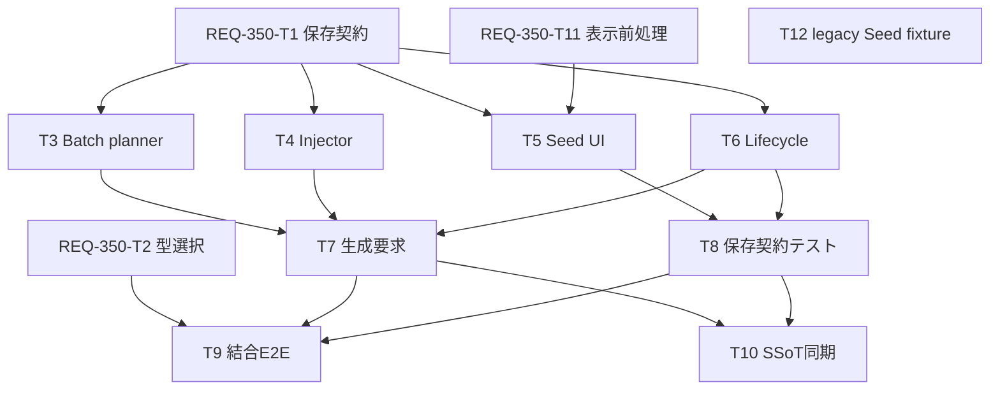

# Implementation Plan: REQ-350 Seed 専用型

## Executive Summary

Seed を標準入力型 `seed` として選択・保存し、欄ごとのランダム/固定操作と各セット内0始まりのバッチ規則を適用する。Main/Seed=100 と Rough/Seed=200 が無同期なら、2枚で100/101と200/201をそれぞれ送る。

詳細は [設計書](docs/design/REQ-350.md)、[テスト計画](docs/design/REQ-350-test-plan.md)。設計レビュー承認済み、実装中。既存REQ-343計画は [保存版](docs/design/REQ-343-implementation_plan.md) に内容を保持した。

## Architecture and Contracts

- 標準 `input_type:'seed'` を追加。既存文字列型DB/APIを利用し、ParamTypeMaster.widget_typeを拡張しない。
- 値は既存paramValuesの完全roleキー、modeは予約キー `__seed_modes_v1` のversion付きJSON文字列に保存。modeのslotKeyはmaster_id/variant_idで識別する。
- metadata不在はfixedで既存値保持。専用Sampler_Seedはglobalから独立し、非seedのlegacy Sampler_Seedだけglobalの既存規則を利用する。
- 専用Seedを含むセットは現行UI上限8を生成前にも検証し、randomの極大batchを抽選前に拒否する。
- dedicated fixedは0..4294967295、fixed=base+index。randomは既存32bit乱数。overflowは全対象セットを送信前に拒否する。
- batch plannerで全設定を検証して各itemを確定、injectorへslot別numberを渡す。実graphと実Seed metadataを凍結して既存BatchRequest APIへ送る。
- seed同士の同期は親mode/値/抽選を共有。mixed型sync・cycle・複数親・参照配線seedは説明付き拒否。snapshotは実値をfixed復元する。

## Task Cards and Ownership

- [REQ-350-T1 Seed 設定の保存形式と入力検証を定義する](docs/backlog/task/active/REQ-350-T1.md): 2ファイル、変更260行以下、依存なし。
- [REQ-350-T2 マッピング編集で標準 Seed 型を選択・保存する](docs/backlog/task/active/REQ-350-T2.md): 3ファイル、変更240行以下、依存なし。
- [REQ-350-T3 各スロットのバッチ Seed を先に確定する](docs/backlog/task/active/REQ-350-T3.md): 2ファイル、変更295行以下、依存T1。
- [REQ-350-T4 専用 Seed をグラフへ数値として注入する](docs/backlog/task/active/REQ-350-T4.md): 2ファイル、変更220行以下、依存T1。
- [REQ-350-T5 専用 Seed 入力にランダム・固定操作を表示する](docs/backlog/task/active/REQ-350-T5.md): 3ファイル、変更260行以下、依存T1/T11。
- [REQ-350-T6 既存プリセットとスナップショットの Seed 初期化を整える](docs/backlog/task/active/REQ-350-T6.md): 2ファイル、変更200行以下、依存T1。
- [REQ-350-T7 通常生成とセット生成の要求を個別 Seed で凍結する](docs/backlog/task/active/REQ-350-T7.md): 2ファイル、変更295行以下、依存T3/T4/T6。
- [REQ-350-T8 モード・値の保存とセット切替を契約検証する](docs/backlog/task/active/REQ-350-T8.md): 3ファイル、変更270行以下、依存T5/T6。
- [REQ-350-T9 受入経路と異常系を結合 E2E で確認する](docs/backlog/task/active/REQ-350-T9.md): 1ファイル、変更280行以下、依存T2/T7/T8。
- [REQ-350-T10 Seed 型とバッチ規則を仕様書へ同期する](docs/backlog/task/active/REQ-350-T10.md): 2ファイル、変更140行以下、依存T7/T8。
- [REQ-350-T11 生成ページの Seed マッピング除外フィルタを更新する](docs/backlog/task/active/REQ-350-T11.md): 2ファイル、変更160行以下、依存なし。
- [REQ-350-T12 ParamPanelのlegacy Seed表示とfloat境界をテストする](docs/backlog/task/active/REQ-350-T12.md): 1テストファイル、変更30行以下。legacy mapping fixtureでglobal Seedを検証し、専用seedに対してfloat CFG欄にSeed toggleが出ないことを確認する。

Task Cardは12件。カード内に対象ファイル、型/シグネチャ、現行抜粋、実装要件、具体的検証コマンドを封入した。原子性監査は全件PASS（計画値<=3ファイル、<=300行）。T12はT5に対して既存テストfixtureのみを補正する。

## Dependency Graph and Scheduling

最大4層、循環なし。T1/T2/T11/T12、続いてT3/T4/T5/T6を独立dispatchできる。T7がuseGenerateActionを単独所有し通常生成/セット生成を同時更新する。T9/T10はそれぞれ依存解消後に並行可能。REQ-336/343の現行variant基盤を使い、REQ-347/348/349/351を前提完了タスクにしない。別PBIと共通ファイルが重なる場合はcoordinatorが排他順序を管理する。

## SSoT Synchronization

T10でSPEC_SETTINGS §4-1にseed標準型と保存契約、SPEC_GENERATE §2-5/生成フローに欄別状態・global優先・batch境界・同期・履歴を反映する。doc_mapperの対応文書未検出は記録済みで、PBIの指定仕様を対象とした。同期完了をDone条件に含める。

## Verification Plan

実装後の検証はTask Cardとtest planに定義。設計段階では未実行。

- `cd frontend; npm run typecheck`
- `cd frontend; npx vitest run src/utils/__tests__/seedModel.test.ts src/utils/__tests__/seedBatch.test.ts src/utils/__tests__/workflowParamInjector.test.ts`
- `cd frontend; npx vitest run src/pages/GeneratePage/hooks/__tests__/useGenerateAction.seed.test.ts src/test/e2e_req350_seed.test.tsx`
- `cd backend; $env:PYTHONPATH='.'; ./.venv/Scripts/python.exe -m pytest tests/test_req350_seed_mapping_api.py tests/test_req350_seed_preset_roundtrip.py`

AC-1〜7、固定MAX単発/overflow全体拒否、乱数stub、stage独立、mode破損、mixed同期、target競合、graph-reference、凍結後編集とretryを実測する。実ブラウザ/実ComfyUI手順はtest planに記載。監査とcleanupは [監査証跡](docs/design/REQ-350-design-audit.md) に記録する。

## Trade-offs and Risk Disclosure

JSON mode metadataはDB変更を減らす一方、予約キーとversion検証が必要。stable slotはstage名変更に強いが、variant削除/再作成で未設定mode=fixedに戻る。

専用固定値も32bit範囲とし、上限超過は全体拒否を選ぶ。uint32 wrapは再現Seedを意図せず変えるため見送り。64bit/safe-integer固定はprecisionとnode上限の別設計が必要。極大Seedから専用型への移行時は値の調整が必要になる。legacy設定を自動移行しない。

mixed型同期と参照配線Seedは拒否するため、直接整数mapping/seed同士の同期へ設定を整える必要がある。randomの偶然一致は許容。既存乱数源を維持し、暗号乱数へ変更しない。

backend/openapi.jsonにV2 mapping schema driftがある。現行Pydantic/router/TSを設計契約とし、REQ-248の全体同期を本PBIへ混ぜない。BAローカルサービス/GPU確認手段の稼働制約がある場合はINCONCLUSIVEとして開示し、PASSを捏造しない。

## Human Design Review Gate

BA監査はreasoning modelで実行し、指摘を検討して凍結時点・同期root抽選・枚数上限8を補足した。モデル判定はFAIL相当で、補足後の再監査は未実施。推論直後のunloadはexit 0、lms psでモデル未ロードを確認済み。nvidia-smiがないためGPU全体のVRAM使用量0の実測はできていない。

レビュー対象は固定32bit/overflow全体拒否、専用Seedとglobalの独立、stable slot mode保存形式、mixed型sync/参照Seed拒否。これらの設計は人間承認済み。T12は実装で判明した既存テストfixtureの補正のみで、製品要件の変更はない。ACの削除・緩和はない。監査未成立があれば明示して返す。

