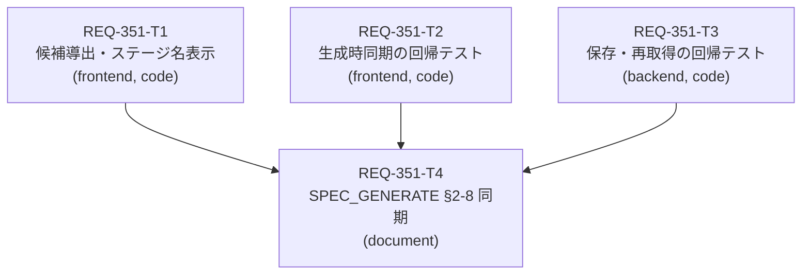

# Implementation Plan - REQ-351: ParamSyncで同一ロールの別ステージを個別選択して同期する

## Proposed Changes

- 原因（コード読取りによる推定）: ParamSyncModal はサブ候補の型判定をマスター一覧の legacy role（基底ロール）で引くため、ステージ接尾辞付きの `computed_role`（例 `Sampler_Steps_Rough`）が候補から除外される。候補表示にステージ名もない。
- 対応: ワークフロー mapping からロール×ステージ単位の候補を導出する純関数 `buildParamSyncCandidates` を `mappingStageGroups.ts` に追加し、ParamSyncModal の候補・型判定・代表変更時の絞り込み・ラベル（`Rough / Steps` 形式）を置き換える（T1）。
- 同期の適用（生成時の `applyParamSync`）と保存 API は role 文字列で動くため変更しない見込み。回帰テストで AC-3〜AC-6 を固定する（T2・T3）。
- SPEC_GENERATE §2-8 を実装結果に合わせて更新する（T4、document）。
- 詳細: `docs/design/REQ-351.md`、テスト計画: `docs/design/REQ-351-test-plan.md`。

## Task DAG

- T1・T2・T3 は所有ファイルが重ならず、新しい共有契約を相互に参照しないため並列実行できる。最大深さ 2。
- T4 は T1〜T3 の確定事実（ラベル形式、型判定の参照順、`applyParamSync` 修正の有無、保存確認）を記述するため最後に実行する。

## AC Coverage

| AC | Card | 主なケース |
|---|---|---|
| AC-1 | T1 | 純関数 unit 3件、モーダル integration（表示・型不一致・API 失敗） |
| AC-2 | T1 | 代表自身を除外 |
| AC-3 | T2 | Rough だけ 50、Detail は 40 保持、無効グループは適用しない |
| AC-4 | T1, T2 | 別ロールを候補として選択、生成で 60 |
| AC-5 | T2 | Detail を同期先から外した後に代表を 70 へ→Rough=70、Detail=40（外した時点で Detail の入力欄にあった値。下の具体例を参照） |
| AC-6 | T1, T3 | 再表示でチェック復元、代表変更時の保持、API の保存・再取得 |

### AC-5 Clarification

AC-5 の「解除時の値」は、**Detail を同期先から外した瞬間に、Detail 自身の入力欄に入っている値**を指す。代表（Main）から直前の生成でコピーされた値ではない。

具体例（初期値 Main=20、Rough=30、Detail=40。T2 のテスト G3 と同じ数値）:

| 手順 | 操作 | 画面の入力欄（ストアの値） | 生成で送信される値 |
|---|---|---|---|
| 1 | Main/Steps を代表にし、Rough/Steps と Detail/Steps の両方を同期先に選ぶ | Main=20、Rough=30、Detail=40 | （まだ生成しない） |
| 2 | Main を 60 に変えて生成 | Main=60、Rough=30、Detail=40（Rough・Detail の欄は同期中のため無効化され、自分の値を表示したまま） | Main=60、Rough=60、Detail=60 |
| 3 | Detail だけ同期先から外す | Main=60、Rough=30、Detail=40 ← この 40 が「解除時の値」 | （生成しない） |
| 4 | Main を 70 に変えて生成 | Main=70、Rough=30、Detail=40 | Main=70、Rough=70、**Detail=40** |

- 「ストアの値」とは、生成画面の状態ストア `paramValues` に入っている各項目の値（例 `paramValues['Sampler_Steps_Detail']`）で、画面の入力欄が表示・編集する値そのものである。DB に保存される値ではない。
- 同期は「生成するときに、送信する値だけを代表の値で上書きする」仕組みで、ストアの Rough・Detail の値は書き換えない（既存挙動を維持。理由は Trade-off Disclosure 2）。そのため手順2で 60 を送信しても Detail の値は 40 のままで、手順3で外した時点の値も 40 になる。
- 同期中は Detail の入力欄が無効化されて編集できないため、「解除時の値」は通常、同期を始める前に Detail に入っていた値と同じになる。
- 手順4で Detail が 60（直前の同期で送った値）や 70（新しい代表値）にならないことを T2 のテストで確認する。

## Verification

- プロファイル: V1 既定。テスターは最終候補で Gate 1（mypy、backend unit、frontend vitest 指定範囲、UI 不変条件、typecheck）、Gate 2（`scripts/run_full_suite.py`）、Gate 3（`scripts/run_e2e.py` とシナリオ・Red Team）を新規実行する。
- 選択契約: REQ-351 ケース 16 件（T1: 11、T2: 4、T3: 1）が収集・全 PASS。

## Trade-off Disclosure

1. **型判定の参照先**: `WorkflowMapping.input_type`（バックエンドが実効マスターから解決済み）を優先し、legacy マスターの role 表を予備とする。カスタム role 上書きにも追従し、既存の legacy データと既存テストの互換を保てる。代替案（マスターのバリアント `computed_role` から逆引き）は、上書き role や孤立 mapping で解決に失敗しやすい。
2. **同期の適用時点**: 生成時に実効値へ適用する現行方式を維持する。代替案（代表の入力変更時にストアの同期先値も書き換える）は表示が直感的だが、プリセット保存・スナップショット・Seed 経路へ影響が広がり本 PBI の範囲を超える。代償として、同期中の同期先入力欄は無効化された状態で自身の保存値を表示する既存挙動が残る。
3. **AC-5「解除時の値」の解釈（設計レビューで確認済み）**: 同期先から外した時点で Detail 自身の入力欄にある値（上の例では 40）を保持する、と解釈した。別の解釈として「外すときに代表の値（例では 60）を Detail の入力欄へ書き込み、以後その値を使う」も考えられるが、ストアを書き換える新しい挙動になるため採用しない。具体例は「AC-5 Clarification」を参照。
4. **純関数の置き場所**: 既存 `mappingStageGroups.ts` に追加し、既存テストファイルを拡張する（テスト配置規約と `groupMappingsByStage` の再利用を優先）。代替案の新規ユーティリティは責務の分離が明確だが、新しいテストファイルが必要になる。
5. **E2E を追加しない**: 変更はモーダル内のリスト表示とチェックで、jsdom で検証できる。実ブラウザ固有の挙動を変えないため、Gate 3 は既存 E2E の回帰実行とシナリオケースで確認する。代償として実ブラウザでの見た目（ラベルの省略表示）は自動検証しない。

## Risks

- リスク分類 low（スキーマ・API・依存・共有フィクスチャの変更なし）。T2 で `useGenerateAction.ts` の修正が必要になった場合、またはバックエンドソースに差分が出た場合は高リスクに切り替え、設計へ差し戻す。
- ParamPanel の「Synced: {表示名}」は同名マスターのステージを区別しない。本 PBI の範囲外として記録する。
- ステージを解決できない legacy mapping は同じ表示名で並ぶことがある（`Role:` 行で区別）。
- 原因は実行による再現ではなくコード読取りによる推定。T1 の AC-1 ケースが修正前に失敗することを Engineer が確認すると根拠が強まる。
