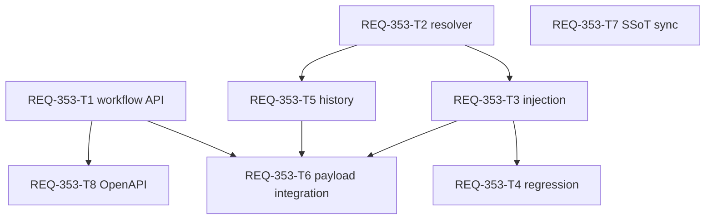

# REQ-353 Design: 専用seedを実際のComfyUI入力へ適用する

## Feasibility and Boundary

AC-1〜5は実現可能。現行React/TypeScriptの純粋関数とFastAPI/Pydanticの既存workflow読取APIを使う。DB migration、生成要求形式、乱数方式は変更しない。実装は人間の設計レビュー承認後に開始する。

Workspace rootは`C:/Users/audih/ws/comfy-create-helper2`。Target_Pathsは同rootのfrontend/backend/docs。作業成果物のGit_Root_Mismatch=No。contextからGLOBAL_SCRIPTSは`C:/Users/audih/.gemini/antigravity/scripts`に解決したが、dev-designのworkspace外アクセス禁止により共通スクリプトの実行は行わない。外部pathに対するHallucination_Lock=ACTIVE。doc_mapper、pbi_manager scaffold、openapi_parser、local_model_adapter BA監査/unloadは`[SCOPE_VIOLATION: BLOCKED_BEFORE_ACCESS]`として記録し、workspace内での対象限定調査と文書生成を進めた。外部監査を完了したという主張はしない。

## Evidence and Scope Expansion

インシデントで観測したworkflow 69のSamplerCustomは`noise_seed`を使用し、MappingMasterはprimary=`seed`、fallback=`[noise_seed]`。DBのバッチ実値は相異なるが、注入コードはfallbackを参照せず`seed`を新規作成する。過去POST本文は保存されておらず、実際のpayloadは静的コードと設定から導いた経路である。

`WorkflowMappingRead`とfrontend `WorkflowMapping`にはfallback属性がなく、`GET /api/workflows/{workflow_id}`のrich mapping projectionにも含まれない。frontendだけ修正しても登録済み別名が届かないため、PBIのSurfaceを**workflow読取API・frontend型・初期値・履歴**へ拡張する。MappingMasterが保存するfallback JSON文字列をeffective_masterから取得し、読取応答へ配列として付加する。生成POSTやmapping更新要求は変更しない。

`getInitialParams`もprimary/valueのみを参照しており、`noise_seed`の初期値を失う。`generationRecord.capture`も同じため注入修正だけではAC-5を満たせない。これらを共通解決規則へ接続する。captureWorkflowの空graph呼出し、bypass、missingの非例外記録を維持する。

## Contracts and Decisions

### Workflow read contract

```python
# backend/app/schemas/workflow.py WorkflowMappingRead
fallback_param_names: Optional[list[str]] = None
```

```typescript
// frontend/src/api/types.ts WorkflowMapping
fallback_param_names?: string[] | null

// 新規frontend/src/utils/seedInputResolver.ts
type SeedInputMapping = Pick<WorkflowMapping, 'param_name' | 'fallback_param_names'>
export function resolveSeedInputKey(
  mapping: SeedInputMapping,
  inputs: Record<string, unknown> | null | undefined
): string | null
```

APIはeffective_masterのfallbackを返す。master/variant/roleの現在の優先関係を変更しない。元がNoneならnull、JSON `[]`なら空配列、JSON文字列配列なら順序を保った配列。schemaのbefore validatorで文字列をJSON decodeし、Pydanticのlist[str]検証へ渡す。malformed JSONや非配列DB値は正常な別名として扱わず、既存APIエラー経路で取得を失敗させる。データ修復・無言の別名推定は行わない。追加propertyはoptional/default nullの読取契約。旧frontendは追加fieldを無視でき、既存fixture/旧応答は省略を許す。ただし旧BE応答でprimary欠損ならfrontendは説明付き生成エラーにする。

API snapshotは`backend/openapi.json`の`components.schemas.WorkflowMappingRead.properties`の追加fieldだけ同期し、requiredへ追加しない。既知の他schemaのdriftを一括再生成で混ぜない。`docs/system/openapi.yaml`は存在せず、読取契約は現行Pydantic/routerと既存JSON snapshotを根拠にする。

### Deterministic input key resolution

専用`input_type === 'seed'`について以下を共通関数に集約する。

1. 非空primary、登録済みfallbackの配列順で候補を構成し、重複を除く。名称をtrim/推定/小文字化しない。
2. `Object.prototype.hasOwnProperty.call(inputs, candidate)`がtrueで値がundefinedでない最初のkeyを返す。prototype上のpropertyを入力とみなさない。空/非文字列の候補は有効候補にしない。
3. 候補が存在しなければnull。新keyを生成しない。nullや0などの存在する値をtruthinessで欠損扱いしない。
4. primaryとfallbackが両方あればprimary、複数fallbackがあれば登録順の先頭を選ぶ。選んだkeyがgraph-reference配列なら他keyへ逃げず、validation/injectionで拒否する。

**専用seedの暗黙`value` fallbackは廃止する。** `value`を使うmappingはprimary=`value`またはfallback=`[value]`を明示する。これはAC-3の「primary/fallbackのいずれでも存在しない入力を拒否」に従う互換性上の判断。既存value用unit fixtureへ登録を追加する。既存登録なしvalue専用mappingは設定修正が必要となることをレビューに提示する。legacy非seed global Seedと非seed一般parameterのvalue fallbackは従来経路を維持する。

共通関数はkey解決だけを行い、乱数抽選・graph変更・エラー表示をしない。missingはnullで返すため、初期値/履歴の非例外用途と生成前の拒否用途を共用できる。

### Validation, injection, defaults and record

- `seedBatch.collectTargets`はresolverを呼び、missing node/inputs/key、graph reference、解決後のnode+key競合を拒否する。従来のrole/slot/mode/range/sync/枚数検証を保持する。異なるprimary/alias表現でも同じ実keyへ書くmappingを競合として拒否する。
- `injectWorkflowParams`は専用seedの対象node/inputs/key/referenceと実数値を**全mappingについて書込前に検証**する。missing nodeを単にskipする既存forEachより前に専用対象を準備し、`cloneJson:false`でも無効なseedを途中まで書き込まない。既存通常型の注入・legacy分岐は保持する。
- `getInitialParams`のseed分岐は同resolverでworkflowの既存実keyを読み取る。解決不能/referenceは空文字を返し、画面初期化を例外にしない。生成操作が既存toast経路で説明する。Save Defaultは同じinjectorで基準値を実keyへ保存し、Reset Defaultも同じ初期値を使う。
- `generationRecord.capture`はseedの場合だけsubmitted graphのinputsをresolverで読む。seedの`CapturedField.param_name`は宣言済primaryのまま保ち、valueは実入力から取得する。submitted node消失では従来の`recorded=false`、`value=null`、`status=bypassed/missing`を維持する。空graph呼出しを例外にしない。履歴schema versionや非seed捕捉は変更しない。

解決不能エラーの文言は日本語で、表示名/role、node ID、候補入力名を含める（例: `Rough Seed: ノード1260:1398にseed入力がありません（候補: seed, noise_seed）`）。HTTP POSTが始まる前に現行useGenerateActionのcatchへ伝播する。検証済み凍結workflowをinjectorが同規則で読むため通常経路の注入時不整合は発生しない。

### Batch and observability

通常生成・複数セット生成は現在のfreeze→全対象validation→乱数確定→各graph注入→bypass→record→BatchRequest→submitの経路を利用する。hook本体のsource変更は予定しない。3枚randomテストはseedBatchのrandomUint32を11/22/33へ制御し、APIへ渡すGenerationItem.graphのnoise_seed、actualParamValues、metadata.valueを比較する。UUID用乱数や実画像の差を判定材料にしない。random衝突は引き続き許容する。

今回の恒久的な診断証拠はpayload境界の回帰テストと正しい生成metadata。全POST本文ログ・graph長期保存は別途保存量/保持期間の設計が必要であり、本PBIに追加しない。GPU実生成だけでseed注入の正しさを判定しない。

## Dependency and SSoT Impact

| 対象 | 上流/下流と同期 | Task |
|---|---|---|
| MappingMaster.fallback_param_names / effective_master | DBの既存JSONをworkflow GETへ伝搬。migrationなし | T1 |
| WorkflowMappingRead / TS WorkflowMapping | optional array/nullの応答追加 | T1/T2 |
| seedInputResolver | primary→登録済aliasを唯一のkey規則にする | T2 |
| seedBatch / injector / getInitialParams | 解決後競合・注入・初期値・Default操作 | T3/T4 |
| generationRecord | submitted graph値を読む。bypass/missing維持 | T5 |
| useGenerateAction / generationApi | 現在のfreeze/送信拒否/再送を結合テストで保証 | T6 |
| SPEC_GENERATE / REQ-350 design | 実入力解決・未解決拒否・暗黙value廃止を同期 | T7 |
| backend/openapi.json | 今回追加するWorkflowMappingRead属性の局所同期 | T8 |

SPEC_SETTINGSは入力型・保存UIの契約が変わらないため同期対象にしない。REQ-350設計のContracts flow 4にあるprimary→value→新keyの記述はREQ-353契約へ改訂する。REQ-350のDone履歴は変更しない。

共通実装ファイルに別PBIの作業があればcoordinatorが所有を調整する。implementation_plan.mdに存在するREQ-347計画は保存しREQ-353節を追記した。他作業の編集を戻さない。T1/T2は独立、T3とT5はT2後に並列、T4/T6はT3/T5後のconsumer検証。

## Atomicity and DAG

| Task | 所有変更ファイル数 | 変更行上限 | 依存 |
|---|---:|---:|---|
| T1 workflow GET fallbackの伝搬と契約テスト | 3 | 260 | なし |
| T2 TS型・共通key resolver・unit | 3 | 220 | なし |
| T3 batch/injector/defaultの適用 | 2 | 200 | T2 |
| T4 batch/injector回帰テスト | 2 | 260 | T3 |
| T5 seed履歴捕捉の修正・unit | 2 | 180 | T2 |
| T6 hook送信payloadと拒否の結合検証 | 1 | 260 | T1,T3,T5 |
| T7 生成契約/REQ-350対象箇所同期 | 2 | 120 | なし |
| T8 OpenAPIの局所同期・契約検証 | 2 | 160 | T1 |

全taskのAtomicity_Check=PASS（<=3 files、<=300 changed lines）。全カードは300行未満。最大依存深さ3層。実装が上限を超えるなら設計へ差し戻し、無承認拡張しない。



## Trade-offs and Review Gate

登録済みaliasを応答へ付加するとFE/BEの両方を更新する必要があるが、`noise_seed`ハードコードやFEからのmaster別追加取得より、登録内容と凍結workflowを一つの契約にできる。primary/fallback優先は設定に基づく決定で、ComfyUIのobject_info型検証を新規に導入しない。暗黙valueを続ける代案は未登録の入力へ値が流れるため採用しない。

リスクは登録なしvalue専用mappingの拒否、保存DBの壊れたfallback JSONでの取得失敗、古いfrontend配信artifactの残存。実装レビューではFE/BE更新を揃え、必要なら既存build skillでfrontend/distを更新する運用をcoordinatorが管理する。build artifactはこの設計のatomic source taskへ混在させない。

Local BA監査は境界制約で未実施。人間のレビューに提出できる文書は生成済みだが、local-model PASS/GPU unloadの証拠はない。監査制約の解消または明示的な扱いの判断と、設計承認の前にimplementationへ進めない。元の「修正に進む」選択はPBI作成・設計作成を許可するもので、このreview gateの承認記録は別途必要。

## BA Audit Trace

- Audit_Status: BLOCKED_BEFORE_EXECUTION_SCOPE
- Audit_Model_Configured: 未取得（workspace外設定は参照しない）
- Skill_Default_Model: qwen/qwen3.5-9b（実行modelとは主張しない）
- Runtime: 未接続、未検証
- Requested_Settings: context_length=32768、reasoning_effort=none
- Targets: REQ-353.md、REQ-353-test-plan.md、REQ-353-T1.md〜REQ-353-T8.md（全10文書）
- Chunks / Elapsed / Result: 0 / 0s / NOT_RUN
- Unload: NOT_RUN（本作業でmodelをloadしていない。model未loadedとの確認も行っていない）
- Manual_Trace: AC-1〜5とT1〜T8を対応付け、API別名欠落・初期値欠損・履歴欠損・未登録value・bypass/empty graph・競合先を設計へ反映。ローカルmodel監査の代替PASSとして扱わない。
