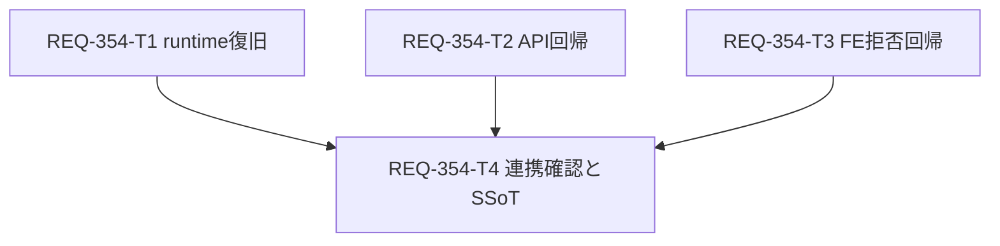

# Implementation Plan — REQ-354

## Executive Summary

Workflow取得APIのSeed alias欠落を、実行中BEをworkspaceへ揃えることで修復する。現行sourceには伝搬/解決処理があり、runtime確認と不足する回帰検証を中心に進める。[設計](REQ-354.md)、[テスト計画](REQ-354-test-plan.md)。前のREQ-344 planは[全文保存](REQ-354-previous-implementation-plan.md)。

## Architecture and SSoT

有効masterのprimary/登録順aliasを返し、FEの既存resolverがown inputを選ぶ。noise_seedへ適用、primary/fallback欠落は全件POST前拒否。既存FastAPI/Pydantic/SQLAlchemy/Seed pipelineを使用。SPEC_GENERATEへ伝搬契約/証拠を追記しdocs/openapi.yamlの不足propertyを同期する。

2026-10-13承認: fallback_param_namesはrequired非包含・nullable array(string)とし、OpenAPI defaultは省略。live/local schemaとbackend snapshotへ文書を揃え、アプリsourceは変更しない。

## Task Cards and Ownership

| Task | 所有変更ファイル | 行予算 | 依存 |
|---|---|---:|---|
| [T1](../backlog/task/active/REQ-354-T1.md) | verification.md、backend限定runtime復旧 | 100 | なし |
| [T2](../backlog/task/active/REQ-354-T2.md) | API既存test 1ファイル、7 mapping | 100 | なし |
| [T3](../backlog/task/active/REQ-354-T3.md) | hook既存test 1ファイル、後段欠落/候補エラー | 100 | なし |
| [T4](../backlog/task/active/REQ-354-T4.md) | SPEC_GENERATE/docs/openapi.yaml/verification.md | 180 | T1,T2,T3 |

物理カード生成済み、各3ファイル/変更300行/カード300行以下。現行実装の欠陥が再現した場合はsource変更前に設計/カードを改訂する。

## Dependency DAG

最大深さ2。T2/T3は並行可能。

## Verification Plan

backend限定restart前後のpath/PID/APIとFE refetchを記録。既存REQ-353 API/resolver/batch/injector/history/hook回帰を実行しrandom11/22/33、seed keyなしを確認。7 mapping、後段欠落の全件拒否/候補エラーを補強。runtimeでworkflow69のbatch3、3 graphとComfy prompt_idを確認。AC-4は承認済みT3のnormal/checked-set自動回帰を受入証拠とし、runtime interception/POST0は必須から外す。live/local/snapshot/docsのdefault省略・property一致・required非包含を確認。必須証拠の不足はINCONCLUSIVE。

## Trade-offs and Risks

runtime一致を確認する修復は小さいが、実行経路/DB/variant/host/cacheの比較が必要。新build-info API/RNG hookは追加しない。処理中jobがあればrestartを待つ。OpenAPIの対象propertyだけ同期して他PBIの差分を保持。DB欠陥が実証された場合は設計へ戻す。

T3はhookで送信関数未呼出を保証する受入証拠で、runtime HTTP件数の観測とは区別して記録する。この範囲はユーザー承認済み。positive runtime batch3/prompt_idの条件は維持する。

## Human Design Review Gate

設計/test plan/物理Task Cardを人のレビューへ返す。実装は今回設計の承認後。

上記default省略とT3証拠受入への改訂は2026-10-13にユーザー承認済みで、改訂範囲の再承認は不要。

## Local BA Audit

初回は固定qwen/qwen3.5-9b、context32768、reasoning_effort=none。設計/test plan/T1〜T4/root planを明示監査し、traceとunloadを記録した。監査応答は取得済み(exit0)、raw判定はCRITICAL INCONSISTENCY。指摘を評価しruntime gate/null/DB照合を明確化、当時は改訂後の再監査を未実施。unload exit0・残存なし。

監査中root planが別REQ-344へ同時更新されたため、この専用コピーでレビューする。rootは他の更新を保持し、開始前hashと監査読取内容の保証範囲をtraceへ記録した。

2026-10-13の改訂版再監査は本専用planを含む7対象で実施済み（2 chunk＋統合、約421秒、exit0）。raw応答は重大な矛盾を指摘しPASS判定ではない。実測と異なるdefault出力の推測、effective masterをGitブランチと扱う誤読、既存gateの見落とし等について[採否trace](REQ-354-ba-reaudit-trace.json)を残した。unload exit0・残存モデルなし。監査メタデータ追記後の文面は再監査していない。
