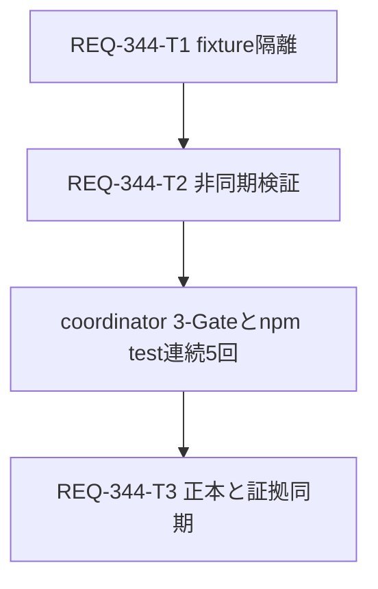

# Implementation Plan — REQ-344

## Executive Summary

GeneratePage.test.tsxの全体実行時のtimeout/disabled判定不安定を、fixture隔離と非同期待機の改善で修正する。AC-1は既定npm testを同じ実装で連続5回実行し、対象全ケースが全回PASSすること。原因は未確定であり、コード上の候補を観測で検証する。

設計: [REQ-344](docs/design/REQ-344.md)、[test plan](docs/design/REQ-344-test-plan.md)。
旧REQ-347用planは [保存した全文](docs/design/REQ-344-previous-implementation-plan.md) に保持した。

## Architecture and SSoT

React18/Query5/Vitest1.6/jsdom/forksの既存枠組みを使う。対象実装はGeneratePage.test.tsxだけ。毎caseでAPI実装・Zustand mock state・QueryClient・storage・timerを初期化する。mock storeは実Zustand購読を使い、preset同期とsetterによる状態変化をassertする。

workflowはdeferredでAPI開始/未解決/成功/rejectを制御し、両layoutのdisabled状態を確認する。autosaveだけbounded fake timerを使い、同期前保存禁止・同期後prompt保持・1000ms後の正しい保存を肯定/否定両方で確認する。SPEC_GENERATEに回帰契約と証拠リンクを完了時に同期する。

## Task Cards and Ownership

| Task | 内容 | 変更ファイル数 / 行予算 | 依存 |
|---|---|---|---|
| [T1](docs/backlog/task/active/REQ-344-T1.md) | 変更前診断、API/store/query/cleanup隔離 | 1 / 280以下 | なし |
| [T2](docs/backlog/task/active/REQ-344-T2.md) | workflow待機、autosave時間制御、境界assert | 1 / 250以下 | T1 |
| [T3](docs/backlog/task/active/REQ-344-T3.md) | SPEC_GENERATEとverification記録 | 2 / 100以下 | T2＋5回検証証拠 |

Task Cardは全て物理生成済み、各300行以内。追加＋削除行予算の超過見込みは再分割する。同じテストファイルの更新とその検証結果が必要なため直列。Task DAGの最大深さ3。

## Dependency DAG

## Verification Plan

frontendでnpm run typecheck、対象vitestを実行する。親coordinator/testerが既定npm testを固定5回実行し、対象判定・全体終了code・日時・件数・ログを全回保存する。境界は両layoutの未解決/reject、同期前1200ms、同期後prompt保持、999/1000ms autosave、cleanupとcase間漏れ。詳細コマンドはtest planにある。設計段階で実装テストは実行していない。

## Trade-offs and Risks

Zustand fixtureは実購読を検証できるが、対象actionの保守が必要。製品store全体の持込みは副作用が増えるため採用しない。fake timerは実待機を除けるがquery通知との混在に注意し、利用区間とadvance時間を明示する。

重いモーダルimportの分離は初手にせず、修正後もtimeoutが再発する場合に実測根拠から設計を改訂する。timeout増加・skip/retry・全体直列化・worker数制限を受入の代替にしない。5回成功は観測条件を満たすが将来flakyゼロの保証ではない。対象PASSと別ファイルによる全体FAILは分けて記録する。

## Human Design Review Gate

本設計、test plan、物理Task Cardを人のレビューへ返す。実装開始は設計承認後。PBI ready/in-progress指定は対象選定の承認であり、完成した今回設計のレビュー承認とは区別する。

## Local BA Audit

qwen/qwen3.5-9bはcatalogで設定キーFOUND確認済み。context32768/reasoning_effort=none、
本設計・test plan・T1/T2/T3・このplanを明示列挙して監査する。
監査結果とunload確認は親への構造化報告と設計監査節へ記録する。
