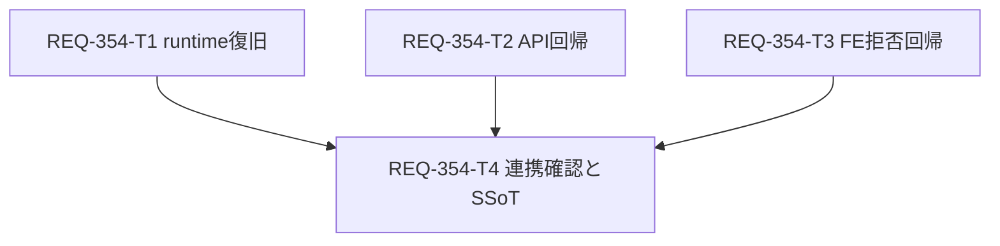

# REQ-354 設計

## Feasibility and Boundary

AC-1〜4は既存のFastAPI/Pydantic/SQLAlchemy、React/TypeScript/Vitestで実現可能。
Workspace Git rootは `C:\Users\audih\ws\comfy-create-helper2`。frontend、backend、tools/server-manager、docsはこの配下。外部実装ファイルは参照・変更しない。LM Studio localhost API/CLIは監査に使用する。

## Evidence and Root Cause

incident報告ではmaster4のaliasが `[noise_seed]`、workflow69の7 seed mappingはnull。Rough/Detail node `1260:1398` / `1260:1396` はnoise_seedのみ。現行workflows.py:get_workflowはeffective_masterからfallbackを返し、FEのresolver/batch/injector/初期値/履歴も登録aliasを使う。REQ-353のAPI/FEテストも存在する。

古いBE importまたは別checkout使用を第一候補とするが、原因確定前に再起動だけで完了しない。DB差異、variantのeffective master、FE接続先、query cacheを比較する。現行コードで再現しなければ製品ロジック変更は不要。欠陥が再現した場合は証拠と変更範囲を設計へ返し、sourceを変更する前にTask Cardを改訂する。

T2/T3は隔離環境の回帰保証でありruntime修復の成功証拠ではない。runtimeのpath/DB/HTTP一致が確認できなければT1/T4は保留する。nullable契約はalias未登録を許容するが、登録済aliasをnullへ落とす成功応答は許容しない。

## SSoT Impact

doc_mapperはPBIとの対応文書を返さず、PBIのseed/workflow契約だけを検索した。SPEC_GENERATE:100/291にprimary→登録順fallback、own key、POST前拒否の正本がある。SPEC_SETTINGS:126のSeed割当契約は変更不要。

`docs/system/openapi.yaml`はなく、実際の正本は `docs/openapi.yaml`。parserでWorkflowMappingReadにfallbackがないことを確認。`backend/openapi.json`はREQ-353契約テスト対象。T4で現在のapp.openapiとbackend snapshotを比較してdocsの当該propertyだけ同期し、他PBIの変更を保持する。

| 文書 | 同期 |
|---|---|
| docs/specs/SPEC_GENERATE.md | workflow GETがeffective masterのprimary/登録順aliasを返す契約、証拠リンク |
| docs/openapi.yaml | optional nullable array(string)のfallback_param_names、OpenAPI defaultは省略 |
| docs/design/REQ-354-verification.md | 実行path/PID、API前後、FE再取得、queue/拒否の証拠 |

## Architecture and Dependencies

MappingMasterの保存JSON → WorkflowMapping.effective_master（direct master優先、なければvariant.master）→ parse_fallback_param_names → WorkflowMappingRead → FE WorkflowMapping → getInitialParams/validateSeedBatch/prepareSeedBatch → injectWorkflowParams → batch → ComfyUI prompt。履歴は実graph keyから読む。

primaryの後に登録順aliasを探索し、既存own keyだけを選ぶ。undefinedはskip、選択keyがgraph referenceなら別aliasへ逃げず拒否。null/[]を区別する。alias推測・graph key追加・DB migrationは不要。

runtime復旧は既存server-managerのbackend限定restartを使う。port8000 listenerのPID、command line、exe、workspace設定、現在のAPIを記録する。別rootだった場合は外部checkoutを読まず、当workspaceを起動するプロセス管理判断をcoordinatorへ返す。処理中jobがあれば終了または既存停止手順を待つ。ComfyUI再起動は不要。

新PID、当workspace venv Python、直接importのmodule.__file__、live OpenAPI、workflow mappingsを確認する。hash/開始時刻だけでimport一致を断言せず、同環境TestClientと稼働HTTPを照合する。FEの実API baseを確認しworkflow queryをinvalidate/refetch、network応答にもaliasがあることを記録する。

## Acceptance Mapping

| AC | 自動検証 | 稼働確認 |
|---|---|---|
| AC-1 | T2: noise_seedのみ、7 mapping、legacy/variant GET | T1:master4/workflow69一致 |
| AC-2 | 既存hook fallback送信 | T4:refetch後Generate→batch→Comfy prompt_id |
| AC-3 | 既存hook random11/22/33、seed own keyなし | T4:3 payloadの実seedとprompt_id |
| AC-4 | T3:後段slot欠落で全件送信0、候補エラー（承認済み受入証拠） | T4: T3の結果と証拠を参照 |

既知random値はVitestのrandomUint32 stubで固定する。稼働E2Eはrandom実値をcaptureし、prod RNG hookを追加しない。queue受付と画像完成は区別する。

2026-10-13のユーザー承認により、AC-4はT3のnormal/checked-set両方の自動回帰（有効な先行slotと解決不能な後段slot、submitGenerationBatch=0、送信state変更0、nodeと候補を含むエラー）で受け入れる。T4のruntime response interception/POST0確認は必須から外す。正例の稼働batch3とComfy prompt_id確認は引き続き必須。

`fallback_param_names` はrequired非包含、値はarray(string)またはnull。Pythonモデルの `Optional[list[str]] = None` とOpenAPIのdefaultキーワードは区別し、live OpenAPI・local app.openapi・backend/openapi.json・docs/openapi.yamlでは当該propertyのdefaultを省略する。既存sourceを変更してdefaultを出力させない。T4でproperty全体とrequired非包含を比較する。

## Atomicity and DAG

各カードは3ファイル以下、追加削除合計300行以下、カード自体も300行以下。

| Task | 変更対象 | 行予算 | 依存 | 判定 |
|---|---|---:|---|---|
| T1 | verification.md | 100 | なし | PASS |
| T2 | test_req353_seed_mapping_api.py | 100 | なし | PASS |
| T3 | useGenerateAction.seed.test.ts | 100 | なし | PASS |
| T4 | SPEC_GENERATE.md, docs/openapi.yaml, verification.md | 180 | T1,T2,T3 | PASS |

最大深さ2。T2/T3は別ファイルで並行可能。T1のlive runtimeとテストDBは独立。T4だけがT1の証拠文書へ追記する。

## Trade-offs and Risks

既存ロジックを維持する復旧は変更が少ないが、運用経路の再発リスクが残るため実行path/APIを証拠化する。build-info endpointや自動restart hookは追加しない。既存テストを再利用し、不足する7-slot応答と後段slot欠落だけ補強する。

ComfyUI unavailableなら自動テスト成功だけでAC-2 runtimeをPASSにしない。runtime一致/prompt_idが未観測ならINCONCLUSIVE。OpenAPIは対象propertyだけ同期し、variant/DB欠陥が実証された場合には勝手なmaster更新で埋めず設計へ戻す。

AC-4の自動回帰は実hookからsubmit関数に到達しないことを保証する。runtime HTTP interceptionの観測は行わないため実HTTP件数を測定済みとは記録しない。この証拠範囲をユーザーが承認した。schemaのdefault省略は稼働契約とsnapshotに揃えるための文書修正で、nullable/optionalやAPIの値を変更しない。

## Audit and Review Gate

catalogで固定モデル `qwen/qwen3.5-9b` FOUND確認済み。context32768/reasoning_effort=noneで設計・test plan・T1〜T4・implementation_plan.mdを明示監査する。traceをREQ-354-ba-audit-trace.jsonへ記録する。実装開始は今回設計の人のレビュー承認後。

初回監査はexit0で応答取得、raw判定はCRITICAL INCONSISTENCY。既存runtime gateの見落としと回帰testを製品logic変更と扱う指摘は採用せず、gate/DB read-only照合、null候補なし、localと稼働schemaの区別を明確化した。当時は改訂後の再監査を未実施。初回の採否は[trace](REQ-354-ba-audit-trace.json)。unload exit0、残存モデルなし確認済み（GPU全メモリ解放の意味ではない）。

root implementation_plan.mdが監査中に別REQ-344へ同時更新されたため、REQ-354用planは[専用コピー](REQ-354-implementation-plan.md)でレビューする。root更新を戻さず、監査のroot plan読取時点の内容は保証できないことをtraceへ記録する。

2026-10-13の上記2点の改訂はユーザー承認済み。専用planと設計/test-plan/T1〜T4の7対象でBA再監査を実施した（26,687文字、2 chunk＋統合、約421秒、exit0）。raw応答は重大な矛盾を指摘しており監査PASSとはしない。採否は[再監査trace](REQ-354-ba-reaudit-trace.json)、全文は[raw応答](REQ-354-ba-reaudit.log)。default:null自動出力の推測はT4のlive/snapshot実測と一致せず、effective masterをGitブランチと扱う指摘はデータモデルの誤読。既存gate/nullable/証拠の引継ぎを見落とした指摘も根拠と採否をtraceに記録した。unload exit0、LM Studio残存モデルなし。監査メタデータ追記後の文面を再監査したものではない。
