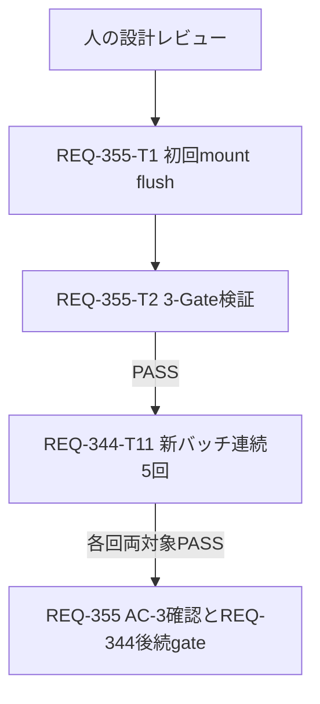

# REQ-355 残存履歴20ページテストの同期修正

## Feasibility and Boundary

実現可能。製品の有限処理は既存の20ページ上限で終了している。
修正は対象テストの1ケース、初回renderHookの同期境界のみ。
workspace/Git rootはC:/Users/audih/ws/comfy-create-helper2、外部実装パスなし。
製品hook、API、schema、timeout、pool、retry、mock応答数、assert、他7ケースを維持する。
設計時のsource編集は禁止。実装は人の設計レビュー後にEngineerへ渡す。
これは現在のWindows workspaceに対するローカルTask設計で、CI設定生成ではない。
承認は親coordinatorが会話履歴で確認する前提条件。depends_onは実装Task間の辺だけを表し、
外部の人間ゲートはMermaidのGで示す。承認未確認ならdispatchしない。

## Evidence and Root Cause

正本はdocs/incidents/REQ-344-residual-history.md。
原本focused 30/30と対象file 8/8がPASS、既定full suiteで初回partial確認がcheckingを受信。
traceはwait開始4954.154ms、page20 API開始6110.449ms、
内部partial設定6169.788ms。有限処理がwait開始から1215.634msを要し、
RTL既定waitFor 1000msを超えた。製品の不具合を示す結果ではない。
対象初回renderだけawait actで包む診断コピーはfocusedとfull 2079/2079 PASS。
原本へは未実装。診断コピーは通常収集対象外の.txtへ移動済み。

REQ-344のdeferred resolverを広いasync act内に置いた事例とは同期対象が異なる。
今回は即時解決する有限mock列のmount/update flushを待つ。deferred待機や
interval、未完了ネットワークを追加しない。上限や実時間の設定を緩めない。

## SSoT and Dependencies

doc_mapper.py docs/specs docs/backlog/pbi/active/REQ-355.mdはexit0/mappedなし。
incidentで特定されたSPEC_GENERATE.mdの「最大20 page/200検査、上限到達partial、
自動タイマー再試行なし」を直接確認。仕様には1秒完了条件がない。
製品契約の変更なし、SPEC_GENERATEやOpenAPIの編集・抽出は不要。
上流: 既存REQ-345の残存履歴hook、React18.3/RTL14.3/TanStack Query5/Zustand5。
下流: REQ-344-T11の新しい既定npm test連続5回バッチ。
REQ-355-T2のGate2 PASS後にREQ-344へ渡し、各回の残存履歴ケースPASSをAC-3へ取込む。
REQ-355 AC-3確認前とREQ-344の全gate達成前は各PBIを完了にしない。

## Minimal Implementation

対象case:
stops after one retry page when baseline-known B follows a full 20-page cycle。
初回renderHookの結果を保持する変数の型は
ReturnType<typeof renderHook<ReturnType<typeof useGenerateDisplayState>, unknown>>。
同じcallback/optionsをawait act(async () => { hook = renderHook(...) })に移し、
act後にconst { result } = hookで既存assertへつなぐ。
RTLの型表現が実環境で合わない場合は、同一型の
RenderHookResult<ReturnType<typeof useGenerateDisplayState>, unknown>をtype importしてよい。
型エラーをas anyで隠さない。ここ以外は変更しない。
installed RTL types/index.d.ts:153-162はrenderHook<Result, Props>の戻りを
RenderHookResult<Result, Props>と定義する。両型表現は同一でcastは不要。
即時resolved mockがact後に収束しなければ実行FAILとして戻す。待機期限の緩和はしない。

初回partial、calls=20、retryResidualHistory、API21回、retry後partial、
baselineB保持assertとmockのcalls<=20分岐をそのまま保持。
renderHookをact内からreturnするだけではactの戻り値がhook結果にならないため、
外側変数への代入を使う。act中にresult.currentをassertしない。

## Task Cards and DAG

| Task | 作業 | 変更file数/行予算 | 依存 |
|---|---|---|---|
| REQ-355-T1 | 1ケースの初回mount flush | source 1 / 30追加削除行以内 | 設計承認 |
| REQ-355-T2 | 3-Gate証拠とREQ-344 handback | 設計・test plan 2 / 160追加行以内 | T1 PASS |

各Task Cardは300行以内。実装sourceと検証証拠は分離。DAG深さ2、
直列依存は変更後sourceを検証するために必要。独立実装枝なし。


## Trade-offs and Rollback

waitFor timeout延長は負荷依存の期限を残すため採用しない。
hook高速化、pool/worker変更、mock短縮は製品境界や再現条件を変えるため採用しない。
初回mountだけをawait actでflushする手法は診断で実証済み、
既存assertが上限とretryの製品契約を継続して検査する。
5回PASSは指定受入の証拠であり、将来の全実行を保証しない。

rollbackはT1で追加したawait act/外側変数だけを元renderHookへ戻す。
他担当のREQ-344 source修正・証拠・Task状態を保持する。
失敗時は行番号、status、API calls、raw logを保存してcoordinatorへ返す。
追加mockや製品修正へ広げる場合は改訂設計をレビューへ戻す。

## Human Review and Audit

詳細設計・test plan・T1/T2を物理生成後、local BA監査を実行する。
監査model/runtime/settings/targets/chunks/elapsed/resultを本節へ記録し、
直後unload exit0でモデル未ロードを確認する。全GPUメモリ解放とは表現しない。
設計変更は人のレビューへ返す。監査結果は未実施をPASS扱いしない。

## BA Audit Trace and Disposition

```json
{
  "action": "ba-audit",
  "model_id": "qwen/qwen3.5-9b",
  "parameters": "9.0B",
  "quantization": "Q6_K",
  "context_length": 32768,
  "runtime": "LM Studio via local_model_adapter.py; version not emitted",
  "reasoning_setting": "adapter governed none; per-request trace not emitted",
  "targets": ["docs/design/REQ-355.md", "docs/design/REQ-355-test-plan.md", "docs/backlog/task/active/REQ-355-T1.md", "docs/backlog/task/active/REQ-355-T2.md"],
  "chunks": "one visible response; internal chunk count not emitted",
  "elapsed_seconds": null,
  "elapsed_note": "tool output did not emit inference elapsed; command/poll waits total about 140.4 seconds, not inference timing",
  "exit_code": 0,
  "verdict": "CRITICAL INTEGRITY RISK DETECTED",
  "unload_exit_code": 0,
  "unload_evidence": "LM Studio reports no models loaded.",
  "post_audit_clarifications_reaudited": false
}
```

| 原指摘の要旨 | 判断・対応 |
|---|---|
| 人の承認とdepends_on=[]が自動CIで矛盾 | ローカル手順でありCIではない。coordinatorの承認確認とGノードを明記 |
| 絶対Windows pathがportabilityを損なう | contextの具体的実行pathを維持。現在workspaceのTask、他OS展開は要件外 |
| unload失敗や外部script欠落の扱い不足 | protocol必須依存。監査失敗/拒否/unload未確認はINCONCLUSIVEとして親へ返す |
| 5回のrun間にglobal stateが残る | 各npm testを独立processで逐次実行する。既定コマンドを維持。追加pool変更不要 |
| mockが遅い場合act後も期限切れ | 対象mockはawait delayなしの即時応答列。実行結果で検証し、未収束はFAIL。timeout延長案は不採用 |
| 別型importとas any禁止が矛盾 | installed RTL型定義で同一型を確認、cast不要を明記 |
| SPEC_GENERATEが自動生成でdriftする | 自動生成との推測は根拠なし。現在の20page契約とsource SHAを検証前固定 |
| auditをbest effort化、OS port確認でGPU解放を確認 | dev-designの必須監査/unload規則に反するため不採用。port閉鎖はモデルunload証拠にならない |

技術修正案への否定指摘はなく、原判定をPASSへ読み替えない。
監査後の明文化は再監査未実施として人の設計レビューへ返す。

## T2 Verification Result (2026-10-13)

Gate 1 typecheck PASS (0 errors)。Gate 2既定`npm test`は229 files、2079 tests
PASS / 0 failures / 0 skipped。対象hook fileはfocusedとfull suiteの双方で8/8 PASS。
Gate 3は既存8ケースで20-page上限、manual retry、baseline保持、identity重複、
unmount、StrictMode、Query restoration境界を確認しPASS。

対象source SHA256は前後同一:
`C43A581BA28B94C85DB7F09CF2BF9C3BB0AE2041D6407D455B17FF5FE01FF7B1`。
SPEC_GENERATE SHA256:
`165EF7F1D504936942BDE4FA5F4CE1D2256F6F4697C8BE063DA176624A4E5FD6`。
全体logのwarning行は142件、unhandled/uncaught一致は0件。warningの不存在は受入条件にしない。

必須local model QA auditはexit 0で実行したが、内容verdictはFAIL
(Critical Ambiguities Detected)。所見はtest planの数値・状態を機械検証する方法、
5-run source integrity guard、固定件数の使用等を要求する。監査結果を無視・修正せず
親coordinatorへトリアージ依頼する。モデル`qwen/qwen3.5-9b` (Q6_K)、context 32768。
traceはreasoning設定、inference時間、内部chunk数を出力していない。
直後unload exit 0、LM Studioはモデル未ロードを報告。全GPUメモリ解放の証明ではない。

したがってGate 1–3およびAC-1/2はPASS、AC-3はREQ-344の直列5-run待ち。
未解決のQA監査指摘があるためT2総合verdictはINCONCLUSIVE。
親への証拠handbackは可能。REQ-344-T11の5-run開始判断は監査所見トリアージ後に行う。
詳細logと各コマンドの時刻・wall・exitは`docs/design/REQ-355-test-plan.md`
のExecution Evidenceおよび`tmp/REQ-355-T2-20261013-evidence.json`を参照。
