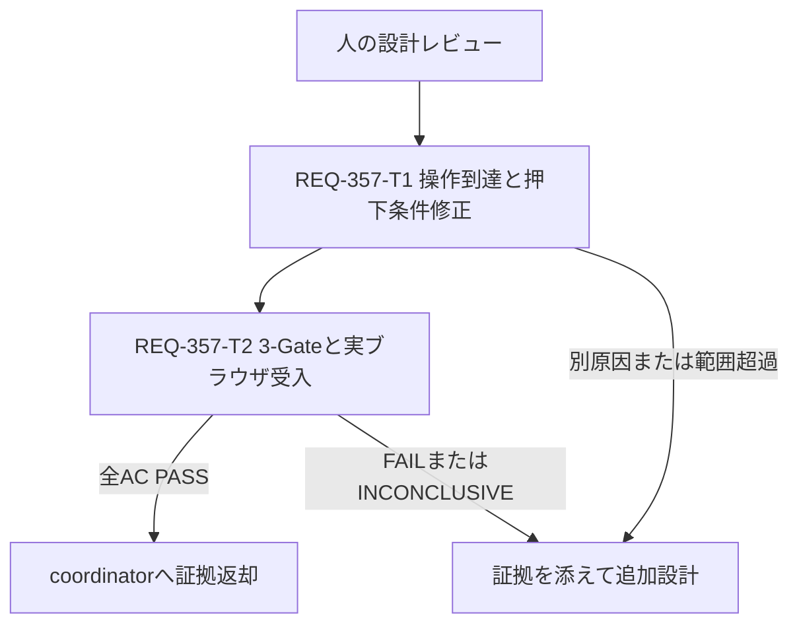

# REQ-357 Design

## Review Status

2026-10-13 JST 作成。利用者は incident report の「開発へ進む」を承認済み。
以下の AC は症状と既存仕様から設計で具体化した提案であり、個別の人の設計レビューは未実施。
設計、test plan、T1/T2 の物理生成後に BA 監査を実施し、人の設計レビューへ返す。
本書作成時点で製品修正・受入確認・PBI 完了は行っていない。

## Feasibility and Boundary

実現可能。対象は共通 TagChipEditor の UI、React 18 / Tailwind 3 / dnd-kit の既存境界内。
workspace は `C:/Users/audih/ws/comfy-create-helper2`、frontend はその配下。
backend/API/データ構造への変更は不要。外部 checkout の設計・書込みを行わない。
`.agents/context.md` の GLOBAL_SCRIPTS は `C:/Users/audih/.gemini/antigravity/scripts` に解決。
既知のグローバル補助スクリプトは設計手順として使用する。
`git status --short` は「must be run in a work tree」で失敗したため差分基準は未確認。
coordinator は実装前に checkout の状態と既存差分を確認し、他案件の差分を保護する。

## Proposed Acceptance Criteria

| ID | Given / When / Then | 主な確認 |
|---|---|---|
| AC-1 | 編集可能な複数チップがあるとき、ハンドルをマウスで8px超／タッチで5px超移動して別位置へドロップすると、対象チップの順序と親への変更通知が一致する | 実ブラウザ DnD |
| AC-2 | 編集可能なチップがあるとき、×アイコンの中央をクリック／タップすると、指定IDのチップだけが削除され、メニューが誤って開かない | 座標入力＋親状態 |
| AC-3 | サブメニューを開いたとき、強度増減、直接入力のEnter/Blur、有効切替を操作すると、本文・重み・有効状態が既存ハンドラに従って更新される | 状態を持つRTL fixture＋実ブラウザ |
| AC-4 | 非編集中・非ドラッグ中のチップ本体を押したとき、既存のコンパクトな領域拡張と押下フィードバックを利用でき、内側の操作要素や隣接チップを遮らない | 押下前後ヒット判定 |
| AC-5 | サブメニューと和訳カードが開いているとき、メニュー内操作の押下から離すまで親チップ縮小による座標基準の変化が起きず、重み操作先が移動・遮蔽されない。カードの閉じる／ドラッグと外側クリックも機能する | rect/transform/イベント標的 |

AC-4 の押下縮小は閉じたチップ本体を対象とする。メニュー操作中の親チップ縮小は抑止する。
これは子操作の座標を安定させるための設計判断であり、人のレビュー対象。

## Evidence and Uncertainty

`TagChip.tsx` root は `before:absolute before:-inset-0.5` と `active:scale-[0.97]` を持つ。
ハンドルと削除ボタンは通常フローで前面指定がなく、pseudo がヒット先を root へ奪う構造。
サブメニューは root の absolute 子で、和訳カードはその下の fixed 子。
メニュー内 mousedown に伴う祖先 `:active` の transform は、メニューの座標と fixed 子の
containing block を変化させ得る。これを強度不応答の確定原因と扱わない。
実ブラウザで修正前の標的・座標を採取し、修正後の同じ操作と比較する。

既存 `TagChip.test.tsx` の REQ-338-T6 群は class と `fireEvent.click(child)` を確認する。
jsdom は実CSSの描画・重なり・ヒット判定を確認しないため、これだけでACをPASSにしない。
翻訳API遅延・エラー時もチップ操作が応答することを確認するが、翻訳通信仕様は変更対象外。

## Architecture Decision

1. 既存 hit-slop の大きさ、見た目の gap、イベントハンドラを維持し、root pseudo より
   ハンドル・本文・削除ボタンを前面に配置する。例は pseudo `z-0`、内側要素 `relative z-10`。
   実際の stacking context とクリック結果で妥当性を確かめる。陰数 z-index による
   外側判定消失、`before:pointer-events-none` だけによる領域拡張無効化を避ける。
2. hit-slop の有効条件と押下 transform の有効条件を分離する。
   hit-slop は非編集・非ドラッグ時、`active:scale-[0.97]` はさらにメニュー閉時のみ付与する。
   dnd-kit の root `style.transform` / `setNodeRef` / listeners のハンドル配置は維持する。
3. メニュー内の stopPropagation、外クリック、ショートカット境界を保持する。
   各メニュー操作に追加の preventDefault を一括導入しない。
4. T1 は修正前後で強度操作のヒット標的を比較する。上記変更で全症状が解消すれば
   TagChip と同じテストの2ファイルで完結する。
   原因が別ソース（TranslationCard/index/global CSS等）に残る場合は証拠と最小候補を返す。
   coordinator/architect が追加の atomic card を作りレビューしてからその範囲を変更する。
5. 読取専用 TagChipViewer は観測された編集操作不具合の直接対象ではない。
   共通viewerの既存テストは回帰確認に含める。

## Dependency and SSoT Analysis

`doc_mapper.py docs/specs <PBI path>` と `<TagChip.tsx path>` はともに mapping なし、exit0。
incident の具体的な引用から次を手動で確認し、メタデータに関連づけた。

| 正本 / 依存 | 関係 | 同期方針 |
|---|---|---|
| SPEC_COMMON §3-5 | 強度更新、削除、DnD、キー伝播境界 | 既存契約へ復旧。仕様本文変更は不要 |
| SPEC_TAGS §2 | 編集modalが共通Editorを利用 | Tags編集で回帰確認 |
| SPEC_LORAS §5 | trigger編集が共通Editorを利用 | LoRA編集で回帰確認 |
| REQ-338 §2.6 | コンパクトhit-slopと押下フィードバック | 本設計で操作要素優先と押下条件を明文化 |
| index.tsx | sensors、handleToggle/Delete/Edit、親状態通知 | readonly依存。既存8px/5px閾値を利用 |
| useChipParser.ts | parseTagWeight/formatTagWeight/adjustWeight | readonly依存。数値規則を変更しない |
| TagChipTranslationCard.tsx | fixed、z-[100]、menuRefの外クリック境界 | readonly依存。座標と操作を実ブラウザ検証 |
| Generate/Tags/LoRA | 共通部品の利用先 | Generateで全AC、他2面は同じ編集操作を確認 |

SPEC_COMMON は「スライダー、0.5〜2.0」と記述する一方、実装は段階ボタン・直接入力・0下限。
この既存差異はREQ-357で数値規則を改変する理由にしない。復旧ACは現在のUI操作を対象とし、
仕様整理の要否は別途coordinatorへ明記する。
T2は本設計/test planを検証結果で更新する。契約変更が必要と分かった場合は追加設計へ戻す。

## Atomic Tasks and DAG

| Task | 役割 / 変更対象 | 上限 | 依存 |
|---|---|---|---|
| T1 | engineer: TagChip.tsx と TagChip.test.tsx、修正前後のブラウザ観測 | 2files / 180変更行 / card300行以下 | 人の設計レビュー |
| T2 | tester-reviewer: walkthrough、REQ-357設計・test planの検証証拠同期 | 3files / 180変更行 / card300行以下 | T1 |

2層、各taskは3files以内・300変更行以内。共有TagChip/testと受入検証は結果依存のため直列。
独立したbackend作業を追加して並列数を増やさない。

## Trade-offs and Rollback

前面指定は変更量が小さく領域拡張を維持できるが、隣接チップやmodal内の重なりを実測する。
メニュー開中のactive抑止は既存の本体押下フィードバックを保ち、メニュー座標を安定させる。
視覚surfaceとoverlayをDOM分離する案は長期的に有効だが、今回はref/外クリック/配置変更が増える。
portal化も外クリックのcontains判定とmodal層を変更するため、現時点の第一案にしない。
全体フィードバック除去、hit-slop全停止、広域inset増加は操作性退行を生む。
rollbackはT1の局所差分のみ。REQ-344/355等の既存差分を戻さない。

## Audit and Completion

物理生成した本書・test plan・T1/T2を明示列挙し、local_model_adapterに
`--context-length 32768 ba-audit` を渡す。LM Studio接続は最初から昇格実行。
直後 `unload` exit0を確認する。モデル未ロードを確認しても全GPUメモリ解放とは表現しない。
監査traceは本書の後段に残す。未実施／拒否／指摘ありをPASSと扱わない。
全AC・3-Gate・実ブラウザ証拠と正本同期が完了するまでPBI Doneにしない。

## BA Audit Findings and Disposition

監査: qwen/qwen3.5-9b、9.0B/Q6_K、ba-audit、context32768、全4target、CLI exit0。
原判定は CRITICAL FLAWS DETECTED。直後unload exit0、LM Studioモデル未ロード確認。
CLIはruntime version/reasoning設定/chunk数/監査専用経過秒を出力しなかったため未取得と記録する。
監査の原判定と指摘対応は REQ-357-ba-audit-trace.json に保存。

| 指摘 | 判断 / 対応 |
|---|---|
| T1の引用に修正後z指定がない | 引用は既存コード。修正前を明示し予定root条件と前面指定を追加 |
| PointerSensor/距離計算が不明 | 実装はMouse/Touch各sensor。readonlyの25行をT1に追加。新規距離計算は不要 |
| unit成功をCSS受入と誤認するリスク | 元計画にもbrowser必須と記述。さらに型/unit/fullだけでは受入未成立を明記 |
| 外縁の具体座標 | computed insetを見てrect.left-1等の拡張内点/拡張外空白点を明記 |
| 親通知/onReorder/backend修正 | 親契約はonChipsChange/onChange。配列/文字列の順序確認を明記。存在しないcallbackやbackend変更を採用しない |
| menu配置へfixed/preserve-3d提案 | 根拠不足。祖先transform抑止を実測し、座標基準の切替を確認する方針を維持 |
| cardがmenuを覆う可能性 | 元計画の表示あり/なし標的比較を維持。別source原因なら追加設計 |

以上の明文化後の再監査は未実施。原判定をPASSに読み替えず、人の設計レビューへ返す。

## T2 Verification Status

2026-10-13 JST: T2の型検査 `npm run typecheck` はexit 0。全体 `npm test` は229 files / 2,081 tests PASS。
ただし `workflow_validator.py test-hygiene REQ-357` はexit 1で既存ticket-named test filesを含む違反を検出したため、必須条件上Gate 2総合はFAIL。
実ブラウザが使えずAC-1〜5の物理操作・ヒット標的は未確認のため、Gate 3と受入はINCONCLUSIVE。QA監査もCritical AmbiguitiesでFAIL。
証拠とAC表は [REQ-357-walkthrough.md](REQ-357-walkthrough.md)。完了状態や従来仕様復旧の判定へ進めない。
