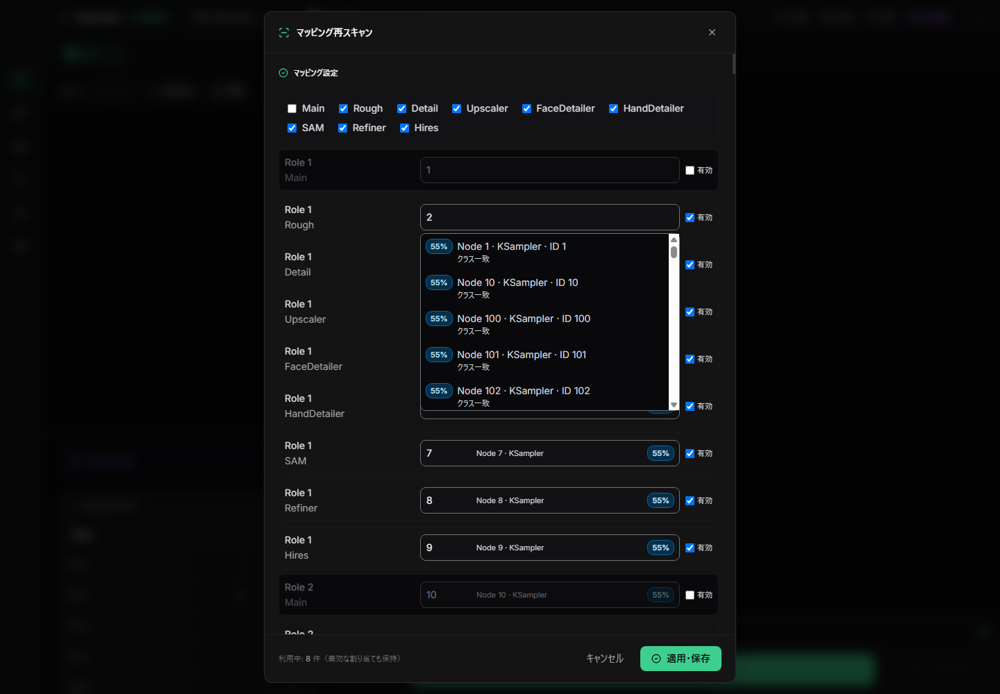

# REQ-358 T35/T36 パフォーマンス・UI再確認

実施日: 2026-10-14（Asia/Tokyo）  
対象: T35/T36 の再スキャンselector、slot有効状態、候補表示、切替・保存負荷

## 結果

合成データを使った実Reactブラウザ確認では、今回の受入範囲をPASSとする。Chromeはheadless・GPU無効で起動し、CDP Fetchで `http://127.0.0.1:5173/api/*` をすべてfixtureへ置換した。生成は行わず、実backend・ユーザーDBへの書込みはない。

| 受入項目 | 結果 | 証拠 |
|---|---|---|
| 32 masters × 9 stages = 288行、候補200個のselector表示 | PASS。全行表示まで579ms | `performance-dense.json` の `openWait` |
| slot個別切替の応答 | PASS。10回のクリックからReact/DOM commitまで中央値55.6ms、p95 68.2ms | `slotToggleTiming`。計測には2回のanimation frame（約33msの下限）が含まれる |
| stage一括切替の応答 | PASS。10回の切替で中央値73.0ms、p95 121.5ms | `stageToggleTiming` |
| 切替時のAPI通信 | PASS。slot個別・stage一括の合計計測窓で0 requests | `toggleRequestDelta: 0`, `toggleWindowRequests: []` |
| selectorの全面クリック | PASS。欄内metadata、score、空欄の各クリックで候補を開く | `selectorTest` |
| 欄内metadataの重複ID表示 | PASS。IDは入力値側だけに表示され、metadataには重複しない。200候補IDはすべて一意 | `metadataHasDuplicateId: false`, `uniqueOptionIds: 200` |
| 無効slotの境界 | PASS。値を保持したままreadonly、readonly欄クリックでは候補を開かない。他の有効slotは開ける | `disabledTest` |
| 保存中ロック | PASS。応答を500ms遅延し、保存ボタンは応答後まで無効・「保存中…」を維持 | `saveSamples`: 86.6–540.8msでdisabled=true。PUT後のGETは再取得 |
| 通信回数と実行安全性 | PASS。保存PUTは1件、全fixture/APIは隔離。console/runtime errorsは0 | `putRequests: 1`, `errors: []`, `requests` |

## 性能比較の読み方

- browser上の再スキャン初回表示は、修正前19.0秒から今回579msへ短縮した（同じ高密度 fixture）。これは実UIの起動計測である。
- rank関数単体の高密度測定は12,186.08msから250.34msへ短縮した（288 slot rank、57,600候補比較）。
- hookの状態切替単体の10回CPU測定は481.05msから11.27msへ短縮した。
- 上記3値は異なる境界の測定値であり、相互に置き換えない。slotクリックの55.6ms中央値には2 animation framesが含まれ、288行すべてを置いたstress fixtureである。個別toggleは候補再順位付けをせず、通信もしない。

## 検証制約

- APIをすべてCDP fixtureで置換したため、ブラウザ試験単独ではDB保存・アプリ再起動後の永続化を証明しない。backend Stage APIのSQLiteテストは従前の証拠として [walkthrough](../walkthrough_REQ-358.md) に記録済み。
- この確認はT35/T36の今回修正範囲に限定する。既存QA audit raw verdict FAIL/HIGHを上書きせず、再監査も行っていない。
- test-hygieneの既存76件違反はraw FAILのまま。ユーザーが以前に受容した既存baseline例外であり、新規違反とは扱わない。
- 最新の画像と完全なfixture request/timing記録: [performance-disabled-open.png](REQ-358-evidence/performance-disabled-open.png), [performance-dense.json](REQ-358-evidence/performance-dense.json)。
