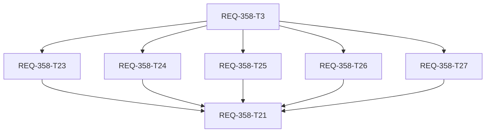
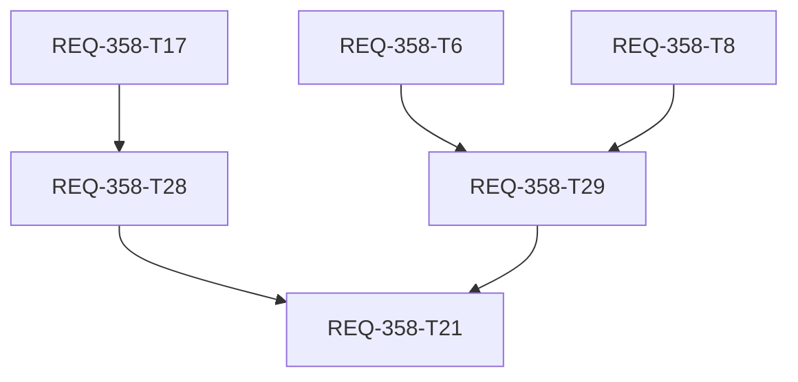

# REQ-358 検証計画

## 最終操作・性能手戻り（T35/T36、2026-10-14）

- hook負荷fixtureは32 masters×9 stages/200 nodes相当。10回toggleのCPU所要時間を修正前後測定し、環境依存時間を受入assertの代わりにしない。候補rank呼出回数はtoggle/ID編集/保存phase変更では増加しないことを決定的に検証。
- チェック変更0 HTTP、保存1 PUTを確認。modal testの実serializer/fetch範囲と、全通信をfixtureへ隔離するChrome CDP範囲を区別する。PUT応答を遅延させても保存/編集を再許可しない。
- selectorのmetadata/score/余白領域から候補を開ける。同じinput DOM/focus/textを維持し、ID重複表示をしない。readonlyのclick/key/change拒否、選択後focusで再オープンしないことを確認。
- 無効行はrole/nodeを減光し、チェックを読みやすく保持。OFFは生成側の未割当相当、保存IDは保持、ONへ戻すまで入力不可。Stage復帰の個別履歴保持は別REQ-360 draftで扱う。

## 2026-10-14 手戻り検証（旧badge/tier順位・未使用減光説明を置換）

- T32: cached workflowを置いたQueryClientでrefetchを遅延し、最新false取得前に編集が初期化されないことを検証。無効化→保存→close→reopenの実modal/query往復でID保持・checkbox false・readonlyを確認する。旧null variantと単一V2 variantでは旧m:false継承、v:falseの生成clone除外、保存結果1mappingを検証。2variant以上は推定せずraw保持する。利用許可と未割当の独立性を確認する。
- T33: raw exact Hand Detailerとnormalized Face Detailerの両方が登録titleに対応する条件で、FaceDetailer stageのFace score>Hand scoreを確認。表記ゆれ同点、共通Detailer部分の加点、group順とscore降順・同点ID順を検証。欄内metadata/score、直接入力focusとDOM保持、未知IDの参照先なし・readonlyを確認。Settingsの全variant title/fallback paramを含む候補scoreを同じrank関数の結果と照合する。
- T34: backend Stage APIでActive false→trueの後に全variant true、WorkflowMappingの同ID/nodeID、workflow slot state不変を確認。true→true/name更新では個別variant falseを上書きしない。
- browser: 実Reactをisolated headless Chromeで操作し、全APIをfixtureへ隔離して保存・再取得・再表示を検証する。fixture保存はサーバDB永続の証明とは区別し、backend実API testと合わせて判断する。Console/runtimeと画像を記録する。以前のユーザーB2/B3 FAILを自動unitだけでPASSへ変えない。

追加対象: `MappingNodeSelector.test.tsx`（中立名selector境界）、`backend/tests/test_req336_stage_api.py`。最新PBIの改訂AC-8/14を採用する。既存QA auditのraw FAILは保持する。

2026-10-13 (Asia/Tokyo)。38 ACを元PBIの番号・内容で保持する。
本書は実装後の検証指示。設計作成時に実装テストを実行した証拠ではない。
要求BA監査はFAIL / PASS未取得。設計監査は別trace。
全テストはCPU/RAM、ComfyUI生成やGPUは使用しない。TierとBaseline 3-Gateは別概念。

## Test Placement

以下は実在する既存ファイル。ticket番号付き旧filenameも延長先として維持し新設しない。
各新caseは可視名またはpytest docstring/param-idに `[REQ-358/AC-n]` を付ける。
Vitestはtask用describe `REQ-358/RANK`等の中にAC名付きcaseを置く。
pytest名は `test_req358_workflow_AC_19`等として `-k "req358 and AC_19"` が使えるようにする。
同じACを異なる層で見るときは各層の証拠を区別し、重複件数をAC合格数にしない。

| 記号 | 延長する既存test |
|---|---|
| N | `frontend/src/utils/__tests__/workflowNodeUtils.test.ts` |
| S | `frontend/src/utils/__tests__/wiringStageGroups.test.ts` |
| H | `frontend/src/hooks/__tests__/useMasterMappingRows.test.ts` |
| M | `frontend/src/components/__tests__/WorkflowModalMultiStage.test.tsx` |
| M10 | `frontend/src/components/__tests__/WorkflowModalEditing.test.tsx`（T10で新設する中立名HTTP境界suite） |
| W | `frontend/src/pages/SettingsPage/components/__tests__/WorkflowAdaptiveStaging.test.tsx` |
| C | `frontend/src/pages/SettingsPage/components/__tests__/WorkflowConnectionSection.config.test.ts` |
| U | `frontend/src/pages/SettingsPage/components/__tests__/MappingMasterSection.req336.test.tsx` |
| P | `frontend/src/components/__tests__/WorkflowMappingPreview.test.tsx` |
| G | `frontend/src/pages/GeneratePage/hooks/__tests__/useWorkflowManagement.seed.test.ts` |
| I | `backend/tests/test_req334_workflow_import.py` |
| A | `backend/tests/test_req336_mapping_masters_api.py` |

補助契約: `backend/tests/test_migrations.py`（新規/旧DB migration2回）、
`backend/tests/test_schemas.py`（strict bool/key/presence）、
`backend/tests/test_workflows_copy.py`（copy独立）、
`backend/tests/test_req353_openapi_contract.py`（対象runtime/schema/snapshot一致）、
`frontend/src/api/__tests__/mappingApi.test.ts`（T5 API_TYPES: optional追加型・旧fixture適合・既定形のみ）。
T5ではworkflow通信caseを追加しない。__tests__は通常tsconfigから除外されるため、明示tscも検証指示に含める。
実hydrate既定はS/H、サーバ既定はschema/I/A、実serializerはM/Cで検証し、T5単独で永続化ACをPASSにしない。
旧suiteがAPIclientをvi.mockしている場合、本件caseはmoduleをunmockしfetch/MSW transportへ切替える。
純粋rank/state/helperをmockして期待値を作らない。共有testファイルはTaskのfile lockで逐次編集。
M10は利用者が承認した「MSW/fetch境界を追加」に基づく配置例外。Mのfile単位API mockを持ち込まず、本番modal/hook/Query/APIclientを実行するため分離する。T10はUploadWorkflowModal/M/M10の3files、既存MSW server/handlers/setupを読取再利用し変更しない。

## Acceptance Map

| AC | test | Tier / browser | 検証する観測 |
|---|---|---|---|
| AC-1 | N | Tier 1 | 登録された2 classともclass一致 |
| AC-2 | N | Tier 1 | 登録された2 titleとも確定相当・推奨 |
| AC-3 | N | Tier 1 | 3表記ゆれとも有力・推奨 |
| AC-4 | N | Tier 1 | typoはクラス候補・非推奨 |
| AC-5 | N | Tier 1 | 入力parameterなしでもclass候補を維持 |
| AC-6 | N | Tier 1 | class違い・own steps keyはparameter候補 |
| AC-7 | N | Tier 1 | class違いの同titleだけではその他 |
| AC-8 | N,M | Tier 1/2 | 5区分順・各node一度、下部のその他を選択可能 |
| AC-9 | N | Tier 1 | Main→Main Sampler、Sampler、他stage順 |
| AC-10 | N | Tier 1 | Upscaler→Upscaler Sampler、Sampler、他stage順 |
| AC-11 | N | Tier 1 | 全有力でFaceDetailer、SAMPLER、他stage順 |
| AC-12 | N | Tier 1 | n01/n02を入力順変更しても文字列昇順 |
| AC-13 | M,W,P | Tier 2 | 同一fixtureを3surfaceへ渡しtier/recommended/順序のDOM結果一致 |
| AC-14 | M,W,P | Tier 2 | 区分badge・class/title/parameter根拠・stage適合のDOM表示、選択中行のID/title/class/confidence |
| AC-15 | M,C,I | Tier 2 | その他node選択→POST/PUT→GETで同一node ID |
| AC-16 | H,M,M10 | Tier 1/2/3 B1 | hookの同key/順序/draft保持、同DOM入力focus、browser rect/scroll変化なし |
| AC-17 | H,M,M10 | Tier 1/2/3 B1 | 明示空文字保持、全消去で同DOMfocus・未使用・減光 |
| AC-18 | H,M,M10 | Tier 1/2/3 B1 | 同slot編集可能、未使用に入力可能・減光解除 |
| AC-19 | I,M,C | Tier 2/3 B2 | 保存→新session/engineで状態再読込→再起動rescan false |
| AC-20 | I,S,C | Tier 1/2 | Aだけfalse保存後BのGETとdraftがtrue |
| AC-21 | S,M,W | Tier 1/2 | stage全slot false、他stageは維持 |
| AC-22 | S,M,W | Tier 1/2 | stage全slot true、個別false履歴も全true |
| AC-23 | I,S,H,M,C | Tier 1/2 | false保存後trueで元node ID、空欄は空欄、hookのgetMappingsは無効IDも保持 |
| AC-24 | S,H,M,W | Tier 1/2 | false空欄を必須/未検出件数から除外しrows/keyを保持 |
| AC-25 | G | Tier 2/3 B3 | falseのprompt/param/seed入力非表示、派生graph無上書き |
| AC-26 | A,U | Tier 2 | master default false保存GET・再表示、定義/variants不変 |
| AC-27 | H,M,W | Tier 2 | 新規slot defaultfalseは非表示・非取込 |
| AC-28 | H,M,C,G,A | Tier 2 | master false後も既存state trueと保存node保持 |
| AC-29 | H,W,C | Tier 2 | 初めてのmaster falseは取り込み行なし |
| AC-30 | A,U,M | Tier 2 | master再true後新規workflowに同じ定義表示 |
| AC-31 | I,H,W,G | Tier 2 | statesなし従来mapping true、Read既定{} |
| AC-32 | N,P | Tier 1/2 | class+stepsある/titleなしはclass候補 |
| AC-33 | H,M,W,G | Tier 2 | 非推奨の保存IDを再順位表示しても不変 |
| AC-34 | S,H,M,W,C | Tier 1/2/3 B2 | disabled中のhook更新no-op、false行が無効文字、readonly、再有効toggleあり |
| AC-35 | H,M,W | Tier 2 | 参照node削除後も保存IDと参照先なし表示 |
| AC-36 | N | Tier 1 | Main (V2)全文の包含不成立 |
| AC-37 | N | Tier 1 | Face Detailer全文正規化の包含成立 |
| AC-38 | N | Tier 1 | current/other両stage包含でもcurrentを優先 |

AC-13は同じ共通関数を使っているというsource inspectionだけでPASSにしない。
Upload、Rescan、Settingsに同一graph/master/stage fixtureを用意し利用者に見える一覧の順序・文字を比較する。
Master previewはstage指定がない条件で別確認する。Master definitionを変えた比較はAC-13に数えない。

## Stage Rank Cases (T6)

NのREQ-358/RANKにAC-9/10/11/36/37/38をタグ付けしたcaseを追加する。
normalizeはASCII A-Z→a-z、U+0009〜U+000D/U+0020と_/-除去のみ。
実タイトル全体に正規化済み非空stage名が連続包含するかを判定する。
rank0=current（他stageにも一致してよい）、rank1=現在/登録群内の非空stage全てに不一致、rank2=別stageのみ一致。
currentは登録群内にない場合も判定する。空current/正規化後空currentは0にしない。

| タグ | 明示する観測 |
|---|---|
| AC-9/10 | exact tier0のcurrent/unknown/otherのstageRank=0/1/2と一覧順 |
| AC-11 | tier1でもFaceDetailer/SAMPLER/他stageの0/1/2 |
| AC-36 | Main (V2)をMain Samplerへ包含としない。空currentはunknown1、登録Mainだけ一致なら2 |
| AC-37 | Face Detailer→FaceDetailer Samplerは0。ASCII大小/space/tab/newline/_/-は同値、NBSP/全角空白/Unicode dashは除去しない |
| AC-38 | Main Upscaler Samplerはcurrent0。allStageNamesからMainを除いても現在stage判定を維持 |
| AC-8/12 境界 | tier2/3/4はstageRank1でID順。stage適合でtier階層を逆転しない |

上記は既存ACの境界検証を具体化したもので、新ACの追加や元ACの置換ではない。

## Slot State Cases (T7)

Sのdescribe REQ-358/STATE内で実setStageEnabled/generationWorkflowを呼ぶ。T7の元AC割当/2files/240行を維持。生成helperのAC-23/31はT17/AC-25の前提証拠、最終生成UIの証明はG/B3。

| タグ | 入力 / 期待する観測 |
|---|---|
| AC-21 | 表示slotsはstage10:v:11(true),v:12(false/defaultEnabled:false)、stage20:v:21(true)、stage1:v:22(false)、stageなしm:4(false)、未知保存v:999(false)。stage10 falseでv:11/v:12だけfalse、新object、他/unknown/stageなしは不変。 |
| AC-22 | 同集合stage10 trueでv:11/v:12全true。元個別false/既定falseも例外なし。対象キー欠落は追加、対象0件でも新objectで全値保持。 |
| AC-23 | raw mappingsのv:11=false/v:12=true/v:21=欠落/m:4(null variant)=false/m:5(variant省略)=欠落からv:12/v:21/m:5のみ新配列へ保持。元順序/record参照とnode_id/variant_id/metadata保持、rawは5件のまま。 |
| AC-31 | states省略/{}なら全件を新配列へ保持。未知定義のmappingもstate欠落なら保持。未知v:999=false stateを保持し、関係ないmappingを除外しない。 |
| AC-23/31 境界 | 全falseなら出力[]、除外0件でも新workflow/新配列。Object.freezeしたraw/mappings/record/state/slotsを破壊せず、state/json_body/追加fieldは元参照/値保持。 |

## Stable Hook Cases (T8)

2026-10-13に承認された「この補足で続行」を反映。対象H、2files/290行、T5/T7依存と元12対象ACを維持。describe `REQ-358/HOOK`と各`[REQ-358/AC-n]`のタグを共存させ、`npx vitest run src/hooks/__tests__/useMasterMappingRows.test.ts -t 'REQ-358/HOOK'`で0件/skipをPASSにしない。実hook/T7 utilityを使い内部mockなし。
完全GWTはT8カード。共通fixtureはmasters=[Steps(id2:variants201 stage10/202 stage20),CFG(id1:legacy)]、配列順が表示順。stateキーはv:201/v:202/m:1、editorキーはv_201/v_202/m_1、master rowKeyはm_2/m_1。

| AC | Given / When / Then（Hでの具体的assert） |
|---|---|
| AC-16 | 有効空欄v201へa→ab→abc更新、rows key順/slot key順不変とabcをassert。新scan/同内容masters refetch/init再呼出しでもdirty abcを維持。 |
| AC-17 | abcをclearSlot、node_id=''・unused=true・enabled=true。同keyでscan defaultへ戻らない。 |
| AC-18 | unused=trueへxyz更新、同key/順序、unused=false・xyz。 |
| AC-23 | saved IDを個別false→true/stage false→true、node_id/getMappingsに元ID、other/unknown state保持。未知mapping/metadataのmerge保存と明示空欄のみ除去も観測。 |
| AC-24 | false空欄v201はrowsへ残り、enabledで集計した必須/未検出寄与0。true空欄v202の寄与1。 |
| AC-27 | 新規default falseはrow/state keyに存在しない。T7 hydrateでfalse keyを作ったことを既存証拠にしない。 |
| AC-28 | 既存mapping+state=trueのmasterがdefault falseになってもrow/ID/true維持。 |
| AC-29 | 保存mapping/stateなしの新default false masterを追加、行/stateを作らず既存dirty保持。 |
| AC-31 | states省略でvariant/legacy保存mappingを復元、有効=true・scan defaultより保存ID優先。 |
| AC-33 | graphに保存otherがありscan候補はrecommendedだけ、再init/refetch/順位表示でもother保持、reference_missing=false。variant/legacy両方。 |
| AC-34 | false中のupdate/clearはID不変、toggle true後は編集可能、unknown v:999保持。 |
| AC-35 | 保存lost/lostLegacyがscan候補とgraphの両方にないがscan default=recommended。init/refetch後も保存ID/getMappings不変、reference_missing=true。API dict/{nodes:dict}/UI nodes[]で確認。graphに再追加でflagだけfalse、空欄/graph未提供ならflag=false。 |

取込済み空欄のstate own keyはtrue/falseどちらでも既存証拠。初回scan=nullは空配列、scan成功後refetch中nullは最後のrows/draft保持。freezeしたoptions/masters/mappings/state/scan/graphを破壊しない。新規基本有効slotだけ補完し既存slotをresetしない。別sessionの初期化/旧応答破棄はT12/T13へ渡す。
HはDOMを持たないため、減光文字/参照先なし/readonly/同input focusはM/W、rect/scrollはB1の証拠。AC-23の永続化はI/M、AC-35の表示はM/Wで完了する。T8 unitだけで最終AC合格を主張しない。T11はT10のみ依存を保持し、T8へのedge追加なし。M/modalの排他lockはT10→T11→T12/T13。

## Upload HTTP Boundary (T10)

M10はstatic importした本番UploadWorkflowModalと既存`../../test/mocks/server`を使う。file-local beforeAll listen(onUnhandledRequest:error)、beforeEach server.use(GET /api/mapping-masters, POST /api/workflows/scan)、afterEach cleanup/queryClient.clear/resetHandlers、afterAll close。global setupのMSW起動は現在なく、本testが一度だけ起動する。各case新QueryClient queries/mutations retry:false、queries gcTime:0。APIclient/内部hook/helperをmockしない。
fixtureはSteps/CFGの2master、Main variants101/201、sort_order1/2、graph={}、scan matched=[]/warnings=[]。handlerがmasters読取とscan実serializerの{json_body:graph}を受けたことをassert。2inputが現れてからfocusし、a→ab→abc→空→xyzでinput/rowの同一参照・isConnected・value・focus・row順序を保持。空で未使用/opacity-50、入力で解除。物理rect/scrollはB1。
完全case名: `REQ-358/UPLOAD_CLEAN [REQ-358/AC-16] [REQ-358/AC-17] [REQ-358/AC-18] keeps the same input while typing, clearing and retyping`。describeもREQ-358/UPLOAD_CLEAN。filterは`-t 'REQ-358/UPLOAD_CLEAN'`で本caseが必ず収集されるようにし、0case成功をPASSにしない。
Mの既存5case/payload assertは回帰実行し、M10へ旧API mockを輸入しない。本caseは編集のみ、create/updateはT12/T13の範囲。T10完了→T11、T12はT10依存、T13はT11経由。共有M/test/modalは排他lock。

## Fixtures and Integration

共通graphの識別子n01〜n09に、2登録class、5tier、Main/Upscaler/FaceDetailer/unknownのtitle、
stepsとfallback、class違いtitle一致、missing metadataを用意する。
API prompt dict / wrapper nodes dict / UI graph nodes[] を同じnamed inputsで比較する。
UI widgets_valuesのみのnodeではparameter名を捏造しない。
exactとvariantのstage寄与が階層を逆転しないfixture、class+parameter/titleなしも含める。

BEはTestClient→real router/schema→SQLite sandboxでPOST/PUT/GETを往復し、実commit後に新Sessionへ読み直す。
所有TaskはT4、編集境界はbackend/app/routers/workflows.pyとI、backend/tests/test_workflows_copy.pyの3files。
Iに保存/GET/省略PUT/{}/新Session/再open/rollback、copy testに独立snapshotを置く。
master runtime既定はT3/A、FE real serializerはT12/T13/MとT15/C、最終統合はT21で実行する。
T5はfrontend/src/api/types.tsと既存mappingApi.test.tsの2filesだけ。FE APIドメインの変更は不要。
再起動相当はtmp_path SQLite fileに保存しengineを閉じ再openして確認（本番DB不可）。
DB書込み失敗はtransport/transaction境界だけで注入し、mappings/state双方が部分更新されないことを観測。
copy後Aの変更がBへ波及しない、json_body replacement→history→rollbackでstate/mappingを同時復元する。
state省略PUT、明示{}、false、null、0/1/"false"、key不正、従来history{}を検証する。

FEはreal Component/Hook/Query/APIclient、MSWまたはfetch応答、短命QueryClient gcTime:0。
masters先/scan先、遅延GET、refetch中の入力、A→B切替後A応答、save中編集制約を制御する。
通常saveでunknownnode IDを保持、importpreviewの既存unknownnode拒否は別case。
Settings version1 export→preview→確認→update1回→GETでstate往復。省略importは現state保持。
generationWorkflowはraw cloneを実関数で作る。実injectWorkflowParams/getInitialParamsへ同じ派生を渡し、
disabled mappingの保存paramがgraphを上書きしない、raw mapping/graph/paramsは残ることを確認する。
旧API mockを使う既存seed suiteでも本件caseの期待値生成に内部helperをpatchしない。

## Property-Based Tests

Nにfast-check（既存dependency）を追加し `[REQ-358/AC-8]` / `[REQ-358/AC-12]`ケース内で各100試行。
無重複IDの任意graphを生成し、入力順序独立・全候補一意・全有効node保持、
tier順の単調性・現在stageがtier階層を逆転しないこと・入力非破壊を確認する。
正規化は許可された英字大小/空白/_/-操作の等価性だけを生成し、綴り差や翻訳を等価にしない。
Sの `[REQ-358/AC-23]`にstate roundtrip/個別false→trueでrawnode保持、
一括操作の他stage不変、初回defaultfalse非取込を任意slot集合で検証する。
同じSのPBTではsetStageEnabledの正確なstageId範囲/unknown保持/再true全件と、generationWorkflowの「明示falseのみ除外・保持順序・raw不変・statesなし全件保持」も各100試行で観測する。
失敗時はseed/shrink counterexampleをwalkthroughへ残す。GPUや実HTTPは不要。

## Browser Acceptance

既存frontend/e2e runnerは存在しないため、新しい依存/runnerを本件で増設しない。
既存computer-use/browserによる実アプリ操作と画像・座標観測を記録する。
実browserが使えなければ以下をINCONCLUSIVEとし、jsdomやsource inspectionで代替PASSにしない。

- **B1（AC-16〜18）**: desktopとmobile相当のscroll領域で未使用slotをfocusしabc入力→全消去→再入力。
  毎操作で同slotのbounding rect、scrollTop、activeElementを記録しその場を維持。
  IME composition・貼付け・backspaceも確認。空欄減光のラベルと入力文字が読めること。
- **B2（AC-19/23/34）**: stage一括false→個別true→保存→リマッピング→アプリ再起動→再表示。
  false行の文字とreadonly、toggleでID復旧、保存していない変更の新たなautosaveがないこと。
- **B3（AC-13/14/15/25）**: 各surface候補popupと通常行で5tier、stage適合、文字badge・根拠、選択中ノードのID/title/class/confidenceを目視し、
  下部その他をkeyboard/mouseで選択保存。長title/多node/viewport端でもpopupへ到達できる。
  disabled prompt/parameter/seedの生成入力がなく、再trueで入力が戻る。
  実ComfyUI生成は不要。sticky見出しと44px操作領域が既存どおり使えるかも確認。

## Boundary and Fault Injection (Gate 3)

| ケース | 期待する結果 |
|---|---|
| 空class/title lists、nullgraph、primitive node、metadata欠落 | crashせず全実nodeの低位候補を維持、偽確定を作らない |
| titleにregex記号、Unicode dash、全角英字、typo、stage空/長/重複 | 明示正規化以外の一致を推定しない、full stage包含、安定sort |
| class + primary/fallback一致/titleなし | クラス候補。parameter tierへ重複しない |
| class違い/title一致とnamedparameter一致 | パラメータ候補、推奨false |
| 最新graph追加/削除、選択済み非推奨、参照node削除 | popup最新集合、選択state不変、missing文字表示 |
| hiddendefaultfalse、既存true/false、空欄true、旧states省略 | 既存は保持、新規取込既定だけ適用 |
| 正規orphankey、variant rename、legacy m:key | identity保持、旧orphanstate保存、他slotへ移転しない |
| GET/scan 503/timeout、master読み込み遅延 | 明示error/再試行、半初期化でsave不可、dirty入力不変 |
| update 422/503、保存中A→B切替、遅延success | draft保持、別workflow書換なし、成功誤表示なし |
| malformed JSON state/null/string bool/invalid key | API/importpreview拒否、mappingsとの部分保存なし |
| import旧version1省略・明示{}・null | 現state保持／明示置換／拒否を区別 |
| disabled専用seed、ParamSync/presetの旧params | 非表示集合を注入にも使う、raw値保持、既存seed validationは有効集合だけ |

## Commands and Gates

PowerShellでworking directoryを明示して実行。時間は観測値を残しtimeout/poolを都合で変更しない。
frontend cwd:
```powershell
npm run typecheck
npx tsc --noEmit --strict --skipLibCheck --target ES2020 --module ESNext --moduleResolution Bundler --lib ES2020,DOM src/api/__tests__/mappingApi.test.ts
npx vitest run src/api/__tests__/mappingApi.test.ts -t 'REQ-358/API_TYPES'
npx vitest run src/utils/__tests__/wiringStageGroups.test.ts -t 'REQ-358/STATE'
npx vitest run src/components/__tests__/WorkflowModalEditing.test.tsx -t 'REQ-358/UPLOAD_CLEAN'
npx vitest run src/components/__tests__/WorkflowModalMultiStage.test.tsx
npx vitest run src/utils/__tests__/workflowNodeUtils.test.ts -t 'REQ-358/AC-12'
npx vitest run src/components/__tests__/WorkflowModalMultiStage.test.tsx -t 'REQ-358/AC-16'
npx vitest run src/utils/__tests__/workflowNodeUtils.test.ts src/utils/__tests__/wiringStageGroups.test.ts src/hooks/__tests__/useMasterMappingRows.test.ts src/components/__tests__/WorkflowModalMultiStage.test.tsx src/pages/SettingsPage/components/__tests__/WorkflowAdaptiveStaging.test.tsx src/pages/SettingsPage/components/__tests__/WorkflowConnectionSection.config.test.ts src/pages/SettingsPage/components/__tests__/MappingMasterSection.req336.test.tsx src/components/__tests__/WorkflowMappingPreview.test.tsx src/pages/GeneratePage/hooks/__tests__/useWorkflowManagement.seed.test.ts -t 'REQ-358'
npm test
```
backend cwd:
```powershell
$env:PYTHONPATH='.'
.\.venv\Scripts\python.exe -m mypy app
.\.venv\Scripts\python.exe -m pytest tests/test_req334_workflow_import.py -k 'req358 and AC_19'
.\.venv\Scripts\python.exe -m pytest tests/test_migrations.py tests/test_schemas.py tests/test_req336_mapping_masters_api.py tests/test_req334_workflow_import.py tests/test_workflows_copy.py tests/test_req353_openapi_contract.py -k req358
.\.venv\Scripts\python.exe -m pytest
```
ACごとに `-t 'REQ-358/AC-n'` / `-k 'req358 and AC_n'`で抽出可能にする。
unitだけ成功したACとbrowser未実施を混同しない。
Baseline 3-Gate（型/既定full suite/異常系）とQA auditはT21でdev-verifyに従い記録する。
テストhygiene等の既存FAILは隠さず全体Gateと本件ACを分けて報告する。
失敗・実行不能・未実施をwalkthroughへ保存し、38ACが未証明なら自動完了にしない。

2026-10-13修復: T20/T21復元、T5型境界とT6順位caseを承認済みの要求内で明確化。
38AC対応表は保持。実装テスト・browser・local BA再監査の実行結果を本追記で主張しない。
承認されたT7補足とT10のMSW/fetch境界追加を上記に反映。T10の1新規test/1追加edge、21Task/最大4層。PBI本文/ACは変更しない。


## T12/T22 Atomicity Repair

2026-10-13: 承認済み T12 の作業配分を本番接続(T12:1file/300行)と既存 Upload test 適合(T22:1file/120行)へ分割。
既存 passing source/test は保持する。38AC と元受入表は変更しない。
T12/T22 は T4/T8/T9/T10 を参照し、T21 が両成果を待つ。共有 lock 確認順は T12→T13→T22。
22カード/49edges/最大4層・非循環。先行成果込み HEAD 差分572行を Task 固有差分へ再計上しない。
既存 Upload describe の差分79行をT22へ帰属。sourceの開始snapshot不在により実atomicityはINCONCLUSIVE。
既存 API mock suite は回帰の部分証拠。実 serializer と browser の最終ACをT21へ渡す。
本改訂は親の設計レビューへ返す。local BA 再監査/実装 test をこの文書修復では実行していない。

## REQ-358 OpenAPI Atomicity Repair

T20のV2参照閉包をsnapshot形式/schema単位へ物理分割。27カード/60edges/最大4層を維持する。

| Task | 範囲 | 依存 | files/予算 |
|---|---|---|---|
| [T23](docs/backlog/task/active/REQ-358-T23.md) | JSON CreatePayload 同期 | T3 | 1/240 |
| [T24](docs/backlog/task/active/REQ-358-T24.md) | JSON Update と VariantUpdateItem 同期 | T3 | 1/260 |
| [T25](docs/backlog/task/active/REQ-358-T25.md) | JSON V2Read と VariantRead 同期 | T3 | 1/300 |
| [T26](docs/backlog/task/active/REQ-358-T26.md) | YAML CreatePayload と Update 同期 | T3 | 1/220 |
| [T27](docs/backlog/task/active/REQ-358-T27.md) | YAML Read と Variant 閉包同期 | T3 | 1/230 |

共有lock確認順はT23→T24→T25→T26→T27→T20。T20はmaster endpoint2箇所と既存contract testを所有。
独立schemaの結果依存はT3で、T21がT20/T23〜T27の全成果を待つ。不要なlock edgeを追加しない。
全V2 schema/参照閉包・T19 Workflow parityを保持。default_enabledのみへの縮小は契約不足となるため採用しない。
現在のsnapshot/test成果を復元・再実装しない。各カードのblock差分をengineerが確認する。
本分割を親の設計レビューへ返す。PBI/38AC・実装成果を保全。local BA再監査は未実施。



### T10 AC Repair Clarification (2026-10-13)

This section supersedes the prior T10 file-scope/test contract. Preserve AC-16/17/18 exactly. T10 tests the HTTP boundary through the real UploadWorkflowModal→WorkflowMappingEditor→MappingNodeSelector path and asserts same row/input identity, focus, value, order, 未使用 label, and dimming on clear/retype. The T10-owned files are only WorkflowMappingEditor.tsx and WorkflowModalEditing.test.tsx (2 files, 240-line budget). Existing Upload modal and WorkflowModalMultiStage test are read-only regression checks; do not weaken assertions. Existing T11/T13/T22 verification evidence remains valid; rerun those regressions after T10. At that point T21 waited for T10; the then-current DAG count was 27 tasks/60 edges, maximum depth 4. Browser B1 remains INCONCLUSIVE when the UI runtime is unavailable.

### Browser Follow-up Rework (2026-10-13)

The user reported B1=OK, B2/B3=FAIL on the browser before this rework. T28 repairs the raw/generated mapping boundary reported in B2. T29 clarifies selected node identity, tier meaning, stage match confidence, mixed stage state, and visible enabled/disabled text. T21 depends on T28 and T29 and must repeat B2/B3 in the browser. The existing `useWorkflowManagement.seed.test.ts` covers a disabled legacy Seed mapping, but does not close the user's B3 report for a V2 variant Seed. Preserve B3 as unresolved until that path is reproduced and verified.

| Task | Files / boundary | Result |
|---|---|---|
| T28 | `GeneratePage.tsx` passes raw saved mappings into `RescanModal`; seed hook test asserts raw mapping retention separately from generation filtering. | Unit/type checks PASS; physical B2 re-test pending. |
| T29 | `MappingNodeSelector.tsx`, `WorkflowMappingEditor.tsx`, and `WorkflowModalMultiStage.test.tsx`. | 16 tests PASS; physical visual re-test pending. |
| T30 | Shared tier/stage label utility, Settings AdaptiveWorkflowWiring, and its component test. | Typecheck PASS; AC-14 focused test 1 passed. |
| T31 | WorkflowMappingPreview and its component test use the same tier/stage presentation. | Typecheck PASS; component test 2 passed. |

T29 depends on T30 for shared labels. T31 depends on T30. T21 waits for T28/T29/T30/T31. DAG count/edge validation remains pending.


