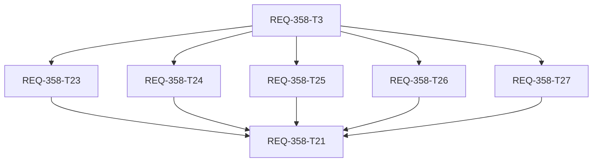

# REQ-358 詳細設計

## T35/T36 最終操作・性能改訂（2026-10-14、旧説明より優先）

有効チェックOFFをrole/node減光と入力不可で示し、再有効化まで編集を止める。生成側は未割当相当として対象外、保存済みnode IDは保持する。利用許可という追加説明をやめ、有効チェックへ統一する。selectorは欄全体から候補を開き、metadataのID重複をなくす。候補選択後のfocus復元が再オープンを起こさないようにする。

hookのslot定義、identity map、visible slot集合、hydrate結果、row結果をmemo化し、各slotのenabled判定で全体を再hydrateしない。modalの候補cacheはmasters/workflow JSONだけを依存とし、選択値・有効state・phase変更では再採点しない。初期化はfresh queryを待ってsessionで一度だけ実施し、saving phaseをeditingへ戻さない。in-flight refで同時保存を拒否する。

前後性能は32 masters×9 stage / 200 graph nodes相当のhookで10切替を測定。CPU計算・DOM commit・通信を分けて記録する。操作のHTTPゼロ、保存PUT1件、遅延応答時のdisabled継続を実transport/browser境界で確認する。全体suiteやブラウザ結果はwalkthroughへ記録する。

Stage Managerの以前OFFだった組合せまでActiveへ戻る問題は、利用者指示により別PBI REQ-360の草案へ切り出した。T35/T36ではglobal Stage復元挙動を変更しない。

## 2026-10-14 承認済み改訂（旧Candidate/表示説明より優先）

ユーザーのB2/B3補足・score変更指示によりT32〜T34を追加した。設計再承認を求めず、既存の自律続行許可と今回の具体的修正指示で進める。

- 推奨tier0/1は同じ75〜100点帯。class候補50〜74、parameter候補20〜49、その他0〜19。百分率badgeはこの適合scoreを示す。完全一致と表記ゆれ一致のtier根拠は保持するが、同推奨group内ではscoreを優先する。
- stage/titleを既存ASCII規則で正規化。stage全文のtitle内包含は近似度1、部分一致は文字bigram集合のDice係数×0.8（最大0.8）。stage不明の基準は0.2、他stage一致は基準0、部分一致の実値が高ければ採用。空title/stageは0.2。scoreは帯のmin+(max-min)×近似度を整数へ丸め、同点ID順。Face DetailerはHand Detailerより上、共通Detailer部分は加点する。
- 登録・再スキャン・Settingsはroleの全variant title登録、fallback param、stage集合で同じ採点を行う。閉じたselector欄内にID/title/class/scoreを置き、直接ID入力時は同じinput DOMを保持する。
- 再スキャンはrefetchOnMount=alwaysとisFetching待ちで最新データ取得後に一度だけhydrateする。以前のキャッシュで初期化し最新falseを捨てる経路を修正する。
- 旧variant未指定mappingは単一slot、または保存role/既知master legacy roleとcomputed_roleが一意に完全一致するslotだけへ対応し、旧m:key状態を引き継ぐ。getMappingsは旧mと新vを重複保存しない。生成cloneも取得した全variant identity定義で同じ解決を行い、保存前のv:falseを無視しない。複数slotへnode title/stage名から曖昧に推定しない。raw mapping/未知stateは保持する。
- 空欄は未割当、チェックは利用許可、明示falseは無効/readonly。空欄で行全体を薄くせず、文字と背景で区別する。node値の存在で無効状態を変更しない。
- Settings Stage Managerのfalse→true遷移は配下variantを全trueへ戻す。既存falseへの一括変更と対称にし、通常name編集/true→trueは個別variant状態を保持する。workflow mappingやworkflow固有slot stateは変更しない。

T32は状態とlegacy互換、T33はscore/欄内表示、T34はglobal Stage Activeの一括復帰。T21が全成果の検証を待つ。以前の監査FAIL/INCONCLUSIVEは上書きしない。

## Review State

2026-10-13 (Asia/Tokyo)。PBIの38 ACとI-1〜I-6は利用者の「OK」で承認済み。
設計も承認済み。今回の「修正して続行」はカード復元とT5/T6の契約明確化を承認した指示として記録する。
要求のBA監査は **FAIL / PASS未取得**。人の承認は監査結果をPASSへ変更しない。
本設計の監査結果は末尾へ別途記録する。初回設計時は実装、実装テスト、Engineer dispatchは未実施。その後の実装進行は親coordinatorが管理する。
2026-10-13のT8補足に対する「この補足で続行」は保存ID保持・固定行・操作契約の明確化の承認。38AC/PBI本文と対象file/依存関係を維持する。

## Boundary and Discovery

workspaceは `C:/Users/audih/ws/comfy-create-helper2`。frontend/backend/docsは全てこのGit root内。
Git_Root_Mismatch=No、外部成果物書込みなし。
contextの GLOBAL_ROOT=`<USER_HOME>/.gemini/antigravity` と GLOBAL_SCRIPTS=`${GLOBAL_ROOT}/scripts`を
USER_HOME=`C:/Users/audih`で展開した。スクリプト本文は読まずCLIだけ使用した。
doc_mapper実行は「No mapped documents found」。対象検索でSPEC_SETTINGS、SPEC_GENERATEを特定。
OpenAPI正本の実在場所は `docs/openapi.yaml`。skill例示の `docs/system/openapi.yaml` は存在しない。
openapi_parserでworkflow GET/UPDATEとmapping GETを抽出。
mapping GET文書はlegacy MappingMasterRead、実routerはMappingMasterV2Read。T20で対象契約を同期する。
既存作業差分（docs/openapi、仕様、implementation_planなど）を保持し、本件範囲だけ追記する。

## Feasibility and Current Architecture

技術的に38 ACは実現可能。React 18、React Query、TypeScript、FastAPI/Pydantic v2、
SQLAlchemy/SQLiteの既存経路に追加し、新規外部サービスは使わない。
登録UploadWorkflowModalとRescanModalはuseMasterMappingRowsのmainRows/notFoundRowsを別DOMに描画する。
入力によりstatusが変わり所属エリアが変わることが、位置・フォーカス喪失の直接原因。
hookは保存node IDが検出候補にないとscan defaultsへ置換する分岐もあり、AC-35のため保持へ変更する。
Settings AdaptiveWorkflowWiringはdetected stageのmatchedNodeIdsで推薦し、登録と判定が異なる。
WorkflowMappingPreviewも独自の部分一致判定を持つため共通候補規則に接続する。
現在Workflowは無効化状態を持たず、MappingMasterにもロール全体の基本有効flagがない。
MappingVariant.is_enabledはマスタのstage展開可否であり、本件workflow個別無効に流用しない。

## Candidate Contract

以下は候補表示の決定規則。保存選択のstateとは独立し、順位更新が対応先を変えることはない。

| tier | 表示 | 条件 | 推奨 |
|---|---|---|---|
| 0 | 確定相当 | 登録class完全一致＋登録title生文字完全一致 | はい |
| 1 | 有力 | class完全一致＋title全体の正規化一致 | はい |
| 2 | クラス候補 | class一致、titleは不一致 | いいえ |
| 3 | パラメータ候補 | class不一致、登録parameter名のいずれかを持つ | いいえ |
| 4 | その他 | 上記以外、titleだけ一致も含む | いいえ |

classは登録配列内の生文字完全一致。空配列はwildcardにしない。
titleの完全一致は大小文字・空白を加工しない文字列比較。空title/patternは一致根拠にしない。
表記ゆれ関数はASCII A-Zだけをa-z化し、ASCII whitespace（U+0009〜U+000D/U+0020）・`_`・ASCII `-`を除去。
`Main Sampler/MainSampler/main_sampler/main-sampler`は正規化一致。
typo、全角英字変換、翻訳、同義語、regex、Unicode dash置換は追加しない。
classの表示用fallbackはtitle一致判定の根拠にしない。
対象パラメータはprimary `param_name` と明示 `fallback_param_names`の集合。
parameter名はown input名の完全一致。配線値でも「名前を持つ」のでtier3の候補にはなる。
候補であることは生成入力として安全である保証ではなく、既存seedの配線拒否等の検証を保つ。

slotの登録title集合はV2の `base_title_patterns`（nullならlegacy `title_patterns`）と
対象variantの `extra_title_patterns` の和集合。空配列は明示空として扱い、role名やstage suffixからtitleを推定しない。
legacyは `title_patterns`だけ。他stageのvariant extraを勝手に追加しない。
同じ定義を全surfaceのadapterで作る。stage指定なしのプレビューはstage不明。

stage適合はtier0/1だけの区分内順位であり、画面でも現在ステージ一致／ステージ不明／別ステージ一致をバッジに併記する。実candidate title全体と現在stage名、登録allStageNamesの各stage名を
上記と同じASCII正規化で比較する。正規化後空のstage名は除外し、normalizedTitle.includes(normalizedStage)の
連続部分文字列包含のみを一致とする。非ASCII空白/Unicode dash/括弧は残す。
stageRank=0は非空の現在stage一致。現在stageは登録群に未掲載でも独立に判定し、他stageにも一致したとき現在を優先。
stageRank=1は現在にも登録群内のどの非空stageにも一致しない不明。
stageRank=2は現在に一致せず、登録群内の非空の別stageの1件以上だけに一致。
空または正規化後空の現在stageは常にcurrent不一致。role名/search_keywords/suffix/aliasを代替に使わない。
tier2/3/4はstageRank=1に固定しstage順を使わない。
Main→Main Sampler/Sampler/Upscaler Samplerは0/1/2、Upscalerは対応して0/1/2（AC-9/10）。
FaceDetailerのtier1でもFaceDetailer Sampler/SAMPLER/Main Samplerは0/1/2（AC-11）。
Main (V2)→Main Samplerはcurrent不一致（AC-36）、Face Detailer→FaceDetailer Samplerは0（AC-37）。
Main→Main Upscaler Samplerは両stageを含んでも0（AC-38）。空currentでSamplerは1、登録Mainを含むtitleは2。
T6にASCII/Unicode境界とtier2〜4のID順を含む具体的検証表を保持する。
比較tupleは `[tier, tier<=1 ? stageRank : 1, nodeId]`。
node IDは数値化やlocaleCompareをせず文字列のコード単位順。n01はn02より先。
重複IDは最初の有効nodeだけ、配列順を入れ替えても一意IDなら同じ結果。
候補集合はpopupを開くとき最新graphで計算。全nodeを一度表示し、全tierを選択可能。
実タイトルの判定と表示fallbackを分ける。保存IDが集合にないとき候補へ架空nodeを追加せず、
入力欄にそのIDを残し「参照先なし」を表示する。選択中IDがcandidate集合に存在する場合、通常行にもそのタイトル・クラス・確度を表示する。mapping編集行はロール名を主表示、ステージ名を下位情報として表示し、各stageの一括操作は横並び、部分有効時はmixed状態にする。

```ts
export interface CandidateDefinition {
  expectedClassTypes: readonly string[]
  titlePatterns: readonly string[]
  paramNames: readonly string[]
}
export interface RankedNodeCandidate {
  id: string
  title: string
  classType: string
  tier: 0 | 1 | 2 | 3 | 4
  stageRank: 0 | 1 | 2
  recommended: boolean
  reasons: readonly string[]
}
export function rankWorkflowNodeCandidates(
  workflowJson: unknown, definition: CandidateDefinition,
  stageName: string, allStageNames: readonly string[]
): RankedNodeCandidate[]
```

workflowNodeUtilsに純粋関数を追加。既存resolveNodeMetadata/getNodeLabelの表示契約を保つ。
読取形式はAPI prompt dict、`{nodes: dict}`、UI graph `nodes[]`。
UI graph inputs[]のnameを使い、widgets_valuesの値だけからparameter名を作らない。
不正primitive/array nodeはskip。unknown nodeをtitle一致にしない。
この表示判定のためbackend scanやスマート置換の数値score方式は変更しない。

## Persistent Slot State

WorkflowおよびWorkflowHistoryへ `mapping_slot_states` JSON text、MappingMasterへ `default_enabled` boolを追加する。
キーはrole/stageの可変文字列ではなくvariant IDの `v:<id>`、legacy masterの `m:<id>`。
variant IDがstageに属するためrole×stage identityになる。renameで既定や無効化が落ちない。
legacyにはstage軸がないので既存single slotを一個として扱う。
keyなし/trueは有効、falseは明示無効。workflow statesのtrue/false自体が取込済みslotの証拠になる。
既存hook `v_<id>/m_<id>`とSettings `v:<id>/m:<id>`の差はutility境界で変換する。

初期hydrate優先順は、保存state→保存mappingの存在（従来は有効）→新規取込master既定。
初めてのslotでdefault_enabled=falseなら行を作らず、取込集合へ追加しない。
基本有効slotは全stageのマスタ有効variantを取り込み、空欄でもtrueを保存する。
既存stateがfalse/trueのslot、従来mappingのslotはmaster基本無効後も画面から消さない。
従来JSONにstateがなく未対応付けのslotだったことを証明する履歴はないため、
既存mappingだけを確実な既存証拠とする。AC-31の対象は保存済み既存roleである。
global variant/stage削除のorphan stateは保持し表示対象から除外。明示削除時の整理は既存delete契約に従う。
本PBIはmaster/variant/stageの削除変更を導入しない。

```ts
type SlotMapping = {master_id:number; node_id:string; variant_id?:number|null}
type SlotDefinition = {
  masterId:number; variantId?:number; stageId?:number;
  defaultEnabled:boolean
}
type WorkflowSlotStates = Record<string, boolean>
slotKey(masterId:number, variantId?:number|null): string
hydrateSlotStates(states:WorkflowSlotStates|undefined,
  existingMappings:readonly SlotMapping[], slots:readonly SlotDefinition[]): WorkflowSlotStates
isSlotEnabled(states:WorkflowSlotStates, key:string): boolean
setStageEnabled(states:WorkflowSlotStates, slots:readonly SlotDefinition[],
  stageId:number, enabled:boolean): WorkflowSlotStates
type MappingWorkflow = {
  mappings:readonly SlotMapping[]; mapping_slot_states?:WorkflowSlotStates
}
generationWorkflow<T extends MappingWorkflow>(raw:T):
  Omit<T, 'mappings'> & {mappings:T['mappings'][number][]}
```

statesは全取込slotと保存済みunknownキーを含む完全snapshot。
省略時の互換性と更新時のobject完全置換を混同しない。
個別/一括toggleで対応付け文字列を変更しない。一括再有効化はそのstage取込slotを全trueへ変更。
過去の個別無効履歴の復元はI-5で対象外。

T7のsetStageEnabledは表示対象として渡されたslotsの`stageId === stageId引数`だけに要求boolを設定し、新state objectを返す。他stage、stageIdなし、表示集合外/unknownの既存キーは保持。対象キー未保存なら追加する。0件でもclone、再有効化は対象全true、defaultEnabled/個別false履歴による例外なし。states/slotsは非破壊。
generationWorkflowは浅いworkflow clone＋新mappings配列。各recordのslotKey(master_id, variant_id)に対してstateが明示falseだけを除外し、状態省略/欠落は有効扱い。null/省略variantはlegacy m:key。定義不明でもkey欠落なら保持し、unknownの保存stateキーを削除しない。保持recordは元順序/参照、mapping_slot_states/json_body/全追加fieldは元参照/値。raw/配列/record/stateを変更しない。除外0件でもobject/配列は新参照。genericの構造型はAPI型importなしでT5独立、recordの追加metadata型を保持する。
T7カードにstage10/20/1/未指定/unknownと、v:key/m:key・true/false/欠落・state省略・freezeのfixtureを明記。helperはAC-23/31を検証し、生成入力の受入AC-25はT17/T21が担当する。

## API and Transaction

FE T5はtypes.tsのoptional追加型と既存mappingApi.test.tsの静的互換契約だけを所有する。
workflowsApiはunknown payloadをJSON.stringifyする既存透過経路なので変更不要。
T5にworkflow POST/PUT/GETのruntime検証を割り当てない。testは通常typecheckから除外されるため明示tscも使う。
サーバのPOST/PUT/GET・実commit/reopenはT4のtest_req334_workflow_import.py、copyはtest_workflows_copy.py、
master既定のCRUDはT3のtest_req336_mapping_masters_api.pyが所有する。
FE save/read実serializerはT12/T13のWorkflowModalMultiStage.test.tsx、T15のWorkflowConnectionSection.config.test.ts。
既定の型形（?? true/?? {}）はT5の部分証拠、実hydrate既定はT7、最終統合はT21の既存Seamで検証する。

| 契約 | 追加field | 省略 | 明示null/不正 |
|---|---|---|---|
| WorkflowCreate | mapping_slot_states: object<boolean> | {} | 422 |
| WorkflowRead | mapping_slot_states: object<boolean> | response既定{} | malformed DB JSONは正常値に偽装しない |
| WorkflowUpdate | mapping_slot_states: object<boolean> optional | 現在値維持 | 422 |
| MappingMaster legacy/V2 Create/Read | default_enabled: boolean | true | requestは422 |
| MappingMaster Update | default_enabled: boolean optional | 現在値維持 | 422 |

WorkflowUpdateの `{}`は状態snapshotの明示置換。次hydrateで従来mappingのslotを有効とみなす。
state値に0/1/"false"をbool coercionしない。keyは `^[mv]:[1-9][0-9]*$`。
FKを持たない保存metadataなので旧orphan正規keyは保存可能、他workflow状態を読み込むことはない。
create/updateはmappingsとstatesを同じDB transactionでcommit。失敗は全rollback。
無効mappingもGET.mappingsへ残す。WorkflowSummaryとscan responseは変更しない。
copyは独立したJSON snapshotを複製。json_body置換時historyへstatesも保存しrollbackで一緒に復元。
従来historyのstatesは{}としてそのmappingを有効とみなす。
JSON import/export version1へoptional fieldを追加、省略importは現在state保持、明示{}置換、null拒否。
importpreviewはDB未変更、既存確認後1update。通常remapは失われたnode IDを保持するが、
importの明示node検証は既存契約を維持する。両操作の境界をUIテストで区別する。
masters listは基本無効を含む全件を返し、既存workflowの定義復元を妨げない。

## Stable Editing and Presentation

入力の空/非空、未検出/okで別エリアに移動しない。登録/リマッピングhookのrowsは入力masters配列順、各master内のslotはvariants配列順（既存is_enabled選別後）。行の並びとkeyを固定し、hook内でstage順へ再sortしない。Settingsの既存stage group順はそのsurfaceのadapterが維持する。
text inputは常時同じDOM node。候補popupを開くbuttonとinputは同じrowに共存。
空欄は「未使用」と読みやすい減光、入力可能。falseは「無効」、input readonly、再有効化は操作可能。
未使用でも有効は状態true。入力1文字、全消去、IME、貼付けで位置/フォーカスを維持。
dirty editorをscan/refetch/遅延GETの到着で再initしない。workflow/session切替は別初期化として扱う。
保存中はtoggle/inputをlock。新たな離脱autosaveはI-6の対象外。

### T8 Approved Hook Contract

完全な型・メソッド・12対象ACのGiven/When/Thenは物理T8カードに記載する。masters/scanResultにoptional options（existingMappings、mappingSlotStates、workflowJson）を追加し、既存buildRows/initFromScan/update/getMappingsを互換維持。rowsはMasterMappingRow[]の単一配列で、master wrapper keyはrowKey=m_<id>、stageSlots/input keyはv_<id>/legacy m_<id>。row/slotへenabled/unused/reference_missingを追加し、既存status enumと独立させる。multi-stage primary fieldは先頭slotの互換投影。mainRows/notFoundRowsは旧consumerの互換viewだけとして保持する。
取込前の保存state own keyまたは保存mappingで既存を判定し、未取込だけmaster既定を適用。T7 hydrateが新規false stateも返すことを既存証拠と誤認しない。全取込stateとunknownキーを保持し、基本無効の未取込slotは追加しない。
初回node_idは保存mapping（空文字含む）→保存stateだけの既存未対応slotなら''→初取込scan default→''。保存IDは候補外/非推奨/graph欠落でも置換せず、保存済み文字列も保持。明示draftの''をundefinedと区別し、scan/refetch/init再呼出しでdirty値/stateを上書きしない。初期化はmasters+scan完了後1hook session1回、新規基本有効slotはそのslotだけ補完。初回scan=nullは空配列、その後一時nullは最後のscan/rowsを保持。T12/T13のworkflow/reopenはhook remountでsessionを切り替える。
reference_missingは非空IDがscan候補と提供graphの実node集合の両方にない場合true。graph未提供時/空欄はfalse、graphへ戻ったらflagだけfalse。API dict/{nodes:dict}/UI nodes[]を扱い、架空candidateを追加しない。「参照先なし」の文字表示はT12/T13（SettingsはT14）。T8は順位計算へ依存せず、scan候補は表示用順位との独立を保つ。
setSlotEnabled(editorSlotKey:string,enabled:boolean):voidは表示・取込済みv_<id>/m_<id>をT7 canonical keyへ変換して1keyだけfunctional更新。未知/非表示keyはno-op。他state/unknown/IDは保持。setStageEnabled(stageId:number,enabled:boolean):voidはT7実utilityに現在の表示・取込済みslotsを渡し、完全stageId一致/全再true/unknown保持/非破壊cloneの既存契約を使用。toggleだけでIDを編集しない。disabled中のinput/候補/clear/updateは値を変更できず、再有効化操作を残す。unused=(node_id==='')とenabledは独立。
getMappings(rows,[])はdisabled/参照先なし/非推奨の非空保存IDを保持し、既知slotの明示draftだけ置換/空欄除去する。未知slotのmapping/追加metadataはmergeで保持。保存IDは元値、利用者のdraftだけ既存保存時trim。variant null/省略のlegacyおよび1variantへの既存fallbackを維持し二重送信しない。有効件数は各slotのenabledで集計する。
T8はhook/state証拠、DOMの同一input/文字/減光/focusはT12/T13のM、物理位置/scrollはT21/B1。AC-35はlost IDとscan defaultを同時に用意し、ID/getMappings不変とflag=trueをvariant/legacy、3graph形式で観測。AC-33はgraph内の非推奨IDを保存してscan default再到着でも保持する。T11のT10依存と2対象filesは維持し、T8 edgeは追加しない。共有M/modalはT10→T11→T12/T13の順で排他lock。

候補はtierごとに順序付きbuttonリストで表示し文字badgeと一致根拠を付ける。
スマート置換のgreen/amber/低位色に揃えるが、百分率は表示せず「確定相当」「有力」等で表す。
確定相当は自動適用/動作保証を意味しない。全ノードの「その他」を最下部へ残す。
native option内の色付けに依存せず通常DOMのbadgeを使う。Tab/Enter/Space/Escapeで選択できる。
Settingsではdetected stageと保存slot所属stageをunionし、disabled stageの復旧操作を消さない。
global variantがenabledな未検出stageも必要ならeditorのstage集合に含め、利用者が無効化できる。
sticky見出し/44px操作領域等の既存契約を維持する。

## Generation Boundary

useWorkflowManagementはGETのrawWorkflowを保持し、生成用workflowだけfalse slotを除外したcloneにする。
valid/invalid/text/param、activePromptTab、useWorkflowParams、seed、プリセット適用、
useGeneratePageStateからinjectorへ渡すworkflowは同じ有効集合を使う。
mapping修正mutationはrawWorkflowから作り、隠れた無効mappingを送信snapshotから脱落させない。
マスタの基本無効flagはこのfilterには使わない。既存stateのみが有効性の正本。
無効slotを含む古い保存paramsは保持できるがgraph値上書き対象には含めない。
graph自体のnode/配線/ノード実行を変更しない（I-4）。backend generation routerはWorkflow.mappingsの
独自読込み/注入経路を持たないことを対象検索で確認。生成graphと元graphのdisabled値を比較する受入を行う。
直接API clientのgraph書込みは本件UI無効設定の強制実行制御対象ではない。

## Dependencies and SSoT

上流: MappingMaster→MappingVariant→StageMaster、Workflow.json_body/mappings、workflow scan初期値。
下流: upload/rescan、Settings draft/import/export/copy/history、生成prompt/parameter/seed/preset/injection。
SPEC_SETTINGS §3/§4/APIへtier・固定編集・状態・マスタ既定・import互換を同期する。
SPEC_GENERATE §3/§4へfalse slotの入力除外と保存mapping保持を同期する。
docs/openapi.yamlとbackend/openapi.jsonの対象schemas/endpointsをT19/T20で同期する。
SPEC_COMMONのtag/seed仕様は変更不要。SPEC_TEST_ARCHITECTUREをSeam/配置の制約として適用。
master/variant/stage名依存のsoft identityへ移行せず既存IDを維持する。

## Seam Map

| 種別 | 実行する層／切断点 |
|---|---|
| Integrated (real code) | rank・parse・state hydrate、React editor/hook、Query、API client serializer、FastAPI router/Pydantic、SQLAlchemy、migration |
| Severed (external I/O only) | FEはMSW/fetch transportのみ、BEはget_dbをtest SQLiteへ、diskはtmp_path。ComfyUI/object-infoはHTTP transportのみ遮断 |
| Mock Level | rank/state/grouping/serviceをvi.mock/monkeypatchしない。既存API mock suiteの本件caseは同module mockをunmockしfetch境界へ寄せる |
| PBT Decision | fast-check必須。graph入力形式、正規化、比較tuple、state snapshotの広い入力を対象。既存dependency使用 |
| Fault Injection | GET/scan/update 422/503/timeout、遅延応答・workflow切替・null state/不正bool・部分metadata、commit失敗 |
| Tier 1 | 純粋採点/state/validation/静的型、CPU/RAMのみ |
| Tier 2 | real component→hook→API serializer/fetch、router→temporary SQLiteのsave/reload。service stub禁止 |
| Tier 3 | 実browserのscroll/フォーカス/入力座標/減光文字/候補popup/再起動。jsdom rect値を位置証拠にしない |

既存testファイルを延長し各caseに[REQ-358/AC-n]を付ける。詳細はtest plan。
T10は利用者が「MSW/fetch境界を追加」を選択。file単位API mockの既存Mは回帰確認として保持し、中立名`frontend/src/components/__tests__/WorkflowModalEditing.test.tsx`をHTTP境界suiteとして新設する。既存MSW serverを再利用しGET /api/mapping-masters、POST /api/workflows/scanをfile-local handlerで遮断。listen(error)/resetHandlers/close、cleanup/QueryClient.clearとgcTime:0は新test内。global setup/server/handlers/packageは変更対象外。完全case名とREQ-358/UPLOAD_CLEAN filterをT10カードに固定する。
既存ticket名testは新設しない。旧filenameの整理は別REQ-356との共有変更を避ける。
ブラウザ自動runnerは現frontendに存在しない。既存computer-useで手動受入し証拠を残す。
利用不可はINCONCLUSIVE、PBI完了判断に引き継ぐ。

## Atomicity and DAG

27 Task Cardを物理生成。各cardは300行未満、変更対象<=3files/予算<=300変更行。
T10/T11は重複UI削除、T12/T13は共通ビュー接続と保存の分割で大きなmodal差分を避ける。
T10の変更対象はUploadWorkflowModal、既存M、新HTTP境界testの3files/300行。新testをmock済み旧fileから分離する承認済み配置例外で、ticket名fileを作らない。T10→T11の編集順edgeを追加し、T12はT10依存、T13はT11経由でT10を待つ。T11/T12/T13の共有Mは排他lockで同時編集しない。
予算超過や追加fileが判明したら実装を広げず再設計する。単なる関連file数を対象数に混ぜない。
共有test、docs snapshots、modalの連続taskは対象file排他lockで直列編集。
合意契約に沿うT14 child/T15 parentは相互待ちを作らず、最後に統合受入。
Taskの最深はT5/T7→T9→T12/T14→T21の4段（3edges）。cyclesなし。
implementation_planに全edge、全Task/verificationを記載する。

## Trade-offs and Risks

JSON snapshot列は空欄の取込済み状態を保存でき、mappingを削除せず段階的互換を保てる。
独立table案はFK/CRUD/新endpointを増やすため採用しない。JSONのorphan keyは保持する管理コストがある。
tuple順位は要件の階層を保証する。数値点を自由加算する案はstageがclass階層を逆転させるため採用しない。
title部分一致/embedding案は誤推薦と再現性低下を招くため対象外。既存部分一致で推奨だったnodeが下位へ移る。
候補変更は表示だけで保存IDは維持する。旧scannerの初期値は推奨と別であり既存手動指定を上書きしない。
初回取込trueも保存するため後のmaster既定変更から空欄行を保護できるが、従来未保存空欄履歴は復元できない。
基本無効とworkflow無効とvariant展開可否の3概念はラベルで区別する。
DBmigrationは追加列だけ。rollbackはcolumn削除でなくflagを全true/状態{}へ戻すかsource局所revert、
状態JSON/対応付け/他案件差分は保管する。未承認の本番DB操作は本設計作成中に行わない。
OpenAPIのlegacy差異同期が300変更行を超える場合T20を再分割する必要がある。
REQ-356によるテスト移動中はcoordinatorがfile排他と新pathを更新する。

## Audit

要求のBA監査FAILはそのまま保存。設計監査は本書、test plan、21cardを全列挙して実行する。
context-length=32768、LOCAL_AUDIT_MODEL_KEY設定（既定qwen/qwen3.5-9b）、reasoning_effort=none。
LM Studio localhostアクセスは初回からrequire_escalatedで実行。
推論直後unload exit0とloaded modelなしを確認しtraceへ保存する。
本設計は人の設計レビュー承認後だけdispatch可能。

### Design Audit Result (2026-10-13)

25 targets（PBI、本書、test plan、21card、implementation_plan）を全列挙してBA監査を実行した。
設定model qwen/qwen3.5-9b (Q6_K)、context-length32768、adapter reasoning default none。
入力120535charsは6chunksへ分割されたがchunk1のHTTP推論が300秒でtimeout、command exit1。
判定は **INCONCLUSIVE / 判定未取得**。未実行のchunk2〜6を検証済みにしない。
410秒はguard/model loadを含む総wall時間。current runtime version/構造化reasoning evidenceは未取得。
adapter shutdownの自動unloadは失敗したため、finallyで明示unloadしexit0、モデル未ロードを確認した。
GPU全メモリ解放は証明していない。[監査trace](REQ-358-ba-audit-trace.json)に全targets/settings/hash/exitsを保存。
監査後、T15の未検出stageアクセスとT17のvariant_id保存を手動設計確認で明文化した。再監査は未実施。
T7のroot単独型検査はAPI Workflow importのないgeneric構造型を使い、T5 API追加型への隠れ依存を防ぐ。
要求BAのFAIL/PASS未取得と設計監査INCONCLUSIVEは別のまま保持する。

### Authorized Design Repair (2026-10-13)

利用者の「修正して続行」に従いT20/T21の切れた本文をhandover/本設計/test plan/implementation_planから復元。
status readyとdesign_review approved、元38AC/I-1〜I-6、対象files・依存・予算を保持した。
T6のstageRank判定とT5の型専用境界を明確化し、T4/T21へ永続化の既存担当seamを明記。
file scope/依存は増減なし、DAGは21Task/最大4層を維持。新しいsource/test編集・Engineer dispatchは今回未実施。
この修復後のlocal BA再監査は未実施。既存FAIL/INCONCLUSIVEをPASSへ変更していない。
本修復は利用者承認済みとしてcoordinatorへ返す。実装の続行判断とdispatchはcoordinatorが所有する。

### Authorized T7/T10 Clarification (2026-10-13)

利用者の「この補足で続行」でT7のstage一括/生成派生非破壊契約を承認、「MSW/fetch境界を追加」でT10のHTTP境界test追加を承認。38AC/I-1〜I-6、T7の2files/240行/依存なしを維持。T10は新中立名testを1file追加し3files/300行、T10→T11の1edge追加、21Task/最大4層を維持。T10→T12は既存edge、T10→T13はT11経由。既存FAIL/INCONCLUSIVEは維持し、本補足後のlocal BA再監査/実装テスト/dispatchは未実施。親へ承認済み補足と構造確認結果を返す。


## T12/T22 Atomicity Repair

2026-10-13: 承認済み T12 の作業配分を本番接続(T12:1file/300行)と既存 Upload test 適合(T22:1file/120行)へ分割。
既存 passing source/test は保持する。38AC と元受入表は変更しない。
T12/T22 は T4/T8/T9/T10 を参照し、T21 が両成果を待つ。共有 lock 確認順は T12→T13→T22。
22カード/49edges/最大4層・非循環。先行成果込み HEAD 差分572行を Task 固有差分へ再計上しない。
既存 Upload describe の差分79行をT22へ帰属。sourceの開始snapshot不在により実atomicityはINCONCLUSIVE。
既存 API mock suite は回帰の部分証拠。実 serializer と browser の最終ACをT21へ渡す。
本改訂は親の設計レビューへ返す。local BA 再監査/実装 test をこの文書修復では実行していない。

## REQ-358 OpenAPI Atomicity Repair

T20のV2参照閉包をsnapshot形式/schema単位へ物理分割。27カード/60edges/最大4層を維持する。

| Task | 範囲 | 依存 | files/予算 |
|---|---|---|---|
| [T23](docs/backlog/task/active/REQ-358-T23.md) | JSON CreatePayload 同期 | T3 | 1/240 |
| [T24](docs/backlog/task/active/REQ-358-T24.md) | JSON Update と VariantUpdateItem 同期 | T3 | 1/260 |
| [T25](docs/backlog/task/active/REQ-358-T25.md) | JSON V2Read と VariantRead 同期 | T3 | 1/300 |
| [T26](docs/backlog/task/active/REQ-358-T26.md) | YAML CreatePayload と Update 同期 | T3 | 1/220 |
| [T27](docs/backlog/task/active/REQ-358-T27.md) | YAML Read と Variant 閉包同期 | T3 | 1/230 |

共有lock確認順はT23→T24→T25→T26→T27→T20。T20はmaster endpoint2箇所と既存contract testを所有。
独立schemaの結果依存はT3で、T21がT20/T23〜T27の全成果を待つ。不要なlock edgeを追加しない。
全V2 schema/参照閉包・T19 Workflow parityを保持。default_enabledのみへの縮小は契約不足となるため採用しない。
現在のsnapshot/test成果を復元・再実装しない。各カードのblock差分をengineerが確認する。
本分割を親の設計レビューへ返す。PBI/38AC・実装成果を保全。local BA再監査は未実施。



### T10 AC Repair Clarification (2026-10-13)

This section supersedes the earlier T10 file-scope and lock descriptions above. The approved AC-16/17/18 behavior is unchanged. T10 owns only `frontend/src/components/WorkflowMappingEditor.tsx` and `frontend/src/components/__tests__/WorkflowModalEditing.test.tsx` (2 files, 240 changed-line budget). It implements visible 未使用 state and dimming for enabled empty rows while preserving slot-key DOM/input/focus stability, and updates the HTTP boundary integration assertion to exercise the real Upload→shared Editor path. UploadWorkflowModal, WorkflowModalMultiStage.test.tsx, MappingNodeSelector, MSW setup/server/handlers, and API clients are read-only regression surfaces. T9's completed shared Editor is the baseline; its completion is a lock prerequisite, not a new result dependency. Lock order: T9 baseline → T10 repair → verify existing T11/T13/T22 artifacts → T21. T21 explicitly depends on T10; this adds the 60th dependency edge without changing the 27-task count or maximum depth 4; no completed task is reopened. The DAG remains 27 tasks, 60 dependency edges, acyclic, maximum depth 4. BA audit FAIL and design audit INCONCLUSIVE remain unchanged.
