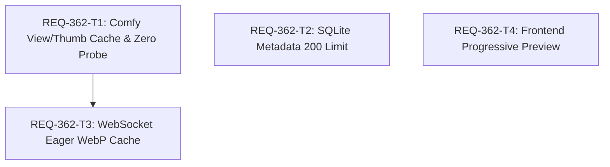

# REQ-362 詳細設計書: プレビュー高速化・通信シーケンス最適化および200件三位一体キャッシュ

## 1. 概要とアーキテクチャ背景 (Architecture Context)

### 1-1. ボトルネックの構造
従来のプレビュー表示では、画像の選択・切り替えのたびに以下の処理が発生していた：
1. **不要なHTTPプローブ**: キャッシュの有無にかかわらず、ComfyUI（WSL2 localhost:8188）への `HEAD` 存在確認を実行（50〜200ms）。
2. **大容量未圧縮PNGの都度転送**: `/api/comfy/view` 経由で十数MBの元画像PNGをComfyUIから取得し、ブラウザへストリーミング転送（200〜500ms）およびブラウザPNGデコード負荷（50〜150ms）。
3. **メタデータと履歴枠の不一致**: ComfyUI履歴窓（200件）に対し、SQLiteメタデータ（1,000件）が保持され、201件以降がアクセス不能な孤児レコードとなっていた。

### 1-2. 解決策: 200件三位一体キャッシュ & ゼロプローブ
ディスク容量、メモリ使用量、UI整合性を総合的に考慮し、**「ComfyUI履歴窓」「フルサイズWebPキャッシュ」「SQLiteメタ情報」の3者をすべて「最新200件」で完全同期**させる。

1. **ゼロプローブ即時返却**:
   ローカルディスク（`db/full_cache/`）にキャッシュファイルが存在し、実サイズ > 0 の場合、外部HTTPプローブを一切行わず即座にWebPを返却（< 5ms）。破損・0バイト検出時はオンデマンド再取得へ安全にフォールバック。
2. **生成完了時の先行生成 (Eager Cache)**:
   WebSocketジョブ完了通知（`executed` イベント）受信時に、サムネイル生成と並行してフルサイズWebP（Quality 90, sRGB）を非同期先行生成。
3. **オンデマンド生成フォールバック (Lazy Fallback)**:
   未キャッシュ画像（過去履歴等）への `/view` 要求時は、ComfyUIから元画像を取得し、ワーカースレッドでWebP（Quality 90）へ変換してディスクに保存・返却。ディスク満杯等（`OSError`）時はエラーとせず元画像ストリーム返却へフォールバック。
4. **ヒステリシス上限間引き (Cache Pruning with Lock)**:
   ディスクIO頻度を抑制するため、`db/full_cache/` 内のWebPファイル総数が220件（High Water Mark）を超過した場合にのみ、`asyncio.Lock` 排他制御下で最終アクセス/更新日時昇順に200件（Target）まで間引く。
5. **SQLiteメタデータ上限200件同期**:
   `prompt_metadata` の上限を200件とし、キュー滞留・実行中のアクティブプロンプトを除外した古いレコード（`created_at` 昇順）を同一トランザクション内で自動削除。
6. **プログレッシブプレビュー**:
   フロントエンドでフルサイズWebPロード完了まで既存サムネイルWebPをプレースホルダー先行描画。サムネイル未ロード時もスピナー表示でグレースフルにフォールバック。

---

## 2. Seam Map (設計義務仕様 [MUST [W-DD-SEAM]])

### 2-1. 結合境界（Integrated - 本番コードそのまま実行）
- FastAPI ルーターレイヤー: `app/routers/comfy.py`, `app/routers/prompt_metadata.py`
- 画像変換・ハッシュ生成ロジック: Pillow / asyncio.to_thread による WebP Quality 90 変換
- SQLite DBセッション: テスト内インメモリ SQLite セッションおよび ORM 操作
- React プレビューコンポーネント: `GenerateParallelPreview.tsx`

### 2-2. 切断境界（Severed - 外部I/Oの遮断）
- ComfyUI HTTP 通信: `httpx.AsyncClient` による外部リクエストは `respx` またはトランスポートモックで遮断。
- ファイルシステム境界: `settings.snapshot_path` をテスト用一時ディレクトリ（`tmp_path`）に設定し、実環境ストレージを保護。

### 2-3. モックレベル規約
- 内部ビジネスロジックやヘルパー関数のモンキーパッチは禁止。
- モックはトランスポート層（`httpx` レベル）または環境変数・設定パス差し替えに限定。

### 2-4. PBT (Property-Based Testing) 判定
- 判定: **不要（No）**。パーサー・DSL・複雑な数式計算は含まず、固定閾値（200件 / 220件）による境界値検証およびHTTPステータス・ヘッダー検証が主であるため、決定論的テーブルテストで網羅。

### 2-5. 異常系・フォールトインジェクション
- ComfyUI 404 (画像未存在): 404 エラーハンドリング
- ComfyUI 502 / タイムアウト: 502 エラーハンドリング
- ディスク書き込み失敗（OSError / 容量満杯等）: リクエスト失敗を回避し、元画像ストリーミング返却にフォールバック
- キャッシュファイル破損（0バイト等）: 破損検出時にキャッシュミスとみなし再生成

---

## 3. テスト配置計画 (Test Placement Plan [MUST [W-DD-PLACE]])

チケット番号を含まない既存の配置先テストファイルを拡張する：

| 対象 AC | 検証テストファイル | テストケース名（タグ付き） |
| :--- | :--- | :--- |
| AC-1, AC-4, AC-5 | `backend/tests/integration/legacy/test_comfy_proxy.py` | `test_comfy_view_cache_and_probe_behavior [REQ-362/AC-1] [REQ-362/AC-4] [REQ-362/AC-5]` |
| AC-2 | `backend/tests/integration/legacy/test_comfy_proxy.py` | `test_comfy_thumbnail_skips_probe_on_cache_hit [REQ-362/AC-2]` |
| AC-3 | `backend/tests/integration/legacy/test_comfy_generation_bridge.py` | `test_eager_full_webp_cache_on_executed [REQ-362/AC-3]` |
| AC-6 | `backend/tests/integration/legacy/test_prompt_metadata.py` | `test_prompt_metadata_200_limit_pruning [REQ-362/AC-6]` |
| AC-7 | `frontend/src/pages/GeneratePage/components/__tests__/GenerateParallelPreview.test.tsx` | `renders thumbnail placeholder during full webp loading [REQ-362/AC-7]` |

---

## 4. タスク分割と依存関係 (DAG)

- **REQ-362-T1**: `backend/app/routers/comfy.py` のゼロプローブ化およびフルサイズWebPキャッシュ・排他安全な200件間引き実装（AC-1, AC-2, AC-4, AC-5）
- **REQ-362-T2**: `backend/app/routers/prompt_metadata.py` のメタデータ200件同期・トランザクション保護パージ実装（AC-6）
- **REQ-362-T3**: `backend/app/routers/comfy.py`（生成完了ハンドラ）での WebSocket 契機フルサイズWebP先行生成実装（AC-3、T1依存）
- **REQ-362-T4**: `frontend/src/pages/GeneratePage/components/GenerateParallelPreview.tsx` のプログレッシブプレビュー表示実装（AC-7）

