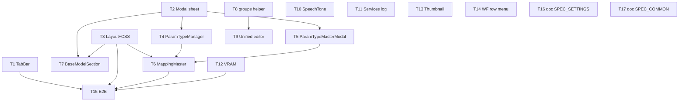

# REQ-365 Settings画面再設計 詳細設計書

作成者: architect (dev-design) / 作成日: 2026-10-15 / change_kind: code（フロントエンドUI）+ document（SPEC同期）

## 1. 境界監査 (Boundary Audit)

| 項目 | 内容 |
|---|---|
| Target_Paths | `C:\Users\audih\ws\comfy-create-helper2\frontend\src\...`（frontendのみ）。`backend/`・`db/`・`docs/system/openapi.yaml` は変更しない |
| Shared_Dependency_Paths | 読み取り/実行のみ: インストール済みruntimeの `helpers/doc_mapper.py`, `helpers/local_model_adapter.py`。編集はしない |
| Git_Root_Mismatch | なし（全編集対象がWORKSPACE_ROOT配下） |
| システム契約の出典 | 既存フロントAPIクライアント（`frontend/src/api/client.ts`, `api/domains/*`）。**契約は一切変更しない**（PBI要件「API・DB保存契約を100%維持」） |
| 対象外の既存未コミット変更 | `backend/tests/integration/legacy/test_comfy_generation_bridge.py`, `docs/design/REQ-356-test-mapping.md`, `db/full_cache/`, REQ-364 PBI は触らない |

OpenAPI抽出（`openapi_parser.py`）は、PBIがAPIエンドポイント/共有スキーマを変更しない純UI変更のため**スキップ**（Skill Step 1-3の条件に従う）。

## 2. 現状調査の要点 (As-Is)

調査は `SettingsPage.tsx` と各 `components/*` に限定した（R-AR-4準拠）。

1. 5タブ構成・URL hash・`prompt-surgeon-settings-active-tab` 保存は **REQ-314/334 で既に実装済み**（`hooks/useSettingsTab.ts`）。短縮ラベルは「モデル/呪文/…」で **数字プレフィックス（①〜⑤）が無い**。
2. 共通 `components/common/Modal.tsx` は既に768px未満でボトムシート化（`items-end`, `rounded-t-2xl`, ハンドル `md:hidden`）済み。ただし最大高さは `calc(100dvh - safe-area)` で85dvhではなく、ハンドルに `data-testid` が無い。`ParamTypeMasterModal` / `BaseModelSection` の2モーダル / `StageManagerModal` / `MappingMasterEditModal` は **独自の中央固定オーバーレイ**（モバイル中央モーダル禁止の不変条件3に反する）だった（当初の現状。実装（プランA）では、Settingsから到達するモーダルはすべて共通Modal化済み: `ParamTypeMasterManagerModal` / `ParamTypeMasterModal` / `BaseModelSection` の各モーダル / `MappingMasterEditModal` / `StageManagerModal` / `SpeechTonePresetModal` / `MappingMasterDeleteModal` / `WorkflowDeleteConfirmDialog` / `WorkflowManageModal` / `WorkflowNodePicker` / `WorkflowDiffReplaceModal`（最後の1件は元から共通Modalで、高さ指定なしの既定高さ）。当初の「`StageManagerModal` / `MappingMasterEditModal` は段階移行」との記述は撤回済み）。
3. `MappingMasterSection` は `div` 行（テーブルではない）。ParamTypeMaster は **ページ内常時展開バー**。`MappingMasterV2` に「Target Node」列は存在せず、ノード情報は `expected_class_types`/`param_name`（`api/types.ts`）。
4. `BaseModelSection` は `lg:grid-cols-2` で「モデル一覧」と「チェックポイントマッピング」の2テーブルを同居させ、`.settings-mobile-table` でモバイルブロック化している。
5. `LlmSettingsSection`（799行）の `prompt` グループは6プロンプトキー（`audit_interference`, `audit_interference_anima`, `audit_vocabulary`, `audit_physical`, `scene_generate`, `scene_generate_anima`）をアコーディオン表示し、LLMパラメータは別セクション（`llm_params_audit` / `llm_params_scene_generate`）。**メインモデルは全プロンプト共通の1値**。
6. `SpeechToneSection` のプレビューは編集モーダル内のみ。タブ上にテスト実行UIは無い（`speechTonePresetsApi.rewrite` は存在）。
7. `ServiceConnectionCard` はカード3枚＋単一の `<details>サービスログ` 。サービス別アコーディオンは無い。
8. `VramGuardSection` はクライアントStateにバインドしたメーター＋閾値線を**既に持つ**（赤線）。LocalStorageキー `prompt-surgeon-vram-guard-limit` は **未定義**。
9. `ThumbnailSettingsSection` は比率プリセットを複数ボタンで表示。`WorkflowConnectionSection` のワークフロー行は6個超のボタンを横並び。
10. `SettingsPage.tsx` は既に `pb-[calc(6rem+env(safe-area-inset-bottom))] lg:pb-5`（当初の現状。実装では `md:pb-5` に是正し、AppShellのbottom navが768px未満のみである境界と一致させた）。

## 3. SSoT影響分析

`doc_mapper.py docs/specs docs/backlog/pbi/active/REQ-365.md` は **"No mapped documents found"** を返した（PBIファイルのパスにはタグ/related_pathsマッピングが無いため）。補助として対象ソースを個別に照会した。

| 照会パス | 結果 |
|---|---|
| `frontend/src/pages/SettingsPage` | `docs/specs/SPEC_SETTINGS.md` |
| `.../components/VramGuardSection.tsx` | `docs/specs/SPEC_SETTINGS.md` |
| `components/common/Modal.tsx`, `utils/localStorageKeys.ts`, `components/ParamTypeMasterModal.tsx` | 未マップ（手動判定: Modal契約は `SPEC_COMMON.md` §Modal/Preset 1 が出典） |

影響仕様と改訂内容:

- **docs/specs/SPEC_SETTINGS.md (v2.6 → v3.0)** — §3 5タブ表のコンパクト表示名（①〜⑤付き）、§3-1 大画面2ペイン/小画面リオーダ、ParamTypeMaster・BaseModelマスタのオンデマンドモーダル化、プロンプト統合型エディタ（種別連動）、口調テスト実行、サービス別ログアコーディオン、VRAM閾値線連動とLocalStorageキー `prompt-surgeon-vram-guard-limit`、モバイル超スリムカード、関連テスト参照。`prompt-surgeon-settings-details-expanded-v2` のスキーマ `{prompt, dialogue}` は**文言を変えず維持**を明記。→ Task Card **REQ-365-T16**（document）
- **docs/specs/SPEC_COMMON.md** — 共通Modalのモバイルシート契約（最大高さ85dvh選択肢、ハンドルのtestid）、AppShell下部余白のnav境界（768px未満のみ）の整合。→ Task Card **REQ-365-T17**（document）。実装後の再同期（T23）で、`index.css` の疑似要素ハンドル（L1）は `.modal-backdrop` 直下のレガシーパネル（`[role='dialog']:not([data-radius-exempt])` と、`role="dialog"` を持たず `max-w-md`〜`max-w-7xl` を持つ直下パネルの2系統）にのみ適用され、共通Modal（`data-radius-exempt`）は実ハンドル1つのみとする制限、および唯一のモーダルネスト例外（MappingMasterEditModal 内の WorkflowNodePicker。外側は `closeOnEsc={!isNodePickerOpen}` で Esc を無視し、内側のみ閉じる）を追記した。
- API仕様（`docs/system/openapi.yaml`）・DBスキーマ: **変更なし**。

## 4. 要件→設計マッピング

### 4.1 AC → 設計 → Task Card

| AC | 設計の要点 | Task Card |
|---|---|---|
| AC-1 | workflowsタブをCSS Gridで`xl`(>=1280px)2カラム化。左=ワークフロー(上)・BaseModel(下)、右=MappingMaster(row-span 2)。`xl:grid-rows-[auto_1fr]`+`items-start`でRow-Span余白を排除。`<xl`は`order`でWF→Mapping→BaseModel | T3 (+T15 E2E) |
| AC-2 | タブバー短縮ラベルの**可視テキストのみ**を「① モデル」「② 呪文」「③ セリフ」「④ 翻訳」「⑤ システム」に変更（`aria-label` は長い表示名のまま丸数字なし＝既存テスト契約と矛盾しない）。snap-x維持。44pxは既存`min-h-11`+CSS(`@media max-width:767px`)を再検証し不足分を補う | T1, T3, T13 (+T15) |
| AC-3 | MappingMaster行を`.settings-mobile-card`(2行グリッド、右上固定アクション)化。Target Node情報は`.settings-mobile-card__target-node`でモバイル非表示、編集ボタンの`aria-label`へ集約。BaseModelのチェックポイント表も`.settings-mobile-table`を2行カード化 | T3(CSS契約), T6, T7 |
| AC-4 | 「カスタム型マスタ」ボタン→`ParamTypeMasterManagerModal`（新規）。常時展開バーを撤去。作成/編集は既存`ParamTypeMasterModal`を**排他的に**開く（list→form→list、ネスト禁止） | T4, T5, T6 |
| AC-5 | `prompt`グループに統合型エディタ。種別セレクタ(6キー)→左=本文textarea、右=共通モデル(参照表示)・Temperature・Max Tokens(+その他は折畳)。種別→パラメータ群の対応は純粋関数`promptParamGroupFor` | T8, T9 |
| AC-6 | `SpeechToneSection`に選択可能プリセット行＋テスト入力＋「テスト実行」→`speechTonePresetsApi.rewrite`→右ペイン出力（古い応答は破棄） | T10 |
| AC-7 | `ServiceConnectionCard`にサービス行(死活ランプ＋「ログ ▼」)。直下インラインアコーディオンで`systemManagerApi.logs`を取得 | T11 |
| AC-8 | `VramGuardSection`を2ペイン化。スライダーdraft Stateからメーター黄線・閾値タグを同期描画（HTTP/WS負荷なし）。接近=黄、未満=赤 | T12 |
| AC-9 | 共通Modalに`sheetMaxHeightClass`(opt-in)とハンドル`data-testid`を追加。ParamType/Manager/BaseModelの各モーダルを共通Modalへ移行（当初設計）。実装では全Settingsモーダル（ParamTypeMasterManagerModal / ParamTypeMasterModal / BaseModelSection各モーダル / MappingMasterEditModal / StageManagerModal / SpeechTonePresetModal / MappingMasterDeleteModal / WorkflowDeleteConfirmDialog / WorkflowManageModal / WorkflowNodePicker）が`max-h-[85dvh]`の共通Modalへ移行済み。WorkflowDiffReplaceModal は元から共通Modalで高さ指定なし（既定高さ）。上端角丸16px・ハンドル二重表示解消を含む | T2, T4, T5, T7, T18, T20〜T22, T24〜T30 |
| AC-10 | タブ: 既存`useSettingsTab`の保存を回帰固定（テスト追加）。VRAM: `LS_KEYS.VRAM_GUARD_LIMIT`追加とwrite-through | T1(テスト), T12 |

PBI本文の要件でACに現れないもの: ワークフロー行アクション「︙」メニュー集約（要件3）→ **T14**、サムネイル比率ドロップダウン化（情報設計）→ **T13**。

### 4.2 主要コンポーネント契約（署名）

```ts
// components/common/Modal.tsx  (T2: 追加のみ。既定値は現行動作と同一)
export interface ModalProps {
  /* 既存 props ... */
  sheetMaxHeightClass?: string // 既定: 'max-h-[calc(100dvh-env(safe-area-inset-top))]'
}
// ハンドル要素に data-testid="modal-sheet-handle" を付与

// components/ParamTypeMasterManagerModal.tsx (T4, 新規)
export interface ParamTypeMasterManagerModalProps {
  isOpen: boolean
  items: ParamTypeMaster[]
  onClose: () => void
  onCreate: () => void
  onEdit: (item: ParamTypeMaster) => void
  onDelete: (item: ParamTypeMaster) => void
}

// pages/SettingsPage/components/llmSettingsGroups.ts (T8, 追記)
export type PromptParamGroup = 'llm_params_audit' | 'llm_params_scene_generate'
export const PROMPT_EDITOR_KEYS: readonly string[] // = GROUP_PROMPTS.prompt
export function promptParamGroupFor(promptKey: string): PromptParamGroup | null

// utils/localStorageKeys.ts (T12)
VRAM_GUARD_LIMIT: 'prompt-surgeon-vram-guard-limit'

// VramGuardSection.tsx (T12, テスト用に export)
export function readStoredVramLimit(raw: string | null): number // 2.0..14.0 にclamp、不正値は 4.0
```

### 4.3 CSS契約（T3が`SettingsResponsive.css`を唯一所有、T6/T7が使用）

- `.req314-settings .settings-mobile-card` : 幅>=768pxは通常のflex行。`@media (max-width:767px)` で `grid-template-columns:minmax(0,1fr) auto; grid-template-areas:"title actions" "badges badges"`。
- 子クラス `__title`(grid-area:title; min-width:0)、`__actions`(grid-area:actions; justify-self:end; flex-shrink:0)、`__badges`(grid-area:badges; flex-wrap)、`__target-node`(モバイルで`display:none`)。
- `.settings-mobile-table` : 既存thead非表示を維持し、`tr`を2行グリッド化。`td[data-cell='actions']`→右上固定、`td[data-cell='target-node']`→モバイル非表示、その他`td`は2行目全幅。

## 5. Seam Map（テスト継ぎ目）[W-DD-SEAM]

1. **Integrated (real code)**: 各Sectionコンポーネント、`useSettingsTab`（`MemoryRouter`）、React Query（`createTestQueryClient`）、`useGenerationStore`、共通`Modal`、`localStorage`（jsdom実体）。
2. **Severed (external I/O only)**: `settingsApi` / `llmPromptsApi` / `speechTonePresetsApi` / `systemManagerApi` / `mappingMastersApi` / `baseModelsApi` / `paramTypeMastersApi` 等のAPIクライアント境界（既存SettingsPage統合テストの手法踏襲: `vi.mock('../../../api/client')`）。`setupNetworkGuard` で未モックfetchを失敗させる。WebSocketは`MockWebSocketController`。
3. **Mock Level**: コンポーネント内部ロジック・ヘルパのmonkey-patchは禁止。切断位置はAPIクライアント（transport facade）のみ。時間依存（toast/タイマー）は`vi.useFakeTimers`。
4. **PBT Decision**: (a) `promptParamGroupFor`（全キーの全域性）、(b) `readStoredVramLimit`（任意文字列→範囲内数値）、(c) viewport分類（767/768/1279/1280境界）に **fast-check** を使用（package.json に`fast-check ^3.18.0`導入済み）。
5. **Fault Injection**: `systemManagerApi.logs` 失敗/504/Manager停止、`speechTonePresetsApi.rewrite` 拒否・遅延逆転、`settingsApi.updateVram` 失敗（AC-10のLS値とサーバ値の乖離確認）、`localStorage.setItem` 例外（quota/無効化）。

Tier割当: Tier1=静的/契約+純粋関数(PBT)、Tier2=jsdom統合、Tier3=Playwright（sticky/実スクロール/実computed-style=44px・1280px境界のみ）。全テストCPU/RAMのみ（Zero-GPU）。

## 6. トレードオフ・制約・リスク

| # | 論点 | 採用 | 代替案と却下理由 |
|---|---|---|---|
| T-1 | モバイルシートの実現 | 既存共通`Modal`のCSS駆動シート（768px未満`items-end`）を拡張し、各モーダルを移行 | 未使用の`BottomSheet`(JS駆動)を新規採用: viewport判定のJS分岐と二重実装になり、Modalのfocus trap/body-lock契約を再実装する必要がある |
| T-2 | 2ペイン実現 | 単一Grid + `order` + `row-span`（`xl:grid-rows-[auto_1fr]`） | 2つのflex列: 順序変更(WF→Mapping→Base)をCSSのみで満たせない（DOM順固定） |
| T-3 | 統合エディタの「種別専用モデル」 | **共通モデルは読み取り表示**し、Temp/MaxTokensは種別に対応する`llm_params_*`群の値。API/DBを変えない | 種別ごとのモデル保存: 新規promptキー/設定契約が必要で「API・DB契約100%維持」に反する |
| T-4 | VRAMのLocalStorage | write-through ミラー（サーバ値が正）。初期値のみLS、サーバ取得でdirtyでなければ上書き | LSを正とする: 実ガード(`vram_min_free_gb`)と乖離し安全性が損なわれる |
| T-5 | ParamTypeMasterの管理UI | 一覧モーダル＋既存フォームモーダルを排他遷移 | 1モーダル内に統合: 482行の`ParamTypeMasterModal`を肥大化・原子性違反 |
| T-6 | サービスログ | 行ごと独立アコーディオン（個別state） | 既存`<details>`維持: AC-7（各行直下に展開）を満たさない |
| T-7 | `SettingsPage.tsx`の所有 | T3のみが編集。他カードはpropsシグネチャを変更しない | 各カードで編集: 同一ファイル同時所有になる |

リスク:
- R1 `SettingsPage.test.tsx`（既存統合テスト）が`SpeechToneSection`/`WorkflowConnectionSection`/`VramGuardSection`の文言に依存。T10/T12/T14は当該テストを**編集せず緑のまま**維持する。不可能なら実装を止めてescalate。
- R2 `LlmSettingsSection.tsx` は799行。T9は`group==='prompt'`分岐のみ変更し、`dialogue`/`translation`は無変更（回帰テスト必須）。
- R3 `.req314-settings button:has(svg){min-width:44px}`等の既存全体ルールとの二重適用（二重padding）。T3は新規ルールを局所クラスに限定する。
- R4 Playwrightは`webServer`未設定（`playwright.config.ts`）。T15は開発サーバ起動前提で、起動不可なら **INCONCLUSIVE**（PASS扱い禁止）。
- R5 `Modal`のbody-scroll-lock・focus trapはモーダル同時1つ前提。排他モーダル設計（list→form遷移で一度closeしてからopen）を守る。
- R6 `MappingMasterV2`に「Target Node」列が存在しない解釈差（§7参照）。

## 7. 未解決事項（人間レビューで確認が必要）

1. **PBIの6プロンプト種別名と実在キーの不一致**: PBI記載（最適化/タグ提案/品質評価/翻訳/スタイル/ネガティブ）は現行DBの`prompt`グループ6キーと一致しない。本設計は**実在6キー＋既存`PROMPT_LABELS`**を採用（API/DB不変のため）。PBIの名称そのものを求める場合は別PBIでキー追加が必要。
2. **AC-5「種別専用のパラメータ値」の粒度**: パラメータは`llm_params_audit`（4キー共有）と`llm_params_scene_generate`（2キー共有）の2群のみ。同群内の種別切替ではTemp/MaxTokensは変わらない（本文は必ず切替）。AC-5テストは群をまたぐ切替（audit→scene_generate）で値の連動を検証する。
3. **「Target Node列」の所在**: `MappingMasterV2`行にはTarget Node表示が無く、`expected_class_types`（+N classes）・`param_name`が該当情報。これらをモバイルで非表示にし`aria-label`へ集約する解釈とする。
4. **VRAM「上限閾値」の語義**: 既存`vram_min_free_gb`（最小必要空き容量）と同一概念として扱う。ラベル`最小必要空き容量 (vram_min_free_gb)`は既存テスト維持のため変更しない。
5. **E2E前提**: 開発サーバ(5173)＋APIモックでのPlaywright実行可否は実行環境依存。

## 8. implementation_plan.md サマリ

ルート `implementation_plan.md` に日本語の実装計画・Mermaid DAG・Trade-off Disclosure を記載した（REQ-366の旧内容は git履歴 `be49e56` に保存済み）。



最大深さ 4（T2→T4→T6→T15）。（上記 DAG と深さは T1〜T17 の初期計画範囲。T18〜T30 は実装中に追加された後続カードで DAG には含めない。§9 参照。）並列可能な根: T1, T2, T3, T8, T10, T11, T12, T13, T14, T16, T17。

## 9. ファイル所有マトリクス（同一ファイルの重複所有なし）

| Task | change_kind | 所有ファイル |
|---|---|---|
| T1 | code | `SettingsPage/components/SettingsTabBar.tsx`, `.../__tests__/SettingsTabBar.test.tsx`, `SettingsPage/hooks/__tests__/useSettingsTab.test.tsx` |
| T2 | code | `components/common/Modal.tsx`, `components/common/__tests__/Modal.test.tsx` |
| T3 | code | `pages/SettingsPage.tsx`, `SettingsPage/SettingsResponsive.css`, `SettingsPage/__tests__/SettingsPage.test.tsx` |
| T4 | code | `components/ParamTypeMasterManagerModal.tsx`(新規), `components/__tests__/ParamTypeMasterManagerModal.test.tsx`(新規) |
| T5 | code | `components/ParamTypeMasterModal.tsx`, `components/__tests__/ParamTypeMasterModal.test.tsx`(新規) |
| T6 | code | `SettingsPage/components/MappingMasterSection.tsx`, `.../__tests__/MappingMasterSection.test.tsx`, `.../__tests__/MappingMasterSection.modals.test.tsx` |
| T7 | code | `SettingsPage/components/BaseModelSection.tsx`, `.../__tests__/BaseModelSection.test.tsx` |
| T8 | code | `SettingsPage/components/llmSettingsGroups.ts`, `.../__tests__/llmSettingsGroups.test.ts` |
| T9 | code | `SettingsPage/components/LlmSettingsSection.tsx`, `.../__tests__/LlmSettingsSection.test.tsx` |
| T10 | code | `SettingsPage/components/SpeechToneSection.tsx`, `.../__tests__/SpeechToneSection.test.tsx` |
| T11 | code | `SettingsPage/components/ServiceConnectionCard.tsx`, `.../__tests__/ServiceConnectionCard.test.tsx` |
| T12 | code | `SettingsPage/components/VramGuardSection.tsx`, `utils/localStorageKeys.ts`, `SettingsPage/components/__tests__/VramGuardSection.test.tsx`(新規) |
| T13 | code | `SettingsPage/components/ThumbnailSettingsSection.tsx`, `.../__tests__/ThumbnailSettingsSection.test.tsx` |
| T14 | code | `SettingsPage/components/WorkflowConnectionSection.tsx`, `.../__tests__/WorkflowConnectionSection.test.tsx` |
| T15 | code | `frontend/e2e/settingsResponsive.spec.ts`(新規) |
| T16 | document | `docs/specs/SPEC_SETTINGS.md` |
| T17 | document | `docs/specs/SPEC_COMMON.md` |
| T18 | code | 共通Modalボトムシート上端角丸を16pxにする（モバイル半径上書きからの除外） |
| T19 | code | ヘッダーケバブメニューのモバイル44pxタッチターゲット化（視覚28px維持） |
| T20 | code | 共通Modalのドラッグハンドル二重表示を解消する（旧擬似要素ハンドルの除外） |
| T21 | code | MappingMasterEditModal を共通Modalのボトムシートへ移行（独自overlay撤去） |
| T22 | code | StageManagerModal を共通Modalのボトムシートへ移行（独自overlay撤去） |
| T23 | document | SPEC_COMMON / SPEC_SETTINGS の共通Modal移行完了への同期とレビュー指摘L1の反映 |
| T24 | code | MappingMasterEditModal / StageManagerModal のボトムシートE2E検証（375px / 1280px） |
| T25 | code | SpeechTonePresetModal を共通Modalのボトムシートへ移行（独自overlay撤去） |
| T26 | code | SettingsComponents の MappingMasterDeleteModal / WorkflowDeleteConfirmDialog を共通Modalのボトムシートへ移行 |
| T27 | code | WorkflowManageModal（名前変更/コピー）を共通Modalのボトムシートへ移行（レガシー .modal-backdrop 撤去） |
| T28 | code | WorkflowNodePicker（MappingMasterEditModal内ネスト）を共通Modalのボトムシートへ移行 |
| T29 | code | SettingsResponsive.css の `.req314-settings [role='dialog']` 規則の見直し・撤去（T3残置） |
| T30 | code | 追加移行ダイアログ（口調プリセット/マッピング削除/ワークフロー削除/名前変更・コピー）のボトムシートE2E（375px / 1280px） |

（T18〜T30 は実装中に追加された後続カード。T18〜T30 行の第3列は所有ファイルではなくカードtitleの要旨を記す。所有ファイルは各Task Cardを参照。）

（パスは特記なき限り `frontend/src/pages/` 起点または `frontend/src/` 起点。各Task Cardに完全パスを記載。）
