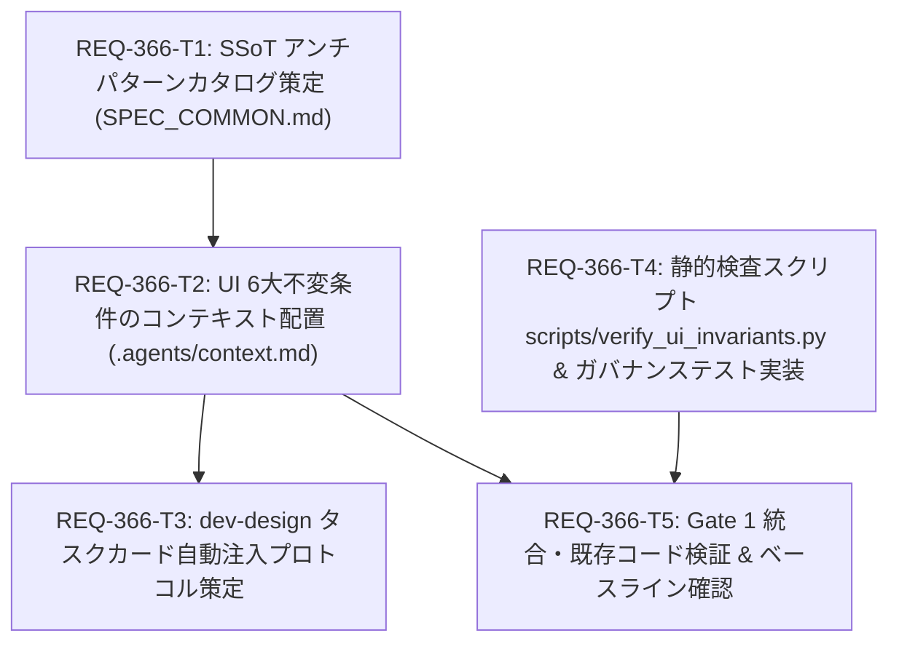

# REQ-366 UI/UX ガバナンス・3層パイプラインおよびアンチパターン詳細設計書

## 1. 概要とアーキテクチャ方針 (Overview & Architecture)

### 1-1. 背景と根本原因 (Root Cause & 5 Whys)
UI/UXの改修時に「CSS一括文字サイズ底上げ（11px Floor）」や「二重パディング」などの対症療法が施され、意図せぬレイアウト崩壊や文字突き破りなどの二次災害が誘発されていた。また、長大なアンチパターン集をエージェントのコンテキストに常時注入することは、コンテキストトークン消費（2,000〜3,000トークン）と注意力の希釈（バックエンド改修時の不要ノイズ）を招く。

### 1-2. 3層パイプライン構造 (3-Layer Pipeline Architecture)
本設計では、UI/UXガバナンスを以下の3層＋1ゲートで分離・構造化する。

```
+--------------------------------------------------------------------------+
| Layer 1: SSoT カタログ (docs/specs/SPEC_COMMON.md #1-5)                   |
| - モバイル10選 & PC8選 アンチパターン詳細、コード例 (Bad/Good)、非省略規則 |
| - 4大コンポーネントプリセット (Tailwind実装仕様 & 防御トークン)           |
|   1) Modals & Overlays  2) Tabs / Chips / Grids                          |
|   3) Forms & Controls   4) Shell & Page Layout                           |
+--------------------------------------------------------------------------+
                                    │ 参照ポインタ
                                    ▼
+--------------------------------------------------------------------------+
| Layer 2: 共通ハード不変条件 (.agents/context.md)                          |
| - エージェント常駐コンテキスト (300〜500トークン)                          |
| - 構文レベルで判定可能な「UI 6大ハード不変条件」のみをコンパクトに定義    |
| - 4大プリセットへの参照マップを保持                                       |
+--------------------------------------------------------------------------+
                                    │ アーキタイプ分類 & サージカル注入
                                    ▼
+--------------------------------------------------------------------------+
| Layer 3: Task Card サージカル注入 (dev-design)                            |
| - Architect がタスクを4大アーキタイプに分類                               |
| - 該当プリセットのみを Task Card の <constraints> にピンポイント注入      |
| - バックエンド単体タスクは注入ゼロ (コンテキスト汚染ゼロ)                |
+--------------------------------------------------------------------------+
                                    │ 静的検証
                                    ▼
+--------------------------------------------------------------------------+
| Gate 1: 機械的即死検証 (scripts/verify_ui_invariants.py)                  |
| - CI / ローカル Gate 1 で即時実行 (<1秒)                                  |
| - グローバル文字底上げ、生 vh、!important 乱用を Exit Code 1 で即死遮断   |
| - コメントによる正当な理由付き例外機構 (Allowlist / Ignore)               |
+--------------------------------------------------------------------------+
```

---

## 2. 詳細仕様設計 (Detailed Specifications)

### 2-1. Layer 1: SSoT アンチパターンカタログ & 4大プリセット (`docs/specs/SPEC_COMMON.md`)
`docs/specs/SPEC_COMMON.md` に「1-5. UI/UX アンチパターンカタログ」を新設し、アンチパターンと対になる「4大コンポーネントプリセット (Component Presets)」を Tailwind CSS 具体構文付きで定義する。

#### モバイル10選 (Mobile Anti-patterns)
1. **Global Font Floor**: グローバルセレクタ（`html, body`, `[class~='text-[...']`）で文字サイズを一括底上げすることによる文字あふれ・突き破り。対策: コンポーネント単位で `text-[11px]` や `text-xs` トークンを指定。
2. **Flex truncate 不発**: `min-w-0` の欠落により flex アイテム内の `truncate` が機能せず親要素を突き破る。対策: `min-w-0 flex-1 truncate` をセットで付与。
3. **モバイル中央モーダル**: 768px未満で中央モーダルを配置しキーボードや画面端と干渉。対策: ボトムシート（`modal-backdrop` + sheet）への統一。
4. **二重パディング**: 親コンテナと子要素の両方にパディングを重複適用して有効領域を縮小。対策: コンテナでの一元管理（`p-4 space-y-2` 等）。
5. **タッチ判定密集 / 誤肥大**: 44px判定を確保するためにUI要素自体を無理に巨大化・密集。対策: Hit-Slop透明判定拡張（`before:absolute before:-inset-2`）。
6. **IME衝突 / 仮想キーボード遮蔽**: フォーカス時に固定アクションバーが入力要素を隠す。対策: チェックボックス/ラジオ/ボタンのフォーカス除外ガードと入力時の適切なスクロール領域確保。
7. **input判定雑駁**: チェックボックスやトグルの `label` 判定が広すぎて意図しないトグル発火。対策: `label` 範囲を操作対象＋説明文に絞り `gap-2` で分離。
8. **英単語・連続英数字の突き抜け**: 長い英単語・ハッシュ値・ファイル名がコンテナ外へ突き抜ける。対策: `break-words` / `overflow-wrap: anywhere`。
9. **ジェスチャー競合**: モーダル内スクロールとブラウザの引き下げリロード/スワイプ戻るが競合。対策: `overscroll-behavior-y: contain`、ジェスチャー面での `touch-action: pan-y / manipulation`。
10. **過剰ブラー**: モバイルでの高半径 `backdrop-filter: blur(24px)` によるGPUスタッター。対策: モバイルでは `blur(8px)` または半透明ベタ塗り。

#### PC8選 (Desktop Anti-patterns)
1. **超ワイド画面コンテナ上限欠落**: Ultra-WideディスプレイでUIが全幅に伸び視線移動が過大化。対策: `max-w-7xl` / `container mx-auto` での最大幅制限。
2. **OS拡大率崩れ**: Windows 125%/150% 等のDPIスケーリング時に固定高px要素がはみ出す。対策: 固定高さを避け `max-h-[...]` + `overflow-y-auto`。
3. **ペイン幅固定**: 低解像度PCで操作領域が圧迫。対策: Resizable SplitPane またはパーセンテージ幅。
4. **ホバー依存UI**: マウスホバー時のみボタンが表示されキーボードやタッチで到達不能。対策: 常時表示または `focus-within:opacity-100`。
5. **ショートカット欠落**: 頻出主要アクションにキーボードショートカットがない。対策: `Ctrl+Enter` / `Esc` 等の標準ショートカット定義。
6. **一括操作欠落**: 複数アイテムを1件ずつしか操作できない。対策: 複数選択チェックボックスと一括操作アクションバー。
7. **多重スクロールバー**: ネストされたコンテナが個別にスクロールバーを持ちホイール挙動が破綻。対策: スクロールコンテナの一元化と `overflow-hidden`。
8. **多重モーダル**: モーダルの上にモーダルを重ねフォーカスやEscape制御が破綻。対策: モーダルスタック管理またはインライン展開。

#### 4大コンポーネントプリセット (4 Component Presets with Tailwind)
アンチパターン防御を実装レベルで標準化するため、以下の4プリセットを策定する:

1. **Preset 1: Modals & Overlays (モーダル・オーバーレイ)**
   - **モバイル**: 下部ボトムシート構造 (`fixed inset-x-0 bottom-0 rounded-t-2xl max-h-[90dvh] overflow-y-auto`)。
   - **スクロール・ジェスチャー制御**: `overscroll-behavior-y: contain` (`overscroll-contain`)、ブラウザ競合回避。
   - **GPU負荷抑制**: `backdrop-blur-sm` (<=8px) または `bg-black/60` (半透明ベタ塗り)。
   - **PCデスクトップ**: 中央配置 (`sm:max-w-lg sm:mx-auto sm:my-auto sm:rounded-xl`)、多重モーダル禁止・スタック一元化。

2. **Preset 2: Tabs / Chips / Grids (タブ・チップ・グリッド)**
   - **横スクロールチップ/タブ**: 折返し防止と幅維持 (`flex overflow-x-auto shrink-0 whitespace-nowrap gap-2 no-scrollbar`)。
   - **Flex テキスト省略防御**: flex アイテムの突き破り防止 (`min-w-0 flex-1 truncate`)。
   - **英単語・ID突き抜け防御**: `break-words` / `overflow-wrap: anywhere`。
   - **レスポンシブグリッド**: 固定幅を排除し、DPI拡大率に対応 (`grid grid-cols-1 sm:grid-cols-2 lg:grid-cols-3 gap-4`)。

3. **Preset 3: Forms & Controls (フォーム・コントロール)**
   - **Hit-Slop タッチ判定拡張**: 見た目のサイズを維持したまま透明判定を44x44pxに拡張 (`relative before:absolute before:-inset-2 before:content-['']`)。
   - **ジェスチャー保護**: 意図せぬピンチズームやダブルタップ誤動作の抑止 (`touch-action: pan-y` または `touch-manipulation`)。
   - **判定範囲適正化**: `label` の過大判定を防ぎ、入力要素＋テキストのみに絞り込み (`inline-flex items-center gap-2 cursor-pointer`)。
   - **IME・キーボード退避保護**: 固定アクションバーのフォーカス遮蔽防止（checkbox/radio/buttonはフォーカス時退避から除外）。

4. **Preset 4: Shell & Page Layout (シェル・ページレイアウト)**
   - **ビューポート単位規約**: 生の `100vh` を禁止し、`100dvh` または `min-h-[100dvh]` を使用。
   - **デスクトップ最大幅上限**: Ultra-Wideでの視線乖離防止 (`max-w-7xl mx-auto w-full px-4 sm:px-6 lg:px-8`)。
   - **OS 拡大率 (125%/150%) 耐性**: 固定px高さを排除し、フレキシブルな `max-h-[...] overflow-y-auto` を確保。
   - **多重スクロールバー抑止**: スクロールコンテナを一元化し、親要素に `overflow-hidden` を適用。二重パディング排除。

#### 重要情報の非省略ルール (Critical Information Non-Truncation Rule)
- エラーメッセージ、ID（Prompt ID, Job ID）、ステータス表示（`<code>`, `<span class="status">`, `data-id` 等）に対して安易な `truncate` を適用することを禁止する。
- 代替策: 折り返し（`break-all` / `break-words`）、複数行表示、またはクリック展開/コピー導線。

---

### 2-2. Layer 2: 共通ハード不変条件 (`.agents/context.md`)
`.agents/context.md` に「UI 6大ハード不変条件 (UI 6 Invariants)」をコンパクトに追記する（約300〜500トークン）。4大プリセットへの参照マップを明記する。

```markdown
## UI 6大ハード不変条件 (UI 6 Invariants)
※詳細根拠・コード例・4大プリセットは SSoT: docs/specs/SPEC_COMMON.md#1-5 を参照
1. No Global Font Floor: グローバルセレクタや汎用属性セレクタで一括して font-size: 11px 等を指定することを禁止する。文字サイズはコンポーネント個別のユーティリティ（text-[11px], text-xs）で定義する。
2. Viewport Units: コンテナ高さに生の 100vh を使用することを禁止する。モバイルのアドレスバー変動に対応するため 100dvh または calc(100dvh - env(...)) を使用する。[Shell Preset]
3. Mobile Modals: 画面幅 768px 未満での画面中央モーダルを禁止する。下部ボトムシート（modal-backdrop + sheet, overscroll-contain）に統一し、Escape/backdrop/キーボード退避を担保する。[Modals Preset]
4. Strict Input Guard: タップ判定は Hit-Slop (before:absolute before:-inset-2) を活用して 44x44px を確保しつつ、label による不要な広域クリック判定を避ける。touch-action: pan-y / manipulation を適用。[Forms Preset]
5. Flex Truncate: flex コンテナ内のテキスト省略には必ず min-w-0 を併用する (min-w-0 flex-1 truncate)。横並びチップには shrink-0 whitespace-nowrap を指定。エラーメッセージ、ID、ステータス等の重要情報を安易に truncate してはならない。[Tabs/Chips Preset]
6. Desktop Container: デスクトップ画面で全幅引き伸ばしを放置せず、max-w-7xl 等の上限を設ける。Windows 125%/150% 等の拡大表示に備え、固定 px ではなく max-h とスクロール領域を確保する。[Shell Preset]
```

---

### 2-3. Layer 3: dev-design タスクカード サージカル自動注入プロトコル
Architect がフロントエンドタスクカードを設計する際、以下の「アーキタイプ分類とサージカル注入手順」を厳格に実行する。

#### Architect によるアーキタイプ分類 (Archetype Classification)
タスクの変更対象UIコンポーネントを以下の4アーキタイプに分類する:
- **Archetype 1: Modals & Overlays**: ダイアログ、ドロワー、ボトムシート、ポップオーバー、ドロップダウンメニュー。
- **Archetype 2: Tabs / Chips / Grids**: ナビゲーションタブ、フィルターチップ、カードグリッド、画像サムネイルリスト。
- **Archetype 3: Forms & Controls**: テキスト入力、トグルスイッチ、チェックボックス、押しボタン、検索バー。
- **Archetype 4: Shell & Page Layout**: ページ全体レイアウト、SplitPane、ヘッダー/フッター、スクロールコンテナ。

#### サージカル注入プロセス (Surgical Injection Process)
1. **Frontend タスク生成時 (AC-3)**:
   - Architect は対象タスクのアーキタイプ（1〜4のいずれか、または複合）を特定する。
   - 特定されたアーキタイプに対応するプリセット制約および推奨 Tailwind クラス（例: Hit-Slop `before:absolute before:-inset-2`、ジェスチャー `touch-action: pan-y / manipulation`、チップ `shrink-0 whitespace-nowrap`、`overscroll-contain`、`min-w-0 flex-1 truncate` 等）のみを Task Card の `<constraints>` タグ内にピンポイントで注入する。
   - 無関係なプリセットや長大なアンチパターン集全体を注入することは厳禁（トークン浪費防止）。
2. **Backend 単体タスク生成時 (AC-5)**:
   - `subsystem: backend` のタスクには UI 制約を一切含めない（コンテキスト汚染ゼロ、ゼロトークン注入の保証）。

---

### 2-4. Gate 1: 静的検査スクリプト (`scripts/verify_ui_invariants.py`)
- **配置**: `scripts/verify_ui_invariants.py`
- **対象**: `frontend/src/**/*.{css,tsx,ts,jsx,js}`
- **検査対象スコープと解析手法**:
  1. **CSSファイル (`.css`)**:
     - `rule-no-global-font-floor`: グローバルセレクタ（`html`, `body`, `*`, `[class~='text-[...']` 等）での一括 `font-size: 11px` 指定を検出。
     - `rule-no-raw-100vh`: `height: 100vh`, `min-height: 100vh` 等の生 `vh` 単位指定を検出（`dvh` を推奨）。
     - `rule-no-indiscriminate-important`: CSS内の `!important` 記述を検出。
  2. **TSX/JSXファイル (`.tsx`, `.jsx`)**:
     - 複雑なJSX AST解析を排し、トークンレベルの軽量マッチング（`h-[100vh]`, `min-h-[100vh]`, `height: '100vh'` 等の生 `100vh` パターン）にフォーカスする。
- **例外機構**:
  - インラインコメント: `/* ui-invariant-ignore: <rule-name> reason: <理由> */` または `// ui-invariant-ignore: <rule-name> reason: <理由>`
  - 設定ファイルまたはスクリプト内 allowlist: 既存レガシーコード（移行期用）の除外定義。
  - エンコーディング耐性: UTF-8 (BOMあり/なし両対応で読み込み、UTF-8 No-BOM/LFで動作)。
- **レガシー移行3フェーズ手順 (Poisoned Well 解消フロー)**:
  1. **Phase 1 (現状検出)**: `verify_ui_invariants.py` を初回実行し、`index.css` 内のレガシー違反箇所を一覧出力（Exit Code 1 を検知）。
  2. **Phase 2 (レガシー注釈)**: 検出された既存行に対し、理由付き例外コメント（`/* ui-invariant-ignore: ... reason: legacy baseline ... */`）を付与。
  3. **Phase 3 (クリーン検証)**: 再実行し、Exit Code 0（違反ゼロ）を確認してベースラインを確立。
- **実行速度**: 1秒未満で完了（Gate 1 の 3〜5秒要件を満たす）。
- **テスト配置**: `backend/tests/governance/test_ui_invariants.py` に単体・回帰テストを配置（REQ-356に準拠しチケット名を含まないファイル名、テストケース名に `[REQ-366/AC-n]` タグを付与）。

---

## 3. Test Seam Map & Test Placement Plan

### 3-1. Test Seam Map [MUST [W-DD-SEAM]]
1. **Integrated (real code)**:
   - `scripts/verify_ui_invariants.py` は Python 標準ライブラリ（`re`, `pathlib`, `sys`, `argparse`）のみで動作し、実ファイルシステムを直接走査・検査する。
   - `backend/tests/governance/test_ui_invariants.py` は `verify_ui_invariants.py` の検査エンジン関数および CLI 実行を直接呼び出して検証する。
2. **Severed (external I/O only)**:
   - 外部ネットワーク、WebSocket、GPU、DB 等の外部依存は一切なし（Zero-GPU, Zero-Network）。
3. **Mock Level**:
   - 内部関数のモンキーパッチは禁止。テスト対象コードスニペットを文字列または `tmp_path` 内のファイルとして提供し、実解析エンジンを動かす。
4. **PBT Decision**:
   - 正規表現および構文マッチングの境界値（複数行コメント、クォート、インライン除外コメント）を網羅するテストケースを作成。過剰な Property-Based Testing フレームワークは導入せず、決定論的なテーブル駆動テストで網羅する。
5. **Fault Injection**:
   - 禁止構文を含む CSS/TSX（生 `100vh`、グローバル文字サイズ底上げ、`!important`）を与えた際に、Exit Code 1 で即座に失敗し、エラー箇所と違反ルールが出力されることを検証する。

### 3-2. Test Placement Plan [MUST [W-DD-PLACE]]
- **テストファイル**: `backend/tests/governance/test_ui_invariants.py`
  - チケット番号（REQ-xxx等）を含まないガバナンス層のテストとして新設。
- **テストケース命名規則**: `[REQ-366/AC-n]` プレフィックスを付与。
  - `test_ui_invariants_detects_global_font_floor [REQ-366/AC-4]`
  - `test_ui_invariants_detects_raw_100vh [REQ-366/AC-4]`
  - `test_ui_invariants_detects_important_abuse [REQ-366/AC-4]`
  - `test_ui_invariants_honors_ignore_comments [REQ-366/AC-4]`
  - `test_ui_invariants_cli_exit_code [REQ-366/AC-4]`
  - `test_ui_invariants_clean_on_compliant_code [REQ-366/AC-4]`
- **検証コマンド**:
  ```bash
  backend\.venv\Scripts\python -m pytest backend/tests/governance/test_ui_invariants.py
  backend\.venv\Scripts\python scripts/verify_ui_invariants.py
  ```

---

## 4. Trade-off Disclosure (トレードオフ開示)

1. **静的検査（正規表現/字句解析） vs 完全な AST/PostCSS パーサー**:
   - トレードオフ: PostCSS / Stylelint の完全導入は Node.js 依存と設定ファイルの増大（Gate 1 の実行遅延）を招く。
   - 決定: Python 標準ライブラリベースの軽量静的チェックスクリプト（`scripts/verify_ui_invariants.py`）を採用し、Gate 1 の実行速度（<0.5秒）と環境依存ゼロを優先する。
2. **既存レガシー CSS (`index.css`) の扱い**:
   - トレードオフ: 既存の `index.css` に存在する `!important` や font-size 底上げ記述を今すぐ全削除すると、本番画面の既存レイアウト（REQ-334等）が崩延するリスクがある。
   - 決定: `/* ui-invariant-ignore: ... */` による正当な理由付き明示例外またはレガシー除外リストを許容し、新規追加・修正箇所に対して厳格な即死判定を適用する。
3. **コンテキスト記述量 vs 情報網羅性**:
   - トレードオフ: `.agents/context.md` に全アンチパターンの事例を書くとコンテキストトークンが肥大化する。
   - 決定: context.md には「6大不変条件」のみを約300〜500トークンで記載し、詳細は SSoT（`SPEC_COMMON.md`）への参照リンクとする。

---

## 5. DAG & タスク分解 (Task Decomposition)



