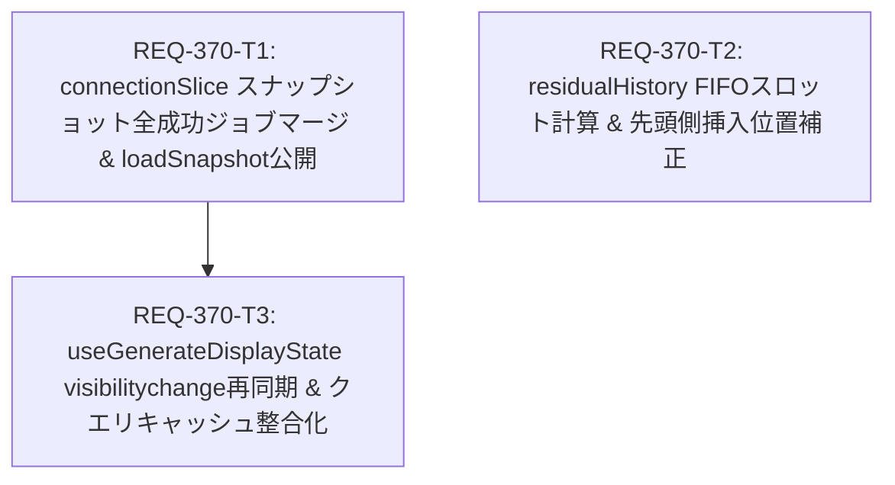

# REQ-370 設計書: 複数端末における生成履歴同期抜けの修正（スナップショット遷移判定・差分スロット上限・挿入位置時系列不整合）

## 1. 概要と背景

複数端末や複数セッションで Prompt Surgeon を利用して画像生成を行った際、他端末で完了したバッチ生成結果が閲覧側の履歴ギャラリー（`comfyHistoryImages` / `batchImages`）に同期されず抜け落ちる、または再読み込み時に履歴最末尾に追いやられる事象が発生していた（詳細は [`docs/incident_report.md`](file:///c:/Users/audih/ws/comfy-create-helper2/docs/incident_report.md) 参照）。

### 根本原因のメカニズム
1. **スナップショット遷移判定の過度限定（`connectionSlice.ts`）**:
   `applyGenerationSnapshot` において、`completedJobs` が「直前のスナップショットで `succeeded` 以外だったジョブが `succeeded` に遷移した瞬間」のみを抽出していた。そのため、初回ロード時（`previous == null`）や HTTP 再同期（`loadSnapshot` / epoch 不一致）時に、スナップショット内に既に存在する `succeeded` ジョブが `mergeManagedHistory` に渡されず破棄されていた。
2. **残存履歴差分マージのスロット計算欠陥（`residualHistory.ts`）**:
   `mergeResidualHistory` において、受け入れ可能スロット数が `Math.max(0, 200 - existingAllCount)` で事前計算されていた。閲覧端末ですでに 200 件の履歴を保持している場合、空き枠数が 0 となり、他端末で生成された新規差分候補が全件切り捨てられていた。
3. **差分画像挿入位置の時系列逆転（`residualHistory.ts`）**:
   `insertAfterPrior` において、初回差分取得時（`priorAddedIdentities` が空）に `foundPrior` が `false` となり、配列最末尾（`base.length`：最古画像の後ろ）に挿入されていた。
4. **能動的再検証の欠如（`useGenerateDisplayState.ts`）**:
   ブラウザタブがバックグラウンドから復帰した際（`visibilitychange` / `focus`）、過剰通信抑制のため `fetchHistory` が抑止されており、かつ `generationApi.getState()` によるスナップショット整合性確認も行われていなかったため、バックグラウンド中に他端末で完了したジョブを取りこぼしていた。

---

## 2. SSoT 影響分析 (SSoT Impact Analysis)

| SSoT / ファイル | 影響有無 | 内容 |
|---|---|---|
| [`docs/specs/SPEC_GENERATE.md`](file:///c:/Users/audih/ws/comfy-create-helper2/docs/specs/SPEC_GENERATE.md#L297-L300) | 仕様整合（記述是正不要） | §「状態同期」において、「再接続時は `GET /api/generation/state` と共有WebSocketの最新Generation snapshotを使ってjob状態を同期し、履歴画像の再取得はAPI経由のhistory照会で行う」「BE候補窓は既存の最新200件に限り、同期は最大20 page/200検査とする」と規定されており、本改修は本仕様に完全に準拠する実装バグ修正（Type A）である。 |
| [`docs/openapi.yaml`](file:///c:/Users/audih/ws/comfy-create-helper2/docs/openapi.yaml) | 変更なし | バックエンド API のエンドポイント・スキーマ変更は一切なし。 |
| Frontend Store / Service / Hook | 改修対象 | `connectionSlice.ts`, `residualHistory.ts`, `useGenerateDisplayState.ts` の 3 領域。 |

---

## 3. アーキテクチャ & 詳細設計

### 3.1 ConnectionSlice: スナップショット完了ジョブの包括マージ & loadSnapshot 公開 (`REQ-370-T1`)

#### 3.1.1 完了ジョブマージの包括化 (`AC-1`)
[`frontend/src/store/slices/connectionSlice.ts`](file:///c:/Users/audih/ws/comfy-create-helper2/frontend/src/store/slices/connectionSlice.ts) の `applyGenerationSnapshot` において、`mergeManagedHistory` に渡すジョブを「直前状態からの遷移ジョブ」に限定せず、スナップショット内に存在するすべての `status === 'succeeded'` かつ `outputs` を持つジョブとする。

```typescript
// 変更前 (L176-179, L255)
const completedJobs = previous?.epoch === snapshot.epoch
  ? snapshot.jobs.filter((job) => job.status === 'succeeded' &&
    previous.jobs.find((prior) => prior.job_id === job.job_id)?.status !== 'succeeded')
  : []
...
if (completedJobs.length > 0) mergeManagedHistory({ ...snapshot, jobs: completedJobs })

// 変更後
const succeededJobs = snapshot.jobs.filter(
  (job) => job.status === 'succeeded' && job.outputs && job.outputs.length > 0
)
...
if (succeededJobs.length > 0) {
  mergeManagedHistory({ ...snapshot, jobs: succeededJobs })
}
```

- **重複防止と冪等性の保証**:
  `mergeManagedHistory` 内では既に `imageIdentity`（`filename`, `subfolder`, `type`）およびシグネチャによる厳密な重複排除・更新スキップ（L131-133: `if (!force && signature === lastManagedHistorySignature) return`）が行われており、スナップショット内の全成功ジョブを渡しても二重登録や不要な再レンダリングは発生しない。
- **通知（`notifyTransitions`）の独立性維持**:
  リアルタイムのトースト通知や `previewAutoFollow`、`comfy-job-event` 送信を担う `notifyTransitions(previous, snapshot)` は変更せず、同一 epoch 内での状態遷移時のみ発火する責務を維持する。
- **WebSocket Push と HTTP Pull の競合防止**:
  `applyGenerationSnapshot` は `snapshot.revision < previous.revision` の場合に即時 `return false` して古い更新を破棄する。また同一 revision の場合は `projectQueue` のみ実行して早期リターンするため、WebSocket 受信と HTTP `loadSnapshot` の結果が競合しても状態破損や無限ループは原理的に発生しない。

#### 3.1.2 `loadSnapshot` の Store Action 公開
Hook やライフサイクルから能動的にスナップショット整合性を要求できるよう、`ConnectionActions`（[`frontend/src/store/types.ts`](file:///c:/Users/audih/ws/comfy-create-helper2/frontend/src/store/types.ts)）および `createConnectionSlice` の戻り値に `loadSnapshot: (automaticEpoch?: string) => Promise<void>` を追加・公開する。

---

### 3.2 ResidualHistory Service: 最新優先・最古追い出し (FIFO Eviction) & 差分挿入位置整合化 (`REQ-370-T2`)

#### 3.2.1 最新優先受容と最古要素追い出し（FIFO Eviction）方式 (`AC-2`)
[`frontend/src/services/residualHistory.ts`](file:///c:/Users/audih/ws/comfy-create-helper2/frontend/src/services/residualHistory.ts) の `mergeResidualHistory` において、既存件数（`existingAllCount`）に基づく事前スロット切り捨て（`200 - existingAllCount`）を撤廃する。
ギャラリー表示順（インデックス 0 が最新画像、末尾が最古画像）に則り、新規差分候補（`candidates`）をすべて受容してマージした後、配列全体を最新側から 200 件に制限（`slice(0, 200)`）する FIFO Eviction（最古要素切り落とし）方式へ改修する。これにより既存 200 件保持時でも新規差分が脱落しない。

#### 3.2.2 差分画像の先頭側挿入 (`AC-3`)
`insertAfterPrior` において、先行キーが見つからなかった場合（初回ページマージ時：`foundPrior === false`）の挿入位置を配列末尾（`base.length`）から配列先頭（`0`）へ変更する。
後続ページ（`priorAddedIdentities` に前ページのキーが存在する場合）は、前ページの最後の要素の後ろ（`insertAt + 1`）へ順次挿入されるため、差分ブロック全体の時系列整合性が維持される。

```typescript
// 変更後
function insertAfterPrior<T>(base: T[], added: T[], priorKeys: ReadonlySet<string>, keyOf: (value: T) => string): T[] {
  if (added.length === 0) return base;
  let insertAt = -1;
  let foundPrior = false;
  for (let index = 0; index < base.length; index += 1) {
    if (priorKeys.has(keyOf(base[index]))) {
      insertAt = index;
      foundPrior = true;
    }
  }
  // 先行差分が存在しない初回ブロックは最新側である先頭 (0) へ挿入
  base.splice(foundPrior ? insertAt + 1 : 0, 0, ...added);
  return base;
}
```

マージ後のスロット制限：
```typescript
  const allMerged = insertAfterPrior([...history.all], candidates.map(item => item.view_url), priorKeys, raw => {
    const identity = identityFromUrl(raw, window.location.origin);
    return identity ? identityKey(identity) : '';
  });
  const all = allMerged.slice(0, 200);

  const ownBase = [...history.own];
  const ownCandidates = candidates.filter(item => item.session_id === history.clientId);
  const ownMerged = insertAfterPrior(ownBase, ownCandidates.map(item => item.view_url), priorKeys, raw => {
    const identity = identityFromUrl(raw, window.location.origin);
    return identity ? identityKey(identity) : '';
  });
  const own = ownMerged.slice(0, 200);

  return { all, own, added: candidates };
```

---

### 3.3 UseGenerateDisplayState Hook: タブ復帰時再同期 & クエリキャッシュ同期 (`REQ-370-T3`)

#### 3.3.1 `visibilitychange` / `focus` での `loadSnapshot()` 呼び出し (`AC-4`)
[`frontend/src/pages/GeneratePage/hooks/useGenerateDisplayState.ts`](file:///c:/Users/audih/ws/comfy-create-helper2/frontend/src/pages/GeneratePage/hooks/useGenerateDisplayState.ts) の `handleVisibility` において、`document.visibilityState === 'visible'` 時に `store.fetchQueue()` に加え、`void store.loadSnapshot()` を実行する。
すでに接続中の場合は HTTP でスナップショットを取得・整合化し、未接続の場合は `store.initialize({ force: true })` により WebSocket 再接続と接続完了後の `loadSnapshot` を順序正しく行わせる。

#### 3.3.2 Store 更新と TanStack Query キャッシュの整合性同期
`applyGenerationSnapshot` により Zustand ストア（`comfyHistoryImages` / `batchImages`）に新規画像がマージされた際、`useGenerateDisplayState` の同期エフェクト（L445-455）において、既存クエリキャッシュ（`currentQueryData`）に存在しない新規画像が取り込まれるようマージ処理を補正する：

```typescript
    const queryKey = ['generateDisplayImages', { filterOwnSession }]
    const currentQueryData = queryClient.getQueryData<string[]>(queryKey)
    if (!currentQueryData || currentQueryData.length === 0) {
      queryClient.setQueryData(queryKey, unavailableRaw)
    } else {
      const merged = uniqueImages([...unavailableRaw, ...currentQueryData], unavailableImages)
      if (merged.length !== currentQueryData.length || !merged.every((v, i) => v === currentQueryData[i])) {
        queryClient.setQueryData(queryKey, merged)
      }
    }
```
これにより、画面リロードを伴わずにギャラリー UI へ即座に反映される。

---

## 4. トレードオフ開示 (Trade-off Disclosure)

| 論点 | 採用方針 | 代替案と却下理由 |
|---|---|---|
| スナップショット適用時の `completedJobs` 抽出条件 | スナップショット内の全 `succeeded` ジョブ（`outputs.length > 0`）を `mergeManagedHistory` に渡す | **直前状態との差分のみを渡す（現行）**: 初回接続時、サーバー再起動時、HTTP 再同期時に既完了ジョブが脱落する致命的な欠陥があり却下。<br>**WebSocket イベントでのみ履歴更新する**: ネットワーク瞬断やタブ非活性時のイベント取りこぼしを救済できないため却下。 |
| 差分履歴マージ時の 200 件上限制限方式 | **最新優先・最古追い出し（FIFO Eviction: 新規候補を先頭側へ受容し、末尾の最古要素を 200 件上限で切り詰め）** | **事前空き枠制限（現行の `Math.max(0, 200 - count)`）**: 既存履歴が 200 件に達すると新しい画像が永久に同期されなくなるため却下。<br>**上限なし**: メモリ肥大化および DOM レンダリング性能低下を招くため却下。 |
| 差分挿入位置（`priorKeys` 不一致時） | **配列先頭（インデックス 0）への挿入** | **配列末尾（`base.length`）への挿入（現行）**: 新規に生成された画像が履歴の一番古い位置に表示され、ユーザーの時系列認知と完全に矛盾するため却下。 |
| タブ復帰時（`visibilitychange`）の同期契機 | **`store.loadSnapshot()` による軽量スナップショット検証** | **`store.fetchHistory()` の全件実行**: ComfyUI の `/history` API は重く、タブ切り替えごとに呼び出すとサーバー負荷およびネットワーク帯域を圧迫するため却下。スナップショットはメモリ常駐の最新状態であるため極めて軽量。 |

---

## 5. Seam Map & Test Placement Plan

### 5.1 Seam Map (結合境界定義)
1. **Integrated (本物のコードとして結合実行する層)**:
   - **Frontend**: `connectionSlice` ⇄ `mergeManagedHistory` ⇄ `mergeImagesByIdentity` ⇄ Zustand Store (`comfyHistoryImages`, `batchImages`)。
   - **Frontend**: `useGenerateDisplayState` ⇄ `trialAvailability` ⇄ `mergeResidualHistory` ⇄ TanStack Query (`generateDisplayImages`)。
2. **Severed (外部 I/O 切断境界)**:
   - **WebSocket 境界**: `systemWsService` をモック／テスト用シミュレータ（`MockWebSocket`）で切断。
   - **HTTP Transport 境界**: `generationApi.getState()`, `generationApi.residualHistory()` を Vitest モックで切断。
3. **Mock Level**:
   - 内部ビジネスロジック（`mergeImagesByIdentity`, `insertAfterPrior`, `mergeResidualHistory`）のモンキーパッチは厳禁。外部 I/O のみ切断する。
4. **PBT Decision**:
   - `mergeResidualHistory` のスロット上限と挿入順序は、入力配列長（0件, 199件, 200件, 205件）および候補件数（1〜10件）の組み合わせ境界値テストで網羅する。
5. **Fault Injection**:
   - `generationApi.getState()` の通信エラー（500/ネットワーク切断）発生時、`loadSnapshot` が既存スナップショットを破壊せず同期エラー状態（`generationSyncIssue`）を適切にハンドリングすることを検証。

### 5.2 Test Placement Plan (テスト配置計画)
チケット番号付き新規テストファイルの作成は禁止（Testing Rules 準拠）。以下の既存テストファイルを拡張する：

| AC | 追記先既存テストファイル | ケース名タグ・フィルタ |
| :--- | :--- | :--- |
| `AC-1` | `frontend/src/store/__tests__/slices/connectionSlice.test.ts` | `[REQ-370/AC-1]`<br>`npm --prefix frontend test -- connectionSlice.test.ts -t "REQ-370/AC-1"` |
| `AC-2` | `frontend/src/services/__tests__/residualHistory.test.ts` | `[REQ-370/AC-2]`<br>`npm --prefix frontend test -- residualHistory.test.ts -t "REQ-370/AC-2"` |
| `AC-3` | `frontend/src/services/__tests__/residualHistory.test.ts` | `[REQ-370/AC-3]`<br>`npm --prefix frontend test -- residualHistory.test.ts -t "REQ-370/AC-3"` |
| `AC-4` | `frontend/src/pages/GeneratePage/hooks/__tests__/useGenerateDisplayState.residual.test.tsx` | `[REQ-370/AC-4]`<br>`npm --prefix frontend test -- useGenerateDisplayState.residual.test.tsx -t "REQ-370/AC-4"` |

---

## 6. タスク分解と DAG 構造

| Task ID | Change Kind | Subsystem | 所有ファイル（最大3ファイル） | 対応 AC |
|---|---|---|---|---|
| `REQ-370-T1` | `code` | `frontend` | 1. `frontend/src/store/slices/connectionSlice.ts`<br>2. `frontend/src/store/types.ts`<br>3. `frontend/src/store/__tests__/slices/connectionSlice.test.ts` | `AC-1` |
| `REQ-370-T2` | `code` | `frontend` | 1. `frontend/src/services/residualHistory.ts`<br>2. `frontend/src/services/__tests__/residualHistory.test.ts` | `AC-2`, `AC-3` |
| `REQ-370-T3` | `code` | `frontend` | 1. `frontend/src/pages/GeneratePage/hooks/useGenerateDisplayState.ts`<br>2. `frontend/src/pages/GeneratePage/hooks/__tests__/useGenerateDisplayState.residual.test.tsx` | `AC-4` |


