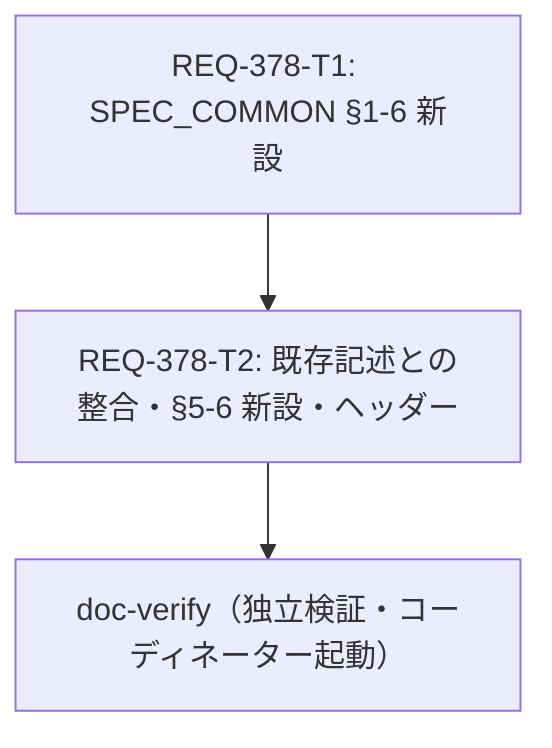

# REQ-378 設計書: モバイルUI共通規約のSPEC_COMMON反映

## 1. 概要と目的

- **目的**: モバイルUI改修（REQ-371〜REQ-377）が前提にする画面横断の規則を、確定仕様 `docs/specs/SPEC_COMMON.md` に「採用済み」として載せる。画面固有の仕様は各PBIの完了時に更新し、本PBIでは扱わない。
- **読み手**: REQ-372／373／375／376／377 の設計者（規則の根拠と適用範囲を読む）、doc-verify の検証者、仕様の保守者。
- **変更の種類**: ドキュメントのみ（`change_kind: document`）。アプリケーションのコード、テスト、API仕様は変更しない（AC-8）。
- **入力**: PBI `docs/backlog/pbi/active/REQ-378.md`、提案書 `docs/design/mobile-ui-redesign/`（COMMON-02〜11、§3 共通コンポーネント影響表、§5 決定フロー、複数選択ドラフト §4）、`docs/specs/SPEC_COMMON.md`、SPEC_GENERATE／HISTORY／LORAS／TAGS。提案書は採否の経緯であり、規則の正本は変更後の SPEC_COMMON とする。
- **維持する挙動（Preserved）**: SPEC_COMMON の既存の節番号と見出し（他仕様から `SPEC_COMMON.md#4-4-1-...`、`#3-tagchipeditor-...` で参照されている）、既存の値（44px、ボトムナビ54px、角丸、z-index）、デスクトップの複数選択パターン（§5-1〜§5-5）、レガシーモーダルの分類（§1-4）。

## 2. SSoT 影響分析

| 文書 | 影響 | 内容 |
|---|---|---|
| `docs/specs/SPEC_COMMON.md` | 変更（唯一の編集対象） | §1-6 新設、§5-6 新設、§1-3／§1-4／§2-4／§5冒頭／§5-2 に追記、ヘッダー更新（版数2.7） |
| `docs/specs/SPEC_GENERATE.md` | 変更なし | §2-11（複数選択一括保存）、§3（モバイル）は導入前の間は現行が正。画面固有の更新は REQ-372／373／375 の完了時 |
| `docs/specs/SPEC_HISTORY.md` | 変更なし | §2 機能一覧・§3 レイアウトは現行が正。画面固有アクションの棚卸しは REQ-375 の設計で行う |
| `docs/specs/SPEC_LORAS.md`／`SPEC_TAGS.md` | 変更なし | カード寸法・詳細／編集は画面固有（REQ-376／377）。複数選択中の並び替え無効（既存）は変更しない |
| `docs/specs/SPEC_SUMMARY.md` | 変更なし | SPEC_COMMON を「デザインシステム・共通コンポーネント」と紹介するだけで、節構成には依存しない |
| `docs/openapi.yaml`、`frontend/`、`backend/` | 変更なし | AC-8 |

## 3. SPEC_COMMON の設計

以下の 3.1〜3.7 で、節構成、規則ID、導入状況、規則一覧、画面固有値の扱い、未承認事項、§5-6 を定める。

## 3.1 節構成と配置

| 場所 | 内容 | 担当Card |
|---|---|---|
| `### 1-6. モバイルUI共通規約`（§1-5 の後、`---` の前） | 前文 | T1 |
| `#### 1-6-1.` 導入状況の読み方 | 「導入前」「導入済み」の定義、更新責務、優先順位 | T1 |
| `#### 1-6-2.` 規則一覧 | MUI-02〜MUI-11（規則ID・テーマ・規則・適用画面・適用PBI・導入状況） | T1 |
| `#### 1-6-3.` 規則ごとの補足 | 例外・対象外・回帰条件 | T1 |
| `#### 1-6-4.` 画面固有の値は共通トークンではない | AC-4。数値は載せず、各画面PBIの範囲と明記 | T1 |
| `#### 1-6-5.` 共有部品に関する未承認事項 | AC-5。4部品＋その他 | T1 |
| `#### 1-6-6.` 既存の記述との関係 | §1-3／§1-4／§2-4／§5 の扱い | T1 |
| §1-3／§1-4／§2-4／§5冒頭／§5-2 | 追記（関係づけ・例外・適用範囲） | T2 |
| `### 5-6. モバイル複数選択パターン（MUI-11）`（§5-5 の後） | AC-2 | T2 |
| ヘッダー（版数、更新日、ステータス、関連仕様書） | 更新 | T2 |

**配置の理由**: 規則は §1「デザインシステム」の共通UIルール（§1-3〜§1-5）の延長で読まれるため §1-6 に置く。複数選択の詳細は §5 が既存の置き場所なので §5-6 に置き、§1-6 の規則 MUI-11 から指す。新しい最上位の章は設けない（章番号を増やさず、他仕様の節番号参照を壊さない）。

## 3.2 規則IDの方針

- `MUI-NN` とし、NN は提案書の `COMMON-NN` と同じ番号にする（出典の追跡が容易）。`MUI-01`（ベースライン維持）は規則ではなく判断原則（問題のない色・文字・余白・共通ナビ・操作を維持する）なので、PBIの要件（COMMON-02〜11）に従い規則に含めず欠番とする。
- 提案書の順序は COMMON-11 が COMMON-10 の前にあるが、SPEC では ID 順（MUI-10、MUI-11）に並べる。

## 3.2.1 提案書の文との語尾の差の記録（差し戻し修正 L-5）

規則を規範形（「〜する」）で書くために、次の3規則は提案書の文より語尾が強い。文言は変えず、差と扱いをここに記録する（SPEC_COMMON の文を提案書の語尾へ弱める代替案は 5. の D-11 に残す）。

| 規則 | 提案書の文（COMMON-NN） | SPEC_COMMON の文 | 差と扱い |
|---|---|---|---|
| MUI-02 | 独立スクロールは明確な理由がある場合のみ | その必要性を当該画面の仕様に明記した場合に限る | 「明確な理由」を、画面の仕様への明記という確認できる形にした。対象外の既存契約の明記だけが Q2 で承認済みで、この具体化は人間レビューの確認対象。 |
| MUI-05 | 画像の常時占有を抑制し | 画像が領域を常時占有しないようにする | 「抑制」より強い言い方。適用PBI（REQ-372、REQ-377）の設計で、画面ごとの許容の範囲を決める。 |
| MUI-10 | 競合を避ける。タップ操作を代替経路として残す | 競合しないようにする。ジェスチャーでのみ実行できる操作を作らず、タップ操作の代替経路を残す | 「避ける」を「しないようにする」とした。「ジェスチャーでのみ…作らず」は規則化時の強化で、既存の長押し起点の操作との関係は 1-6-3 の MUI-10 補足（3.4 の下の逐語文）に例外の理由と範囲として記録する（R-23）。 |

## 3.3 導入前／導入済みの扱い（AC-3）

- 規則ごとに1つの導入状況（導入前または導入済み）を持つ。現時点で全規則は **導入前**（適用PBIが未完了で、実装への反映を検証した事実がない）。
- 導入前の規則は「採用済みの規範」であり現行の挙動ではない。1-6-1 に定義を置き、規則文は「〜する」の規範形で書く。`実装済み`／`既に`／`現在は`／`現状は` を節内で使わない（検証でgrep）。
- 適用PBIが複数の規則は、すべて完了するまで導入前のまま、導入済みの画面を1-6-3の補足に記載する（規則×PBIの二次元表は採らない。理由は 5. のトレードオフ）。
- 導入前の規則と画面別仕様が食い違う場合は、画面別仕様の現行記述を優先する（1-6-1）。導入済みへの更新と画面別仕様の整合は、各適用PBIの完了時に当該PBIが行う。

## 3.4 規則一覧（T1 の挿入内容と同一。正本は Task Card T1）

| 規則ID | テーマ | 規則 | 適用画面 | 適用PBI | 導入状況 |
|---|---|---|---|---|---|
| MUI-02 | スクロール | 主要コンテンツの縦スクロールはページ全体で行い、無用な入れ子スクロール（内容を切り詰めるための子要素の独立スクロール）を作らない。独立スクロールは、その必要性を当該画面の仕様に明記した場合に限る。 | Generateの本文、LoRA・Tag Setのカード一覧、Tag SetのSubsets | REQ-373、REQ-376、REQ-377 | 導入前 |
| MUI-03 | 固定操作 | 決定・保存・生成など重要なアクションを固定表示する場合は、本文のスクロールで失われないようにし、表示階層（MUI-07）、下部余白（§2-4）、セーフエリア、キーボード表示時の挙動（§1-5-1の6・7）を一組で設計する。 | Generateの固定生成バー、LoRA・Tag Set詳細の固定フッター | REQ-373、REQ-377 | 導入前 |
| MUI-04 | アクション配置 | 同種の詳細・編集シートでは、左に戻る・取消（Close／Cancel）、右に進む・確定（Edit／Save）を配置する。用途の異なるボタンには機械的に適用しない。 | LoRA・Tag Setの詳細・編集シート | REQ-377 | 導入前 |
| MUI-05 | シート／画像 | 文字作業を主目的とする画面では、画像が領域を常時占有しないようにする。画像の拡大・一覧・Cover変更は、本文とは別の明確な導線で提供する。 | Generateの画像確認、LoRA・Tag SetのCover・Snapshot | REQ-372、REQ-377 | 導入前 |
| MUI-06 | 操作領域 | 主要操作の有効タップ領域は§1-3の最小44×44pxを維持し、隣接する操作と誤タップしない間隔とフォーカスの視認性を確保する。見た目の外形を小さくする場合は§1-5-3のHit-Slopで有効領域を保ち、誤タップと操作効率を実機で確認する。 | Generateのタブ・チップ、LoRA・Tag Setの削除／編集・フッター・ドラッグ、Historyのカード操作・選択操作 | REQ-372、REQ-373、REQ-374、REQ-375、REQ-376、REQ-377 | 導入前 |
| MUI-07 | 表示階層 | 通常の本文・チップ・ドラッグ対象は固定操作を覆わない。モーダル・シート・ポップオーバーは用途に応じた階層とし、既存の重なり順（§4-4-1）と排他規則（§1-4）を変更しない。 | Generateのタグと生成バー、LoRA・Tag SetおよびGenerateのシート・画像ギャラリー | REQ-372、REQ-377 | 導入前 |
| MUI-08 | 情報階層 | 一覧では識別に必要な情報を優先し、詳細データは詳細画面に置く。行数制限や省略で隠れる情報には、全文を確認できる経路（詳細表示・展開・コピー等）を残す。§1-5-4の重要情報は省略の対象にしない。 | LoRA・Tag Setの固定サイズカード | REQ-376 | 導入前 |
| MUI-09 | 入口の一貫性 | 同じ編集対象・目的に入る複数の導線は、開く画面の状態・見た目・確定動作を揃える。 | Tag Setのカードからの編集と詳細からの編集 | REQ-377 | 導入前 |
| MUI-10 | ジェスチャー | 横移動（スワイプ・横スクロール）、縦スクロール、ドラッグ、チップ操作、入力、支援技術の操作が競合しないようにする。ジェスチャーでのみ実行できる操作を作らず、タップ操作の代替経路を残す。§1-5-1の9の保護を維持する。 | Generateのスワイプ、一覧の並べ替え・選択 | REQ-373、REQ-375、REQ-376 | 導入前 |
| MUI-11 | 複数選択 | モバイルの複数選択では、上部に「×＋選択件数＋補助選択操作」、下部に画面固有の一括操作を表示し、状態表示と操作の役割を分離する。詳細は§5-6。 | History一覧・アルバム詳細、Generate履歴 | REQ-375 | 導入前 |

適用画面・適用PBIの対応は、REQ-371〜REQ-377 の各PBIの記述（Surface・Inferred points）から設計者が導いた。コーディネーターの確認を要する（9. Q3）。差し戻し修正（9.3）で MUI-06 の適用PBIに REQ-372 を加えた（REQ-372 の参照が COMMON-05／06／07 を含むため）。

1-6-3 の規則ごとの補足のうち MUI-10 は、差し戻し修正（F-1、R-23）で次の文を MUI-09 と MUI-11 の間に置く（T1 の正本。規則一覧の MUI-10 の文は変えない）。

> - **MUI-10**: 既存の長押し起点の操作（§5-1と§5-6の長押しによる選択モードの開始、SPEC_HISTORYのタッチ操作による並べ替えなど各画面の仕様書に記載の操作）は、本規則の例外として従来どおりとする。理由は、これらが各画面の仕様書で定められた既存の操作であり、本規則の導入だけで変更すると画面別の仕様書と食い違うため。例外の範囲は上記の既存の操作に限り、新たに設けるジェスチャー起点の操作には本規則を適用する。タップ操作の代替経路の要否と内容は、適用PBI（REQ-375、REQ-376）の設計で決める。

## 3.5 画面固有値の扱い（AC-4）

- SPEC_COMMON に新しく追加する文に、提案書の画面固有値（タブ42px、カード320px・2/2/1行、チップ3px／8px、下部余白72px、ナビ54px 等）を **一つも書かない**。1-6-4 に「寸法・数値・行数は共通トークンではなく、各画面PBI（REQ-372〜377）で決める」と書き、既存の共通値（§1-3 の44px、§2-4 のナビ高さ）は変更しないと明記する。
- 数値を一切載せない方式にした理由: 「共通トークンとして記載されていない」ことを機械的に確認できる（追加行にこれらの数値が現れないこと）。列挙して否定する書き方では、読み手が値を共通値と誤読する恐れがある。
- 既存の 44px と 54px の記述は維持する。MUI-06 は 44px を最小値として維持し、外形を小さくする場合はHit-Slop（§1-5-3）で有効領域を保つ解釈を採る（提案書の「寸法を減らす場合は実機確認」と REQ-373 AC-7 の「44px以上を優先」の両方に整合）。

## 3.6 未承認事項（AC-5）

SPEC_COMMON の 1-6-5 に次の表を置く（T1 の挿入内容と同一）。承認済みの規則とは別枠で、現状の仕様・実装を変更するものとして書かない。

| 項目 | 判断が必要な内容 | 影響画面 | 判断の場 | 状態 |
|---|---|---|---|---|
| `TagChipEditor`／`TagChip` のチップ密度 | チップの寸法・編集操作を変えるか。Generate限定の例外とするか、共有部品として全利用箇所で変えるか。MUI-06の有効タップ領域との両立。 | Generateのプロンプト、Tag Setの作成・編集（`TagSetFormFields` 経由）、LoRA、Studio（`MatrixGenerationStep`） | 担当: 専任PBI(未起票・ID未定。起票後に更新) | 未承認 |
| `ImageCarousel` の中央配置 | カード画像の中央配置を共有部品のグローバルな変更とするか、一覧側の対応にとどめるか。 | LoRA・Tag Setの一覧、`ImageCarousel` の他の利用箇所（§4-2） | REQ-376の設計時（影響調査） | 未承認 |
| `MultiSelectToolbar` の統合 | モバイルの状態バー・下部ドック（§5-6）を共有部品（`MultiSelectToolbar`／`useMultiSelect`）へ統合するか、画面ごとの適用にとどめるか。Generateは画面内の独自の選択バーを使う。 | History一覧・アルバム詳細、Generate履歴、`MultiSelectToolbar` を使うLoRA・Tag Set・Settings | REQ-375の設計時（利用箇所の調査） | 未承認 |
| `TagSetFormFields` のスクロール仕様 | Subsetsの内部スクロールを廃止するか。共有フォームを変える場合の作成・編集の両導線への影響。 | Tag Setの作成・編集、`TagSetFormFields` の他の利用箇所 | REQ-377の設計時（両導線の整合確認） | 未承認 |
| その他の共有部品 | `TagChipInput`／`TagChipViewer` の視覚の統一、詳細シート・固定フッターの共有コンポーネント化、`PageHeader`／`AppShell`、ドラッグ・ポップオーバー基盤の変更。 | 各画面 | 各PBIの設計時（影響調査と回帰確認） | 未承認 |

## 3.7 モバイル複数選択パターン（AC-2、T2 の §5-6）

- デスクトップ（768px以上）と既存の複数選択（LoRAs・Tags・Settings）は §5-1〜§5-5 のまま。モバイル（幅767px以下）の History 一覧・アルバム詳細・Generate 履歴だけに §5-6 を適用する。導入前の間は、各画面の現行の選択UI（§5-1〜§5-5と各画面の仕様書）が現行の挙動。Generate 履歴は画面内の独自の選択バーを使うため、「§5-2 の共通ツールバーが現行」とは書かない（差し戻し修正 F-2、R-24）。
- 上部＝「×＋選択件数＋補助選択操作」、下部＝ボトムナビ直上の一括操作ドック。「選択解除」は0件へ戻すがモード継続、「×」は終了＋クリア。
- 画面固有アクションの種類とラベルは SPEC_COMMON では固定しない（SPEC_HISTORY の既存の画面固有アクションとの矛盾を避けるため。9. の所見 F-2 を参照）。
- 提案書のモック固有の事項（DOM後処理、イベント補正の遅延値、offline fixture 向けの長押し回避策）は本番仕様に含めない。実装方式（状態駆動のレンダリング等）は SPEC に書かない。

挿入文（T2 の E7、正本は Task Card T2）:

### 5-6. モバイル複数選択パターン（MUI-11）

- **適用範囲**: 幅767px以下のHistory（スナップショット一覧・アルバム詳細）とGenerateの履歴。デスクトップ（768px以上）と、LoRAs・Tags・Settingsなど`MultiSelectToolbar`を使う既存の複数選択は、§5-1〜§5-5のままとする（適用の拡大は別途判断する）。
- **導入状況**: 導入前（適用PBI: REQ-375）。完了までは、各画面の現行の選択UI（§5-1〜§5-5と各画面の仕様書）が現行の挙動である。
- **役割の分離**: 上部は選択状態、下部は選択した対象への操作とする。

| 要素 | 位置 | 規則 | §5-2の既存パターンとの関係 |
|---|---|---|---|
| 選択状態バー | 画面上部 | 「×」と「N件（またはN枚）選択中」を主情報として横並びに表示し、補助の選択操作として「すべて選択」「選択解除」を置く。 | 件数・全選択・選択解除・終了を状態バーにまとめる。全体件数の表示は本節では規定しない。 |
| ×（選択モード終了） | 状態バー | 選択モードを終了し、選択をクリアする。アクセシブルな名前は「選択モード終了」とし、操作領域は§1-3に従う。 | §5-2の選択モード終了ボタンに相当する。 |
| すべて選択／選択解除 | 状態バー | 「すべて選択」は対象を全選択する。「選択解除」は選択を0件に戻すが、選択モードは終了しない。0件時の無効状態など選択のロジックは従来を維持する。 | 従来の全選択・選択解除に相当する。 |
| 一括操作ドック | ボトムナビの直上 | 選択中だけ固定表示し、選択モードの終了と画面離脱で取り除く。非表示のまま透明なタップ領域を残さない。ボタンは操作の結果が分かるラベルとし、破壊的操作・無効状態・実行中状態・確認ダイアログは各画面の既存の処理と連動させる。ナビとの間に隙間や重なりを作らない。 | §5-2の画面固有アクションボタンを、上部のツールバーから分離する。 |

- **選択の開始**: 画像の長押し（§5-1の500ms、設定画面で変更可）で選択モードに入り、最初の対象を選択する。以降はタップで選択・解除する。選択中のカードは、チェックや輪郭など色だけに依存しない形で識別できるようにする。
- **ドックの操作領域**: 各ボタンの有効タップ領域は§1-3に従う。狭幅や回転でボタンが折り返しても、サムネイルやナビの操作を妨げない。
- **画面固有アクション**: 種類とラベルは本節では固定せず、各画面の仕様書と適用PBIが定める。各画面の既存の画面固有アクション（SPEC_HISTORYに記載の一括操作など）を欠落させない。
- **用語**: 本節の「一括操作ドック」は、§1-5-1の3でいうシート最下部の固定操作ドック（§1-5-3では「最下部固定アクションバー」）とは別のものである。
- **共有部品**: `MultiSelectToolbar`／`useMultiSelect`の統合や変更は§1-6-5の未承認事項であり、本節は表示と操作のパターンだけを定める。

## 4. 既存記述との照合結果一覧（AC-6 のレビュー記録）R-01〜R-11

判定の凡例: 整合＝食い違いなし／補完＝新しい規則が既存を補う／食い違い＝解消が必要／範囲外＝本PBIで扱わない。解消方法の E1〜E7 は Task Card T2、T1 は §1-6 内の対応を指す。

| # | 既存の記述（場所） | 新しい規則 | 判定 | 解消方法 | Card |
|---|---|---|---|---|---|
| R-01 | §1-3「モバイル操作対象は最小44×44px」 | MUI-06 | 整合（同値）。提案書のタブ42pxは画面固有値であり共通値と食い違う | MUI-06 本文で44pxを維持。1-6-3 で44px未満は例外承認。E2 で §1-3 に参照を追記 | T1、T2 |
| R-02 | §1-3 共通Modalの角丸16px、レガシー12px、Settingsは共通Modal | MUI-04／05 | 整合（非干渉） | 変更なし | - |
| R-03 | §1-4 共通Modal／レガシーモーダル一覧（LoraDetailModal 等）の分類 | MUI-03／04／05 | 整合。ただし適用範囲の明示が必要（REQ-377 は「中央モーダル風」との報告と現行記述の差を実画面で確認する） | 1-6-6 と E3 で「両方に適用。分類は REQ-377 が確認して更新するまで不変」 | T1、T2 |
| R-04 | §1-4 モーダルの排他・ネスト禁止、画像閲覧の全画面プレビュー例外 | MUI-05／07 | 整合 | MUI-07 本文で「排他規則（§1-4）を変更しない」。例外は維持 | T1 |
| R-05 | §4-4-1 重なり順（ヘッダーメニュー60、ボトムナビ50、共通Modal100） | MUI-07 | 整合 | MUI-07 本文で「既存の重なり順（§4-4-1）を変更しない」 | T1 |
| R-06 | §1-5-1 の3 の「固定操作ドック」（シート最下部。§1-5-3 は「最下部固定アクションバー」と表記） | MUI-11 の「一括操作ドック」 | 食い違い（用語の衝突） | §5-6 に用語注記（別のものと明記。§1-5-3 の表記も併記） | T2 |
| R-07 | §1-5-1 の6・7（キーボード起動時の固定バー退避、入力判定）、SPEC_GENERATE §3（非テキスト入力時はバー維持） | MUI-03 | 整合 | MUI-03 本文で §1-5-1 の6・7 を参照 | T1 |
| R-08 | §1-5-1 の9・§1-5-3 ジェスチャー保護 | MUI-10 | 補完 | MUI-10 本文で保護を維持と明記 | T1 |
| R-09 | §1-5-4 重要情報の非省略 | MUI-08 | 補完 | MUI-08 本文で重要情報は省略対象にしない | T1 |
| R-10 | §1-5-2 の7、§1-5-3 Preset 1・4（スクロール一元化、シート内スクロール、横スクロールチップ） | MUI-02 | 食い違いの恐れ（入れ子スクロールの禁止と、既存のシート内・横スクロールの許容） | 1-6-3 で既存契約（§1-4、§1-5-3、§4-4-1）を対象外と明記 | T1 |
| R-11 | §2-4 ナビ54px＋safe-area、`main` の下部余白、CSS変数なし、Settingsの例外 | MUI-03（下部余白）、MUI-11（ドック） | 整合（新しい値を定義しない） | 1-6-6 と E4（ナビ実高へ追従。値・CSS変数を定義しない） | T1、T2 |

## 4.2 照合結果一覧（続き: R-12〜R-24）

| # | 既存の記述（場所） | 新しい規則 | 判定 | 解消方法 | Card |
|---|---|---|---|---|---|
| R-12 | §5 冒頭「各画面で統一して使用」 | §5-6（モバイル限定） | 食い違い | E5 で対象と例外を明記。導入前の間の現行の挙動は「各画面の現行の選択UI」と書く（R-24） | T2 |
| R-13 | §5-2 上部ツールバーに画面固有アクションを含める、件数／全体件数 | §5-6 下部ドックへ分離、全体件数は規定しない | 食い違い | E6 で適用範囲を明記。§5-6 の表で §5-2 との関係を対応づけ | T2 |
| R-14 | §5-1「選択解除/終了: exitMultiSelectMode() で選択クリア」 | §5-6「選択解除は0件へ戻しモード継続」 | 要確認（現行コードの挙動は本PBIでは確認しない） | モバイルの定義として §5-6 に明記。実装との差は REQ-375 の設計で確認 | T2 |
| R-15 | §5-5 複数選択中のドラッグで一括移動 vs SPEC_LORAS／TAGS／HISTORY「選択中は並び替えD&D無効」 | MUI-10（競合回避） | 範囲外（既存の食い違い） | 変更せず報告（9. F-1） | 報告 |
| R-16 | SPEC_HISTORY §2／§3 の画面固有の一括操作（アルバムへ追加、一括漫画化バッチ、一括ダウンロード） | §5-6 一括操作ドック | 整合（固定しない）。提案書のドック例は一括漫画化バッチを含まない | §5-6 で「既存の画面固有アクションを欠落させない」。REQ-375 で棚卸し（9. F-2） | T2 |
| R-17 | SPEC_GENERATE §3（モバイル、プレビュー高さ、下部余白、ActionBar）、§2-11 | MUI-03／05／11 | 整合（導入前の間は現行が正。数値は画面固有） | 1-6-1 の優先順位。SPEC_GENERATE は変更しない | T1 |
| R-18 | SPEC_LORAS／TAGS のカード寸法・表示項目 | MUI-08 | 整合（画面固有） | 変更なし（REQ-376 で更新） | - |
| R-19 | SPEC_COMMON ヘッダー「現行実装と承認済み契約を記載」 | 導入前の規則を含む | 食い違い | E1-a でステータス行に注記、版数2.7 | T2 |
| R-20 | SPEC_SUMMARY の SPEC_COMMON 紹介 | - | 範囲外（影響なし） | 変更なし | - |
| R-21 | SPEC_GENERATE.md L7 のリンク `REQ-347-T10.md`（実在しない） | AC-7 | 範囲外（既存のリンク切れ） | ベースラインとして許容し報告（9. F-3） | 報告 |
| R-22 | §3 TagChipEditor、§4-2 ImageCarousel | 1-6-5 の未承認事項 | 整合 | 変更しない。未承認事項として列挙 | T1 |
| R-23 | §5-1 の長押しによる選択モード開始、SPEC_HISTORY の `TouchSensor` 長押しによる並べ替え（差し戻し修正で追加） | MUI-10「ジェスチャーでのみ実行できる操作を作らず、タップ操作の代替経路を残す」、§5-6 の「選択の開始」（長押し） | 食い違い（例外の理由と範囲が未記録） | 1-6-3 に MUI-10 の補足を追加。既存の長押し起点の操作は例外として従来どおりとし、理由と範囲を明記。タップ代替経路の要否は REQ-375／376 の設計で決める。規則一覧の MUI-10 の文は変えない | T1（差し戻し） |
| R-24 | 1-6-5 の `MultiSelectToolbar` 行「Generateは画面内の独自の選択バーを使う」（差し戻し修正で追加） | §5 冒頭と §5-6 導入状況の「§5-2 の共通ツールバーが現行」「§5-1〜§5-5 が現行」 | 矛盾（Generate 履歴の現行の挙動の誤記） | §5 冒頭と §5-6 導入状況を「各画面の現行の選択UI（§5-1〜§5-5と各画面の仕様書）が現行の挙動」へ直す | T2（差し戻し） |

合格条件: R-01〜R-24 の各行について、検証者が変更後の SPEC_COMMON の該当箇所（行番号または文字列）を示して、判定どおり解消されていることを検証レビュー記録に残す（検証計画 §4）。

## 5. 設計上の判断とトレードオフ

| # | 判断 | 採用 | 代替案と不採用の理由 |
|---|---|---|---|
| D-1 | 規則の置き場 | §1-6（規則）と §5-6（複数選択）。章番号を増やさない | 新しい最上位章 §8: 末尾の章が Generate API で主題が離れ、REQ-334 の無番号節もあり順序が乱れる。別ファイル: 「SPEC_COMMON に反映」という要件に反する |
| D-2 | カード分割 | 2枚（T1=新設節、T2=既存記述の整合＋§5-6）。同一ファイルなので逐次 | 1枚: 約300行の上限に近く、検証観点（新規節と既存の整合）が混ざる。4枚以上: 同一ファイルを直列に編集するだけで並列の利益がなく、受け渡しの手戻りが増える。並列効果は `unknown`（同一ファイルのため並列化不可） |
| D-3 | 導入状況の粒度 | 規則ごとに1つ。部分導入は補足に記載 | 規則×PBIの表: 情報は増えるが、更新責務が増えて SPEC が膨らみ、AC-3 の「各規則に」の読みから離れる |
| D-4 | 画面別仕様書の編集 | しない（SPEC_COMMON のみ） | SPEC_HISTORY／GENERATE に注記: 画面固有の更新は各PBIの完了時という PBI の方針に反し、導入前の仕様が混ざる |
| D-5 | 画面固有値の記載 | 数値を一切載せない | 「共通トークンではない」と列挙: 誤読の恐れ、AC-4 の機械的確認が難しい |
| D-6 | 44px の解釈 | 最小44px維持、外形縮小はHit-Slop、44px未満は例外承認 | 提案書どおり「実機確認すれば縮小可」: SPEC_COMMON §1-3 と REQ-373 AC-7（44px優先）に反する。要確認（Q1） |
| D-7 | 画面固有アクションの例 | SPEC_COMMON に載せない | 提案書の例（History一覧＝ダウンロード／アルバムへ追加／削除 等）を載せる: SPEC_HISTORY の既存の一括操作（一括漫画化バッチ等）と矛盾しうる |
| D-8 | 提案書への参照 | コードスパンのパス表記のみ（リンクにしない） | リンク: `docs/design/mobile-ui-redesign/` は現状 git 未追跡で、コミットされない場合にリンク切れになる（9. F-4） |
| D-9 | カード内の検証 | 短い独立コマンド（grep／git diff／python -c／リポジトリ既定チェック）。意味的な検証と完全な検査スクリプトは検証計画と検査スクリプト（`docs/design/REQ-378-verify-script.md`、独立検証者用）に置く | カードに全スクリプトを同梱: カードが300行を超える。実装者の自己確認が独立検証を代替する懸念 |
| D-10 | MUI-10 と既存の長押し起点の操作（F-1、R-23） | 規則一覧の MUI-10 の文は変えず、1-6-3 に例外の補足（既存の長押し起点の操作は従来どおり。理由と範囲を明記。タップ代替経路の要否は REQ-375／376 の設計で決める）を追加する | MUI-10 を提案書の「タップ操作を代替経路として残す」へ戻す: 規則文の再承認が必要で、1-6-2 の変更になる。補足の追加は 1-6-3 のみで足りる。既存の長押しの扱いを書かない: AC-6 の「残す場合は理由と適用範囲」を満たさない |
| D-11 | 規則文の語尾の差（L-5） | 3.2.1 に差を記録し、SPEC_COMMON の文は変えない（設計書1か所の変更で足りる） | 提案書の語尾へ弱める: SPEC_COMMON 3か所と T1 の逐語文3か所の変更が必要。コーディネーターが弱める方を選ぶ場合の置換は、MUI-05「画像が領域を常時占有しないようにする」→「画像が領域を常時占有することを抑制する」、MUI-10「競合しないようにする」→「競合を避ける」、MUI-02「その必要性を当該画面の仕様に明記した場合に限る」→「明確な理由がある場合のみとする」 |
| D-12 | 導入前の間の現行の挙動の書き方（F-2、R-24） | 「各画面の現行の選択UI（§5-1〜§5-5と各画面の仕様書）が現行の挙動」と書く。画面ごとの現行UIの名前は挙げない | 画面別に「History＝§5-2、Generate＝画面内の選択バー」と列挙: 各画面の仕様書の更新で再び食い違う。§5-2 の共通ツールバーと書く: Generate 履歴の現行（独自の選択バー）と矛盾する |

**リスク**: (1) 導入前の規則が現行の挙動と誤読される → 定義（1-6-1）、規範形の文、wording検査で緩和。(2) SPEC_COMMON が約3万6千字に増え、規則と既存契約が重複する → 規則は参照で既存契約を指し、重複を作らない。(3) 適用PBIの対応は設計者の導出 → Q3 で確認。(4) MUI-02 の対象外（シート内・横スクロール等）は設計者の解釈 → Q2 で確認。(5) 提案書の方向性採用は 2026-10-18 のユーザー判断に基づくが、共有部品の採否は含まない。(6) 実装との乖離（R-14）はコード未確認。

## 6. Task Card 構成と DAG



| Card | change_kind | 担当 | 所有ファイル | AC | 依存 | 依存の充足証拠 |
|---|---|---|---|---|---|---|
| REQ-378-T1 | document | doc-editor | `docs/specs/SPEC_COMMON.md` | AC-1、3、4、5、8 | なし | - |
| REQ-378-T2 | document | doc-editor | `docs/specs/SPEC_COMMON.md` | AC-2、6、7、8 | T1 | T1完了報告、`grep -c '^| MUI-' docs/specs/SPEC_COMMON.md` が10、1-6 の見出し7行の読み戻し |

- **所有の衝突**: 2枚とも同じファイルを所有するため **同時実行しない**（T1 完了後に T2）。他の `docs/specs/*.md` はどのカードも所有しない。
- **DAG の深さ**: 2（警告対象外）。並列実行の見込みはなし（同一ファイル）。
- **分割の根拠**: 新設する規範節（T1）と、既存記述への追記・例外（T2）は、検証の観点（新規の網羅性／既存との食い違いの解消）が異なり、独立にレビューできる。T2 が T1 の見出し番号・規則IDに依存するため逐次にする。手戻りの危険: T1 の文言を T2 の段階で直す場合は T1 の再編集になる（T2 は §1-6 を編集しないので、誤りは報告して設計へ戻す）。
- **コミット単位**: 本PBIの成果物は1コミットにまとめる想定（コーディネーターが決定）。

## 7. implementation_plan 要約

### Proposed Changes
1. T1: `docs/specs/SPEC_COMMON.md` に §1-6（1-6-1〜1-6-6）を挿入のみで追加する。
2. T2: 同ファイルに E1〜E7（ヘッダー更新、§1-3／§1-4／§2-4／§5冒頭／§5-2 への追記、§5-6 新設）を適用する。
3. 検証者（doc-verify）が、検証計画に従い、構造・意味・矛盾・参照・リポジトリ既定チェック・スコープを独立に検証し、照合結果一覧（4.）を検証レビュー記録へ転記・確定する。

### Trade-off Disclosure
5. の D-1〜D-9 を参照。主な代償: 配置を既存の節構成に合わせたため §1 が長くなる点、導入状況の粒度を粗くしたため部分導入の情報は補足文に依存する点、画面固有アクションの例を載せないため REQ-375 の設計に棚卸しを委ねる点。差し戻し修正の D-10〜D-12 も参照。

## 8. AC トレーサビリティ

| AC | 設計の該当 | 担当 | 検証（検証計画） |
|---|---|---|---|
| AC-1 | 3.1〜3.4 | T1 | §3 AC-1、構造・意味 |
| AC-2 | 3.7、4.（R-12〜R-16） | T2 | §3 AC-2、矛盾 |
| AC-3 | 3.3 | T1、T2 | §3 AC-3、wording |
| AC-4 | 3.5 | T1、T2 | §3 AC-4、数値検査 |
| AC-5 | 3.6 | T1 | §3 AC-5 |
| AC-6 | 4. | T1、T2 | §3 AC-6、§4 照合の確認 |
| AC-7 | 3.1 | T2（T1も実行） | §3 AC-7、リンク・参照・UI不変条件 |
| AC-8 | 2. | T1、T2 | §3 AC-8、スコープ |

## 9. 所見と未承認事項（人間レビューの対象）

9.1 は人間レビューで確認する質問、9.2 は本PBIの範囲外の所見である。

## 9.1 確認を要する質問

人間レビューで Q1〜Q5 の回答を得た（Q1〜Q3・Q5 は設計の既定案を承認、Q4 は下記の決定）。

- **Q1（MUI-06 / D-6・承認済み・既定案どおり）**: 44px を最小値として維持し、画面固有の短縮は例外承認とする既定案でよいか。提案書は「実機確認すれば寸法を減らせる」とも読める。
- **Q2（MUI-02・承認済み・既定案どおり）**: 入れ子スクロールの対象外に、既存契約（シート本体、横スクロールのタブ・チップ、展開パネル）を明記する既定案でよいか（提案書は「明確な理由がある場合のみ」とだけ述べる）。
- **Q3（適用PBI・承認済み・既定案どおり）**: 規則ごとの適用PBIの対応（3.4）は REQ-371〜377 の記述からの導出である。誤りや不足はないか（REQ-371 は先行する不具合修正で、MUI-03／07 の回帰条件として扱う）。
- **Q4（TagChipEditor・決定済み）**: チップ密度の判断は、新規の専任PBIが担う。専任PBIは未起票でIDは未定であり、後日BA intakeで起票する（起票後に本書とSPEC_COMMON 1-6-5 の担当欄のIDを更新する）。共有部品 `TagChipEditor`／`TagChip` の密度の判断は Generate・Tag Set・LoRA に影響する。REQ-373・REQ-377 の個別PBIでは決めない。SPEC_COMMON 1-6-5 では引き続き「未承認事項」とし、担当欄に「専任PBI(未起票・ID未定。起票後に更新)」と記載する。
- **Q5（提案書の扱い・承認済み・既定案どおり）**: `docs/design/mobile-ui-redesign/` は git 未追跡である。本PBIと一緒にコミットするか。

## 9.2 所見

本PBIの範囲外であり、変更しない。

- **F-1**: §5-5（複数選択中のドラッグで一括移動）は、SPEC_LORAS／TAGS／HISTORY の「選択中は並び替えD&D無効」と既存の段階で食い違う。別PBIでの整理を提案する。
- **F-2**: 提案書の History 一覧のドック例（ダウンロード／アルバムへ追加／削除）は、SPEC_HISTORY の一括漫画化バッチを含まない。REQ-375 の設計で既存アクションの棚卸しが必要。
- **F-3**: SPEC_GENERATE.md L7 のリンク `../backlog/task/active/REQ-347-T10.md` は存在しない（ベースラインの既存欠陥）。
- **F-4**: リポジトリの宣言済み検証コマンドは UI 不変条件チェック（`scripts/verify_ui_invariants.py`）のみで、ドキュメント用のリンク検証コマンドは宣言されていない。共有ヘルパー `doc_link_validator.py` は既存の無関係な37件で常に exit 1 のため、ベースライン比較（SPEC_／REQ-378 を含む行がないこと）で使う。`scripts/verify_test_naming.py` は実行すると `docs/design/REQ-356-test-mapping.md` を書き換える副作用があるため、本PBIの検証には使わない（設計時に1回実行して復元済み）。
- **F-5**: REQ-371〜377 の PBI ファイルは本ワークツリーに存在しない（コミット f8212dc にのみ存在）。適用PBIの導出はそのコミットの記述を読んで行った。

## 9.3 差し戻し修正の記録（doc-verify 指摘 F-1、F-2、L-1〜L-5）

doc-verify レポート（`docs/logs/REQ-378-doc-verify-report.md`）の指摘に対し、ユーザーの承認のもとで次のとおり直す。L-6（新規リンク先のコミット範囲）はコーディネーターの扱いで、本書の対象外。

| 指摘 | 扱い | 設計の該当 |
|---|---|---|
| F-2（Medium・矛盾） | §5 冒頭と §5-6 導入状況の「現行の挙動」を「各画面の現行の選択UI（§5-1〜§5-5と各画面の仕様書）」へ直す。ユーザー承認の修正案どおり | 3.7、R-24、D-12、RW-1・RW-2 |
| F-1（Medium・未記録の食い違い） | MUI-10 の文は維持。1-6-3 に例外の補足を追加（既存の長押し起点は従来どおり。理由と範囲を記録。タップ代替経路の要否は REQ-375／376 の設計で決める）。照合結果に R-23 を追加 | 3.4、R-23、D-10、RW-3 |
| L-1 | 1-6-5 の `TagChipEditor` の影響画面に Studio（`MatrixGenerationStep`）を追加 | 3.6、RW-4 |
| L-2 | MUI-06 の適用PBIに REQ-372 を追加。承認済みの Q3 の対応表を、ユーザー指示で1件補正する | 3.4、RW-5 |
| L-3 | §5-6 の用語注記を §1-5-1 の3 と §1-5-3 の表記に合わせる | 3.7、R-06、RW-6 |
| L-4 | 1-6-5 「その他の共有部品」から裏付けのない「現時点ではパターンだけを共有」を削除 | 3.6、RW-7 |
| L-5 | 小さい方の変更として、SPEC_COMMON の文は変えず、設計書に語尾の差と扱いを記録（MUI-02／05／10）。弱める代替案は D-11 に保持 | 3.2.1、D-11 |

**適用方法**: T1／T2 の Task Card（status は done のまま）は、挿入文言と検証コマンドを差し戻し後の最終形へ更新した。SPEC_COMMON には既に Card の内容が入っているため、doc-editor はカードを再実行せず、11. の Rework edits だけを適用する（重複挿入の防止）。

## 10. 監査

設計監査（ba-audit、`--audit-kind design`）の実行結果と証跡は、設計者の返却報告に記録する。監査は PASS_NO_FINDINGS でも設計承認の代わりにならない。

## 11. Rework edits（doc-editor 向け。SPEC_COMMON の現行バイトへ適用）

対象ファイル: `docs/specs/SPEC_COMMON.md` のみ（所有: doc-editor、T1／T2 の差し戻し分）。適用前の基準: 検証済みのバイト列（sha256 `7fb854e90eb1dacc342201258ad873b21f62f280e295f2e578b33111591102a2`）。ハッシュが異なる場合は着手せず、コーディネーターへ報告する。

規則: (1) 下の RW-1〜RW-7 を番号順に、Edit の `old_string`→`new_string` として逐語で適用する（各 old_string は現行ファイルで1回だけ一致する。一致数が1以外なら適用せず報告）。(2) 他の行は変更しない。(3) Task Card の T1／T2 は再実行しない。(4) 文言の変更は不可（誤字の最小修正のみ可。変更したら報告）。(5) PBI／カードの status は更新しない。コミットしない。

#### RW-1 §5 冒頭の現行の挙動（F-2、R-24、R-12）
old_string:
```
§5-6の導入前の間はモバイルを含めて§5-1〜§5-5が現行の挙動である。
```
new_string:
```
§5-6の導入前の間は、モバイルを含めて各画面の現行の選択UI（§5-1〜§5-5と各画面の仕様書）が現行の挙動である。
```

#### RW-2 §5-6 導入状況の現行の挙動（F-2、R-24）
old_string:
```
完了までは§5-2の共通ツールバーが現行の挙動である。
```
new_string:
```
完了までは、各画面の現行の選択UI（§5-1〜§5-5と各画面の仕様書）が現行の挙動である。
```

#### RW-3 1-6-3 に MUI-10 の補足（F-1、R-23）。MUI-09 と MUI-11 の間に挿入
old_string:
```
- **MUI-11**: 対象画面の範囲とデスクトップとの違いは§5-6に定める。
```
new_string:
```
- **MUI-10**: 既存の長押し起点の操作（§5-1と§5-6の長押しによる選択モードの開始、SPEC_HISTORYのタッチ操作による並べ替えなど各画面の仕様書に記載の操作）は、本規則の例外として従来どおりとする。理由は、これらが各画面の仕様書で定められた既存の操作であり、本規則の導入だけで変更すると画面別の仕様書と食い違うため。例外の範囲は上記の既存の操作に限り、新たに設けるジェスチャー起点の操作には本規則を適用する。タップ操作の代替経路の要否と内容は、適用PBI（REQ-375、REQ-376）の設計で決める。
- **MUI-11**: 対象画面の範囲とデスクトップとの違いは§5-6に定める。
```

#### RW-4 1-6-5 の TagChipEditor 影響画面に Studio（L-1）
old_string:
```
Tag Setの作成・編集（`TagSetFormFields` 経由）、LoRA | 担当: 専任PBI
```
new_string:
```
Tag Setの作成・編集（`TagSetFormFields` 経由）、LoRA、Studio（`MatrixGenerationStep`） | 担当: 専任PBI
```

#### RW-5 MUI-06 の適用PBIに REQ-372（L-2）
old_string:
```
Historyのカード操作・選択操作 | REQ-373、REQ-374、REQ-375、REQ-376、REQ-377 |
```
new_string:
```
Historyのカード操作・選択操作 | REQ-372、REQ-373、REQ-374、REQ-375、REQ-376、REQ-377 |
```

#### RW-6 §5-6 用語注記を §1-5-1 の3／§1-5-3 の表記に合わせる（L-3、R-06）
old_string:
```
- **用語**: 本節の「一括操作ドック」は、§1-5-1の3・§1-5-3でいうシート最下部の固定操作ドックとは別のものである。
```
new_string:
```
- **用語**: 本節の「一括操作ドック」は、§1-5-1の3でいうシート最下部の固定操作ドック（§1-5-3では「最下部固定アクションバー」）とは別のものである。
```

#### RW-7 1-6-5「その他の共有部品」から裏付けのない現状の断定を削除（L-4）
old_string:
```
詳細シート・固定フッターの共有コンポーネント化（現時点ではパターンだけを共有）、
```
new_string:
```
詳細シート・固定フッターの共有コンポーネント化、
```

### 適用後の確認（期待値）

cwd=操作ルート。読み取り専用。
```bash
export PYTHONIOENCODING=utf-8
grep -c '§5-2の共通ツールバーが現行の挙動' docs/specs/SPEC_COMMON.md          # 0
grep -c '各画面の現行の選択UI（§5-1〜§5-5と各画面の仕様書）が現行の挙動である' docs/specs/SPEC_COMMON.md   # 2
grep -c '^- \*\*MUI-10\*\*' docs/specs/SPEC_COMMON.md                          # 1
grep -c 'MatrixGenerationStep' docs/specs/SPEC_COMMON.md                       # 1
grep '^| MUI-06' docs/specs/SPEC_COMMON.md | grep -c 'REQ-372'                 # 1
grep -c '現時点' docs/specs/SPEC_COMMON.md                                      # 0
grep -c '§1-5-3でいうシート最下部' docs/specs/SPEC_COMMON.md                   # 0
grep -c '最下部固定アクションバー' docs/specs/SPEC_COMMON.md                     # 2
git diff -U0 -- docs/specs/SPEC_COMMON.md | grep -c '^-[^-]'                   # 4（削除行は変わらない）
git diff --shortstat -- docs/specs/SPEC_COMMON.md                              # 91 insertions(+), 4 deletions(-)
```
適用後は、独立検証者が検証計画 6. の再検証を行う。
