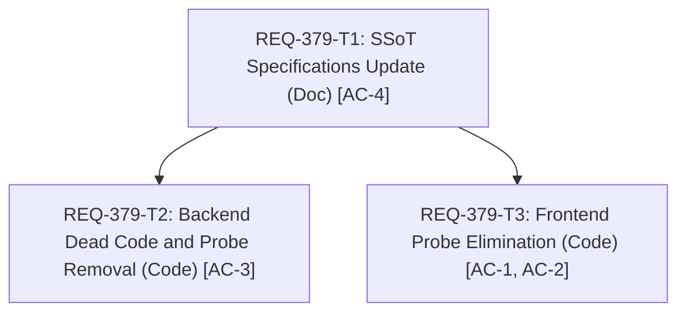

# REQ-379 詳細設計書: ComfyUIへの原画確認処理の完全廃止とBE自立キャッシュへの仕様整合

### エグゼクティブサマリー (Executive Summary)
本設計書は、REQ-379における「ComfyUIへの原画確認処理（GET /api/comfy/image-availability）の完全廃止」および「Prompt Surgeon BE自立型WebPキャッシュへのSSoT整合」のアーキテクチャ詳細、Seam Map、テスト計画、タスク分解を定義する。
本改修により、フロントエンドのGalleryサムネイル表示時のComfyUI存在確認通信（AC-1）を根絶し、ComfyUI側の一時ファイル削除時にもBEのWebPキャッシュによって試行履歴画像を安定保持（AC-2）し、バックエンドルーター内のデッドコード `_check_comfy_exists` を完全除去（AC-3）し、関連SSoT仕様書（SPEC_COMMON, SPEC_GENERATE, SPEC_HISTORY）を自立キャッシュ仕様へ整合更新（AC-4）する。

## 1. 概要とアーキテクチャ背景 (Architecture Context)

### 1-1. 課題の構造と背景
Prompt Surgeonでは、REQ-333/REQ-345時代において「バックエンドには256pxのサムネイルしか存在せず、フルサイズ表示時はComfyUIのWSL2上にある元画像PNG（10〜30MB）を都度直接ストリーミング取得する」アーキテクチャであった。そのため、ComfyUI側で元画像が削除された場合に画面が壊れる（404）のを防ぐ目的で、ギャラリー行のサムネイル読み込みを契機としてComfyUIへHEADリクエスト（原画存在確認 / Availability probe）を発行し、404の場合は未保存の試行履歴一覧から除外する仕組みが導入されていた。

しかしREQ-362（三位一体キャッシュ・ゼロプローブ）により、画像生成完了時にバックエンドが即座に「フルサイズWebP（Quality 90）」と「サムネイルWebP」を先行生成してBEローカルディスク（`db/full_cache/`, `db/thumbnails/`）に保持し、メタデータも手元のSQLite（`prompt_metadata`）に永続化する「自立型キャッシュ」へ刷新された。
この改修により、Prompt Surgeon上でのサムネイル・フルサイズプレビュー・モーダル拡大・ワークフロー再構成は、ComfyUI側に元画像PNGが残っていなくとも100% BE単体で完結するようになった。

それにもかかわらず、REQ-362では画像配信エンドポイント（`/view`, `/thumbnail`）内のプローブのみが廃止され、フロントエンドのGallery表示契機で動いていた原画実在確認（`trialImageAvailability` / `/api/comfy/image-availability`）およびバックエンドの `residual_history.py` でのComfyUI原画プローブがSSoT（`SPEC_COMMON.md`, `SPEC_GENERATE.md`）の仕様記述とともに取り残されていた。
この結果、以下の問題が発生している：
1. **不要な外部HTTPプローブ**: ギャラリーにサムネイルが描画されるたびに、BE側で既にキャッシュがあるにもかかわらずComfyUIへHEAD確認通信が走り、不要なネットワーク負荷が発生する。
2. **キャッシュ有効画像の不当な除外**: ユーザーがComfyUI側の出力フォルダを掃除・削除した場合、Prompt SurgeonのBEにWebPキャッシュが存在して正常に閲覧可能であるにもかかわらず、ComfyUIが404を返したことでギャラリー履歴から不意に消去されてしまう。
3. **デッドコードの残存**: `backend/app/routers/comfy.py` の `get_comfy_thumbnail` 内に、呼び出し箇所が削除されたローカル関数 `_check_comfy_exists()` が参照されないまま放置されている。

### 1-2. 解決策: BE自立キャッシュの正本化と原画確認の完全撤廃
1. **SSoT仕様書の整合改定**:
   - `SPEC_COMMON.md` および `SPEC_GENERATE.md`、`SPEC_HISTORY.md` から、Gallery rowのthumbnail load/errorを契機としたComfyUI原画実在確認（availability probe）規定を削除する。
   - 試行履歴（未保存履歴）の表示可否は、Prompt Surgeon BEが保持する履歴データ（Snapshot / Residual History）およびBE手元のWebPキャッシュを一意の正本（SSoT）として扱う仕様へ改定する。
2. **フロントエンド原画確認処理の完全撤廃**:
   - `GenerationGallerySection.tsx` において、サムネイルロード時の `observeThumbnail` / `trialAvailability.observe` を撤廃し、通常の画像コンポーネントとしての読み込みに単純化する。
   - `useGenerateDisplayState.ts` において、`trialAvailability` コントローラーおよび missing 除外の監視ロジックを整理・撤廃する。
   - `trialImageAvailability.ts` は不要となったため廃止（または互換ダミー）とする。
3. **バックエンドプローブ処理・デッドコードの撤廃**:
   - `backend/app/routers/comfy.py` の `get_comfy_thumbnail` 内のデッドコード `_check_comfy_exists` を削除。
   - `backend/app/services/residual_history.py` における `probe_image_availability` 呼び出しを撤廃し、ComfyUI `/history` から取得された候補はComfyUIへの追加プローブを行わずに即座に `items`（present）として返却する。
   - `/api/comfy/image-availability` エンドポイントおよび `probe_image_availability` は、既存外部API互換として常に `present`（またはBEキャッシュに基づく判定）を返すか、不要な場合は整理する。

---

## 2. Seam Map (設計義務仕様 [MUST [W-DD-SEAM]])

### 2-1. 結合境界（Integrated - 本番コードそのまま実行）
- FastAPI ルーター・サービスレイヤー: `app/routers/comfy.py`, `app/services/residual_history.py`
- React コンポーネントおよびフック: `GenerationGallerySection.tsx`, `useGenerateDisplayState.ts`
- 試行履歴状態管理: `connectionSlice.ts`, `residualHistory.ts`

### 2-2. 切断境界（Severed - 外部I/Oの遮断）
- ComfyUI HTTP 通信: `httpx.AsyncClient` による外部リクエストは `respx` またはトランスポートモックで遮断。
- 外部原画プローブ: 本改修によりComfyUI `/view` へのHEADプローブ自体が発生しなくなることを検証。

### 2-3. モックレベル規約
- 内部ビジネスロジックやヘルパー関数のモンキーパッチは禁止。
- モックはトランスポート層（`httpx` / `fetch` レベル）または設定パラメータ差し替えに限定。

### 2-4. PBT (Property-Based Testing) 判定
- 判定: **不要（No）**。パーサー・DSL・複雑な数式計算は含まず、不要プローブ通信の撤廃・静的コード削除・状態遷移の単純化であるため、決定論的テーブルテストおよび統合テストで網羅。

### 2-5. 異常系・フォールトインジェクション
- ComfyUI側で元画像が削除されている状態（404）: BEキャッシュが存在する場合、ギャラリーから画像が消えずに正常表示されること。
- サムネイル読み込みエラー時: ブラウザ側のネットワークエラー等でサムネイルが読み込めなかった場合、再試行バッジが表示されるのみで、試行履歴から項目が勝手に削除されないこと。

---

## 3. テスト配置計画 (Test Placement Plan [MUST [W-DD-PLACE]])

チケット番号を含まない既存の配置先テストファイルを拡張する：

| 対象 AC | 検証テストファイル | テストケース名（タグ付き） |
| :--- | :--- | :--- |
| AC-1 | `frontend/src/pages/GeneratePage/sections/__tests__/GenerationGallerySection.probing.test.tsx` | `does not trigger image availability probe on thumbnail load [REQ-379/AC-1]` |
| AC-2 | `frontend/src/pages/GeneratePage/hooks/__tests__/useGenerateDisplayState.availability.test.tsx` | `retains trial history image even if upstream ComfyUI original is missing [REQ-379/AC-2]` |
| AC-3 | `backend/tests/integration/legacy/test_comfy_proxy.py` | `test_comfy_router_dead_code_eliminated [REQ-379/AC-3]` |
| AC-4 | `docs/specs/SPEC_COMMON.md`, `docs/specs/SPEC_GENERATE.md` | ドキュメント照合検証（doc-verify） |

---

## 4. タスク分割と依存関係 (DAG)

各タスクカードへの受入基準（AC）の割り当ておよび成果物は以下の通りである：

- **REQ-379-T1**: SSoT 仕様書改定（`SPEC_COMMON.md`, `SPEC_GENERATE.md`, `SPEC_HISTORY.md` における原画プローブ規定の削除とBE自立キャッシュの正本化）（AC-4）
  - 成果物: `docs/specs/SPEC_COMMON.md`, `docs/specs/SPEC_GENERATE.md`, `docs/specs/SPEC_HISTORY.md`
  - 変更種別: document
  - 依存関係: なし（先行着手）
- **REQ-379-T2**: バックエンド原画確認プローブおよびデッドコードの撤廃（`backend/app/routers/comfy.py`, `backend/app/services/residual_history.py` の修正とテスト更新）（AC-3）
  - 成果物: `backend/app/routers/comfy.py`, `backend/app/services/residual_history.py`, `backend/tests/integration/legacy/test_comfy_proxy.py`, `backend/tests/integration/legacy/test_residual_history.py`, `backend/tests/integration/legacy/test_comfy_proxy_fault.py`
  - 変更種別: code
  - 依存関係: REQ-379-T1
- **REQ-379-T3**: フロントエンド原画監視処理の完全撤廃（`GenerationGallerySection.tsx`, `useGenerateDisplayState.ts`, `trialImageAvailability.ts` の修正とテスト更新）（AC-1, AC-2）
  - 成果物: `frontend/src/pages/GeneratePage/sections/GenerationGallerySection.tsx`, `frontend/src/pages/GeneratePage/hooks/useGenerateDisplayState.ts`, `frontend/src/services/trialImageAvailability.ts`, `frontend/src/pages/GeneratePage/sections/__tests__/GenerationGallerySection.probing.test.tsx`, `frontend/src/pages/GeneratePage/hooks/__tests__/useGenerateDisplayState.availability.test.tsx`
  - 変更種別: code
  - 依存関係: REQ-379-T1

---

## 5. 技術的トレードオフと代替案 (Trade-offs & Alternatives)

### トレードオフ: ComfyUI未圧縮PNGファイルとBE WebPキャッシュの差異
- **採用案**: BEのWebPキャッシュ（Quality 90）および手元SQLiteメタデータを正本とする。ComfyUI側のフォルダ掃除で元PNGが削除されても、Prompt Surgeon上での表示・閲覧・パラメータ再利用は継続できる。
- **制約事項**: ユーザーがComfyUI標準GUIに画像を直接ドラッグ＆ドロップしてワークフローを復元したい場合、ComfyUI側の `output/` フォルダにある元PNG（PNGチャンクにworkflow JSONが埋め込まれたファイル）が必要となる。しかしPrompt Surgeon内には「プロンプト復元」「パラメータ同期」機能が既に備わっているため、Prompt Surgeon利用上の影響はない。
- **代替案（不採用）**: ComfyUI側の元PNGの存在を監視し続け、消えたらPrompt Surgeonからも消す方式。これはREQ-362で導入した「自立型キャッシュ」の価値を自ら無効化し、パラパラめくり時の遅延や外部通信負荷を温存するため不採用。

