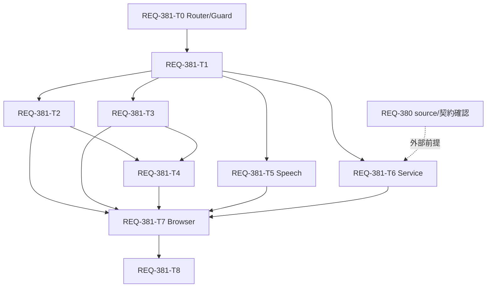

# Implementation Plan - REQ-381

## Objective

モバイルSettingsの5カテゴリを保ちながら、375px級での情報密度、管理操作、説明参照、保存状態、横スワイプを整える。768px以上の既存配置と明示保存は維持する。詳細は[設計](REQ-381.md)、[テスト計画](REQ-381-test-plan.md)、[文書設計](REQ-381-document-design.md)を参照する。

rootの`implementation_plan.md`はREQ-377の既存計画として保持し、coordinator指示により本ファイルを今回のレビュー対象計画とする。

## Proposed Changes

| Task | 変更 | 依存 |
|---|---|---|
| REQ-381-T0 | 同routeのData Router最小seam＋Settingsだけのdirty/failed離脱確認 | なし |
| REQ-381-T1 | Settings専用mobile判定、本文12px/gap12px、保護付き左右スワイプ | T0 |
| REQ-381-T2 | inline説明popover、MappingMasterの管理menu | T1 |
| REQ-381-T3 | resource別の保存順序/state hook、LLM数値の入力確定autosave | T1 |
| REQ-381-T4 | Bubble/翻訳debounce/VRAM/表示操作への説明・保存適用 | T2,T3 |
| REQ-381-T5 | 口調sheetの固定操作とkeyboard保護 | T1 |
| REQ-381-T6 | service行のmobile統合（AC-11） | T1、外部REQ-380 source確認 |
| REQ-381-T7 | 実browserの配置/scroll/gesture/保存failure受入 | T2,T3,T4,T5,T6 |
| REQ-381-T8 | SPEC_SETTINGSとSPEC_COMMONの適用範囲・保存契約同期 | T7 |

各Task Cardは`docs/backlog/task/active/`の同名ファイル。実装所有ファイルを分け、同一ファイルの並列編集を避ける。T2/T3/T5は独立所有なら並行可能。

## Dependency Graph

## Settings Draft Protection

人手のoption 1選択を具体化し、App.tsxのBrowserRouterを既存react-router7.17.0のData Routerへ最小置換する。route表/QueryClient/AppShell/外側error boundaryは維持し、新依存やroute機能を追加しない。Settings leafだけregistry/useBlockerを持ち、mobile/desktopのdirty/invalid/failed/queued/inflightを集約する。内部PUSH/REPLACE/POPでCancelはdraft保持、Leaveはpersist inFlight中disabled。送信完了後も自動遷移せず、明示Leaveで未送信queue/local draftを破棄し一度だけproceedする。同Settings tab/hash/queryは保持して移動できる。reload/close/cross-documentはnative beforeunloadの制約に従う。

T0にroot/guard test、T2/T3/T4/T5に各draft登録、T7に実browser race/取消検証を割り当てる。AC-11外部依存は変更しない。このscope具体化は実装開始承認ではない。

## Validation

数値はblur/Enter/slider確定で保存し、同値の重複送信・旧応答によるdraft巻戻り・失敗後の無断retryを防ぐ。MSW/routeで422/503/遅延/timeoutを注入し、fast-checkで数値/gesture/保存sequenceを検証する。実Chromiumで375/767/768/1280px、44px操作領域、横overflow、info clipping、keyboard縮小、menu/Modalを確認する。

局所実行は`npm.cmd --prefix frontend run typecheck`、`backend\.venv\Scripts\python.exe scripts/run_in_dir.py frontend npm.cmd exec -- vitest run src/pages/SettingsPage --testNamePattern '\[REQ-381/AC-'`、`backend\.venv\Scripts\python.exe scripts/run_e2e.py e2e/settingsResponsive.spec.ts --grep '\[REQ-381/AC-'`。最終受入はprofileの全固定行とscenario行を独立担当がGate1→2→3の順に新規実行する。

## Trade-off Disclosure

- mobile専用の保存分岐が増えるため、767↔768px resizeとdesktop Saveを回帰条件にする。
- 入力中debounce通信を避け、確定後に送る。通常時のSaveを減らす代わり、失敗/不正値の未保存と再試行を明示する。
- infoをSettings局所portalにし、共通基盤への波及を抑える。viewport/scroll/focusの処理は局所で検証する。
- 翻訳provider＋認証は既存formの明示Saveを維持し、既存複数PUTの部分失敗を成功扱いしない。
- 外部REQ-380が未実装のため、T6とAC-11最終検証はそのsource/契約確認まで進められない。現在のservice UIだけでAC-11を満たしたと扱わない。
- DAG最長6段の依存は基盤→consumer→browser→仕様同期の実依存であり、調整コストと外部待ちを記録する。

- router modeは共有rootに触れるため、既存6route/error/persistenceの回帰をT0で検証する。desktopにはSPEC_SETTINGSに沿う離脱確認だけを追加し、Save/配置は保持する。

## Review Gate

BA監査・モデルunloadの証拠をcoordinatorが確認し、全設計/テスト計画/物理Cardを提示した後、具体的な人手設計承認を得る。実装承認、AC-11外部待ちの進行方針、最終closureを区別する。本書の作成は実装開始やcommit/push/distributionを許可しない。
