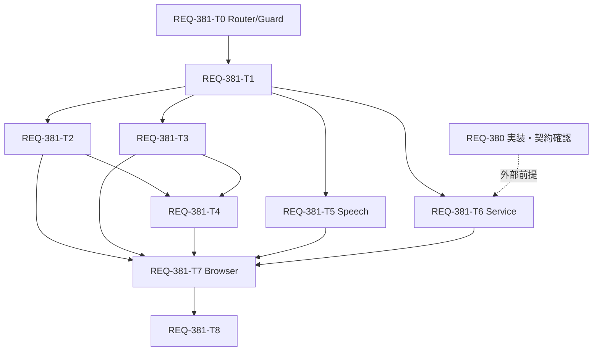

# REQ-381 詳細設計

## 結論と範囲

幅767px以下だけで、Settingsの5分類・全項目・配色を維持しながら、余白、説明表示、管理操作、保存契機、本文スワイプを整理する。768px以上では既存の数値フォームの明示保存と表示を維持する。新しいAPI、DB変更、共通Modalや全アプリpopover基盤の変更は行わない。

本書・テスト計画・物理Task Cardの承認前にコードを実装しない。BA監査、独立QA、最終3-Gateは別の証拠であり、設計文書の存在をPASSと扱わない。

## Boundary Audit

| 項目 | 確認結果 |
|---|---|
| WORKSPACE_ROOT / Git root | `${WORKSPACE_ROOT}` で一致 |
| 実装対象 | `frontend/src/pages/SettingsPage.tsx` と `frontend/src/pages/SettingsPage/`、既存 `frontend/e2e/settingsResponsive.spec.ts` |
| 仕様正本 | `docs/specs/SPEC_SETTINGS.md`。共通原則は `docs/specs/SPEC_COMMON.md` |
| 参照のみの依存 | installed `GLOBAL_HELPERS` のdoc_mapper/openapi_parser/local_model_adapter、同rootのexecution reference |
| 外部編集 | なし。backend/tools/server-managerの実装はREQ-380の所有 |
| 独立した既存変更 | `tools/server-manager/config.json` 等を保持。indexは初回確認時空 |
| 過去計画 | root `implementation_plan.md` はREQ-377を保持。今回は `docs/design/REQ-381-implementation_plan.md` を使う（coordinator指示） |

`doc_mapper.py docs/specs docs/backlog/pbi/active/REQ-381.md` は `No mapped documents found` を返した。PBIの明示参照からSPEC_SETTINGS §3-1/3-1-1/3-2/3-3、SPEC_COMMON §1-4/1-5/1-6を限定参照した。`.agents/context.md`の旧Antigravity globalsはinstalled rootの解決に使わない。

## 現行実装と仕様への影響

- `SettingsPage` は5 panelをunmountせず`hidden`で切り替える。`useSettingsTab.selectTab` がURL hashと履歴・localStorageの既存経路であり、スワイプもこの関数を呼ぶ。
- 本文は`p-5`、panelとworkflow gridは`gap/space-y-6`、個別カードは`p-4/5`。モバイル専用classを明示して局所的に縮め、全`.p-4`への一括上書きは行わない。
- MappingMasterヘッダーは管理2ボタン＋Add Masterが横並び。管理だけをmobile menuへ移し、desktopの直接ボタンを維持する。
- LLM数値、Bubble検出、VRAMは現行で明示保存。翻訳debounceはonChangeごとに送信し、失敗時draftを戻す。REQ-381ではモバイルだけ入力確定後保存へ変えるため、保存順序・失敗時draft保護も必要。
- SPEC_SETTINGS §3-1のBubble未保存遷移保護を削除せず、モバイルの確定済み自動保存とdesktop/明示保存draftの差を文書カードで明文化する。

## Architecture

### T0: 既存routeを維持する最小Data Router seamとSettings限定離脱保護

人手のoption 1選択により、SPEC_SETTINGS §3-1の未保存/保存失敗draft保護を本PBIの具体設計へ含める。これは設計scope承認であり実装承認ではない。installed react-routerは7.17.0で、createBrowserRouter/createRoutesFromElements/RouterProvider/useBlocker/useBeforeUnloadを既にexportしており新依存は不要。現行BrowserRouterではuseBlockerがDataRouterContextを要求するため、そのままSettings内hookを加えることはできない。

T0は正確な現router root `frontend/src/App.tsx` の宣言部分をData Routerへ置換する。同じAppShell配下のindex Generate、/studio、/loras、/tags、/history、/settingsを同じRoute JSXから構成し、path/hash/query/NavLink/Outlet、QueryClient/persist/store初期化、main.tsxのStrictModeと外側GlobalErrorBoundaryを保持する。新loader/action/redirect/Suspense/ScrollRestoration等は追加しない。Data Router既定error UIが従来外側boundaryを奪わないようroot errorElementはuseRouteErrorを再throwする最小adapterとし、実回帰testで確認する。production routerはrenderごとに再生成せず、testは同route定義からcreateMemoryRouterを生成/disposeする。

`/settings` leafだけ `SettingsDraftBoundary` で包み、Settings専用 `SettingsDraftContext` を供給する。他画面のdraft管理、AppShell click interception、history/window API monkey patchは行わない。共有rootに触れるのはこのrouter mode seamだけである。

```ts
type SettingsDraftRisk = { dirty:boolean; invalid:boolean; failed:boolean; queued:boolean; inFlight:boolean }
type SettingsDraftControls = { cancelQueued:()=>void; discardLocal:()=>void }
// useSettingsDraftRegistration(resourceId, controls) -> {update(risk), clear()}
// SettingsDraftBoundary({children}) -> React.JSX.Element
```

unique instance/resourceごとのregistryは5flagのORを集約し、raw prompt/credentialを保持・ログ出力しない。edit/commit/ack/error handlerから同期refへ更新して、blur直後navigationでcleanの旧snapshotを見ない。StrictMode/cleanupで登録を残さない。T3 commit engineと長文prompt、T4 Bubble/VRAM/翻訳provider認証/debounce/workflow/BaseModel draft、T5 tone create/edit、T2変更済master formを登録する。master modalの親にraw baselineがない場合はinput capture後から成功Save/取消まで保守的dirtyとし、変更後元へ戻しても確認が出る可能性を開示する。

**mobile/desktop両方**で、riskがある状態のSettingsから異なるpathnameへのrouter PUSH/REPLACE/POPをuseBlockerで止める（NavLink/useNavigate/戻る進む）。同Settingsのhash/query/tab移動は許可し、hidden panelのdraftを保持する。blocked時は共通Modalの「キャンセル」「変更を破棄して移動」。Cancelはblocker.resetだけでdraft/validation/error/queueを保持する。確認中のinflight persist要求は通常完了させ、inFlightが1件でもあればLeaveをdisabledにする。応答成功/失敗/timeout後も自動proceedしない。inflightがないときに明示Leaveを押した場合だけ、最新registryを同期再確認→未送信queue停止→local draft破棄→blocker.proceedを1回実行し、二重クリックを防ぐ。成功済保存をrollbackせず、過去timeout要求がserverでも取消されたとは表現しない。

risk時のreload/close/同tab cross-documentはnative beforeunloadを使う。browserの一般的確認文言に従い、非同期flush/任意文言/モバイルOS強制終了の完全保護は約束しない。modified click/新tabは元documentのdraftを消費しない。確認中の追加navigation、保存完了、新edit、767↔768resizeもrace試験に含める。

根拠: [公式useBlocker](https://reactrouter.com/api/hooks/useBlocker)、[公式decision](https://github.com/remix-run/react-router/blob/main/decisions/0001-use-blocker.md)。Web最新版とは別にinstalled7.17.0のexport/typeおよびuseDataRouterContext呼出しを実読して適用可否を確認した。

### T1: モバイル状態・本文密度・スワイプ

`useSettingsMobile(): boolean` を新設し、`matchMedia('(max-width: 767px)')`とchange listenerでCSS境界へ一致させる。Settings専用であり他画面のbreakpointを変更しない。

`useSettingsSwipe({ enabled, activeTab, onSelect })`をSettings本文に接続する。primary touch/pen 1本のみ、開始点から横48px以上かつ`abs(dx) > 1.5 * abs(dy)`で隣へ1カテゴリだけ移動し、端で循環しない。縦方向に12px先行したgesture、複数pointer、pointercancelは中止する。縦scrollを阻害する`preventDefault`やpointer captureは使わない。

開始targetがinput/textarea/select/button/link/contenteditable、range、tablist、`data-settings-swipe-ignore`、横scroll領域、dialog/menu/popover内の場合は不発。画面内にmodal/popover/menuが開いている場合も不発とする。直接タブとkeyboard操作は既存のまま残し、タブ選択時は既存scrollIntoView経路を使う。`touch-action: pan-y`を本文へ限定する。

mobile本文padding=12px、主カード間gap=12px、カード内padding=12pxを原則とする。desktopは既存20px/16px/24pxへresponsive modifierで戻す。既存bottom nav余白例外・max-w-7xl・workflow専用scrollを保持する。文字を11px未満へ縮めない。情報削除で密度を作らない。

### T2: Settings専用説明と管理メニュー

`SettingInfoPopover({ label, children })`は`components/`内の局所部品とする。mobileのみ ⓘ trigger（見た目16px、有効44px、重ならないhit area）、desktopは既存説明文を表示する。triggerはbutton、`aria-expanded/aria-controls`、内容は名前付き`role="dialog"`の非modal説明とし、Tab trapは設けず、Escape時はtriggerへfocusを戻す。

body portalへ描画し、fixed座標をtrigger rectから求める。viewport/visualViewportの上下左右8px内へ収め、width=min(320px, viewport−16px)、最大高さ=min(320px,可視高さ−16px)、内部overflow-y-auto/overscroll-contain。背景#18181b（alphaなし）、本文#f4f4f5（少なくとも4.5:1を確認）。開く説明は同時に1つ。再tap、外側pointerdown、Escape、祖先scroll、resize/visualViewport変更、カテゴリ変更で閉じる。ただしpopover自身の内部scrollでは閉じない（全文閲覧のため）。Modalの上に開かず、settings内のmenuと排他にする。

対象はBubbleの画像フィルタ2項目（最小面積/最小輝度）、翻訳入力待ち時間、VRAM閾値の効果説明。見出し言い換えの重複説明はmobileで除き、警告/エラー/未保存/接続状態/認証情報の注意は常時表示する。移す説明全文を各変更前後で照合する。

MappingMasterはmobileでタイトルを1行目、Add Master＋「管理 ⋯」を2行目に置く。menuに「ステージ管理」「カスタム型マスタ」を置き、選択時は先にmenuを閉じて既存modal stateを操作する。list→form→listの排他遷移を保持。外側tap/Escape、矢印/Home/End、trigger復帰を含めて検証する。Add Masterをmenuへ隠さない。

### T3/T4: 保存契機と順序

| 設定 | mobile保存契機 | desktop |
|---|---|---|
| model、表示比率、長押し時間、switch | 既存の確定changeで即時 | 既存経路 |
| LLMの5数値×各group | number blur/Enter、range pointerup/keyboard keyup/blur | 既存Save |
| Bubble min_area/min_brightness | 同上、2数値を1つのJSON snapshotとして保存 | 既存Save |
| VRAM GB | 同上、有効flagと同じ既存payload | 既存Save |
| VRAM guard enabled | 確定changeで即時。GBの未確定不正raw値は送らず最後の有効値を使用し、不正raw表示は保持 | 既存Save |
| 翻訳debounce | range pointerup/keyboard keyup/blur、300–2000ms・50step | 既存経路 |
| 長文system prompt、翻訳provider＋認証、workflow一括適用、tone preset | 明示Save/Applyを維持 | 既存経路 |

翻訳providerは認証情報と一体の既存formなのでradioだけを勝手に自動保存しない。表示比率の既存parserは変更しない。range pointercancelは保存しない。blurとEnterの二重通知は同一snapshotで重複送信しない。

新規`useSettingsCommit`は外部I/O関数を注入するSettings専用hook。resource key（例`llm_params_audit`、`bubble_detection_params`、`settings-vram`、`translation_debounce`）ごとに最大1要求をin flightとし、後続の**確定済み**snapshotだけを最新1件へ集約する。別keyは独立する。同keyの失敗後はqueueを止め、利用者の「再試行」まで再送しない。abort/timeout等の結果不明を成功にしない。

```ts
type CommitPhase = 'idle' | 'dirty' | 'invalid' | 'saving' | 'saved' | 'error'
type CommitState = { phase: CommitPhase; revision: number; error: string | null }
type SettingsCommitOptions = { save: (key: string, snapshot: string) => Promise<void> }
// 戻り値: stage(key, snapshot: string | null), commit(key), retry(key),
// acceptServer(key, snapshot), getState(key): CommitState。
// null snapshotは不正入力で送信不可。snapshotは既存API用のcontent/JSON。
```

入力raw draftはcomponentに保持し、空文字/NaN/Infinity/既存範囲外を0へ変換しない。LLMは既存PARAM_FIELDS、Bubbleは面積50–5000/50step・輝度0–255/5step、VRAMは既存2–14GB、debounceは300–2000/50stepを使う。既存仕様のstepを変えず、勝手なclampで未入力を確定しない。

要求にはsubmitted revisionを持たせる。成功はそのrevisionのackだけで、新draftやdirty値をrefetch/旧応答で上書きせず、新draftが残る間は「保存済み」と表示しない。UIはdirty/invalid/errorを持続、savingは控えめな「保存中…」、matching successは約2秒で消す。通常時の個別Saveと常設「保存済み」をmobile自動保存項目から除き、失敗時だけ「再試行」を表示する。エラーはinfoへ隠さない。

panel hidden切替ではcomponentが生存するためdraft/queueを保持する。tab操作でもswipeでも既存`selectTab`を通る。明示保存draftや不正/失敗draftは自動破棄せず、既存の未保存遷移確認を維持する。viewport変更だけでcommitしない。mobile→desktopでもpending要求を破棄せず、draftを保持しdesktop Saveへ戻す。非同期cleanupはlistener/timer/state反映を止め、送信結果を捏造しない。

### API契約

APIは変更しない。`openapi_parser`で`docs/openapi.yaml`の次を抽出した（パスは`/api`付き、method引数は小文字）。`PUT /api/llm-prompts/{key}`は`{content:string, description?:string|null}`→LlmPrompt、`PUT /api/settings/vram`は`{vram_min_free_gb:number,vram_guard_enabled?:boolean}`→VramSettings。既存client `llmPromptsApi.update` / `settingsApi.updateVram`を呼ぶ。VRAMを複数独立requestへ分解しない。翻訳認証の既存複数PUTはtransactionを新設したとは表現せず、全応答成功まで保存済みにしない。

### T5/T6/T7: sheet・service・browser統合

SpeechTonePresetModalの共通Modal、85dvh、単一本文scroll、左Cancel/右Saveを維持し、mobile footerがkeyboard下へ消えないことをvisualViewport/高さ制約で実測する。共通Modal本体の修正が必要なら本カードで編集せずdesignへ差し戻す。

**外部依存REQ-380 / AC-11**: 現行ServiceConnectionCardには死活・ログ・起動/停止/再起動はあるが「メモリ解放」はない。REQ-380はReadyであり、本PBIで実装しない。T6はREQ-380の実source/操作契約到着・所有競合解消・差分確認までdispatch禁止。T6契約に影響する変更はcard更新と再承認へ戻す。T7のAC-11は実際のbuttonが存在した後に、375pxで44px領域/非重複/ログ展開/生成中disabledを確認する。架空buttonのfixtureだけでPASSにしない。REQ-381の最終受入・closureはそれまでpending。

## Seam Map

| 項目 | 計画 |
|---|---|
| Integrated (real code) | SettingsPage→tabs/swipe→実Settings components→commit hook→既存API client→React Query、localStorage保存hook、共通Modal |
| Severed (external I/O only) | HTTPをMSW/Playwright routeで応答制御、Manager別origin 8899もtransport境界。テスト用localStorageの拒否をsandboxで注入 |
| Mock level | hook/validator/内部queue/component handlersのmonkey patch禁止。新ACの統合証拠は実clientを通す。既存のmodule-API mockケースは既存回帰参照であり新AC統合PASSに使わない |
| PBT | fast-checkでgesture判定の境界、numeric不正/範囲入力、stage/commit/ack/fail sequenceの不変条件。finite requestのみ、max1 in flight/key、ackが新draftを上書きしないこと |
| Fault injection | 422/503、transport reject/timeout、応答を遅延中に再編集、refetch古値、key別保存、Storage拒否、pointercancel/多点touch/overlay/keyboard |

## AC割当とDAG

| Card | AC | 所有/責務 | 依存 |
|---|---|---|---|
| T0 | 7/8/9/12 | 同route Data Router seam、Settings専用draft registry/離脱確認 | なし |
| T1 | 1/2/9/12 | mobile判定、shell密度、swipe、tab可視 | T0 |
| T2 | 3/4/5/6/12 | Settings専用info、Mapping menu | T1 |
| T3 | 7/8/12 | resource別保存engine、LLM数値と明示prompt | T1 |
| T4 | 5/6/7/8/12 | Bubble/翻訳/VRAM/表示操作の保存・説明適用 | T2,T3 |
| T5 | 2/8/10/12 | Speech footer | T1 |
| T6 | 2/11/12 | service行の統合 | T1＋外部REQ-380 |
| T7 | 1–12 | 実ブラウザ統合・境界・失敗 | T2,T3,T4,T5,T6 |
| T8 | 1–12の仕様契約 | 文書担当によるSPEC_SETTINGS/SPEC_COMMON同期 | T7 |



最大深さはT0→T1→T2/T3→T4→T7→T8の6段。3–4段以上の調整リスクを認めるが、基盤→利用component→browser→仕様同期という実依存を削らない。T2/T3/T5はT1後、同時所有ファイルなしで並行可能。期待時間/token短縮は未計測でunknown。T6外部待ちが主要bottleneck。

各Cardは1つの受入可能な責務とし、同一componentを別実装cardへ分散しない。App router/guard registryはT0、CSS/root shellはT1、Mapping/PopoverはT2、LLM/commit engineはT3、他設定はT4、SpeechはT5、ServiceはT6、E2EはT7の排他所有。変更が割当を超えた場合は推測せずdesignへ戻す。

## Atomicity Audit

実装担当は全T0–T7がengineer/dev-task、文書はT8がdoc-editor/doc-task。各所有ファイルはCard frontmatterを正本とし、以下は責務の分割理由を示す。

| Card | 全文行数（生成時） | 結合理由・独立受入 | 分割/並列利益と再作業境界 |
|---|---:|---|---|
| T0 | 125 | 同route router adapterとSettings限定離脱保護 | 新依存なし。共有root回帰を専用testで検証 |
| T1 | 125 | 同じshellに接続するmobile状態/gesture/密度 | rootとCSSを1担当へ集約。後続consumerの前提 |
| T2 | 98 | 局所説明overlayと排他的な管理menu | LLMを所有せずT3と並行可能。overlay基盤への越境は差戻し |
| T3 | 141 | 保存engineと最初のLLM consumerで契約を実証 | 同一LLMファイルを分割しない。engine契約変更はT4着手前に確認 |
| T4 | 195 | 同じ保存分類/説明部品を使う設定consumer群 | 複数の小fileへ分けるより共通失敗条件を一括確認。T2/T3 interfaceの変更が再作業境界 |
| T5 | 123 | Speech sheet/keyboard/明示保存 | Serviceと所有を分け、REQ-380待ちを独立Speechへ伝播させない |
| T6 | 91 | Service行/AC11の外部feature統合 | REQ-380実sourceを前提にした単一所有。未到着時dispatch不可 |
| T7 | 104 | 実Settings browser acceptanceを既存1specへ統合 | 同じE2E fixtureの競合を避ける。failureは該当source Cardへ戻す |

全Cardは300行以下。parallel利益の時間/token値は未計測でunknownであり、単なるCard数増加を効率改善とは表現しない。

## Trade-offs and Risks

1. 保存順序保護の小さなSettings専用hookを追加する。各componentに別々のrace対策を複製するより検証しやすいが、hook自体にsequence/PBT検証が必要。
2. mobileだけ保存契機を変えるためdesktopとの分岐が増える。viewport変更だけで送信せず、768px境界を実ブラウザで確認する。
3. infoはSettingsローカルportalとする。共通hover基盤の改変を避ける代わり、scroll/viewport/focus cleanupを局所部品で担う。
4. blur/Enter/slider releaseを採用し、入力中debounce通信は採用しない。無効な中間入力や連続送信を防ぐが、入力確定前は未保存であることを示す必要がある。
5. 翻訳provider/credentialsの複数PUTをtransaction化しない。部分失敗は未保存のまま明示retryし、秘密値をログへ出さない。
6. AC-11はREQ-380なしでは受入不可。部分的な実装進行の承認と、PBI全体closureの保留を区別する。
7. router mode変更は共有rootへの最小変更で、全routeの描画/error/persistence/historyに回帰リスクがある。T0でroute表と既存App testを検証し、Settingsだけblockerを有効にする。desktopに追加する離脱確認は既存SPEC_SETTINGSの保護要求に整合する限定例外で、desktop Save/配置は維持する。
8. beforeunloadはブラウザ/OSの制約があり強制終了まで保証できない。inflight中の内部Leave待機と、hard navigationで利用者が確認後に離脱できる差を明記する。

## Evidence and Pending Gates

- 実施済み: root/index/既存出力確認、PBI/限定SSoT/現行source読取、mapper結果、OpenAPI2endpoint抽出。
- 本段階でコードやテストは実行・実装していない。テスト計画のコマンドは将来の実行指示。
- BA監査: route保護を追加した本改訂は旧監査結果のPASSを継承しない。coordinatorがconfigured key/ctx32768/reasoning noneで全設計・全Cardを再監査し、raw verdict/trace/unloadを添付するまでpending。
- 人手設計承認: pending。AC-11外部待ちの進行方針を明示して判断を得る。
- 独立document/code QAと新規final Gate1→Gate2→Gate3: 実装後に必須。
