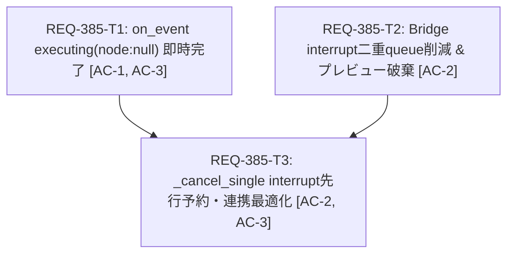

# Implementation Plan: REQ-385 生成完了プレビュー表示遅延およびジョブキャンセル処理の遅延解消

## 1. Overview & Objectives (概要と目的)
ComfyUI連携において、生成完了シグナル（WebSocket `executing` node: null）を即時検知し、2.5秒のフォールバックポーリング待ちを解消して生成完了プレビュー表示を高速化する。
また、キャンセル操作（`/interrupt`）時の不要な二重 `queue()` 照会を削減し、先行キャンセル予約（`_cancel_requested`）とイベントハンドラ（`on_event`）を密連携させることで、サンプラー停止と同時に即時 `cancelled` 状態へ確定・配信する。

## 2. Architecture & Seam Map (設計方針とSeam Map)
- **Integrated (実コード実行)**:
  - `backend/app/services/generation_service.py`: `on_event` の `executing` (node: null) 即時完了判定および `_cancel_single` の interrupt 発行連携。
  - `backend/app/services/comfy_generation_bridge.py`: `interrupt()` 内の冗長な二重 `queue()` 削減、完了時プレビューキャッシュクリア。
  - `backend/app/services/generation_repository.py`: 既存ステータス遷移（`transition`）契約の維持。
- **Severed (外部I/O遮断)**:
  - ComfyUI HTTP API (`/prompt`, `/queue`, `/history`, `/interrupt`): `httpx.AsyncClient` トランスポートモックで切断。
  - ComfyUI WebSocket (`/ws`): `_FakeSocket` によるイベント注入。
- **PBT判定**: 不採用（No）。固定イベントスキーマおよび確定的な状態遷移ロジックの単体・結合テストで網羅。
- **Fault Injection**: `executing` (node: null) 受信時に history が一時的に 404/503 を返した場合でも例外でクラッシュせず、既存ポーリングで安全にリカバリすること。

## 3. Task Breakdown & Mermaid DAG (タスク分解とDAG)
- **REQ-385-T1**: `GenerationService.on_event` の `executing` (node: null) 即時完了ハンドリング [change_kind: code]
  - 対象: `backend/app/services/generation_service.py`, `backend/tests/integration/legacy/test_generation_service.py`
  - AC: AC-1, AC-3
- **REQ-385-T2**: `ComfyGenerationBridge` の不要な二重 `queue()` 削減と完了時プレビュークリア [change_kind: code]
  - 対象: `backend/app/services/comfy_generation_bridge.py`, `backend/tests/integration/legacy/test_comfy_generation_bridge.py`
  - AC: AC-2
- **REQ-385-T3**: `GenerationService._cancel_single` の interrupt 発行とキャンセル完了連携最適化 [change_kind: code]
  - 対象: `backend/app/services/generation_service.py`, `backend/tests/integration/legacy/test_generation_service.py`
  - AC: AC-2, AC-3

## 4. Technical Trade-offs & Alternatives (技術的トレードオフと代替案)
- **`executing` (node: null) 時の upstream history 即時照会**:
  - *採否*: 採用。ComfyUI が完了時に `execution_success` を送らない現行仕様において、ミリ秒単位で完了を検知してプレビュー反映できる唯一の正規イベントパス。
  - *緩和策*: もし ComfyUI 側で history の書き込みがミリ秒単位でわずかに遅延して空が返った場合、例外を補足してフォールバックポーリング（2.5秒）に委ねることで、システムの安定性を損なわない。
- **キャンセル時の二重 `queue()` 削減**:
  - *採否*: 採用。以前のコードは `/interrupt` 直前に二重に `queue()` を呼んでおり無駄な往復レイテンシを生んでいた。1回の事前確認で十分安全。
- **フロントエンドの待機タイマー（3000ms）維持**:
  - *採否*: 採用。`SPEC_GENERATE.md:203` の既存規定（待機中キャンセルボタン長押し・連打抑止タイマー）を尊重し、バックエンドの即時反映化によってユーザー体感を改善しつつ、UIの既存契約を破壊しない。

## 5. Verification Plan (3-Gate検証計画)
- **Gate 1: 静的型チェック & ユニットテスト**
- **Gate 1: 静的型チェック & 命名規約**
  - テスト命名規約: `backend\.venv\Scripts\python scripts/verify_test_naming.py`
  - バックエンド型検査: `backend\.venv\Scripts\mypy backend/app`
  - フロントエンド型検査: `cd frontend; npm run typecheck`
- **Gate 2: バックエンド統合テストスイート**
  - `backend\.venv\Scripts\python -m pytest backend/tests`
- **Gate 3: シナリオ受け入れ検証**
  - `test_generation_service.py` における `executing` (node: null) 即時完了テスト
  - `test_comfy_generation_bridge.py` における `interrupt` 1回 queue 照会検証
  - キャンセル操作時の即時確定・スナップショット配信の整合性検証